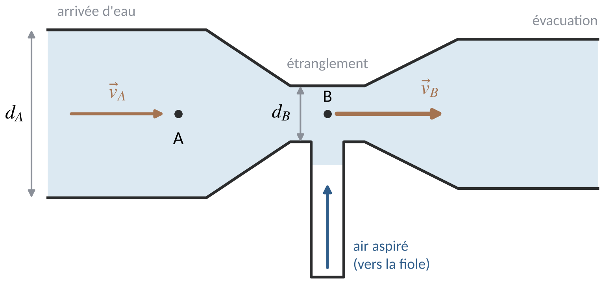

<!--meta {"entete": "Charte et modèle des fiches d'exercices", "titre": "Document de référence", "document": "MasterBac : charte et modèle des fiches d'exercices", "fichier": "MasterBac_Charte_et_modele_fiches", "versions": "complet"} -->

::: {custom-style="CouvMarque"}
{{marque}}
:::

::: {custom-style="CouvCollection"}
{{collection}}
:::

::: {custom-style="CouvNumero"}
Charte et modèle
:::

::: {custom-style="CouvTitre"}
Le format des fiches d'exercices
:::

::: {custom-style="CouvFilet"}
\ 
:::

::: {custom-style="CouvSousTitre"}
Couleurs, typographie, structure, blocs et styles Word
:::

::: {custom-style="CouvEdition"}
[\ {{edition}}\ ]{custom-style="Niv18"}\ \ \ Format validé le 11 novembre 2026
:::

::: {custom-style="CouvChiffres"}
Référence pour écrire ou mettre à jour une fiche
:::

```{=openxml}
<w:p><w:r><w:br w:type="page"/></w:r></w:p>
```

::: {custom-style="TitreSommaire"}
Sommaire
:::

::: {custom-style="LegendeSommaire"}
[En cuivre]{custom-style="EtiqBac"} : les exercices construits d'après un sujet du BAC, avec le sujet correspondant.
:::

::: {custom-style="SommairePlaceholder"}
SOMMAIREICI
:::

```{=openxml}
<w:p><w:r><w:br w:type="page"/></w:r></w:p>
```

# La charte en une page {#charte}

::: {custom-style="Intertitre"}
Les couleurs
:::

|  | Nom | Code | Rôle |
|---|---|---|---|
|  | Cuivre | #A47351 | Couleur de marque : numéros de question, filets, surtitres, pastille Objectif 14, bouton « Retour à l'énoncé », exercices issus du BAC au sommaire |
|  | Bleu nuit | #001128 | Titres de thème et de question |
|  | Anthracite | #2B2C2D | Texte courant, en-tête des tableaux, pastille Objectif 18 |
|  | Crème | #FAF6F3 | Fond des bandeaux de question, lignes alternées des tableaux |
|  | Cuivre clair | #E9DDD3 | Pastille Objectif 10 |
|  | Gris | #6B6F76 | Ligne méta, légendes, en-tête et pied de page |
|  | Vert | #2E6B4F | Bandeau des corrigés, bouton « Voir le corrigé », encadré À retenir, sur fond vert pâle |
|  | Bleu | #2F5D8A | Encadré Méthode, sur fond bleu pâle |
|  | Brique | #B23A2E | Encadré Piège, sur fond rosé ; termes qui se simplifient dans une équation |
|  | Ardoise | #8A8F98 | Encadré Remarque, sur fond gris clair |
|  | Sable | #FDF4E8 | Fond des bandeaux d'exercice issus du BAC et de l'encadré Rédaction, avec un liseré cuivre |

::: {custom-style="Intertitre"}
La typographie
:::

- Calibri pour tout le texte : titres de thème en gras 22 points, questions en gras 12 points, texte courant en 11 points, encadrés en 10,5 points, ligne méta et légendes en 9 points.
- Les équations sont des équations Word, jamais des images. Elles restent modifiables et réutilisables dans l'application.
- La marque s'écrit en capitales espacées, en cuivre.

::: {custom-style="Intertitre"}
La mise en page
:::

- Format A4, marges de 2 cm, une seule colonne.
- En-tête : la marque, le numéro de la fiche et son titre. Pied de page : le site, le compte et le numéro de page.
- Couverture sans en-tête, avec les mentions légales en pied de page.
- Chaque partie et chaque thème commencent sur une nouvelle page. Dans la partie énoncés, chaque exercice ouvre une page et peut s'imprimer seul.

```{=openxml}
<w:p><w:r><w:br w:type="page"/></w:r></w:p>
```

# La structure et les règles d'écriture {#regles}

::: {custom-style="Intertitre"}
L'ordre des parties
:::

1. La couverture, l'avant-propos et le sommaire.
2. L'essentiel en une page : les relations à connaître, les pièges et un parcours selon l'objectif visé.
3. Ce qui est tombé aux dernières sessions du BAC.
4. Les énoncés, thème par thème : les questions de cours, puis les exercices.
5. Les corrigés, thème par thème, puis l'index des notions.

La même source produit la fiche complète et le cahier d'énoncés à imprimer, qui s'arrête après les énoncés.

::: {custom-style="Intertitre"}
Les règles d'écriture
:::

- Chaque question et chaque exercice porte un niveau : objectif 10, 14 ou 18.
- Tous les énoncés viennent avant les corrigés. Un bouton relie chaque énoncé à son corrigé, et chaque corrigé à son énoncé.
- Un exercice construit d'après un sujet du BAC cite ce sujet dans son titre et en tête d'énoncé. Il apparaît en cuivre au sommaire et porte un barème et une durée indicatifs.
- L'élève ne voit ni les ajouts ni les corrections d'une édition à l'autre : ils sont consignés dans le journal de mise à jour.
- Les unités s'écrivent avec des puissances, les nombres avec une virgule décimale, et le résultat final dans un encadré À retenir.
- On s'adresse à l'élève avec « vous ». On écrit « cours » et non « leçon ». Pas d'emoji, pas de tiret long.

```{=openxml}
<w:p><w:r><w:br w:type="page"/></w:r></w:p>
```

# Les styles Word {#styles}

Chaque bloc d'une fiche porte un style nommé, visible dans la galerie de styles de Word. Les fiches sont fabriquées à partir d'une source qui applique ces styles : le fichier Word ne se corrige pas à la main. Les pages suivantes montrent chaque bloc en situation.

| Style | À utiliser pour |
|---|---|
| Surtitre, puis Titre 1 | Le nom de la partie (Énoncés, Corrigés), puis le titre du thème. Le surtitre ouvre une nouvelle page. |
| Rubrique | Les intertitres « Questions de cours » et « Exercices » d'un thème. |
| Titre 2 | Une question de cours (Q.1) ou un exercice. Le numéro reçoit le style de caractère Numéro. |
| Titre 3 | Un exercice construit d'après un sujet du BAC : bandeau sable, en cuivre au sommaire. Le sujet cité reçoit le style Voir BAC. |
| Titre 4 | Le titre d'un corrigé, sur bandeau vert. Il n'apparaît pas au sommaire. |
| Méta | La ligne placée sous le titre : niveau, notions, barème et durée. |
| Objectif 10, Objectif 14, Objectif 18, Tag type BAC | Les pastilles de niveau et le tag (styles de caractère). |
| Mention BAC | La ligne « Sujet du BAC correspondant », en tête d'énoncé. |
| Renvoi, Bouton corrigé, Bouton énoncé | Les boutons « Voir le corrigé » et « Retour à l'énoncé », suivis du numéro de page. |
| Énoncé, Énoncé données | Le texte d'un exercice et la liste de ses données. |
| Question rappel | Le rappel de la question dans le corrigé d'un exercice. |
| À retenir | Le résultat ou la formule à connaître. |
| Remarque, Méthode, Piège, Rédaction | Les encadrés. Leur premier mot reçoit le style Étiquette du même nom. |
| Figure, Légende figure | Une figure centrée, puis sa légende numérotée. |
| Tableau en-tête, Tableau texte | La première ligne d'un tableau, puis les autres lignes. |

Le sommaire et les numéros de page des boutons sont des champs Word. À l'ouverture, Word propose de les mettre à jour : il faut répondre Oui.

::: {custom-style="Surtitre"}
Énoncés
:::

# Thème 1 : titre du thème {#theme1}

::: {custom-style="Rubrique"}
Questions de cours
:::

## [Q.1]{custom-style="QNum"}\ \ Intitulé de la question de cours {#q1}

::: {custom-style="Meta"}
[\ Objectif 10\ ]{custom-style="Niv10"}\ \ Cours · Notions : première notion, deuxième notion\ \ \ [CIBLE:c_q1]{custom-style="BoutonCorrige"}
:::

::: {custom-style="Rubrique"}
Exercices
:::

### [Exercice 1]{custom-style="QNum"}\ \ Titre de l'exercice [(voir BAC Métropole, juin 2026)]{custom-style="VoirBac"} {#ex1}

::: {custom-style="Meta"}
[\ Objectif 14\ ]{custom-style="Niv14"}\ \ [Type BAC]{custom-style="TagBac"} · 3 points · 30 min
:::

::: {custom-style="MentionBac"}
[Sujet du BAC correspondant.]{custom-style="EtiqBac"} Centre, mois et année, jour, numéro de l'exercice : « titre du sujet ».
:::

::: {custom-style="Enonce"}
Texte de présentation de la situation étudiée (figure 1).
:::

::: {custom-style="Figure"}
{width=6.6cm}
:::

::: {custom-style="Legende"}
Figure 1. Figure dans la palette : traits anthracite, fluide bleu clair, vecteurs en cuivre
:::

::: {custom-style="Enonce"}
**Données**
:::

::: {custom-style="EnonceDonnees"}
Première donnée : $m = 25{,}0\ \text{g}$

Deuxième donnée : $\rho = 1{,}00 \times 10^{3}\ \text{kg·m}^{-3}$
:::

::: {custom-style="Enonce"}
**1.** Première question.

**2.** Deuxième question.
:::

::: {custom-style="Renvoi"}
[CIBLE:c_ex1]{custom-style="BoutonCorrige"}
:::

::: {custom-style="Surtitre"}
Corrigés
:::

# Corrigés du thème 1 : titre du thème {#c_theme1}

#### [Corrigé]{custom-style="NumCorrige"}\ \ Q.1 · Intitulé de la question de cours {#c_q1}

::: {custom-style="Renvoi"}
[CIBLE:q1]{custom-style="BoutonEnonce"}
:::

Texte du corrigé. Une équation se place sur sa propre ligne, centrée :

$$D = \dfrac{V}{\Delta t}$$

Le résultat à connaître est mis en valeur :

::: {custom-style="Retenir"}
$D = S \times v$
:::

::: {custom-style="Remarque"}
[Remarque.]{custom-style="EtiqRemarque"} Un complément ou une variante de la question.
:::

::: {custom-style="Methode"}
[Méthode.]{custom-style="EtiqMethode"} Une démarche à réutiliser dans d'autres exercices.
:::

::: {custom-style="Piege"}
[Piège.]{custom-style="EtiqPiege"} L'erreur fréquente à éviter.
:::

::: {custom-style="Redaction"}
[Rédaction.]{custom-style="EtiqRedaction"} La phrase attendue sur la copie.
:::

#### [Corrigé]{custom-style="NumCorrige"}\ \ Exercice 1 · Titre de l'exercice {#c_ex1}

::: {custom-style="Renvoi"}
[CIBLE:ex1]{custom-style="BoutonEnonce"}
:::

::: {custom-style="QRappel"}
**1.** Première question
:::

Texte du corrigé de la première question.

::: {custom-style="QRappel"}
**2.** Deuxième question
:::

Texte du corrigé de la deuxième question, avec son résultat :

::: {custom-style="Retenir"}
$v_B = \sqrt{2 g H}$
:::

::: {custom-style="Renvoi"}
[CIBLE:ex1]{custom-style="BoutonEnonce"}
:::
