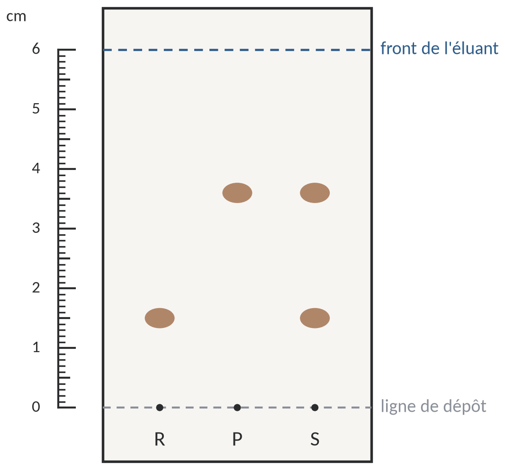
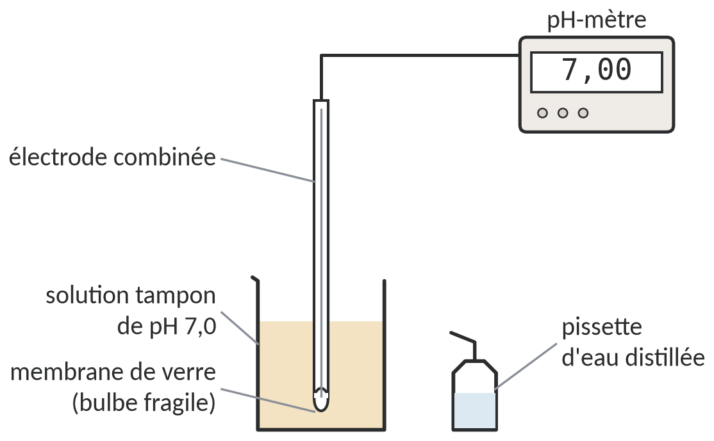
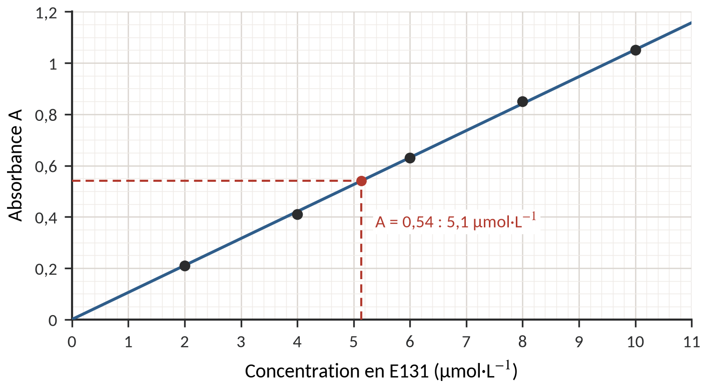
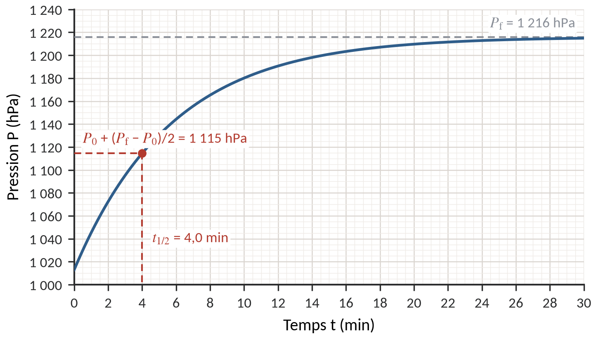

<!--meta {"numero": "annexe", "matiere": "Physique-Chimie", "titre": "Montages de chimie : solutions, appareils de mesure, titrages, synthèse, piles et électrolyse", "titre_court": "Montages de chimie", "fichier": "MasterBac_PC_Fiche_annexe_Montages", "fichier_cahier": "MasterBac_PC_Fiche_annexe_Montages_Cahier_enonces"} -->

<!--inclure:ouverture-->

# L'essentiel en une page {#essentiel}

::: {custom-style="Rubrique"}
À connaître par cœur
:::

<!--colonnes: 19 29 52-->

| Notion | Relation | À retenir |
|---|---|---|
| Dilution | $C_\text{mère} \times V_\text{mère} = C_\text{fille} \times V_\text{fille}$ | Facteur de dilution $V_\text{fille} / V_\text{mère}$ ; pipette et fiole jaugées. |
| Loi de Beer-Lambert | $A = k \times C$ | À $\lambda_\text{max}$, après le blanc, dans la gamme d'étalonnage. |
| Loi de Kohlrausch | $\sigma = \sum \lambda_i\, [X_i]$ | Conductimètre étalonné ; solutions diluées. |
| Équivalence | $n_\text{A} / a = n_{\text{B,E}} / b$ | Pour $a\,\text{A} + b\,\text{B} \rightarrow \ldots$, avec A titré et B titrant. |
| Pile, électrolyse | $Q = I \times \Delta t = n(\text{e}^-) \times F$ | Ampèremètre en série, voltmètre en dérivation. |
| Rapport frontal | $R_\text{f} = h / H$ | $h$ et $H$ : distances parcourues par la tache et par le front de l'éluant depuis la ligne de dépôt ; cuve fermée. |
| Gaz parfait | $P \times V = n \times R \times T$ | Capteur de pression : $P$ en Pa, $V$ en $\text{m}^{3}$, $T$ en K. |

::: {custom-style="Rubrique"}
À savoir retrouver
:::

<!--colonnes: 19 29 52-->

| Notion | Relation | Comment la retrouver |
|---|---|---|
| Masse à peser | $m = C \times V \times M$ | $n = C \times V$, puis $m = n \times M$ (Q.2). |
| Masse déposée | $m = M \times I \times \Delta t / (z \times F)$ | $n(\text{e}^-) = I \times \Delta t / F$, puis $n(\text{métal}) = n(\text{e}^-) / z$, où $z$ est le nombre d'électrons échangés par ion métallique (Q.18). |
| Gaz formé | $n = (P - P_0) \times V / (R \times T)$ | Équation d'état, récipient fermé, $V$ et $T$ constants (Ex. 4). |

::: {custom-style="Rubrique"}
Fourni par l'énoncé, à savoir exploiter
:::

Spectres, conductivités molaires ioniques, zones de virage, températures de changement d'état, densités, solubilités, $F$ et $R$ ; le schéma du montage n'est pas toujours fourni (Q.7, Q.10, Q.17).

::: {custom-style="Rubrique"}
Les pièges qui coûtent des points
:::

- Prélever à l'éprouvette un volume qui doit être précis ; rincer la burette à l'eau seulement.
- Faire entrer l'eau par le haut d'un réfrigérant, ou chauffer un montage fermé.
- Plonger dans le liquide le thermomètre d'une distillation, ou la ligne de dépôt d'une CCM.
- Brancher l'ampèremètre en dérivation ; relier à la borne positive l'objet à recouvrir.

::: {custom-style="Rubrique"}
Votre parcours selon votre objectif
:::

| Objectif | Questions de cours | Exercices |
|---|---|---|
| [\ Objectif 10\ ]{custom-style="Niv10"} | Q.1 à Q.8, Q.10, Q.13 à Q.15, Q.17, Q.18 | Ex. 1 (questions 1 à 4) |
| [\ Objectif 14\ ]{custom-style="Niv14"} | Plus Q.9, Q.11, Q.12, Q.16, Q.19 | Ex. 1 et Ex. 2 en entier ; Ex. 3 et Ex. 4 (questions 1 à 5) |
| [\ Objectif 18\ ]{custom-style="Niv18"} | Toutes | Tous |

```{=openxml}
<w:p><w:r><w:br w:type="page"/></w:r></w:p>
```

# Ce qui est tombé aux BAC 2025 et 2026 {#tombe}

Ce tableau relève vingt-deux des exercices de 2025 et 2026 qui interrogent un montage, un appareil de mesure, la conduite d'un suivi ou un geste de laboratoire. Les titrages dont on n'exploite que l'équivalence ou la courbe relèvent de la fiche 10.

<!--colonnes: 26 26 30 18-->

| Session | Exercice | Montages et gestes de cette fiche | Pour s'y préparer |
|---|---|---|---|
| Métropole, juin 2026, jour 1 | L'odeur de Jasmin | Suivi par titrages successifs, trempe | Q.19 |
| Métropole, juin 2026, jour 2 | Le kéfir de fruit | Schéma du titrage, suivi, extraction, CCM | Q.5, Q.8, Q.13, Q.15, Q.19 |
| Métropole, septembre 2026, jour 1 | Synthèse de l'alcool de champignon | Reflux, ampoule, distillation, CCM, titrage | Q.8, Q.10, Q.12, Q.13, Q.15 |
| Métropole, septembre 2026, jour 2 | De l'acide salicylique à l'aspirine | Sécurité, reflux, lavage à froid, CCM, étalonnage | Q.9, Q.10, Q.14, Q.15, Ex. 1 |
| Métropole 2026, jour 2 (sujet de secours) | La tomate, un fruit plein de ressources | Extraction par un solvant, schéma de l'ampoule | Q.13 |
| Amérique du Nord 2026, jour 1 | Valorisation du dioxyde de carbone dans les cimenteries | Verrerie d'une dilution | Q.1, Q.3, Q.9 |
| Amérique du Nord 2026, jour 2 | HOPE, l'espoir du dihydrogène vert | Électrolyse : électrodes, courant | Q.18 |
| Antilles-Guyane 2026, jour 1 | Les 200 ans de la pastille de Vichy | Indicateur coloré d'un titrage, hydrodistillation, extraction, CCM | Q.8, Q.10, Q.12, Q.13, Q.15 |
| Antilles-Guyane 2026, jour 2 | Traitement de l'eau d'une piscine | Électrolyse : polarité, durée | Q.18 |
| Centres étrangers 2026, jour 1 | Analyse d'un comprimé | Verrerie d'une dilution | Q.1, Q.3 |
| Centres étrangers 2026, jour 1 | La dépollution par les plantes pour extraire du nickel | Électrolyse : schéma, durée | Q.18 |
| Polynésie 2026, jour 1 | Synthèse d'une Coumarine | Protocole de dilution, filtration sur Büchner, recristallisation | Q.3, Q.14 |
| Métropole, juin 2025, jour 2 | Eau de Quinton | Verrerie d'une dilution | Q.1, Q.3 |
| Métropole, juin 2025, jour 2 | Un parfum de rose | Chauffage, ampoule à décanter | Q.10, Q.13 |
| Métropole, septembre 2025, jour 1 | Étude d'une lessive « multi-usages » | Schéma du titrage pH-métrique, verrerie | Q.1, Q.6, Q.7 |
| Métropole, septembre 2025, jour 1 | Traitement de surface d'une pièce de jeu d'échecs | Sécurité, électrolyse : polarité du générateur | Q.9, Q.18 |
| Métropole 2025, jour 2 (sujet de secours) | Savon : parfum, synthèse et utilisation | Élimination de l'eau, ampoule à décanter, CCM | Q.11, Q.13, Q.15 |
| Amérique du Nord 2025, jour 1 | Étude d'un vernis à ongles | Spectrophotométrie, verrerie d'un étalon, extraction | Q.3, Q.4, Q.13, Ex. 1 |
| Amérique du Nord 2025, jour 2 (sujet de secours) | L'atropine | Chauffage à reflux, Dean-Stark, CCM | Q.10, Q.11, Q.15 |
| Amérique du Sud 2025, jour 1 | Étude d'un herbicide | Dilution, indicateur d'un titrage | Q.3, Q.8 |
| Asie 2025, jour 1 | Pollution ammoniacale | Verrerie d'une dilution | Q.1, Q.3 |
| Centres étrangers 2025, jour 1 | Autour du géranium rosat | Verrerie d'une dilution, schéma du titrage pH-métrique | Q.1, Q.3, Q.7 |

::: {custom-style="Intertitre"}
Ce qu'il faut en retenir
:::

- Titrage : sept de ces exercices, dont trois où l'on schématise le montage (Q.5 à Q.9, Q.19).
- Dilution : verrerie ou protocole demandés dans neuf exercices (Q.1, Q.3, Q.9).
- Synthèse : extraction dans sept exercices, CCM dans six, chauffage à reflux dans trois (Q.10 à Q.15).
- Électrolyse : quatre exercices, dont trois en 2026 (Q.18).

::: {custom-style="Surtitre"}
Énoncés
:::

# Thème 1 : préparer une solution et utiliser un appareil de mesure {#theme1}

::: {custom-style="Rubrique"}
Questions de cours
:::

## [Q.1]{custom-style="QNum"}\ \ Choisir la verrerie selon la précision attendue {#q1}

::: {custom-style="Meta"}
[\ Objectif 10\ ]{custom-style="Niv10"}\ \ Cours · Notions : verrerie jaugée, verrerie graduée, lecture d'un volume · Demandé en 2025 et 2026\ \ \ [CIBLE:c_q1]{custom-style="BoutonCorrige"}
:::

::: {custom-style="Enonce"}
Application : pour chaque opération, choisir l'instrument le mieux adapté parmi un bécher, une éprouvette graduée, une pipette graduée, une pipette jaugée, une fiole jaugée, une burette graduée et une balance. a. Prélever exactement $10{,}0\ \text{mL}$ d'une solution. b. Préparer exactement $100{,}0\ \text{mL}$ d'une solution. c. Verser peu à peu une solution en lisant le volume versé. d. Ajouter environ $50\ \text{mL}$ d'eau distillée dans un bécher. e. Prélever $2{,}5\ \text{mL}$ d'une solution, sans pipette jaugée de ce volume. f. Mesurer la masse d'un solide à dissoudre. Comment lit-on un volume sur une verrerie graduée ou jaugée ?
:::

## [Q.2]{custom-style="QNum"}\ \ Préparer une solution par dissolution d'un solide {#q2}

::: {custom-style="Meta"}
[\ Objectif 10\ ]{custom-style="Niv10"}\ \ Méthode · Notions : masse à peser, balance, fiole jaugée, homogénéisation\ \ \ [CIBLE:c_q2]{custom-style="BoutonCorrige"}
:::

::: {custom-style="Enonce"}
Application : on veut préparer $V = 100{,}0\ \text{mL}$ d'une solution de sulfate de cuivre(II) de concentration $C = 5{,}00 \times 10^{-2}\ \text{mol·L}^{-1}$, à partir de cristaux bleus de sulfate de cuivre(II) pentahydraté $\text{CuSO}_4\text{,5H}_2\text{O}$, de masse molaire $M = 249{,}7\ \text{g·mol}^{-1}$. Calculer la masse de cristaux à peser, puis décrire le protocole en nommant le matériel.
:::

## [Q.3]{custom-style="QNum"}\ \ Préparer une gamme d'étalons par dilution {#q3}

::: {custom-style="Meta"}
[\ Objectif 10\ ]{custom-style="Niv10"}\ \ Méthode · Notions : facteur de dilution, pipette jaugée, fiole jaugée, gamme d'étalonnage · Demandé en 2025 et 2026\ \ \ [CIBLE:c_q3]{custom-style="BoutonCorrige"}
:::

::: {custom-style="Enonce"}
Application : à partir de la solution mère de Q.2, de concentration $C_0 = 5{,}00 \times 10^{-2}\ \text{mol·L}^{-1}$, on prépare quatre solutions étalons de $50{,}0\ \text{mL}$, de concentrations $5{,}00$ ; $10{,}0$ ; $20{,}0$ et $25{,}0\ \text{mmol·L}^{-1}$. Calculer pour chacune le facteur de dilution et le volume de solution mère à prélever. Décrire la préparation d'un étalon. Pourquoi verse-t-on la solution mère dans un bécher avant de la prélever, et pourquoi rince-t-on la pipette avec cette solution ?
:::

```{=openxml}
<w:p><w:r><w:br w:type="page"/></w:r></w:p>
```

## [Q.4]{custom-style="QNum"}\ \ Mesurer une absorbance avec un spectrophotomètre {#q4}

::: {custom-style="Meta"}
[\ Objectif 10\ ]{custom-style="Niv10"}\ \ Cours · Notions : principe du spectrophotomètre, cuve, blanc, longueur d'onde de travail · Demandé en 2025 (Amérique du Nord)\ \ \ [CIBLE:c_q4]{custom-style="BoutonCorrige"}
:::

::: {custom-style="Enonce"}
Application : la figure 1 représente le principe d'un spectrophotomètre. Nommer les éléments numérotés et donner le rôle de chacun. Comment remplit-on et place-t-on la cuve ? Qu'appelle-t-on « faire le blanc », et pourquoi le fait-on ? Pourquoi règle-t-on la longueur d'onde sur le maximum d'absorption de l'espèce dosée ?
:::

::: {custom-style="Figure"}
{width=9.4cm}
:::

::: {custom-style="Legende"}
Figure 1. Principe d'un spectrophotomètre
:::

## [Q.5]{custom-style="QNum"}\ \ Mesurer une conductivité avec un conductimètre {#q5}

::: {custom-style="Meta"}
[\ Objectif 10\ ]{custom-style="Niv10"}\ \ Cours · Notions : cellule conductimétrique, conductance, étalonnage, unités · Demandé en 2026 (Métropole, juin)\ \ \ [CIBLE:c_q5]{custom-style="BoutonCorrige"}
:::

::: {custom-style="Enonce"}
Application : de quoi est formée une cellule conductimétrique, et quelle grandeur le conductimètre mesure-t-il ? Comment l'étalonne-t-on ? Quelles précautions prend-on avant chaque mesure ? Un conductimètre affiche $1\,413\ \text{µS·cm}^{-1}$ : convertir cette valeur en $\text{S·m}^{-1}$, l'unité de la loi de Kohlrausch.
:::

## [Q.6]{custom-style="QNum"}\ \ Mesurer un pH avec un pH-mètre {#q6}

::: {custom-style="Meta"}
[\ Objectif 10\ ]{custom-style="Niv10"}\ \ Cours · Notions : électrode combinée, étalonnage, solutions tampons, rinçage · Demandé en 2025 (Métropole, septembre)\ \ \ [CIBLE:c_q6]{custom-style="BoutonCorrige"}
:::

::: {custom-style="Enonce"}
Application : avant de suivre le titrage d'un acide par une base, on étalonne le pH-mètre avec deux solutions tampons. Qu'est-ce qu'une solution tampon, et pourquoi en faut-il deux ? Décrire l'étalonnage. Quelles précautions prend-on avec l'électrode entre deux mesures, puis pendant le titrage ?
:::

::: {custom-style="Rubrique"}
Exercices
:::

## [Exercice 1]{custom-style="QNum"}\ \ Le bleu d'un sirop de menthe {#ex1}

::: {custom-style="Meta"}
[\ Objectif 10\ ]{custom-style="Niv10"}\ \ Entraînement · 5 points · 45 min · Questions 5 et 6 : objectif 14
:::

::: {custom-style="Enonce"}
Un sirop de menthe doit sa couleur verte à deux colorants : la tartrazine (E102), jaune, et le bleu patenté V (E131). On veut doser le bleu patenté V par étalonnage. On dispose d'une solution mère $\text{S}_0$ de E131 de concentration $C_0 = 1{,}00 \times 10^{-4}\ \text{mol·L}^{-1}$, d'un spectrophotomètre, de fioles jaugées de $50{,}0\ \text{mL}$, de pipettes jaugées de $5{,}00$ ; $10{,}0$ et $20{,}0\ \text{mL}$ et d'une burette graduée de $25\ \text{mL}$. La figure 2 a donne le spectre d'absorption de chaque colorant, seul en solution.

On prépare cinq étalons, de concentrations $2{,}0$ ; $4{,}0$ ; $6{,}0$ ; $8{,}0$ et $10{,}0\ \text{µmol·L}^{-1}$, dont on mesure l'absorbance à la longueur d'onde de travail (figure 2 b). Le sirop, dilué cinq fois, a une absorbance $A = 0{,}54$ dans les mêmes conditions.
:::

::: {custom-style="Figure"}
![Deux graphiques côte à côte. a : absorbance en fonction de la longueur d'onde, de 400 à 750 nm ; la tartrazine présente une bande d'absorption maximale vers 427 nanomètres, d'absorbance 0,52, nulle au-delà de 560 nanomètres ; le bleu patenté V présente une bande maximale vers 638 nanomètres, d'absorbance 0,80, avec un épaulement vers 590 nanomètres, et n'absorbe pas en dessous de 520 nanomètres. b : absorbance des étalons en fonction de leur concentration en E131, de 0 à 11 micromoles par litre ; cinq points alignés sur une droite passant par l'origine, de 0,21 pour 2,0 micromoles par litre à 1,05 pour 10,0 micromoles par litre](figs/fig_sirop.png){width=15cm}
:::

::: {custom-style="Legende"}
Figure 2. a. Spectres d'absorption des deux colorants du sirop ; b. courbe d'étalonnage
:::

::: {custom-style="Enonce"}
**Données**
:::

::: {custom-style="EnonceDonnees"}
Masse molaire du bleu patenté V : $M = 1\,159\ \text{g·mol}^{-1}$.
:::

::: {custom-style="Enonce"}
**1.** Pourquoi le sirop paraît-il vert ? À l'aide de la figure 2 a, choisir la longueur d'onde de travail pour doser E131 dans le sirop. Justifier.

**2.** Calculer le volume de solution $\text{S}_0$ à prélever pour préparer chaque étalon. Quel instrument choisir pour délivrer ces volumes ? Justifier.

**3.** Avec quelle solution fait-on le blanc ? Pourquoi ne mesure-t-on pas l'absorbance du sirop sans l'avoir dilué ?

**4.** Montrer que la figure 2 b est en accord avec la loi de Beer-Lambert et déterminer le coefficient $k$.

**5.** Déterminer la concentration en E131 du sirop, puis sa concentration en masse, en $\text{mg·L}^{-1}$.

**6.** Décrire la dilution du sirop, avec sa verrerie, puis calculer la masse de E131 contenue dans un verre de $250\ \text{mL}$ préparé avec un volume de sirop pour sept volumes d'eau.
:::

::: {custom-style="Renvoi"}
[CIBLE:c_ex1]{custom-style="BoutonCorrige"}
:::

<!--debut:cahier-->
```{=openxml}
<w:p><w:r><w:br w:type="page"/></w:r></w:p>
```

<!--fin:cahier-->
# Thème 2 : les montages de titrage {#theme2}

::: {custom-style="Rubrique"}
Questions de cours
:::

## [Q.7]{custom-style="QNum"}\ \ Schématiser le montage d'un titrage pH-métrique et le mettre en œuvre {#q7}

::: {custom-style="Meta"}
[\ Objectif 10\ ]{custom-style="Niv10"}\ \ Cours · Notions : burette graduée, prise d'essai, agitateur magnétique, électrode, conduite du titrage · Demandé en 2025 (Métropole, Centres étrangers)\ \ \ [CIBLE:c_q7]{custom-style="BoutonCorrige"}
:::

::: {custom-style="Enonce"}
Application : on titre $V = 20{,}0\ \text{mL}$ d'une solution d'acide éthanoïque par une solution d'hydroxyde de sodium de concentration $c = 0{,}100\ \text{mol·L}^{-1}$, avec un suivi pH-métrique. Réaliser le schéma légendé du montage. Décrire la préparation de la burette et celle du bécher, puis la conduite du titrage : comment choisit-on les volumes versés entre deux mesures ?
:::

## [Q.8]{custom-style="QNum"}\ \ Adapter le montage : suivi conductimétrique ou repérage colorimétrique {#q8}

::: {custom-style="Meta"}
[\ Objectif 10\ ]{custom-style="Niv10"}\ \ Cours · Notions : cellule conductimétrique, ajout d'eau, indicateur coloré, changement de couleur · Demandé en 2025 et 2026\ \ \ [CIBLE:c_q8]{custom-style="BoutonCorrige"}
:::

::: {custom-style="Enonce"}
Application : on veut titrer les ions chlorure d'une eau minérale par une solution de nitrate d'argent, avec un suivi conductimétrique. Quelles modifications apporter au montage de Q.7 ? Pourquoi ajoute-t-on environ $150\ \text{mL}$ d'eau distillée dans le bécher, et avec quel instrument les mesure-t-on ? On titre ensuite un acide par une base, sans appareil de mesure, en présence de quelques gouttes de phénolphtaléine : comment repère-t-on l'équivalence, et comment opère-t-on à son approche ?
:::

## [Q.9]{custom-style="QNum"}\ \ Choisir une dilution et une prise d'essai adaptées à la burette {#q9}

::: {custom-style="Meta"}
[\ Objectif 14\ ]{custom-style="Niv14"}\ \ Méthode · Notions : volume équivalent attendu, facteur de dilution, prise d'essai, sécurité · Demandé en 2025 et 2026\ \ \ [CIBLE:c_q9]{custom-style="BoutonCorrige"}
:::

::: {custom-style="Enonce"}
Application : un déboucheur pour canalisations contient de l'hydroxyde de sodium à une concentration voisine de $6\ \text{mol·L}^{-1}$. On dispose d'acide chlorhydrique de concentration $c = 0{,}100\ \text{mol·L}^{-1}$ et d'une burette de $25\ \text{mL}$. Montrer qu'un titrage direct de $10{,}0\ \text{mL}$ de produit est impossible. Proposer une dilution, avec sa verrerie, et une prise d'essai qui donnent un volume équivalent voisin de $12\ \text{mL}$. Quelles précautions ce produit impose-t-il ?
:::

::: {custom-style="Rubrique"}
Exercices
:::

## [Exercice 2]{custom-style="QNum"}\ \ Les gestes d'un titrage, à la loupe {#ex2}

::: {custom-style="Meta"}
[\ Objectif 14\ ]{custom-style="Niv14"}\ \ Entraînement · 4 points · 35 min
:::

::: {custom-style="Enonce"}
Pour déterminer la concentration $C$ en acide éthanoïque d'un vinaigre, un élève le dilue dix fois, puis titre $V = 20{,}0\ \text{mL}$ de la solution diluée par une solution d'hydroxyde de sodium de concentration $c = 0{,}100\ \text{mol·L}^{-1}$, avec un suivi pH-métrique. Il trouve $V_\text{E} = 16{,}8\ \text{mL}$.

Le professeur relève plusieurs écarts au protocole, chacun commis seul, lors d'essais différents : a. la burette a été rincée à l'eau distillée, mais pas avec la solution d'hydroxyde de sodium ; b. la pipette jaugée a été rincée à l'eau distillée, mais pas avec la solution à titrer ; c. le bécher de titrage contenait encore quelques gouttes d'eau distillée ; d. $30\ \text{mL}$ d'eau distillée ont été ajoutés dans le bécher pour immerger l'électrode ; e. une bulle d'air, restée dans la pointe de la burette, s'est échappée pendant le titrage ; f. le pH-mètre n'a pas été étalonné.
:::

::: {custom-style="Figure"}
{width=4.6cm}
:::

::: {custom-style="Legende"}
Figure 3. La burette lors d'un relevé, vue de trois positions de l'œil
:::

::: {custom-style="Enonce"}
**Données**
:::

::: {custom-style="EnonceDonnees"}
Masse molaire de l'acide éthanoïque : $M = 60{,}1\ \text{g·mol}^{-1}$.
:::

::: {custom-style="Enonce"}
**1.** Calculer la concentration en acide éthanoïque de la solution diluée, puis celle du vinaigre et sa concentration en masse.

**2.** Pour chacun des écarts a à f, indiquer si le volume équivalent mesuré est trop grand, trop petit ou inchangé. Justifier.

**3.** En déduire, pour les écarts a et b, si la concentration calculée du vinaigre est trop grande ou trop petite.

**4.** Dans le cas e, la bulle avait un volume de $0{,}20\ \text{mL}$. Calculer l'écart relatif sur la concentration calculée.

**5.** La figure 3 montre la burette lors d'un relevé du volume versé, vue de trois positions de l'œil. Laquelle convient ? Quel volume lit-on ?

**6.** L'écart f empêche-t-il de déterminer $V_\text{E}$ ? Quelle autre grandeur, lue sur la courbe de titrage, serait faussée ?
:::

::: {custom-style="Renvoi"}
[CIBLE:c_ex2]{custom-style="BoutonCorrige"}
:::

<!--debut:cahier-->
```{=openxml}
<w:p><w:r><w:br w:type="page"/></w:r></w:p>
```

<!--fin:cahier-->
# Thème 3 : synthétiser, isoler, purifier et analyser {#theme3}

::: {custom-style="Rubrique"}
Questions de cours
:::

## [Q.10]{custom-style="QNum"}\ \ Schématiser un montage de chauffage à reflux {#q10}

::: {custom-style="Meta"}
[\ Objectif 10\ ]{custom-style="Niv10"}\ \ Cours · Notions : ballon, réfrigérant à boules, chauffe-ballon, support élévateur, pierre ponce · Demandé en 2025 et 2026\ \ \ [CIBLE:c_q10]{custom-style="BoutonCorrige"}
:::

::: {custom-style="Enonce"}
Application : on synthétise un ester en chauffant pendant une heure un mélange d'acide carboxylique et d'alcool, avec quelques gouttes d'acide sulfurique. Réaliser le schéma légendé du montage de chauffage à reflux et donner le rôle de chaque élément. Pourquoi l'eau entre-t-elle par le bas du réfrigérant, et pourquoi son sommet reste-t-il ouvert ? Comment arrête-t-on rapidement le chauffage ?
:::

## [Q.11]{custom-style="QNum"}\ \ Éliminer l'eau formée avec un appareil de Dean-Stark {#q11}

::: {custom-style="Meta"}
[\ Objectif 14\ ]{custom-style="Niv14"}\ \ Méthode · Notions : appareil de Dean-Stark, élimination d'un produit, avancement, rendement · Demandé en 2025 (Métropole, Amérique du Nord, sujets de secours)\ \ \ [CIBLE:c_q11]{custom-style="BoutonCorrige"}
:::

::: {custom-style="Enonce"}
Application : on réalise l'estérification de $0{,}200\ \text{mol}$ d'acide éthanoïque par $0{,}200\ \text{mol}$ de butan-1-ol, en présence d'acide sulfurique et de cyclohexane, avec le montage de la figure 4. Le cyclohexane n'est pas miscible avec l'eau et il est moins dense qu'elle. Expliquer comment l'eau formée s'accumule dans le tube gradué. Pourquoi le rendement est-il meilleur qu'avec un simple chauffage à reflux ? En fin de synthèse, le tube contient $3{,}4\ \text{mL}$ d'eau : calculer l'avancement final et le rendement. Données : $\rho(\text{eau}) = 1{,}00\ \text{g·mL}^{-1}$ ; $M(\text{H}_2\text{O}) = 18{,}0\ \text{g·mol}^{-1}$.
:::

::: {custom-style="Figure"}
{width=10.4cm}
:::

::: {custom-style="Legende"}
Figure 4. Chauffage à reflux avec un appareil de Dean-Stark
:::

## [Q.12]{custom-style="QNum"}\ \ Purifier un liquide par distillation fractionnée {#q12}

::: {custom-style="Meta"}
[\ Objectif 14\ ]{custom-style="Niv14"}\ \ Méthode · Notions : colonne de Vigreux, thermomètre, température d'ébullition, distillat · Demandé en 2026 (Métropole, Antilles-Guyane)\ \ \ [CIBLE:c_q12]{custom-style="BoutonCorrige"}
:::

::: {custom-style="Enonce"}
Application : après lavage et séchage, la phase organique de Q.11 contient l'éthanoate de butyle, qui bout à $126\ \text{°C}$, et le cyclohexane, qui bout à $81\ \text{°C}$. Réaliser le schéma légendé d'une distillation fractionnée. Quelle espèce distille la première ? Comment le thermomètre indique-t-il qu'il faut changer de récipient pour recueillir l'ester ? Quel est le rôle de la colonne de Vigreux ?
:::

## [Q.13]{custom-style="QNum"}\ \ Extraire une espèce avec une ampoule à décanter {#q13}

::: {custom-style="Meta"}
[\ Objectif 10\ ]{custom-style="Niv10"}\ \ Méthode · Notions : solvant extracteur, densité, phases, dégazage, séchage · Demandé en 2025 et 2026\ \ \ [CIBLE:c_q13]{custom-style="BoutonCorrige"}
:::

::: {custom-style="Enonce"}
Application : on veut extraire le diiode d'une solution aqueuse jaune-brun à l'aide de cyclohexane, non miscible avec l'eau, de densité $0{,}78$, dans lequel le diiode est beaucoup plus soluble que dans l'eau ; dissous dans le cyclohexane, le diiode est violet. Décrire les gestes de l'extraction, puis schématiser l'ampoule à décanter après décantation en indiquant le contenu de chaque phase. Comment recueille-t-on chaque phase ? Où serait la phase organique avec le dichlorométhane, de densité $1{,}33$ ?
:::

## [Q.14]{custom-style="QNum"}\ \ Isoler un solide par filtration sous vide et le recristalliser {#q14}

::: {custom-style="Meta"}
[\ Objectif 10\ ]{custom-style="Niv10"}\ \ Méthode · Notions : entonnoir Büchner, fiole à vide, trompe à eau, lavage, recristallisation · Demandé en 2026 (Métropole, Polynésie)\ \ \ [CIBLE:c_q14]{custom-style="BoutonCorrige"}
:::

::: {custom-style="Enonce"}
Application : en fin de synthèse, le produit, solide, est en suspension dans un mélange aqueux refroidi dans la glace. Réaliser le schéma légendé d'une filtration sous vide. Pourquoi la préfère-t-on à une filtration simple ? Pourquoi lave-t-on le solide avec de l'eau glacée ? À la fin, pourquoi débranche-t-on le tuyau de la fiole avant de fermer le robinet d'eau de la trompe ? Décrire ensuite une recristallisation du produit.
:::

```{=openxml}
<w:p><w:r><w:br w:type="page"/></w:r></w:p>
```

## [Q.15]{custom-style="QNum"}\ \ Contrôler un produit : chromatographie et banc Kofler {#q15}

::: {custom-style="Meta"}
[\ Objectif 10\ ]{custom-style="Niv10"}\ \ Méthode · Notions : chromatographie sur couche mince, éluant, révélation, rapport frontal, température de fusion · Demandé en 2025 et 2026\ \ \ [CIBLE:c_q15]{custom-style="BoutonCorrige"}
:::

::: {custom-style="Enonce"}
Application : pour contrôler une synthèse, on réalise une chromatographie sur couche mince avec trois dépôts : R, le réactif ; P, le produit pur du commerce ; S, le produit synthétisé. Décrire les étapes de la chromatographie : préparation de la cuve et de la plaque, élution, révélation. Pourquoi la ligne de dépôt doit-elle rester au-dessus de l'éluant, et pourquoi ferme-t-on la cuve ? La plaque obtenue est représentée figure 5 : calculer les rapports frontaux et conclure. Comment vérifier ensuite, sur un banc Kofler, que le produit purifié est bien l'espèce attendue ?
:::

::: {custom-style="Figure"}
{width=7.0cm}
:::

::: {custom-style="Legende"}
Figure 5. La plaque après élution et révélation
:::

## [Q.16]{custom-style="QNum"}\ \ Repérer les erreurs dans trois montages {#q16}

::: {custom-style="Meta"}
[\ Objectif 14\ ]{custom-style="Niv14"}\ \ Méthode · Notions : sécurité, réfrigérant, thermomètre, ligne de dépôt\ \ \ [CIBLE:c_q16]{custom-style="BoutonCorrige"}
:::

::: {custom-style="Enonce"}
Application : la figure 6 représente trois montages réalisés par des élèves. Trouver deux erreurs dans chacun, puis indiquer leur conséquence et la correction à apporter.
:::

::: {custom-style="Figure"}
{width=14.2cm}
:::

::: {custom-style="Legende"}
Figure 6. Trois montages à corriger
:::

::: {custom-style="Rubrique"}
Exercices
:::

## [Exercice 3]{custom-style="QNum"}\ \ L'acide benzoïque, du ballon au banc Kofler {#ex3}

::: {custom-style="Meta"}
[\ Objectif 14\ ]{custom-style="Niv14"}\ \ Entraînement · 5 points · 45 min · Question 6 : objectif 18
:::

::: {custom-style="Enonce"}
L'acide benzoïque, $\text{C}_6\text{H}_5\text{-COOH}$, est un conservateur alimentaire. On le prépare au laboratoire en oxydant l'alcool benzylique, $\text{C}_6\text{H}_5\text{-CH}_2\text{-OH}$, par les ions permanganate en milieu basique ; il se forme des ions benzoate et du dioxyde de manganèse, solide brun :

$$3\,\text{C}_6\text{H}_5\text{CH}_2\text{OH}(\text{aq}) + 4\,\text{MnO}_4^-(\text{aq}) \rightarrow 3\,\text{C}_6\text{H}_5\text{COO}^-(\text{aq}) + 4\,\text{MnO}_2(\text{s}) + \text{HO}^-(\text{aq}) + 4\,\text{H}_2\text{O}(\ell)$$

Protocole. (1) Dans un ballon, introduire $2{,}0\ \text{mL}$ d'alcool benzylique, $100\ \text{mL}$ d'une solution de carbonate de sodium, $4{,}7\ \text{g}$ de permanganate de potassium et quelques grains de pierre ponce ; chauffer à reflux pendant $30\ \text{min}$. (2) Laisser refroidir, puis ajouter quelques millilitres d'éthanol, qui réduit les ions permanganate restants, jusqu'à disparition de la teinte violette. (3) Filtrer pour retirer le dioxyde de manganèse ; le filtrat est incolore. (4) Placer le filtrat dans un bain d'eau glacée et y ajouter de l'acide chlorhydrique concentré jusqu'à $\text{pH} \approx 2$ : un solide blanc apparaît. (5) Filtrer sous vide, laver le solide à l'eau glacée, le recristalliser dans l'eau, puis le sécher à l'étuve. (6) Peser le solide obtenu, $m = 1{,}65\ \text{g}$, et mesurer sa température de fusion au banc Kofler : $121\ \text{°C}$.
:::

::: {custom-style="Enonce"}
**Données**
:::

::: {custom-style="EnonceDonnees"}
Alcool benzylique : $M_1 = 108{,}1\ \text{g·mol}^{-1}$ ; $\rho = 1{,}04\ \text{g·mL}^{-1}$. Permanganate de potassium : $M = 158{,}0\ \text{g·mol}^{-1}$.

Acide benzoïque : $M_2 = 122{,}1\ \text{g·mol}^{-1}$ ; température de fusion $122\ \text{°C}$ ; très peu soluble dans l'eau froide, beaucoup plus soluble dans l'eau bouillante. $\text{p}K_\text{A}(\text{C}_6\text{H}_5\text{-COOH}/\text{C}_6\text{H}_5\text{-COO}^-) = 4{,}2$. L'ion benzoate est très soluble dans l'eau.
:::

::: {custom-style="Enonce"}
**1.** Associer chaque étape du protocole à l'une des opérations : transformation, isolement, purification, analyse.

**2.** Donner deux raisons de chauffer à reflux, puis le rôle de la pierre ponce.

**3.** Vérifier que l'alcool benzylique est le réactif limitant, puis calculer la masse maximale d'acide benzoïque que l'on peut obtenir.

**4.** Écrire l'équation de la réaction qui se produit à l'étape 4. Expliquer pourquoi l'acide benzoïque apparaît sous forme solide, et pourquoi on opère dans un bain d'eau glacée.

**5.** Quel type de filtration convient à l'étape 3, et lequel à l'étape 5 ? Justifier le lavage à l'eau glacée et la recristallisation dans l'eau.

**6.** Établir l'expression littérale du rendement en fonction de $m$, $V$, $\rho$, $M_1$ et $M_2$, puis le calculer. La température de fusion mesurée est-elle satisfaisante ? Proposer une autre analyse qui confirmerait la pureté du produit.
:::

::: {custom-style="Renvoi"}
[CIBLE:c_ex3]{custom-style="BoutonCorrige"}
:::

# Thème 4 : piles, électrolyse et suivi d'une transformation {#theme4}

::: {custom-style="Rubrique"}
Questions de cours
:::

## [Q.17]{custom-style="QNum"}\ \ Réaliser une pile et mesurer sa tension à vide {#q17}

::: {custom-style="Meta"}
[\ Objectif 10\ ]{custom-style="Niv10"}\ \ Méthode · Notions : demi-pile, pont salin, voltmètre, borne COM, polarité\ \ \ [CIBLE:c_q17]{custom-style="BoutonCorrige"}
:::

::: {custom-style="Enonce"}
Application : on réalise une pile en reliant par un pont salin au nitrate de potassium deux demi-piles : une lame de zinc dans une solution de sulfate de zinc, une lame de cuivre dans une solution de sulfate de cuivre(II). Schématiser la pile et le branchement du voltmètre qui mesure sa tension à vide. Le voltmètre, borne V reliée à la lame de cuivre, affiche $1{,}08\ \text{V}$ : en déduire la polarité de la pile et les réactions aux électrodes. Quel est le rôle du pont salin ? Comment vérifier le sens du courant quand la pile débite ?
:::

## [Q.18]{custom-style="QNum"}\ \ Réaliser une électrolyse et calculer la masse déposée {#q18}

::: {custom-style="Meta"}
[\ Objectif 10\ ]{custom-style="Niv10"}\ \ Méthode · Notions : générateur, ampèremètre, anode, cathode, charge électrique · Demandé en 2025 et 2026\ \ \ [CIBLE:c_q18]{custom-style="BoutonCorrige"}
:::

::: {custom-style="Enonce"}
Application : pour recouvrir de cuivre une clé en acier, on réalise l'électrolyse d'une solution de sulfate de cuivre(II) entre la clé et une lame de cuivre. Schématiser le montage avec un générateur de tension continue, un ampèremètre et un interrupteur, en indiquant à quelle borne du générateur relier la clé. L'intensité du courant est maintenue à $I = 0{,}50\ \text{A}$ pendant $20{,}0\ \text{min}$ : calculer la masse de cuivre déposée. Données : $M(\text{Cu}) = 63{,}5\ \text{g·mol}^{-1}$ ; $F = 9{,}65 \times 10^{4}\ \text{C·mol}^{-1}$.
:::

## [Q.19]{custom-style="QNum"}\ \ Choisir le montage de suivi d'une transformation {#q19}

::: {custom-style="Meta"}
[\ Objectif 14\ ]{custom-style="Niv14"}\ \ Méthode · Notions : spectrophotométrie, conductimétrie, capteur de pression, trempe, titrages successifs · Demandé en 2026 (Métropole, juin)\ \ \ [CIBLE:c_q19]{custom-style="BoutonCorrige"}
:::

::: {custom-style="Enonce"}
Application : pour chaque transformation, choisir une méthode de suivi au cours du temps et décrire le montage. a. La décoloration d'un colorant alimentaire bleu par l'eau de Javel, dont les produits sont incolores. b. La réaction de l'éthanoate d'éthyle avec les ions hydroxyde : $\text{CH}_3\text{-COO-C}_2\text{H}_5(\text{aq}) + \text{HO}^-(\text{aq}) \rightarrow \text{CH}_3\text{-COO}^-(\text{aq}) + \text{C}_2\text{H}_5\text{-OH}(\text{aq})$. c. L'attaque du zinc par l'acide chlorhydrique, qui libère du dihydrogène. d. Une estérification, où aucune espèce n'est colorée ni ionique. Conductivités molaires ioniques, en $\text{mS·m}^{2}\text{·mol}^{-1}$ : $\text{HO}^-$ : $19{,}9$ ; $\text{CH}_3\text{COO}^-$ : $4{,}09$ ; $\text{Na}^{\text{+}}$ : $5{,}01$.
:::

::: {custom-style="Rubrique"}
Exercices
:::

## [Exercice 4]{custom-style="QNum"}\ \ L'eau oxygénée et son catalyseur, suivis par la pression {#ex4}

::: {custom-style="Meta"}
[\ Objectif 14\ ]{custom-style="Niv14"}\ \ Entraînement · 5 points · 45 min · Question 6 : objectif 18
:::

::: {custom-style="Enonce"}
L'eau oxygénée, solution aqueuse de peroxyde d'hydrogène, se décompose lentement en eau et en dioxygène ; les ions fer(III) accélèrent cette transformation :

$$2\,\text{H}_2\text{O}_2(\text{aq}) \rightarrow 2\,\text{H}_2\text{O}(\ell) + \text{O}_2(\text{g})$$

On place $V_\text{s} = 10{,}0\ \text{mL}$ d'eau oxygénée de concentration $C_0 = 0{,}40\ \text{mol·L}^{-1}$ dans un erlenmeyer, posé sur un agitateur magnétique, dans un bain d'eau à $20\ \text{°C}$. L'erlenmeyer est fermé par un bouchon que traversent un tuyau relié à un capteur de pression et l'aiguille d'une seringue contenant $V_\text{cat} = 1{,}0\ \text{mL}$ d'une solution d'ions fer(III). À $t = 0$, on injecte cette solution ; le capteur, relié à un ordinateur, enregistre la pression du gaz contenu dans l'erlenmeyer (figure 7).
:::

::: {custom-style="Figure"}
{width=9.5cm}
:::

::: {custom-style="Legende"}
Figure 7. Pression du gaz de l'erlenmeyer au cours du temps
:::

::: {custom-style="Enonce"}
**Données**
:::

::: {custom-style="EnonceDonnees"}
Volume occupé par le gaz au-dessus de la solution, après l'injection : $V = 2{,}40 \times 10^{-4}\ \text{m}^{3}$. Pression lue juste après l'injection : $P_0 = 1\,013\ \text{hPa}$. $R = 8{,}314\ \text{J·mol}^{-1}\text{·K}^{-1}$ ; $T = 293\ \text{K}$. On néglige le dioxygène qui reste dissous dans la solution.
:::

::: {custom-style="Enonce"}
**1.** Réaliser le schéma légendé du montage. Pourquoi injecte-t-on le catalyseur avec une seringue, plutôt que de le verser avant de boucher ? Pourquoi place-t-on l'erlenmeyer dans un bain d'eau ?

**2.** Montrer que la quantité de dioxygène formé à la date $t$ vaut $n(\text{O}_2) = \dfrac{(P - P_0) \times V}{R \times T}$.

**3.** Calculer la quantité maximale de dioxygène que peut former la transformation, puis la pression finale attendue. Comparer à la figure 7.

**4.** Déterminer le temps de demi-réaction à l'aide de la figure 7.

**5.** On refait l'expérience sans ions fer(III) : en une heure, la pression ne varie pas de façon mesurable. Quel est le rôle des ions fer(III) ? Proposer une autre façon d'accélérer la transformation.

**6.** Établir l'expression de la concentration en peroxyde d'hydrogène à la date $t$ en fonction de $P$, $P_0$, $V$, $R$, $T$, $C_0$, $V_\text{s}$ et $V_\text{cat}$, puis la calculer à $t = 8{,}0\ \text{min}$.
:::

::: {custom-style="Renvoi"}
[CIBLE:c_ex4]{custom-style="BoutonCorrige"}
:::

<!--debut:complet-->
::: {custom-style="Surtitre"}
Corrigés
:::

# Corrigés du thème 1 : préparer une solution et utiliser un appareil de mesure {#c_theme1}

#### [Corrigé]{custom-style="NumCorrige"}\ \ Q.1 · Choisir la verrerie selon la précision attendue {#c_q1}

::: {custom-style="Renvoi"}
[CIBLE:q1]{custom-style="BoutonEnonce"}
:::

<!--colonnes: 32 36 32-->

| Opération | Instrument | Pourquoi |
|---|---|---|
| a. Prélever exactement 10,0 mL | Pipette jaugée de 10,0 mL, munie d'une propipette | Volume fixe et précis, prélevé |
| b. Préparer exactement 100,0 mL | Fiole jaugée de 100,0 mL | Volume fixe et précis, contenu |
| c. Verser peu à peu en lisant le volume | Burette graduée | Volume variable et précis |
| d. Ajouter environ 50 mL d'eau | Éprouvette graduée | Un volume approximatif suffit |
| e. Prélever 2,5 mL | Pipette graduée, munie d'une propipette | Volume variable, assez précis |
| f. Mesurer une masse | Balance, avec une coupelle tarée | La tare remet l'affichage à zéro, coupelle posée |

Le bécher et l'erlenmeyer ne mesurent pas : leurs graduations, quand ils en ont, ne donnent qu'un ordre de grandeur (figure 8). On lit un volume au bas du ménisque, l'œil à la hauteur du trait ou de la graduation, pour éviter l'erreur de parallaxe.

::: {custom-style="Figure"}
{width=12.4cm}
:::

::: {custom-style="Legende"}
Figure 8. La verrerie : contenir, mesurer approximativement, mesurer précisément
:::

::: {custom-style="Retenir"}
Volume fixe et précis : pipette jaugée pour prélever, fiole jaugée pour préparer ; volume variable et précis : burette graduée ; volume approximatif : éprouvette graduée
:::

::: {custom-style="Remarque"}
[Remarque.]{custom-style="EtiqRemarque"} La fiole jaugée est étalonnée pour contenir le volume indiqué, la pipette jaugée pour le délivrer : on la laisse s'écouler sans souffler la goutte qui reste dans la pointe. La verrerie jaugée est étalonnée à $20\ \text{°C}$ et ne se chauffe jamais : le verre pourrait se déformer, et le volume ne serait plus celui du trait de jauge.
:::

#### [Corrigé]{custom-style="NumCorrige"}\ \ Q.2 · Préparer une solution par dissolution d'un solide {#c_q2}

::: {custom-style="Renvoi"}
[CIBLE:q2]{custom-style="BoutonEnonce"}
:::

$$m = n \times M = C \times V \times M = 5{,}00 \times 10^{-2} \times 0{,}1000 \times 249{,}7 = 1{,}25\ \text{g}$$

Protocole (figure 9) :

1. Poser une coupelle sur le plateau de la balance et appuyer sur la touche de tare ; peser $1{,}25\ \text{g}$ de cristaux avec une spatule propre et sèche.
2. Verser les cristaux dans une fiole jaugée de $100{,}0\ \text{mL}$ à l'aide d'un entonnoir ; rincer la coupelle et l'entonnoir à l'eau distillée au-dessus de la fiole, pour y entraîner tout le solide.
3. Remplir la fiole aux trois quarts d'eau distillée, la boucher et agiter jusqu'à dissolution complète.
4. Compléter à l'eau distillée jusqu'au trait de jauge, en finissant au compte-gouttes, le bas du ménisque sur le trait ; boucher et retourner plusieurs fois la fiole pour homogénéiser.

::: {custom-style="Figure"}
{width=11.9cm}
:::

::: {custom-style="Legende"}
Figure 9. La préparation d'une solution par dissolution
:::

::: {custom-style="Retenir"}
$m = C \times V \times M$, pesée dans une coupelle tarée, dissolution et ajustement au trait de jauge dans une fiole jaugée
:::

::: {custom-style="Piege"}
[Piège.]{custom-style="EtiqPiege"} Prendre la masse molaire du sulfate de cuivre anhydre, $\text{CuSO}_4$, soit $159{,}6\ \text{g·mol}^{-1}$ : les cinq molécules d'eau font partie du cristal que l'on pèse. Autre erreur : dissoudre le solide dans $100\ \text{mL}$ d'eau mesurés à l'éprouvette ; le volume de la solution obtenue n'est alors pas connu avec précision.
:::

#### [Corrigé]{custom-style="NumCorrige"}\ \ Q.3 · Préparer une gamme d'étalons par dilution {#c_q3}

::: {custom-style="Renvoi"}
[CIBLE:q3]{custom-style="BoutonEnonce"}
:::

La quantité de soluté prélevée se retrouve en entier dans l'étalon : $C_0 \times V_0 = C \times V$, d'où le facteur de dilution $F_\text{dil} = \dfrac{C_0}{C}$ et $V_0 = \dfrac{V}{F_\text{dil}}$, avec $C_0 = 50{,}0\ \text{mmol·L}^{-1}$ et $V = 50{,}0\ \text{mL}$.

<!--colonnes: 16 32 24 28-->

| Étalon | Concentration (mmol·L⁻¹) | Facteur de dilution | Volume à prélever (mL) |
|:-:|:-:|:-:|:-:|
| 1 | 5,00 | 10,0 | 5,00 |
| 2 | 10,0 | 5,00 | 10,0 |
| 3 | 20,0 | 2,50 | 20,0 |
| 4 | 25,0 | 2,00 | 25,0 |

Chaque volume correspond à une pipette jaugée. Pour un étalon : verser un peu de solution mère dans un bécher propre et sec ; rincer la pipette jaugée avec un peu de cette solution, que l'on jette ; prélever $V_0$ avec la pipette munie d'une propipette, en ajustant le bas du ménisque sur le trait de jauge ; verser dans la fiole jaugée de $50{,}0\ \text{mL}$ ; remplir d'eau distillée aux trois quarts, boucher et agiter ; compléter au trait de jauge et homogénéiser.

On ne pipette jamais dans le flacon : on risquerait de polluer toute la solution mère. Rincée avec la solution à prélever, la pipette ne contient plus d'eau, qui diluerait le prélèvement.

::: {custom-style="Retenir"}
$C_0 \times V_0 = C \times V$ : prélever $V_0$ à la pipette jaugée, compléter dans une fiole jaugée
:::

::: {custom-style="Remarque"}
[Remarque.]{custom-style="EtiqRemarque"} Quand les volumes à prélever ne correspondent à aucune pipette jaugée, on les délivre avec une burette graduée (Ex. 1).
:::

#### [Corrigé]{custom-style="NumCorrige"}\ \ Q.4 · Mesurer une absorbance avec un spectrophotomètre {#c_q4}

::: {custom-style="Renvoi"}
[CIBLE:q4]{custom-style="BoutonEnonce"}
:::

1, source de lumière blanche ; 2, monochromateur : un prisme, ou un réseau, disperse la lumière, et une fente ne laisse passer que la radiation de longueur d'onde $\lambda$ choisie ; 3, cuve contenant la solution ; 4, capteur, qui mesure l'intensité de la lumière transmise ; 5, afficheur (figure 10). L'appareil compare la lumière transmise par la solution à celle que transmet le blanc et affiche l'absorbance $A$ : plus la solution absorbe, plus $A$ est grande.

::: {custom-style="Figure"}
{width=11.1cm}
:::

::: {custom-style="Legende"}
Figure 10. Le spectrophotomètre et le rôle de chaque élément
:::

On remplit la cuve aux trois quarts environ, sans bulle d'air. On la tient par ses faces dépolies et on la place de façon que la lumière traverse ses faces lisses, propres et sèches.

Faire le blanc, c'est régler l'absorbance à zéro avec une cuve remplie du solvant seul, souvent l'eau distillée : l'absorbance mesurée ensuite n'est due qu'aux espèces dissoutes, et non à la cuve ni au solvant.

À $\lambda_\text{max}$, l'absorbance est la plus grande : la mesure est la plus sensible. Près du maximum, la courbe est plate, et un petit écart de réglage change peu l'absorbance.

::: {custom-style="Retenir"}
Blanc fait avec le solvant, mesure à $\lambda_\text{max}$, étalons et échantillon mesurés dans les mêmes conditions
:::

::: {custom-style="Piege"}
[Piège.]{custom-style="EtiqPiege"} Régler l'appareil sur la couleur de la solution : une solution bleue absorbe surtout l'orange, sa couleur complémentaire, et le rouge.
:::

::: {custom-style="Remarque"}
[Remarque.]{custom-style="EtiqRemarque"} Les cuves en plastique ou en verre ordinaire absorbent l'ultraviolet : pour une mesure dans l'ultraviolet, on utilise une cuve en quartz.
:::

#### [Corrigé]{custom-style="NumCorrige"}\ \ Q.5 · Mesurer une conductivité avec un conductimètre {#c_q5}

::: {custom-style="Renvoi"}
[CIBLE:q5]{custom-style="BoutonEnonce"}
:::

La cellule porte deux plaques métalliques parallèles, de surface $S$, distantes de $L$, qui plongent dans la solution (figure 11). Le conductimètre applique entre elles une tension alternative $U$ et mesure l'intensité $I$ du courant : il en déduit la conductance $G = \dfrac{I}{U}$, en siemens, puis la conductivité $\sigma = G \times \dfrac{L}{S}$. Le rapport $\dfrac{L}{S}$, propre à chaque cellule, est déterminé par l'étalonnage.

::: {custom-style="Figure"}
{width=8.8cm}
:::

::: {custom-style="Legende"}
Figure 11. Le conductimètre et sa cellule
:::

Étalonnage : on plonge la cellule dans une solution étalon de conductivité connue à la température de la mesure, souvent une solution de chlorure de potassium, et l'on règle l'appareil pour qu'il affiche cette valeur.

Avant chaque mesure : rincer la cellule à l'eau distillée, puis avec un peu de la solution à mesurer, ou la sécher délicatement sans toucher les plaques ; la plonger assez pour que les plaques soient couvertes, sans bulle d'air entre elles ; attendre que l'affichage se stabilise. Toutes les mesures se font à la même température, car la conductivité augmente avec la température.

$$\sigma = 1\,413 \times \dfrac{10^{-6}\ \text{S}}{10^{-2}\ \text{m}} = 0{,}1413\ \text{S·m}^{-1}$$

::: {custom-style="Retenir"}
$1\ \text{mS·cm}^{-1} = 0{,}1\ \text{S·m}^{-1}$ ; étalonner, rincer, mesurer à température constante
:::

::: {custom-style="Piege"}
[Piège.]{custom-style="EtiqPiege"} Reporter dans la loi de Kohlrausch la valeur affichée en $\text{µS·cm}^{-1}$ ou en $\text{mS·cm}^{-1}$ sans la convertir.
:::

::: {custom-style="Remarque"}
[Remarque.]{custom-style="EtiqRemarque"} Un titrage conductimétrique n'exploite que les variations de la conductivité : l'étalonnage y compte moins que pour un dosage par étalonnage.
:::

#### [Corrigé]{custom-style="NumCorrige"}\ \ Q.6 · Mesurer un pH avec un pH-mètre {#c_q6}

::: {custom-style="Renvoi"}
[CIBLE:q6]{custom-style="BoutonEnonce"}
:::

Une solution tampon a un pH connu, qui varie très peu quand on y ajoute un peu d'acide, de base ou d'eau. La mesure repose sur une électrode combinée, reliée au pH-mètre (figure 12) : la tension qu'elle délivre est une fonction affine du pH. Deux solutions tampons de pH connus suffisent pour régler les deux paramètres de cette fonction.

::: {custom-style="Figure"}
{width=7.4cm}
:::

::: {custom-style="Legende"}
Figure 12. L'étalonnage du pH-mètre dans une solution tampon
:::

Étalonnage : rincer l'électrode à l'eau distillée et l'essuyer délicatement avec du papier absorbant, sans frotter ; la plonger dans le tampon de pH $7{,}0$ et régler l'appareil ; rincer, essuyer, puis la plonger dans le second tampon et régler de nouveau. Le second tampon encadre avec le premier les pH à mesurer : pH $4{,}0$ pour des solutions acides, pH $10{,}0$ pour des solutions basiques.

Entre deux mesures : rincer l'électrode à l'eau distillée au-dessus d'un bécher de rinçage, l'essuyer sans frotter, car la membrane de verre est fragile. Pendant le titrage : la membrane reste immergée, l'électrode ne touche ni le barreau aimanté ni la paroi, et l'on attend que l'affichage se stabilise avant de noter le pH. En fin de séance, l'électrode est rangée dans sa solution de conservation : elle ne doit pas sécher.

::: {custom-style="Retenir"}
Étalonner avec deux solutions tampons, rincer l'électrode à l'eau distillée entre deux solutions, ne jamais la laisser sécher
:::

::: {custom-style="Remarque"}
[Remarque.]{custom-style="EtiqRemarque"} La réponse de l'électrode dépend de la température : on mesure à la température de l'étalonnage.
:::

#### [Corrigé]{custom-style="NumCorrige"}\ \ Exercice 1 · Le bleu d'un sirop de menthe {#c_ex1}

::: {custom-style="Renvoi"}
[CIBLE:ex1]{custom-style="BoutonEnonce"}
:::

::: {custom-style="QRappel"}
**1.** Couleur du sirop et longueur d'onde de travail
:::

La tartrazine absorbe surtout le violet et le bleu, vers $427\ \text{nm}$ ; le bleu patenté V absorbe surtout l'orange et le rouge, vers $638\ \text{nm}$. Le sirop absorbe donc aux deux extrémités du spectre visible et transmet surtout le vert, sa couleur.

On règle le spectrophotomètre à $638\ \text{nm}$ : c'est le maximum d'absorption de E131, et la tartrazine n'y absorbe pas (figure 2 a). L'absorbance mesurée n'est due qu'au colorant bleu.

::: {custom-style="QRappel"}
**2.** Volumes à prélever et instrument
:::

$$V_0 = \dfrac{C \times V}{C_0} \text{ avec } V = 50{,}0\ \text{mL} \text{ et } C_0 = 100\ \text{µmol·L}^{-1}$$

Les volumes valent $1{,}0$ ; $2{,}0$ ; $3{,}0$ ; $4{,}0$ et $5{,}0\ \text{mL}$. On les délivre avec la burette graduée, rincée puis remplie avec la solution $\text{S}_0$ : elle délivre un volume variable avec précision, alors qu'il n'existe pas ici de pipette jaugée de $1$, $2$, $3$ ou $4\ \text{mL}$. On complète ensuite chaque fiole jaugée à l'eau distillée jusqu'au trait de jauge, puis on homogénéise.

::: {custom-style="QRappel"}
**3.** Blanc et dilution du sirop
:::

Le blanc se fait avec de l'eau distillée, le solvant des étalons et du sirop dilué. Le sirop pur aurait une absorbance d'environ $5 \times 0{,}54 = 2{,}7$ : elle est hors de la gamme d'étalonnage, où rien ne garantit que la loi de Beer-Lambert reste valable, et trop forte pour être mesurée avec précision, car presque toute la lumière est absorbée.

::: {custom-style="QRappel"}
**4.** Loi de Beer-Lambert
:::

Les points sont alignés sur une droite passant par l'origine : l'absorbance est proportionnelle à la concentration, conformément à la loi de Beer-Lambert $A = k \times C$. Avec le point $(10{,}0\ \text{µmol·L}^{-1} ; 1{,}05)$ :

$$k = \dfrac{1{,}05}{10{,}0} = 0{,}105\ \text{L·µmol}^{-1}$$

::: {custom-style="QRappel"}
**5.** Concentration en E131 du sirop
:::

$$C_\text{d} = \dfrac{A}{k} = \dfrac{0{,}54}{0{,}105} = 5{,}1\ \text{µmol·L}^{-1}$$

Cette concentration est celle du sirop dilué cinq fois (figure 13). Dans le sirop :

$$C = 5 \times C_\text{d} = 26\ \text{µmol·L}^{-1} \qquad C_\text{m} = C \times M = 2{,}6 \times 10^{-5} \times 1\,159 = 3{,}0 \times 10^{-2}\ \text{g·L}^{-1}$$

Le sirop contient environ $30\ \text{mg}$ de bleu patenté V par litre.

::: {custom-style="Figure"}
{width=9.3cm}
:::

::: {custom-style="Legende"}
Figure 13. Lecture de la concentration du sirop dilué
:::

::: {custom-style="QRappel"}
**6.** Dilution et masse de colorant dans un verre
:::

On prélève $10{,}0\ \text{mL}$ de sirop à la pipette jaugée, on les verse dans une fiole jaugée de $50{,}0\ \text{mL}$, on complète à l'eau distillée jusqu'au trait de jauge et on homogénéise : le facteur de dilution vaut $F_\text{dil} = \dfrac{50{,}0}{10{,}0} = 5$.

Un verre de $250\ \text{mL}$ contient un huitième de sirop, soit $\dfrac{250}{8} = 31{,}25\ \text{mL}$. Sans arrondir en cours de calcul, $C = 25{,}7\ \text{µmol·L}^{-1}$ et $C_\text{m} = 29{,}8\ \text{mg·L}^{-1}$ :

$$m = C_\text{m} \times V_\text{sirop} = 29{,}8 \times 31{,}25 \times 10^{-3} = 0{,}93\ \text{mg}$$

::: {custom-style="Piege"}
[Piège.]{custom-style="EtiqPiege"} Oublier de multiplier par le facteur de dilution : la concentration lue sur la courbe est celle du sirop dilué, pas celle du sirop.
:::

# Corrigés du thème 2 : les montages de titrage {#c_theme2}

#### [Corrigé]{custom-style="NumCorrige"}\ \ Q.7 · Schématiser le montage d'un titrage pH-métrique et le mettre en œuvre {#c_q7}

::: {custom-style="Renvoi"}
[CIBLE:q7]{custom-style="BoutonEnonce"}
:::

::: {custom-style="Figure"}
{width=10.9cm}
:::

::: {custom-style="Legende"}
Figure 14. Le montage d'un titrage avec suivi pH-métrique
:::

Préparation de la burette : la rincer à l'eau distillée, puis avec un peu de solution titrante, que l'on jette ; la remplir au-dessus du zéro, ouvrir le robinet pour chasser la bulle d'air de la pointe, puis ajuster le bas du ménisque sur le zéro.

Préparation du bécher : prélever $20{,}0\ \text{mL}$ de solution titrée avec une pipette jaugée rincée avec cette solution, et les verser dans le bécher ; ajouter si besoin de l'eau distillée pour que la membrane de l'électrode soit immergée : la quantité d'acide ne change pas, donc le volume équivalent non plus. Placer le barreau aimanté et régler une agitation modérée.

Conduite : verser la solution titrante millilitre par millilitre, en notant le pH une fois l'affichage stable ; resserrer les ajouts, à $0{,}2\ \text{mL}$ par exemple, là où le pH varie vite, autour de l'équivalence ; reprendre des ajouts de $1\ \text{mL}$ bien au-delà de l'équivalence. Un titrage rapide préalable indique où resserrer.

::: {custom-style="Retenir"}
Burette rincée avec la solution titrante et ajustée au zéro, prise d'essai à la pipette jaugée, ajouts resserrés autour de l'équivalence
:::

::: {custom-style="Redaction"}
[Rédaction.]{custom-style="EtiqRedaction"} Sur chaque légende, nommer l'objet et ce qu'il contient : « burette graduée contenant la solution d'hydroxyde de sodium de concentration $c = 0{,}100\ \text{mol·L}^{-1}$ ».
:::

#### [Corrigé]{custom-style="NumCorrige"}\ \ Q.8 · Adapter le montage : suivi conductimétrique ou repérage colorimétrique {#c_q8}

::: {custom-style="Renvoi"}
[CIBLE:q8]{custom-style="BoutonEnonce"}
:::

Suivi conductimétrique : la cellule conductimétrique, reliée au conductimètre, remplace l'électrode et le pH-mètre (figure 15, à gauche). On ajoute environ $150\ \text{mL}$ d'eau distillée, mesurés à l'éprouvette graduée, car ce volume n'intervient dans aucun calcul. Ce grand volume rend négligeable la dilution due à la solution titrante : la conductivité varie alors linéairement avec le volume versé, et la courbe est formée de deux segments de droite dont l'intersection donne $V_\text{E}$.

::: {custom-style="Figure"}
{width=11.5cm}
:::

::: {custom-style="Legende"}
Figure 15. Les deux variantes du montage de titrage
:::

Repérage colorimétrique : on retire l'appareil de mesure et l'on ajoute quelques gouttes d'un indicateur coloré dont la zone de virage contient le pH à l'équivalence ; le récipient est posé sur une feuille blanche pour mieux voir la couleur (figure 15, à droite). Un premier titrage, rapide, encadre $V_\text{E}$. Dans le second, on verse vite jusqu'à environ $1\ \text{mL}$ avant l'équivalence, puis goutte à goutte, en agitant, jusqu'au changement de couleur persistant : avec la phénolphtaléine, la solution, incolore, devient rose.

::: {custom-style="Retenir"}
Conductimétrie : cellule et grand volume d'eau ; colorimétrie : indicateur adapté, fond blanc, goutte à goutte près de l'équivalence
:::

::: {custom-style="Remarque"}
[Remarque.]{custom-style="EtiqRemarque"} Quand un réactif est coloré, il sert lui-même d'indicateur : l'ion permanganate, violet, persiste dès que l'équivalence est dépassée ; le diiode, brun, disparaît à l'équivalence, et l'empois d'amidon, qui donne avec lui une teinte bleu foncé, rend cette disparition plus visible.
:::

#### [Corrigé]{custom-style="NumCorrige"}\ \ Q.9 · Choisir une dilution et une prise d'essai adaptées à la burette {#c_q9}

::: {custom-style="Renvoi"}
[CIBLE:q9]{custom-style="BoutonEnonce"}
:::

Les ions hydroxyde et les ions oxonium réagissent mole à mole : à l'équivalence, $C \times V = c \times V_\text{E}$. Sans dilution :

$$V_\text{E} = \dfrac{C \times V}{c} = \dfrac{6 \times 10{,}0}{0{,}100} = 6 \times 10^{2}\ \text{mL}$$

soit vingt-quatre burettes : c'est impossible. Pour obtenir $V_\text{E} \approx 12\ \text{mL}$ avec une prise d'essai de $10{,}0\ \text{mL}$, la solution titrée doit avoir une concentration $C_\text{d}$, d'où le facteur de dilution $F_\text{dil}$ :

$$C_\text{d} = \dfrac{c \times V_\text{E}}{V} = \dfrac{0{,}100 \times 12}{10{,}0} = 0{,}12\ \text{mol·L}^{-1} \qquad F_\text{dil} = \dfrac{C}{C_\text{d}} = \dfrac{6}{0{,}12} = 50$$

On prélève $2{,}00\ \text{mL}$ de déboucheur à la pipette jaugée et on les verse dans une fiole jaugée de $100{,}0\ \text{mL}$ contenant déjà de l'eau distillée ; on complète au trait de jauge et on homogénéise. On titre ensuite $10{,}0\ \text{mL}$ de la solution diluée.

Précautions : le produit est corrosif ; blouse, lunettes et gants sont obligatoires. On le verse dans l'eau, et non l'inverse, car sa dilution dégage de la chaleur.

::: {custom-style="Retenir"}
Le volume équivalent attendu doit tenir dans la burette, de préférence entre $10$ et $20\ \text{mL}$ pour une burette de $25\ \text{mL}$
:::

::: {custom-style="Methode"}
[Méthode.]{custom-style="EtiqMethode"} Partir du volume équivalent visé pour remonter à la concentration de la solution à titrer, puis au facteur de dilution.
:::

#### [Corrigé]{custom-style="NumCorrige"}\ \ Exercice 2 · Les gestes d'un titrage, à la loupe {#c_ex2}

::: {custom-style="Renvoi"}
[CIBLE:ex2]{custom-style="BoutonEnonce"}
:::

::: {custom-style="QRappel"}
**1.** Concentration du vinaigre
:::

L'acide éthanoïque et les ions hydroxyde réagissent mole à mole :

$$C_\text{d} = \dfrac{c \times V_\text{E}}{V} = \dfrac{0{,}100 \times 16{,}8}{20{,}0} = 8{,}40 \times 10^{-2}\ \text{mol·L}^{-1} \qquad C = 10 \times C_\text{d} = 0{,}840\ \text{mol·L}^{-1}$$

$$C_\text{m} = C \times M = 0{,}840 \times 60{,}1 = 50{,}5\ \text{g·L}^{-1}$$

::: {custom-style="QRappel"}
**2.** Effet de chaque écart sur le volume équivalent
:::

<!--colonnes: 9 20 71-->

| Écart | Volume équivalent | Pourquoi |
|:-:|:-:|---|
| a | Trop grand | L'eau restée dans la burette dilue la solution titrante : il en faut un plus grand volume pour apporter la même quantité d'ions hydroxyde. |
| b | Trop petit | L'eau restée dans la pipette dilue le prélèvement, qui contient moins d'acide. |
| c | Inchangé | Le bécher contient la même quantité d'acide ; quelques gouttes d'eau ne changent que le volume. |
| d | Inchangé | Même raison : seule la quantité d'acide compte, pas le volume de la solution. |
| e | Trop grand | Une partie du volume lu correspond à la bulle d'air, et non à de la solution versée. |
| f | Inchangé | Les pH affichés sont faux, mais le saut de pH se produit pour le même volume. |

::: {custom-style="QRappel"}
**3.** Effet sur la concentration calculée
:::

La concentration se calcule par $C = 10 \times \dfrac{c \times V_\text{E}}{V}$, avec la valeur de $c$ inscrite sur le flacon. En a, $V_\text{E}$ trop grand donne une concentration trop grande ; en b, $V_\text{E}$ trop petit donne une concentration trop petite.

::: {custom-style="QRappel"}
**4.** Écart relatif dû à la bulle d'air
:::

Le volume lu vaut $16{,}8 + 0{,}20 = 17{,}0\ \text{mL}$, alors que $16{,}8\ \text{mL}$ seulement ont été versés :

$$\dfrac{17{,}0 - 16{,}8}{16{,}8} = 1{,}2 \times 10^{-2}$$

La concentration calculée est trop grande de $1{,}2\ \%$.

::: {custom-style="QRappel"}
**5.** Lecture de la burette
:::

L'œil doit être à la hauteur du bas du ménisque, en b : on lit $16{,}80\ \text{mL}$. Vu d'en haut (a), la ligne de visée croise la paroi graduée au-dessus du ménisque, là où les valeurs des graduations sont plus faibles : on lirait une valeur trop faible. Vu d'en bas (c), on lirait une valeur trop forte : c'est l'erreur de parallaxe.

::: {custom-style="QRappel"}
**6.** pH-mètre non étalonné
:::

Non : le saut de pH se produit pour le même volume, et $V_\text{E}$ reste juste. En revanche, le pH à la demi-équivalence, qui donne le $\text{p}K_\text{A}$ du couple, serait faux.

::: {custom-style="Methode"}
[Méthode.]{custom-style="EtiqMethode"} Pour juger un geste, se demander s'il change la quantité de réactif titré présente dans le bécher, la concentration réelle de la solution titrante ou le volume lu. Seuls ces trois changements modifient le résultat.
:::

# Corrigés du thème 3 : synthétiser, isoler, purifier et analyser {#c_theme3}

#### [Corrigé]{custom-style="NumCorrige"}\ \ Q.10 · Schématiser un montage de chauffage à reflux {#c_q10}

::: {custom-style="Renvoi"}
[CIBLE:q10]{custom-style="BoutonEnonce"}
:::

::: {custom-style="Figure"}
{width=8.6cm}
:::

::: {custom-style="Legende"}
Figure 16. Le montage de chauffage à reflux
:::

Le chauffe-ballon chauffe le mélange : la température est un facteur cinétique, la transformation est plus rapide. Il n'y a pas de flamme, car les vapeurs organiques sont souvent inflammables.

Le réfrigérant à boules condense les vapeurs, qui retombent dans le ballon : on peut chauffer longtemps à ébullition sans perdre de réactif ni de produit. L'eau entre par la tubulure du bas et sort par celle du haut : le manchon reste plein d'eau froide sur toute sa hauteur. Le sommet du réfrigérant reste ouvert : un montage fermé que l'on chauffe verrait sa pression augmenter et pourrait éclater.

La pierre ponce régularise l'ébullition et évite les projections. Le ballon, rempli au plus à moitié, est tenu au col par une pince ; le chauffe-ballon repose sur un support élévateur, que l'on abaisse pour arrêter aussitôt le chauffage.

::: {custom-style="Retenir"}
Reflux : chauffer pour accélérer, condenser pour ne rien perdre ; eau entrant par le bas, réfrigérant ouvert en haut
:::

::: {custom-style="Piege"}
[Piège.]{custom-style="EtiqPiege"} Confondre reflux et distillation : au reflux, les vapeurs condensées retombent dans le ballon ; dans une distillation, elles sont recueillies à part.
:::

#### [Corrigé]{custom-style="NumCorrige"}\ \ Q.11 · Éliminer l'eau formée avec un appareil de Dean-Stark {#c_q11}

::: {custom-style="Renvoi"}
[CIBLE:q11]{custom-style="BoutonEnonce"}
:::

Les vapeurs de cyclohexane et d'eau montent du ballon, passent dans le bras et se condensent dans le réfrigérant ; le liquide tombe dans le tube gradué (figure 17). L'eau, non miscible avec le cyclohexane et plus dense, se rassemble au fond du tube ; le cyclohexane forme la couche supérieure, qui déborde par le bras et retourne dans le ballon. L'eau quitte ainsi le milieu réactionnel dès qu'elle se forme.

::: {custom-style="Figure"}
{width=9.4cm}
:::

::: {custom-style="Legende"}
Figure 17. Le fonctionnement de l'appareil de Dean-Stark
:::

L'estérification est une transformation non totale :

$$\text{CH}_3\text{-COOH}(\ell) + \text{C}_4\text{H}_9\text{-OH}(\ell) \rightleftarrows \text{CH}_3\text{-COO-C}_4\text{H}_9(\ell) + \text{H}_2\text{O}(\ell)$$

En retirant l'eau, on maintient le quotient de réaction inférieur à la constante d'équilibre : la transformation continue dans le sens direct, et le rendement augmente.

$$x_\text{f} = n(\text{H}_2\text{O}) = \dfrac{\rho \times V}{M} = \dfrac{1{,}00 \times 3{,}4}{18{,}0} = 0{,}19\ \text{mol} \qquad \eta = \dfrac{x_\text{f}}{x_\text{max}} = \dfrac{0{,}189}{0{,}200} = 0{,}94$$

Le rendement atteint $94\ \%$, contre environ deux tiers avec un simple chauffage à reflux.

::: {custom-style="Retenir"}
Éliminer un produit au fur et à mesure qu'il se forme déplace l'équilibre et augmente le rendement
:::

::: {custom-style="Remarque"}
[Remarque.]{custom-style="EtiqRemarque"} Le tube gradué permet aussi de suivre la synthèse : quand le volume d'eau ne varie plus, la transformation est terminée. Il doit pouvoir contenir toute l'eau qui peut se former, ici $0{,}200 \times 18{,}0 = 3{,}6\ \text{mL}$.
:::

#### [Corrigé]{custom-style="NumCorrige"}\ \ Q.12 · Purifier un liquide par distillation fractionnée {#c_q12}

::: {custom-style="Renvoi"}
[CIBLE:q12]{custom-style="BoutonEnonce"}
:::

Le cyclohexane, le plus volatil, distille le premier : tant qu'il passe, le thermomètre indique environ $81\ \text{°C}$. Quand il n'en reste plus, la température monte ; on change alors de récipient, et l'on recueille l'ester quand la température se stabilise vers $126\ \text{°C}$.

Le réservoir du thermomètre est à la hauteur du bras latéral : il mesure la température de la vapeur qui part vers le réfrigérant, c'est-à-dire la température d'ébullition de l'espèce qui distille (figure 18).

::: {custom-style="Figure"}
{width=9.4cm}
:::

::: {custom-style="Legende"}
Figure 18. La distillation fractionnée
:::

Dans la colonne de Vigreux, la vapeur se condense en partie sur les pointes de verre, puis se vaporise de nouveau, plusieurs fois : elle s'enrichit en espèce la plus volatile en montant. La colonne améliore la séparation de liquides dont les températures d'ébullition sont proches.

Le réfrigérant droit condense la vapeur ; le distillat s'écoule dans un récipient laissé ouvert, car on ne chauffe jamais un montage fermé.

::: {custom-style="Retenir"}
Le liquide le plus volatil distille le premier ; le réservoir du thermomètre est à la hauteur du bras latéral
:::

::: {custom-style="Remarque"}
[Remarque.]{custom-style="EtiqRemarque"} Une distillation peut aussi se faire pendant la synthèse : distiller un produit plus volatil que les réactifs dès qu'il se forme le retire du milieu et augmente le rendement, comme le Dean-Stark (Q.11).
:::

#### [Corrigé]{custom-style="NumCorrige"}\ \ Q.13 · Extraire une espèce avec une ampoule à décanter {#c_q13}

::: {custom-style="Renvoi"}
[CIBLE:q13]{custom-style="BoutonEnonce"}
:::

Gestes : l'ampoule, robinet fermé, est posée sur un anneau fixé à une potence. On y verse la solution aqueuse, puis le cyclohexane, à l'aide d'un entonnoir. On bouche, on retourne l'ampoule en maintenant le bouchon, et l'on ouvre le robinet, tourné vers le haut et vers le fond de la hotte, pour évacuer la surpression : c'est le dégazage. On agite, puis on dégaze de nouveau, plusieurs fois. On replace l'ampoule sur l'anneau, on retire le bouchon et on laisse décanter.

Le cyclohexane, moins dense que l'eau, forme la phase supérieure : elle est violette et contient le diiode extrait. La phase aqueuse, en dessous, est presque décolorée (figure 19). On recueille la phase inférieure par le robinet dans un bécher, puis la phase supérieure dans un second bécher.

::: {custom-style="Figure"}
{width=6.9cm}
:::

::: {custom-style="Legende"}
Figure 19. L'ampoule à décanter après décantation
:::

Avec le dichlorométhane, plus dense que l'eau, la phase organique serait en bas.

Pour récupérer l'espèce extraite, on lave la phase organique, on la sèche avec un desséchant comme le sulfate de magnésium anhydre, on filtre, puis on élimine le solvant par évaporation.

::: {custom-style="Retenir"}
Solvant extracteur : non miscible avec la phase de départ, l'espèce y est plus soluble ; la phase la moins dense est au-dessus
:::

::: {custom-style="Piege"}
[Piège.]{custom-style="EtiqPiege"} Ouvrir le robinet sans avoir retiré le bouchon : l'air ne peut pas entrer, et l'écoulement s'arrête vite.
:::

#### [Corrigé]{custom-style="NumCorrige"}\ \ Q.14 · Isoler un solide par filtration sous vide et le recristalliser {#c_q14}

::: {custom-style="Renvoi"}
[CIBLE:q14]{custom-style="BoutonEnonce"}
:::

La trompe à eau abaisse la pression dans la fiole à vide : le liquide est aspiré à travers le papier filtre posé dans l'entonnoir Büchner (figure 20). La filtration est plus rapide qu'une filtration simple, et le solide recueilli est plus sec.

::: {custom-style="Figure"}
{width=10.2cm}
:::

::: {custom-style="Legende"}
Figure 20. La filtration sous vide
:::

On lave le solide à l'eau glacée : elle entraîne la solution qui imprègne les cristaux, avec les impuretés dissoutes, sans redissoudre le produit, peu soluble à froid.

À la fin, on débranche d'abord le tuyau de la fiole, pour rétablir la pression : si l'on fermait d'abord le robinet de la trompe, l'eau de la trompe pourrait refluer dans la fiole et souiller le filtrat.

Recristallisation : dissoudre le solide dans le minimum de solvant bouillant ; laisser refroidir lentement, puis dans un bain d'eau glacée : le produit cristallise, tandis que les impuretés, solubles à froid ou en faible quantité, restent dissoutes ; filtrer sous vide, laver au solvant glacé et sécher à l'étuve.

::: {custom-style="Retenir"}
Filtrer sous vide, laver au solvant glacé ; recristalliser : dissoudre à chaud dans le minimum de solvant, cristalliser à froid
:::

#### [Corrigé]{custom-style="NumCorrige"}\ \ Q.15 · Contrôler un produit : chromatographie et banc Kofler {#c_q15}

::: {custom-style="Renvoi"}
[CIBLE:q15]{custom-style="BoutonEnonce"}
:::

1. Verser l'éluant dans la cuve sur une hauteur d'environ $0{,}5\ \text{cm}$ et la fermer : l'atmosphère de la cuve se sature en vapeur d'éluant.
2. Tracer au crayon à papier, à environ $1\ \text{cm}$ du bas de la plaque, la ligne de dépôt ; y déposer une petite goutte de chaque solution avec un capillaire, en séchant entre deux dépôts.
3. Placer la plaque dans la cuve, ligne de dépôt au-dessus de l'éluant, refermer et laisser l'éluant monter ; sortir la plaque avant que le front n'atteigne le haut, marquer aussitôt le front au crayon et sécher (figure 21).
4. Révéler les taches des espèces incolores sous une lampe ultraviolette, en les entourant au crayon, ou dans des vapeurs de diiode.

::: {custom-style="Figure"}
{width=8.6cm}
:::

::: {custom-style="Legende"}
Figure 21. La cuve de chromatographie pendant l'élution
:::

Si la ligne de dépôt trempait dans l'éluant, les dépôts se dissoudraient dans l'éluant de la cuve au lieu de migrer sur la plaque. La cuve fermée évite que l'éluant s'évapore de la plaque, ce qui fausserait la migration.

$$R_\text{f}(\text{P}) = \dfrac{3{,}6}{6{,}0} = 0{,}60 \qquad R_\text{f}(\text{R}) = \dfrac{1{,}5}{6{,}0} = 0{,}25$$

Le dépôt S donne deux taches, aux hauteurs de P et de R : le produit synthétisé contient l'espèce attendue, mais aussi du réactif. Il doit être purifié, par recristallisation s'il est solide (Q.14).

Banc Kofler : c'est une plaque chauffante dont la température croît d'une extrémité à l'autre. On l'étalonne avec une espèce de température de fusion connue, voisine de celle attendue. On dépose quelques cristaux sur le banc, on les pousse avec une spatule vers la zone froide, et l'on place le curseur sur la limite entre la partie fondue et la partie solide : il indique la température de fusion. Une espèce pure fond à la température des tables ; une impureté abaisse cette température.

::: {custom-style="Retenir"}
Même rapport frontal que la référence, avec le même éluant : même espèce ; une seule tache et la température de fusion des tables : produit pur
:::

::: {custom-style="Piege"}
[Piège.]{custom-style="EtiqPiege"} Tracer la ligne de dépôt au stylo : l'encre migrerait avec l'éluant.
:::

#### [Corrigé]{custom-style="NumCorrige"}\ \ Q.16 · Repérer les erreurs dans trois montages {#c_q16}

::: {custom-style="Renvoi"}
[CIBLE:q16]{custom-style="BoutonEnonce"}
:::

<!--colonnes: 12 27 34 27-->

| Montage | Erreur | Conséquence | Correction |
|:-:|---|---|---|
| a | L'eau entre par le haut du réfrigérant | Le manchon ne se remplit pas : les vapeurs sont mal condensées et s'échappent | Faire entrer l'eau par la tubulure du bas |
| a | Le sommet du réfrigérant est bouché | La pression monte dans le montage chauffé, qui peut éclater | Laisser le sommet du réfrigérant ouvert |
| b | Le réservoir du thermomètre plonge dans le liquide du ballon | Il mesure la température du mélange, pas celle de la vapeur qui distille | Placer le réservoir à la hauteur du bras latéral |
| b | L'erlenmeyer qui recueille le distillat est bouché | Le montage chauffé est fermé : la pression monte | Laisser le récipient ouvert |
| c | La ligne de dépôt est sous le niveau de l'éluant | Les dépôts se dissolvent dans l'éluant de la cuve au lieu de migrer | Verser moins d'éluant, environ 0,5 cm |
| c | La cuve n'est pas fermée | L'éluant s'évapore de la plaque : la migration est irrégulière, les rapports frontaux sont faux | Couvrir la cuve |

::: {custom-style="Methode"}
[Méthode.]{custom-style="EtiqMethode"} Devant un montage, se demander où va la chaleur, où vont les vapeurs, où la pression pourrait monter et ce que mesure chaque instrument.
:::

#### [Corrigé]{custom-style="NumCorrige"}\ \ Exercice 3 · L'acide benzoïque, du ballon au banc Kofler {#c_ex3}

::: {custom-style="Renvoi"}
[CIBLE:ex3]{custom-style="BoutonEnonce"}
:::

::: {custom-style="QRappel"}
**1.** Étapes du protocole
:::

Étape 1 : transformation. Étapes 2 à 4, puis la filtration de l'étape 5 : isolement du produit. Une étape se classe d'après son rôle, et non d'après la présence d'une réaction. L'étape 2 détruit l'oxydant en excès et met ainsi fin à la transformation : on peut aussi l'y rattacher. L'étape 4 comporte une réaction acide-base, mais elle sert à faire précipiter le produit, formé dès l'étape 1 sous forme d'ions benzoate : c'est un isolement. Lavage, recristallisation et séchage de l'étape 5 : purification. Étape 6 : analyse.

::: {custom-style="QRappel"}
**2.** Chauffage à reflux et pierre ponce
:::

Le chauffage accélère la transformation, la température étant un facteur cinétique ; le réfrigérant condense les vapeurs, qui retombent dans le ballon : aucune espèce n'est perdue. La pierre ponce régularise l'ébullition et évite les projections.

::: {custom-style="QRappel"}
**3.** Réactif limitant et masse maximale
:::

$$n_1 = \dfrac{\rho \times V}{M_1} = \dfrac{1{,}04 \times 2{,}0}{108{,}1} = 1{,}92 \times 10^{-2}\ \text{mol} \qquad n(\text{MnO}_4^-) = \dfrac{4{,}7}{158{,}0} = 2{,}97 \times 10^{-2}\ \text{mol}$$

D'après l'équation, il faut quatre ions permanganate pour trois molécules d'alcool : $\dfrac{n_1}{3} = 6{,}41 \times 10^{-3}\ \text{mol}$ est inférieur à $\dfrac{n(\text{MnO}_4^-)}{4} = 7{,}44 \times 10^{-3}\ \text{mol}$. L'alcool benzylique est le réactif limitant. Chaque molécule d'alcool donne un ion benzoate, puis une molécule d'acide benzoïque :

$$m_\text{max} = n_1 \times M_2 = 1{,}92 \times 10^{-2} \times 122{,}1 = 2{,}35\ \text{g}$$

::: {custom-style="QRappel"}
**4.** Apparition de l'acide benzoïque
:::

$$\text{C}_6\text{H}_5\text{-COO}^-(\text{aq}) + \text{H}_3\text{O}^{\text{+}}(\text{aq}) \rightarrow \text{C}_6\text{H}_5\text{-COOH}(\text{s}) + \text{H}_2\text{O}(\ell)$$

À $\text{pH} \approx 2$, inférieur au $\text{p}K_\text{A}$ de $4{,}2$, la forme acide prédomine. Contrairement à l'ion benzoate, l'acide benzoïque est très peu soluble dans l'eau froide : il précipite. Le bain d'eau glacée abaisse encore sa solubilité, et davantage de produit précipite.

::: {custom-style="QRappel"}
**5.** Filtrations, lavage et recristallisation
:::

À l'étape 3, on garde le filtrat et l'on jette le solide : une filtration simple convient, une filtration sous vide va plus vite. À l'étape 5, on garde le solide : la filtration sous vide, sur Büchner, est plus rapide et donne un solide plus sec. L'eau glacée du lavage entraîne la solution qui imprègne les cristaux, avec ses ions, sans dissoudre l'acide. La recristallisation dans l'eau convient, car l'acide benzoïque est beaucoup plus soluble à chaud qu'à froid : il cristallise au refroidissement, tandis que les impuretés restent dissoutes.

::: {custom-style="QRappel"}
**6.** Rendement et contrôle du produit
:::

$$\eta = \dfrac{m}{m_\text{max}} = \dfrac{m \times M_1}{\rho \times V \times M_2} = \dfrac{1{,}65 \times 108{,}1}{1{,}04 \times 2{,}0 \times 122{,}1} = 0{,}70$$

Le rendement vaut $70\ \%$. La température de fusion mesurée, $121\ \text{°C}$, est très proche de celle de l'acide benzoïque, $122\ \text{°C}$ : le produit est de l'acide benzoïque presque pur, une trace d'impureté abaissant légèrement la température de fusion. Une chromatographie sur couche mince, avec de l'acide benzoïque pur et de l'alcool benzylique comme références, confirmerait la pureté : une seule tache, à la hauteur de l'acide benzoïque.

::: {custom-style="Redaction"}
[Rédaction.]{custom-style="EtiqRedaction"} « Le rendement de la synthèse est de $70\ \%$. Le produit fond à $121\ \text{°C}$, près des $122\ \text{°C}$ de l'acide benzoïque pur : c'est de l'acide benzoïque presque pur. »
:::

```{=openxml}
<w:p><w:r><w:br w:type="page"/></w:r></w:p>
```

# Corrigés du thème 4 : piles, électrolyse et suivi d'une transformation {#c_theme4}

#### [Corrigé]{custom-style="NumCorrige"}\ \ Q.17 · Réaliser une pile et mesurer sa tension à vide {#c_q17}

::: {custom-style="Renvoi"}
[CIBLE:q17]{custom-style="BoutonEnonce"}
:::

Le voltmètre est branché seul aux bornes de la pile, qui ne débite pratiquement pas : il mesure sa tension à vide (figure 22). Il affiche une valeur positive quand sa borne V est au potentiel le plus élevé : la lame de cuivre est le pôle positif, la lame de zinc le pôle négatif.

::: {custom-style="Figure"}
{width=9.3cm}
:::

::: {custom-style="Legende"}
Figure 22. La pile cuivre-zinc et la mesure de sa tension à vide
:::

Quand la pile débite, les électrons partent du pôle négatif : le zinc est oxydé, c'est l'anode ; les ions cuivre(II) sont réduits sur la lame de cuivre, c'est la cathode.

$$\text{Zn}(\text{s}) = \text{Zn}^{\text{2+}}(\text{aq}) + 2\,\text{e}^- \qquad \text{Cu}^{\text{2+}}(\text{aq}) + 2\,\text{e}^- = \text{Cu}(\text{s})$$

Équation de fonctionnement : $\text{Zn}(\text{s}) + \text{Cu}^{\text{2+}}(\text{aq}) \rightarrow \text{Zn}^{\text{2+}}(\text{aq}) + \text{Cu}(\text{s})$.

Le pont salin relie les deux solutions sans qu'elles se mélangent : il ferme le circuit, le courant y étant porté par des ions, et il maintient l'électroneutralité de chaque solution.

Pour vérifier le sens du courant, on branche aux bornes de la pile un conducteur ohmique en série avec un ampèremètre, borne A reliée à la lame de cuivre : l'affichage est positif, le courant sort de la pile par le cuivre.

::: {custom-style="Retenir"}
Tension à vide : voltmètre seul aux bornes de la pile ; affichage positif : la borne V est reliée au pôle positif. L'anode d'une pile est son pôle négatif
:::

::: {custom-style="Piege"}
[Piège.]{custom-style="EtiqPiege"} Brancher un ampèremètre seul aux bornes de la pile : il la met en court-circuit. Un ampèremètre se branche toujours en série avec un récepteur.
:::

#### [Corrigé]{custom-style="NumCorrige"}\ \ Q.18 · Réaliser une électrolyse et calculer la masse déposée {#c_q18}

::: {custom-style="Renvoi"}
[CIBLE:q18]{custom-style="BoutonEnonce"}
:::

Le cuivre doit se déposer sur la clé par réduction des ions cuivre(II) : la clé est la cathode. Elle reçoit les électrons, donc elle est reliée à la borne négative du générateur. La lame de cuivre, reliée à la borne positive, est l'anode : le cuivre y est oxydé, ce qui renouvelle les ions cuivre(II) de la solution (figure 23).

$$\text{Cu}^{\text{2+}}(\text{aq}) + 2\,\text{e}^- \rightarrow \text{Cu}(\text{s}) \qquad \text{Cu}(\text{s}) \rightarrow \text{Cu}^{\text{2+}}(\text{aq}) + 2\,\text{e}^-$$

::: {custom-style="Figure"}
![Électrolyseur légendé : une lame de cuivre, l'anode, et une clé, la cathode, plongent dans une solution de sulfate de cuivre ; la borne positive du générateur est reliée à la borne A d'un ampèremètre affichant 0,50 ampère, dont la borne COM est reliée à la lame de cuivre ; la borne négative est reliée à la clé à travers un interrupteur ; le courant va de la borne positive vers la lame, les électrons de la borne négative vers la clé ; les ions cuivre se déplacent vers la clé, qui se couvre de cuivre, et les ions sulfate vers la lame](figs/fig_electrolyse_c.png){width=9.9cm}
:::

::: {custom-style="Legende"}
Figure 23. Le cuivrage d'une clé par électrolyse
:::

L'ampèremètre est en série dans le circuit : le courant, qui sort de la borne positive du générateur, y entre par la borne A et en sort par la borne COM. L'interrupteur permet de déclencher le chronomètre à la fermeture du circuit.

$$Q = I \times \Delta t = 0{,}50 \times 20{,}0 \times 60 = 6{,}0 \times 10^{2}\ \text{C} \qquad n(\text{e}^-) = \dfrac{Q}{F} = \dfrac{6{,}0 \times 10^{2}}{9{,}65 \times 10^{4}} = 6{,}2 \times 10^{-3}\ \text{mol}$$

$$n(\text{Cu}) = \dfrac{n(\text{e}^-)}{2} = 3{,}1 \times 10^{-3}\ \text{mol} \qquad m = n(\text{Cu}) \times M(\text{Cu}) = 3{,}1 \times 10^{-3} \times 63{,}5 = 0{,}20\ \text{g}$$

::: {custom-style="Retenir"}
Électrolyse : l'objet à recouvrir est la cathode, reliée à la borne négative ; $Q = I \times \Delta t = n(\text{e}^-) \times F$
:::

::: {custom-style="Piege"}
[Piège.]{custom-style="EtiqPiege"} Relier la clé à la borne positive : elle serait l'anode, et c'est elle qui serait oxydée.
:::

::: {custom-style="Remarque"}
[Remarque.]{custom-style="EtiqRemarque"} Pour contrôler le résultat, on pèse la clé, rincée et séchée, avant et après l'électrolyse.
:::

#### [Corrigé]{custom-style="NumCorrige"}\ \ Q.19 · Choisir le montage de suivi d'une transformation {#c_q19}

::: {custom-style="Renvoi"}
[CIBLE:q19]{custom-style="BoutonEnonce"}
:::

a. Spectrophotométrie : seul le colorant absorbe. On mesure à intervalles réguliers l'absorbance à son $\lambda_\text{max}$, dans une cuve placée dans le spectrophotomètre ; la loi de Beer-Lambert donne sa concentration.

b. Conductimétrie : chaque ion hydroxyde consommé est remplacé par un ion éthanoate, de conductivité molaire ionique bien plus faible ($4{,}09$ contre $19{,}9$) ; la conductivité du mélange diminue. La cellule conductimétrique plonge dans le mélange, agité.

c. Mesure de pression : la transformation a lieu dans un erlenmeyer bouché, relié à un capteur de pression ; à volume et température constants, la pression augmente avec la quantité de dihydrogène formé. Le montage est celui de l'exercice 4. On peut aussi recueillir le gaz dans une éprouvette graduée retournée sur une cuve à eau.

d. Titrages successifs : on prélève à intervalles réguliers une partie du mélange, on la verse dans de l'eau glacée, ce qui bloque pratiquement la transformation (trempe), puis on titre l'acide restant par une solution d'hydroxyde de sodium.

Dans tous les cas, la température est maintenue constante, par un bain thermostaté, et l'on déclenche le chronomètre au moment où les réactifs sont mis en contact.

::: {custom-style="Retenir"}
On suit une transformation par une grandeur, mesurée rapidement, qui varie avec l'avancement : absorbance, conductivité, pression ; sinon, par des titrages après trempe
:::

#### [Corrigé]{custom-style="NumCorrige"}\ \ Exercice 4 · L'eau oxygénée et son catalyseur, suivis par la pression {#c_ex4}

::: {custom-style="Renvoi"}
[CIBLE:ex4]{custom-style="BoutonEnonce"}
:::

::: {custom-style="QRappel"}
**1.** Schéma du montage, seringue et bain d'eau
:::

::: {custom-style="Figure"}
{width=10.9cm}
:::

::: {custom-style="Legende"}
Figure 24. Le suivi d'une transformation par la mesure d'une pression
:::

Avec la seringue, l'erlenmeyer est déjà fermé quand la transformation commence : aucun gaz ne s'échappe, et la date $t = 0$ est connue précisément. Le bain d'eau maintient la température constante : elle intervient dans l'équation d'état des gaz, et c'est un facteur cinétique.

::: {custom-style="QRappel"}
**2.** Quantité de dioxygène formé
:::

Le gaz de l'erlenmeyer contient l'air présent au départ, de quantité $n_\text{air}$, et le dioxygène formé ; $V$ et $T$ sont constants. À $t = 0$, $P_0 \times V = n_\text{air} \times R \times T$ ; à la date $t$, $P \times V = (n_\text{air} + n(\text{O}_2)) \times R \times T$. Par différence :

$$n(\text{O}_2) = \dfrac{(P - P_0) \times V}{R \times T}$$

::: {custom-style="QRappel"}
**3.** Quantité maximale de dioxygène et pression finale
:::

$$n_0(\text{H}_2\text{O}_2) = C_0 \times V_\text{s} = 0{,}40 \times 10{,}0 \times 10^{-3} = 4{,}0 \times 10^{-3}\ \text{mol} \qquad n_\text{max}(\text{O}_2) = \dfrac{n_0}{2} = 2{,}0 \times 10^{-3}\ \text{mol}$$

$$P_\text{f} - P_0 = \dfrac{n_\text{max} \times R \times T}{V} = \dfrac{2{,}0 \times 10^{-3} \times 8{,}314 \times 293}{2{,}40 \times 10^{-4}} = 2{,}03 \times 10^{4}\ \text{Pa} = 203\ \text{hPa}$$

La pression finale attendue vaut $P_\text{f} = 1\,013 + 203 = 1\,216\ \text{hPa}$. La courbe tend vers cette valeur : la transformation est totale, et le dioxygène resté dissous est bien négligeable.

::: {custom-style="QRappel"}
**4.** Temps de demi-réaction
:::

À $t_{1/2}$, la moitié du dioxygène final est formée : $P = P_0 + \dfrac{P_\text{f} - P_0}{2} = 1\,013 + 101{,}5 \approx 1\,115\ \text{hPa}$. On lit $t_{1/2} = 4{,}0\ \text{min}$ (figure 25).

::: {custom-style="Figure"}
{width=9.5cm}
:::

::: {custom-style="Legende"}
Figure 25. Le temps de demi-réaction lu sur la courbe
:::

::: {custom-style="QRappel"}
**5.** Rôle des ions fer(III)
:::

Les ions fer(III) sont un catalyseur : ils accélèrent la transformation sans figurer dans son équation, et on les retrouve à la fin. On peut aussi accélérer la décomposition en chauffant le bain : la température est un facteur cinétique.

::: {custom-style="QRappel"}
**6.** Concentration en peroxyde d'hydrogène
:::

Deux molécules de peroxyde d'hydrogène disparaissent pour une molécule de dioxygène formée ; la solution occupe le volume $V_\text{s} + V_\text{cat}$ :

$$[\text{H}_2\text{O}_2] = \dfrac{C_0 \times V_\text{s} - \dfrac{2 \times (P - P_0) \times V}{R \times T}}{V_\text{s} + V_\text{cat}}$$

À $t = 8{,}0\ \text{min}$, on lit $P = 1\,165\ \text{hPa}$, soit $P - P_0 = 1{,}52 \times 10^{4}\ \text{Pa}$ :

$$n(\text{O}_2) = \dfrac{1{,}52 \times 10^{4} \times 2{,}40 \times 10^{-4}}{8{,}314 \times 293} = 1{,}50 \times 10^{-3}\ \text{mol}$$

$$[\text{H}_2\text{O}_2] = \dfrac{4{,}0 \times 10^{-3} - 3{,}0 \times 10^{-3}}{11{,}0 \times 10^{-3}} = 9{,}1 \times 10^{-2}\ \text{mol·L}^{-1}$$

Ici, à $8{,}0\ \text{min}$, soit deux fois $t_{1/2}$, il reste le quart du peroxyde d'hydrogène de départ, comme le prévoit une loi de vitesse d'ordre 1.

::: {custom-style="Piege"}
[Piège.]{custom-style="EtiqPiege"} Garder la pression en hectopascals dans l'équation d'état : elle s'exprime en pascals, avec $V$ en $\text{m}^{3}$.
:::

```{=openxml}
<w:p><w:r><w:br w:type="page"/></w:r></w:p>
```

# Index des notions {#index}

Chaque notion renvoie aux questions de cours (Q) et aux exercices (Ex.) où elle est travaillée, puis aux figures qui en donnent le schéma.

| Notion | Où la travailler |
|---|---|
| Ampoule à décanter, extraction | Q.13 ; schéma : figure 19 |
| Banc Kofler, température de fusion | Q.15, Ex. 3 |
| Burette graduée, lecture d'un volume | Q.1, Q.7, Ex. 2 ; schémas : figures 3 et 8 |
| Capteur de pression, gaz parfait | Q.19, Ex. 4 ; schéma : figure 24 |
| Chauffage à reflux | Q.10, Q.16, Ex. 3 ; schéma : figure 16 |
| Chromatographie sur couche mince, rapport frontal | Q.15, Q.16 ; schémas : figures 5 et 21 |
| Conductimètre, conductivité | Q.5, Q.8, Q.19 ; schéma : figure 11 |
| Dean-Stark, élimination d'un produit | Q.11 ; schémas : figures 4 et 17 |
| Dilution, gamme d'étalons | Q.3, Q.9, Ex. 1 |
| Dissolution, masse à peser | Q.2 ; schéma : figure 9 |
| Distillation fractionnée | Q.12, Q.16 ; schéma : figure 18 |
| Électrolyse, masse déposée | Q.18 ; schéma : figure 23 |
| Erreurs de manipulation | Q.16, Ex. 2 ; schémas : figures 3 et 6 |
| Filtration sous vide, recristallisation | Q.14, Ex. 3 ; schéma : figure 20 |
| Indicateur coloré, titrage colorimétrique | Q.8 ; schéma : figure 15 |
| pH-mètre, solutions tampons | Q.6, Ex. 2 ; schéma : figure 12 |
| Pile, tension à vide, pont salin | Q.17 ; schéma : figure 22 |
| Rendement | Q.11, Ex. 3 |
| Sécurité au laboratoire | Q.9, Q.10, Q.16 ; schéma : figure 6 |
| Spectrophotomètre, absorbance, blanc | Q.4, Ex. 1 ; schémas : figures 1 et 10 |
| Suivi d'une transformation, trempe, catalyseur | Q.19, Ex. 4 ; schéma : figure 24 |
| Titrage conductimétrique | Q.8 ; schéma : figure 15 |
| Titrage pH-métrique, montage | Q.7, Q.9, Ex. 2 ; schéma : figure 14 |
| Verrerie jaugée et graduée | Q.1 à Q.3 ; schéma : figure 8 |

<!--fin:complet-->
