<!--meta {"numero": "1", "matiere": "Physique-Chimie", "titre": "Mécanique : chute libre et mouvement d'un projectile", "titre_court": "Chute libre et mouvement d'un projectile", "fichier": "MasterBac_PC_Fiche1_Mecanique_Chute_libre", "fichier_cahier": "MasterBac_PC_Fiche1_Cahier_enonces"} -->

<!--inclure:ouverture-->

# L'essentiel en une page {#essentiel}

::: {custom-style="Rubrique"}
À connaître par cœur
:::

<!--colonnes: 15 45 40-->

| Notion | Relation | À retenir |
|---|---|---|
| Chute libre | $\vec{a} = \vec{g}$ | Seul le poids agit (deuxième loi de Newton), quelle que soit la masse. |
| Sommet | $v_y(t_S) = 0$ | La vitesse y est horizontale ; elle n'est nulle que pour un lancer vertical. |
| Portée | $y(x_p) = 0$ | Second degré : on garde la racine positive. |
| Mesures sur document | $v_i \approx \dfrac{G_{i-1}G_{i+1}}{2\tau} \quad \text{et} \quad \vec{a} \approx \dfrac{\Delta \vec{v}}{\Delta t}$ | Tenir compte de l'échelle. Mouvement rectiligne : $a$ est la pente de $v(t)$. |

::: {custom-style="Rubrique"}
À savoir retrouver
:::

<!--colonnes: 15 45 40-->

| Notion | Relation | Comment la retrouver |
|---|---|---|
| Vitesse | $\begin{cases} v_x = v_0 \times \cos(\alpha) \\ v_y = -g \times t + v_0 \times \sin(\alpha) \end{cases}$ | Primitives de $a_x = 0$ et $a_y = -g$, avec $(Oy)$ vers le haut. Constantes : coordonnées de $\vec{v}_0$. |
| Position | $\begin{cases} x = v_0 \times \cos(\alpha) \times t \\ y = -\dfrac{1}{2} g \times t^{2} + v_0 \times \sin(\alpha) \times t + H \end{cases}$ | Primitives de la vitesse. Constantes : coordonnées de $G$ à $t = 0$. |
| Trajectoire | $y(x) = -\dfrac{g \times x^{2}}{2 (v_0 \times \cos(\alpha))^{2}} + \tan(\alpha) \times x + H$ | On isole $t$ dans $x(t)$ et on le remplace dans $y(t)$. C'est une parabole. |

::: {custom-style="Rubrique"}
Fourni par l'énoncé, à savoir exploiter
:::

L'énoncé fournit des documents : chronophotographie avec son échelle, graphe ou programme Python.

::: {custom-style="Rubrique"}
Les pièges qui coûtent des points
:::

- Écrire $a_y = -g$ sans regarder l'orientation de l'axe vertical.
- Oublier une constante d'intégration : la vitesse initiale, puis la position initiale.
- Oublier d'échanger le cosinus et le sinus quand l'angle est mesuré par rapport à la verticale.
- Laisser la calculatrice en radians, ou une vitesse en $\text{km·h}^{-1}$ avec une durée en seconde.

::: {custom-style="Rubrique"}
Votre parcours selon votre objectif
:::

| Objectif | Questions de cours | Exercices |
|---|---|---|
| [\ Objectif 10\ ]{custom-style="Niv10"} | Q.1 à Q.3, Q.8, Q.9, Q.11, Q.15, Q.16 | Ex. 1 (questions 1 à 5), Ex. 2 (partie A) |
| [\ Objectif 14\ ]{custom-style="Niv14"} | Plus Q.4 à Q.7, Q.10, Q.12, Q.13, Q.17 | Ex. 1, Ex. 2 (parties A et B), Ex. 3 (questions 1 à 5) |
| [\ Objectif 18\ ]{custom-style="Niv18"} | Toutes | Tous, avec la partie C de l'Ex. 2 et la fin de l'Ex. 3 |

```{=openxml}
<w:p><w:r><w:br w:type="page"/></w:r></w:p>
```

# Ce qui est tombé aux BAC 2025 et 2026 {#tombe}

Ces notions ont été demandées dans au moins dix exercices des sessions 2025 et 2026 : le tableau indique ce qui était mobilisé et où s'y préparer.

<!--colonnes: 19 21 40 20-->
| Session | Exercice | Notions de cette fiche | Pour s'y préparer |
|---|---|---|---|
| Amérique du Nord 2026, jour 1 | La Wemba-mania | Mouvement horizontal uniforme, vitesses lues sur les courbes $x(t)$ et $v_y(t)$ issues d'un pointage, vitesse initiale et angle de lancer, équations horaires, trajectoire | Q.9, Q.10, Q.16, Ex. 2, Ex. 3 |
| Antilles-Guyane 2026, jour 2 | Sécurité incendie | Deuxième loi de Newton, équations horaires, portée d'un jet d'eau | Q.9, Q.13, Ex. 2 |
| Asie 2026, jour 2 | Jeu d'évasion | Lancer d'un projectile depuis une hauteur réglable, équations horaires | Q.9, Q.10, Ex. 2 |
| Métropole, septembre 2026, jour 1 | Étude d'une éruption volcanique | Deuxième loi de Newton avec une force en plus du poids, norme du vecteur vitesse | Q.2, Q.4, Ex. 1 |
| Métropole, septembre 2026, jour 2 | Un champion du monde inattendu | Deuxième loi de Newton, équations horaires, équation de la trajectoire, portée | Q.9, Q.10, Q.13, Q.14, Ex. 2 |
| Polynésie 2025, jour 1 | Le Mölkky | Deuxième loi de Newton, équations horaires, équation de la trajectoire, point d'impact, durée de chute | Q.9, Q.10, Q.13, Ex. 2 |
| Asie 2025, jour 2 | Slam dunk au golf | Accélération, équations horaires, équation de la trajectoire, choix des paramètres du lancer | Q.9, Q.10, Q.14, Ex. 2 |
| Amérique du Nord 2025, jour 2 (sujet de secours) | Raven Saunders, la lanceuse de poids américaine | Équations horaires, trajectoire, point de chute, vitesse d'arrivée au sol | Q.9, Q.10, Q.13, Ex. 2 |
| Nouvelle-Calédonie 2025, jour 2 | La physique s'invite sur un terrain de rugby | Deuxième loi de Newton, équations horaires, durée du vol | Q.9, Q.12, Q.13, Ex. 2 |
| Centres étrangers 2025, jour 1 | Radar pédagogique équipé d'un panneau solaire | Vitesses mesurées par pointage, vitesse moyenne, courbes de la position et de la vitesse | Q.16, Q.17, Ex. 3 |

::: {custom-style="Intertitre"}
Ce qu'il faut en retenir
:::

- Établir les équations horaires d'un projectile à partir de la deuxième loi de Newton est demandé dans au moins huit de ces exercices : c'est la démonstration à savoir refaire sans hésiter (Q.9).
- L'équation de la trajectoire suit dans au moins cinq exercices, puis vient presque toujours une vérification chiffrée : point de chute, portée, durée du vol.
- Les sujets partent d'une situation concrète (golf, rugby, lance à incendie, éruption) et demandent de conclure : le tir est-il réussi, la valeur annoncée est-elle retrouvée ?
- Les mesures sur document reviennent chaque année : chronophotographie, pointage, lecture d'un graphique.
- En 2025, trois de ces exercices se terminent par une étude énergétique (Polynésie, Nouvelle-Calédonie, Amérique du Nord). Elle est traitée dans la fiche 2.

::: {custom-style="Surtitre"}
Énoncés
:::

# Thème 1 : la chute libre verticale {#theme1}

::: {custom-style="Rubrique"}
Questions de cours
:::

## [Q.1]{custom-style="QNum"}\ \ Qu'appelle-t-on chute libre ? {#q1}

::: {custom-style="Meta"}
[\ Objectif 10\ ]{custom-style="Niv10"}\ \ Cours · Notions : poids, chute libre\ \ \ [CIBLE:c_q1]{custom-style="BoutonCorrige"}
:::

## [Q.2]{custom-style="QNum"}\ \ Établir l'expression de l'accélération d'un système dans le cas d'une chute libre {#q2}

::: {custom-style="Meta"}
[\ Objectif 10\ ]{custom-style="Niv10"}\ \ Cours · Notions : deuxième loi de Newton · Demandée dans presque tous les sujets\ \ \ [CIBLE:c_q2]{custom-style="BoutonCorrige"}
:::

::: {custom-style="Enonce"}
On considère un système de centre de masse $G$ et de masse $m$ en chute libre. L'axe $(Oy)$ est vertical et orienté vers le bas (figure 1).
:::

::: {custom-style="Figure"}
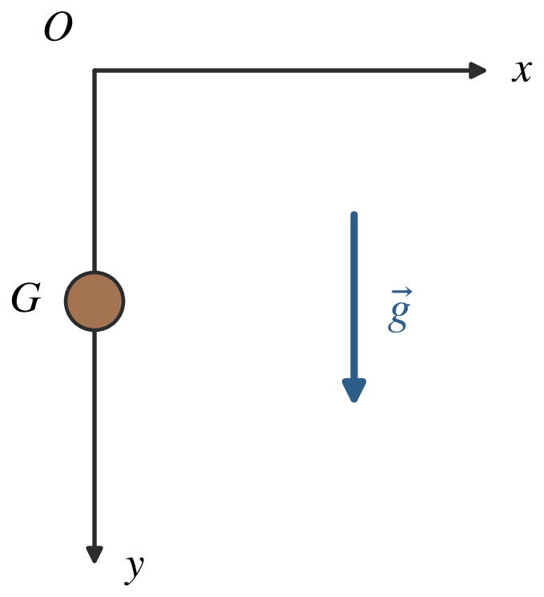{width=5cm}
:::

::: {custom-style="Legende"}
Figure 1. Système en chute libre, axe $(Oy)$ orienté vers le bas
:::

## [Q.3]{custom-style="QNum"}\ \ Établir la relation liant la vitesse $v$ atteinte au cours du mouvement et la durée $t$, et déterminer les équations horaires $x(t)$ et $y(t)$, dans le cas d'une chute libre verticale sans vitesse initiale {#q3}

::: {custom-style="Meta"}
[\ Objectif 10\ ]{custom-style="Niv10"}\ \ Cours · Notions : primitives, conditions initiales, équations horaires\ \ \ [CIBLE:c_q3]{custom-style="BoutonCorrige"}
:::

::: {custom-style="Enonce"}
Le système de la figure 1 est lâché sans vitesse initiale du point $O$, origine du repère.
:::

## [Q.4]{custom-style="QNum"}\ \ Déterminer la distance parcourue lorsqu'on atteint une certaine vitesse. Par exemple, déterminer la distance parcourue lorsqu'on atteint la vitesse du son $c_{\text{son}} = 340\ \text{m·s}^{-1}$ {#q4}

::: {custom-style="Meta"}
[\ Objectif 14\ ]{custom-style="Niv14"}\ \ Application · Notions : norme de la vitesse, distance parcourue\ \ \ [CIBLE:c_q4]{custom-style="BoutonCorrige"}
:::

::: {custom-style="Enonce"}
On reprend la chute libre verticale sans vitesse initiale de Q.3. On prendra $g = 9{,}81\ \text{m·s}^{-2}$.
:::

## [Q.5]{custom-style="QNum"}\ \ Déterminer l'altitude $h$ du système à l'instant où il franchit la vitesse du son, sachant qu'il a été lâché d'une hauteur $H$ {#q5}

::: {custom-style="Meta"}
[\ Objectif 14\ ]{custom-style="Niv14"}\ \ Application · Notions : altitude, distance parcourue\ \ \ [CIBLE:c_q5]{custom-style="BoutonCorrige"}
:::

::: {custom-style="Enonce"}
On a déterminé en Q.4 la distance parcourue par le système à la date $t_{\text{son}}$. Pour l'application numérique, on prendra $H = 39{,}0\ \text{km}$.
:::

## [Q.6]{custom-style="QNum"}\ \ Déterminer l'instant $t_h$ auquel on atteint une hauteur $h$ (par exemple $h = 10\ \text{m}$). À quel instant l'objet touche-t-il le sol, sachant qu'il part initialement d'une hauteur $H$ par rapport au sol ? {#q6}

::: {custom-style="Meta"}
[\ Objectif 14\ ]{custom-style="Niv14"}\ \ Application · Notions : équation horaire, durée de chute\ \ \ [CIBLE:c_q6]{custom-style="BoutonCorrige"}
:::

::: {custom-style="Enonce"}
On reprend la chute libre verticale sans vitesse initiale de Q.3. Pour l'application numérique, on prendra $H = 30\ \text{m}$ et $g = 9{,}81\ \text{m·s}^{-2}$.
:::

## [Q.7]{custom-style="QNum"}\ \ Déterminer la vitesse à laquelle un objet initialement à la hauteur $H$ touche le sol {#q7}

::: {custom-style="Meta"}
[\ Objectif 14\ ]{custom-style="Niv14"}\ \ Application · Notions : durée de chute, vitesse d'impact\ \ \ [CIBLE:c_q7]{custom-style="BoutonCorrige"}
:::

::: {custom-style="Enonce"}
On garde les données de Q.6 : $H = 30\ \text{m}$ et $g = 9{,}81\ \text{m·s}^{-2}$.
:::

## [Q.8]{custom-style="QNum"}\ \ Établir la relation liant la vitesse $v$ et la durée $t$, et déterminer les équations horaires $x(t)$ et $y(t)$, dans le cas d'une chute libre verticale avec vitesse initiale {#q8}

::: {custom-style="Meta"}
[\ Objectif 10\ ]{custom-style="Niv10"}\ \ Cours · Notions : vitesse initiale, conditions initiales\ \ \ [CIBLE:c_q8]{custom-style="BoutonCorrige"}
:::

::: {custom-style="Enonce"}
Le système est cette fois lancé vers le bas, depuis le point $O$, avec une vitesse initiale $\vec{v}_0$ verticale (figure 2).
:::

::: {custom-style="Figure"}
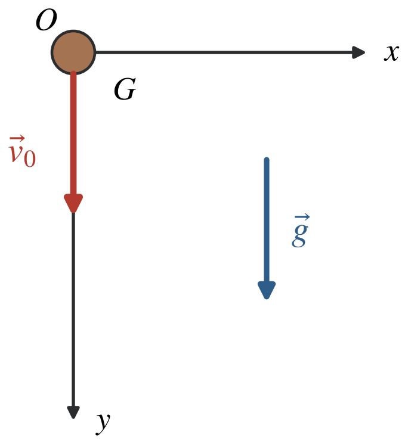{width=5cm}
:::

::: {custom-style="Legende"}
Figure 2. Chute libre verticale avec vitesse initiale
:::

::: {custom-style="Rubrique"}
Exercices
:::

## [Exercice 1]{custom-style="QNum"}\ \ Le saut de la sauterelle {#ex1}

::: {custom-style="Meta"}
[\ Objectif 10\ ]{custom-style="Niv10"}\ \ Entraînement · 5 points · 40 min · Questions 6 à 8 : objectif 14
:::

::: {custom-style="Enonce"}
Une sauterelle se propulse à la verticale en détendant brusquement ses pattes arrière. Le saut se déroule en deux phases : l'impulsion, pendant laquelle les pattes poussent sur le sol, puis le vol, pendant lequel l'insecte ne touche plus le sol.

On étudie le mouvement du centre de masse $G$ de la sauterelle dans le référentiel terrestre supposé galiléen. L'axe $(Oy)$ est vertical et orienté vers le haut. On néglige l'action de l'air.
:::

::: {custom-style="Enonce"}
**Données**
:::

::: {custom-style="EnonceDonnees"}
Masse de la sauterelle : $m = 2{,}0\ \text{g}$

Durée de l'impulsion : $\Delta t = 25\ \text{ms}$

Vitesse de $G$ à la fin de l'impulsion : $v_0 = 3{,}0\ \text{m·s}^{-1}$

Intensité de la pesanteur : $g = 9{,}81\ \text{m·s}^{-2}$
:::

::: {custom-style="Enonce"}

**Partie A. L'impulsion**

Pendant l'impulsion, la vitesse de $G$ passe de $0$ à $v_0$ et son accélération est supposée constante.

**1.** Calculer la valeur $a$ de l'accélération pendant l'impulsion. La comparer à l'intensité de la pesanteur.

**2.** Faire le bilan des forces qui s'exercent sur la sauterelle pendant l'impulsion, puis déterminer la valeur $F$ de la force exercée par le sol. La comparer au poids de la sauterelle.

**Partie B. Le vol**

L'origine des dates est l'instant où les pattes quittent le sol, et l'origine $O$ du repère est la position de $G$ à cet instant : $y(0) = 0$ et $v_y(0) = v_0$.

**3.** Montrer que $a_y = -g$ pendant le vol.

**4.** Établir les expressions de $v_y(t)$ et de $y(t)$.

**5.** Déterminer la date $t_S$ à laquelle la sauterelle atteint le sommet de son saut, puis la hauteur maximale $h_{\text{max}}$.

**6.** Déterminer la durée totale du vol. La comparer à $t_S$.

**7.** Calculer la coordonnée $v_y$ de la vitesse à l'atterrissage. Commenter son signe et sa valeur.

**8.** Une vidéo du saut montre que la hauteur réellement atteinte est de $0{,}40\ \text{m}$. Proposer une explication.
:::

::: {custom-style="Renvoi"}
[CIBLE:c_ex1]{custom-style="BoutonCorrige"}
:::

::: {custom-style="Surtitre"}
Énoncés
:::

# Thème 2 : le lancer d'un projectile {#theme2}

::: {custom-style="Rubrique"}
Questions de cours
:::

## [Q.9]{custom-style="QNum"}\ \ Établir la relation liant la vitesse $v$ et la durée $t$, et déterminer les équations horaires $x(t)$ et $y(t)$, dans le cas d'un lancer de projectile en chute libre {#q9}

::: {custom-style="Meta"}
[\ Objectif 10\ ]{custom-style="Niv10"}\ \ Cours · Notions : projection, équations horaires · Au moins huit sujets en 2025 et 2026\ \ \ [CIBLE:c_q9]{custom-style="BoutonCorrige"}
:::

::: {custom-style="Enonce"}
Un projectile est lancé d'une hauteur $H$ avec une vitesse initiale $\vec{v}_0$ qui fait un angle $\alpha$ avec l'horizontale. L'axe $(Oy)$ est vertical et orienté vers le haut. La situation est représentée sur la figure 3.

Notations : $H$, hauteur initiale ; $x_p$, portée (distance horizontale totale parcourue par le système) ; $H_{\text{max}}$, flèche du mouvement, ou encore hauteur maximale ; $v_0$, vitesse initiale ; $\alpha$, angle du lancer.
:::

::: {custom-style="Figure"}
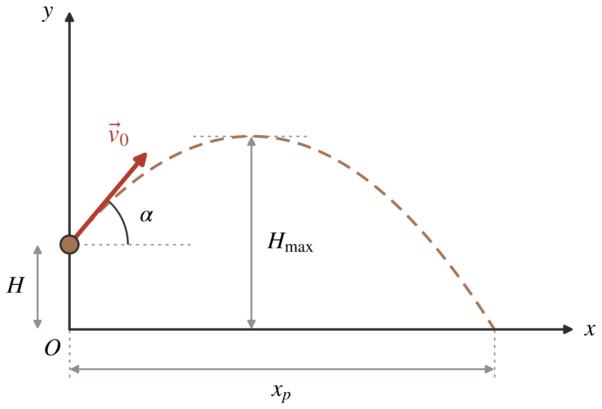{width=9.6cm}
:::

::: {custom-style="Legende"}
Figure 3. Lancer d'un projectile en chute libre
:::

## [Q.10]{custom-style="QNum"}\ \ Déterminer l'équation de la trajectoire {#q10}

::: {custom-style="Meta"}
[\ Objectif 14\ ]{custom-style="Niv14"}\ \ Cours · Notions : équations horaires, parabole · Au moins cinq sujets en 2025 et 2026\ \ \ [CIBLE:c_q10]{custom-style="BoutonCorrige"}
:::

::: {custom-style="Enonce"}
On reprend le lancer de Q.9, pour cette question et pour les suivantes.
:::

## [Q.11]{custom-style="QNum"}\ \ Quelles sont les caractéristiques du vecteur vitesse au sommet de la trajectoire ? {#q11}

::: {custom-style="Meta"}
[\ Objectif 10\ ]{custom-style="Niv10"}\ \ Cours · Notions : tangente à la trajectoire, composantes de la vitesse\ \ \ [CIBLE:c_q11]{custom-style="BoutonCorrige"}
:::

## [Q.12]{custom-style="QNum"}\ \ Déterminer l'instant auquel le mobile atteint le sommet de la trajectoire. En déduire la hauteur maximale atteinte {#q12}

::: {custom-style="Meta"}
[\ Objectif 14\ ]{custom-style="Niv14"}\ \ Application · Notions : sommet, flèche\ \ \ [CIBLE:c_q12]{custom-style="BoutonCorrige"}
:::

## [Q.13]{custom-style="QNum"}\ \ Déterminer la portée du mouvement (distance maximale parcourue horizontalement) {#q13}

::: {custom-style="Meta"}
[\ Objectif 14\ ]{custom-style="Niv14"}\ \ Application · Notions : équation du second degré · Demandée en 2026 (Antilles-Guyane ; Métropole, septembre)\ \ \ [CIBLE:c_q13]{custom-style="BoutonCorrige"}
:::

::: {custom-style="Enonce"}
Pour l'application numérique, on prendra $H = 1\ \text{m}$, $\alpha = 45°$, $v_0 = 10\ \text{m·s}^{-1}$ et $g = 10\ \text{m·s}^{-2}$.
:::

## [Q.14]{custom-style="QNum"}\ \ Déterminer la vitesse initiale que le mobile doit avoir pour atteindre une distance $x_p = 15\ \text{m}$ {#q14}

::: {custom-style="Meta"}
[\ Objectif 18\ ]{custom-style="Niv18"}\ \ Application · Notions : portée, calcul littéral\ \ \ [CIBLE:c_q14]{custom-style="BoutonCorrige"}
:::

::: {custom-style="Enonce"}
On garde les données de Q.13, sauf la vitesse initiale, qui devient l'inconnue.
:::

::: {custom-style="Rubrique"}
Exercices
:::

### [Exercice 2]{custom-style="QNum"}\ \ Tirer à la pétanque [(voir BAC Polynésie 2025)]{custom-style="VoirBac"} {#ex2}

::: {custom-style="Meta"}
[\ Objectif 14\ ]{custom-style="Niv14"}\ \ [Type BAC]{custom-style="TagBac"} · 6 points · 50 min · Partie A : objectif 10 · Partie C : objectif 18
:::

::: {custom-style="MentionBac"}
[Sujet du BAC correspondant.]{custom-style="EtiqBac"} Polynésie 2025, jour 1, exercice 2 : « Le Mölkky ». Voir aussi Asie 2025, jour 2, exercice 2 : « Slam dunk au golf ».
:::

::: {custom-style="Enonce"}
À la pétanque, « tirer » consiste à lancer sa boule pour qu'elle retombe directement sur la cible, sans rouler. Nadia vise le cochonnet, posé sur le sol à la distance $D = 6{,}00\ \text{m}$ du point $O$, situé au sol à la verticale du point de lancer. La boule quitte sa main à la hauteur $H$, avec une vitesse initiale $\vec{v}_0$ inclinée d'un angle $\alpha$ au-dessus de l'horizontale (figure 4).

On étudie le mouvement du centre de masse $G$ de la boule dans le référentiel terrestre supposé galiléen. Le point $O$ est l'origine du repère et l'axe $(Oy)$ est orienté vers le haut. L'action de l'air est négligée.
:::

::: {custom-style="Figure"}
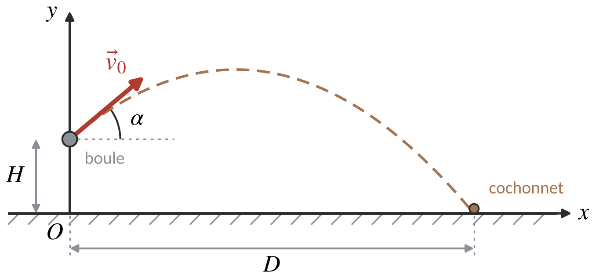{width=9cm}
:::

::: {custom-style="Legende"}
Figure 4. Tir à la pétanque
:::

::: {custom-style="Enonce"}
**Données**
:::

::: {custom-style="EnonceDonnees"}
Hauteur de lancer : $H = 1{,}10\ \text{m}$ ; vitesse initiale : $v_0 = 7{,}0\ \text{m·s}^{-1}$ ; angle de lancer : $\alpha = 40°$

Intensité de la pesanteur : $g = 9{,}81\ \text{m·s}^{-2}$
:::

::: {custom-style="Enonce"}

**Partie A. Les équations du mouvement**

**1.** Faire le bilan des forces sur la boule, puis établir les coordonnées du vecteur accélération.

**2.** Exprimer les coordonnées du vecteur vitesse initiale, puis celles du vecteur vitesse à la date $t$.

**3.** Établir les équations horaires $x(t)$ et $y(t)$.

**Partie B. La trajectoire**

**4.** Montrer que l'équation de la trajectoire s'écrit, avec $x$ et $y$ en mètre :

$$y(x) = -0{,}171 \times x^{2} + 0{,}839 \times x + 1{,}10$$

**5.** Déterminer la date $t_S$ du passage au sommet de la trajectoire, puis la hauteur maximale atteinte.

**6.** Déterminer l'abscisse $x_p$ du point où la boule touche le sol. Le tir est-il réussi ?

**Partie C. Pour aller plus loin**

**7.** Calculer la durée du vol, puis la valeur de la vitesse de la boule à l'impact.

**8.** Le cochonnet est à $6{,}5\ \text{m}$. Avec le même angle et la même hauteur, quelle vitesse initiale faut-il ?
:::

::: {custom-style="Renvoi"}
[CIBLE:c_ex2]{custom-style="BoutonCorrige"}
:::

::: {custom-style="Surtitre"}
Énoncés
:::

# Thème 3 : mesurer une vitesse et une accélération {#theme3}

::: {custom-style="Rubrique"}
Questions de cours
:::

## [Q.15]{custom-style="QNum"}\ \ Mini-exercice : mouvement d'une voiture sur un axe horizontal {#q15}

::: {custom-style="Meta"}
[\ Objectif 10\ ]{custom-style="Niv10"}\ \ Application · Notions : mouvement rectiligne uniformément accéléré, équation horaire\ \ \ [CIBLE:c_q15]{custom-style="BoutonCorrige"}
:::

::: {custom-style="Enonce"}
Une voiture se déplace sur un axe horizontal $(Ox)$. Elle passe au point $O$ à la date $t = 0$ avec la vitesse $v_0 = 30\ \text{km·h}^{-1}$, puis au point $A$ à la date $t = 5{,}4\ \text{s}$ avec la vitesse $v_A = 70\ \text{km·h}^{-1}$ (figure 5). On néglige les forces de frottement. L'accélération est supposée constante.

**1.** Déterminer l'équation horaire $x(t)$.

**2.** En utilisant les données de la figure, calculer la valeur de l'accélération.
:::

::: {custom-style="Figure"}
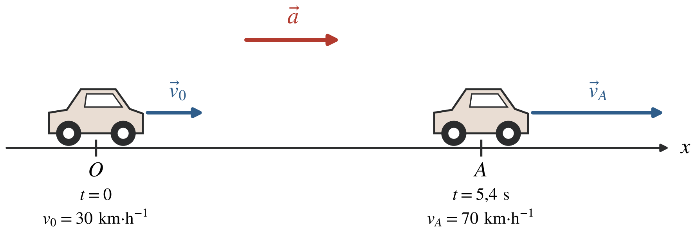{width=12.5cm}
:::

::: {custom-style="Legende"}
Figure 5. Mouvement de la voiture entre les points $O$ et $A$
:::

## [Q.16]{custom-style="QNum"}\ \ Déterminer graphiquement la valeur de l'accélération à partir du graphe de la vitesse $v(t)$ {#q16}

::: {custom-style="Meta"}
[\ Objectif 10\ ]{custom-style="Niv10"}\ \ Méthode · Notions : pente d'une droite · Voir BAC 2009 (Polynésie) et BAC 2021 (SI)\ \ \ [CIBLE:c_q16]{custom-style="BoutonCorrige"}
:::

::: {custom-style="Enonce"}
Le graphique de la figure 6 donne l'évolution de la vitesse d'une voiture électrique au cours du temps, pendant un démarrage en ligne droite. Expliquer comment en déduire l'accélération, puis la calculer.
:::

::: {custom-style="Figure"}
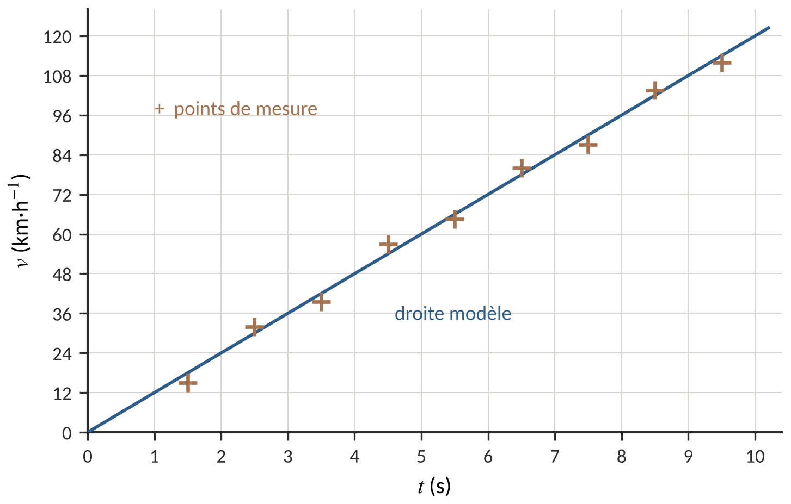{width=10.5cm}
:::

::: {custom-style="Legende"}
Figure 6. Évolution de la vitesse de la voiture électrique au cours du temps
:::

## [Q.17]{custom-style="QNum"}\ \ Déterminer graphiquement la valeur de l'accélération sur une chronophotographie {#q17}

::: {custom-style="Meta"}
[\ Objectif 14\ ]{custom-style="Niv14"}\ \ Méthode · Notions : variation du vecteur vitesse · Voir BAC 2004 (Amérique du Nord)\ \ \ [CIBLE:c_q17]{custom-style="BoutonCorrige"}
:::

::: {custom-style="Enonce"}
On considère la chronophotographie de la figure 7. Entre deux positions successives, il s'écoule une durée $\tau = 20\ \text{ms}$. Le document est à l'échelle 1/2 : 1 cm sur le schéma représente 2 cm en réalité.

**1.** Déterminer les valeurs des vitesses $v_9$ et $v_{11}$ et construire les vecteurs vitesse associés (échelle : 1 cm pour $0{,}5\ \text{m·s}^{-1}$).

**2.** Construire le vecteur variation de vitesse $\Delta\vec{v} = \vec{v}_{11} - \vec{v}_9$ en le plaçant au point $G_{10}$ pris comme origine. Quelle est sa norme ?

**3.** En déduire la valeur de l'accélération $a_{10}$ à l'instant $t_{10}$ et placer le vecteur accélération associé $\vec{a}_{10}$ en prenant comme origine le point $G_{10}$ (échelle : 1 cm pour $5\ \text{m·s}^{-2}$).

Sur le cahier d'énoncés imprimé en taille réelle, les mesures se font directement à la règle. À l'écran, servez-vous du segment-repère tracé sur la figure pour retrouver l'échelle.
:::

::: {custom-style="Figure"}
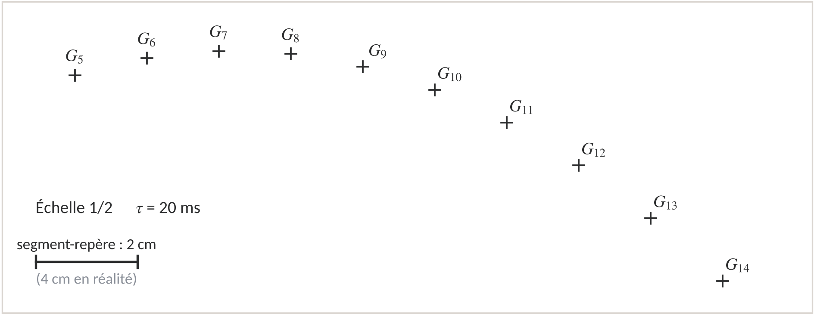{width=16cm}
:::

::: {custom-style="Legende"}
Figure 7. Chronophotographie d'un lancer, à l'échelle 1/2
:::

::: {custom-style="Rubrique"}
Exercices
:::

## [Exercice 3]{custom-style="QNum"}\ \ La balle du jongleur {#ex3}

::: {custom-style="Meta"}
[\ Objectif 14\ ]{custom-style="Niv14"}\ \ Entraînement · 5 points · 40 min · Questions 6 et 7 : objectif 18
:::

::: {custom-style="Enonce"}
Un jongleur lance une balle. Le mouvement est filmé, puis on relève toutes les $\tau = 50\ \text{ms}$ les coordonnées du centre de masse $G$ de la balle, dans un repère dont l'axe $(Oy)$ est vertical et orienté vers le haut. La position $G_0$ est celle de la balle à l'instant où elle quitte la main, pris comme origine des dates (figure 8).
:::

<!--colonnes: 13 8 8 8 8 8 8 8 8 8 8 8-->

| Position | G~0~ | G~1~ | G~2~ | G~3~ | G~4~ | G~5~ | G~6~ | G~7~ | G~8~ | G~9~ | G~10~ |
|---|---|---|---|---|---|---|---|---|---|---|---|
| *x* (m) | 0 | 0,100 | 0,200 | 0,300 | 0,400 | 0,500 | 0,600 | 0,700 | 0,800 | 0,900 | 1,000 |
| *y* (m) | 0 | 0,161 | 0,297 | 0,409 | 0,497 | 0,559 | 0,598 | 0,612 | 0,601 | 0,566 | 0,506 |

::: {custom-style="Figure"}
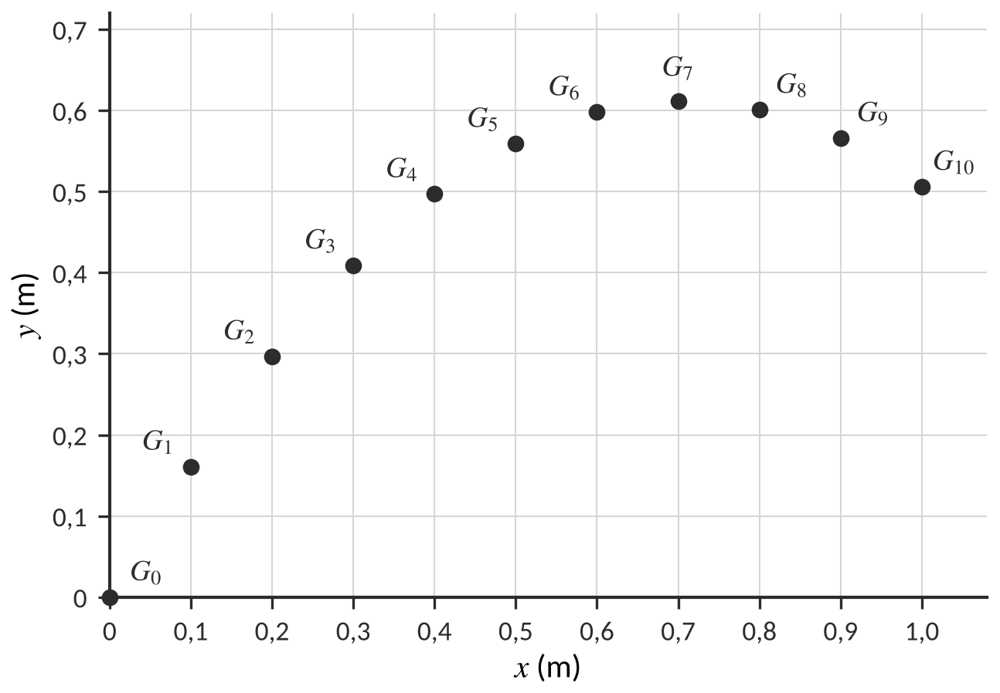{width=9cm}
:::

::: {custom-style="Legende"}
Figure 8. Positions successives du centre de masse de la balle
:::

::: {custom-style="Enonce"}
**Données**
:::

::: {custom-style="EnonceDonnees"}
Coordonnées du vecteur vitesse à la date $t_i$ : $v_{ix} = \dfrac{x_{i+1} - x_{i-1}}{2\tau}$ et $v_{iy} = \dfrac{y_{i+1} - y_{i-1}}{2\tau}$

Intensité de la pesanteur : $g = 9{,}81\ \text{m·s}^{-2}$
:::

::: {custom-style="Enonce"}
**1.** Montrer que le mouvement de $G$ selon l'axe horizontal est uniforme. Calculer la vitesse $v_x$.

**2.** Calculer les coordonnées des vecteurs vitesse $\vec{v}_3$ et $\vec{v}_5$, puis leurs normes.

**3.** Déterminer les coordonnées du vecteur $\Delta\vec{v} = \vec{v}_5 - \vec{v}_3$. Quels sont sa direction et son sens ?

**4.** En déduire les coordonnées et la norme de l'accélération $\vec{a}_4$ à la date $t_4$. Comparer à $g$.

**5.** Que peut-on en conclure sur les forces qui s'exercent sur la balle ?

**6.** Déterminer la valeur $v_0$ de la vitesse initiale et l'angle $\alpha$ que fait le vecteur $\vec{v}_0$ avec l'horizontale.

**7.** Déterminer la date à laquelle la balle passe au sommet de sa trajectoire et la hauteur maximale atteinte. Ces résultats sont-ils en accord avec le tableau ?
:::

::: {custom-style="Renvoi"}
[CIBLE:c_ex3]{custom-style="BoutonCorrige"}
:::

<!--debut:complet-->
::: {custom-style="Surtitre"}
Corrigés
:::

# Corrigés du thème 1 : la chute libre verticale {#c_theme1}

#### [Corrigé]{custom-style="NumCorrige"}\ \ Q.1 · Qu'appelle-t-on chute libre ? {#c_q1}

::: {custom-style="Renvoi"}
[CIBLE:q1]{custom-style="BoutonEnonce"}
:::

::: {custom-style="Retenir"}
On appelle chute libre le mouvement d'un système qui n'est soumis qu'à l'action de son poids.
:::

::: {custom-style="Remarque"}
[Remarque.]{custom-style="EtiqRemarque"} Dans un exercice, on se place dans ce cas dès que l'énoncé indique que l'action de l'air (frottements, poussée d'Archimède) est négligeable devant le poids. Une chute libre n'est pas forcément verticale : un projectile lancé avec une vitesse inclinée est lui aussi en chute libre.
:::

#### [Corrigé]{custom-style="NumCorrige"}\ \ Q.2 · Établir l'expression de l'accélération d'un système dans le cas d'une chute libre {#c_q2}

::: {custom-style="Renvoi"}
[CIBLE:q2]{custom-style="BoutonEnonce"}
:::

::: {custom-style="Remarque"}
[Remarque.]{custom-style="EtiqRemarque"} Les calculs suivants sont valables quel que soit le type de mouvement (chute verticale avec ou sans vitesse initiale, ou encore lancer de projectile).
:::

Considérons le mouvement du système de la figure 1, de centre de masse $G$ et de masse $m$, en chute libre.

Dans le référentiel terrestre supposé galiléen, la deuxième loi de Newton appliquée au système donne :

$$\sum \vec{F}_{\text{ext}} = m \times \vec{a}$$

Le corps étant en chute libre, la seule force appliquée est le poids. Il vient :

$$\vec{P} = m \times \vec{g} = m \times \vec{a}$$

On en conclut que :

::: {custom-style="Retenir"}
$\vec{a} = \vec{g}$
:::

C'est toujours le cas pour un mouvement de chute libre.

::: {custom-style="Remarque"}
[Remarque.]{custom-style="EtiqRemarque"} Dans les exercices, le champ de pesanteur est supposé uniforme : le vecteur $\vec{g}$ est le même en tout point. Cette hypothèse n'est que très rarement remise en cause (voir la fiche 3, Q.2, pour l'intensité de la pesanteur à l'altitude $h$).
:::

Avec l'axe $(Oy)$ vertical et orienté vers le bas, les coordonnées du vecteur $\vec{g}$ sont $(0\ ;\ g)$. On en déduit les coordonnées du vecteur accélération, qui sont exactement les mêmes que celles du vecteur $\vec{g}$ :

$$\vec{a}\ \begin{cases} a_x = 0 \\ a_y = g \end{cases}$$

::: {custom-style="Piege"}
[Piège.]{custom-style="EtiqPiege"} Si l'axe $(Oy)$ était orienté vers le haut, on aurait $\vec{a}\ (0\ ;\ -g)$. Le signe dépend de l'orientation de l'axe, pas du mouvement : l'accélération d'un système en chute libre est toujours dirigée vers le bas, comme le poids, même quand le système monte.
:::

#### [Corrigé]{custom-style="NumCorrige"}\ \ Q.3 · Établir la relation liant la vitesse $v$ atteinte au cours du mouvement et la durée $t$, et déterminer les équations horaires $x(t)$ et $y(t)$, dans le cas d'une chute libre verticale sans vitesse initiale {#c_q3}

::: {custom-style="Renvoi"}
[CIBLE:q3]{custom-style="BoutonEnonce"}
:::

Il s'agit du cas le plus simple. Reprenons les coordonnées du vecteur accélération (voir Q.2) :

$$\vec{a}\ \begin{cases} a_x = 0 \\ a_y = g \end{cases}$$

::: {custom-style="Intertitre"}
Détermination de la vitesse
:::

Comme $\vec{a} = \dfrac{\mathrm{d}\vec{v}}{\mathrm{d}t}$, les coordonnées du vecteur vitesse sont des primitives de celles du vecteur accélération. Il vient donc :

$$\cR{\vec{v}(t)\ \begin{cases} v_x(t) = K_1 \\ v_y(t) = g \times t + K_2 \end{cases}}$$

où $K_1$ et $K_2$ sont des constantes réelles à déterminer. Pour cela, on utilise les coordonnées de la vitesse initiale $\vec{v}_0\ (0\ ;\ 0)$. On évalue donc les coordonnées du système d'équations obtenu plus haut à $t = 0$. Il vient :

$$\vec{v}(t = 0)\ \begin{cases} v_x(t = 0) = K_1 = 0 \\ v_y(t = 0) = g \times 0 + K_2 = 0 \end{cases}$$

On en déduit $K_1 = 0$ et $K_2 = 0$, que l'on remplace dans les coordonnées de la vitesse :

::: {custom-style="Retenir"}
$\vec{v}(t)\ \begin{cases} v_x(t) = 0 \\ v_y(t) = g \times t \end{cases}$
:::

::: {custom-style="Intertitre"}
Détermination des équations horaires (coordonnées du vecteur position)
:::

Comme $\vec{v} = \dfrac{\mathrm{d}\overrightarrow{OG}}{\mathrm{d}t}$, les coordonnées du vecteur position sont des primitives de celles de la vitesse. Il vient :

$$\overrightarrow{OG}(t)\ \begin{cases} x(t) = K_3 \\ y(t) = \dfrac{1}{2} g \times t^{2} + K_4 \end{cases}$$

avec $K_3$ et $K_4$ des constantes.

Pour déterminer la valeur des constantes, on utilise les conditions initiales sur la position de l'objet. À $t = 0$, l'objet se trouve à l'origine du repère, au point $O$ de coordonnées $(0\ ;\ 0)$. Ainsi, en évaluant les équations horaires à $t = 0$, il vient :

$$\overrightarrow{OG}(t = 0)\ \begin{cases} x(t = 0) = K_3 = 0 \\ y(t = 0) = \dfrac{1}{2} g \times 0^{2} + K_4 = 0 \end{cases}$$

Ainsi, on obtient $K_3 = 0$ et $K_4 = 0$. Les équations horaires finales sont donc :

::: {custom-style="Retenir"}
$\overrightarrow{OG}(t)\ \begin{cases} x(t) = 0 \\ y(t) = \dfrac{1}{2} g \times t^{2} \end{cases}$
:::

::: {custom-style="Methode"}
[Méthode.]{custom-style="EtiqMethode"} La démarche est toujours la même : la deuxième loi de Newton donne l'accélération, une première primitive donne la vitesse, une seconde donne la position. À chaque primitive apparaît une constante, que l'on détermine avec les conditions initiales (vitesse à $t = 0$, puis position à $t = 0$).
:::

#### [Corrigé]{custom-style="NumCorrige"}\ \ Q.4 · Déterminer la distance parcourue lorsqu'on atteint une certaine vitesse. Par exemple, déterminer la distance parcourue lorsqu'on atteint la vitesse du son $c_{\text{son}} = 340\ \text{m·s}^{-1}$ {#c_q4}

::: {custom-style="Renvoi"}
[CIBLE:q4]{custom-style="BoutonEnonce"}
:::

La distance parcourue à l'instant $t$ correspond à la valeur absolue de $y(t)$. En effet, il ne faut pas oublier que $y(t)$ représente l'ordonnée du système, qui est donc positive ou négative en fonction de l'orientation de l'axe des ordonnées. Or cette orientation peut être librement choisie par l'exercice ou par l'élève.

On voit que l'équation horaire dépend du temps et non directement de la vitesse. Ainsi, si l'on veut calculer $y(t)$ pour une certaine vitesse, il faut préalablement déterminer l'instant $t$ correspondant. Pour ce faire, on utilise les coordonnées de la vitesse déterminées précédemment (voir Q.3), à savoir :

$$\vec{v}(t)\ \begin{cases} v_x(t) = 0 \\ v_y(t) = g \times t \end{cases}$$

On peut alors exprimer la norme de la vitesse, qui vaut :

$$v = \sqrt{(v_x)^{2} + (v_y)^{2}} = \sqrt{(0)^{2} + (g \times t)^{2}} = \sqrt{(g \times t)^{2}} = g \times t$$

Plus intéressant, on a donc trouvé $v = g \times t$. Notons à présent $t_{\text{son}}$ l'instant auquel le système atteint la vitesse du son $c_{\text{son}}$ au cours de la chute. On peut donc écrire :

$$c_{\text{son}} = g \times t_{\text{son}}$$

On peut alors exprimer $t_{\text{son}}$ :

$$t_{\text{son}} = \dfrac{c_{\text{son}}}{g} \lbl{1}$$

Maintenant que l'on a trouvé l'instant qui correspond à la situation, on peut exprimer la distance $d$ parcourue :

$$d = \left|y(t = t_{\text{son}})\right| = \left|\dfrac{1}{2} \times g \times t_{\text{son}}^{2}\right| = \dfrac{1}{2} \times g \times t_{\text{son}}^{2}$$

On injecte la relation (1), il vient :

$$d = \dfrac{1}{2} \times g \times \left(\dfrac{c_{\text{son}}}{g}\right)^{2} = \dfrac{1}{2} \times \cR{g} \times \dfrac{c_{\text{son}}^{2}}{\cR{g^{2}}} = \dfrac{1}{2} \times \dfrac{c_{\text{son}}^{2}}{g}$$

::: {custom-style="Retenir"}
$d = \dfrac{c_{\text{son}}^{2}}{2g}$
:::

**Application numérique.** Avec $c_{\text{son}} = 340\ \text{m·s}^{-1}$ et $g = 9{,}81\ \text{m·s}^{-2}$ :

$$t_{\text{son}} = \dfrac{340}{9{,}81} = 34{,}7\ \text{s}$$

$$d = \dfrac{340^{2}}{2 \times 9{,}81} = 5{,}89 \times 10^{3}\ \text{m}$$

Il faut près de 6 km de chute libre pour atteindre la vitesse du son.

::: {custom-style="Remarque"}
[Remarque.]{custom-style="EtiqRemarque"} Dans le cadre de l'exercice, il est évident que $\left|y(t)\right|$ représente la distance parcourue, car on part d'une ordonnée nulle. Si l'exercice demande de calculer la distance parcourue entre deux positions correspondant à des instants $t_1$ et $t_0$, cette distance vaut $d = \left|y(t_1) - y(t_0)\right|$, à condition que le système ne change pas de sens entre ces deux instants.
:::

#### [Corrigé]{custom-style="NumCorrige"}\ \ Q.5 · Déterminer l'altitude $h$ du système à l'instant où il franchit la vitesse du son, sachant qu'il a été lâché d'une hauteur $H$ {#c_q5}

::: {custom-style="Renvoi"}
[CIBLE:q5]{custom-style="BoutonEnonce"}
:::

L'altitude $h$ du système correspond à la hauteur initiale $H$ à laquelle on a retiré la distance parcourue $d$ (voir Q.4). Il vient donc :

::: {custom-style="Retenir"}
$h = H - d = H - \dfrac{c_{\text{son}}^{2}}{2g}$
:::

**Application numérique.** Avec $H = 39{,}0\ \text{km}$ : $h = 39{,}0 \times 10^{3} - 5{,}89 \times 10^{3} = 3{,}31 \times 10^{4}\ \text{m}$, soit environ 33 km.

::: {custom-style="Remarque"}
[Remarque.]{custom-style="EtiqRemarque"} À 39 km d'altitude, $g$ est légèrement plus faible qu'au sol (environ 1 %) et la célérité du son est inférieure à $340\ \text{m·s}^{-1}$. L'énoncé garde les valeurs du sol : le modèle reste acceptable pour cet ordre de grandeur.
:::

::: {custom-style="Piege"}
[Piège.]{custom-style="EtiqPiege"} Ne confondez pas la distance parcourue $d$, comptée depuis le point de départ, et l'altitude $h$, comptée depuis le sol. Un schéma avec les deux grandeurs évite l'erreur.
:::

#### [Corrigé]{custom-style="NumCorrige"}\ \ Q.6 · Déterminer l'instant $t_h$ auquel on atteint une hauteur $h$ (par exemple $h = 10\ \text{m}$). À quel instant l'objet touche-t-il le sol, sachant qu'il part initialement d'une hauteur $H$ par rapport au sol ? {#c_q6}

::: {custom-style="Renvoi"}
[CIBLE:q6]{custom-style="BoutonEnonce"}
:::

Pour ce faire, on repart de l'équation horaire suivant $y$ (voir Q.3) :

$$\cR{y(t) = \dfrac{1}{2} g \times t^{2}}$$

Notons à présent $t_h$ la date à laquelle le système atteint la hauteur $h$. Si on est à la hauteur $h$, alors l'ordonnée vaut $H - h$ (figure 9). Il vient :

$$\cR{y(t_h) = H - h = \dfrac{1}{2} g \times t_h^{2}}$$

::: {custom-style="Figure"}
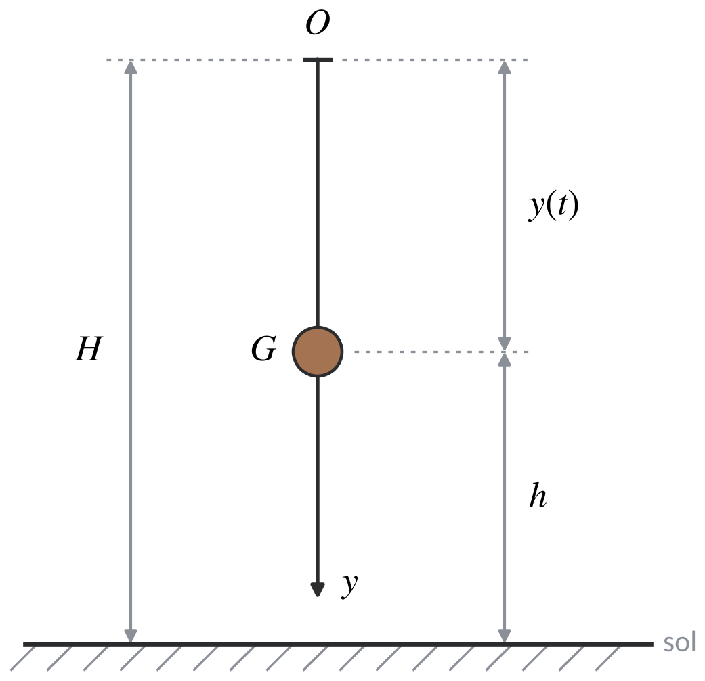{width=7.2cm}
:::

::: {custom-style="Legende"}
Figure 9. Hauteur initiale $H$, distance parcourue $y(t)$ et hauteur $h$ au-dessus du sol
:::

On peut alors exprimer $t_h$ :

$$t_h^{2} = \dfrac{2(H - h)}{g}$$

::: {custom-style="Retenir"}
$t_h = \sqrt{\dfrac{2(H - h)}{g}}$
:::

L'objet touche le sol lorsque $h = 0$, ce qui correspond à l'instant :

::: {custom-style="Retenir"}
$t_{\text{sol}} = \sqrt{\dfrac{2H}{g}}$
:::

**Application numérique.** Avec $H = 30\ \text{m}$ et $g = 9{,}81\ \text{m·s}^{-2}$ :

$$t_h = \sqrt{\dfrac{2 \times (30 - 10)}{9{,}81}} = 2{,}0\ \text{s} \quad \text{pour} \quad h = 10\ \text{m}$$

$$t_{\text{sol}} = \sqrt{\dfrac{2 \times 30}{9{,}81}} = 2{,}5\ \text{s}$$

#### [Corrigé]{custom-style="NumCorrige"}\ \ Q.7 · Déterminer la vitesse à laquelle un objet initialement à la hauteur $H$ touche le sol {#c_q7}

::: {custom-style="Renvoi"}
[CIBLE:q7]{custom-style="BoutonEnonce"}
:::

On doit d'abord déterminer l'instant auquel le système a parcouru la distance $H$. D'après la question précédente (Q.6), cette date est :

$$t_{\text{sol}} = \sqrt{\dfrac{2H}{g}}$$

Pour déterminer la vitesse d'arrivée au sol, on remplace cette date dans l'expression de la norme de la vitesse. On a déjà montré en Q.4 que cette norme valait :

$$v = g \times t$$

Soit :

$$v_{\text{sol}} = g \times t_{\text{sol}}$$

$$v_{\text{sol}} = \cR{g} \times \sqrt{\dfrac{2H}{g}}$$

$$v_{\text{sol}} = \sqrt{\cR{g^{2}} \times \dfrac{2H}{g}}$$

D'où :

::: {custom-style="Retenir"}
$v_{\text{sol}} = \sqrt{2 \times g \times H}$
:::

**Application numérique.** Avec $H = 30\ \text{m}$ : $v_{\text{sol}} = \sqrt{2 \times 9{,}81 \times 30} = 24\ \text{m·s}^{-1}$, soit environ $87\ \text{km·h}^{-1}$.

::: {custom-style="Remarque"}
[Remarque.]{custom-style="EtiqRemarque"} Cette vitesse ne dépend pas de la masse de l'objet. On retrouve le même résultat avec la conservation de l'énergie mécanique : $\dfrac{1}{2} m \times v_{\text{sol}}^{2} = m \times g \times H$.
:::

#### [Corrigé]{custom-style="NumCorrige"}\ \ Q.8 · Établir la relation liant la vitesse $v$ et la durée $t$, et déterminer les équations horaires $x(t)$ et $y(t)$, dans le cas d'une chute libre verticale avec vitesse initiale {#c_q8}

::: {custom-style="Renvoi"}
[CIBLE:q8]{custom-style="BoutonEnonce"}
:::

Le projectile est cette fois-ci lancé avec une vitesse non nulle, comme représenté sur la figure 2.

::: {custom-style="Intertitre"}
Détermination de l'accélération
:::

Les coordonnées de l'accélération ne varient pas. Il suffit donc de reprendre exactement les étapes de Q.3. Il vient :

$$\vec{a}\ \begin{cases} a_x = 0 \\ a_y = g \end{cases}$$

::: {custom-style="Intertitre"}
Détermination de la vitesse
:::

Comme $\vec{a} = \dfrac{\mathrm{d}\vec{v}}{\mathrm{d}t}$, les coordonnées du vecteur vitesse sont des primitives de celles du vecteur accélération. Il vient donc :

$$\cR{\vec{v}(t)\ \begin{cases} v_x(t) = K_1 \\ v_y(t) = g \times t + K_2 \end{cases}}$$

où $K_1$ et $K_2$ sont des constantes réelles à déterminer. Pour cela, on utilise les coordonnées de la vitesse initiale $\vec{v}_0\ (0\ ;\ v_0)$. On évalue donc les coordonnées du système d'équations obtenu plus haut à $t = 0$. Il vient :

$$\vec{v}(t = 0)\ \begin{cases} v_x(t = 0) = K_1 = 0 \\ v_y(t = 0) = g \times 0 + K_2 = v_0 \end{cases}$$

On en déduit $K_1 = 0$ et $K_2 = v_0$. On remplace ensuite la valeur des constantes dans les coordonnées de la vitesse :

::: {custom-style="Retenir"}
$\vec{v}(t)\ \begin{cases} v_x(t) = 0 \\ v_y(t) = g \times t + v_0 \end{cases}$
:::

::: {custom-style="Intertitre"}
Détermination des équations horaires (coordonnées du vecteur position)
:::

Comme $\vec{v} = \dfrac{\mathrm{d}\overrightarrow{OG}}{\mathrm{d}t}$, les coordonnées du vecteur position sont des primitives de celles de la vitesse. Il vient :

$$\overrightarrow{OG}(t)\ \begin{cases} x(t) = K_3 \\ y(t) = \dfrac{1}{2} g \times t^{2} + v_0 \times t + K_4 \end{cases}$$

avec $K_3$ et $K_4$ des constantes.

Pour déterminer la valeur des constantes, on utilise les conditions initiales sur la position de l'objet. À $t = 0$, l'objet se trouve à l'origine du repère, au point $O$ de coordonnées $(0\ ;\ 0)$. Ainsi, en évaluant les équations horaires à $t = 0$, il vient :

$$\overrightarrow{OG}(t = 0)\ \begin{cases} x(t = 0) = K_3 = 0 \\ y(t = 0) = \dfrac{1}{2} g \times 0^{2} + v_0 \times 0 + K_4 = 0 \end{cases}$$

Ainsi, on obtient $K_3 = 0$ et $K_4 = 0$. Les équations horaires finales sont donc :

::: {custom-style="Retenir"}
$\overrightarrow{OG}(t)\ \begin{cases} x(t) = 0 \\ y(t) = \dfrac{1}{2} g \times t^{2} + v_0 \times t \end{cases}$
:::

::: {custom-style="Remarque"}
[Remarque.]{custom-style="EtiqRemarque"} Si l'objet est lancé vers le haut alors que l'axe est orienté vers le bas, la coordonnée de la vitesse initiale est négative : $\vec{v}_0\ (0\ ;\ -v_0)$. Les calculs sont les mêmes, avec $-v_0$ à la place de $v_0$. L'exercice 1 traite ce cas avec un axe orienté vers le haut.
:::

#### [Corrigé]{custom-style="NumCorrige"}\ \ Exercice 1 · Le saut de la sauterelle {#c_ex1}

::: {custom-style="Renvoi"}
[CIBLE:ex1]{custom-style="BoutonEnonce"}
:::

::: {custom-style="QRappel"}
**1.** Accélération pendant l'impulsion
:::

L'accélération est supposée constante : elle est égale à la variation de la vitesse divisée par la durée de l'impulsion. La vitesse passe de $0$ à $v_0$ en $\Delta t = 25\ \text{ms} = 25 \times 10^{-3}\ \text{s}$ :

$$a = \dfrac{\Delta v}{\Delta t} = \dfrac{v_0 - 0}{\Delta t} = \dfrac{3{,}0}{25 \times 10^{-3}} = 1{,}2 \times 10^{2}\ \text{m·s}^{-2}$$

Cette accélération vaut environ 12 fois l'intensité de la pesanteur.

::: {custom-style="QRappel"}
**2.** Force exercée par le sol
:::

On étudie le système {sauterelle} dans le référentiel terrestre supposé galiléen. Pendant l'impulsion, il est soumis à deux forces verticales : son poids $\vec{P}$, dirigé vers le bas, et la force $\vec{F}$ exercée par le sol, dirigée vers le haut.

La deuxième loi de Newton s'écrit :

$$\vec{P} + \vec{F} = m \times \vec{a}$$

En projection sur l'axe $(Oy)$ orienté vers le haut, avec une accélération dirigée vers le haut :

$$-m \times g + F = m \times a$$

::: {custom-style="Retenir"}
$F = m \times (a + g) = 2{,}0 \times 10^{-3} \times (1{,}2 \times 10^{2} + 9{,}81) = 0{,}26\ \text{N}$
:::

Le poids vaut $P = m \times g = 2{,}0 \times 10^{-3} \times 9{,}81 = 2{,}0 \times 10^{-2}\ \text{N}$. La force exercée par le sol vaut donc environ 13 fois le poids de la sauterelle.

::: {custom-style="QRappel"}
**3.** Accélération pendant le vol
:::

Une fois que les pattes ont quitté le sol, l'action de l'air étant négligée, la sauterelle n'est soumise qu'à son poids : elle est en chute libre. La deuxième loi de Newton donne $m \times \vec{g} = m \times \vec{a}$, donc $\vec{a} = \vec{g}$.

L'axe $(Oy)$ est orienté vers le haut et $\vec{g}$ est dirigé vers le bas : $a_y = -g$.

::: {custom-style="QRappel"}
**4.** Vitesse et position
:::

On cherche une primitive de $a_y = -g$ : $v_y(t) = -g \times t + K_1$. À la date $t = 0$, $v_y(0) = v_0$, donc $K_1 = v_0$ :

$$v_y(t) = -g \times t + v_0$$

On cherche une primitive : $y(t) = -\dfrac{1}{2} g \times t^{2} + v_0 \times t + K_2$. À $t = 0$, $y(0) = 0$, donc $K_2 = 0$ :

::: {custom-style="Retenir"}
$y(t) = -\dfrac{1}{2} g \times t^{2} + v_0 \times t$
:::

::: {custom-style="QRappel"}
**5.** Sommet du saut
:::

Au sommet, la sauterelle cesse de monter : sa vitesse s'annule. On note $t_S$ la date correspondante :

$$v_y(t_S) = -g \times t_S + v_0 = 0 \quad \text{donc} \quad t_S = \dfrac{v_0}{g} = \dfrac{3{,}0}{9{,}81} = 0{,}31\ \text{s}$$

La hauteur maximale est l'ordonnée à cette date :

$$y(t_S) = -\dfrac{1}{2} g \times \left(\dfrac{v_0}{g}\right)^{2} + v_0 \times \dfrac{v_0}{g} = -\dfrac{v_0^{2}}{2g} + \dfrac{v_0^{2}}{g} = \dfrac{v_0^{2}}{2g}$$

::: {custom-style="Retenir"}
$h_{\text{max}} = \dfrac{v_0^{2}}{2g} = \dfrac{3{,}0^{2}}{2 \times 9{,}81} = 0{,}46\ \text{m}$
:::

::: {custom-style="QRappel"}
**6.** Durée totale du vol
:::

La sauterelle retombe au sol quand $y(t) = 0$ :

$$-\dfrac{1}{2} g \times t^{2} + v_0 \times t = 0 \quad \text{soit} \quad t \times \left(-\dfrac{1}{2} g \times t + v_0\right) = 0$$

La solution $t = 0$ correspond au départ. L'autre solution est la date d'atterrissage :

$$t_{\text{vol}} = \dfrac{2 v_0}{g} = \dfrac{2 \times 3{,}0}{9{,}81} = 0{,}61\ \text{s}$$

On a $t_{\text{vol}} = 2 \times t_S$. La montée dure $t_S$, donc la descente, du sommet au sol, dure $t_{\text{vol}} - t_S = t_S$ : elle dure autant que la montée.

Ce n'est pas un hasard : pendant tout le vol, seul le poids agit, donc l'accélération est la même à la montée et à la descente. Au sommet, la vitesse est nulle (question 5) : la descente est une chute libre sans vitesse initiale, d'une hauteur $h_{\text{max}}$. Sa durée s'obtient avec la relation $t_{\text{sol}} = \sqrt{\dfrac{2H}{g}}$ de la question de cours Q.6, en remplaçant $H$ par $h_{\text{max}}$ :

$$\sqrt{\dfrac{2 h_{\text{max}}}{g}} = \sqrt{\dfrac{2}{g} \times \dfrac{v_0^{2}}{2g}} = \dfrac{v_0}{g} = t_S$$

```{=openxml}
<w:p><w:r><w:br w:type="page"/></w:r></w:p>
```

::: {custom-style="QRappel"}
**7.** Vitesse à l'atterrissage
:::

$$v_y(t_{\text{vol}}) = -g \times \dfrac{2 v_0}{g} + v_0 = -v_0 = -3{,}0\ \text{m·s}^{-1}$$

La sauterelle retombe avec une vitesse de même valeur qu'au départ, $3{,}0\ \text{m·s}^{-1}$, mais dirigée vers le bas : le signe moins traduit ce changement de sens.

::: {custom-style="QRappel"}
**8.** Écart avec la mesure
:::

Le modèle de la chute libre néglige l'action de l'air. Pour un animal aussi léger, cette action peut freiner la sauterelle pendant la montée : la hauteur réellement atteinte ($0{,}40\ \text{m}$) est alors inférieure à la valeur calculée ($0{,}46\ \text{m}$). Une autre cause possible est l'incertitude sur la vitesse $v_0$ : comme $h_{\text{max}} = \dfrac{v_0^{2}}{2g}$, une vitesse de $2{,}8\ \text{m·s}^{-1}$ au lieu de $3{,}0\ \text{m·s}^{-1}$ suffit à donner $0{,}40\ \text{m}$.

::: {custom-style="Redaction"}
[Rédaction.]{custom-style="EtiqRedaction"} Avant toute projection, annoncez le système, le référentiel et l'orientation de l'axe : « On étudie le système {sauterelle} dans le référentiel terrestre supposé galiléen. L'axe $(Oy)$ est vertical et orienté vers le haut. » Le signe de chaque coordonnée en dépend.
:::

::: {custom-style="Surtitre"}
Corrigés
:::

# Corrigés du thème 2 : le lancer d'un projectile {#c_theme2}

#### [Corrigé]{custom-style="NumCorrige"}\ \ Q.9 · Établir la relation liant la vitesse $v$ et la durée $t$, et déterminer les équations horaires $x(t)$ et $y(t)$, dans le cas d'un lancer de projectile en chute libre {#c_q9}

::: {custom-style="Renvoi"}
[CIBLE:q9]{custom-style="BoutonEnonce"}
:::

::: {custom-style="Intertitre"}
Détermination de l'expression de la vitesse
:::

On se place toujours dans le cadre de la chute libre : la seule force appliquée est donc le poids. Dans le référentiel terrestre supposé galiléen, la deuxième loi de Newton s'écrit alors :

$$\vec{P} = m \times \vec{g} = m \times \vec{a}$$

Donc :

$$\vec{a} = \vec{g}$$

Les coordonnées du vecteur $\vec{g}$ sont $(0\ ;\ -g)$. Attention, le vecteur $\vec{g}$ est orienté dans le sens contraire à l'axe des ordonnées, comme sur la figure 10.

::: {custom-style="Figure"}
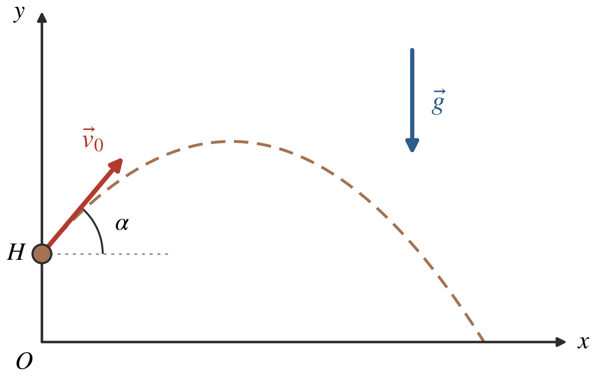{width=9.6cm}
:::

::: {custom-style="Legende"}
Figure 10. Le vecteur $\vec{g}$ est de sens contraire à l'axe des ordonnées
:::

Les coordonnées du vecteur accélération sont ainsi :

$$\vec{a}\ \begin{cases} a_x = 0 \\ a_y = -g \end{cases}$$

Comme $\vec{a} = \dfrac{\mathrm{d}\vec{v}}{\mathrm{d}t}$, les coordonnées du vecteur vitesse sont des primitives de celles du vecteur accélération. Il vient donc :

$$\cR{\vec{v}(t)\ \begin{cases} v_x(t) = K_1 \\ v_y(t) = -g \times t + K_2 \end{cases}}$$

où $K_1$ et $K_2$ sont des constantes réelles à déterminer. Pour cela, on doit utiliser les coordonnées de la vitesse initiale. Pour les déterminer, on projette le vecteur vitesse initiale sur l'axe des abscisses, puis sur l'axe des ordonnées (figure 11).

::: {custom-style="Figure"}
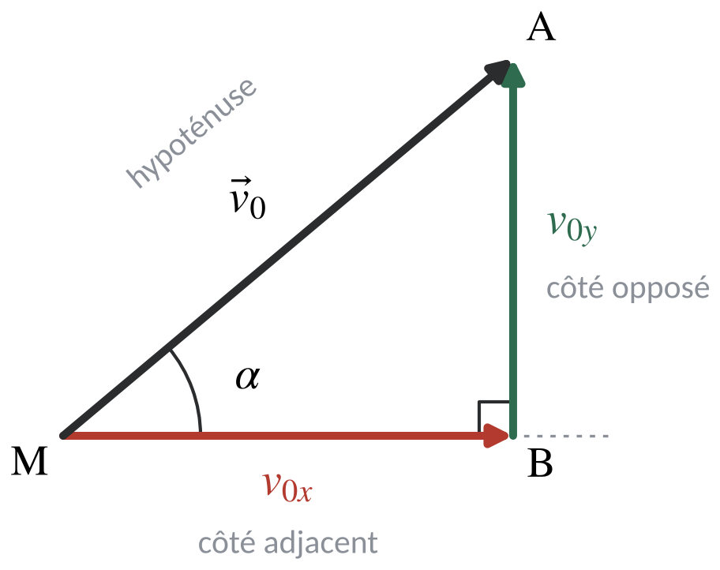{width=8.4cm}
:::

::: {custom-style="Legende"}
Figure 11. Projection du vecteur vitesse initiale sur les deux axes
:::

**Projection sur l'axe des abscisses.** On réalise la projection comme sur la figure 11 (en rouge). On se place ensuite dans le triangle $\text{AMB}$ rectangle en $\text{B}$. Puis on applique la formule trigonométrique du cosinus sur l'angle $\alpha$ :

$$\cos(\alpha) = \dfrac{\text{côté adjacent}}{\text{hypoténuse}} = \dfrac{\text{MB}}{\text{MA}} = \dfrac{v_{0x}}{v_0} \lbl{1}$$

On peut donc exprimer l'abscisse de la vitesse initiale $v_{0x}$ à partir de la relation (1) :

$$v_{0x} = v_0 \times \cos(\alpha)$$

**Projection sur l'axe des ordonnées.** On réalise la projection comme sur la figure 11 (en vert). On se place de nouveau dans le triangle $\text{AMB}$ rectangle en $\text{B}$. Puis on applique la formule trigonométrique du sinus sur l'angle $\alpha$ :

$$\sin(\alpha) = \dfrac{\text{côté opposé}}{\text{hypoténuse}} = \dfrac{\text{AB}}{\text{MA}} = \dfrac{v_{0y}}{v_0} \lbl{2}$$

On peut donc exprimer l'ordonnée de la vitesse initiale $v_{0y}$ à partir de la relation (2) :

$$v_{0y} = v_0 \times \sin(\alpha)$$

Les coordonnées de la vitesse initiale sont donc $\vec{v}_0\ (v_0 \times \cos(\alpha)\ ;\ v_0 \times \sin(\alpha))$. On évalue à présent les coordonnées du système d'équations obtenu plus haut à $t = 0$. Il vient :

$$\vec{v}(t = 0)\ \begin{cases} v_x(t = 0) = K_1 = v_0 \times \cos(\alpha) \\ v_y(t = 0) = -g \times 0 + K_2 = v_0 \times \sin(\alpha) \end{cases}$$

On en déduit $K_1 = v_0 \times \cos(\alpha)$ et $K_2 = v_0 \times \sin(\alpha)$. On remplace ensuite la valeur des constantes dans les coordonnées de la vitesse :

::: {custom-style="Retenir"}
$\vec{v}(t)\ \begin{cases} v_x(t) = v_0 \times \cos(\alpha) \\ v_y(t) = -g \times t + v_0 \times \sin(\alpha) \end{cases}$
:::

::: {custom-style="Remarque"}
[Remarque.]{custom-style="EtiqRemarque"} Les coordonnées de la vitesse sont indépendantes de la masse de l'objet. Deux objets de masses différentes, lancés avec la même vitesse initiale, ont ainsi le même mouvement. C'est le cas également pour la chute verticale d'une bille en l'absence de frottements et lorsque l'effet de la poussée d'Archimède est négligeable.
:::

::: {custom-style="Intertitre"}
Détermination des équations horaires (coordonnées du vecteur position)
:::

Comme $\vec{v} = \dfrac{\mathrm{d}\overrightarrow{OG}}{\mathrm{d}t}$, les coordonnées du vecteur position sont des primitives de celles de la vitesse. Il vient :

$$\overrightarrow{OG}(t)\ \begin{cases} x(t) = v_0 \times \cos(\alpha) \times t + K_3 \\ y(t) = -\dfrac{1}{2} g \times t^{2} + v_0 \times \sin(\alpha) \times t + K_4 \end{cases}$$

avec $K_3$ et $K_4$ des constantes.

Pour déterminer la valeur des constantes, on utilise les conditions initiales sur la position de l'objet. À $t = 0$, l'objet se trouve au point de coordonnées $(0\ ;\ H)$. Ainsi, en évaluant les équations horaires à $t = 0$, il vient :

$$\overrightarrow{OG}(t = 0)\ \begin{cases} x(t = 0) = v_0 \times \cos(\alpha) \times 0 + K_3 = 0 \\ y(t = 0) = -\dfrac{1}{2} g \times 0^{2} + v_0 \times \sin(\alpha) \times 0 + K_4 = H \end{cases}$$

Ainsi, on obtient $K_3 = 0$ et $K_4 = H$. Les équations horaires finales sont donc :

::: {custom-style="Retenir"}
$\overrightarrow{OG}(t)\ \begin{cases} x(t) = v_0 \times \cos(\alpha) \times t \\ y(t) = -\dfrac{1}{2} g \times t^{2} + v_0 \times \sin(\alpha) \times t + H \end{cases}$
:::

::: {custom-style="Piege"}
[Piège.]{custom-style="EtiqPiege"} Vérifiez sur la figure de l'énoncé de quel angle il s'agit. Si l'angle donné est mesuré par rapport à la verticale, le cosinus et le sinus s'échangent. Avant d'écrire $a_y = -g$, vérifiez aussi l'orientation de l'axe vertical.
:::

#### [Corrigé]{custom-style="NumCorrige"}\ \ Q.10 · Déterminer l'équation de la trajectoire {#c_q10}

::: {custom-style="Renvoi"}
[CIBLE:q10]{custom-style="BoutonEnonce"}
:::

On part des équations horaires établies en Q.9 :

$$x(t) = v_0 \times \cos(\alpha) \times t \lbl{1}$$

$$y(t) = -\dfrac{1}{2} g \times t^{2} + v_0 \times \sin(\alpha) \times t + H \lbl{2}$$

Pour obtenir l'équation de la trajectoire, on tire l'expression de $t$ dans l'équation horaire portant sur $x$ (relation (1)) :

$$t = \dfrac{x}{v_0 \times \cos(\alpha)} \lbl{3}$$

On injecte ensuite cette relation dans l'équation horaire portant sur l'ordonnée $y(t)$ (relation (2)). Il vient :

$$y(x) = -\dfrac{1}{2} g \times \left(\dfrac{x}{v_0 \times \cos(\alpha)}\right)^{2} + \cB{v_0} \times \sin(\alpha) \times \dfrac{x}{\cB{v_0} \times \cos(\alpha)} + H$$

::: {custom-style="Remarque"}
[Remarque.]{custom-style="EtiqRemarque"} On obtient ainsi une fonction $y(x)$ et non plus $y(t)$ car, comme on peut le voir ci-dessus, $y$ dépend désormais de la variable $x$.
:::

Poursuivons les calculs. Les deux facteurs $v_0$ du deuxième terme se simplifient, et on applique au premier terme la relation $\left(\dfrac{a}{b}\right)^{2} = \dfrac{a^{2}}{b^{2}}$ :

$$y(x) = -\dfrac{1}{2} g \times \dfrac{x^{2}}{(v_0 \times \cos(\alpha))^{2}} + \dfrac{\sin(\alpha)}{\cos(\alpha)} \times x + H$$

Or :

$$\dfrac{\sin(\alpha)}{\cos(\alpha)} = \tan(\alpha)$$

Donc :

::: {custom-style="Retenir"}
$y(x) = -\dfrac{1}{2} g \times \dfrac{x^{2}}{(v_0 \times \cos(\alpha))^{2}} + \tan(\alpha) \times x + H$
:::

On a ainsi obtenu l'équation de la trajectoire, qui est une fonction du second degré de la forme :

$$P(x) = a x^{2} + b x + c$$

La trajectoire est donc parabolique. Sur une chronophotographie de la trajectoire, on obtiendrait un graphique du type de la figure 12.

::: {custom-style="Figure"}
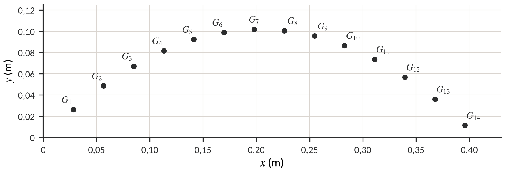{width=12cm}
:::

::: {custom-style="Legende"}
Figure 12. Chronophotographie d'un lancer ($\tau = 20\ \text{ms}$, $v_0 = 2{,}0\ \text{m·s}^{-1}$, $\alpha = 45°$)
:::

::: {custom-style="Remarque"}
[Remarque.]{custom-style="EtiqRemarque"} L'exercice peut vous poser la question dans l'autre sens, en vous demandant si le graphique est conforme à l'équation de la trajectoire obtenue. Dans ce cas, il suffit de remarquer que la trajectoire représentée est une parabole, dont l'équation doit être une fonction du second degré, ce qui est le cas de la trajectoire déterminée analytiquement.
:::

#### [Corrigé]{custom-style="NumCorrige"}\ \ Q.11 · Quelles sont les caractéristiques du vecteur vitesse au sommet de la trajectoire ? {#c_q11}

::: {custom-style="Renvoi"}
[CIBLE:q11]{custom-style="BoutonEnonce"}
:::

Au cours du mouvement, la vitesse est toujours tangente à la trajectoire. Plus précisément, en un point, la vitesse a donc la même direction que la tangente à la courbe en ce point. Au sommet de la trajectoire, la tangente à la courbe est horizontale, ce qui signifie que le vecteur vitesse est lui aussi horizontal (figure 13). On peut en conclure que sa composante verticale $v_y$ est nulle.

::: {custom-style="Retenir"}
Au sommet, le vecteur vitesse est horizontal, orienté dans le sens du mouvement, de norme $v_S = v_0 \times \cos(\alpha)$.
:::

::: {custom-style="Figure"}
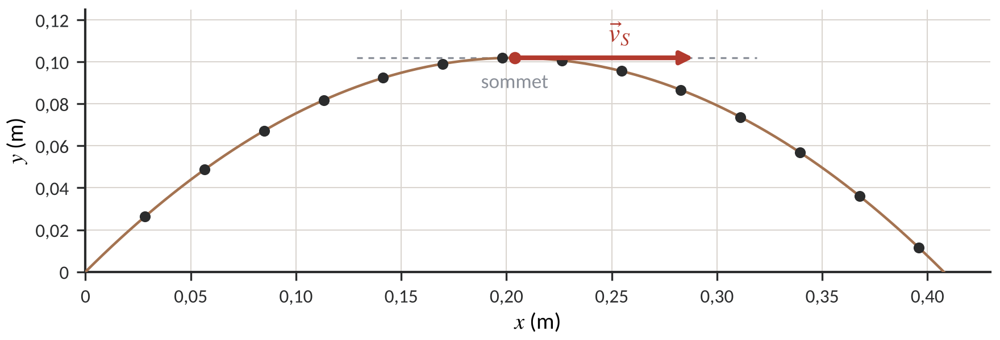{width=12cm}
:::

::: {custom-style="Legende"}
Figure 13. Au sommet de la trajectoire, le vecteur vitesse $\vec{v}_S$ est horizontal
:::

::: {custom-style="Remarque"}
[Remarque.]{custom-style="EtiqRemarque"} La vitesse n'est pas nulle au sommet : sa composante horizontale garde la valeur $v_x = v_0 \times \cos(\alpha)$ pendant tout le mouvement. La norme de la vitesse y est simplement minimale.
:::

#### [Corrigé]{custom-style="NumCorrige"}\ \ Q.12 · Déterminer l'instant auquel le mobile atteint le sommet de la trajectoire. En déduire la hauteur maximale atteinte {#c_q12}

::: {custom-style="Renvoi"}
[CIBLE:q12]{custom-style="BoutonEnonce"}
:::

On a montré précédemment (Q.11) qu'au sommet de la trajectoire $v_y = 0$. Notons $t_S$ l'instant où on atteint le sommet de la trajectoire. En particulier :

$$v_y(t_S) = 0$$

Or, on a déterminé précédemment (Q.9) l'expression de la composante verticale de la vitesse :

$$\cR{v_y(t) = -g \times t + v_0 \times \sin(\alpha)}$$

À $t = t_S$, il vient donc :

$$-g \times t_S + v_0 \times \sin(\alpha) = 0$$

$$-g \times t_S = -v_0 \times \sin(\alpha)$$

::: {custom-style="Retenir"}
$t_S = \dfrac{v_0 \times \sin(\alpha)}{g}$
:::

Pour déterminer la hauteur maximale, il faut ensuite remplacer l'expression de $t_S$ dans l'équation horaire $y(t)$ :

$$y(t) = -\dfrac{1}{2} g \times t^{2} + v_0 \times \sin(\alpha) \times t + H$$

À l'instant $t = t_S$, il vient :

$$y(t_S) = -\dfrac{1}{2} g \times t_S^{2} + v_0 \times \sin(\alpha) \times t_S + H$$

$$y(t_S) = -\dfrac{1}{2} g \times \left(\dfrac{v_0 \times \sin(\alpha)}{g}\right)^{2} + v_0 \times \sin(\alpha) \times \dfrac{v_0 \times \sin(\alpha)}{g} + H$$

$$y(t_S) = -\dfrac{1}{2} g \times \dfrac{v_0^{2} \times \sin^{2}(\alpha)}{g^{2}} + \dfrac{v_0^{2} \times \sin^{2}(\alpha)}{g} + H$$

$$y(t_S) = -\dfrac{1}{2} \times \dfrac{v_0^{2} \times \sin^{2}(\alpha)}{g} + \dfrac{v_0^{2} \times \sin^{2}(\alpha)}{g} + H$$

On factorise par le terme $\dfrac{v_0^{2} \times \sin^{2}(\alpha)}{g}$ :

$$y(t_S) = \dfrac{v_0^{2} \times \sin^{2}(\alpha)}{g} \times \left(-\dfrac{1}{2} + 1\right) + H = \dfrac{v_0^{2} \times \sin^{2}(\alpha)}{g} \times \dfrac{1}{2} + H$$

::: {custom-style="Retenir"}
$H_{\text{max}} = y(t_S) = \dfrac{v_0^{2} \times \sin^{2}(\alpha)}{2g} + H$
:::

Si le mobile part d'une hauteur $H = 0$, l'expression se simplifie en :

$$H_{\text{max}} = y(t_S) = \dfrac{v_0^{2} \times \sin^{2}(\alpha)}{2g}$$

#### [Corrigé]{custom-style="NumCorrige"}\ \ Q.13 · Déterminer la portée du mouvement (distance maximale parcourue horizontalement) {#c_q13}

::: {custom-style="Renvoi"}
[CIBLE:q13]{custom-style="BoutonEnonce"}
:::

La portée correspond à l'endroit où le mobile touche le sol, soit $y(x) = 0$. Vous remarquerez qu'on a posé $y(x) = 0$ et non $y(t) = 0$. La raison est simple : la première égalité permet de trouver directement l'abscisse, alors que la seconde permet de déterminer l'instant correspondant à la portée (l'instant où on touche le sol).

Procédons en notant $x_p$ la portée. D'après l'équation de la trajectoire (voir Q.10) :

$$y(x_p) = -\dfrac{1}{2} g \times \dfrac{x_p^{2}}{(v_0 \times \cos(\alpha))^{2}} + \tan(\alpha) \times x_p + H = 0$$

Il s'agit d'une équation du second degré, que l'on met sous la forme :

$$\cR{-\dfrac{1}{2} \times \dfrac{g}{(v_0 \times \cos(\alpha))^{2}}} \times x_p^{2} + \cB{\tan(\alpha)} \times x_p + \cV{H} = 0$$

La forme générale de cette équation du second degré est :

$$\cR{a} x^{2} + \cB{b} x + \cV{c} = 0$$

Par identification, on a :

$$a = -\dfrac{1}{2} \times \dfrac{g}{(v_0 \times \cos(\alpha))^{2}} \qquad b = \tan(\alpha) \qquad c = H$$

Deux méthodes sont alors possibles : résoudre cette équation « à la main » ou, judicieusement, utiliser la calculatrice.

**À la main.** On calcule au préalable $a$, $b$ et $c$. Puis on calcule le discriminant :

$$\Delta = b^{2} - 4ac$$

En général, on trouve pour ce type d'exercice $\Delta > 0$. On en déduit donc que l'équation admet deux racines réelles. Comme $a$ est négatif :

$$x_1 = \dfrac{-b + \sqrt{\Delta}}{2a} < 0 \quad \text{: solution non admissible}$$

$$x_2 = \dfrac{-b - \sqrt{\Delta}}{2a} > 0$$

On conclut alors que :

::: {custom-style="Retenir"}
$x_p = x_2$ (car la portée est nécessairement positive)
:::

**À la calculatrice.** On se rend dans le module de résolution d'équations de la calculatrice et on saisit l'équation sans faire de calcul intermédiaire (on fait tous les calculs lors de la saisie de l'équation). En fonction de votre calculatrice, vous serez amené soit à saisir distinctement les valeurs de $a$, $b$ et $c$, soit à saisir toute l'équation.

**Application numérique.** Avec les données de l'énoncé, $H = 1\ \text{m}$, $\alpha = 45°$, $v_0 = 10\ \text{m·s}^{-1}$ et $g = 10\ \text{m·s}^{-2}$ :

$$a = -\dfrac{1}{2} \times \dfrac{10}{(10 \times \cos(45°))^{2}} = -0{,}10\ \text{m}^{-1} \qquad b = \tan(45°) = 1{,}0 \qquad c = 1\ \text{m}$$

$$\Delta = 1{,}0^{2} - 4 \times (-0{,}10) \times 1 = 1{,}4$$

On trouve comme prévu deux solutions, dont une négative $x_1$ et une positive $x_2$ :

$$x_1 = \dfrac{-1{,}0 + \sqrt{1{,}4}}{2 \times (-0{,}10)} = -0{,}92\ \text{m} \qquad x_2 = \dfrac{-1{,}0 - \sqrt{1{,}4}}{2 \times (-0{,}10)} = 11\ \text{m}$$

On a donc $x_p = x_2 = 11\ \text{m}$.

::: {custom-style="Piege"}
[Piège.]{custom-style="EtiqPiege"} Avant de saisir $\cos(45°)$ ou $\tan(45°)$, vérifiez que la calculatrice est en mode degré. En mode radian, elle renvoie ici $9{,}5\ \text{m}$ sans signaler la moindre erreur.
:::

::: {custom-style="Remarque"}
[Remarque.]{custom-style="EtiqRemarque"} En présence de frottements, pour un angle initial inchangé, il faudra augmenter la vitesse pour garder la même portée, car les frottements s'opposent au mouvement et le ralentissent.
:::

#### [Corrigé]{custom-style="NumCorrige"}\ \ Q.14 · Déterminer la vitesse initiale que le mobile doit avoir pour atteindre une distance $x_p = 15\ \text{m}$ {#c_q14}

::: {custom-style="Renvoi"}
[CIBLE:q14]{custom-style="BoutonEnonce"}
:::

On repart de l'équation du second degré (voir Q.13) :

$$-\dfrac{1}{2} \times \dfrac{g}{(v_0 \times \cos(\alpha))^{2}} \times x_p^{2} + \tan(\alpha) \times x_p + H = 0$$

Dans cette expression, l'inconnue devient $v_0$. On isole donc $v_0$ :

$$-\dfrac{1}{2} \times \dfrac{g}{(v_0 \times \cos(\alpha))^{2}} \times x_p^{2} = -\tan(\alpha) \times x_p - H$$

On multiplie l'équation par $-1$ :

$$\dfrac{1}{2} \times \dfrac{g}{(v_0 \times \cos(\alpha))^{2}} \times x_p^{2} = \tan(\alpha) \times x_p + H$$

$$\dfrac{g}{(v_0 \times \cos(\alpha))^{2}} \times x_p^{2} = 2 \times (\tan(\alpha) \times x_p + H)$$

$$\dfrac{1}{(v_0 \times \cos(\alpha))^{2}} = \dfrac{2 \times (\tan(\alpha) \times x_p + H)}{g \times x_p^{2}}$$

On passe à l'inverse :

$$(v_0 \times \cos(\alpha))^{2} = \dfrac{g \times x_p^{2}}{2 \times (\tan(\alpha) \times x_p + H)}$$

On passe ensuite à la racine carrée et on développe le dénominateur :

$$v_0 \times \cos(\alpha) = \sqrt{\dfrac{g}{2 \times \tan(\alpha) \times x_p + 2H}} \times \sqrt{x_p^{2}} = \sqrt{\dfrac{g}{2 \times \tan(\alpha) \times x_p + 2H}} \times x_p$$

::: {custom-style="Retenir"}
$v_0 = \sqrt{\dfrac{g}{2 \times \tan(\alpha) \times x_p + 2H}} \times \dfrac{x_p}{\cos(\alpha)}$
:::

Il ne reste plus qu'à faire l'application numérique en prenant $x_p = 15\ \text{m}$, avec les données de Q.13, soit $H = 1\ \text{m}$, $\alpha = 45°$ et $g = 10\ \text{m·s}^{-2}$ :

$$v_0 = \sqrt{\dfrac{10}{2 \times \tan(45°) \times 15 + 2 \times 1}} \times \dfrac{15}{\cos(45°)} = 12\ \text{m·s}^{-1}$$

::: {custom-style="Methode"}
[Méthode.]{custom-style="EtiqMethode"} Pour vérifier une expression littérale aussi longue, contrôlez son unité. Sous la racine, $g$ est en $\text{m·s}^{-2}$ et le dénominateur en mètre : le quotient est en $\text{s}^{-2}$ et sa racine en $\text{s}^{-1}$. Multipliée par une longueur, elle donne bien une vitesse en $\text{m·s}^{-1}$.
:::

#### [Corrigé]{custom-style="NumCorrige"}\ \ Exercice 2 · Tirer à la pétanque {#c_ex2}

::: {custom-style="Renvoi"}
[CIBLE:ex2]{custom-style="BoutonEnonce"}
:::

::: {custom-style="QRappel"}
**1.** Bilan des forces et accélération
:::

On étudie le système {boule} dans le référentiel terrestre supposé galiléen. L'action de l'air étant négligée, la boule n'est soumise qu'à son poids $\vec{P} = m \times \vec{g}$ : elle est en chute libre.

La deuxième loi de Newton s'écrit $m \times \vec{g} = m \times \vec{a}$, donc $\vec{a} = \vec{g}$. L'axe $(Oy)$ étant orienté vers le haut :

$$\vec{a}\ \begin{cases} a_x = 0 \\ a_y = -g \end{cases}$$

::: {custom-style="QRappel"}
**2.** Coordonnées de la vitesse
:::

On projette le vecteur vitesse initiale sur les deux axes :

$$\vec{v}_0\ \begin{cases} v_{0x} = v_0 \times \cos(\alpha) \\ v_{0y} = v_0 \times \sin(\alpha) \end{cases}$$

On cherche une primitive de chaque coordonnée de l'accélération : $v_x(t) = K_1$ et $v_y(t) = -g \times t + K_2$. À la date $t = 0$, $\vec{v} = \vec{v}_0$, donc $K_1 = v_0 \times \cos(\alpha)$ et $K_2 = v_0 \times \sin(\alpha)$ :

$$\vec{v}(t)\ \begin{cases} v_x(t) = v_0 \times \cos(\alpha) \\ v_y(t) = -g \times t + v_0 \times \sin(\alpha) \end{cases}$$

::: {custom-style="QRappel"}
**3.** Équations horaires
:::

On cherche une primitive de chaque coordonnée de la vitesse : $x(t) = v_0 \times \cos(\alpha) \times t + K_3$ et $y(t) = -\dfrac{1}{2} g \times t^{2} + v_0 \times \sin(\alpha) \times t + K_4$. À la date $t = 0$, la boule est au point de coordonnées $(0\ ;\ H)$, donc $K_3 = 0$ et $K_4 = H$ :

::: {custom-style="Retenir"}
$\overrightarrow{OG}(t)\ \begin{cases} x(t) = v_0 \times \cos(\alpha) \times t \\ y(t) = -\dfrac{1}{2} g \times t^{2} + v_0 \times \sin(\alpha) \times t + H \end{cases}$
:::

::: {custom-style="QRappel"}
**4.** Équation de la trajectoire
:::

D'après la première équation horaire, $t = \dfrac{x}{v_0 \times \cos(\alpha)}$. On remplace dans la seconde :

$$y(x) = -\dfrac{1}{2} g \times \dfrac{x^{2}}{(v_0 \times \cos(\alpha))^{2}} + \tan(\alpha) \times x + H$$

Application numérique des coefficients :

$$\dfrac{g}{2 \times (v_0 \times \cos(\alpha))^{2}} = \dfrac{9{,}81}{2 \times (7{,}0 \times \cos(40°))^{2}} = 0{,}171\ \text{m}^{-1} \qquad \tan(40°) = 0{,}839$$

On obtient bien :

$$y(x) = -0{,}171 \times x^{2} + 0{,}839 \times x + 1{,}10$$

::: {custom-style="QRappel"}
**5.** Sommet de la trajectoire
:::

Au sommet, le vecteur vitesse est horizontal : $v_y(t_S) = 0$. Donc :

$$-g \times t_S + v_0 \times \sin(\alpha) = 0 \quad \text{soit} \quad t_S = \dfrac{v_0 \times \sin(\alpha)}{g} = \dfrac{7{,}0 \times \sin(40°)}{9{,}81} = 0{,}46\ \text{s}$$

On remplace dans $y(t)$ (le calcul littéral est détaillé en Q.12) :

::: {custom-style="Retenir"}
$H_{\text{max}} = \dfrac{v_0^{2} \times \sin^{2}(\alpha)}{2g} + H = \dfrac{(7{,}0 \times \sin(40°))^{2}}{2 \times 9{,}81} + 1{,}10 = 2{,}1\ \text{m}$
:::

::: {custom-style="QRappel"}
**6.** Point de chute
:::

La boule touche le sol quand $y(x_p) = 0$ :

$$-0{,}171 \times x_p^{2} + 0{,}839 \times x_p + 1{,}10 = 0$$

C'est une équation du second degré, avec $a = -0{,}171\ \text{m}^{-1}$, $b = 0{,}839$ et $c = 1{,}10\ \text{m}$ :

$$\Delta = b^{2} - 4ac = 0{,}839^{2} - 4 \times (-0{,}171) \times 1{,}10 = 1{,}46$$

$$x_1 = \dfrac{-0{,}839 + \sqrt{1{,}46}}{2 \times (-0{,}171)} = -1{,}1\ \text{m} \qquad x_2 = \dfrac{-0{,}839 - \sqrt{1{,}46}}{2 \times (-0{,}171)} = 6{,}0\ \text{m}$$

Seule la solution positive convient : $x_p = 6{,}0\ \text{m}$. Le cochonnet est placé à $D = 6{,}00\ \text{m}$ : à la précision des données, la boule retombe sur le cochonnet. Le tir est réussi.

::: {custom-style="QRappel"}
**7.** Durée du vol et vitesse à l'impact
:::

D'après la première équation horaire, avec la valeur non arrondie $x_p = 5{,}995\ \text{m}$ :

$$t_p = \dfrac{x_p}{v_0 \times \cos(\alpha)} = \dfrac{5{,}995}{7{,}0 \times \cos(40°)} = 1{,}118\ \text{s}$$

Le vol dure donc environ $1{,}1\ \text{s}$. Les coordonnées de la vitesse à cette date sont :

$$v_x = v_0 \times \cos(\alpha) = 5{,}36\ \text{m·s}^{-1} \qquad v_y = -9{,}81 \times 1{,}118 + 7{,}0 \times \sin(40°) = -6{,}47\ \text{m·s}^{-1}$$

::: {custom-style="Retenir"}
$v = \sqrt{v_x^{2} + v_y^{2}} = \sqrt{5{,}36^{2} + (-6{,}47)^{2}} = 8{,}4\ \text{m·s}^{-1}$
:::

La boule arrive au sol plus vite qu'elle n'a été lancée : elle est descendue de $1{,}10\ \text{m}$ entre le lancer et l'impact.

```{=openxml}
<w:p><w:r><w:br w:type="page"/></w:r></w:p>
```

::: {custom-style="QRappel"}
**8.** Vitesse initiale pour un cochonnet à 6,5 m
:::

On isole $v_0$ dans l'équation $y(x_p) = 0$ (le calcul est détaillé en Q.14) :

$$v_0 = \sqrt{\dfrac{g}{2 \times \tan(\alpha) \times x_p + 2H}} \times \dfrac{x_p}{\cos(\alpha)}$$

::: {custom-style="Retenir"}
$v_0 = \sqrt{\dfrac{9{,}81}{2 \times \tan(40°) \times 6{,}5 + 2 \times 1{,}10}} \times \dfrac{6{,}5}{\cos(40°)} = 7{,}3\ \text{m·s}^{-1}$
:::

Il suffit d'augmenter la vitesse de lancer de $0{,}3\ \text{m·s}^{-1}$ pour gagner 50 cm de portée.

::: {custom-style="Redaction"}
[Rédaction.]{custom-style="EtiqRedaction"} Quand l'énoncé demande de « montrer que » l'équation de la trajectoire a une forme donnée, écrivez l'expression littérale avant les valeurs, puis concluez par « On obtient bien… ». Le correcteur doit voir d'où viennent les coefficients $0{,}171$ et $0{,}839$.
:::

::: {custom-style="Surtitre"}
Corrigés
:::

# Corrigés du thème 3 : mesurer une vitesse et une accélération {#c_theme3}

#### [Corrigé]{custom-style="NumCorrige"}\ \ Q.15 · Mini-exercice : mouvement d'une voiture sur un axe horizontal {#c_q15}

::: {custom-style="Renvoi"}
[CIBLE:q15]{custom-style="BoutonEnonce"}
:::

::: {custom-style="QRappel"}
**1.** Équation horaire $x(t)$
:::

Le mouvement a lieu sur un seul axe $(Ox)$. On assimile donc chaque grandeur à sa coordonnée suivant cet axe. En particulier $a_x = a$.

Pour obtenir la vitesse, on cherche une primitive :

$$v(t) = a \times t + \text{cte}$$

On utilise la condition initiale sur la vitesse pour déterminer la valeur de la constante :

$$v(t = 0) = v_0 = a \times 0 + \text{cte} = \text{cte}$$

On a donc $\text{cte} = v_0$, d'où :

$$v(t) = a \times t + v_0$$

Pour obtenir l'équation horaire selon $x$, on cherche une primitive de la vitesse. Il vient :

$$x(t) = \dfrac{1}{2} \times a \times t^{2} + v_0 \times t + \text{cte}$$

Avec les conditions initiales :

$$x(t = 0) = \text{cte} = 0$$

D'où :

::: {custom-style="Retenir"}
$x(t) = \dfrac{1}{2} \times a \times t^{2} + v_0 \times t$
:::

::: {custom-style="Remarque"}
[Remarque.]{custom-style="EtiqRemarque"} $x(t)$ correspond également à la distance parcourue à l'instant $t$.
:::

::: {custom-style="QRappel"}
**2.** Valeur de l'accélération
:::

L'accélération étant constante, on a :

$$a = \dfrac{\Delta v}{\Delta t} = \dfrac{v_A - v_0}{\Delta t}$$

avec $\Delta t = 5{,}4\ \text{s}$.

Application numérique (il faut convertir les vitesses en $\text{m·s}^{-1}$ en les divisant par 3,6) :

::: {custom-style="Retenir"}
$a = \dfrac{\dfrac{70}{3{,}6} - \dfrac{30}{3{,}6}}{5{,}4} = 2{,}1\ \text{m·s}^{-2}$
:::

**Pour aller plus loin.** L'équation horaire donne alors la distance parcourue entre $O$ et $A$ :

$$x(5{,}4\ \text{s}) = \dfrac{1}{2} \times 2{,}06 \times 5{,}4^{2} + \dfrac{30}{3{,}6} \times 5{,}4 = 75\ \text{m}$$

::: {custom-style="Piege"}
[Piège.]{custom-style="EtiqPiege"} Une vitesse en $\text{km·h}^{-1}$ ne peut pas être utilisée avec une durée en seconde : $1\ \text{m·s}^{-1} = 3{,}6\ \text{km·h}^{-1}$, donc on divise par 3,6 pour passer en $\text{m·s}^{-1}$.
:::

#### [Corrigé]{custom-style="NumCorrige"}\ \ Q.16 · Déterminer graphiquement la valeur de l'accélération à partir du graphe de la vitesse $v(t)$ {#c_q16}

::: {custom-style="Renvoi"}
[CIBLE:q16]{custom-style="BoutonEnonce"}
:::

Pour un mouvement rectiligne, si l'on donne le graphe de la fonction $v(t)$, l'accélération en un point correspond à la pente de la tangente en ce point. Si le graphe est une droite, comme sur la figure 6, alors l'accélération peut être supposée constante et égale au coefficient directeur de la droite. En effet, la vitesse s'écrit alors $v(t) = a \times t + v_0$ : le coefficient directeur est l'accélération $a$. Sur la figure 6, la droite passe par l'origine, donc $v(t) = a \times t$.

::: {custom-style="Methode"}
[Méthode.]{custom-style="EtiqMethode"} Pour déterminer le coefficient directeur d'une droite ou d'une tangente, il suffit de considérer deux points de la droite ou de la tangente, par exemple $A(x_A\ ;\ y_A)$ et $B(x_B\ ;\ y_B)$, et d'appliquer la formule :

$$\text{pente} = \text{accélération} = \dfrac{y_B - y_A}{x_B - x_A}$$
:::

**Application à la figure 6.** On choisit deux points de la droite modèle éloignés l'un de l'autre : $A(0\ \text{s}\ ;\ 0\ \text{km·h}^{-1})$ et $B(9{,}0\ \text{s}\ ;\ 108\ \text{km·h}^{-1})$. On convertit la vitesse : $108\ \text{km·h}^{-1} = \dfrac{108}{3{,}6} = 30\ \text{m·s}^{-1}$.

::: {custom-style="Figure"}
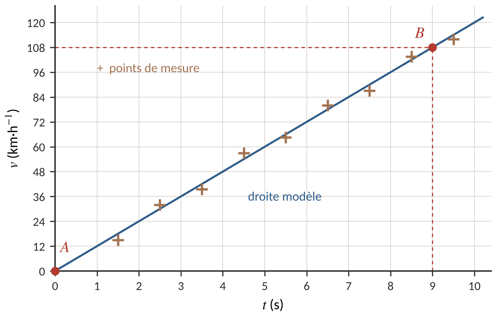{width=10.5cm}
:::

::: {custom-style="Legende"}
Figure 6 annotée. Lecture des points $A$ et $B$ sur la droite modèle
:::

::: {custom-style="Retenir"}
$a = \dfrac{v_B - v_A}{t_B - t_A} = \dfrac{30 - 0}{9{,}0 - 0} = 3{,}3\ \text{m·s}^{-2}$
:::

::: {custom-style="Piege"}
[Piège.]{custom-style="EtiqPiege"} Les deux points se lisent sur la droite tracée, pas parmi les points de mesure, qui sont dispersés autour d'elle. Et la pente n'est une accélération en $\text{m·s}^{-2}$ que si la vitesse est exprimée en $\text{m·s}^{-1}$.
:::

#### [Corrigé]{custom-style="NumCorrige"}\ \ Q.17 · Déterminer graphiquement la valeur de l'accélération sur une chronophotographie {#c_q17}

::: {custom-style="Renvoi"}
[CIBLE:q17]{custom-style="BoutonEnonce"}
:::

::: {custom-style="QRappel"}
**1.** Vitesses $v_9$ et $v_{11}$ et vecteurs associés
:::

Pour déterminer la vitesse à un instant $t_i$ sur une chronophotographie, il faut utiliser la formule :

::: {custom-style="Retenir"}
$v_i = \dfrac{G_{i-1}G_{i+1}}{2\tau}$
:::

avec $\tau$ correspondant à la durée qui s'écoule entre deux mesures. On peut donc écrire :

$$v_9 = \dfrac{G_8G_{10}}{2\tau} \quad \text{et} \quad v_{11} = \dfrac{G_{10}G_{12}}{2\tau}$$

Il faut donc ensuite mesurer les distances $G_8G_{10}$ et $G_{10}G_{12}$ sur la figure. Pour cela, on remarque que la figure est à l'échelle 1/2 (cette information est indiquée sur le schéma). Cela signifie que les distances sur la figure sont égales à la moitié des distances réelles. Autrement dit, 1 cm sur le schéma équivaut à 2 cm en réalité.

On mesure alors (figure 14) :

$$G_8G_{10} = 2{,}9\ \text{cm sur le schéma, soit}\ 2{,}9 \times 2 = 5{,}8\ \text{cm en réalité}$$

$$G_{10}G_{12} = 3{,}2\ \text{cm sur le schéma, soit}\ 3{,}2 \times 2 = 6{,}4\ \text{cm en réalité}$$

On peut ainsi déterminer les vitesses :

$$v_9 = \dfrac{G_8G_{10}}{2\tau} = \dfrac{2{,}9 \times 2}{2 \times 20 \times 10^{-3}} = 145\ \text{cm·s}^{-1} = 1{,}45\ \text{m·s}^{-1}$$

Avec une échelle de 1 cm pour $0{,}5\ \text{m·s}^{-1}$, la longueur du vecteur $\vec{v}_9$ sur le schéma est :

$$\dfrac{1{,}45}{0{,}5} = 2{,}9\ \text{cm}$$

Et :

$$v_{11} = \dfrac{G_{10}G_{12}}{2\tau} = \dfrac{3{,}2 \times 2}{2 \times 20 \times 10^{-3}} = 160\ \text{cm·s}^{-1} = 1{,}60\ \text{m·s}^{-1}$$

Avec une échelle de 1 cm pour $0{,}5\ \text{m·s}^{-1}$, la longueur du vecteur $\vec{v}_{11}$ sur le schéma est :

$$\dfrac{1{,}60}{0{,}5} = 3{,}2\ \text{cm}$$

Le vecteur $\vec{v}_9$ a pour origine le point $G_9$. Il est parallèle à la droite $(G_8G_{10})$ et orienté dans le sens du mouvement. De même, le vecteur $\vec{v}_{11}$ a pour origine $G_{11}$ et il est parallèle à la droite $(G_{10}G_{12})$.

::: {custom-style="Figure"}
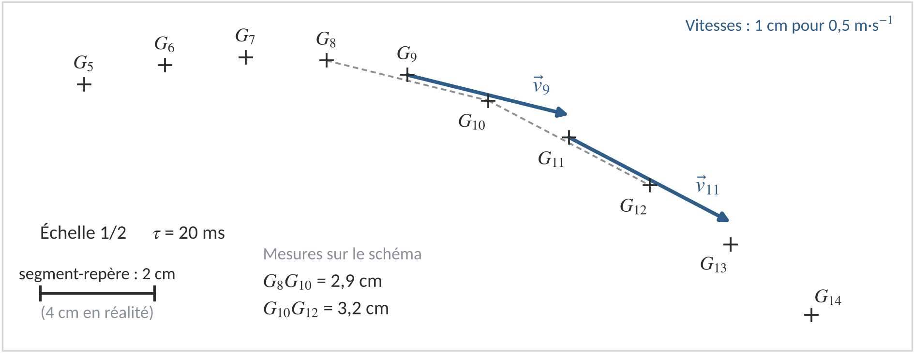{width=16cm}
:::

::: {custom-style="Legende"}
Figure 14. Mesure des distances $G_8G_{10}$ et $G_{10}G_{12}$, puis tracé des vecteurs $\vec{v}_9$ et $\vec{v}_{11}$
:::

::: {custom-style="Remarque"}
[Remarque.]{custom-style="EtiqRemarque"} Avec les deux échelles de cet énoncé, la longueur d'un vecteur vitesse sur le schéma est égale à la distance mesurée entre les deux positions qui l'encadrent (2,9 cm et 3,2 cm). C'est une conséquence des valeurs choisies ici, pas une règle générale : refaites toujours le calcul.
:::

::: {custom-style="QRappel"}
**2.** Vecteur variation de vitesse $\Delta\vec{v} = \vec{v}_{11} - \vec{v}_9$
:::

Pour construire cette différence de vecteurs au point $G_{10}$, on suit trois étapes (figure 15).

**Étape 1.** On ramène d'abord le vecteur $\vec{v}_{11}$ au niveau du point $G_{10}$. Il s'agit de la construction en bleu sur le schéma. Attention, le vecteur $\vec{v}_{11}$ tracé en $G_{11}$ (figure 14) et celui tracé en $G_{10}$ sont identiques : ils sont donc parallèles et de même longueur.

**Étape 2.** On construit à présent le vecteur $-\vec{v}_9$ à l'extrémité du vecteur $\vec{v}_{11}$ que l'on vient de tracer (construction en gris). Il est parallèle à $\vec{v}_9$, de même longueur et de sens opposé.

**Étape 3.** On peut alors construire le vecteur $\vec{v}_{11} - \vec{v}_9$, en partant de l'origine $G_{10}$ jusqu'à l'extrémité du vecteur $-\vec{v}_9$ (construction en vert).

::: {custom-style="Figure"}
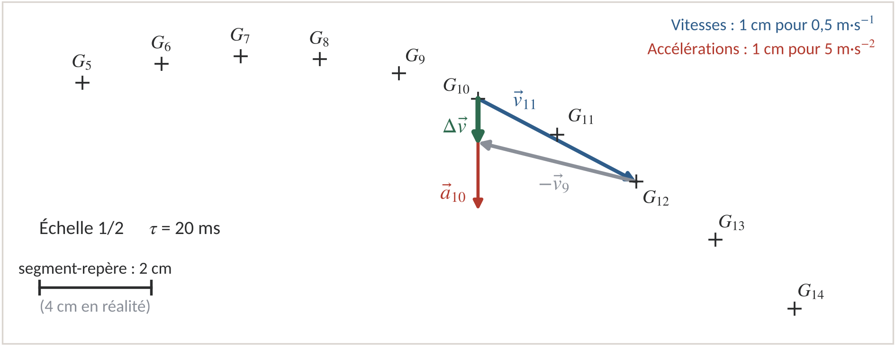{width=16cm}
:::

::: {custom-style="Legende"}
Figure 15. Construction de $\Delta\vec{v} = \vec{v}_{11} - \vec{v}_9$ au point $G_{10}$, puis du vecteur accélération $\vec{a}_{10}$
:::

Pour trouver la norme du vecteur $\Delta\vec{v}$ que l'on vient de construire, il faut mesurer sa longueur sur le schéma, puis utiliser l'échelle des vitesses pour déterminer la norme de ce vecteur (homogène à une vitesse).

Avec la précision que permet le schéma, on mesure une longueur égale à 0,8 cm. Or, d'après l'échelle des vitesses, 1 cm représente $0{,}5\ \text{m·s}^{-1}$. Donc :

::: {custom-style="Retenir"}
$\Delta v = 0{,}8 \times 0{,}5 = 0{,}4\ \text{m·s}^{-1}$
:::

::: {custom-style="QRappel"}
**3.** Accélération $a_{10}$ et vecteur associé
:::

Pour déterminer la norme de l'accélération sur une chronophotographie, on peut utiliser la formule :

$$a_i = \dfrac{\Delta v_{(i-1) \rightarrow (i+1)}}{2\tau}$$

On peut donc écrire, avec les notations de l'énoncé :

::: {custom-style="Retenir"}
$a_{10} = \dfrac{\Delta v}{2\tau} = \dfrac{0{,}4}{2 \times 20 \times 10^{-3}} = 10\ \text{m·s}^{-2}$
:::

Pour la construction du vecteur $\vec{a}_{10}$, on utilise l'échelle de l'accélération : 1 cm représente $5\ \text{m·s}^{-2}$. On en déduit la longueur du vecteur sur le schéma :

$$\dfrac{10}{5} = 2{,}0\ \text{cm}$$

On peut donc placer le vecteur $\vec{a}_{10}$, qui est colinéaire à $\Delta\vec{v}$, de même sens, et de longueur 2,0 cm (en rouge sur la figure 15).

::: {custom-style="Remarque"}
[Remarque.]{custom-style="EtiqRemarque"} Le vecteur accélération obtenu est vertical, dirigé vers le bas, et sa valeur est proche de $g = 9{,}8\ \text{m·s}^{-2}$ : c'est bien ce que prévoit la deuxième loi de Newton pour une chute libre (voir Q.2). Une construction à la main donne une valeur comprise entre 9 et 11 $\text{m·s}^{-2}$ : un écart de 1 mm sur la longueur de $\Delta\vec{v}$ change le résultat de plus de 10 %.
:::

#### [Corrigé]{custom-style="NumCorrige"}\ \ Exercice 3 · La balle du jongleur {#c_ex3}

::: {custom-style="Renvoi"}
[CIBLE:ex3]{custom-style="BoutonEnonce"}
:::

::: {custom-style="QRappel"}
**1.** Mouvement horizontal
:::

D'une position à la suivante, l'abscisse augmente toujours de la même quantité, $0{,}100\ \text{m}$, pendant la même durée $\tau = 50\ \text{ms}$. Le mouvement de $G$ selon l'axe horizontal est donc uniforme, de vitesse :

$$v_x = \dfrac{0{,}100}{50 \times 10^{-3}} = 2{,}00\ \text{m·s}^{-1}$$

::: {custom-style="QRappel"}
**2.** Vecteurs vitesse aux dates $t_3$ et $t_5$
:::

On applique la relation de l'énoncé à chaque coordonnée, avec $2\tau = 0{,}100\ \text{s}$ :

$$\vec{v}_3\ \begin{cases} v_{3x} = \dfrac{x_4 - x_2}{2\tau} = \dfrac{0{,}400 - 0{,}200}{0{,}100} = 2{,}00\ \text{m·s}^{-1} \\ v_{3y} = \dfrac{y_4 - y_2}{2\tau} = \dfrac{0{,}497 - 0{,}297}{0{,}100} = 2{,}00\ \text{m·s}^{-1} \end{cases}$$

$$\vec{v}_5\ \begin{cases} v_{5x} = \dfrac{x_6 - x_4}{2\tau} = \dfrac{0{,}600 - 0{,}400}{0{,}100} = 2{,}00\ \text{m·s}^{-1} \\ v_{5y} = \dfrac{y_6 - y_4}{2\tau} = \dfrac{0{,}598 - 0{,}497}{0{,}100} = 1{,}01\ \text{m·s}^{-1} \end{cases}$$

Les normes valent :

$$v_3 = \sqrt{2{,}00^{2} + 2{,}00^{2}} = 2{,}83\ \text{m·s}^{-1} \qquad v_5 = \sqrt{2{,}00^{2} + 1{,}01^{2}} = 2{,}24\ \text{m·s}^{-1}$$

La balle ralentit pendant qu'elle monte.

::: {custom-style="QRappel"}
**3.** Vecteur variation de vitesse
:::

$$\Delta\vec{v} = \vec{v}_5 - \vec{v}_3\ \begin{cases} \Delta v_x = 2{,}00 - 2{,}00 = 0 \\ \Delta v_y = 1{,}01 - 2{,}00 = -0{,}99\ \text{m·s}^{-1} \end{cases}$$

Sa coordonnée horizontale est nulle et sa coordonnée verticale est négative : le vecteur $\Delta\vec{v}$ est vertical et dirigé vers le bas (figure 16).

::: {custom-style="Figure"}
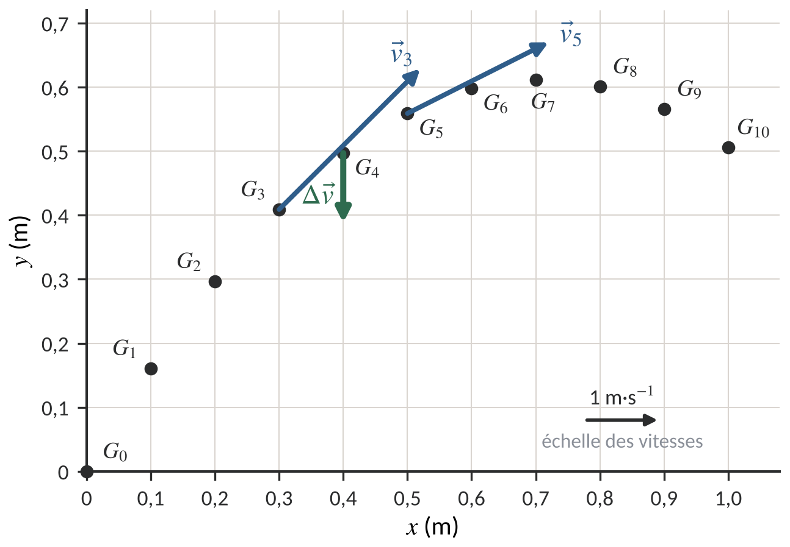{width=10.5cm}
:::

::: {custom-style="Legende"}
Figure 16. Vecteurs vitesse $\vec{v}_3$ et $\vec{v}_5$, et vecteur variation de vitesse $\Delta\vec{v}$ tracé au point $G_4$
:::

::: {custom-style="QRappel"}
**4.** Accélération à la date $t_4$
:::

Entre les dates $t_3$ et $t_5$, il s'écoule la durée $2\tau$ :

$$\vec{a}_4 = \dfrac{\Delta\vec{v}}{2\tau}\ \begin{cases} a_{4x} = 0 \\ a_{4y} = \dfrac{-0{,}99}{0{,}100} = -9{,}9\ \text{m·s}^{-2} \end{cases}$$

Le vecteur accélération est vertical, dirigé vers le bas, de norme $a_4 = 9{,}9\ \text{m·s}^{-2}$. L'écart relatif avec l'intensité de la pesanteur vaut :

$$\dfrac{\left|9{,}9 - 9{,}81\right|}{9{,}81} = 0{,}9\ \%$$

Aux erreurs de pointage près, $\vec{a}_4 = \vec{g}$.

::: {custom-style="QRappel"}
**5.** Forces qui s'exercent sur la balle
:::

D'après la deuxième loi de Newton, $\sum \vec{F}_{\text{ext}} = m \times \vec{a} = m \times \vec{g}$ : la somme des forces se réduit au poids. L'action de l'air est donc négligeable et la balle est en chute libre.

::: {custom-style="QRappel"}
**6.** Vitesse initiale et angle de lancer
:::

On calcule d'abord la coordonnée verticale de la vitesse à la date $t_1 = \tau = 0{,}050\ \text{s}$ :

$$v_{1y} = \dfrac{y_2 - y_0}{2\tau} = \dfrac{0{,}297 - 0}{0{,}100} = 2{,}97\ \text{m·s}^{-1}$$

Pour une chute libre avec un axe vertical orienté vers le haut, $v_y(t) = -g \times t + v_{0y}$ (voir Q.9). Donc :

$$v_{0y} = v_{1y} + g \times t_1 = 2{,}97 + 9{,}81 \times 0{,}050 = 3{,}46\ \text{m·s}^{-1}$$

La coordonnée horizontale reste égale à $v_{0x} = 2{,}00\ \text{m·s}^{-1}$. On en déduit :

::: {custom-style="Retenir"}
$v_0 = \sqrt{v_{0x}^{2} + v_{0y}^{2}} = \sqrt{2{,}00^{2} + 3{,}46^{2}} = 4{,}0\ \text{m·s}^{-1}$
:::

L'angle $\alpha$ vérifie :

::: {custom-style="Retenir"}
$\tan(\alpha) = \dfrac{v_{0y}}{v_{0x}} = \dfrac{3{,}46}{2{,}00} = 1{,}73 \quad \text{soit} \quad \alpha = 60°$
:::

::: {custom-style="QRappel"}
**7.** Sommet de la trajectoire
:::

Au sommet, $v_y(t_S) = 0$, donc :

$$t_S = \dfrac{v_{0y}}{g} = \dfrac{3{,}46}{9{,}81} = 0{,}35\ \text{s}$$

Cette date correspond à la position $G_7$ ($t_7 = 7\tau = 0{,}35\ \text{s}$) : c'est bien là que l'ordonnée du tableau est la plus grande. La hauteur atteinte vaut (voir Q.12, avec $H = 0$) :

$$H_{\text{max}} = \dfrac{v_{0y}^{2}}{2g} = \dfrac{3{,}46^{2}}{2 \times 9{,}81} = 0{,}61\ \text{m}$$

Le tableau donne $y_7 = 0{,}612\ \text{m}$ : le modèle de la chute libre décrit bien le mouvement.

::: {custom-style="Redaction"}
[Rédaction.]{custom-style="EtiqRedaction"} Une vitesse ou une accélération obtenue à partir de positions est une valeur approchée. Dites-le dans la conclusion : « Aux erreurs de pointage près, l'accélération est égale à $\vec{g}$. » Affirmer une égalité stricte à partir de mesures fait perdre des points.
:::

```{=openxml}
<w:p><w:r><w:br w:type="page"/></w:r></w:p>
```

# Index des notions {#index}

Chaque notion renvoie aux questions de cours (Q) et aux exercices (Ex.) où elle est travaillée.

| Notion | Où la travailler |
|---|---|
| Accélération constante sur un axe | Q.15, Q.16, Ex. 1 |
| Angle de lancer, projection de la vitesse initiale | Q.9, Ex. 2, Ex. 3 |
| Chronophotographie | Q.17, Ex. 3 |
| Chute libre | Q.1, Q.2, Ex. 1, Ex. 3 |
| Chute libre verticale | Q.3 à Q.8, Ex. 1 |
| Conditions initiales, constantes d'intégration | Q.3, Q.8, Q.9, Ex. 1, Ex. 2 |
| Conversion entre km·h^−1^ et m·s^−1^ | Q.15, Q.16 |
| Deuxième loi de Newton | Q.2, Q.9, Ex. 1, Ex. 2, Ex. 3 |
| Distance parcourue, altitude | Q.4, Q.5 |
| Durée de chute, durée de vol | Q.6, Ex. 1, Ex. 2 |
| Échelle d'un document | Q.17 |
| Équation de la trajectoire | Q.10, Ex. 2 |
| Équation du second degré | Q.13, Ex. 2 |
| Équations horaires | Q.3, Q.8, Q.9, Q.15, Ex. 1, Ex. 2 |
| Graphe de la vitesse, coefficient directeur | Q.16 |
| Hauteur maximale, flèche | Q.12, Ex. 1, Ex. 2, Ex. 3 |
| Norme du vecteur vitesse | Q.4, Ex. 2, Ex. 3 |
| Portée | Q.13, Q.14, Ex. 2 |
| Sommet de la trajectoire | Q.11, Q.12, Ex. 2, Ex. 3 |
| Vecteur accélération | Q.2, Q.9, Q.17, Ex. 3 |
| Vecteur variation de vitesse | Q.17, Ex. 3 |
| Vecteur vitesse | Q.11, Q.17, Ex. 3 |
| Vitesse à l'arrivée au sol | Q.7, Ex. 1, Ex. 2 |
| Vitesse initiale à donner | Q.14, Ex. 2 |

<!--fin:complet-->
