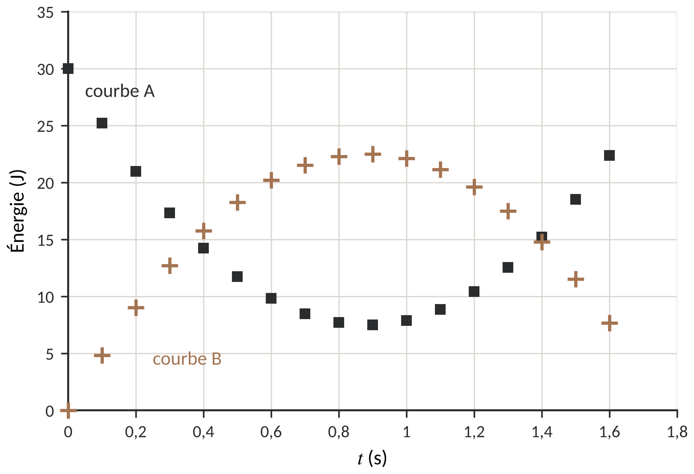
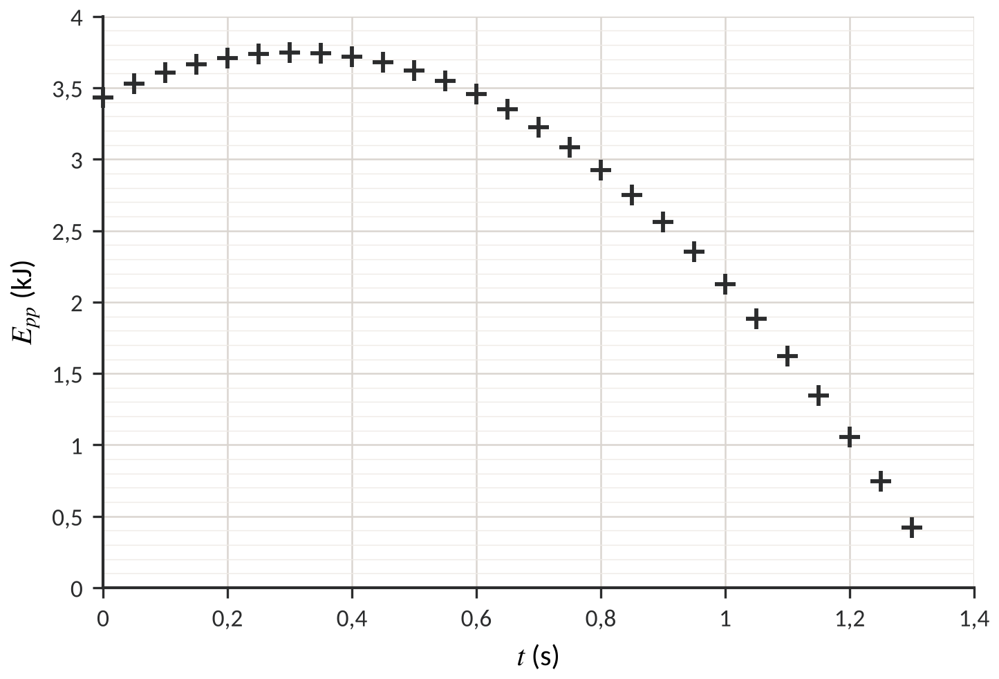
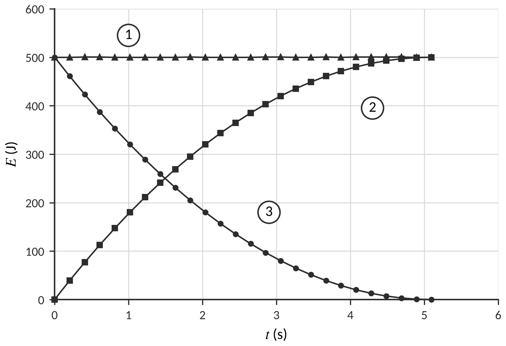
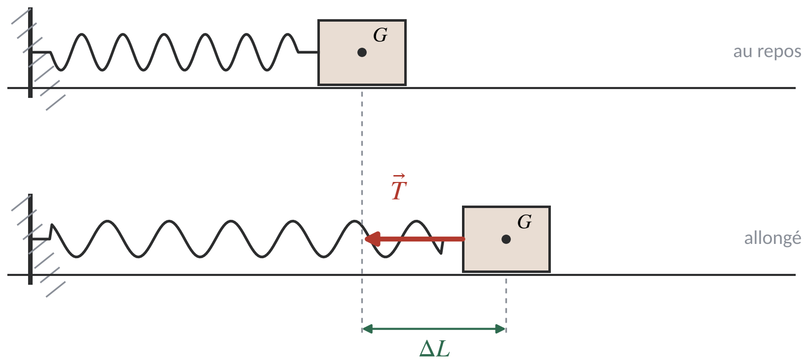
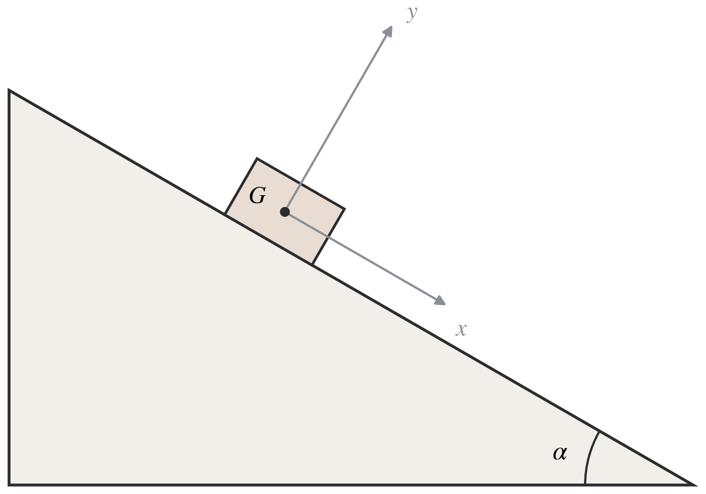
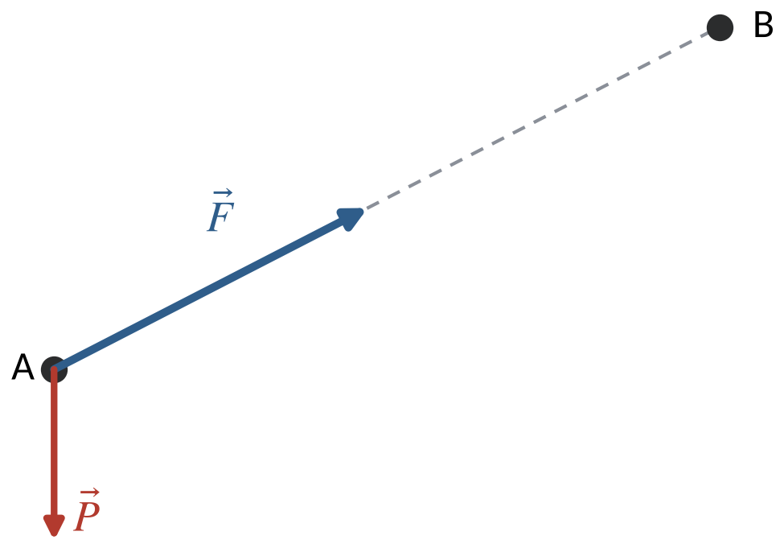
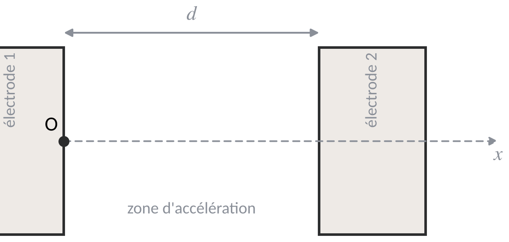
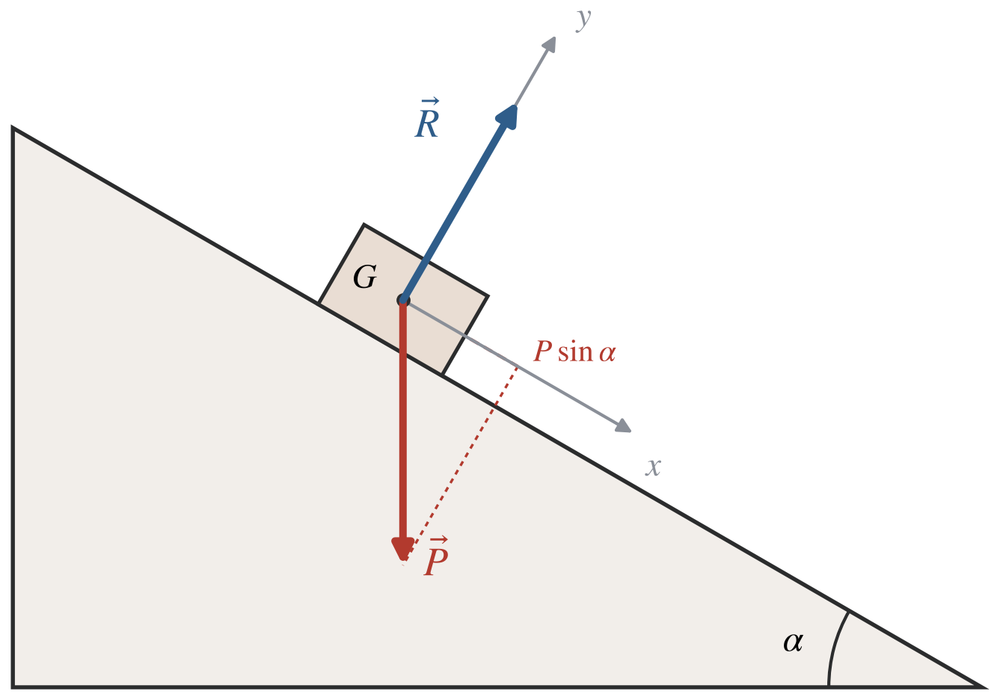
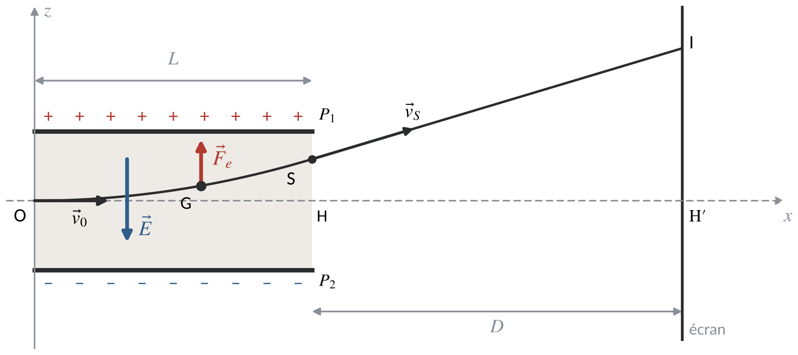
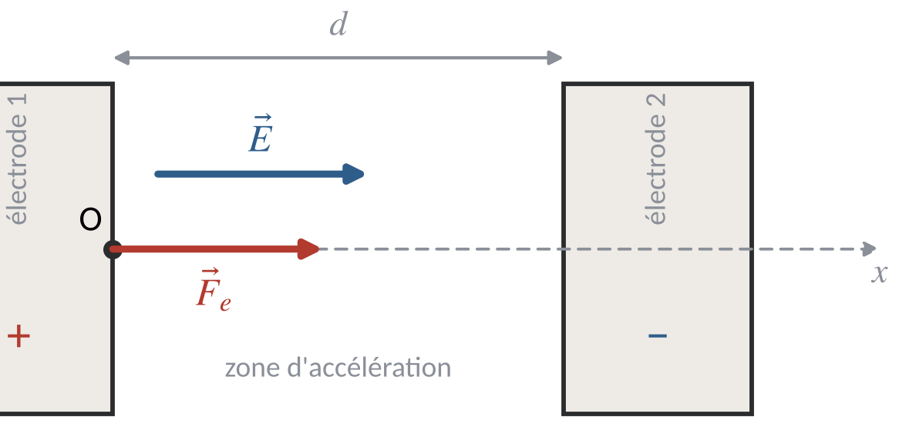

<!--meta {"numero": "2", "matiere": "Physique-Chimie", "titre": "Mécanique : énergie et champ électrique uniforme", "titre_court": "Énergie et champ électrique uniforme", "fichier": "MasterBac_PC_Fiche2_Mecanique_Energie_Champ_electrique", "fichier_cahier": "MasterBac_PC_Fiche2_Cahier_enonces"} -->

<!--inclure:ouverture-->

# L'essentiel en une page {#essentiel}

::: {custom-style="Rubrique"}
À connaître par cœur
:::

<!--colonnes: 21 37 42-->

| Notion | Relation | À retenir |
|---|---|---|
| Travail d'une force constante | $W_{AB}(\vec{F}) = \vec{F} \cdot \overrightarrow{\text{AB}} = F \times \text{AB} \times \cos\alpha$ | En joule. Moteur s'il est positif, résistant s'il est négatif. |
| Énergies | $E_c = \dfrac{1}{2} m v^{2} \quad \text{et} \quad E_{pp} = m g z$ | $E_m = E_c + E_{pp}$. L'origine de $E_{pp}$ est fixée par l'énoncé. |
| Théorème de l'énergie cinétique | $E_c(B) - E_c(A) = \sum W_{AB}(\vec{F})$ | Dans un référentiel galiléen : somme des travaux de toutes les forces. |
| Énergie mécanique | $\Delta E_m = W_{AB}(\vec{f})$ | $\vec{f}$ : forces non conservatives. Sans frottement, $E_m$ se conserve. |
| Champ et force électriques | $\vec{F}_e = q \times \vec{E}$ | $\vec{E}$ va de la plaque positive vers la plaque négative. |

::: {custom-style="Rubrique"}
À savoir retrouver
:::

<!--colonnes: 21 37 42-->

| Notion | Relation | Comment la retrouver |
|---|---|---|
| Travail du poids | $W_{AB}(\vec{P}) = m \times g \times (z_A - z_B)$ | Travail d'une force constante : le poids étant vertical, seul compte le dénivelé, pas le chemin. |
| Particule chargée | $\vec{a} = \dfrac{q}{m}\ \vec{E} \quad \text{et} \quad W_{AB}(\vec{F}_e) = q \times U_{AB}$ | Deuxième loi de Newton, poids négligé ; travail de la force constante $q \times \vec{E}$ entre les plaques. |

::: {custom-style="Rubrique"}
Fourni par l'énoncé, à savoir exploiter
:::

L'énoncé donne les masses, la charge élémentaire, la tension, l'écartement des plaques et l'expression du champ $E = U / d$, souvent aussi des courbes d'énergie à identifier ou un programme Python à compléter.

::: {custom-style="Rubrique"}
Les pièges qui coûtent des points
:::

- Oublier une force dans la somme des travaux, ou le signe du travail du poids.
- Conclure à la conservation de $E_m$ sans vérifier l'absence de frottement.
- Orienter la force électrique comme le champ pour une charge négative.
- Garder le poids d'une particule sans montrer qu'il est négligeable.

::: {custom-style="Rubrique"}
Votre parcours selon votre objectif
:::

| Objectif | Questions de cours | Exercices |
|---|---|---|
| [\ Objectif 10\ ]{custom-style="Niv10"} | Q.1 à Q.4, Q.6, Q.9 à Q.11 | Ex. 1 (questions 1 à 5) |
| [\ Objectif 14\ ]{custom-style="Niv14"} | Plus Q.5, Q.7, Q.8, Q.12 à Q.14, Q.17 | Ex. 1, Ex. 2 (questions 1 à 7), Ex. 3 (questions 1 à 6) |
| [\ Objectif 18\ ]{custom-style="Niv18"} | Toutes | Tous |

```{=openxml}
<w:p><w:r><w:br w:type="page"/></w:r></w:p>
```

# Ce qui est tombé aux BAC 2025 et 2026 {#tombe}

Les notions de cette fiche ont été demandées dans au moins sept exercices des sessions 2025 et 2026. Le tableau indique, pour chacun, ce qui était mobilisé et où s'y préparer dans la fiche.

| Session | Exercice | Notions de cette fiche | Pour s'y préparer |
|---|---|---|---|
| Centres étrangers 2026, jour 2 | Le cyclotron Arronax | Poids négligeable devant la force électrique, champ et force électriques, accélération, équations horaires, vitesse et énergie cinétique de sortie | Q.10, Q.11, Q.13, Q.17, Ex. 3 |
| Métropole, septembre 2026, jour 1 | Étude d'une éruption volcanique | Énergie mécanique, norme du vecteur vitesse, poids et force de poussée | Q.2, Q.5, Q.8 |
| Métropole, septembre 2026, jour 2 | Un champion du monde inattendu | Énergie cinétique, puissance mécanique | Q.2 |
| Métropole 2025, jour 2 (sujet de secours) | Jeu de billes et gravité | Courbes d'énergie cinétique et potentielle, évolution de l'énergie mécanique, programme Python, conservation de l'énergie mécanique | Q.2, Q.3, Q.5, Ex. 1 |
| Nouvelle-Calédonie 2025, jour 2 | La physique s'invite sur un terrain de rugby | Énergies cinétique, potentielle et mécanique, programme Python, conservation de l'énergie mécanique | Q.2, Q.3, Q.5 |
| Polynésie 2025, jour 1 | Le Mölkky | Étude énergétique d'un lancer, programme Python | Q.2, Q.5, Ex. 2 |
| Amérique du Nord 2025, jour 2 (sujet de secours) | Raven Saunders, la lanceuse de poids américaine | Étude énergétique d'un lancer | Q.2, Q.5, Ex. 2 |

::: {custom-style="Intertitre"}
Ce qu'il faut en retenir
:::

- L'étude énergétique termine la plupart des exercices de mécanique : six de ces sept exercices la demandent, souvent après les équations horaires d'un lancer.
- Identifier les courbes d'énergie cinétique et potentielle, puis juger si l'énergie mécanique se conserve, est la question la plus fréquente (Q.3 et Q.5).
- Un programme Python à compléter accompagne l'étude énergétique dans trois exercices : une ligne pour $E_{pp}$, une pour $E_c$, une pour $E_m$ (Q.2).
- Le mouvement dans un champ électrique uniforme est tombé une fois, en 2026, avec la démarche complète : poids négligeable, accélération, équations horaires, vitesse de sortie (Q.10, Q.11, Q.13 et Q.17).

::: {custom-style="Surtitre"}
Énoncés
:::

# Thème 1 : travail et énergie mécanique {#theme1}

::: {custom-style="Rubrique"}
Questions de cours
:::

## [Q.1]{custom-style="QNum"}\ \ Définir le travail d'une force et une force conservative. Calculer le travail du poids et celui de la force électrique {#q1}

::: {custom-style="Meta"}
[\ Objectif 10\ ]{custom-style="Niv10"}\ \ Cours · Notions : travail, force conservative\ \ \ [CIBLE:c_q1]{custom-style="BoutonCorrige"}
:::

::: {custom-style="Enonce"}
Application : une bille de masse $m = 20\ \text{g}$ descend d'une hauteur de $1{,}2\ \text{m}$. Calculer le travail de son poids, avec $g = 9{,}81\ \text{m·s}^{-2}$.
:::

## [Q.2]{custom-style="QNum"}\ \ Exprimer une énergie potentielle de pesanteur et une énergie cinétique, en Python aussi. Énoncer le théorème de l'énergie cinétique {#q2}

::: {custom-style="Meta"}
[\ Objectif 10\ ]{custom-style="Niv10"}\ \ Cours · Notions : énergies, Python · Voir BAC 2023 (Centres étrangers 2)\ \ \ [CIBLE:c_q2]{custom-style="BoutonCorrige"}
:::

## [Q.3]{custom-style="QNum"}\ \ Identifier les courbes d'énergie cinétique et d'énergie potentielle sur un graphique {#q3}

::: {custom-style="Meta"}
[\ Objectif 10\ ]{custom-style="Niv10"}\ \ Application · Notions : lecture de courbes · Demandée en 2025\ \ \ [CIBLE:c_q3]{custom-style="BoutonCorrige"}
:::

::: {custom-style="Enonce"}
Un ballon de masse $m = 0{,}60\ \text{kg}$ est lancé depuis le sol. L'origine de l'énergie potentielle de pesanteur est prise au sol. La figure 1 donne l'évolution de ses énergies cinétique et potentielle de pesanteur au cours du vol.

Identifier chaque courbe. En déduire la vitesse de lancement du ballon et la hauteur maximale qu'il atteint ($g = 9{,}81\ \text{m·s}^{-2}$).
:::

::: {custom-style="Figure"}
{width=8.5cm}
:::

::: {custom-style="Legende"}
Figure 1. Énergies d'un ballon au cours de son vol
:::

```{=openxml}
<w:p><w:r><w:br w:type="page"/></w:r></w:p>
```

## [Q.4]{custom-style="QNum"}\ \ Déterminer la hauteur maximale atteinte à l'aide du graphe de l'énergie potentielle {#q4}

::: {custom-style="Meta"}
[\ Objectif 10\ ]{custom-style="Niv10"}\ \ Application · Notions : énergie potentielle, lecture graphique\ \ \ [CIBLE:c_q4]{custom-style="BoutonCorrige"}
:::

::: {custom-style="Enonce"}
Un plongeur de masse $m = 70\ \text{kg}$ saute d'une plateforme. L'origine de l'énergie potentielle de pesanteur est prise à la surface de l'eau. La figure 2 donne l'évolution de son énergie potentielle de pesanteur jusqu'à la date $t = 1{,}3\ \text{s}$, peu avant son entrée dans l'eau. Déterminer la hauteur maximale atteinte par le plongeur au-dessus de l'eau ($g = 9{,}81\ \text{m·s}^{-2}$).
:::

::: {custom-style="Figure"}
{width=8.5cm}
:::

::: {custom-style="Legende"}
Figure 2. Énergie potentielle de pesanteur d'un plongeur
:::

## [Q.5]{custom-style="QNum"}\ \ Exprimer l'énergie mécanique et discuter de sa conservation {#q5}

::: {custom-style="Meta"}
[\ Objectif 14\ ]{custom-style="Niv14"}\ \ Cours · Notions : énergie mécanique · Au moins cinq sujets en 2025 et 2026\ \ \ [CIBLE:c_q5]{custom-style="BoutonCorrige"}
:::

::: {custom-style="Enonce"}
La figure 3 traduit le mouvement d'une fusée de feu d'artifice de masse $m = 0{,}40\ \text{kg}$, tirée verticalement vers le haut, jusqu'au sommet de sa trajectoire. L'origine de l'énergie potentielle de pesanteur est prise au sol.

**1.** Identifier la courbe de l'énergie mécanique. Les frottements sont-ils négligeables ?

**2.** Associer les courbes 2 et 3 à l'énergie cinétique et à l'énergie potentielle de pesanteur.

**3.** Déterminer la hauteur maximale atteinte ($g = 9{,}81\ \text{m·s}^{-2}$).

**4.** Exprimer la hauteur $h$ de la fusée en fonction de son énergie mécanique $E_m$ et de sa vitesse $v$.
:::

::: {custom-style="Figure"}
{width=8.5cm}
:::

::: {custom-style="Legende"}
Figure 3. Énergies d'une fusée de feu d'artifice jusqu'au sommet de sa trajectoire
:::

::: {custom-style="Rubrique"}
Exercices
:::

### [Exercice 1]{custom-style="QNum"}\ \ La table inclinée [(voir BAC Métropole 2025, sujet de secours)]{custom-style="VoirBac"} {#ex1}

::: {custom-style="Meta"}
[\ Objectif 10\ ]{custom-style="Niv10"}\ \ [Type BAC]{custom-style="TagBac"} · 5 points · 45 min · Questions 6 à 8 : objectif 14
:::

::: {custom-style="MentionBac"}
[Sujet du BAC correspondant.]{custom-style="EtiqBac"} Métropole 2025, jour 2 (sujet de secours), exercice 2 : « Jeu de billes et gravité » (courbes d'énergie, conservation de l'énergie mécanique, programme Python, mesure de $g$).
:::

::: {custom-style="Enonce"}
Pour mesurer l'intensité de la pesanteur, on lâche sans vitesse un mobile autoporteur de masse $m = 0{,}20\ \text{kg}$ sur une table inclinée. Un coussin d'air supprime les frottements. On mesure la vitesse $v$ du mobile après qu'il est descendu d'une hauteur $h$. L'étude se fait dans le référentiel terrestre.
:::

| Hauteur *h* (m) | 0,05 | 0,10 | 0,15 | 0,20 | 0,25 | 0,30 |
|---|---|---|---|---|---|---|
| Vitesse *v* (m·s⁻¹) | 0,99 | 1,40 | 1,71 | 1,98 | 2,21 | 2,43 |

::: {custom-style="Enonce"}

**1.** Rappeler les expressions de l'énergie cinétique et de l'énergie potentielle de pesanteur du mobile.

**2.** Quelle est la valeur de l'énergie cinétique au départ ?

**3.** Justifier que l'énergie mécanique du mobile se conserve.

**4.** En écrivant la conservation de l'énergie mécanique entre le départ et la position de mesure, montrer que $v^{2} = 2 \times g \times h$.

**5.** Calculer $v^{2}$ pour chaque mesure du tableau.

**6.** Un tableur modélise $v^{2}$ en fonction de $h$ par une droite passant par l'origine, de coefficient directeur $k = 19{,}6\ \text{m·s}^{-2}$. En déduire la valeur de $g$.

**7.** L'incertitude-type sur la mesure est $u(g) = 0{,}2\ \text{m·s}^{-2}$. Comparer le résultat à la valeur de référence $g_{\text{réf}} = 9{,}81\ \text{m·s}^{-2}$.

**8.** Un programme Python calcule les énergies à partir des listes h et v. Les listes Epp, Ec et Em sont créées vides avant la boucle. Écrire, dans la boucle sur l'indice i, les trois lignes qui leur ajoutent les énergies de la mesure i, en prenant l'origine de l'énergie potentielle à la position de mesure la plus basse.
:::

::: {custom-style="Renvoi"}
[CIBLE:c_ex1]{custom-style="BoutonCorrige"}
:::

::: {custom-style="Surtitre"}
Énoncés
:::

# Thème 2 : forces et deuxième loi de Newton {#theme2}

::: {custom-style="Rubrique"}
Questions de cours
:::

## [Q.6]{custom-style="QNum"}\ \ Exprimer la tension d'un ressort {#q6}

::: {custom-style="Meta"}
[\ Objectif 10\ ]{custom-style="Niv10"}\ \ Cours · Notions : force de rappel, raideur\ \ \ [CIBLE:c_q6]{custom-style="BoutonCorrige"}
:::

::: {custom-style="Enonce"}
Application : un ressort de raideur $k = 20\ \text{N·m}^{-1}$ est allongé de $5{,}0\ \text{cm}$ (figure 4). Calculer la valeur de sa tension.
:::

::: {custom-style="Figure"}
{width=10cm}
:::

::: {custom-style="Legende"}
Figure 4. Ressort au repos, puis allongé de $\Delta L$
:::

## [Q.7]{custom-style="QNum"}\ \ Projeter la deuxième loi de Newton pour un solide sur un plan incliné {#q7}

::: {custom-style="Meta"}
[\ Objectif 14\ ]{custom-style="Niv14"}\ \ Méthode · Notions : projection, réaction du support\ \ \ [CIBLE:c_q7]{custom-style="BoutonCorrige"}
:::

::: {custom-style="Enonce"}
Un solide de masse $m$ descend en glissant sur un plan incliné d'un angle $\alpha$ sur l'horizontale (figure 5). L'axe (*Gx*) est parallèle à la pente, orienté vers le bas ; l'axe (*Gy*) lui est perpendiculaire.

Écrire la deuxième loi de Newton et la projeter sur les deux axes, sans frottement, puis avec une force de frottement de valeur $f$. Traiter ensuite le cas d'un plan horizontal.
:::

::: {custom-style="Figure"}
{width=7.5cm}
:::

::: {custom-style="Legende"}
Figure 5. Solide sur un plan incliné
:::

## [Q.8]{custom-style="QNum"}\ \ Déterminer la force qui propulse un système à partir de sa variation de vitesse {#q8}

::: {custom-style="Meta"}
[\ Objectif 14\ ]{custom-style="Niv14"}\ \ Méthode · Notions : deuxième loi de Newton, accélération moyenne · Demandée en 2026\ \ \ [CIBLE:c_q8]{custom-style="BoutonCorrige"}
:::

::: {custom-style="Enonce"}
Une force $\vec{F}$ constante propulse un système de masse $m$, immobile en A, jusqu'au point B, atteint au bout d'une durée $\Delta t$ avec la vitesse $v_B$ (figure 6). Exprimer la valeur de $F$ si le poids est négligeable.

Application : une balle de tennis de masse $58\ \text{g}$, immobile, est frappée et part à $50\ \text{m·s}^{-1}$ ; le contact dure $5{,}0\ \text{ms}$.
:::

::: {custom-style="Figure"}
{width=6cm}
:::

::: {custom-style="Legende"}
Figure 6. Système propulsé de A vers B
:::

::: {custom-style="Rubrique"}
Exercices
:::

## [Exercice 2]{custom-style="QNum"}\ \ Le jeu du boulet {#ex2}

::: {custom-style="Meta"}
[\ Objectif 14\ ]{custom-style="Niv14"}\ \ Entraînement · 6 points · 50 min · Questions 8 et 9 : objectif 18
:::

::: {custom-style="Enonce"}
Un jeu consiste à lâcher un boulet sans vitesse en haut d'un plan incliné pour qu'il atteigne une cible posée au sol (figure 7). Le boulet, assimilé à un point, descend le plan de A à B, parcourt la portion horizontale BC, puis quitte la table en C. On néglige tous les frottements et l'action de l'air. L'étude se fait dans le référentiel terrestre, supposé galiléen.
:::

::: {custom-style="Figure"}
{width=9cm}
:::

::: {custom-style="Legende"}
Figure 7. Le jeu du boulet
:::

::: {custom-style="Enonce"}
**Données**
:::

::: {custom-style="EnonceDonnees"}
$m = 10\ \text{g}$ ; $\alpha = 30°$ ; $\text{AB} = D = 0{,}50\ \text{m}$ ; $h_C = 0{,}40\ \text{m}$ ; $g = 9{,}8\ \text{m·s}^{-2}$

Cible au sol entre $X_1 = 0{,}55\ \text{m}$ et $X_2 = 0{,}60\ \text{m}$, abscisses mesurées depuis la verticale de C
:::

::: {custom-style="Enonce"}

**Partie A. De A à B**

**1.** Faire l'inventaire des forces que subit le boulet de A à B et les représenter sans souci d'échelle.

**2.** L'origine de l'énergie potentielle de pesanteur est prise au niveau du palier BC. Exprimer l'énergie potentielle du boulet en A en fonction de $m$, $g$, $D$ et $\alpha$, puis vérifier qu'elle vaut $2{,}5 \times 10^{-2}\ \text{J}$.

**3.** En déduire l'énergie mécanique du boulet en A, puis en B, en justifiant.

**4.** Montrer que la vitesse en B s'écrit $v_B = \sqrt{2 \times g \times D \times \sin\alpha}$ et la calculer.

**Partie B. Après le point C**

Entre B et C, le mouvement est rectiligne uniforme : le boulet quitte C avec une vitesse horizontale $v_C = v_B$. L'origine des dates est son passage en C ; on travaille dans le repère (*Cx*, *Cz*) de la figure 7.

**5.** Établir les équations horaires du mouvement du boulet après C.

**6.** En déduire l'équation de sa trajectoire.

**7.** Calculer la durée de la chute jusqu'au sol, puis l'abscisse du point d'impact. La cible est-elle atteinte ?

**8.** Quelle longueur $D$ choisir pour que le boulet tombe à l'abscisse $0{,}575\ \text{m}$, au milieu de la cible ?

**9.** On reprend la longueur $D = 0{,}50\ \text{m}$. Exprimer la vitesse du boulet à son arrivée au sol à l'aide de la conservation de l'énergie mécanique, puis la calculer.
:::

::: {custom-style="Renvoi"}
[CIBLE:c_ex2]{custom-style="BoutonCorrige"}
:::

::: {custom-style="Surtitre"}
Énoncés
:::

# Thème 3 : particule chargée dans un champ électrique uniforme {#theme3}

::: {custom-style="Rubrique"}
Questions de cours
:::

::: {custom-style="Enonce"}
Les questions Q.9 à Q.11 et Q.13 à Q.16 portent sur le déflecteur d'une imprimante à jet d'encre. Une goutte d'encre G, de masse $m$ et de charge $q$ négative, entre en O, à égale distance de deux plaques horizontales $P_1$ et $P_2$, distantes de $d$ et soumises à une tension $U$, avec une vitesse $\vec{v}_0$ horizontale. Elle est déviée vers le haut, sort des plaques en S, puis atteint l'écran en I (figure 8).
:::

::: {custom-style="Figure"}
{width=14cm}
:::

::: {custom-style="Legende"}
Figure 8. Déflecteur d'une imprimante à jet d'encre
:::

::: {custom-style="Enonce"}
**Données pour les applications**
:::

::: {custom-style="EnonceDonnees"}
Goutte : $m = 3{,}4 \times 10^{-11}\ \text{kg}$ ; $q = -2{,}0 \times 10^{-13}\ \text{C}$ ; $v_0 = 20\ \text{m·s}^{-1}$ ; $g = 9{,}81\ \text{m·s}^{-2}$

Plaques : $U = 1{,}5\ \text{kV}$ ; $d = 2{,}0\ \text{mm}$ ; $L = 1{,}0\ \text{cm}$ ; distance à l'écran : $D = 2{,}0\ \text{cm}$

Champ électrique entre les plaques : $E = \dfrac{U}{d}$
:::

## [Q.9]{custom-style="QNum"}\ \ Indiquer le signe des charges portées par les plaques du déflecteur {#q9}

::: {custom-style="Meta"}
[\ Objectif 10\ ]{custom-style="Niv10"}\ \ Cours · Notions : attraction, répulsion\ \ \ [CIBLE:c_q9]{custom-style="BoutonCorrige"}
:::

## [Q.10]{custom-style="QNum"}\ \ Représenter le champ électrique et la force électrique sur la figure {#q10}

::: {custom-style="Meta"}
[\ Objectif 10\ ]{custom-style="Niv10"}\ \ Cours · Notions : champ, force électrique · Demandée en 2026\ \ \ [CIBLE:c_q10]{custom-style="BoutonCorrige"}
:::

## [Q.11]{custom-style="QNum"}\ \ Montrer que le poids est négligeable, puis déterminer l'accélération de la particule entre les plaques {#q11}

::: {custom-style="Meta"}
[\ Objectif 10\ ]{custom-style="Niv10"}\ \ Cours · Notions : deuxième loi de Newton · Demandée en 2026\ \ \ [CIBLE:c_q11]{custom-style="BoutonCorrige"}
:::

## [Q.12]{custom-style="QNum"}\ \ Exprimer la charge d'une goutte immobile entre les plaques {#q12}

::: {custom-style="Meta"}
[\ Objectif 14\ ]{custom-style="Niv14"}\ \ Application · Notions : principe d'inertie, équilibre\ \ \ [CIBLE:c_q12]{custom-style="BoutonCorrige"}
:::

::: {custom-style="Enonce"}
Dans une autre expérience, on ne néglige plus le poids. Une goutte d'huile sphérique, de rayon $r$ et de masse volumique $\rho$, reste immobile entre deux plaques horizontales distantes de $d$ et soumises à une tension $U$ ; le champ électrique entre les plaques a pour valeur $E = \dfrac{U}{d}$. Exprimer la valeur $|q|$ de sa charge en fonction de $r$, $\rho$, $g$, $d$ et $U$.

Application : $r = 1{,}0\ \text{µm}$ ; $\rho = 9{,}0 \times 10^{2}\ \text{kg·m}^{-3}$ ; $d = 1{,}0\ \text{cm}$ ; $U = 460\ \text{V}$ ; $g = 9{,}81\ \text{m·s}^{-2}$. Comparer $|q|$ à la charge élémentaire $e = 1{,}60 \times 10^{-19}\ \text{C}$.
:::

## [Q.13]{custom-style="QNum"}\ \ Établir les équations horaires du mouvement d'une particule chargée entre deux plaques {#q13}

::: {custom-style="Meta"}
[\ Objectif 14\ ]{custom-style="Niv14"}\ \ Cours · Notions : primitives, conditions initiales · Demandée en 2026\ \ \ [CIBLE:c_q13]{custom-style="BoutonCorrige"}
:::

## [Q.14]{custom-style="QNum"}\ \ Exprimer la date à laquelle la goutte sort du déflecteur et son ordonnée de sortie {#q14}

::: {custom-style="Meta"}
[\ Objectif 14\ ]{custom-style="Niv14"}\ \ Application · Notions : équations horaires\ \ \ [CIBLE:c_q14]{custom-style="BoutonCorrige"}
:::

## [Q.15]{custom-style="QNum"}\ \ Exprimer l'angle de sortie α entre la vitesse de sortie et l'horizontale {#q15}

::: {custom-style="Meta"}
[\ Objectif 18\ ]{custom-style="Niv18"}\ \ Méthode · Notions : coordonnées de la vitesse, tangente\ \ \ [CIBLE:c_q15]{custom-style="BoutonCorrige"}
:::

## [Q.16]{custom-style="QNum"}\ \ En déduire la hauteur H′I du point d'impact sur l'écran {#q16}

::: {custom-style="Meta"}
[\ Objectif 18\ ]{custom-style="Niv18"}\ \ Méthode · Notions : mouvement rectiligne uniforme, triangle rectangle\ \ \ [CIBLE:c_q16]{custom-style="BoutonCorrige"}
:::

## [Q.17]{custom-style="QNum"}\ \ Calculer la vitesse acquise par une particule accélérée par une tension, avec le théorème de l'énergie cinétique {#q17}

::: {custom-style="Meta"}
[\ Objectif 14\ ]{custom-style="Niv14"}\ \ Application · Notions : travail de la force électrique · Demandée en 2026\ \ \ [CIBLE:c_q17]{custom-style="BoutonCorrige"}
:::

::: {custom-style="Enonce"}
Dans un accélérateur linéaire, un proton (masse $m_p = 1{,}67 \times 10^{-27}\ \text{kg}$, charge $e = 1{,}60 \times 10^{-19}\ \text{C}$) part sans vitesse d'une plaque et est accéléré jusqu'à une seconde plaque, parallèle à la première et distante de $d$ ; la tension entre les deux plaques vaut $U = 2{,}0\ \text{kV}$, et le champ électrique entre elles $E = \dfrac{U}{d}$. Exprimer, puis calculer, sa vitesse à la sortie. Le poids est négligeable.
:::

::: {custom-style="Rubrique"}
Exercices
:::

### [Exercice 3]{custom-style="QNum"}\ \ Le cyclotron [(voir BAC Centres étrangers 2026)]{custom-style="VoirBac"} {#ex3}

::: {custom-style="Meta"}
[\ Objectif 14\ ]{custom-style="Niv14"}\ \ [Type BAC]{custom-style="TagBac"} · 6 points · 55 min · Questions 7 et 8 : objectif 18
:::

::: {custom-style="MentionBac"}
[Sujet du BAC correspondant.]{custom-style="EtiqBac"} Centres étrangers 2026, jour 2, exercice 1 : « Le cyclotron Arronax » (poids négligeable, champ et force électriques, accélération, équations horaires, énergie cinétique de sortie).
:::

::: {custom-style="Enonce"}
Un cyclotron produit des protons de grande énergie, utilisés pour fabriquer des traceurs médicaux. À chaque demi-tour, les protons traversent l'espace qui sépare deux électrodes, où règne un champ électrique uniforme qui les accélère. On étudie la première traversée, dans le référentiel du laboratoire supposé galiléen : le proton entre en O sans vitesse et sort à l'abscisse $x = d$ (figure 9).
:::

::: {custom-style="Figure"}
{width=9cm}
:::

::: {custom-style="Legende"}
Figure 9. Zone d'accélération entre les deux électrodes
:::

::: {custom-style="Enonce"}
**Données**
:::

::: {custom-style="EnonceDonnees"}
Proton : $m_p = 1{,}67 \times 10^{-27}\ \text{kg}$ ; $e = 1{,}60 \times 10^{-19}\ \text{C}$ ; $g = 9{,}81\ \text{m·s}^{-2}$

Tension entre les électrodes : $U = 50\ \text{kV}$ ; distance : $d = 4{,}0\ \text{cm}$ ; $1\ \text{eV} = 1{,}60 \times 10^{-19}\ \text{J}$

Champ électrique entre les électrodes : $E = \dfrac{U}{d}$
:::

::: {custom-style="Enonce"}

**1.** Montrer que le poids du proton est négligeable devant la force électrique.

**2.** Le proton est accéléré vers les $x$ croissants. Représenter, sans souci d'échelle, la force électrique et le champ électrique. Quelle électrode est positive ?

**3.** Montrer que l'accélération du proton s'écrit $a_x = \dfrac{e \times U}{m_p \times d}$ et la calculer.

**4.** Établir les expressions de $v_x(t)$ et de $x(t)$.

**5.** Calculer la durée de la traversée, puis la vitesse du proton à la sortie.

**6.** Vérifier que l'énergie cinétique du proton à la sortie vaut $8{,}0 \times 10^{-15}\ \text{J}$.

**7.** Retrouver ce résultat avec le théorème de l'énergie cinétique, sans les équations horaires.

**8.** Le proton gagne la même énergie à chaque traversée, soit deux fois par tour. Combien de tours doit-il faire pour atteindre une énergie cinétique de $30\ \text{MeV}$ ?
:::

::: {custom-style="Renvoi"}
[CIBLE:c_ex3]{custom-style="BoutonCorrige"}
:::

<!--debut:complet-->
::: {custom-style="Surtitre"}
Corrigés
:::

# Corrigés du thème 1 : travail et énergie mécanique {#c_theme1}

#### [Corrigé]{custom-style="NumCorrige"}\ \ Q.1 · Définir le travail d'une force et une force conservative. Calculer le travail du poids et celui de la force électrique {#c_q1}

::: {custom-style="Renvoi"}
[CIBLE:q1]{custom-style="BoutonEnonce"}
:::

Le travail d'une force sur un trajet de A à B est l'énergie que cette force transfère au système qui se déplace de A à B. Un travail positif est dit moteur : la force favorise le mouvement. Un travail négatif est dit résistant : la force s'oppose au mouvement, comme les forces de frottement.

Pour une force $\vec{F}$ constante, sur un trajet de A à B :

::: {custom-style="Retenir"}
$W_{AB}(\vec{F}) = \vec{F} \cdot \overrightarrow{\text{AB}} = F \times \text{AB} \times \cos\alpha$
:::

avec $\alpha$ l'angle entre le vecteur $\vec{F}$ et le vecteur $\overrightarrow{\text{AB}}$. Le travail s'exprime en joule (J).

Une force est conservative lorsque son travail ne dépend pas du chemin suivi entre A et B, mais seulement des positions de départ et d'arrivée.

**Travail du poids.** Le poids est une force conservative. Avec un axe $(Oz)$ vertical orienté vers le haut :

::: {custom-style="Retenir"}
$W_{AB}(\vec{P}) = m \times g \times (z_A - z_B)$
:::

Il est positif quand le système descend ($z_A > z_B$), négatif quand il monte.

**Travail de la force électrique.** Dans un champ électrique uniforme, la force électrique $\vec{F}_e = q \times \vec{E}$ est constante et conservative. Sur un trajet de A à B :

::: {custom-style="Retenir"}
$W_{AB}(\vec{F}_e) = q \times U_{AB}$
:::

avec $U_{AB} = V_A - V_B$ la tension entre les points A et B, $V_A$ et $V_B$ étant les potentiels électriques en A et en B. Pour une particule qui traverse tout l'espace entre deux plaques distantes de $d$, parallèlement au champ, $W = q \times E \times d$ en valeur, car $E = \dfrac{U}{d}$.

**Application numérique.** La bille descend de $1{,}2\ \text{m}$, donc $z_A - z_B = 1{,}2\ \text{m}$ :

$$W_{AB}(\vec{P}) = 20 \times 10^{-3} \times 9{,}81 \times 1{,}2 = 0{,}24\ \text{J}$$

Le travail est positif : le poids est moteur pendant la descente.

::: {custom-style="Piege"}
[Piège.]{custom-style="EtiqPiege"} L'ordre compte : c'est $z_A - z_B$, altitude de départ moins altitude d'arrivée. Une bille qui monte reçoit un travail négatif de son poids.
:::

#### [Corrigé]{custom-style="NumCorrige"}\ \ Q.2 · Exprimer une énergie potentielle de pesanteur et une énergie cinétique, en Python aussi. Énoncer le théorème de l'énergie cinétique {#c_q2}

::: {custom-style="Renvoi"}
[CIBLE:q2]{custom-style="BoutonEnonce"}
:::

L'énergie potentielle de pesanteur d'un système de masse $m$, situé à l'altitude $z$ :

::: {custom-style="Retenir"}
$E_{pp} = m \times g \times z$
:::

avec $z$ l'altitude mesurée depuis l'origine choisie pour l'énergie potentielle (souvent le sol, parfois un autre niveau fixé par l'énoncé).

L'énergie cinétique d'un système de masse $m$ et de vitesse $v$ :

::: {custom-style="Retenir"}
$E_c = \dfrac{1}{2} \times m \times v^{2}$
:::

On en tire la vitesse : $v = \sqrt{\dfrac{2 \times E_c}{m}}$.

**En Python.** Les sujets donnent souvent les positions et les vitesses sous forme de listes : y\[i\] est l'ordonnée à l'instant $t_i$, v\[i\] la vitesse. Les listes Epp, Ec et Em sont créées vides avant la boucle ; à chaque tour, on leur ajoute une valeur :

::: {custom-style="EnonceDonnees"}
Epp.append(m\*g\*y\[i\])

Ec.append(0.5\*m\*v\[i\]\*\*2)

Em.append(Ec\[i\] + Epp\[i\])
:::

Si seules les coordonnées de la vitesse sont données, on calcule d'abord sa valeur : v.append((vx\[i\]\*\*2 + vy\[i\]\*\*2)\*\*0.5), racine carrée de la somme des carrés des coordonnées.

**Théorème de l'énergie cinétique.** Dans un référentiel galiléen, la variation de l'énergie cinétique d'un système entre A et B est égale à la somme des travaux des forces qui s'exercent sur lui :

::: {custom-style="Retenir"}
$E_c(B) - E_c(A) = \sum W_{AB}(\vec{F})$
:::

::: {custom-style="Remarque"}
[Remarque.]{custom-style="EtiqRemarque"} Une ligne Python se complète comme une formule : on remplace chaque grandeur par le nom de la variable du programme. L'élévation au carré s'écrit \*\*2, la racine carrée \*\*0.5.
:::

#### [Corrigé]{custom-style="NumCorrige"}\ \ Q.3 · Identifier les courbes d'énergie cinétique et d'énergie potentielle sur un graphique {#c_q3}

::: {custom-style="Renvoi"}
[CIBLE:q3]{custom-style="BoutonEnonce"}
:::

On regarde les valeurs au départ, à $t = 0$. Le ballon part du sol, où l'on a pris l'origine de l'énergie potentielle : $z = 0$, donc $E_{pp}(0) = 0$. Sa vitesse de lancement n'est pas nulle, donc $E_c(0) > 0$.

La courbe B part de $0\ \text{J}$ : c'est l'énergie potentielle de pesanteur. La courbe A part de $30\ \text{J}$ : c'est l'énergie cinétique.

On le confirme par l'allure : le ballon monte puis redescend, donc son énergie potentielle augmente puis diminue (courbe B), tandis que sa vitesse diminue puis augmente (courbe A).

**Vitesse de lancement.** À $t = 0$, $E_c = 30\ \text{J}$ :

$$v_0 = \sqrt{\dfrac{2 \times E_c}{m}} = \sqrt{\dfrac{2 \times 30}{0{,}60}} = 10\ \text{m·s}^{-1}$$

**Hauteur maximale.** Elle correspond au maximum de la courbe B, $E_{pp,\text{max}} = 22{,}5\ \text{J}$ :

$$h_{\text{max}} = \dfrac{E_{pp,\text{max}}}{m \times g} = \dfrac{22{,}5}{0{,}60 \times 9{,}81} = 3{,}8\ \text{m}$$

::: {custom-style="Methode"}
[Méthode.]{custom-style="EtiqMethode"} Pour identifier les courbes, partir de la grandeur nulle au départ : une altitude nulle donne $E_{pp} = 0$ et une vitesse nulle donne $E_c = 0$. Ici, l'énergie cinétique ne s'annule jamais : au sommet, le ballon garde sa vitesse horizontale.
:::

#### [Corrigé]{custom-style="NumCorrige"}\ \ Q.4 · Déterminer la hauteur maximale atteinte à l'aide du graphe de l'énergie potentielle {#c_q4}

::: {custom-style="Renvoi"}
[CIBLE:q4]{custom-style="BoutonEnonce"}
:::

**Étape 1 : lire le maximum de l'énergie potentielle.** La hauteur est maximale quand l'énergie potentielle est maximale. Sur la figure 2, ce maximum vaut environ $E_{pp,\text{max}} = 3{,}75\ \text{kJ}$, vers $t = 0{,}3\ \text{s}$.

**Étape 2 : en déduire la hauteur.** Puisque $E_{pp,\text{max}} = m \times g \times h_{\text{max}}$ :

::: {custom-style="Retenir"}
$h_{\text{max}} = \dfrac{E_{pp,\text{max}}}{m \times g}$
:::

$$h_{\text{max}} = \dfrac{3{,}75 \times 10^{3}}{70 \times 9{,}81} = 5{,}5\ \text{m}$$

Le plongeur s'élève à $5{,}5\ \text{m}$ environ au-dessus de l'eau. La même méthode donne la hauteur de la plateforme : $E_{pp}(0) \approx 3{,}4\ \text{kJ}$ donne $5{,}0\ \text{m}$.

::: {custom-style="Piege"}
[Piège.]{custom-style="EtiqPiege"} L'énergie est lue en kilojoule : la convertir en joule avant le calcul.
:::

#### [Corrigé]{custom-style="NumCorrige"}\ \ Q.5 · Exprimer l'énergie mécanique et discuter de sa conservation {#c_q5}

::: {custom-style="Renvoi"}
[CIBLE:q5]{custom-style="BoutonEnonce"}
:::

Par définition, l'énergie mécanique est la somme de l'énergie cinétique et de l'énergie potentielle de pesanteur :

::: {custom-style="Retenir"}
$E_m = E_c + E_{pp} = \dfrac{1}{2} m v^{2} + m g z$
:::

Sa variation entre A et B est égale au travail des forces non conservatives, comme les frottements : $E_m(B) - E_m(A) = W_{AB}(\vec{f})$. Sans force non conservative, l'énergie mécanique se conserve. Sur un graphique, une énergie mécanique qui diminue signale des frottements non négligeables.

::: {custom-style="QRappel"}
**1.** Courbe de l'énergie mécanique
:::

L'énergie mécanique est la somme des deux autres : quand les deux énergies sont positives, c'est la plus élevée des trois courbes. C'est la courbe 1. Elle reste constante, égale à $500\ \text{J}$ : les frottements sont négligeables.

::: {custom-style="QRappel"}
**2.** Courbes 2 et 3
:::

La fusée monte : son altitude augmente, donc son énergie potentielle de pesanteur aussi. C'est la courbe 2, qui part de $0\ \text{J}$ puisque la fusée part du sol. Sa vitesse diminue jusqu'au sommet, donc son énergie cinétique aussi : c'est la courbe 3.

::: {custom-style="QRappel"}
**3.** Hauteur maximale
:::

Au sommet, la vitesse est nulle : $E_c = 0$, et toute l'énergie mécanique est sous forme potentielle :

$$m \times g \times h_{\text{max}} = E_m \quad \text{donc} \quad h_{\text{max}} = \dfrac{E_m}{m \times g} = \dfrac{500}{0{,}40 \times 9{,}81} = 1{,}3 \times 10^{2}\ \text{m}$$

::: {custom-style="QRappel"}
**4.** Hauteur en fonction de l'énergie mécanique
:::

$$E_m = \dfrac{1}{2} m v^{2} + m g h \quad \text{donc} \quad m g h = E_m - \dfrac{1}{2} m v^{2}$$

::: {custom-style="Retenir"}
$h = \dfrac{1}{m \times g} \times \left(E_m - \dfrac{1}{2} m v^{2}\right)$
:::

::: {custom-style="Remarque"}
[Remarque.]{custom-style="EtiqRemarque"} Pour un projectile lancé en oblique, la vitesse au sommet n'est pas nulle : elle vaut $v_S$, sa composante horizontale. La hauteur maximale s'obtient alors avec la même relation, en remplaçant $v$ par $v_S$.
:::

#### [Corrigé]{custom-style="NumCorrige"}\ \ Exercice 1 · La table inclinée {#c_ex1}

::: {custom-style="Renvoi"}
[CIBLE:ex1]{custom-style="BoutonEnonce"}
:::

::: {custom-style="QRappel"}
**1.** Expressions des énergies
:::

$E_c = \dfrac{1}{2} \times m \times v^{2}$ et $E_{pp} = m \times g \times z$, où $z$ est l'altitude du mobile mesurée depuis l'origine choisie pour l'énergie potentielle.

::: {custom-style="QRappel"}
**2.** Énergie cinétique au départ
:::

Le mobile est lâché sans vitesse : $v = 0$, donc $E_c = 0\ \text{J}$ au départ.

::: {custom-style="QRappel"}
**3.** Conservation de l'énergie mécanique
:::

Le mobile est soumis à son poids, force conservative, et à la réaction de la table, perpendiculaire au mouvement en l'absence de frottement : son travail est nul. Aucune force non conservative ne travaille, donc l'énergie mécanique se conserve.

::: {custom-style="QRappel"}
**4.** Relation entre $v^{2}$ et $h$
:::

Entre le départ D et la position de mesure M, le mobile descend de $h$ : $z_D - z_M = h$. La conservation de l'énergie mécanique s'écrit :

$$E_c(D) + m g z_D = E_c(M) + m g z_M \quad \text{soit} \quad 0 + m g z_D = \dfrac{1}{2} m v^{2} + m g z_M$$

$$\dfrac{1}{2} m v^{2} = m g (z_D - z_M) = m g h$$

On simplifie par $m$ :

::: {custom-style="Retenir"}
$v^{2} = 2 \times g \times h$
:::

::: {custom-style="QRappel"}
**5.** Valeurs de $v^{2}$
:::

| Hauteur *h* (m) | 0,05 | 0,10 | 0,15 | 0,20 | 0,25 | 0,30 |
|---|---|---|---|---|---|---|
| $v^{2}$ (m²·s⁻²) | 0,98 | 1,96 | 2,92 | 3,92 | 4,88 | 5,90 |

::: {custom-style="QRappel"}
**6.** Valeur de $g$
:::

La relation $v^{2} = 2 g h$ prévoit bien une droite passant par l'origine, de coefficient directeur $k = 2g$. Donc :

$$g = \dfrac{k}{2} = \dfrac{19{,}6}{2} = 9{,}80\ \text{m·s}^{-2}$$

::: {custom-style="QRappel"}
**7.** Comparaison avec la valeur de référence
:::

On calcule l'écart normalisé (z-score) :

$$\dfrac{|g - g_{\text{réf}}|}{u(g)} = \dfrac{|9{,}80 - 9{,}81|}{0{,}2} = 0{,}05$$

L'écart normalisé est inférieur à 2 : la mesure est compatible avec la valeur de référence.

::: {custom-style="QRappel"}
**8.** Lignes du programme Python
:::

L'origine de l'énergie potentielle est à la position la plus basse, atteinte après une descente de $0{,}30\ \text{m}$. Le mobile se trouve donc à l'altitude $0{,}30 - h$ au-dessus de cette origine :

::: {custom-style="EnonceDonnees"}
Epp.append(m\*g\*(0.30 - h\[i\]))

Ec.append(0.5\*m\*v\[i\]\*\*2)

Em.append(Ec\[i\] + Epp\[i\])
:::

Vérification sur la dernière mesure : $E_c = \dfrac{1}{2} \times 0{,}20 \times 2{,}43^{2} = 0{,}59\ \text{J}$, égale à l'énergie potentielle perdue, $0{,}20 \times 9{,}81 \times 0{,}30 = 0{,}59\ \text{J}$.

::: {custom-style="Redaction"}
[Rédaction.]{custom-style="EtiqRedaction"} Pour justifier une conservation, nommez chaque force et dites pourquoi elle ne fait pas varier l'énergie mécanique : force conservative, ou travail nul car perpendiculaire au mouvement.
:::

# Corrigés du thème 2 : forces et deuxième loi de Newton {#c_theme2}

#### [Corrigé]{custom-style="NumCorrige"}\ \ Q.6 · Exprimer la tension d'un ressort {#c_q6}

::: {custom-style="Renvoi"}
[CIBLE:q6]{custom-style="BoutonEnonce"}
:::

La tension d'un ressort est proportionnelle à sa déformation :

::: {custom-style="Retenir"}
$T = k \times |\Delta L|$
:::

avec $k$ la raideur du ressort, en newton par mètre ($\text{N·m}^{-1}$), et $|\Delta L|$ son allongement ou son raccourcissement, en mètre. La tension s'oppose à la déformation : un ressort allongé tire le solide vers sa position de repos, un ressort comprimé le repousse. Au BAC, cette relation est fournie par l'énoncé.

**Application numérique.** $\Delta L = 5{,}0\ \text{cm} = 5{,}0 \times 10^{-2}\ \text{m}$ :

$$T = 20 \times 5{,}0 \times 10^{-2} = 1{,}0\ \text{N}$$

#### [Corrigé]{custom-style="NumCorrige"}\ \ Q.7 · Projeter la deuxième loi de Newton pour un solide sur un plan incliné {#c_q7}

::: {custom-style="Renvoi"}
[CIBLE:q7]{custom-style="BoutonEnonce"}
:::

On étudie le solide dans le référentiel terrestre, supposé galiléen. Sans frottement, il est soumis à son poids $\vec{P}$, vertical vers le bas, et à la réaction $\vec{R}$ du plan, perpendiculaire au plan (figure 10). La deuxième loi de Newton s'écrit :

$$\vec{P} + \vec{R} = m \times \vec{a}$$

::: {custom-style="Figure"}
{width=7.5cm}
:::

::: {custom-style="Legende"}
Figure 10. Forces exercées sur le solide et projection du poids
:::

Le poids fait l'angle $\alpha$ avec l'axe (*Gy*). Ses coordonnées sont $P_x = P \times \sin\alpha$ et $P_y = -P \times \cos\alpha$. Celles de la réaction sont $R_x = 0$ et $R_y = R$.

Sur l'axe (*Gx*) :

$$m g \sin\alpha + 0 = m \times a_x \quad \text{donc} \quad a_x = g \times \sin\alpha$$

Sur l'axe (*Gy*) :

$$-m g \cos\alpha + R = m \times a_y$$

Le solide reste sur le plan, donc $a_y = 0$ et $R = m g \cos\alpha$.

::: {custom-style="Retenir"}
$a_x = g \times \sin\alpha \quad \text{et} \quad R = m \times g \times \cos\alpha$
:::

**Avec une force de frottement** de valeur $f$, opposée au mouvement, seule la projection sur (*Gx*) change :

$$m g \sin\alpha - f = m \times a_x \quad \text{donc} \quad a_x = g \sin\alpha - \dfrac{f}{m}$$

**Sur un plan horizontal**, $\alpha = 0$, donc $\sin\alpha = 0$ et $\cos\alpha = 1$. Avec frottement :

$$-f = m \times a_x \quad \text{donc} \quad a_x = -\dfrac{f}{m} \quad \text{et} \quad R = m \times g$$

L'accélération est négative : le solide ralentit. Sans frottement, $a_x = 0$ : le mouvement est rectiligne et uniforme.

::: {custom-style="Piege"}
[Piège.]{custom-style="EtiqPiege"} Sur un plan incliné, la réaction ne compense pas tout le poids : $R = m g \cos\alpha$, et non $m g$. C'est seulement sur un plan horizontal que $R = m g$.
:::

#### [Corrigé]{custom-style="NumCorrige"}\ \ Q.8 · Déterminer la force qui propulse un système à partir de sa variation de vitesse {#c_q8}

::: {custom-style="Renvoi"}
[CIBLE:q8]{custom-style="BoutonEnonce"}
:::

Le système est soumis à son poids $\vec{P}$ et à la force $\vec{F}$. La deuxième loi de Newton s'écrit $\vec{P} + \vec{F} = m \times \vec{a}$. Si $F$ est très grande devant le poids, on néglige celui-ci :

$$\vec{F} = m \times \vec{a} \quad \text{soit, en valeur,} \quad F = m \times a$$

L'accélération moyenne entre A et B s'obtient à partir de la variation de vitesse, le système étant immobile en A :

$$a = \dfrac{\Delta v}{\Delta t} = \dfrac{v_B - 0}{\Delta t} = \dfrac{v_B}{\Delta t}$$

::: {custom-style="Retenir"}
$F = \dfrac{m \times v_B}{\Delta t}$
:::

**Application numérique.**

$$F = \dfrac{58 \times 10^{-3} \times 50}{5{,}0 \times 10^{-3}} = 5{,}8 \times 10^{2}\ \text{N}$$

Le poids de la balle vaut $P = 58 \times 10^{-3} \times 9{,}81 = 0{,}57\ \text{N}$, environ mille fois moins : le négliger était justifié.

::: {custom-style="Remarque"}
[Remarque.]{custom-style="EtiqRemarque"} Le calcul donne une force moyenne : en réalité, la force exercée par la raquette varie pendant le contact.
:::

#### [Corrigé]{custom-style="NumCorrige"}\ \ Exercice 2 · Le jeu du boulet {#c_ex2}

::: {custom-style="Renvoi"}
[CIBLE:ex2]{custom-style="BoutonEnonce"}
:::

::: {custom-style="QRappel"}
**1.** Inventaire des forces
:::

Le système {boulet} est étudié dans le référentiel terrestre, supposé galiléen. Sans frottement, il est soumis à son poids $\vec{P}$, vertical vers le bas, de valeur $P = m \times g$, et à la réaction $\vec{R}$ du plan, perpendiculaire au plan. La représentation est celle de la figure 10.

::: {custom-style="QRappel"}
**2.** Énergie potentielle en A
:::

L'altitude de A au-dessus du palier vaut $h_A$. Dans le triangle rectangle formé par le plan :

$$\sin\alpha = \dfrac{h_A}{\text{AB}} \quad \text{donc} \quad h_A = D \times \sin\alpha$$

$$E_{pp}(A) = m \times g \times h_A = m \times g \times D \times \sin\alpha$$

$$E_{pp}(A) = 10 \times 10^{-3} \times 9{,}8 \times 0{,}50 \times \sin 30° = 2{,}5 \times 10^{-2}\ \text{J}$$

::: {custom-style="QRappel"}
**3.** Énergie mécanique en A et en B
:::

Le boulet est lâché sans vitesse : $E_c(A) = 0$. Donc :

$$E_m(A) = E_c(A) + E_{pp}(A) = 2{,}5 \times 10^{-2}\ \text{J}$$

Les frottements sont négligés : la réaction ne travaille pas, car elle est perpendiculaire au mouvement, et le poids est conservatif. L'énergie mécanique se conserve : $E_m(B) = E_m(A) = 2{,}5 \times 10^{-2}\ \text{J}$.

::: {custom-style="QRappel"}
**4.** Vitesse en B
:::

En B, le boulet est au niveau du palier : $E_{pp}(B) = 0$. Donc :

$$\dfrac{1}{2} m v_B^{2} = m g D \sin\alpha \quad \text{soit} \quad v_B^{2} = 2 g D \sin\alpha$$

::: {custom-style="Retenir"}
$v_B = \sqrt{2 \times g \times D \times \sin\alpha}$
:::

$$v_B = \sqrt{2 \times 9{,}8 \times 0{,}50 \times \sin 30°} = 2{,}2\ \text{m·s}^{-1}$$

::: {custom-style="QRappel"}
**5.** Équations horaires après C
:::

Après C, le boulet n'est soumis qu'à son poids : c'est une chute libre (voir la fiche 1, Q.9). La deuxième loi de Newton donne $\vec{a} = \vec{g}$, soit $a_x = 0$ et $a_z = -g$.

À $t = 0$, le boulet est en C, origine du repère, avec une vitesse horizontale : $v_x(0) = v_C$ et $v_z(0) = 0$. En cherchant les primitives :

$$v_x(t) = v_C \quad \text{et} \quad v_z(t) = -g \times t$$

::: {custom-style="Retenir"}
$x(t) = v_C \times t \quad \text{et} \quad z(t) = -\dfrac{1}{2} \times g \times t^{2}$
:::

::: {custom-style="QRappel"}
**6.** Équation de la trajectoire
:::

On isole le temps dans la première équation, $t = \dfrac{x}{v_C}$, et on le reporte dans la seconde :

::: {custom-style="Retenir"}
$z = -\dfrac{g}{2 \times v_C^{2}} \times x^{2}$
:::

::: {custom-style="QRappel"}
**7.** Point d'impact
:::

Le boulet touche le sol quand $z = -h_C$ :

$$-\dfrac{1}{2} g t_{\text{sol}}^{2} = -h_C \quad \text{donc} \quad t_{\text{sol}} = \sqrt{\dfrac{2 \times h_C}{g}} = \sqrt{\dfrac{2 \times 0{,}40}{9{,}8}} = 0{,}29\ \text{s}$$

$$X_f = v_C \times t_{\text{sol}} = 2{,}2 \times 0{,}286 = 0{,}63\ \text{m}$$

L'abscisse du point d'impact est supérieure à $X_2 = 0{,}60\ \text{m}$ : le boulet tombe au-delà de la cible, qui n'est pas atteinte.

::: {custom-style="QRappel"}
**8.** Longueur $D$ pour viser le milieu de la cible
:::

La durée de chute ne dépend que de $h_C$ : elle reste $t_{\text{sol}} = 0{,}286\ \text{s}$. Il faut donc :

$$v_C = \dfrac{0{,}575}{0{,}286} = 2{,}0\ \text{m·s}^{-1}$$

Comme $v_C = v_B$ et $v_B^{2} = 2 g D \sin\alpha$ :

$$D = \dfrac{v_C^{2}}{2 \times g \times \sin\alpha} = \dfrac{2{,}0^{2}}{2 \times 9{,}8 \times \sin 30°} = 0{,}41\ \text{m}$$

::: {custom-style="QRappel"}
**9.** Vitesse à l'arrivée au sol
:::

L'énergie mécanique se conserve de A jusqu'au sol. On prend cette fois l'origine de l'énergie potentielle au sol : A est à l'altitude $h_A + h_C$, avec $h_A = D \times \sin\alpha = 0{,}25\ \text{m}$, et le boulet y est immobile. À l'arrivée, $z = 0$ :

$$m g (h_A + h_C) = \dfrac{1}{2} m v_{\text{sol}}^{2} \quad \text{donc} \quad v_{\text{sol}} = \sqrt{2 \times g \times (h_A + h_C)}$$

$$v_{\text{sol}} = \sqrt{2 \times 9{,}8 \times (0{,}25 + 0{,}40)} = 3{,}6\ \text{m·s}^{-1}$$

::: {custom-style="Methode"}
[Méthode.]{custom-style="EtiqMethode"} Pour calculer une vitesse, la conservation de l'énergie mécanique est plus rapide que les équations horaires : il suffit des altitudes de départ et d'arrivée, sans calculer la durée du mouvement.
:::

```{=openxml}
<w:p><w:r><w:br w:type="page"/></w:r></w:p>
```

# Corrigés du thème 3 : particule chargée dans un champ électrique uniforme {#c_theme3}

#### [Corrigé]{custom-style="NumCorrige"}\ \ Q.9 · Indiquer le signe des charges portées par les plaques du déflecteur {#c_q9}

::: {custom-style="Renvoi"}
[CIBLE:q9]{custom-style="BoutonEnonce"}
:::

Deux charges de signes contraires s'attirent, deux charges de même signe se repoussent. La goutte d'encre est chargée négativement et elle est déviée vers le haut : elle est attirée par la plaque du haut et repoussée par celle du bas.

::: {custom-style="Retenir"}
La plaque $P_1$ (en haut) est chargée positivement, la plaque $P_2$ (en bas) négativement.
:::

#### [Corrigé]{custom-style="NumCorrige"}\ \ Q.10 · Représenter le champ électrique et la force électrique sur la figure {#c_q10}

::: {custom-style="Renvoi"}
[CIBLE:q10]{custom-style="BoutonEnonce"}
:::

- Entre deux plaques planes et parallèles, le champ électrique $\vec{E}$ est uniforme, perpendiculaire aux plaques, et orienté de la plaque positive vers la plaque négative, c'est-à-dire dans le sens des potentiels décroissants : ici, vers le bas.
- La force électrique s'écrit $\vec{F}_e = q \times \vec{E}$ : elle est colinéaire au champ. Elle a le même sens que $\vec{E}$ si la charge est positive, le sens contraire si elle est négative. La goutte étant chargée négativement, $\vec{F}_e$ est dirigée vers le haut.

::: {custom-style="Figure"}
{width=14cm}
:::

::: {custom-style="Legende"}
Figure 11. Champ électrique et force électrique dans le déflecteur
:::

#### [Corrigé]{custom-style="NumCorrige"}\ \ Q.11 · Montrer que le poids est négligeable, puis déterminer l'accélération de la particule entre les plaques {#c_q11}

::: {custom-style="Renvoi"}
[CIBLE:q11]{custom-style="BoutonEnonce"}
:::

On étudie le système {goutte} dans le référentiel du laboratoire, supposé galiléen. Il est soumis à son poids et à la force électrique.

**Le poids est négligeable.** On compare les valeurs des deux forces, avec $E = \dfrac{U}{d}$ :

$$\dfrac{F_e}{P} = \dfrac{|q| \times E}{m \times g} = \dfrac{|q| \times U}{m \times g \times d}$$

$$\dfrac{F_e}{P} = \dfrac{2{,}0 \times 10^{-13} \times 1{,}5 \times 10^{3}}{3{,}4 \times 10^{-11} \times 9{,}81 \times 2{,}0 \times 10^{-3}} = 4{,}5 \times 10^{2}$$

La force électrique est environ 450 fois plus grande que le poids : on néglige le poids.

**Accélération.** La deuxième loi de Newton s'écrit alors :

$$\vec{F}_e = m \times \vec{a} \quad \text{soit} \quad q \times \vec{E} = m \times \vec{a}$$

::: {custom-style="Retenir"}
$\vec{a} = \dfrac{q}{m} \times \vec{E}$
:::

Avec un axe $(Oz)$ vertical vers le haut, de vecteur unitaire $\vec{k}$, $\vec{E} = -E\ \vec{k}$. La charge $q$ étant négative, $\vec{a} = -\dfrac{q \times E}{m}\ \vec{k}$ est dirigée vers le haut, comme la force électrique : $a_x = 0$ et $a_z = -\dfrac{q \times E}{m} > 0$.

$$a_z = \dfrac{|q| \times U}{m \times d} = \dfrac{2{,}0 \times 10^{-13} \times 1{,}5 \times 10^{3}}{3{,}4 \times 10^{-11} \times 2{,}0 \times 10^{-3}} = 4{,}4 \times 10^{3}\ \text{m·s}^{-2}$$

::: {custom-style="Redaction"}
[Rédaction.]{custom-style="EtiqRedaction"} « Négligeable » se justifie par un calcul : un rapport des deux forces supérieur à 100 suffit. Écrivez ensuite la deuxième loi de Newton avec la seule force électrique.
:::

#### [Corrigé]{custom-style="NumCorrige"}\ \ Q.12 · Exprimer la charge d'une goutte immobile entre les plaques {#c_q12}

::: {custom-style="Renvoi"}
[CIBLE:q12]{custom-style="BoutonEnonce"}
:::

La goutte est immobile : d'après le principe d'inertie, les forces qu'elle subit se compensent.

$$\vec{P} + \vec{F}_e = \vec{0} \quad \text{donc} \quad \vec{F}_e = -\vec{P}$$

La force électrique est opposée au poids et de même valeur : $m \times g = |q| \times E$, avec $E = \dfrac{U}{d}$.

$$|q| = \dfrac{m \times g}{E} = \dfrac{m \times g \times d}{U}$$

La goutte est sphérique : $m = \rho \times V = \rho \times \dfrac{4}{3} \pi r^{3}$.

::: {custom-style="Retenir"}
$|q| = \dfrac{4 \pi r^{3} \times \rho \times g \times d}{3 \times U}$
:::

**Application numérique.**

$$|q| = \dfrac{4\pi \times (1{,}0 \times 10^{-6})^{3} \times 9{,}0 \times 10^{2} \times 9{,}81 \times 1{,}0 \times 10^{-2}}{3 \times 460} = 8{,}0 \times 10^{-19}\ \text{C}$$

$$\dfrac{|q|}{e} = \dfrac{8{,}0 \times 10^{-19}}{1{,}60 \times 10^{-19}} = 5{,}0$$

La goutte porte cinq charges élémentaires.

::: {custom-style="Remarque"}
[Remarque.]{custom-style="EtiqRemarque"} C'est le principe de l'expérience de Millikan (1909) : la charge de chaque goutte est toujours un multiple entier de $e$.
:::

#### [Corrigé]{custom-style="NumCorrige"}\ \ Q.13 · Établir les équations horaires du mouvement d'une particule chargée entre deux plaques {#c_q13}

::: {custom-style="Renvoi"}
[CIBLE:q13]{custom-style="BoutonEnonce"}
:::

D'après Q.11, $a_x = 0$ et $a_z = -\dfrac{q \times E}{m}$. On cherche les primitives :

$$v_x(t) = C_1 \quad \text{et} \quad v_z(t) = -\dfrac{q \times E}{m} \times t + C_2$$

À $t = 0$, la vitesse est horizontale, de valeur $v_0$ : $v_x(0) = v_0$ et $v_z(0) = 0$. Donc $C_1 = v_0$ et $C_2 = 0$ :

$$v_x(t) = v_0 \quad \text{et} \quad v_z(t) = -\dfrac{q \times E}{m} \times t$$

On cherche à nouveau les primitives :

$$x(t) = v_0 \times t + C_3 \quad \text{et} \quad z(t) = -\dfrac{q \times E}{2m} \times t^{2} + C_4$$

À $t = 0$, la goutte est en O : $x(0) = 0$ et $z(0) = 0$, donc $C_3 = C_4 = 0$.

::: {custom-style="Retenir"}
$x(t) = v_0 \times t \quad \text{et} \quad z(t) = -\dfrac{q \times E}{2 \times m} \times t^{2}$
:::

::: {custom-style="Remarque"}
[Remarque.]{custom-style="EtiqRemarque"} Le mouvement est celui d'un projectile lancé horizontalement (voir la fiche 1), avec une accélération $\dfrac{|q| \times E}{m}$ vers le haut à la place de $g$ vers le bas.
:::

#### [Corrigé]{custom-style="NumCorrige"}\ \ Q.14 · Exprimer la date à laquelle la goutte sort du déflecteur et son ordonnée de sortie {#c_q14}

::: {custom-style="Renvoi"}
[CIBLE:q14]{custom-style="BoutonEnonce"}
:::

La goutte sort en S, à l'abscisse $x = L$. On reporte dans l'équation horaire selon $x$ :

$$L = v_0 \times t_S \quad \text{donc} \quad t_S = \dfrac{L}{v_0}$$

On reporte $t_S$ dans l'équation horaire selon $z$ :

::: {custom-style="Retenir"}
$z_S = -\dfrac{q \times E}{2 \times m} \times \left(\dfrac{L}{v_0}\right)^{2}$
:::

**Application numérique.**

$$t_S = \dfrac{1{,}0 \times 10^{-2}}{20} = 5{,}0 \times 10^{-4}\ \text{s} \quad \text{et} \quad z_S = \dfrac{1}{2} \times 4{,}4 \times 10^{3} \times (5{,}0 \times 10^{-4})^{2} = 5{,}5 \times 10^{-4}\ \text{m}$$

La goutte sort $0{,}55\ \text{mm}$ au-dessus de l'axe. C'est moins que la demi-distance entre les plaques, $1{,}0\ \text{mm}$ : elle ne touche pas la plaque $P_1$.

#### [Corrigé]{custom-style="NumCorrige"}\ \ Q.15 · Exprimer l'angle de sortie α entre la vitesse de sortie et l'horizontale {#c_q15}

::: {custom-style="Renvoi"}
[CIBLE:q15]{custom-style="BoutonEnonce"}
:::

En S, le vecteur vitesse a pour coordonnées $v_x(t_S) = v_0$ et $v_z(t_S) = -\dfrac{q \times E}{m} \times t_S$. Dans le triangle rectangle formé par ces deux coordonnées :

$$\tan\alpha = \dfrac{v_z(t_S)}{v_x(t_S)} = -\dfrac{q \times E \times t_S}{m \times v_0}$$

On remplace $t_S$ par $\dfrac{L}{v_0}$ :

::: {custom-style="Retenir"}
$\tan\alpha = -\dfrac{q \times E \times L}{m \times v_0^{2}}$
:::

**Application numérique.**

$$\tan\alpha = \dfrac{4{,}4 \times 10^{3} \times 1{,}0 \times 10^{-2}}{20^{2}} = 0{,}11 \quad \text{donc} \quad \alpha = 6{,}3°$$

::: {custom-style="Remarque"}
[Remarque.]{custom-style="EtiqRemarque"} Pour un petit angle exprimé en radian, $\tan\alpha \approx \alpha$. Ici, $\alpha = 0{,}11\ \text{rad}$.
:::

#### [Corrigé]{custom-style="NumCorrige"}\ \ Q.16 · En déduire la hauteur H′I du point d'impact sur l'écran {#c_q16}

::: {custom-style="Renvoi"}
[CIBLE:q16]{custom-style="BoutonEnonce"}
:::

Après S, la goutte n'est plus soumise à la force électrique. Elle atteint l'écran en $1{,}0\ \text{ms}$ : pendant cette durée, son poids ne la fait descendre que de $5\ \text{µm}$, ce que l'on néglige. Son mouvement est donc rectiligne et uniforme, dans la direction de $\vec{v}_S$. Notons S′ le point de l'écran à la hauteur de S.

Dans le triangle $\text{SS′I}$, rectangle en S′, avec $\text{SS′} = D$ :

$$\tan\alpha = \dfrac{\text{S′I}}{\text{SS′}} \quad \text{donc} \quad \text{S′I} = D \times \tan\alpha$$

D'autre part, $\text{H′S′} = \text{HS} = z_S$. Donc :

$$\text{H′I} = \text{H′S′} + \text{S′I} = z_S + D \times \tan\alpha$$

::: {custom-style="Retenir"}
$\text{H′I} = -\dfrac{q \times E \times L}{m \times v_0^{2}} \times \left(\dfrac{L}{2} + D\right)$
:::

Le résultat est positif, car la charge $q$ est négative.

**Application numérique.**

$$\text{H′I} = 5{,}5 \times 10^{-4} + 2{,}0 \times 10^{-2} \times 0{,}11 = 2{,}8 \times 10^{-3}\ \text{m}$$

Le point d'impact est à $2{,}8\ \text{mm}$ au-dessus de l'axe. En réglant la charge de chaque goutte, l'imprimante choisit où elle frappe le papier.

#### [Corrigé]{custom-style="NumCorrige"}\ \ Q.17 · Calculer la vitesse acquise par une particule accélérée par une tension, avec le théorème de l'énergie cinétique {#c_q17}

::: {custom-style="Renvoi"}
[CIBLE:q17]{custom-style="BoutonEnonce"}
:::

Le proton n'est soumis qu'à la force électrique, son poids étant négligeable. Cette force, $\vec{F}_e = e \times \vec{E}$, est constante. Le proton traverse tout l'espace entre les plaques dans le sens de la force, de l'entrée A à la sortie B, donc le travail de la force électrique vaut $W_{AB}(\vec{F}_e) = e \times E \times d = e \times U$, car $E = \dfrac{U}{d}$.

D'après le théorème de l'énergie cinétique :

$$E_c(B) - E_c(A) = W_{AB}(\vec{F}_e) = e \times U$$

Le proton part sans vitesse, donc $E_c(A) = 0$ :

$$\dfrac{1}{2} \times m_p \times v^{2} = e \times U$$

::: {custom-style="Retenir"}
$v = \sqrt{\dfrac{2 \times e \times U}{m_p}}$
:::

**Application numérique.**

$$v = \sqrt{\dfrac{2 \times 1{,}60 \times 10^{-19} \times 2{,}0 \times 10^{3}}{1{,}67 \times 10^{-27}}} = 6{,}2 \times 10^{5}\ \text{m·s}^{-1}$$

::: {custom-style="Methode"}
[Méthode.]{custom-style="EtiqMethode"} Le théorème de l'énergie cinétique donne la vitesse de sortie sans passer par les équations horaires. Il suffit de connaître la tension entre les deux plaques.
:::

#### [Corrigé]{custom-style="NumCorrige"}\ \ Exercice 3 · Le cyclotron {#c_ex3}

::: {custom-style="Renvoi"}
[CIBLE:ex3]{custom-style="BoutonEnonce"}
:::

::: {custom-style="QRappel"}
**1.** Poids négligeable
:::

$$P = m_p \times g = 1{,}67 \times 10^{-27} \times 9{,}81 = 1{,}64 \times 10^{-26}\ \text{N}$$

$$E = \dfrac{U}{d} = \dfrac{50 \times 10^{3}}{4{,}0 \times 10^{-2}} = 1{,}25 \times 10^{6}\ \text{V·m}^{-1} \quad \text{et} \quad F_e = e \times E = 2{,}0 \times 10^{-13}\ \text{N}$$

$$\dfrac{F_e}{P} = \dfrac{2{,}0 \times 10^{-13}}{1{,}64 \times 10^{-26}} = 1{,}2 \times 10^{13}$$

Le poids est tout à fait négligeable.

::: {custom-style="QRappel"}
**2.** Force et champ électriques
:::

La force électrique est dirigée vers les $x$ croissants. Le proton étant chargé positivement, le champ $\vec{E} = \dfrac{\vec{F}_e}{e}$ a le même sens. Le champ va de la plaque positive vers la plaque négative : l'électrode 1, d'où part le proton, est positive (figure 12).

::: {custom-style="Figure"}
{width=9cm}
:::

::: {custom-style="Legende"}
Figure 12. Force électrique et champ électrique dans la zone d'accélération
:::

::: {custom-style="QRappel"}
**3.** Accélération
:::

Dans le référentiel du laboratoire, supposé galiléen, la deuxième loi de Newton s'écrit $\vec{F}_e = m_p \times \vec{a}$. Sur l'axe $(Ox)$ :

$$e \times E = m_p \times a_x \quad \text{donc} \quad a_x = \dfrac{e \times U}{m_p \times d}$$

$$a_x = \dfrac{1{,}60 \times 10^{-19} \times 50 \times 10^{3}}{1{,}67 \times 10^{-27} \times 4{,}0 \times 10^{-2}} = 1{,}2 \times 10^{14}\ \text{m·s}^{-2}$$

::: {custom-style="QRappel"}
**4.** Équations horaires
:::

Le proton part de O sans vitesse : $v_x(0) = 0$ et $x(0) = 0$. En cherchant les primitives :

::: {custom-style="Retenir"}
$v_x(t) = a_x \times t \quad \text{et} \quad x(t) = \dfrac{1}{2} \times a_x \times t^{2}$
:::

::: {custom-style="QRappel"}
**5.** Durée de la traversée et vitesse de sortie
:::

Le proton sort quand $x = d$ :

$$d = \dfrac{1}{2} a_x t_s^{2} \quad \text{donc} \quad t_s = \sqrt{\dfrac{2 \times d}{a_x}} = \sqrt{\dfrac{2 \times 4{,}0 \times 10^{-2}}{1{,}2 \times 10^{14}}} = 2{,}6 \times 10^{-8}\ \text{s}$$

$$v_s = a_x \times t_s = 1{,}2 \times 10^{14} \times 2{,}6 \times 10^{-8} = 3{,}1 \times 10^{6}\ \text{m·s}^{-1}$$

::: {custom-style="QRappel"}
**6.** Énergie cinétique à la sortie
:::

$$E_c = \dfrac{1}{2} \times m_p \times v_s^{2} = \dfrac{1}{2} \times 1{,}67 \times 10^{-27} \times (3{,}1 \times 10^{6})^{2} = 8{,}0 \times 10^{-15}\ \text{J}$$

::: {custom-style="QRappel"}
**7.** Théorème de l'énergie cinétique
:::

Seule la force électrique travaille. Elle est constante et de même sens que le déplacement, sur toute la distance $d$ : $W(\vec{F}_e) = e \times E \times d = e \times U$. Le proton part sans vitesse, donc :

$$E_c - 0 = W(\vec{F}_e) = e \times U = 1{,}60 \times 10^{-19} \times 50 \times 10^{3} = 8{,}0 \times 10^{-15}\ \text{J}$$

On retrouve le résultat de la question 6.

::: {custom-style="QRappel"}
**8.** Nombre de tours
:::

Une charge $e$ accélérée sous une tension de $50\ \text{kV}$ gagne $50\ \text{keV}$ ; deux traversées par tour donnent $100\ \text{keV}$ par tour.

$$N = \dfrac{30\ \text{MeV}}{100\ \text{keV}} = \dfrac{30 \times 10^{6}}{100 \times 10^{3}} = 300\ \text{tours}$$

```{=openxml}
<w:p><w:r><w:br w:type="page"/></w:r></w:p>
```

# Index des notions {#index}

Chaque notion renvoie aux questions de cours (Q) et aux exercices (Ex.) où elle est travaillée.

| Notion | Où la travailler |
|---|---|
| Accélérateur de particules, cyclotron | Q.17, Ex. 3 |
| Champ électrique uniforme | Q.10, Q.11, Q.13, Ex. 3 |
| Charge élémentaire | Q.12, Ex. 3 |
| Conservation de l'énergie mécanique | Q.5, Ex. 1, Ex. 2 |
| Deuxième loi de Newton | Q.7, Q.8, Q.11, Ex. 2, Ex. 3 |
| Énergie cinétique | Q.2, Q.3, Q.17, Ex. 1, Ex. 3 |
| Énergie mécanique | Q.5, Ex. 1, Ex. 2 |
| Énergie potentielle de pesanteur | Q.2 à Q.5, Ex. 1, Ex. 2 |
| Équations horaires | Q.13, Q.14, Ex. 2, Ex. 3 |
| Force conservative | Q.1, Ex. 1 |
| Force électrique | Q.1, Q.9 à Q.12, Ex. 3 |
| Frottements | Q.5, Q.7 |
| Hauteur maximale | Q.3 à Q.5 |
| Lecture de courbes d'énergie | Q.3 à Q.5 |
| Plan incliné | Q.7, Ex. 1, Ex. 2 |
| Poids négligeable | Q.8, Q.11, Ex. 3 |
| Potentiel électrique | Q.1, Q.10 |
| Principe d'inertie | Q.12 |
| Python | Q.2, Ex. 1 |
| Réaction d'un support | Q.7, Ex. 2 |
| Tension d'un ressort | Q.6 |
| Théorème de l'énergie cinétique | Q.2, Q.17, Ex. 3 |
| Trajectoire, déviation | Q.14 à Q.16, Ex. 2 |
| Travail d'une force | Q.1, Q.17, Ex. 3 |
| Z-score, incertitude | Ex. 1 |

<!--fin:complet-->
