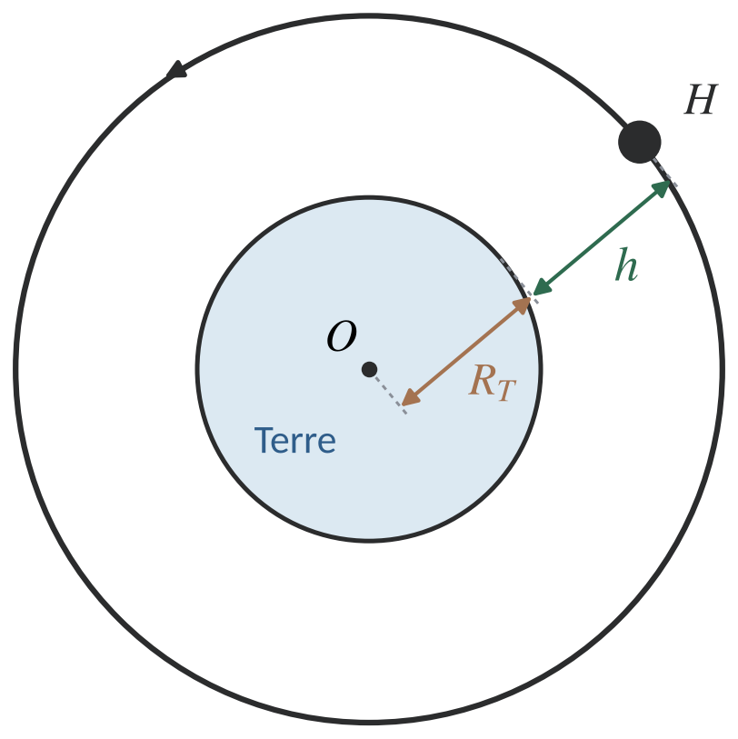
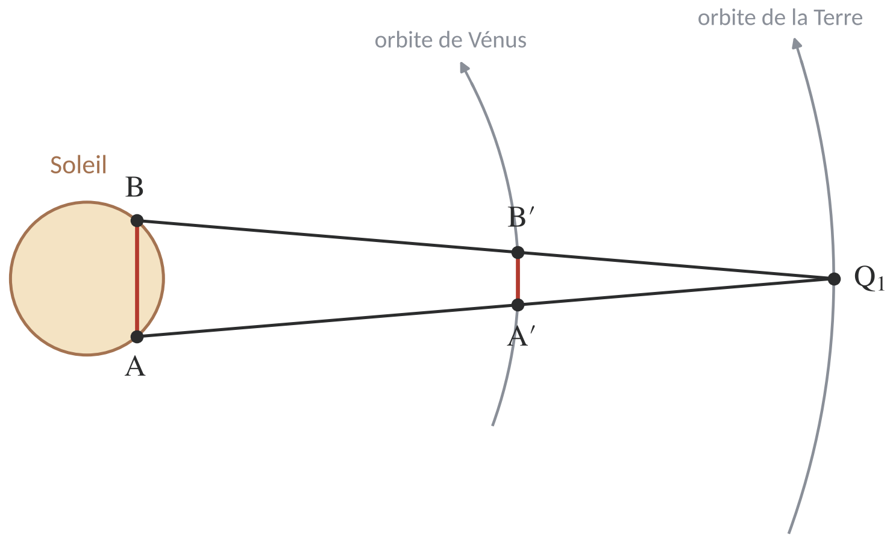
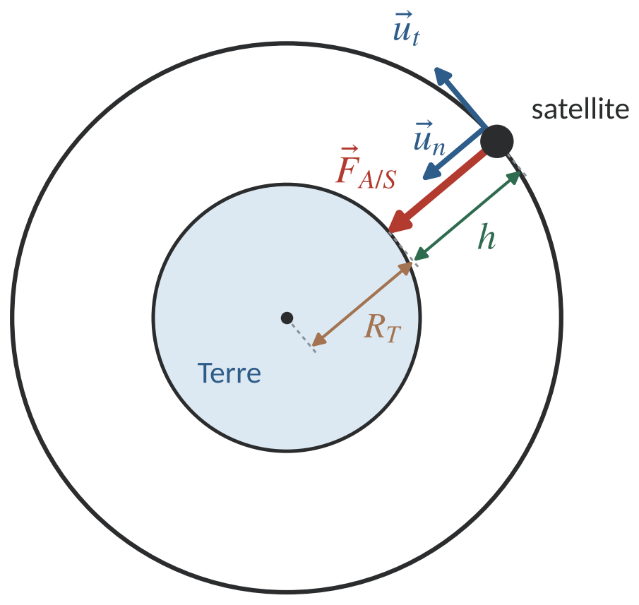
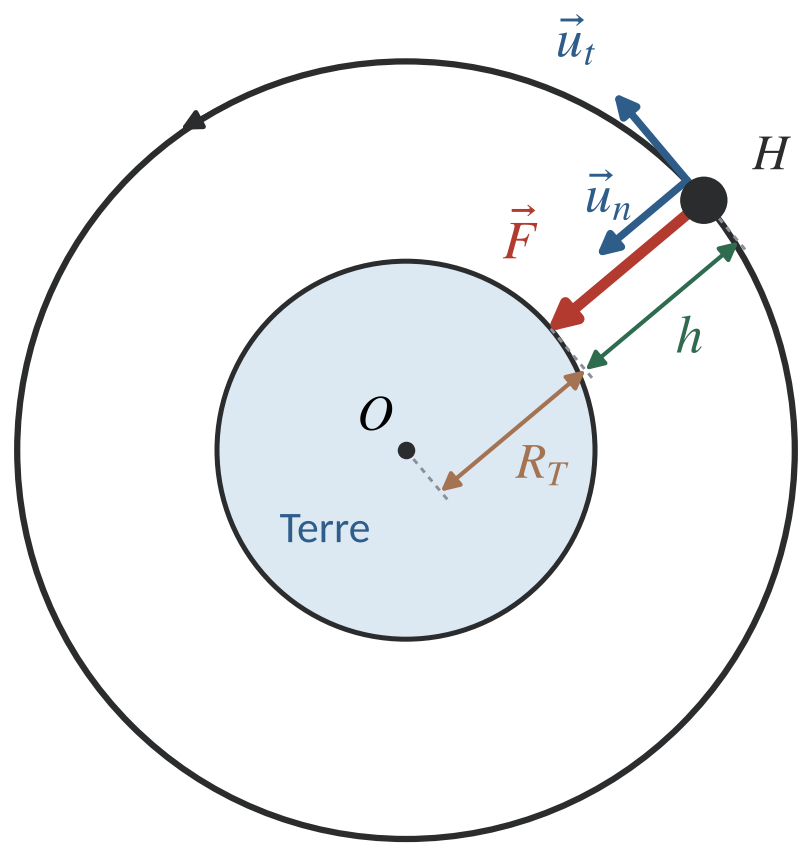

<!--meta {"numero": "3", "matiere": "Physique-Chimie", "titre": "Gravitation : satellites et lois de Kepler", "fichier": "MasterBac_PC_Fiche3_Gravitation", "fichier_cahier": "MasterBac_PC_Fiche3_Cahier_enonces"} -->

<!--inclure:ouverture-->

# L'essentiel en une page {#essentiel}

::: {custom-style="Rubrique"}
À connaître par cœur
:::

<!--colonnes: 18 34 48-->

| Notion | Relation | À retenir |
|---|---|---|
| Force gravitationnelle | $\vec{F}_{A/S} = G \times \dfrac{M_A \times M_S}{d^{2}}\ \vec{u}_n$ | Dirigée du système vers l'attracteur. $d$ est la distance entre les centres, en mètre. |
| Satellite de la Terre | $d = R_T + h$ | L'altitude $h$ se compte depuis la surface, le rayon de l'orbite depuis le centre. |
| Accélération (Frenet) | $\vec{a} = \dfrac{v^{2}}{R}\ \vec{u}_n + \dfrac{\mathrm{d}v}{\mathrm{d}t}\ \vec{u}_t$ | Mouvement circulaire de rayon $R$ (ici $R = d$). Il est uniforme si $\dfrac{\mathrm{d}v}{\mathrm{d}t} = 0$. |
| Vitesse | $v = \sqrt{\dfrac{G \times M_A}{R}}$ | Elle ne dépend pas de la masse du système. |
| Période de révolution | $T = 2\pi \times \sqrt{\dfrac{R^{3}}{G \times M_A}}$ | Durée d'un tour. On l'obtient aussi par $T = \dfrac{2\pi R}{v}$. |
| Troisième loi de Kepler | $\dfrac{T^{2}}{R^{3}} = \dfrac{4\pi^{2}}{G \times M_A}$ | Même constante pour tout ce qui tourne autour du même attracteur. |
| Satellite géostationnaire | $T = 86\ 164\ \text{s}$ | Période de rotation de la Terre, donnée par l'énoncé. Orbite circulaire dans le plan de l'équateur, dans le sens de rotation de la Terre. |

Les énoncés des trois lois de Kepler sont à connaître par cœur (Q.5 et Q.6).

::: {custom-style="Rubrique"}
Fourni par l'énoncé, à savoir exploiter
:::

Les masses, les rayons et la constante $G$ sont donnés. L'énoncé fournit souvent un tableau de périodes et de rayons d'orbite, ou un graphe de $T^{2}$ en fonction de $R^{3}$, à exploiter avec la troisième loi.

::: {custom-style="Rubrique"}
Les pièges qui coûtent des points
:::

- Prendre l'altitude $h$ à la place du rayon $R_T + h$ de l'orbite.
- Laisser une distance en kilomètre, ou une période en heure ou en jour.
- Confondre l'attracteur, qui exerce la force, et le système étudié.
- Oublier de nommer le référentiel et de le supposer galiléen.

::: {custom-style="Rubrique"}
Votre parcours selon votre objectif
:::

| Objectif | Questions de cours | Exercices |
|---|---|---|
| [\ Objectif 10\ ]{custom-style="Niv10"} | Q.1, Q.3 à Q.6, Q.9 | Ex. 1 (parties A et B) |
| [\ Objectif 14\ ]{custom-style="Niv14"} | Plus Q.2, Q.7, Q.8, Q.10 à Q.12 | Ex. 1 en entier, Ex. 2 et Ex. 3 (parties A et B) |
| [\ Objectif 18\ ]{custom-style="Niv18"} | Toutes | Tous, avec la partie C des Ex. 2 et Ex. 3 |

```{=openxml}
<w:p><w:r><w:br w:type="page"/></w:r></w:p>
```

# Ce qui est tombé aux BAC 2025 et 2026 {#tombe}

Les notions de cette fiche ont été demandées dans au moins neuf exercices des sessions 2025 et 2026. Le tableau indique, pour chacun, ce qui était mobilisé et où s'y préparer.

<!--colonnes: 17 16 47 20-->

| Session | Exercice | Notions de cette fiche | Pour s'y préparer |
|---|---|---|---|
| Antilles-Guyane 2026, jour 1 | L'astéroïde 2024 PT5 | Force gravitationnelle, repère de Frenet, vitesse et période de la Lune, troisième loi de Kepler, distance Terre-Lune | Q.1, Q.3, Q.4, Q.6, Q.8 |
| Asie 2026, jour 1 | Satellites de communication | Force gravitationnelle dans le repère de Frenet, mouvement circulaire uniforme, période, troisième loi de Kepler sur un graphe, altitude géostationnaire, durée de transmission d'un signal | Q.1, Q.3, Q.4, Q.6, Q.9, Q.11, Ex. 3 |
| Métropole, juin 2026, jour 2 | Le satellite TESS | Force gravitationnelle, deuxième loi de Newton dans le repère de Frenet, vitesse, masse de l'étoile, troisième loi de Kepler | Q.1, Q.3, Q.6, Q.7, Ex. 2 |
| Métropole 2026, jour 2 (sujet de secours) | Surveillance de la fonte des glaces | Force gravitationnelle dans le repère de Frenet, accélération, vitesse constante, période de révolution | Q.1, Q.3, Q.4, Ex. 1 |
| Métropole, septembre 2026, jour 2 | Observer l'ISS | Force gravitationnelle, accélération dans le repère de Frenet, vitesse, période, nombre de révolutions | Q.1, Q.3, Q.4, Ex. 1 |
| Polynésie 2026, jour 1 | La saga de la découverte des trous noirs | Deuxième loi de Kepler, deuxième loi de Newton dans le repère de Frenet, mouvement circulaire uniforme, vitesse, troisième loi de Kepler, masse du trou noir | Q.1, Q.3, Q.5 à Q.7 |
| Polynésie 2025, jour 2 | Exploration du ciel profond par le télescope James Webb | Forces gravitationnelles exercées par deux astres, accélération dans le repère de Frenet, vitesse, période de révolution | Q.1, Q.3, Q.4 |
| Centres étrangers 2025, jour 1 | La face cachée de la Lune | Force gravitationnelle dans le repère de Frenet, période de révolution de la Lune | Q.1, Q.3, Q.4 |
| Nouvelle-Calédonie 2025, jour 1 | Métis, un satellite en sursis ? | Force de gravitation, mouvement circulaire uniforme, vitesse et période, troisième loi de Kepler, rayon de l'orbite | Q.1, Q.3, Q.4, Q.6, Q.8 |

::: {custom-style="Intertitre"}
Ce qu'il faut en retenir
:::

- La même démonstration ouvre presque tous ces exercices : force gravitationnelle, deuxième loi de Newton dans le repère de Frenet, mouvement uniforme, expression de la vitesse (Q.1 et Q.3). Elle est attendue dans les neuf exercices.
- La période de révolution suit dans au moins sept exercices, souvent avec un calcul : durée d'un tour, nombre de tours par jour.
- La troisième loi de Kepler revient dans au moins quatre exercices, pour trouver une masse, un rayon d'orbite ou une période, parfois à partir d'un graphe.
- Le satellite géostationnaire est tombé en 2026 (Asie), avec un calcul d'altitude et la durée de transmission d'un signal.
- Les situations changent (station spatiale, télescope, exoplanète, astéroïde) mais l'attracteur et le système se repèrent toujours de la même façon : c'est l'étape 1 de Q.1.

::: {custom-style="Surtitre"}
Énoncés
:::

# Thème 1 : la force de gravitation et le mouvement circulaire {#theme1}

::: {custom-style="Rubrique"}
Questions de cours
:::

## [Q.1]{custom-style="QNum"}\ \ Donner l'expression de la force gravitationnelle dans le cas du mouvement de planètes, d'étoiles ou de satellites {#q1}

::: {custom-style="Meta"}
[\ Objectif 10\ ]{custom-style="Niv10"}\ \ Cours · Notions : attracteur, système, repère de Frenet · Voir BAC 2023 (Métropole 1)\ \ \ [CIBLE:c_q1]{custom-style="BoutonCorrige"}
:::

::: {custom-style="Enonce"}
Représenter cette force sans souci d'échelle dans le cas d'une trajectoire circulaire, puis dans le cas d'un satellite en orbite autour de la Terre, en faisant apparaître les distances importantes.
:::

## [Q.2]{custom-style="QNum"}\ \ Donner l'expression de l'intensité $g$ de la pesanteur à l'altitude $h$ {#q2}

::: {custom-style="Meta"}
[\ Objectif 14\ ]{custom-style="Niv14"}\ \ Application · Notions : poids, force gravitationnelle, altitude\ \ \ [CIBLE:c_q2]{custom-style="BoutonCorrige"}
:::

::: {custom-style="Enonce"}
Dans certains exercices, on peut assimiler la force gravitationnelle au poids d'un corps. Dans ces conditions, donner l'expression littérale de l'intensité $g$ de la pesanteur à l'altitude $h$, pour un système de masse $M_S$, en fonction de $G$, de la masse $M_T$ de la Terre, de son rayon $R_T$ et de $h$.

Application : calculer $g$ au sol, puis à l'altitude $h = 400\ \text{km}$. On donne $G = 6{,}67 \times 10^{-11}\ \text{N·m}^{2}\text{·kg}^{-2}$, $M_T = 5{,}972 \times 10^{24}\ \text{kg}$ et $R_T = 6\ 378\ \text{km}$.
:::

## [Q.3]{custom-style="QNum"}\ \ Appliquer la deuxième loi de Newton pour retrouver l'expression de la vitesse d'un système dans le cadre d'un mouvement des astres (planètes, satellites, étoiles) {#q3}

::: {custom-style="Meta"}
[\ Objectif 10\ ]{custom-style="Niv10"}\ \ Cours · Notions : référentiel, repère de Frenet · Les neuf exercices relevés en 2025 et 2026\ \ \ [CIBLE:c_q3]{custom-style="BoutonCorrige"}
:::

::: {custom-style="Enonce"}
On suppose que la trajectoire est circulaire.

Application : calculer la vitesse d'un satellite en orbite autour de la Terre à l'altitude $h = 400\ \text{km}$. On donne $G = 6{,}67 \times 10^{-11}\ \text{N·m}^{2}\text{·kg}^{-2}$, $M_T = 5{,}972 \times 10^{24}\ \text{kg}$ et $R_T = 6\ 378\ \text{km}$.
:::

## [Q.4]{custom-style="QNum"}\ \ Exprimer la période de révolution d'un système dans le cadre d'un mouvement circulaire uniforme des astres {#q4}

::: {custom-style="Meta"}
[\ Objectif 10\ ]{custom-style="Niv10"}\ \ Cours · Notions : périmètre du cercle, vitesse · Au moins sept sujets en 2025 et 2026\ \ \ [CIBLE:c_q4]{custom-style="BoutonCorrige"}
:::

::: {custom-style="Enonce"}
Application : calculer la période de révolution du satellite de Q.3, puis le nombre de tours qu'il effectue en une journée de $86\ 400\ \text{s}$.
:::

::: {custom-style="Rubrique"}
Exercices
:::

### [Exercice 1]{custom-style="QNum"}\ \ Le télescope spatial Hubble [(voir BAC Métropole, septembre 2026)]{custom-style="VoirBac"} {#ex1}

::: {custom-style="Meta"}
[\ Objectif 10\ ]{custom-style="Niv10"}\ \ [Type BAC]{custom-style="TagBac"} · 5,5 points · 50 min · Partie C : objectif 14
:::

::: {custom-style="MentionBac"}
[Sujet du BAC correspondant.]{custom-style="EtiqBac"} Métropole, septembre 2026, jour 2, exercice 2 : « Observer l'ISS » (force gravitationnelle, repère de Frenet, vitesse, période, nombre de révolutions).
:::

::: {custom-style="Enonce"}
Depuis 1990, le télescope spatial Hubble observe l'Univers au-dessus de l'atmosphère. On étudie le mouvement de son centre de masse $H$ autour de la Terre, de centre $O$ (figure 1). La trajectoire est supposée circulaire et Hubble n'est soumis qu'à l'attraction gravitationnelle de la Terre.
:::

::: {custom-style="Figure"}
{width=5cm}
:::

::: {custom-style="Legende"}
Figure 1. Orbite du télescope Hubble autour de la Terre (le schéma n'est pas à l'échelle)
:::

::: {custom-style="Enonce"}
**Données**
:::

::: {custom-style="EnonceDonnees"}
Masse de Hubble : $m = 11 \times 10^{3}\ \text{kg}$ ; altitude : $h = 540\ \text{km}$

Rayon de la Terre : $R_T = 6\ 378\ \text{km}$ ; masse de la Terre : $M_T = 5{,}972 \times 10^{24}\ \text{kg}$

Constante de gravitation universelle : $G = 6{,}67 \times 10^{-11}\ \text{N·m}^{2}\text{·kg}^{-2}$
:::

::: {custom-style="Enonce"}

**Partie A. La force et le mouvement**

**1.** Dans quel référentiel étudie-t-on ce mouvement ? Quelle hypothèse fait-on sur ce référentiel ?

**2.** Reproduire la figure et y représenter, sans souci d'échelle, les vecteurs unitaires $\vec{u}_n$ et $\vec{u}_t$ du repère de Frenet, ainsi que la force $\vec{F}$ exercée par la Terre sur Hubble.

**3.** Donner l'expression vectorielle de $\vec{F}$ en fonction de $G$, $M_T$, $m$, $R_T$ et $h$, puis calculer sa valeur.

**4.** En appliquant la deuxième loi de Newton, montrer que le mouvement de Hubble est uniforme.

**5.** Établir l'expression de la vitesse $v$ de Hubble, puis la calculer.

**Partie B. La période de révolution**

**6.** Exprimer la période de révolution $T$ en fonction de $R_T$, $h$ et $v$, puis la calculer.

**7.** Combien de tours de la Terre Hubble effectue-t-il en une journée de $86\ 400\ \text{s}$ ?

**Partie C. Pour aller plus loin**

**8.** Lors d'une mission de maintenance, un astronaute travaille à côté du télescope et semble « flotter ». Calculer l'intensité de la pesanteur à l'altitude de Hubble, puis expliquer pourquoi l'astronaute flotte.
:::

::: {custom-style="Renvoi"}
[CIBLE:c_ex1]{custom-style="BoutonCorrige"}
:::

::: {custom-style="Surtitre"}
Énoncés
:::

# Thème 2 : les lois de Kepler {#theme2}

::: {custom-style="Rubrique"}
Questions de cours
:::

## [Q.5]{custom-style="QNum"}\ \ Énoncer les deux premières lois de Kepler. Appliquer la deuxième loi de Kepler pour justifier qu'un mouvement en référentiel héliocentrique est non uniforme {#q5}

::: {custom-style="Meta"}
[\ Objectif 10\ ]{custom-style="Niv10"}\ \ Cours · Notions : ellipse, foyer, loi des aires\ \ \ [CIBLE:c_q5]{custom-style="BoutonCorrige"}
:::

## [Q.6]{custom-style="QNum"}\ \ Énoncer et appliquer la troisième loi de Kepler pour retrouver la valeur de la constante dans le cadre du mouvement des planètes {#q6}

::: {custom-style="Meta"}
[\ Objectif 10\ ]{custom-style="Niv10"}\ \ Cours · Notions : période, rayon de l'orbite · Au moins quatre sujets en 2025 et 2026\ \ \ [CIBLE:c_q6]{custom-style="BoutonCorrige"}
:::

## [Q.7]{custom-style="QNum"}\ \ Exprimer la masse de l'attracteur à partir de la troisième loi de Kepler {#q7}

::: {custom-style="Meta"}
[\ Objectif 14\ ]{custom-style="Niv14"}\ \ Application · Notions : calcul littéral, masse d'un astre · Demandée en 2026 (Métropole, jour 2)\ \ \ [CIBLE:c_q7]{custom-style="BoutonCorrige"}
:::

::: {custom-style="Enonce"}
Application : calculer la masse du Soleil, sachant que la Terre parcourt en $365{,}25$ jours une orbite de rayon $R = 1{,}496 \times 10^{11}\ \text{m}$. On donne $G = 6{,}67 \times 10^{-11}\ \text{N·m}^{2}\text{·kg}^{-2}$.
:::

## [Q.8]{custom-style="QNum"}\ \ Exprimer le rayon $R$ de la trajectoire à partir de la troisième loi de Kepler {#q8}

::: {custom-style="Meta"}
[\ Objectif 14\ ]{custom-style="Niv14"}\ \ Application · Notions : racine cubique, rayon d'une orbite · Demandée en 2025 et en 2026\ \ \ [CIBLE:c_q8]{custom-style="BoutonCorrige"}
:::

::: {custom-style="Enonce"}
Application : la Lune fait le tour de la Terre en $27{,}3$ jours. Calculer le rayon de son orbite, avec $M_T = 5{,}972 \times 10^{24}\ \text{kg}$ et $G = 6{,}67 \times 10^{-11}\ \text{N·m}^{2}\text{·kg}^{-2}$.
:::

::: {custom-style="Rubrique"}
Exercices
:::

### [Exercice 2]{custom-style="QNum"}\ \ Les planètes de TRAPPIST-1 [(voir BAC Métropole, juin 2026)]{custom-style="VoirBac"} {#ex2}

::: {custom-style="Meta"}
[\ Objectif 14\ ]{custom-style="Niv14"}\ \ [Type BAC]{custom-style="TagBac"} · 6 points · 55 min · Partie C : objectif 18
:::

::: {custom-style="MentionBac"}
[Sujet du BAC correspondant.]{custom-style="EtiqBac"} Métropole, juin 2026, jour 2, exercice 3 : « Le satellite TESS » (masse de l'étoile, troisième loi de Kepler).
:::

::: {custom-style="Enonce"}
L'étoile TRAPPIST-1, située à 40 années-lumière de la Terre, possède au moins sept planètes, nommées de b à h. On étudie leur mouvement dans le référentiel lié au centre $E$ de l'étoile, supposé galiléen. Les orbites sont supposées circulaires, de centre $E$, et chaque planète n'est soumise qu'à l'attraction de l'étoile.

Le tableau donne la période de révolution $T$ et le rayon $R$ de l'orbite des sept planètes. Deux valeurs sont à déterminer.
:::

<!--colonnes: 30 10 10 10 10 10 10 10-->

| Planète | b | c | d | e | f | g | h |
|---|---|---|---|---|---|---|---|
| Période *T* (jour) | 1,51 | 2,42 | 4,05 | 6,10 | 9,21 | 12,35 | ? |
| Rayon *R* de l'orbite (10^9^ m) | 1,73 | 2,36 | 3,33 | 4,38 | ? | 7,01 | 9,27 |

::: {custom-style="Enonce"}
**Données**
:::

::: {custom-style="EnonceDonnees"}
Constante de gravitation universelle : $G = 6{,}67 \times 10^{-11}\ \text{N·m}^{2}\text{·kg}^{-2}$

Durée d'un jour : $86\ 400\ \text{s}$ ; masse du Soleil : $M_{\text{Sol}} = 1{,}99 \times 10^{30}\ \text{kg}$
:::

::: {custom-style="Enonce"}

**Partie A. Le mouvement de la planète e**

On note $M_E$ la masse de l'étoile, $m$ la masse de la planète e et $R$ le rayon de son orbite.

**1.** Donner l'expression vectorielle de la force $\vec{F}$ exercée par l'étoile sur la planète e, en fonction de $G$, $M_E$, $m$, $R$ et d'un vecteur unitaire du repère de Frenet.

**2.** Montrer que le mouvement de la planète e est uniforme, puis établir l'expression de sa vitesse $v$ en fonction de $G$, $M_E$ et $R$.

**3.** Montrer que sa période de révolution s'écrit $T = 2\pi \times \sqrt{\dfrac{R^{3}}{G \times M_E}}$.

**Partie B. La masse de l'étoile et la troisième loi de Kepler**

**4.** Exprimer la masse $M_E$ de l'étoile en fonction de $T$, $R$ et $G$, puis la calculer avec les données de la planète e.

**5.** Comparer cette masse à celle du Soleil.

**6.** Énoncer la troisième loi de Kepler. Vérifier qu'elle s'applique aux planètes b et d.

**7.** À partir des données de la planète e, déterminer le rayon de l'orbite de la planète f.

**Partie C. Pour aller plus loin**

**8.** De la même façon, déterminer la période de révolution de la planète h, en jour.

**9.** Calculer la vitesse de la planète e. La Terre parcourt son orbite autour du Soleil à $29{,}8\ \text{km·s}^{-1}$, sur un cercle de rayon $1{,}496 \times 10^{11}\ \text{m}$. Commenter.
:::

::: {custom-style="Renvoi"}
[CIBLE:c_ex2]{custom-style="BoutonCorrige"}
:::

::: {custom-style="Surtitre"}
Énoncés
:::

# Thème 3 : le satellite géostationnaire {#theme3}

::: {custom-style="Rubrique"}
Questions de cours
:::

## [Q.9]{custom-style="QNum"}\ \ Définir un satellite géostationnaire et donner les conditions pour qu'un satellite soit géostationnaire {#q9}

::: {custom-style="Meta"}
[\ Objectif 10\ ]{custom-style="Niv10"}\ \ Cours · Notions : référentiel terrestre, plan équatorial · Voir BAC 2009 (Asie)\ \ \ [CIBLE:c_q9]{custom-style="BoutonCorrige"}
:::

## [Q.10]{custom-style="QNum"}\ \ Identifier la seule trajectoire possible d'un satellite géostationnaire {#q10}

::: {custom-style="Meta"}
[\ Objectif 14\ ]{custom-style="Niv14"}\ \ Application · Notions : plan de l'orbite · Voir BAC 2009 (Asie)\ \ \ [CIBLE:c_q10]{custom-style="BoutonCorrige"}
:::

::: {custom-style="Enonce"}
La figure 2 propose trois trajectoires, A, B et C, pour un satellite de la Terre. Identifier la seule qui peut être celle d'un satellite géostationnaire, en justifiant.
:::

::: {custom-style="Figure"}
{width=16cm}
:::

::: {custom-style="Legende"}
Figure 2. Trois trajectoires proposées pour un satellite de la Terre
:::

## [Q.11]{custom-style="QNum"}\ \ À l'aide de la troisième loi de Kepler, déterminer la hauteur à laquelle doit être placé un satellite pour qu'il soit géostationnaire {#q11}

::: {custom-style="Meta"}
[\ Objectif 14\ ]{custom-style="Niv14"}\ \ Application · Notions : rayon de l'orbite, altitude · Demandée en 2026 (Asie)\ \ \ [CIBLE:c_q11]{custom-style="BoutonCorrige"}
:::

::: {custom-style="Enonce"}
**Données**
:::

::: {custom-style="EnonceDonnees"}
Masse de la Terre : $M_T = 5{,}972 \times 10^{24}\ \text{kg}$ ; rayon de la Terre : $R_T = 6\ 378\ \text{km}$

Constante de gravitation universelle : $G = 6{,}67 \times 10^{-11}\ \text{N·m}^{2}\text{·kg}^{-2}$

Période de rotation de la Terre sur elle-même : $86\ 164\ \text{s}$, soit 23 h 56 min 4 s
:::

## [Q.12]{custom-style="QNum"}\ \ Déterminer la vitesse d'un satellite géostationnaire {#q12}

::: {custom-style="Meta"}
[\ Objectif 14\ ]{custom-style="Niv14"}\ \ Application · Notions : vitesse sur une orbite circulaire\ \ \ [CIBLE:c_q12]{custom-style="BoutonCorrige"}
:::

::: {custom-style="Enonce"}
On reprend les données et le résultat de Q.11.
:::

## [Q.13]{custom-style="QNum"}\ \ Écrire la relation de Thalès dans une configuration d'astronomie : le transit de Vénus {#q13}

::: {custom-style="Meta"}
[\ Objectif 18\ ]{custom-style="Niv18"}\ \ Méthode · Notions : théorème de Thalès, alignement · Voir BAC 2005 (National)\ \ \ [CIBLE:c_q13]{custom-style="BoutonCorrige"}
:::

::: {custom-style="Enonce"}
Lors d'un transit, Vénus passe entre la Terre et le Soleil. Sur la figure 3, un observateur placé sur la Terre au point $\text{Q}_1$ voit Vénus, située en $\text{A′}$ puis en $\text{B′}$, se projeter sur le Soleil aux points $\text{A}$ et $\text{B}$. Les droites $(\text{A′B′})$ et $(\text{AB})$ sont parallèles.

Écrire la relation de Thalès dans cette configuration.
:::

::: {custom-style="Figure"}
{width=10.5cm}
:::

::: {custom-style="Legende"}
Figure 3. Transit de Vénus : alignements vus depuis la Terre (le schéma n'est pas à l'échelle)
:::

::: {custom-style="Rubrique"}
Exercices
:::

### [Exercice 3]{custom-style="QNum"}\ \ Internet par satellite : orbite haute ou orbite basse ? [(voir BAC Asie 2026)]{custom-style="VoirBac"} {#ex3}

::: {custom-style="Meta"}
[\ Objectif 14\ ]{custom-style="Niv14"}\ \ [Type BAC]{custom-style="TagBac"} · 6 points · 55 min · Partie C : objectif 18
:::

::: {custom-style="MentionBac"}
[Sujet du BAC correspondant.]{custom-style="EtiqBac"} Asie 2026, jour 1, exercice 2 : « Satellites de communication ».
:::

::: {custom-style="Enonce"}
Une connexion à Internet peut passer par un satellite géostationnaire ou par une constellation en orbite basse. Dans le référentiel géocentrique, leurs orbites sont circulaires, de rayon $R$ et de période $T$. La figure 4 donne $T^{2}$ en fonction de $R^{3}$ pour cinq satellites. La droite passe par l'origine et le point $\text{P}$.
:::

::: {custom-style="Figure"}
{width=8cm}
:::

::: {custom-style="Legende"}
Figure 4. Carré de la période en fonction du cube du rayon de l'orbite, pour cinq satellites de la Terre
:::

::: {custom-style="Enonce"}
**Données**
:::

::: {custom-style="EnonceDonnees"}
Rayon de la Terre : $R_T = 6\ 378\ \text{km}$ ; constante de gravitation universelle : $G = 6{,}67 \times 10^{-11}\ \text{N·m}^{2}\text{·kg}^{-2}$

Période de rotation de la Terre sur elle-même : $86\ 164\ \text{s}$ ; vitesse du signal : $c = 3{,}00 \times 10^{8}\ \text{m·s}^{-1}$
:::

::: {custom-style="Enonce"}

**Partie A. La troisième loi de Kepler sur un graphique**

**1.** Énoncer la troisième loi de Kepler. Le graphique est-il en accord avec elle ?

**2.** Déterminer le coefficient directeur $k$ de la droite, avec son unité.

**3.** On montre que $k = 4\pi^{2} / (G \times M_T)$. En déduire la masse $M_T$ de la Terre.

**Partie B. Le satellite géostationnaire**

**4.** Donner les trois conditions que doit remplir un satellite pour être géostationnaire.

**5.** Déterminer le rayon de l'orbite géostationnaire, puis l'altitude $h$ du satellite.

**6.** Un signal part d'une antenne à la verticale du satellite et revient au sol. Calculer la durée $\Delta t$ de ce trajet.

**Partie C. La constellation en orbite basse**

**7.** Les satellites de la constellation évoluent à l'altitude $h_B = 550\ \text{km}$. Calculer leur période $T_B$.

**8.** Calculer la durée de l'aller-retour du signal à la verticale, puis la comparer à celle de la question 6.

**9.** Donner un avantage et un inconvénient de chaque type d'orbite pour une connexion à Internet.
:::

::: {custom-style="Renvoi"}
[CIBLE:c_ex3]{custom-style="BoutonCorrige"}
:::

<!--debut:complet-->
::: {custom-style="Surtitre"}
Corrigés
:::

# Corrigés du thème 1 : la force de gravitation et le mouvement circulaire {#c_theme1}

#### [Corrigé]{custom-style="NumCorrige"}\ \ Q.1 · Donner l'expression de la force gravitationnelle dans le cas du mouvement de planètes, d'étoiles ou de satellites {#c_q1}

::: {custom-style="Renvoi"}
[CIBLE:q1]{custom-style="BoutonEnonce"}
:::

**Étape 1 : identifier clairement l'attracteur et le système.** Dans certains exercices, cette étape peut être floue (voir par exemple BAC 2023, Centres étrangers 1, exercice 2). Une astuce consiste à identifier le système étudié à travers les questions suivantes. Par exemple, si on vous demande dans une question ultérieure de conclure sur la nature du mouvement d'une étoile, cela signifie qu'il s'agit du système étudié (il ne s'agit donc pas de l'attracteur). On peut également se baser sur des phrases du type « la force gravitationnelle exercée par l'étoile X sur la planète P ». En effet, c'est l'attracteur qui exerce la force gravitationnelle. Ici, ce serait donc l'étoile X.

**Étape 2 : conclure.** Notons $M_A$ la masse de l'attracteur et $M_S$ la masse du système. La force gravitationnelle a pour expression :

::: {custom-style="Retenir"}
$\vec{F}_{A/S} = G \times \dfrac{M_A \times M_S}{d^{2}}\ \vec{u}_n$
:::

avec $d$ la distance séparant le centre de masse de l'attracteur (souvent associé au centre de l'attracteur, comme dans le cas de mouvements de satellites autour de la Terre) et celui du système étudié. Pour une trajectoire circulaire centrée sur l'attracteur, le vecteur $\vec{u}_n$ représente le vecteur normal de la base de Frenet, orienté du système vers l'attracteur (le vecteur $\vec{u}_t$ représente quant à lui le vecteur tangentiel de la base de Frenet). La force d'attraction, toujours dirigée vers l'attracteur, est alors normale à la trajectoire. Sur une ellipse (voir Q.5), elle reste dirigée vers l'attracteur mais n'est plus normale à la trajectoire.

On a synthétisé les différents éléments sur la figure 5 (cas d'une trajectoire circulaire).

::: {custom-style="Figure"}
{width=6.5cm}
:::

::: {custom-style="Legende"}
Figure 5. Force gravitationnelle exercée par l'attracteur sur le système, dans le repère de Frenet
:::

**Cas des mouvements satellitaires.** Attention, la distance $d$ est bien celle qui sépare le centre de l'attracteur du centre du système. Dans le cadre du mouvement d'un satellite, il s'agira ainsi de la distance entre le centre de la Terre et le centre du satellite. On aura donc $d = R_T + h$, où $h$ est la distance séparant le centre du satellite de la surface de la Terre (on parle de hauteur, ou d'altitude, du satellite). La force gravitationnelle s'écrit alors (figure 6) :

::: {custom-style="Retenir"}
$\vec{F}_{A/S} = G \times \dfrac{M_A \times M_S}{(R_T + h)^{2}}\ \vec{u}_n$
:::

::: {custom-style="Figure"}
{width=6.5cm}
:::

::: {custom-style="Legende"}
Figure 6. Cas d'un satellite de la Terre : la distance entre les centres vaut $R_T + h$
:::

::: {custom-style="Piege"}
[Piège.]{custom-style="EtiqPiege"} Dans cette formule, les masses sont en kilogramme et les distances en mètre : un rayon ou une altitude donnés en kilomètre doivent être convertis. La constante $G$ vaut $6{,}67 \times 10^{-11}\ \text{N·m}^{2}\text{·kg}^{-2}$ et la force s'exprime en newton.
:::

#### [Corrigé]{custom-style="NumCorrige"}\ \ Q.2 · Donner l'expression de l'intensité $g$ de la pesanteur à l'altitude $h$ {#c_q2}

::: {custom-style="Renvoi"}
[CIBLE:q2]{custom-style="BoutonEnonce"}
:::

Par définition, le poids d'un corps s'écrit :

$$P = M_S \times g$$

On va donc égaler cette expression à celle de la force gravitationnelle (voir Q.1) :

$$P = M_S \times g = G \times \dfrac{M_T \times M_S}{(R_T + h)^{2}}$$

La masse $M_S$ du système se simplifie. Il vient :

::: {custom-style="Retenir"}
$g = G \times \dfrac{M_T}{(R_T + h)^{2}}$
:::

avec $M_T$ la masse de la Terre (en kg), $R_T$ le rayon de la Terre (en m), $h$ la hauteur du système par rapport à la surface de la Terre (en m) et $G$ la constante de gravitation universelle (en unité SI).

::: {custom-style="Remarque"}
[Remarque.]{custom-style="EtiqRemarque"} L'intensité de la pesanteur ne dépend pas de la masse du système : elle ne dépend que de l'attracteur et de la distance à son centre. Elle diminue quand l'altitude augmente.
:::

**Application numérique.** Au sol, $h = 0$ et $R_T = 6{,}378 \times 10^{6}\ \text{m}$ :

$$g = 6{,}67 \times 10^{-11} \times \dfrac{5{,}972 \times 10^{24}}{(6{,}378 \times 10^{6})^{2}} = 9{,}79\ \text{m·s}^{-2}$$

On ne retrouve pas tout à fait $9{,}81\ \text{m·s}^{-2}$ : $6\ 378\ \text{km}$ est le rayon de la Terre à l'équateur. Avec le rayon moyen, $6\ 371\ \text{km}$, on obtient $9{,}81\ \text{m·s}^{-2}$.

À l'altitude $h = 400\ \text{km}$, la distance au centre de la Terre vaut $R_T + h = 6{,}778 \times 10^{6}\ \text{m}$ :

$$g = 6{,}67 \times 10^{-11} \times \dfrac{5{,}972 \times 10^{24}}{(6{,}778 \times 10^{6})^{2}} = 8{,}67\ \text{m·s}^{-2}$$

À 400 km d'altitude, la pesanteur vaut encore 89 % de sa valeur au sol.

#### [Corrigé]{custom-style="NumCorrige"}\ \ Q.3 · Appliquer la deuxième loi de Newton pour retrouver l'expression de la vitesse d'un système dans le cadre d'un mouvement des astres (planètes, satellites, étoiles) {#c_q3}

::: {custom-style="Renvoi"}
[CIBLE:q3]{custom-style="BoutonEnonce"}
:::

**Étape 1 : identifier le système** (voir Q.1). Notons $M_S$ la masse du système et $M_A$ la masse de l'attracteur.

**Étape 2 : identifier le référentiel en le supposant galiléen** (condition indispensable pour pouvoir appliquer la deuxième loi de Newton).

- Exemple 1 : si l'on étudie le mouvement d'une lune de Jupiter, on considérera le référentiel jupitérocentrique supposé galiléen (voir BAC 2023, Métropole 1, exercice 1, Q13).
- Exemple 2 : si l'on étudie le mouvement d'un satellite géostationnaire autour de la Terre, on se placera dans le référentiel géocentrique supposé galiléen.
- Exemple 3 : si l'on étudie le mouvement de Mars autour du Soleil, on se placera dans le référentiel héliocentrique supposé galiléen.

**Étape 3 : faire l'inventaire des forces.** Sauf mention contraire de l'exercice, il faut considérer que la force d'attraction gravitationnelle exercée par l'attracteur sur le système est la seule force qui s'applique. On peut par exemple rédiger en ces termes : « Bilan des forces : la force gravitationnelle est la seule force qui s'applique sur le système. »

**Étape 4 : exploiter la deuxième loi de Newton pour déterminer l'expression vectorielle de l'accélération.** La deuxième loi de Newton s'écrit :

$$\sum \vec{F}_{\text{ext}} = \vec{F}_{A/S} = M_S \times \vec{a}$$

Or (voir Q.1) :

$$\vec{F}_{A/S} = G \times \dfrac{M_A \times M_S}{d^{2}}\ \vec{u}_n$$

Ainsi, on en déduit :

$$G \times \dfrac{M_A \times M_S}{d^{2}}\ \vec{u}_n = M_S \times \vec{a}$$

On simplifie la masse du système de part et d'autre. Il vient :

::: {custom-style="Retenir"}
$\vec{a} = G \times \dfrac{M_A}{d^{2}}\ \vec{u}_n$
:::

**Étape 5 : exploiter les coordonnées de l'accélération dans le repère de Frenet pour conclure sur les caractéristiques de la vitesse.** Dans le repère de Frenet, pour un mouvement circulaire (ou assimilé à un mouvement circulaire) de rayon $R$ :

::: {custom-style="Retenir"}
$\vec{a} = \dfrac{v^{2}}{R}\ \vec{u}_n + \dfrac{\mathrm{d}v}{\mathrm{d}t}\ \vec{u}_t$
:::

Cette expression vectorielle est à connaître par cœur. Dans le cadre retenu ici, on a $R = d$. On a donc deux expressions égales de l'accélération :

$$\vec{a} = \dfrac{G \times M_A}{d^{2}}\ \vec{u}_n + 0 \times \vec{u}_t = \dfrac{v^{2}}{d}\ \vec{u}_n + \dfrac{\mathrm{d}v}{\mathrm{d}t}\ \vec{u}_t$$

On procède par identification sur chaque axe.

Selon $\vec{u}_t$ :

$$\dfrac{\mathrm{d}v}{\mathrm{d}t} = 0$$

Ainsi, $v$ est constante : le mouvement du système est uniforme.

Selon $\vec{u}_n$ :

$$\dfrac{v^{2}}{d} = \dfrac{G \times M_A}{d^{2}} \quad \text{donc} \quad v^{2} = \dfrac{G \times M_A}{d}$$

On en conclut :

::: {custom-style="Retenir"}
$v = \sqrt{\dfrac{G \times M_A}{d}}$
:::

::: {custom-style="Remarque"}
[Remarque.]{custom-style="EtiqRemarque"} La deuxième loi de Newton, sous cette forme, est applicable à un système de masse constante. Ce n'est par exemple pas le cas d'une fusée, dont la masse diminue avec la consommation de carburant. De même, si on avait une étoile qui se désintègre ou un satellite qui s'allège avec le temps, on ne pourrait pas l'appliquer ainsi.
:::

**Application numérique.** À l'altitude $h = 400\ \text{km}$ autour de la Terre, $d = R_T + h = 6{,}378 \times 10^{6} + 0{,}400 \times 10^{6} = 6{,}778 \times 10^{6}\ \text{m}$ :

$$v = \sqrt{\dfrac{6{,}67 \times 10^{-11} \times 5{,}972 \times 10^{24}}{6{,}778 \times 10^{6}}} = 7{,}67 \times 10^{3}\ \text{m·s}^{-1}$$

Cette vitesse, de l'ordre de $27\ 600\ \text{km·h}^{-1}$, ne dépend pas de la masse du satellite.

::: {custom-style="Redaction"}
[Rédaction.]{custom-style="EtiqRedaction"} Trois phrases sont attendues avant tout calcul : le système étudié, le référentiel « supposé galiléen », et le bilan des forces. Un candidat qui écrit directement la formule de la vitesse perd les points de la démonstration.
:::

#### [Corrigé]{custom-style="NumCorrige"}\ \ Q.4 · Exprimer la période de révolution d'un système dans le cadre d'un mouvement circulaire uniforme des astres {#c_q4}

::: {custom-style="Renvoi"}
[CIBLE:q4]{custom-style="BoutonEnonce"}
:::

Notons $v$ la vitesse constante du système (voir Q.3) et $T$ sa période de révolution autour de l'attracteur. Notons par ailleurs $R$ le rayon de la trajectoire. Avec les notations des questions précédentes, on a toujours $R = d$.

Par définition, $v = \dfrac{\ell}{\Delta t}$, où $\ell$ est la distance parcourue par le système et $\Delta t$ la durée mise pour parcourir cette distance.

Pour une révolution, la distance parcourue correspond au périmètre de la trajectoire, soit $\ell = 2\pi R$. Cette distance est parcourue en une période, soit $\Delta t = T$. De fait, on peut écrire :

$$v = \dfrac{\ell}{\Delta t} = \dfrac{2\pi R}{T} \lbl{1}$$

Or on a vu que, dans le cadre de ce mouvement (voir Q.3) :

$$v = \sqrt{\dfrac{G \times M_A}{R}}$$

En remplaçant cette dernière expression dans la relation (1), on peut écrire :

$$\sqrt{\dfrac{G \times M_A}{R}} = \dfrac{2\pi R}{T}$$

D'où :

$$T = \dfrac{2\pi R}{\sqrt{\dfrac{G \times M_A}{R}}} = \dfrac{2\pi R}{\dfrac{\sqrt{G \times M_A}}{\sqrt{R}}} = \dfrac{2\pi R \times \sqrt{R}}{\sqrt{G \times M_A}} \lbl{2}$$

Or $R = \sqrt{R^{2}}$, donc :

$$R \times \sqrt{R} = \sqrt{R^{2}} \times \sqrt{R} = \sqrt{R^{2} \times R} = \sqrt{R^{3}}$$

On remplace cette expression dans le numérateur de la relation (2). Il vient :

$$T = \dfrac{2\pi \sqrt{R^{3}}}{\sqrt{G \times M_A}} = 2\pi \times \dfrac{\sqrt{R^{3}}}{\sqrt{G \times M_A}}$$

::: {custom-style="Retenir"}
$T = 2\pi \times \sqrt{\dfrac{R^{3}}{G \times M_A}}$
:::

::: {custom-style="Methode"}
[Méthode.]{custom-style="EtiqMethode"} En fonction de la question posée par l'énoncé, il faut savoir parvenir à l'une ou l'autre des deux formes : $T = \dfrac{2\pi R}{v}$ si la vitesse est connue, ou la forme encadrée si elle ne l'est pas. On rappelle que $M_A$ représente la masse de l'attracteur, exprimée en kilogramme. La période s'exprime en seconde, avec le rayon $R$ en mètre.
:::

::: {custom-style="Remarque"}
[Remarque.]{custom-style="EtiqRemarque"} Certains exercices vous demanderont de calculer le nombre d'orbites parcourues durant une durée $t$. Pour calculer ce nombre, il suffit de se rappeler qu'une orbite est parcourue en une période $T$. Le nombre d'orbites parcourues durant la durée $t$ est donc :

$$N = \dfrac{t}{T}$$
:::

**Application numérique.** Pour le satellite de Q.3, $R = 6{,}778 \times 10^{6}\ \text{m}$ :

$$T = 2\pi \times \sqrt{\dfrac{(6{,}778 \times 10^{6})^{3}}{6{,}67 \times 10^{-11} \times 5{,}972 \times 10^{24}}} = 5{,}56 \times 10^{3}\ \text{s}$$

soit 92,6 min. En une journée, le satellite effectue, avec la valeur non arrondie $T = 5\ 555\ \text{s}$ :

$$N = \dfrac{86\ 400}{5\ 555} = 15{,}6\ \text{tours}$$

#### [Corrigé]{custom-style="NumCorrige"}\ \ Exercice 1 · Le télescope spatial Hubble {#c_ex1}

::: {custom-style="Renvoi"}
[CIBLE:ex1]{custom-style="BoutonEnonce"}
:::

::: {custom-style="QRappel"}
**1.** Référentiel d'étude
:::

Hubble tourne autour de la Terre : on étudie son mouvement dans le référentiel géocentrique, que l'on suppose galiléen pour pouvoir appliquer la deuxième loi de Newton.

::: {custom-style="QRappel"}
**2.** Repère de Frenet et force
:::

Le vecteur $\vec{u}_t$ est tangent à la trajectoire, dans le sens du mouvement. Le vecteur $\vec{u}_n$ est dirigé de Hubble vers le centre de la Terre. La force $\vec{F}$ exercée par la Terre a la même direction et le même sens que $\vec{u}_n$ (figure 7).

::: {custom-style="Figure"}
{width=5.5cm}
:::

::: {custom-style="Legende"}
Figure 7. Repère de Frenet et force exercée par la Terre sur Hubble
:::

::: {custom-style="QRappel"}
**3.** Expression et valeur de la force
:::

La distance entre le centre de la Terre et Hubble vaut $R_T + h$ (voir Q.1) :

$$\vec{F} = G \times \dfrac{M_T \times m}{(R_T + h)^{2}}\ \vec{u}_n$$

Avec $R_T + h = 6{,}378 \times 10^{6} + 0{,}540 \times 10^{6} = 6{,}918 \times 10^{6}\ \text{m}$ :

::: {custom-style="Retenir"}
$F = 6{,}67 \times 10^{-11} \times \dfrac{5{,}972 \times 10^{24} \times 11 \times 10^{3}}{(6{,}918 \times 10^{6})^{2}} = 9{,}2 \times 10^{4}\ \text{N}$
:::

::: {custom-style="QRappel"}
**4.** Mouvement uniforme
:::

On étudie le système {Hubble} dans le référentiel géocentrique supposé galiléen. Bilan des forces : la force gravitationnelle exercée par la Terre est la seule force qui s'applique. La deuxième loi de Newton s'écrit :

$$\vec{F} = m \times \vec{a} \quad \text{donc} \quad \vec{a} = G \times \dfrac{M_T}{(R_T + h)^{2}}\ \vec{u}_n$$

Dans le repère de Frenet, pour un mouvement circulaire de rayon $R_T + h$ :

$$\vec{a} = \dfrac{v^{2}}{R_T + h}\ \vec{u}_n + \dfrac{\mathrm{d}v}{\mathrm{d}t}\ \vec{u}_t$$

L'accélération obtenue avec la deuxième loi de Newton n'a pas de composante selon $\vec{u}_t$. Par identification :

$$\dfrac{\mathrm{d}v}{\mathrm{d}t} = 0$$

La valeur de la vitesse est constante : le mouvement de Hubble est uniforme.

::: {custom-style="QRappel"}
**5.** Vitesse de Hubble
:::

Par identification selon $\vec{u}_n$ :

$$\dfrac{v^{2}}{R_T + h} = G \times \dfrac{M_T}{(R_T + h)^{2}} \quad \text{donc} \quad v = \sqrt{\dfrac{G \times M_T}{R_T + h}}$$

::: {custom-style="Retenir"}
$v = \sqrt{\dfrac{6{,}67 \times 10^{-11} \times 5{,}972 \times 10^{24}}{6{,}918 \times 10^{6}}} = 7{,}59 \times 10^{3}\ \text{m·s}^{-1}$
:::

::: {custom-style="QRappel"}
**6.** Période de révolution
:::

En une période, Hubble parcourt le périmètre de son orbite à vitesse constante :

$$v = \dfrac{2\pi \times (R_T + h)}{T} \quad \text{donc} \quad T = \dfrac{2\pi \times (R_T + h)}{v}$$

::: {custom-style="Retenir"}
$T = \dfrac{2\pi \times 6{,}918 \times 10^{6}}{7{,}59 \times 10^{3}} = 5{,}73 \times 10^{3}\ \text{s}$
:::

Hubble fait le tour de la Terre en 95,5 min.

::: {custom-style="QRappel"}
**7.** Nombre de tours en une journée
:::

Un tour dure une période $T$ (voir Q.4). En une journée :

$$N = \dfrac{86\ 400}{5{,}73 \times 10^{3}} = 15{,}1$$

Hubble effectue environ 15 tours de la Terre par jour.

::: {custom-style="QRappel"}
**8.** Pesanteur à l'altitude de Hubble
:::

En assimilant le poids à la force gravitationnelle (voir Q.2) :

$$g = G \times \dfrac{M_T}{(R_T + h)^{2}} = 6{,}67 \times 10^{-11} \times \dfrac{5{,}972 \times 10^{24}}{(6{,}918 \times 10^{6})^{2}} = 8{,}32\ \text{m·s}^{-2}$$

La pesanteur n'est pas nulle : elle vaut encore 85 % de sa valeur au sol ($9{,}79\ \text{m·s}^{-2}$). L'astronaute flotte parce qu'il est, comme le télescope, en orbite autour de la Terre : tous deux ne sont soumis qu'à l'attraction de la Terre et ont la même accélération, quelle que soit leur masse. Ils « tombent » ensemble autour de la Terre, donc l'astronaute ne tombe pas par rapport au télescope : il est en impesanteur.

::: {custom-style="Redaction"}
[Rédaction.]{custom-style="EtiqRedaction"} Pour « montrer que le mouvement est uniforme », la conclusion attendue tient en une phrase : « La composante de l'accélération selon $\vec{u}_t$ est nulle, donc la valeur de la vitesse est constante. » Écrire seulement « la trajectoire est un cercle » ne suffit pas.
:::

::: {custom-style="Surtitre"}
Corrigés
:::

# Corrigés du thème 2 : les lois de Kepler {#c_theme2}

#### [Corrigé]{custom-style="NumCorrige"}\ \ Q.5 · Énoncer les deux premières lois de Kepler. Appliquer la deuxième loi de Kepler pour justifier qu'un mouvement en référentiel héliocentrique est non uniforme {#c_q5}

::: {custom-style="Renvoi"}
[CIBLE:q5]{custom-style="BoutonEnonce"}
:::

::: {custom-style="Retenir"}
Première loi de Kepler (loi des trajectoires) : dans le référentiel héliocentrique, chaque planète décrit une ellipse dont le Soleil occupe l'un des foyers.
:::

::: {custom-style="Retenir"}
Deuxième loi de Kepler (loi des aires) : dans le référentiel héliocentrique, le rayon vecteur Soleil-planète balaie des aires égales pendant des durées égales.
:::

Les deux lois sont illustrées sur la figure 8 : les aires $A_1$ et $A_2$, balayées pendant la même durée $\Delta t$, sont égales.

::: {custom-style="Figure"}
{width=12.5cm}
:::

::: {custom-style="Legende"}
Figure 8. Les deux premières lois de Kepler : le Soleil est à un foyer de l'ellipse et les aires $A_1$ et $A_2$ sont égales
:::

Pendant une durée $\Delta t$, la planète parcourt deux arcs d'ellipse. Près du Soleil, le rayon vecteur est plus court : pour balayer une aire égale pendant la même durée, la planète doit parcourir un arc plus long. Les longueurs $L_1$ (près du Soleil) et $L_2$ (loin du Soleil) des deux arcs vérifient donc $L_1 > L_2$, comme le montre la figure. Donc :

$$\dfrac{L_1}{\Delta t} > \dfrac{L_2}{\Delta t} \quad \text{soit} \quad v_1 > v_2$$

La vitesse de la planète varie : au voisinage du point le plus proche du Soleil (le périhélie), elle est plus grande qu'au voisinage du point le plus éloigné (l'aphélie).

::: {custom-style="Retenir"}
Le mouvement de la planète n'est donc pas uniforme.
:::

::: {custom-style="Remarque"}
[Remarque.]{custom-style="EtiqRemarque"} Ces lois s'appliquent à tout système en orbite autour d'un attracteur : il suffit de remplacer le Soleil par l'attracteur et le référentiel héliocentrique par le référentiel lié à son centre. Pour un satellite de la Terre, on parle de périgée et d'apogée ; dans le cas général, de périastre et d'apoastre. Si la trajectoire est un cercle, les deux foyers sont confondus au centre et la loi des aires impose un mouvement uniforme.
:::

#### [Corrigé]{custom-style="NumCorrige"}\ \ Q.6 · Énoncer et appliquer la troisième loi de Kepler pour retrouver la valeur de la constante dans le cadre du mouvement des planètes {#c_q6}

::: {custom-style="Renvoi"}
[CIBLE:q6]{custom-style="BoutonEnonce"}
:::

On énonce la troisième loi de Kepler (loi des périodes) : le carré de la période de révolution d'une planète est proportionnel au cube du demi-grand axe de son orbite. Pour une orbite circulaire, le demi-grand axe est le rayon $R$ de la trajectoire :

::: {custom-style="Retenir"}
$\dfrac{T^{2}}{R^{3}} = \text{constante}$
:::

avec $R$ le rayon de la trajectoire et $T$ la période de révolution du système.

Reprenons le résultat de Q.4 pour avoir la période de révolution :

$$T = 2\pi \times \sqrt{\dfrac{R^{3}}{G \times M_A}}$$

avec $M_A$ la masse de l'attracteur (le Soleil dans le cadre du mouvement des planètes). On élève cette relation au carré :

$$T^{2} = 4\pi^{2} \times \dfrac{R^{3}}{G \times M_A}$$

On divise par $R^{3}$ :

$$\dfrac{T^{2}}{R^{3}} = 4\pi^{2} \times \dfrac{1}{G \times M_A}$$

::: {custom-style="Retenir"}
$\dfrac{T^{2}}{R^{3}} = \dfrac{4\pi^{2}}{G \times M_A}$
:::

On obtient ainsi l'expression de la constante dans le cadre du mouvement des planètes. Pour le Système solaire, avec $M_A = 1{,}99 \times 10^{30}\ \text{kg}$, elle vaut $2{,}97 \times 10^{-19}\ \text{s}^{2}\text{·m}^{-3}$.

::: {custom-style="Remarque"}
[Remarque.]{custom-style="EtiqRemarque"} Cette constante ne dépend que de la masse de l'attracteur. Elle est donc la même pour toutes les planètes du Système solaire, mais elle change si l'on étudie les satellites de la Terre ou les lunes de Jupiter. Pour deux systèmes 1 et 2 qui tournent autour du même attracteur, on peut écrire directement :

$$\dfrac{T_1^{2}}{R_1^{3}} = \dfrac{T_2^{2}}{R_2^{3}}$$
:::

#### [Corrigé]{custom-style="NumCorrige"}\ \ Q.7 · Exprimer la masse de l'attracteur à partir de la troisième loi de Kepler {#c_q7}

::: {custom-style="Renvoi"}
[CIBLE:q7]{custom-style="BoutonEnonce"}
:::

On a (voir Q.6) :

$$\dfrac{T^{2}}{R^{3}} = \dfrac{4\pi^{2}}{G \times M_A}$$

Soit :

::: {custom-style="Retenir"}
$M_A = \dfrac{4\pi^{2} \times R^{3}}{G \times T^{2}}$
:::

**Application numérique.** La période de la Terre vaut $T = 365{,}25 \times 86\ 400 = 3{,}156 \times 10^{7}\ \text{s}$. La masse du Soleil est donc :

$$M_A = \dfrac{4\pi^{2} \times (1{,}496 \times 10^{11})^{3}}{6{,}67 \times 10^{-11} \times (3{,}156 \times 10^{7})^{2}} = 1{,}99 \times 10^{30}\ \text{kg}$$

::: {custom-style="Methode"}
[Méthode.]{custom-style="EtiqMethode"} C'est ainsi que l'on « pèse » un astre : il suffit de connaître la période et le rayon de l'orbite d'un corps qui tourne autour de lui. La masse de ce corps n'intervient pas.
:::

#### [Corrigé]{custom-style="NumCorrige"}\ \ Q.8 · Exprimer le rayon $R$ de la trajectoire à partir de la troisième loi de Kepler {#c_q8}

::: {custom-style="Renvoi"}
[CIBLE:q8]{custom-style="BoutonEnonce"}
:::

On a (voir Q.6) :

$$\dfrac{T^{2}}{R^{3}} = \dfrac{4\pi^{2}}{G \times M_A}$$

On échange les places de $R^{3}$ et de $4\pi^{2}$ :

$$\dfrac{T^{2}}{4\pi^{2}} = \dfrac{R^{3}}{G \times M_A}$$

On multiplie par $G \times M_A$ :

$$\dfrac{T^{2} \times G \times M_A}{4\pi^{2}} = R^{3}$$

On prend la racine cubique :

::: {custom-style="Retenir"}
$R = \sqrt[3]{\dfrac{T^{2} \times G \times M_A}{4\pi^{2}}}$
:::

**Application numérique.** La période de la Lune vaut $T = 27{,}3 \times 86\ 400 = 2{,}36 \times 10^{6}\ \text{s}$. Le rayon de son orbite autour de la Terre est donc :

$$R = \sqrt[3]{\dfrac{(2{,}36 \times 10^{6})^{2} \times 6{,}67 \times 10^{-11} \times 5{,}972 \times 10^{24}}{4\pi^{2}}} = 3{,}83 \times 10^{8}\ \text{m}$$

soit environ 383 000 km.

::: {custom-style="Piege"}
[Piège.]{custom-style="EtiqPiege"} La racine cubique se saisit à la calculatrice avec la touche dédiée, ou en élevant à la puissance $\dfrac{1}{3}$ en mettant bien cet exposant entre parenthèses. Et la période doit être en seconde : une période en jour ou en heure donne un rayon faux.
:::

#### [Corrigé]{custom-style="NumCorrige"}\ \ Exercice 2 · Les planètes de TRAPPIST-1 {#c_ex2}

::: {custom-style="Renvoi"}
[CIBLE:ex2]{custom-style="BoutonEnonce"}
:::

::: {custom-style="QRappel"}
**1.** Force exercée par l'étoile
:::

L'étoile est l'attracteur, la planète e est le système. Avec $\vec{u}_n$ le vecteur unitaire normal du repère de Frenet, dirigé de la planète vers le centre de l'étoile (voir Q.1) :

$$\vec{F} = G \times \dfrac{M_E \times m}{R^{2}}\ \vec{u}_n$$

::: {custom-style="QRappel"}
**2.** Vitesse de la planète e
:::

On étudie le système {planète e} dans le référentiel lié au centre de l'étoile, supposé galiléen. Bilan des forces : la force gravitationnelle exercée par l'étoile est la seule force qui s'applique. La deuxième loi de Newton donne :

$$\vec{F} = m \times \vec{a} \quad \text{donc} \quad \vec{a} = G \times \dfrac{M_E}{R^{2}}\ \vec{u}_n$$

Dans le repère de Frenet, pour un mouvement circulaire de rayon $R$ :

$$\vec{a} = \dfrac{v^{2}}{R}\ \vec{u}_n + \dfrac{\mathrm{d}v}{\mathrm{d}t}\ \vec{u}_t$$

Par identification selon $\vec{u}_t$, $\dfrac{\mathrm{d}v}{\mathrm{d}t} = 0$ : la valeur de la vitesse est constante, le mouvement de la planète e est uniforme. Par identification selon $\vec{u}_n$ :

$$\dfrac{v^{2}}{R} = G \times \dfrac{M_E}{R^{2}} \quad \text{donc} \quad v^{2} = \dfrac{G \times M_E}{R}$$

On en déduit l'expression de la vitesse :

$$v = \sqrt{\dfrac{G \times M_E}{R}}$$

::: {custom-style="QRappel"}
**3.** Période de révolution
:::

La planète parcourt le périmètre $2\pi R$ de son orbite en une période $T$, à vitesse constante (le calcul est détaillé en Q.4) :

$$T = \dfrac{2\pi R}{v} = \dfrac{2\pi R}{\sqrt{\dfrac{G \times M_E}{R}}} = 2\pi R \times \sqrt{\dfrac{R}{G \times M_E}}$$

Comme $R \times \sqrt{R} = \sqrt{R^{3}}$, on obtient bien :

$$T = 2\pi \times \sqrt{\dfrac{R^{3}}{G \times M_E}}$$

::: {custom-style="QRappel"}
**4.** Masse de l'étoile
:::

On élève l'expression de la période au carré, puis on isole $M_E$ (voir Q.7) :

$$T^{2} = \dfrac{4\pi^{2} \times R^{3}}{G \times M_E} \quad \text{donc} \quad M_E = \dfrac{4\pi^{2} \times R^{3}}{G \times T^{2}}$$

Pour la planète e, $R = 4{,}38 \times 10^{9}\ \text{m}$ et $T = 6{,}10 \times 86\ 400 = 5{,}27 \times 10^{5}\ \text{s}$ :

::: {custom-style="Retenir"}
$M_E = \dfrac{4\pi^{2} \times (4{,}38 \times 10^{9})^{3}}{6{,}67 \times 10^{-11} \times (5{,}27 \times 10^{5})^{2}} = 1{,}79 \times 10^{29}\ \text{kg}$
:::

::: {custom-style="QRappel"}
**5.** Comparaison avec le Soleil
:::

$$\dfrac{M_E}{M_{\text{Sol}}} = \dfrac{1{,}79 \times 10^{29}}{1{,}99 \times 10^{30}} = 0{,}090$$

L'étoile TRAPPIST-1 a une masse égale à 9 % de celle du Soleil : elle est environ 11 fois moins massive.

::: {custom-style="QRappel"}
**6.** Troisième loi de Kepler
:::

Le carré de la période de révolution est proportionnel au cube du rayon de l'orbite : le quotient $\dfrac{T^{2}}{R^{3}}$ a la même valeur pour toutes les planètes qui tournent autour de la même étoile (voir Q.6).

Pour la planète b, $T = 1{,}51 \times 86\ 400 = 1{,}30 \times 10^{5}\ \text{s}$ :

$$\dfrac{T^{2}}{R^{3}} = \dfrac{(1{,}30 \times 10^{5})^{2}}{(1{,}73 \times 10^{9})^{3}} = 3{,}26 \times 10^{-18}\ \text{s}^{2}\text{·m}^{-3}$$

Pour la planète d, $T = 4{,}05 \times 86\ 400 = 3{,}50 \times 10^{5}\ \text{s}$ :

$$\dfrac{T^{2}}{R^{3}} = \dfrac{(3{,}50 \times 10^{5})^{2}}{(3{,}33 \times 10^{9})^{3}} = 3{,}32 \times 10^{-18}\ \text{s}^{2}\text{·m}^{-3}$$

Les deux quotients sont égaux à moins de 2 % près, ce qui correspond à la précision des données : la troisième loi de Kepler s'applique bien.

::: {custom-style="QRappel"}
**7.** Rayon de l'orbite de la planète f
:::

Les planètes e et f tournent autour de la même étoile :

$$\dfrac{T_f^{2}}{R_f^{3}} = \dfrac{T_e^{2}}{R_e^{3}} \quad \text{donc} \quad R_f^{3} = R_e^{3} \times \dfrac{T_f^{2}}{T_e^{2}}$$

Les périodes n'interviennent que par leur quotient : on peut les laisser en jour.

::: {custom-style="Retenir"}
$R_f = R_e \times \sqrt[3]{\left(\dfrac{T_f}{T_e}\right)^{2}} = 4{,}38 \times 10^{9} \times \sqrt[3]{\left(\dfrac{9{,}21}{6{,}10}\right)^{2}} = 5{,}76 \times 10^{9}\ \text{m}$
:::

::: {custom-style="QRappel"}
**8.** Période de la planète h
:::

De la même façon :

$$\dfrac{T_h^{2}}{R_h^{3}} = \dfrac{T_e^{2}}{R_e^{3}} \quad \text{donc} \quad T_h = T_e \times \sqrt{\left(\dfrac{R_h}{R_e}\right)^{3}}$$

::: {custom-style="Retenir"}
$T_h = 6{,}10 \times \sqrt{\left(\dfrac{9{,}27}{4{,}38}\right)^{3}} = 18{,}8\ \text{jours}$
:::

::: {custom-style="QRappel"}
**9.** Vitesse de la planète e
:::

$$v = \dfrac{2\pi R}{T} = \dfrac{2\pi \times 4{,}38 \times 10^{9}}{5{,}27 \times 10^{5}} = 5{,}22 \times 10^{4}\ \text{m·s}^{-1}$$

soit $52{,}2\ \text{km·s}^{-1}$. La planète e va 1,75 fois plus vite que la Terre, alors que son étoile est 11 fois moins massive que le Soleil. C'est qu'elle en est beaucoup plus proche : le rayon de son orbite est 34 fois plus petit que celui de l'orbite terrestre. Dans l'expression $v = \sqrt{\dfrac{G \times M_E}{R}}$, la diminution du rayon l'emporte sur celle de la masse.

::: {custom-style="Redaction"}
[Rédaction.]{custom-style="EtiqRedaction"} Quand l'énoncé donne l'expression à obtenir (« montrer que »), terminez par « On obtient bien… » et recopiez la formule. Pour une comparaison, concluez par un nombre : « 11 fois moins massive », « 34 fois plus proche ».
:::

::: {custom-style="Surtitre"}
Corrigés
:::

# Corrigés du thème 3 : le satellite géostationnaire {#c_theme3}

#### [Corrigé]{custom-style="NumCorrige"}\ \ Q.9 · Définir un satellite géostationnaire et donner les conditions pour qu'un satellite soit géostationnaire {#c_q9}

::: {custom-style="Renvoi"}
[CIBLE:q9]{custom-style="BoutonEnonce"}
:::

::: {custom-style="Retenir"}
Un satellite géostationnaire est un satellite fixe par rapport au référentiel terrestre.
:::

En d'autres termes, le satellite géostationnaire est immobile dans le référentiel terrestre et reste à la verticale du même point de la Terre.

Dans le référentiel géocentrique, sa trajectoire est un cercle dont le centre est le centre de la Terre. En effet, d'après la première loi de Kepler appliquée aux mouvements orbitaux autour de la Terre, cette trajectoire est nécessairement plane, elliptique (un cercle est une ellipse dont les foyers sont confondus), et le centre de la Terre en est l'un des foyers. Les deux foyers étant confondus et réduits au centre de la Terre, le centre de la trajectoire est nécessairement le centre de la Terre.

Par ailleurs, pour que le satellite reste à la verticale du même point de la Terre, il faut non seulement qu'il ait une période égale à la période de rotation de la Terre sur elle-même, soit approximativement 24 h, mais il faut en plus que sa trajectoire soit contenue dans le plan équatorial et qu'il tourne dans le même sens que la Terre. Un satellite ayant une orbite polaire ne peut donc pas être géostationnaire (voir BAC 2009, Asie).

::: {custom-style="Methode"}
[Méthode.]{custom-style="EtiqMethode"} Trois conditions à citer : une orbite circulaire dans le plan de l'équateur, une période égale à celle de la rotation de la Terre, un sens de parcours identique à celui de la Terre.
:::

#### [Corrigé]{custom-style="NumCorrige"}\ \ Q.10 · Identifier la seule trajectoire possible d'un satellite géostationnaire {#c_q10}

::: {custom-style="Renvoi"}
[CIBLE:q10]{custom-style="BoutonEnonce"}
:::

Au vu des éléments donnés en Q.9, seule la trajectoire A de la figure 2 peut correspondre.

En effet, le plan de la trajectoire B ne contient pas le centre de la Terre. Cette trajectoire est même incompatible avec les lois de la mécanique, puisqu'elle ne respecte pas la première loi de Kepler : le centre de la Terre doit être un foyer de l'orbite, donc appartenir à son plan.

La trajectoire C n'est pas contenue dans le plan équatorial. Elle n'est pas incompatible avec les lois de la mécanique, mais elle ne correspond pas à la situation du satellite géostationnaire : le satellite survolerait tour à tour les deux hémisphères.

::: {custom-style="Retenir"}
Seule la trajectoire A convient : un cercle centré sur la Terre, dans le plan de l'équateur.
:::

#### [Corrigé]{custom-style="NumCorrige"}\ \ Q.11 · À l'aide de la troisième loi de Kepler, déterminer la hauteur à laquelle doit être placé un satellite pour qu'il soit géostationnaire {#c_q11}

::: {custom-style="Renvoi"}
[CIBLE:q11]{custom-style="BoutonEnonce"}
:::

On a déjà montré (voir Q.6 et Q.8) que la troisième loi de Kepler conduit à l'expression suivante, en gardant les notations déjà introduites :

$$\dfrac{T^{2}}{4\pi^{2}} = \dfrac{R^{3}}{G \times M_A}$$

Pour les mouvements autour de la Terre, le rayon de la trajectoire correspond à :

$$R = R_T + h$$

où $h$ est la hauteur du satellite que l'on recherche. Il vient donc :

$$\dfrac{T^{2}}{4\pi^{2}} = \dfrac{(R_T + h)^{3}}{G \times M_A}$$

L'attracteur correspond ici à la Terre, donc $M_A = M_T$, la masse de la Terre :

$$(R_T + h)^{3} = G \times M_T \times \dfrac{T^{2}}{4\pi^{2}}$$

$$R_T + h = \sqrt[3]{G \times M_T \times \dfrac{T^{2}}{4\pi^{2}}}$$

::: {custom-style="Retenir"}
$h = \sqrt[3]{G \times M_T \times \dfrac{T^{2}}{4\pi^{2}}} - R_T$
:::

Le satellite est géostationnaire, donc sa période est celle de la rotation de la Terre sur elle-même : $T = 86\ 164\ \text{s}$.

**Application numérique.** On calcule d'abord le rayon de l'orbite, avec $R_T = 6{,}378 \times 10^{6}\ \text{m}$ :

$$R_T + h = \sqrt[3]{6{,}67 \times 10^{-11} \times 5{,}972 \times 10^{24} \times \dfrac{(86\ 164)^{2}}{4\pi^{2}}} = 4{,}215 \times 10^{7}\ \text{m}$$

$$h = 4{,}215 \times 10^{7} - 0{,}638 \times 10^{7} = 3{,}58 \times 10^{7}\ \text{m}$$

Le satellite doit être placé à une altitude de $3{,}58 \times 10^{4}\ \text{km}$, soit près de 36 000 km.

::: {custom-style="Remarque"}
[Remarque.]{custom-style="EtiqRemarque"} La Terre fait un tour sur elle-même en 23 h 56 min 4 s, et non en 24 h : c'est cette durée qui fixe la période du satellite. Avec la valeur arrondie de 24 h, on trouverait une altitude supérieure d'environ 80 km. Utilisez toujours la période donnée par l'énoncé.
:::

#### [Corrigé]{custom-style="NumCorrige"}\ \ Q.12 · Déterminer la vitesse d'un satellite géostationnaire {#c_q12}

::: {custom-style="Renvoi"}
[CIBLE:q12]{custom-style="BoutonEnonce"}
:::

On a montré précédemment que (voir Q.3) :

$$v = \sqrt{\dfrac{G \times M_A}{R}}$$

Dans ce cas, cela donne :

$$v = \sqrt{\dfrac{G \times M_T}{R_T + h}}$$

**Application numérique.** Avec $R_T + h = 4{,}215 \times 10^{7}\ \text{m}$ (voir Q.11) :

::: {custom-style="Retenir"}
$v = \sqrt{\dfrac{6{,}67 \times 10^{-11} \times 5{,}972 \times 10^{24}}{4{,}215 \times 10^{7}}} = 3{,}07 \times 10^{3}\ \text{m·s}^{-1}$
:::

::: {custom-style="Methode"}
[Méthode.]{custom-style="EtiqMethode"} Un contrôle rapide : en une période, le satellite parcourt le périmètre de son orbite. On retrouve la même vitesse avec $v = \dfrac{2\pi \times (R_T + h)}{T} = \dfrac{2\pi \times 4{,}215 \times 10^{7}}{86\ 164} = 3{,}07 \times 10^{3}\ \text{m·s}^{-1}$.
:::

::: {custom-style="Remarque"}
[Remarque.]{custom-style="EtiqRemarque"} On peut étendre ce raisonnement à un satellite ou à une sonde qui reste immobile au-dessus d'un autre astre, par exemple une sonde saturno-stationnaire (BAC 2005, Maroc). Il suffit de remplacer la masse, le rayon et la période de rotation de la Terre par ceux de l'astre.
:::

#### [Corrigé]{custom-style="NumCorrige"}\ \ Q.13 · Écrire la relation de Thalès dans une configuration d'astronomie : le transit de Vénus {#c_q13}

::: {custom-style="Renvoi"}
[CIBLE:q13]{custom-style="BoutonEnonce"}
:::

Certains exercices sur les mouvements gravitationnels nécessitent l'utilisation du théorème de Thalès, comme dans le cas du transit de Vénus (BAC 2005, National).

Sur la figure 3, les points $\text{Q}_1$, $\text{A′}$ et $\text{A}$ sont alignés, ainsi que les points $\text{Q}_1$, $\text{B′}$ et $\text{B}$, et les droites $(\text{A′B′})$ et $(\text{AB})$ sont parallèles. On a donc, d'après le théorème de Thalès :

::: {custom-style="Retenir"}
$\dfrac{\text{Q}_1\text{B′}}{\text{Q}_1\text{B}} = \dfrac{\text{A′B′}}{\text{AB}} = \dfrac{\text{Q}_1\text{A′}}{\text{Q}_1\text{A}}$
:::

Il faut ensuite appliquer cette relation pour répondre à la question posée : en général, calculer une distance à partir des trois autres.

::: {custom-style="Methode"}
[Méthode.]{custom-style="EtiqMethode"} Dans chaque quotient, le numérateur est une longueur du petit triangle $\text{Q}_1\text{A′B′}$ et le dénominateur la longueur correspondante du grand triangle $\text{Q}_1\text{AB}$. Avant d'écrire la relation, citez les deux conditions : les alignements et le parallélisme.
:::

#### [Corrigé]{custom-style="NumCorrige"}\ \ Exercice 3 · Internet par satellite : orbite haute ou orbite basse ? {#c_ex3}

::: {custom-style="Renvoi"}
[CIBLE:ex3]{custom-style="BoutonEnonce"}
:::

::: {custom-style="QRappel"}
**1.** Troisième loi de Kepler
:::

Pour des satellites en orbite circulaire autour de la Terre, le carré de la période de révolution est proportionnel au cube du rayon de l'orbite : le quotient $\dfrac{T^{2}}{R^{3}}$ est le même pour tous (voir Q.6).

Sur le graphique, les cinq points sont alignés sur une droite qui passe par l'origine : $T^{2}$ est proportionnel à $R^{3}$. Le graphique est en accord avec la troisième loi de Kepler.

::: {custom-style="QRappel"}
**2.** Coefficient directeur de la droite
:::

On choisit deux points de la droite éloignés l'un de l'autre : l'origine et le point $\text{P}$, d'abscisse $8{,}0 \times 10^{22}\ \text{m}^{3}$ et d'ordonnée $7{,}9 \times 10^{9}\ \text{s}^{2}$.

L'ordonnée de $\text{P}$ se lit juste sous la graduation 8 : une lecture à $8{,}0 \times 10^{9}\ \text{s}^{2}$ donne $k = 1{,}0 \times 10^{-13}\ \text{s}^{2}\text{·m}^{-3}$, puis $M_T = 5{,}9 \times 10^{24}\ \text{kg}$, résultats tout aussi acceptables.

::: {custom-style="Retenir"}
$k = \dfrac{7{,}9 \times 10^{9} - 0}{8{,}0 \times 10^{22} - 0} = 9{,}9 \times 10^{-14}\ \text{s}^{2}\text{·m}^{-3}$
:::

::: {custom-style="QRappel"}
**3.** Masse de la Terre
:::

$$k = \dfrac{4\pi^{2}}{G \times M_T} \quad \text{donc} \quad M_T = \dfrac{4\pi^{2}}{G \times k}$$

::: {custom-style="Retenir"}
$M_T = \dfrac{4\pi^{2}}{6{,}67 \times 10^{-11} \times 9{,}9 \times 10^{-14}} = 6{,}0 \times 10^{24}\ \text{kg}$
:::

Cette valeur est en accord avec la masse connue de la Terre, $5{,}97 \times 10^{24}\ \text{kg}$.

::: {custom-style="QRappel"}
**4.** Conditions pour être géostationnaire
:::

Un satellite géostationnaire reste à la verticale du même point de la Terre (voir Q.9). Il faut pour cela que :

- son orbite soit un cercle contenu dans le plan de l'équateur ;
- sa période de révolution soit égale à la période de rotation de la Terre, soit $86\ 164\ \text{s}$ ;
- il tourne dans le même sens que la Terre.

::: {custom-style="QRappel"}
**5.** Rayon de l'orbite et altitude
:::

Pour le satellite géostationnaire, $T^{2} = (86\ 164)^{2} = 7{,}42 \times 10^{9}\ \text{s}^{2}$. Comme $T^{2} = k \times R^{3}$ :

$$R^{3} = \dfrac{T^{2}}{k} = \dfrac{7{,}42 \times 10^{9}}{9{,}9 \times 10^{-14}} = 7{,}5 \times 10^{22}\ \text{m}^{3}$$

On retrouve cette valeur par lecture graphique, en cherchant l'abscisse du point de la droite d'ordonnée $7{,}4 \times 10^{9}\ \text{s}^{2}$. On en déduit le rayon de l'orbite :

$$R = \sqrt[3]{7{,}5 \times 10^{22}} = 4{,}2 \times 10^{7}\ \text{m}$$

puis l'altitude, avec $R_T = 0{,}64 \times 10^{7}\ \text{m}$ :

::: {custom-style="Retenir"}
$h = R - R_T = 4{,}2 \times 10^{7} - 0{,}64 \times 10^{7} = 3{,}6 \times 10^{7}\ \text{m}$
:::

soit environ 36 000 km.

::: {custom-style="QRappel"}
**6.** Durée de l'aller-retour du signal
:::

Le signal parcourt deux fois la distance $h$ à la vitesse $c$ :

$$\Delta t = \dfrac{2h}{c} = \dfrac{2 \times 3{,}6 \times 10^{7}}{3{,}00 \times 10^{8}} = 0{,}24\ \text{s}$$

::: {custom-style="QRappel"}
**7.** Période d'un satellite en orbite basse
:::

Le rayon de l'orbite vaut $R_B = R_T + h_B = 6{,}378 \times 10^{6} + 0{,}550 \times 10^{6} = 6{,}928 \times 10^{6}\ \text{m}$. D'après la troisième loi de Kepler, avec le même coefficient $k$ :

$$T_B^{2} = k \times R_B^{3} = 9{,}9 \times 10^{-14} \times (6{,}928 \times 10^{6})^{3} = 3{,}3 \times 10^{7}\ \text{s}^{2}$$

::: {custom-style="Retenir"}
$T_B = \sqrt{3{,}3 \times 10^{7}} = 5{,}7 \times 10^{3}\ \text{s}$
:::

soit un peu plus de 95 min. Le satellite fait le tour de la Terre en une heure et demie environ : vu du sol, il traverse le ciel en quelques minutes.

::: {custom-style="QRappel"}
**8.** Durée de l'aller-retour en orbite basse
:::

$$\Delta t_B = \dfrac{2h_B}{c} = \dfrac{2 \times 5{,}50 \times 10^{5}}{3{,}00 \times 10^{8}} = 3{,}7 \times 10^{-3}\ \text{s}$$

$$\dfrac{\Delta t}{\Delta t_B} = \dfrac{0{,}24}{3{,}7 \times 10^{-3}} = 65$$

Le signal met environ 65 fois moins de temps avec un satellite en orbite basse.

::: {custom-style="QRappel"}
**9.** Avantage et inconvénient de chaque orbite
:::

Le satellite géostationnaire reste fixe dans le ciel : l'antenne au sol est pointée une fois pour toutes et un seul satellite couvre une grande partie de la Terre. En revanche, le délai de 0,24 s à chaque aller-retour gêne les échanges en direct, comme les appels vidéo ou les jeux en ligne.

Le satellite en orbite basse réduit ce délai à quelques millisecondes. En revanche, il défile rapidement au-dessus de l'antenne : il faut une constellation de très nombreux satellites qui se relaient, et une antenne capable de les suivre.

::: {custom-style="Redaction"}
[Rédaction.]{custom-style="EtiqRedaction"} Un coefficient directeur se donne toujours avec son unité, ici $\text{s}^{2}\text{·m}^{-3}$. Et quand la question demande « un avantage et un inconvénient », répondez par deux phrases construites de la même façon pour chaque orbite : le correcteur doit retrouver les quatre éléments sans chercher.
:::

```{=openxml}
<w:p><w:r><w:br w:type="page"/></w:r></w:p>
```

# Index des notions {#index}

Chaque notion renvoie aux questions de cours (Q) et aux exercices (Ex.) où elle est travaillée.

| Notion | Où la travailler |
|---|---|
| Altitude d'un satellite, rayon de l'orbite | Q.1, Q.11, Ex. 1, Ex. 3 |
| Attracteur et système | Q.1, Q.3, Ex. 2 |
| Constante de gravitation universelle | Q.1, Q.2 |
| Deuxième loi de Kepler (loi des aires) | Q.5 |
| Deuxième loi de Newton | Q.3, Ex. 1, Ex. 2 |
| Durée de transmission d'un signal | Ex. 3 |
| Force gravitationnelle | Q.1, Q.3, Ex. 1, Ex. 2 |
| Graphe du carré de la période en fonction du cube du rayon | Ex. 3 |
| Impesanteur | Ex. 1 |
| Intensité de la pesanteur à une altitude donnée | Q.2, Ex. 1 |
| Masse de l'attracteur | Q.7, Ex. 2, Ex. 3 |
| Mouvement circulaire uniforme | Q.3, Q.4, Ex. 1, Ex. 2 |
| Nombre d'orbites parcourues | Q.4, Ex. 1 |
| Orbite basse | Ex. 3 |
| Périhélie, aphélie | Q.5 |
| Période de révolution | Q.4, Q.6, Ex. 1, Ex. 2, Ex. 3 |
| Première loi de Kepler (loi des trajectoires) | Q.5, Q.9, Q.10 |
| Rayon d'une orbite par la troisième loi de Kepler | Q.8, Q.11, Ex. 2, Ex. 3 |
| Référentiel géocentrique, héliocentrique | Q.3, Q.5, Ex. 1 |
| Repère de Frenet | Q.1, Q.3, Ex. 1, Ex. 2 |
| Satellite géostationnaire | Q.9 à Q.12, Ex. 3 |
| Théorème de Thalès | Q.13 |
| Troisième loi de Kepler (loi des périodes) | Q.6 à Q.8, Q.11, Ex. 2, Ex. 3 |
| Vitesse sur une orbite circulaire | Q.3, Q.12, Ex. 1, Ex. 2 |

<!--fin:complet-->
