<!--meta {"numero": "4", "matiere": "Physique-Chimie", "titre": "Poussée d'Archimède et écoulement de fluides", "fichier": "MasterBac_PC_Fiche4_Poussee_Archimede_Ecoulement", "fichier_cahier": "MasterBac_PC_Fiche4_Cahier_enonces"} -->

<!--inclure:ouverture-->

# L'essentiel en une page {#essentiel}

::: {custom-style="Rubrique"}
À connaître par cœur
:::

| Notion | Relation | À retenir |
|---|---|---|
| Poussée d'Archimède | $\vec{\Pi} = -\rho_{\text{fluide}} \times V_{\text{immergé}} \times \vec{g}$ | Verticale, vers le haut. Sa norme $\Pi = \rho_{\text{fluide}} \times V_{\text{immergé}} \times g$ s'exprime en newton. |
| Débit volumique | $D = \dfrac{V}{\Delta t} = S \times v$ | En $\text{m}^{3}\text{·s}^{-1}$, avec $S$ en $\text{m}^{2}$ et $v$ en $\text{m·s}^{-1}$. |
| Conservation du débit | $S_A \times v_A = S_B \times v_B$ | Fluide incompressible en régime permanent : la vitesse augmente quand la section diminue. |
| Statique des fluides | $P_B - P_A = \rho \times g \times (z_A - z_B)$ | La pression augmente avec la profondeur. |

::: {custom-style="Rubrique"}
À savoir retrouver
:::

| Notion | Relation | Comment la retrouver |
|---|---|---|
| Repos ou vitesse limite | $m \times g = \Pi$ ou $m \times g = \Pi + f$ | Principe d'inertie : les forces se compensent ; $m \times g$ est la norme du poids. |

::: {custom-style="Rubrique"}
Fourni par l'énoncé, à savoir exploiter
:::

La relation de Bernoulli est donnée dans les sujets : $P + \dfrac{1}{2}\rho v^{2} + \rho g z = \text{constante}$ le long d'une ligne de courant. Il faut savoir la simplifier (même altitude, fluide au repos, pression atmosphérique) puis l'exploiter. Le modèle de la force de frottement exercée par un fluide ($f = k \times v$ ou $f = K \times v^{2}$) est lui aussi donné.

::: {custom-style="Rubrique"}
Les pièges qui coûtent des points
:::

- Confondre la masse volumique de l'objet et celle du fluide, le volume total et le volume immergé.
- Oublier le signe moins dans l'expression vectorielle de la poussée d'Archimède.
- Laisser un débit en $\text{L·min}^{-1}$ ou un diamètre en millimètre : tout se convertit en unités SI.
- Confondre rayon et diamètre dans le calcul d'une section : $S = \pi R^{2} = \pi d^{2} / 4$.
- Écrire que la pression augmente avec la vitesse : à altitude constante, elle diminue (effet Venturi).
- Appliquer la règle des 63 % à un frottement en $v^{2}$ : seule la tangente à l'origine convient.

::: {custom-style="Rubrique"}
Votre parcours selon votre objectif
:::

| Objectif | Questions de cours | Exercices |
|---|---|---|
| [\ Objectif 10\ ]{custom-style="Niv10"} | Q.1 à Q.3, Q.5, Q.6, Q.10 à Q.12, Q.14 et Q.16 | Exercice 1 (questions 1 à 4), exercice 7 (parties A et B), exercice 8 (questions 1 à 3) |
| [\ Objectif 14\ ]{custom-style="Niv14"} | Les précédentes, plus Q.4, Q.7 à Q.9, Q.13 et Q.15 | Exercices 1, 5 à 8 en entier, exercice 2 (questions 1 à 7), exercice 9 (questions 1 à 5) |
| [\ Objectif 18\ ]{custom-style="Niv18"} | Toutes | Tous, avec les exercices 3 et 4 et la fin des 2 et 9 |

```{=openxml}
<w:p><w:r><w:br w:type="page"/></w:r></w:p>
```

# Ce qui est tombé aux BAC 2025 et 2026 {#tombe}

Les notions de cette fiche ont été demandées dans au moins treize exercices des sessions 2025 et 2026.

<!--colonnes: 23 21 39 17-->

| Session | Exercice | Notions de cette fiche | Pour s'y préparer |
|---|---|---|---|
| Métropole, juin 2026, jour 1 | Étude d'un lave-linge | Débit volumique, statique des fluides | Q.6, Q.10, Ex. 7 |
| Antilles-Guyane 2026, jour 2 | Sécurité incendie | Débit volumique, relation de Bernoulli | Q.7 à Q.9, Ex. 5, Ex. 6 |
| Métropole, juin 2025, jour 1 | Viscosimètre à chute de bille | Poussée d'Archimède, chute dans un fluide visqueux, vitesse limite | Q.1, Q.13 à Q.15, Ex. 2 |
| Métropole, septembre 2025, jour 1 | La physique au service du vigneron | Poussée d'Archimède, flottaison, principe d'inertie | Q.3, Q.4, Ex. 1 |
| Centres étrangers 2025, jour 2 | La viscosité du glycérol | Chute d'une bille dans un fluide visqueux, mesure d'une viscosité | Q.13 à Q.15, Ex. 2 |
| Amérique du Nord 2025, jour 1 | Traitement des eaux d'un bassin d'orage | Poussée d'Archimède, débit volumique, relation de Bernoulli, effet Venturi | Q.1, Q.7, Ex. 6 |
| Amérique du Nord 2025, jour 2 | Mostiglass®, le vitrage moustiquaire rafraîchissant | Conservation du débit, relation de Bernoulli, effet Venturi | Q.8, Q.9, Ex. 6 |
| Amérique du Nord 2025, jour 2 (sujet de secours) | Écoulement du sang dans une artère | Débit volumique, relation de Bernoulli | Q.8, Q.9, Ex. 6 |
| Amérique du Nord 2025, jour 2 (sujet de secours) | Raven Saunders, la lanceuse de poids américaine | Frottement de l'air comparé au poids, chute libre | Q.16 |
| Asie 2025, jour 1 | Installation sanitaire | Débit volumique, relation de Bernoulli | Q.7 à Q.9, Ex. 6 |
| Amérique du Sud 2025, jour 1 | Tour Montparnasse | Statique des fluides | Q.10, Ex. 7 |
| Amérique du Sud 2025, jour 2 | Cargo dirigeable | Poussée d'Archimède dans l'air, principe d'inertie, débit volumique, relation de Bernoulli | Q.1, Q.3, Q.9 |
| Nouvelle-Calédonie 2025, jour 1 | Des écoulements sanguins | Débit volumique, relation de Bernoulli, statique des fluides | Q.8 à Q.10, Ex. 6 |

::: {custom-style="Intertitre"}
Ce qu'il faut en retenir
:::

- Le débit volumique apparaît dans huit de ces treize exercices et la relation de Bernoulli dans sept, presque toujours avec la conservation du débit ou l'effet Venturi.
- La poussée d'Archimède est demandée dans au moins quatre exercices : objet qui flotte, objet en équilibre dans l'air, bille qui chute dans un liquide visqueux.
- La chute dans un fluide est revenue trois fois en 2025, avec un modèle de frottement donné.
- La statique des fluides, vue en première, est revenue trois fois, dont une à partir de Bernoulli (voir Q.10).
- La relation de Bernoulli est fournie par l'énoncé, comme le prévoit le programme : ce qui est noté, c'est de savoir la simplifier puis l'exploiter.

::: {custom-style="Surtitre"}
Énoncés
:::

# Thème 1 : la poussée d'Archimède {#theme1}

::: {custom-style="Rubrique"}
Questions de cours
:::

## [Q.1]{custom-style="QNum"}\ \ Définir et donner les caractéristiques de la poussée d'Archimède puis en donner l'expression (vous préciserez les unités) {#q1}

::: {custom-style="Meta"}
[\ Objectif 10\ ]{custom-style="Niv10"}\ \ Cours · Notions : poussée d'Archimède, masse volumique · Expression vectorielle demandée en 2025 (Amérique du Sud, jour 2)\ \ \ [CIBLE:c_q1]{custom-style="BoutonCorrige"}
:::

## [Q.2]{custom-style="QNum"}\ \ Expliquer qualitativement l'origine de la poussée d'Archimède {#q2}

::: {custom-style="Meta"}
[\ Objectif 10\ ]{custom-style="Niv10"}\ \ Cours · Notions : pression, forces pressantes, statique des fluides\ \ \ [CIBLE:c_q2]{custom-style="BoutonCorrige"}
:::

## [Q.3]{custom-style="QNum"}\ \ Pour un corps immergé, comparer la norme de la poussée d'Archimède à celle du poids et prévoir le mouvement du corps {#q3}

::: {custom-style="Meta"}
[\ Objectif 10\ ]{custom-style="Niv10"}\ \ Cours · Notions : poids, poussée d'Archimède, principe d'inertie\ \ \ [CIBLE:c_q3]{custom-style="BoutonCorrige"}
:::

## [Q.4]{custom-style="QNum"}\ \ Un ballon de diamètre $50\ \text{cm}$ est immergé à moitié dans de l'eau (en équilibre). Déterminer sa masse. {#q4}

::: {custom-style="Meta"}
[\ Objectif 14\ ]{custom-style="Niv14"}\ \ Application · Notions : équilibre, flottaison, volume d'une sphère\ \ \ [CIBLE:c_q4]{custom-style="BoutonCorrige"}
:::

::: {custom-style="Enonce"}
Données : $\rho_{\text{eau}} = 1{,}0 \times 10^{3}\ \text{kg·m}^{-3}$ ; volume d'une sphère de rayon $R$ : $V = \dfrac{4}{3}\pi R^{3}$.
:::

::: {custom-style="Rubrique"}
Exercices
:::

### [Exercice 1]{custom-style="QNum"}\ \ Le pèse-sirop du confiseur [(voir BAC Métropole, septembre 2025)]{custom-style="VoirBac"} {#ex1}

::: {custom-style="Meta"}
[\ Objectif 14\ ]{custom-style="Niv14"}\ \ [Type BAC]{custom-style="TagBac"} · 3 points · 30 min · Questions 1 à 4 : objectif 10
:::

::: {custom-style="MentionBac"}
[Sujet du BAC correspondant.]{custom-style="EtiqBac"} Métropole, septembre 2025, jour 1, exercice 1 : « La physique au service du vigneron » (partie 3, mustimètre).
:::

::: {custom-style="Enonce"}
Pour contrôler la concentration en sucre de ses sirops, un confiseur utilise un densimètre appelé pèse-sirop. C'est un flotteur lesté, formé d'un réservoir de volume $V_0$ surmonté d'une tige cylindrique graduée de section $s$. Plongé dans un sirop, il flotte en position verticale : le réservoir est entièrement immergé et la tige l'est sur une longueur $h$ (figure 1).
:::

::: {custom-style="Figure"}
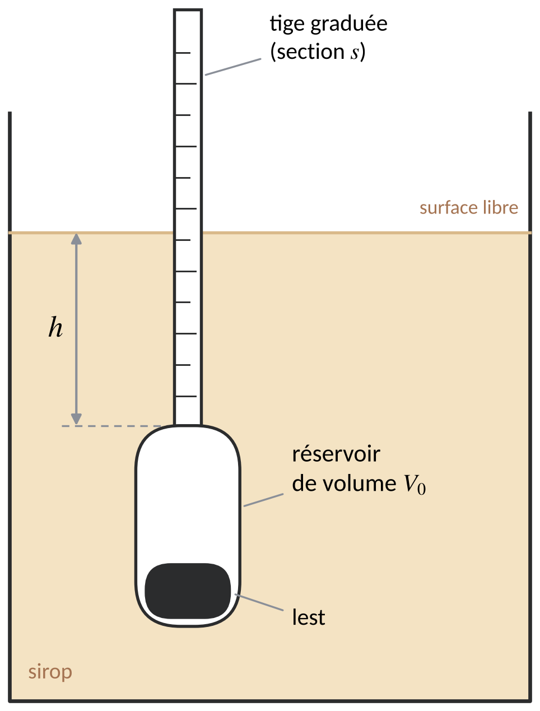{width=5.2cm}
:::

::: {custom-style="Legende"}
Figure 1. Pèse-sirop en équilibre dans un sirop
:::

::: {custom-style="Enonce"}
**Données**
:::

::: {custom-style="EnonceDonnees"}
Masse du pèse-sirop : $m = 25{,}0\ \text{g}$ ; volume du réservoir : $V_0 = 18{,}0\ \text{cm}^{3}$

Section de la tige : $s = 0{,}200\ \text{cm}^{2}$ ; longueur de la tige : $L = 16{,}0\ \text{cm}$

Masse volumique de l'eau : $\rho_{\text{eau}} = 1{,}00\ \text{g·cm}^{-3}$

La poussée d'Archimède exercée par l'air est négligée.
:::

::: {custom-style="Enonce"}
**1.** Faire le bilan des forces qui s'exercent sur le pèse-sirop en équilibre dans le sirop.

**2.** Le pèse-sirop est immobile. Quelle relation lie ces forces ? Nommer la loi utilisée.

**3.** Exprimer le volume immergé en fonction de $V_0$, $s$ et $h$, puis montrer que $\rho = m / (V_0 + s \times h)$.

**4.** Dans un sirop A, le confiseur lit $h_A = 10{,}0\ \text{cm}$. Calculer la masse volumique $\rho_A$ de ce sirop.

**5.** Après cuisson, le sirop est plus concentré : sa masse volumique vaut $\rho_B = 1{,}32\ \text{g·cm}^{-3}$. Prévoir, sans calcul, si le pèse-sirop s'enfonce plus ou moins, puis calculer $h_B$.

**6.** Quelle est la plus petite masse volumique mesurable avec ce pèse-sirop ? Que se passe-t-il si on le plonge dans l'eau ?

**7.** Pour un instrument plus sensible (déplacement de la tige plus grand pour une même variation de masse volumique), faut-il une tige plus fine ou plus large ? Justifier.
:::

::: {custom-style="Renvoi"}
[CIBLE:c_ex1]{custom-style="BoutonCorrige"}
:::

### [Exercice 2]{custom-style="QNum"}\ \ Viscosimètre à chute de bille : le contrôle d'un miel [(voir BAC Métropole, juin 2025)]{custom-style="VoirBac"} {#ex2}

::: {custom-style="Meta"}
[\ Objectif 14\ ]{custom-style="Niv14"}\ \ [Type BAC]{custom-style="TagBac"} · 5 points · 50 min · Questions 8 et 9 : objectif 18
:::

::: {custom-style="MentionBac"}
[Sujet du BAC correspondant.]{custom-style="EtiqBac"} Métropole, juin 2025, jour 1, exercice 3 : « Viscosimètre à chute de bille ». Voir aussi Centres étrangers 2025, jour 2, exercice 3 : « La viscosité du glycérol ».
:::

::: {custom-style="Enonce"}
La viscosité $\eta$ d'un liquide traduit sa résistance à l'écoulement. Elle s'exprime en $\text{Pa·s}$ (ou $\text{kg·m}^{-1}\text{·s}^{-1}$). Un apiculteur veut vérifier celle de son miel d'acacia, mesurée par un laboratoire à $\eta_{\text{réf}} = 10{,}0\ \text{Pa·s}$ à $20\ \text{°C}$.

Il lâche sans vitesse initiale une bille d'acier à la surface d'une éprouvette remplie de miel à $20\ \text{°C}$, puis mesure la durée $\Delta t$ que met la bille pour parcourir la distance $L$ qui sépare deux repères (figure 2).
:::

::: {custom-style="Figure"}
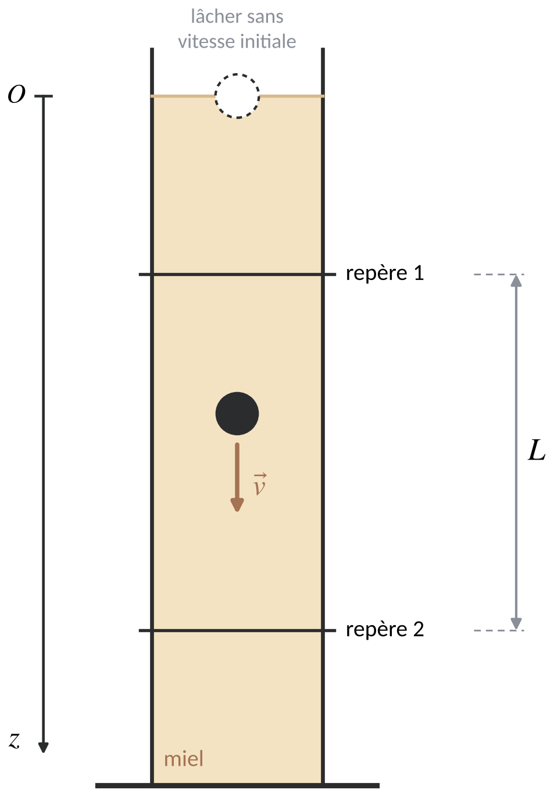{width=4.8cm}
:::

::: {custom-style="Legende"}
Figure 2. Principe du viscosimètre à chute de bille
:::

::: {custom-style="Enonce"}
**Données**
:::

::: {custom-style="EnonceDonnees"}
Rayon de la bille : $R = 3{,}00\ \text{mm}$

Volume d'une sphère de rayon $R$ : $V = \dfrac{4}{3}\pi R^{3}$

Masse volumique de l'acier : $\rho_{\text{acier}} = 7{,}80 \times 10^{3}\ \text{kg·m}^{-3}$

Masse volumique du miel : $\rho_{\text{miel}} = 1{,}42 \times 10^{3}\ \text{kg·m}^{-3}$

Intensité de la pesanteur : $g = 9{,}81\ \text{m·s}^{-2}$

Distance entre les repères : $L = 10{,}0\ \text{cm}$

Distance entre la surface du miel et le repère 1 : $5{,}0\ \text{cm}$

Force de frottement exercée par le miel sur la bille : opposée à la vitesse, de norme $f = 6\pi \times \eta \times R \times v$
:::

::: {custom-style="Enonce"}

**Partie A. Étude théorique de la chute**

**1.** Faire le bilan des forces qui s'exercent sur la bille pendant sa chute et les représenter sur un schéma, sans souci d'échelle.

**2.** Exprimer le rapport $\dfrac{\Pi}{P}$ de la norme de la poussée d'Archimède à celle du poids en fonction des masses volumiques, puis le calculer. Peut-on négliger la poussée d'Archimède ?

**3.** On note $v$ la vitesse de la bille selon l'axe $(Oz)$ vertical dirigé vers le bas. En appliquant la deuxième loi de Newton, montrer que :

$$\dfrac{\mathrm{d}v}{\mathrm{d}t} = g \times \left(1 - \dfrac{\rho_{\text{miel}}}{\rho_{\text{acier}}}\right) - \dfrac{v}{\tau}$$

avec $\tau = \dfrac{2 \times \rho_{\text{acier}} \times R^{2}}{9 \times \eta}$.

**4.** La bille atteint rapidement une vitesse constante, appelée vitesse limite $v_{\text{lim}}$. Montrer que $v_{\text{lim}} = \dfrac{2 \times R^{2} \times g \times (\rho_{\text{acier}} - \rho_{\text{miel}})}{9 \times \eta}$.

**5.** Calculer $\tau$ pour $\eta = \eta_{\text{réf}}$. La vitesse limite est atteinte au bout d'une durée de l'ordre de $5\tau$ : est-elle atteinte avant le repère 1 ?

**Partie B. Mesure de la viscosité**

**6.** La moyenne de cinq mesures donne $\Delta t = 8{,}30\ \text{s}$. Calculer la vitesse limite de la bille puis la viscosité $\eta$ du miel.

**7.** L'incertitude-type sur la viscosité est donnée par la relation ci-dessous, avec $u(R) = 0{,}03\ \text{mm}$, $u(\Delta t) = 0{,}10\ \text{s}$ et $u(L) = 0{,}1\ \text{cm}$. Calculer $u(\eta)$, puis dire si la mesure est compatible avec la valeur du laboratoire.

$$u(\eta) = \eta \times \sqrt{\left(\dfrac{2 \times u(R)}{R}\right)^{2} + \left(\dfrac{u(\Delta t)}{\Delta t}\right)^{2} + \left(\dfrac{u(L)}{L}\right)^{2}}$$

**8.** Vérifier que $v(t) = v_{\text{lim}} \times \left(1 - e^{-t/\tau}\right)$ est solution de l'équation différentielle de la question 3 et respecte la condition initiale.

**9.** Citer deux précautions expérimentales qui rendent la mesure plus fiable.
:::

::: {custom-style="Renvoi"}
[CIBLE:c_ex2]{custom-style="BoutonCorrige"}
:::

::: {custom-style="Surtitre"}
Énoncés
:::

# Thème 2 : écoulement de fluides {#theme2}

::: {custom-style="Rubrique"}
Questions de cours
:::

## [Q.5]{custom-style="QNum"}\ \ Qu'est-ce qu'un fluide incompressible ? {#q5}

::: {custom-style="Meta"}
[\ Objectif 10\ ]{custom-style="Niv10"}\ \ Cours · Notion : fluide incompressible\ \ \ [CIBLE:c_q5]{custom-style="BoutonCorrige"}
:::

## [Q.6]{custom-style="QNum"}\ \ Définir le débit volumique {#q6}

::: {custom-style="Meta"}
[\ Objectif 10\ ]{custom-style="Niv10"}\ \ Cours · Notion : débit volumique · Demandé dans huit exercices en 2025 et 2026\ \ \ [CIBLE:c_q6]{custom-style="BoutonCorrige"}
:::

## [Q.7]{custom-style="QNum"}\ \ Dans une conduite cylindrique de section $S$ et de longueur $h$, exprimer le débit volumique d'un fluide traversant la tranche cylindrique pendant une durée $\Delta t$ en fonction de la section et de la vitesse du fluide. {#q7}

::: {custom-style="Meta"}
[\ Objectif 14\ ]{custom-style="Niv14"}\ \ Démonstration · Notions : débit volumique, section, vitesse d'écoulement\ \ \ [CIBLE:c_q7]{custom-style="BoutonCorrige"}
:::

## [Q.8]{custom-style="QNum"}\ \ Qu'appelle-t-on régime permanent ou stationnaire ? Montrer que dans ce cas la vitesse se conserve le long d'une conduite de section constante $S$. Que dire de la vitesse dans deux sections différentes ? {#q8}

::: {custom-style="Meta"}
[\ Objectif 14\ ]{custom-style="Niv14"}\ \ Démonstration · Notions : régime permanent, conservation du débit volumique\ \ \ [CIBLE:c_q8]{custom-style="BoutonCorrige"}
:::

## [Q.9]{custom-style="QNum"}\ \ Énoncer la relation de Bernoulli (non exigible) {#q9}

::: {custom-style="Meta"}
[\ Objectif 14\ ]{custom-style="Niv14"}\ \ Cours · Notions : relation de Bernoulli, effet Venturi · Demandée dans sept exercices en 2025 et 2026\ \ \ [CIBLE:c_q9]{custom-style="BoutonCorrige"}
:::

## [Q.10]{custom-style="QNum"}\ \ Que devient la relation de Bernoulli pour un fluide au repos ? Retrouver la loi fondamentale de la statique des fluides. {#q10}

::: {custom-style="Meta"}
[\ Objectif 10\ ]{custom-style="Niv10"}\ \ Cours · Notions : statique des fluides, pression · Demandée en 2025 (Amérique du Sud, jour 1 ; Nouvelle-Calédonie, jour 1) et en 2026 (Métropole, juin, jour 1)\ \ \ [CIBLE:c_q10]{custom-style="BoutonCorrige"}
:::

::: {custom-style="Rubrique"}
Exercices
:::

## [Exercice 3]{custom-style="QNum"}\ \ Tube de Pitot {#ex3}

::: {custom-style="Meta"}
[\ Objectif 18\ ]{custom-style="Niv18"}\ \ Expressions littérales · 20 min · Notions : relation de Bernoulli, statique des fluides, débit volumique
:::

::: {custom-style="Enonce"}
Considérons la situation décrite par la figure ci-dessous avec de l'eau qui s'écoule dans la conduite de diamètre $d$.

Les points $A$ et $B$ sont situés à la même hauteur. L'eau est au repos au point $A$.

Relation de Bernoulli le long d'une ligne de courant : $P + \dfrac{1}{2}\rho v^{2} + \rho g z = \text{constante}$
:::

::: {custom-style="Figure"}
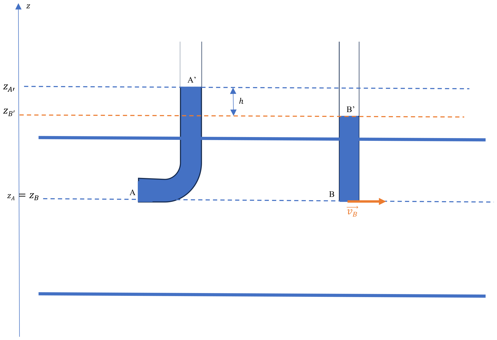{width=12.4cm}
:::

::: {custom-style="Legende"}
Figure 3. Tube de Pitot
:::

::: {custom-style="Enonce"}
**1.** Écrire la relation de Bernoulli entre les deux points $A$ et $B$.

**2.** En appliquant la relation de Bernoulli, exprimer la pression $P_A$ en fonction de la pression $P_B$.

**3.** Écrire la relation fondamentale de l'hydrostatique entre $A$ et $\text{A′}$ puis entre $B$ et $\text{B′}$.

**4.** Exprimer la vitesse $v_B$ en fonction de $h$ (différence de hauteur entre les points $\text{B′}$ et $\text{A′}$).

**5.** En déduire le débit volumique dans la canalisation (le régime stationnaire étant atteint).

**6.** Application numérique : $h = 3{,}2\ \text{cm}$, $d = 2{,}0\ \text{cm}$, $g = 9{,}81\ \text{m·s}^{-2}$. Calculer $v_B$ puis le débit volumique.
:::

::: {custom-style="Renvoi"}
[CIBLE:c_ex3]{custom-style="BoutonCorrige"}
:::

## [Exercice 4]{custom-style="QNum"}\ \ Phénomène de Venturi {#ex4}

::: {custom-style="Meta"}
[\ Objectif 18\ ]{custom-style="Niv18"}\ \ Expressions littérales · 25 min · Notions : conservation du débit, relation de Bernoulli, statique des fluides
:::

::: {custom-style="Enonce"}
On considère l'écoulement dans la canalisation ci-dessous.
:::

::: {custom-style="Figure"}
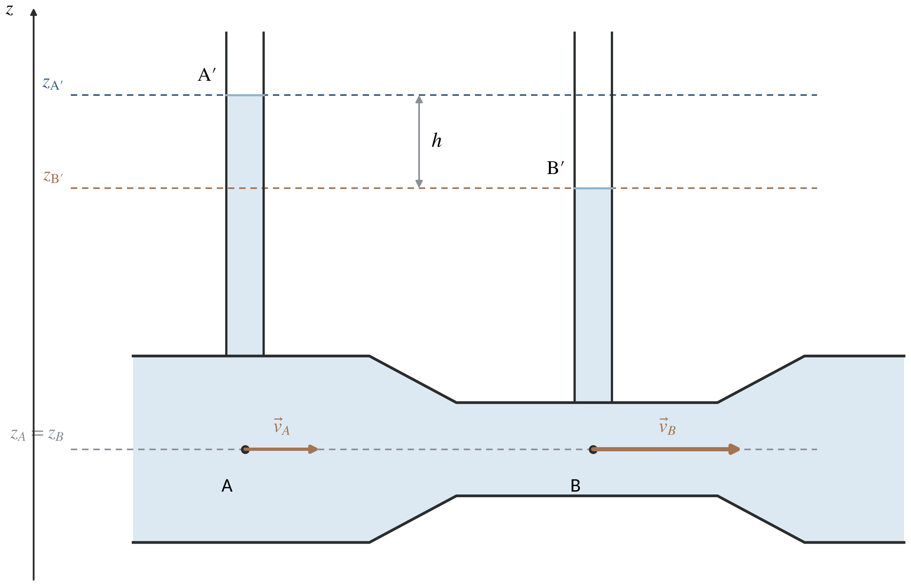{width=12.4cm}
:::

::: {custom-style="Legende"}
Figure 4. Canalisation avec rétrécissement
:::

::: {custom-style="Enonce"}
On note $S_A$ et $S_B$ les sections respectives de la conduite aux points $A$ et $B$. On pose $\beta = \dfrac{S_A}{S_B}$. On note $h$ la différence de hauteur entre $\text{A′}$ et $\text{B′}$.

Relation de Bernoulli le long d'une ligne de courant : $P + \dfrac{1}{2}\rho v^{2} + \rho g z = \text{constante}$

**1.** En écrivant la relation de continuité dans la canalisation (conservation du débit volumique), exprimer la relation entre $v_A$, $v_B$ et $\beta$.

**2.** En écrivant la relation de Bernoulli, trouver une relation entre $P_A$, $P_B$, $v_A$ et $\beta$.

**3.** Écrire la relation fondamentale de l'hydrostatique entre $\text{A′}$ et $A$ puis entre $\text{B′}$ et $B$.

**4.** En déduire la relation entre $v_A$ et $\beta$.

**5.** Exprimer alors le débit volumique en fonction de $\beta$ et des données de l'énoncé.
:::

::: {custom-style="Renvoi"}
[CIBLE:c_ex4]{custom-style="BoutonCorrige"}
:::

## [Exercice 5]{custom-style="QNum"}\ \ Liquide sortant d'un réservoir {#ex5}

::: {custom-style="Meta"}
[\ Objectif 14\ ]{custom-style="Niv14"}\ \ Expressions littérales · 10 min · Notions : relation de Bernoulli, pression atmosphérique
:::

::: {custom-style="Enonce"}
Un réservoir ouvert à l'air libre se vide par un orifice situé à une hauteur $H$ sous la surface libre du liquide. On note $A$ un point de la surface libre et $B$ un point du jet à la sortie de l'orifice. La section du réservoir est très grande devant celle de l'orifice.

Relation de Bernoulli le long d'une ligne de courant : $P + \dfrac{1}{2}\rho v^{2} + \rho g z = \text{constante}$
:::

::: {custom-style="Figure"}
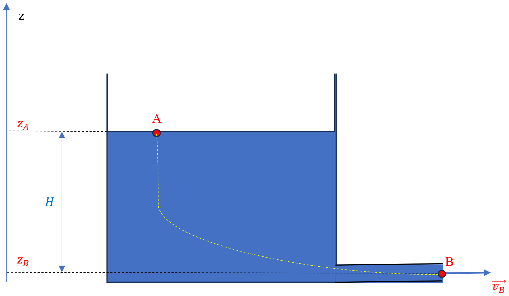{width=10.6cm}
:::

::: {custom-style="Legende"}
Figure 5. Liquide sortant d'un réservoir
:::

::: {custom-style="Enonce"}
**1.** Que vaut la vitesse au point $A$ au début de l'écoulement ?

**2.** Écrire la relation de Bernoulli entre les points $A$ et $B$ puis exprimer la vitesse de sortie $v_B$ en fonction de la hauteur $H$ au début de l'écoulement.
:::

::: {custom-style="Renvoi"}
[CIBLE:c_ex5]{custom-style="BoutonCorrige"}
:::

### [Exercice 6]{custom-style="QNum"}\ \ La trompe à eau du laboratoire [(voir BAC Amérique du Nord 2025)]{custom-style="VoirBac"} {#ex6}

::: {custom-style="Meta"}
[\ Objectif 14\ ]{custom-style="Niv14"}\ \ [Type BAC]{custom-style="TagBac"} · 3 points · 30 min
:::

::: {custom-style="MentionBac"}
[Sujet du BAC correspondant.]{custom-style="EtiqBac"} Amérique du Nord 2025, jour 2, exercice 3 : « Mostiglass®, le vitrage moustiquaire rafraîchissant ». Voir aussi jour 1, exercice 3 : « Traitement des eaux d'un bassin d'orage ».
:::

::: {custom-style="Enonce"}
Au laboratoire de chimie, la filtration sous pression réduite utilise une trompe à eau. L'eau du robinet traverse un étranglement relié par un tuyau à la fiole de filtration : l'air de la fiole est aspiré (figure 6). La trompe est horizontale : les points $A$ et $B$ sont à la même altitude.
:::

::: {custom-style="Figure"}
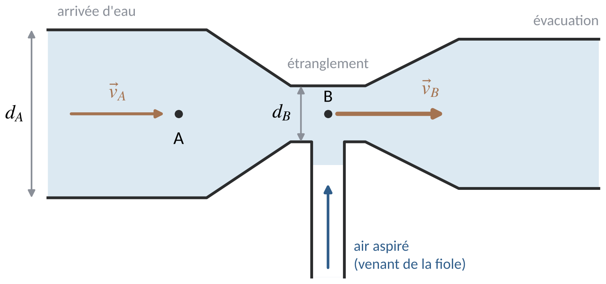{width=11cm}
:::

::: {custom-style="Legende"}
Figure 6. Schéma de principe d'une trompe à eau
:::

::: {custom-style="Enonce"}
**Données**
:::

::: {custom-style="EnonceDonnees"}
Débit volumique de l'eau : $D = 9{,}00\ \text{L·min}^{-1}$

Diamètre de la conduite en $A$ : $d_A = 12{,}0\ \text{mm}$

Diamètre de l'étranglement en $B$ : $d_B = 4{,}00\ \text{mm}$

Pression de l'eau en $A$ : $P_A = 1{,}50 \times 10^{5}\ \text{Pa}$

Pression atmosphérique : $P_{\text{atm}} = 1{,}013 \times 10^{5}\ \text{Pa}$

Masse volumique de l'eau : $\rho = 1{,}00 \times 10^{3}\ \text{kg·m}^{-3}$

Relation de Bernoulli le long d'une ligne de courant : $P + \dfrac{1}{2}\rho v^{2} + \rho g z = \text{constante}$
:::

::: {custom-style="Enonce"}
**1.** Convertir le débit volumique en $\text{m}^{3}\text{·s}^{-1}$.

**2.** Calculer la vitesse $v_A$ de l'eau au point $A$.

**3.** En exploitant la conservation du débit volumique, montrer que $v_B = v_A \times \left(\dfrac{d_A}{d_B}\right)^{2}$, puis calculer $v_B$.

**4.** Simplifier la relation de Bernoulli entre $A$ et $B$, puis exprimer et calculer la différence de pression $P_A - P_B$.

**5.** En déduire la pression $P_B$ dans l'étranglement. Expliquer pourquoi l'air de la fiole est aspiré et nommer l'effet mis en jeu.

**6.** Un élève écrit : « Dans l'étranglement, l'eau va plus vite donc la pression augmente. » Corriger cette affirmation en deux ou trois phrases.
:::

::: {custom-style="Renvoi"}
[CIBLE:c_ex6]{custom-style="BoutonCorrige"}
:::

### [Exercice 7]{custom-style="QNum"}\ \ Le récupérateur d'eau de pluie [(voir BAC Métropole, juin 2026)]{custom-style="VoirBac"} {#ex7}

::: {custom-style="Meta"}
[\ Objectif 14\ ]{custom-style="Niv14"}\ \ [Type BAC]{custom-style="TagBac"} · 4 points · 40 min · Parties A et B : objectif 10
:::

::: {custom-style="MentionBac"}
[Sujet du BAC correspondant.]{custom-style="EtiqBac"} Métropole, juin 2026, jour 1, exercice 1 : « Étude d'un lave-linge » (partie 1).
:::

::: {custom-style="Enonce"}
Une cuve cylindrique de diamètre intérieur $d = 1{,}00\ \text{m}$ recueille l'eau de pluie d'un toit. Un capteur de pression au fond de la cuve donne la hauteur d'eau $H$. Un robinet au niveau du fond sert à remplir des arrosoirs (figure 7).
:::

::: {custom-style="Figure"}
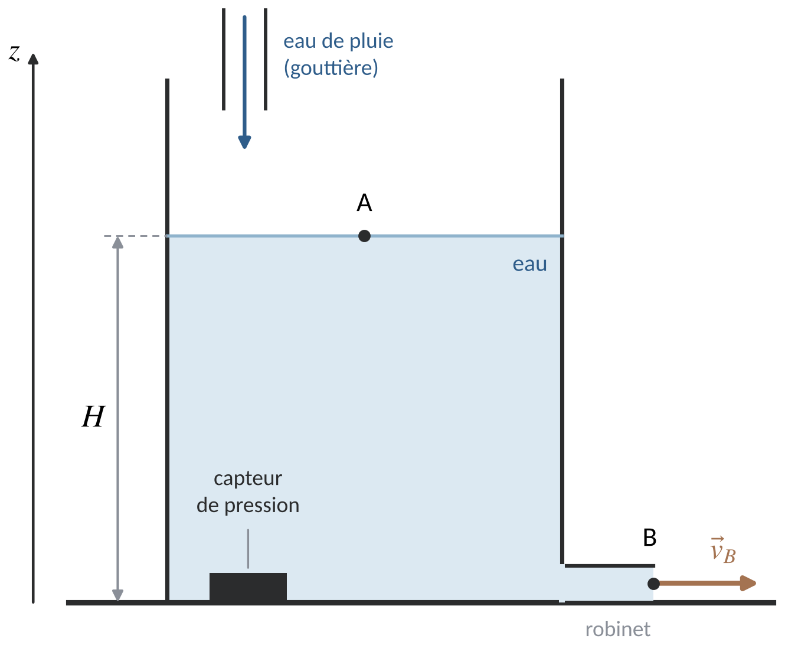{width=7.7cm}
:::

::: {custom-style="Legende"}
Figure 7. Récupérateur d'eau de pluie
:::

::: {custom-style="Enonce"}
**Données**
:::

::: {custom-style="EnonceDonnees"}
Surface du toit : $S_{\text{toit}} = 60{,}0\ \text{m}^{2}$ ; diamètre de sortie du robinet : $d_r = 12{,}0\ \text{mm}$

Masse volumique de l'eau : $\rho = 1{,}00 \times 10^{3}\ \text{kg·m}^{-3}$ ; intensité de la pesanteur : $g = 9{,}81\ \text{m·s}^{-2}$

Relation de Bernoulli le long d'une ligne de courant : $P + \dfrac{1}{2}\rho v^{2} + \rho g z = \text{constante}$
:::

::: {custom-style="Enonce"}
**Partie A. Remplissage**

**1.** Lors d'une averse, il tombe $12{,}0\ \text{mm}$ d'eau sur le toit en $30{,}0\ \text{min}$. Calculer le volume d'eau recueilli, puis le débit volumique moyen d'arrivée dans la cuve.

**2.** De quelle hauteur le niveau de l'eau monte-t-il dans la cuve pendant cette averse ?

**Partie B. Mesure du niveau**

**3.** Énoncer la loi fondamentale de la statique des fluides, puis exprimer $P_{\text{fond}}$ au fond de la cuve avec $P_{\text{atm}}$, $\rho$, $g$ et $H$.

**4.** Quelques jours plus tard, le capteur indique $P_{\text{fond}} - P_{\text{atm}} = 8{,}83 \times 10^{3}\ \text{Pa}$. Calculer la hauteur d'eau $H$.

**Partie C. Vidange par le robinet**

On ouvre le robinet. On note $A$ un point de la surface libre et $B$ un point du jet à la sortie du robinet, avec $H = 0{,}900\ \text{m}$.

**5.** Justifier que $v_A$ est négligeable devant $v_B$, puis montrer que $v_B = \sqrt{2 g H}$. Calculer $v_B$.

**6.** Calculer le débit volumique à la sortie du robinet, puis la durée pour remplir un arrosoir de $10{,}0\ \text{L}$.

**7.** Expliquer, sans calcul, pourquoi remplir le même arrosoir est plus long quand la cuve est presque vide.
:::

::: {custom-style="Renvoi"}
[CIBLE:c_ex7]{custom-style="BoutonCorrige"}
:::

::: {custom-style="Surtitre"}
Énoncés
:::

# Thème 3 : chute dans un fluide {#theme3}

::: {custom-style="Rubrique"}
Questions de cours
:::

## [Q.11]{custom-style="QNum"}\ \ Faire le bilan des forces qui s'exercent sur un objet qui tombe dans un fluide {#q11}

::: {custom-style="Meta"}
[\ Objectif 10\ ]{custom-style="Niv10"}\ \ Cours · Notions : poids, poussée d'Archimède, force de frottement\ \ \ [CIBLE:c_q11]{custom-style="BoutonCorrige"}
:::

::: {custom-style="Enonce"}
Application : une goutte de pluie sphérique, de rayon $r = 1{,}0\ \text{mm}$, tombe dans l'air. Comparer la poussée d'Archimède à son poids, puis conclure. Données : $\rho_{\text{eau}} = 1{,}00 \times 10^{3}\ \text{kg·m}^{-3}$ et $\rho_{\text{air}} = 1{,}2\ \text{kg·m}^{-3}$.
:::

## [Q.12]{custom-style="QNum"}\ \ Déterminer l'unité d'un coefficient de frottement par analyse dimensionnelle {#q12}

::: {custom-style="Meta"}
[\ Objectif 10\ ]{custom-style="Niv10"}\ \ Méthode · Notions : unités du système international, analyse dimensionnelle\ \ \ [CIBLE:c_q12]{custom-style="BoutonCorrige"}
:::

::: {custom-style="Enonce"}
Application : selon la vitesse, la force de frottement exercée par un fluide s'écrit $f = k \times v$ ou $f = K \times v^{2}$. Déterminer l'unité SI de $k$, puis celle de $K$. Vérifier que $\dfrac{1}{2}\rho \times C_x \times S$, où $\rho$ est une masse volumique, $C_x$ un coefficient sans unité et $S$ une surface, s'exprime dans la même unité que $K$.
:::

## [Q.13]{custom-style="QNum"}\ \ Établir l'équation différentielle d'une chute avec un frottement $f = k \times v$ {#q13}

::: {custom-style="Meta"}
[\ Objectif 14\ ]{custom-style="Niv14"}\ \ Démonstration · Notions : deuxième loi de Newton, équation différentielle\ \ \ [CIBLE:c_q13]{custom-style="BoutonCorrige"}
:::

::: {custom-style="Enonce"}
Application : une gouttelette de brouillard, sphérique et de rayon $r = 10\ \text{µm}$, tombe sans vitesse initiale dans l'air immobile. L'air exerce sur elle une force de frottement de norme $f = k \times v$, avec $k = 6\pi \times \eta \times r$, où $\eta$ est la viscosité de l'air. En négligeant la poussée d'Archimède, montrer que sa vitesse vérifie $\dfrac{\mathrm{d}v}{\mathrm{d}t} + \dfrac{v}{\tau} = g$ avec $\tau = \dfrac{m}{k}$, puis calculer $\tau$. Données : $\eta = 1{,}8 \times 10^{-5}\ \text{Pa·s}$, $\rho_{\text{eau}} = 1{,}00 \times 10^{3}\ \text{kg·m}^{-3}$, volume d'une sphère : $V = \dfrac{4}{3}\pi r^{3}$.
:::

## [Q.14]{custom-style="QNum"}\ \ Exprimer et calculer la vitesse limite d'un objet qui tombe dans un fluide {#q14}

::: {custom-style="Meta"}
[\ Objectif 10\ ]{custom-style="Niv10"}\ \ Cours · Notions : vitesse limite, principe d'inertie · Demandée en 2025 (Métropole, juin, jour 1)\ \ \ [CIBLE:c_q14]{custom-style="BoutonCorrige"}
:::

::: {custom-style="Enonce"}
Application : la gouttelette de Q.13 a une masse $m = 4{,}2 \times 10^{-12}\ \text{kg}$ et le coefficient de frottement vaut $k = 3{,}4 \times 10^{-9}\ \text{kg·s}^{-1}$. Calculer sa vitesse limite, puis la durée d'une chute de $1{,}0\ \text{m}$. Expliquer pourquoi le brouillard semble flotter dans l'air. Donnée : $g = 9{,}81\ \text{m·s}^{-2}$.
:::

## [Q.15]{custom-style="QNum"}\ \ Exploiter la courbe de vitesse d'une bille qui tombe dans un liquide {#q15}

::: {custom-style="Meta"}
[\ Objectif 14\ ]{custom-style="Niv14"}\ \ Méthode · Notions : vitesse limite, temps caractéristique, tangente à l'origine\ \ \ [CIBLE:c_q15]{custom-style="BoutonCorrige"}
:::

::: {custom-style="Figure"}
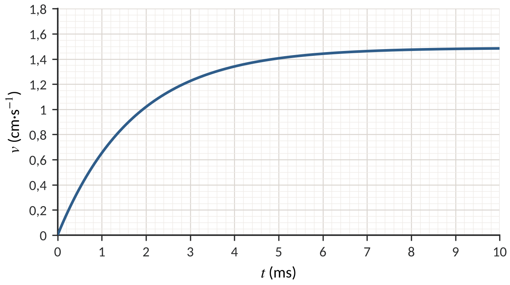{width=10cm}
:::

::: {custom-style="Legende"}
Figure 8. Vitesse d'une bille d'acier lâchée dans une huile
:::

::: {custom-style="Enonce"}
Application : la figure 8 donne l'évolution de la vitesse d'une bille d'acier lâchée sans vitesse initiale dans une huile, qui exerce sur elle une force de frottement proportionnelle à la vitesse, de norme $f = k \times v$. Déterminer la vitesse limite, puis le temps caractéristique $\tau$ par deux méthodes. Déterminer la valeur de $\dfrac{\mathrm{d}v}{\mathrm{d}t}$ à $t = 0$ et expliquer pourquoi elle est inférieure à $g$. Données : $\rho_{\text{acier}} = 7{,}80 \times 10^{3}\ \text{kg·m}^{-3}$ et $\rho_{\text{huile}} = 9{,}70 \times 10^{2}\ \text{kg·m}^{-3}$ et $g = 9{,}81\ \text{m·s}^{-2}$.
:::

## [Q.16]{custom-style="QNum"}\ \ Justifier que l'on peut négliger, ou non, les frottements de l'air {#q16}

::: {custom-style="Meta"}
[\ Objectif 10\ ]{custom-style="Niv10"}\ \ Application · Notions : modèle de la chute libre, ordre de grandeur · Demandé en 2025 (Amérique du Nord, sujet de secours)\ \ \ [CIBLE:c_q16]{custom-style="BoutonCorrige"}
:::

::: {custom-style="Enonce"}
Application : l'air exerce sur une balle de vitesse $v$ une force de frottement de norme $f = \dfrac{1}{2}\rho_{\text{air}} \times C_x \times S \times v^{2}$, où $S$ est l'aire du disque de même diamètre $d$ que la balle. Comparer $f$ au poids pour une boule de pétanque ($m = 700\ \text{g}$, $d = 7{,}5\ \text{cm}$), puis pour une balle de tennis de table ($m = 2{,}7\ \text{g}$, $d = 4{,}0\ \text{cm}$), toutes deux à $10\ \text{m·s}^{-1}$. Conclure. Données : $\rho_{\text{air}} = 1{,}2\ \text{kg·m}^{-3}$, $C_x = 0{,}47$, $g = 9{,}81\ \text{m·s}^{-2}$.
:::

::: {custom-style="Rubrique"}
Exercices
:::

## [Exercice 8]{custom-style="QNum"}\ \ Le thermomètre de Galilée {#ex8}

::: {custom-style="Meta"}
[\ Objectif 10\ ]{custom-style="Niv10"}\ \ Entraînement · 4 points · 35 min · Questions 4 et 5 : objectif 14
:::

::: {custom-style="Enonce"}
Un thermomètre de Galilée est un tube de verre fermé, rempli d'un liquide où baignent cinq boules de verre lestées, de même volume mais de masses légèrement différentes. Chaque boule porte une étiquette (18, 20, 22, 24 ou 26 °C) : sa masse est ajustée pour qu'elle soit en équilibre dans le liquide à cette température. La masse volumique du liquide diminue quand sa température augmente. La figure 9 le montre dans une pièce.
:::

::: {custom-style="Figure"}
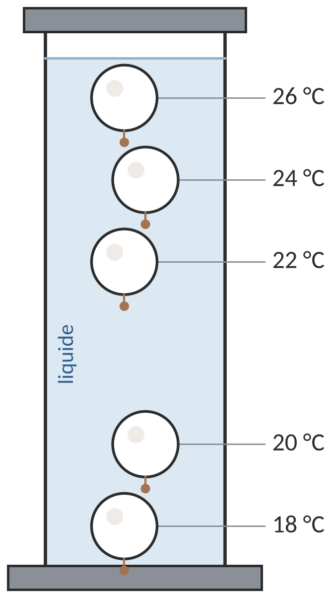{width=3.6cm}
:::

::: {custom-style="Legende"}
Figure 9. Thermomètre de Galilée posé dans une pièce
:::

::: {custom-style="Enonce"}
**Données**
:::

::: {custom-style="EnonceDonnees"}
Volume de chaque boule, sans l'étiquette : $V = 12{,}00\ \text{cm}^{3}$ ; volume d'une sphère de rayon $R$ : $\dfrac{4}{3}\pi R^{3}$

Masse volumique du liquide à la température $\theta$ (en °C) : $\rho(\theta) = 880{,}0 - 0{,}80 \times (\theta - 20)$, en $\text{kg·m}^{-3}$

Intensité de la pesanteur : $g = 9{,}81\ \text{m·s}^{-2}$

Force de frottement exercée par le liquide sur une boule en mouvement : opposée à la vitesse, de norme $f = K \times v^{2}$, avec $K = \dfrac{1}{2}\rho \times C_x \times S$, où $\rho$ est la masse volumique du liquide, $C_x = 0{,}47$ et $S = \pi R^{2}$
:::

::: {custom-style="Enonce"}
**1.** Faire le bilan des forces sur une boule en équilibre au sein du liquide, sans contact avec le tube ni les autres boules. En déduire que la boule dont l'étiquette indique $\theta$ a pour masse $m = \rho(\theta) \times V$.

**2.** Calculer la masse de la boule « 22 °C », puis l'écart de masse entre deux boules voisines. Commenter.

**3.** Justifier la position des boules « 20 °C » et « 22 °C » (figure 9), puis encadrer la température de la pièce.

**4.** La température du liquide passe à $23\ \text{°C}$. Indiquer dans quel sens la boule « 22 °C » se met en mouvement, puis calculer la norme de la résultante de son poids et de la poussée d'Archimède.

**5.** Quand cette boule descend à vitesse constante, la force de frottement compense cette résultante. Calculer cette vitesse limite, puis la durée minimale de la descente de la boule sur $25\ \text{cm}$. Le thermomètre indique-t-il rapidement un changement de température ?
:::

::: {custom-style="Renvoi"}
[CIBLE:c_ex8]{custom-style="BoutonCorrige"}
:::

## [Exercice 9]{custom-style="QNum"}\ \ Le saut en parachute {#ex9}

::: {custom-style="Meta"}
[\ Objectif 14\ ]{custom-style="Niv14"}\ \ Entraînement · 5 points · 45 min · Question 6 : objectif 18
:::

::: {custom-style="Enonce"}
Un parachutiste saute d'un avion. On étudie sa chute verticale, parachute fermé, dans le référentiel terrestre supposé galiléen, muni d'un axe $(Oz)$ vertical orienté vers le bas. À la date $t = 0$, sa vitesse verticale est nulle.

Le système {parachutiste et équipement} a une masse $m = 80{,}0\ \text{kg}$ et un volume $V = 0{,}080\ \text{m}^{3}$. L'air exerce sur lui une force de frottement opposée à la vitesse, de norme $f = K \times v^{2}$. La figure 10 donne l'évolution de la vitesse obtenue avec ce modèle.
:::

::: {custom-style="Figure"}
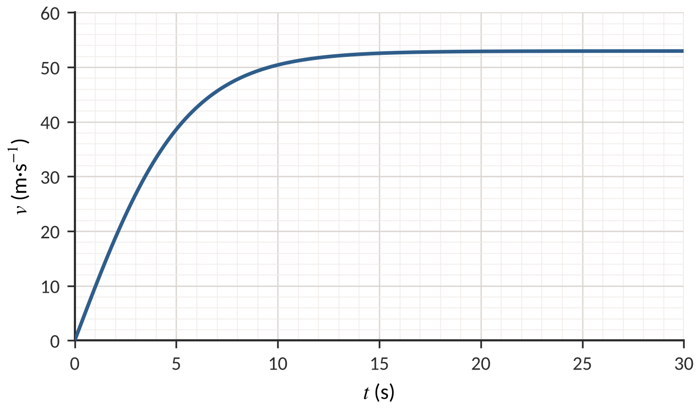{width=10cm}
:::

::: {custom-style="Legende"}
Figure 10. Vitesse du parachutiste, parachute fermé
:::

::: {custom-style="Enonce"}
**Données**
:::

::: {custom-style="EnonceDonnees"}
Intensité de la pesanteur : $g = 9{,}81\ \text{m·s}^{-2}$

Masse volumique de l'air : $\rho_{\text{air}} = 1{,}2\ \text{kg·m}^{-3}$

Coefficient de frottement : $K = 0{,}280\ \text{kg·m}^{-1}$ parachute fermé, $K\text{′} = 28{,}0\ \text{kg·m}^{-1}$ parachute ouvert
:::

::: {custom-style="Enonce"}
**1.** Faire le bilan des forces qui s'exercent sur le système. Montrer que la poussée d'Archimède est négligeable devant le poids.

**2.** En appliquant la deuxième loi de Newton, établir que $\dfrac{\mathrm{d}v}{\mathrm{d}t} = g - \dfrac{K}{m} \times v^{2}$.

**3.** En déduire l'expression de la vitesse limite $v_{\text{lim}}$ et vérifier son unité. La calculer en $\text{m·s}^{-1}$ puis en $\text{km·h}^{-1}$, et la comparer à la figure 10.

**4.** Tracer la tangente à la courbe à l'origine et déterminer son coefficient directeur. Le comparer à $g$, puis interpréter.

**5.** Le temps caractéristique $\tau$ de la chute est l'abscisse du point d'intersection de cette tangente avec la droite $v = v_{\text{lim}}$. Le déterminer, puis vérifier que $\tau = \dfrac{v_{\text{lim}}}{g}$. Pouvait-on l'obtenir, comme pour la charge d'un condensateur, en cherchant la date à laquelle $v = 0{,}63 \times v_{\text{lim}}$ ?

**6.** Une fois le parachute ouvert, la vitesse se stabilise à une nouvelle valeur limite. La calculer, puis déterminer la hauteur d'un saut sans frottement qui donnerait la même vitesse à l'arrivée au sol. Commenter.
:::

::: {custom-style="Renvoi"}
[CIBLE:c_ex9]{custom-style="BoutonCorrige"}
:::

<!--debut:complet-->
::: {custom-style="Surtitre"}
Corrigés
:::

# Corrigés du thème 1 : la poussée d'Archimède {#c_theme1}

#### [Corrigé]{custom-style="NumCorrige"}\ \ Q.1 · Définir et donner les caractéristiques de la poussée d'Archimède puis en donner l'expression (vous préciserez les unités) {#c_q1}

::: {custom-style="Renvoi"}
[CIBLE:q1]{custom-style="BoutonEnonce"}
:::

La poussée d'Archimède est la résultante des forces pressantes qu'un fluide (soit un gaz comme l'air, soit un liquide comme l'eau) exerce sur un corps partiellement ou totalement immergé.

C'est une force verticale orientée de bas en haut. Elle est opposée au poids du fluide déplacé par l'immersion du solide.

Son expression est donc :

$$\vec{\Pi} = - m_{\text{fluide déplacé}} \times \vec{g}$$

En notant $\rho_{\text{fluide}}$ la masse volumique du fluide, on a donc :

$$\rho_{\text{fluide}} = \dfrac{m_{\text{fluide déplacé}}}{V_{\text{fluide déplacé}}}$$

Soit :

$$m_{\text{fluide déplacé}} = \rho_{\text{fluide}} \times V_{\text{fluide déplacé}}$$

La poussée d'Archimède s'exprime alors comme :

$$\vec{\Pi} = - \rho_{\text{fluide}} \times V_{\text{fluide déplacé}} \times \vec{g}$$

Avec $V_{\text{fluide déplacé}} = V_{\text{immergé}}$ :

$$\vec{\Pi} = - \rho_{\text{fluide}} \times V_{\text{immergé}} \times \vec{g}$$

La norme de la poussée d'Archimède est donc :

::: {custom-style="Retenir"}
$\Pi = \rho_{\text{fluide}} \times V_{\text{immergé}} \times g$
:::

Unités :

- $\Pi$ : en newton (N) ;
- $\rho_{\text{fluide}}$ : en $\text{kg·m}^{-3}$ ;
- $V_{\text{immergé}}$ (volume de la partie immergée du corps) : en $\text{m}^{3}$ ;
- $g$ : en $\text{m·s}^{-2}$.

::: {custom-style="Piege"}
[Piège.]{custom-style="EtiqPiege"} Le signe moins de l'expression vectorielle traduit le sens de la force : la poussée d'Archimède est opposée à $\vec{g}$, donc dirigée vers le haut. Dans la formule, $\rho$ est la masse volumique du fluide (pas celle de l'objet) et $V$ est le volume immergé (pas le volume total quand l'objet flotte).
:::

#### [Corrigé]{custom-style="NumCorrige"}\ \ Q.2 · Expliquer qualitativement l'origine de la poussée d'Archimède {#c_q2}

::: {custom-style="Renvoi"}
[CIBLE:q2]{custom-style="BoutonEnonce"}
:::

Dans un fluide au repos, la pression augmente avec la profondeur (voir Q.10). Un corps immergé subit donc des forces pressantes plus intenses sur ses parties basses que sur ses parties hautes.

- Les forces pressantes latérales se compensent deux à deux.
- La force pressante exercée sur le bas du corps, dirigée vers le haut, l'emporte sur celle exercée sur le haut du corps, dirigée vers le bas.

La résultante des forces pressantes est donc verticale et dirigée vers le haut : c'est la poussée d'Archimède.

::: {custom-style="Figure"}
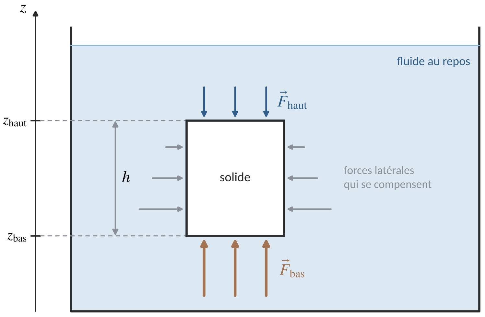{width=9.6cm}
:::

::: {custom-style="Legende"}
Figure 11. Forces pressantes exercées par un fluide au repos sur un solide immergé
:::

::: {custom-style="Intertitre"}
Vérification par le calcul
:::

Soit un solide de section $S$ et de hauteur $h$ immergé dans un fluide au repos (figure 11). L'axe $(Oz)$ est vertical, vers le haut ; les faces du haut et du bas sont aux altitudes $z_{\text{haut}}$ et $z_{\text{bas}}$, avec $z_{\text{haut}} - z_{\text{bas}} = h$.

**Étape 1 : la différence de pression entre les deux faces.** On applique la loi fondamentale de la statique des fluides (voir Q.10) entre un point de la face du haut et un point de la face du bas :

$$P_{\text{bas}} - P_{\text{haut}} = \rho_{\text{fluide}} \times g \times (z_{\text{haut}} - z_{\text{bas}}) = \rho_{\text{fluide}} \times g \times h$$

Cette différence est positive : la pression est plus forte sur la face du bas.

**Étape 2 : les forces pressantes sur les deux faces.** Sur une face plane de surface $S$, où la pression vaut $P$ en tout point, le fluide exerce une force perpendiculaire à la face, dirigée vers le solide, de norme $F = P \times S$ :

- sur la face du haut, $\vec{F}_{\text{haut}}$ est dirigée vers le bas et $F_{\text{haut}} = P_{\text{haut}} \times S$ ;
- sur la face du bas, $\vec{F}_{\text{bas}}$ est dirigée vers le haut et $F_{\text{bas}} = P_{\text{bas}} \times S$.

**Étape 3 : la résultante.** Les forces latérales se compensent. La résultante est donc verticale, dirigée vers le haut. Avec $V = S \times h$, le volume du solide, sa norme vaut :

$$F_{\text{bas}} - F_{\text{haut}} = (P_{\text{bas}} - P_{\text{haut}}) \times S = \rho_{\text{fluide}} \times g \times h \times S = \rho_{\text{fluide}} \times V \times g$$

On retrouve la norme de la poussée d'Archimède établie en Q.1.

**Exemple.** Un cube d'arête $a = 10{,}0\ \text{cm}$ est immergé dans l'eau, sa face du haut à $20{,}0\ \text{cm}$ sous la surface libre, où la pression vaut $P_{\text{atm}} = 1{,}013 \times 10^{5}\ \text{Pa}$. On prend $\rho_{\text{eau}} = 1{,}00 \times 10^{3}\ \text{kg·m}^{-3}$ et $g = 9{,}81\ \text{m·s}^{-2}$.

La loi fondamentale, appliquée entre la surface libre et chaque face, donne :

$$P_{\text{haut}} = P_{\text{atm}} + \rho_{\text{eau}} \times g \times 0{,}200 = 1{,}013 \times 10^{5} + 1{,}00 \times 10^{3} \times 9{,}81 \times 0{,}200 = 1{,}033 \times 10^{5}\ \text{Pa}$$

$$P_{\text{bas}} = P_{\text{atm}} + \rho_{\text{eau}} \times g \times 0{,}300 = 1{,}013 \times 10^{5} + 1{,}00 \times 10^{3} \times 9{,}81 \times 0{,}300 = 1{,}042 \times 10^{5}\ \text{Pa}$$

La pression atmosphérique s'élimine dans la différence, que l'on calcule donc directement :

$$P_{\text{bas}} - P_{\text{haut}} = \rho_{\text{eau}} \times g \times a = 1{,}00 \times 10^{3} \times 9{,}81 \times 0{,}100 = 981\ \text{Pa}$$

Chaque face a pour surface $S = a^{2} = 1{,}00 \times 10^{-2}\ \text{m}^{2}$. Les forces pressantes valent donc environ $1{,}03 \times 10^{3}\ \text{N}$ sur la face du haut et $1{,}04 \times 10^{3}\ \text{N}$ sur la face du bas, mais leur différence est bien plus petite :

$$F_{\text{bas}} - F_{\text{haut}} = (P_{\text{bas}} - P_{\text{haut}}) \times S = 981 \times 1{,}00 \times 10^{-2} = 9{,}81\ \text{N}$$

C'est bien la norme de la poussée d'Archimède, avec le volume du cube $V = a^{3} = 1{,}00 \times 10^{-3}\ \text{m}^{3}$ :

$$\Pi = \rho_{\text{eau}} \times V \times g = 1{,}00 \times 10^{3} \times 1{,}00 \times 10^{-3} \times 9{,}81 = 9{,}81\ \text{N}$$

::: {custom-style="Redaction"}
[Rédaction.]{custom-style="EtiqRedaction"} Pour une question « expliquer qualitativement », aucun calcul n'est attendu. Deux ou trois phrases complètes, avec les mots pression, profondeur et résultante, suffisent.
:::

#### [Corrigé]{custom-style="NumCorrige"}\ \ Q.3 · Pour un corps immergé, comparer la norme de la poussée d'Archimède à celle du poids et prévoir le mouvement du corps {#c_q3}

::: {custom-style="Renvoi"}
[CIBLE:q3]{custom-style="BoutonEnonce"}
:::

Si le poids du corps est supérieur à la poussée d'Archimède, il coule. S'il est inférieur, le corps remonte vers la surface. Si les deux forces se compensent, il reste en équilibre.

::: {custom-style="Remarque"}
[Remarque.]{custom-style="EtiqRemarque"} Pour un corps entièrement immergé, le poids vaut $P = \rho_{\text{corps}} \times V \times g$ et la poussée d'Archimède $\Pi = \rho_{\text{fluide}} \times V \times g$. Comparer les deux forces revient donc à comparer les masses volumiques : le corps coule si $\rho_{\text{corps}} > \rho_{\text{fluide}}$ et il remonte si $\rho_{\text{corps}} < \rho_{\text{fluide}}$. Si les deux forces se compensent, un corps immobile reste en équilibre (principe d'inertie).
:::

::: {custom-style="Redaction"}
[Rédaction.]{custom-style="EtiqRedaction"} « Le poids de l'objet est supérieur à la poussée d'Archimède. La somme des forces est donc dirigée vers le bas : l'objet coule. »
:::

#### [Corrigé]{custom-style="NumCorrige"}\ \ Q.4 · Un ballon de diamètre $50\ \text{cm}$ est immergé à moitié dans de l'eau (en équilibre). Déterminer sa masse. {#c_q4}

::: {custom-style="Renvoi"}
[CIBLE:q4]{custom-style="BoutonEnonce"}
:::

Le ballon est en équilibre. Cela signifie que son poids et la poussée d'Archimède se compensent. En particulier :

$$\Pi = \rho_{\text{fluide}} \times V_{\text{immergé}} \times g = P = m_{\text{ballon}} \times g$$

En simplifiant par $g$ :

$$\rho_{\text{fluide}} \times V_{\text{immergé}} = m_{\text{ballon}}$$

Soit :

$$m_{\text{ballon}} = \rho_{\text{fluide}} \times V_{\text{immergé}} \lbl{*}$$

La moitié du ballon est immergée donc :

$$V_{\text{immergé}} = \dfrac{V_{\text{ballon}}}{2}$$

Le ballon étant sphérique, on a :

$$V_{\text{ballon}} = \dfrac{4}{3}\pi R^{3}$$

Et :

$$V_{\text{immergé}} = \dfrac{\dfrac{4}{3}\pi R^{3}}{2} = \dfrac{2}{3}\pi R^{3} \lbl{1}$$

Le diamètre du ballon est tel que :

$$R = \dfrac{d}{2}$$

De sorte que :

$$V_{\text{immergé}} = \dfrac{2}{3}\pi \left(\dfrac{d}{2}\right)^{3}$$

La relation (\*) devient donc :

$$m_{\text{ballon}} = \rho_{\text{fluide}} \times \dfrac{2}{3}\pi \left(\dfrac{d}{2}\right)^{3}$$

Avec $\rho_{\text{fluide}} = \rho_{\text{eau}} = 1{,}0 \times 10^{3}\ \text{kg·m}^{-3}$ et $d = 0{,}50\ \text{m}$ :

::: {custom-style="Retenir"}
$m_{\text{ballon}} = 1{,}0 \times 10^{3} \times \dfrac{2}{3}\pi \times \left(\dfrac{0{,}50}{2}\right)^{3} = 33\ \text{kg}$
:::

::: {custom-style="Piege"}
[Piège.]{custom-style="EtiqPiege"} La masse volumique de l'eau vaut $1{,}0 \times 10^{3}\ \text{kg·m}^{-3}$, soit $1{,}0\ \text{kg·L}^{-1}$, et non $1\ \text{kg·m}^{-3}$. Le diamètre doit être converti en mètre avant le calcul.
:::

::: {custom-style="Remarque"}
[Remarque.]{custom-style="EtiqRemarque"} On peut également changer la question de façon à déterminer le **rayon** de l'objet connaissant sa masse et la fraction immergée (ici la moitié). En effet, d'après les relations (1) et (\*) :

$$m_{\text{ballon}} = \rho_{\text{fluide}} \times \dfrac{2}{3}\pi R^{3}$$

Soit :

$$R^{3} = \dfrac{3 \times m_{\text{ballon}}}{2\pi \times \rho_{\text{fluide}}}$$

$$R = \sqrt[3]{\dfrac{3 \times m_{\text{ballon}}}{2\pi \times \rho_{\text{fluide}}}}$$
:::

#### [Corrigé]{custom-style="NumCorrige"}\ \ Exercice 1 · Le pèse-sirop du confiseur {#c_ex1}

::: {custom-style="Renvoi"}
[CIBLE:ex1]{custom-style="BoutonEnonce"}
:::

::: {custom-style="QRappel"}
**1.** Bilan des forces
:::

On étudie le système {pèse-sirop} dans le référentiel terrestre supposé galiléen. Il est soumis à deux forces :

- son poids $\vec{P}$, vertical, dirigé vers le bas, de norme $P = m \times g$ ;
- la poussée d'Archimède $\vec{\Pi}$ exercée par le sirop, verticale, dirigée vers le haut, de norme $\Pi = \rho \times V_{\text{immergé}} \times g$.

::: {custom-style="QRappel"}
**2.** Relation entre les forces
:::

Le pèse-sirop est immobile dans un référentiel galiléen. D'après le principe d'inertie (première loi de Newton), les forces qui s'exercent sur lui se compensent :

$$\vec{P} + \vec{\Pi} = \vec{0}$$

Les deux forces ont donc la même norme :

$$P = \Pi$$

::: {custom-style="QRappel"}
**3.** Expression de la masse volumique du sirop
:::

Le réservoir est entièrement immergé et la tige l'est sur une longueur $h$ :

$$V_{\text{immergé}} = V_0 + s \times h$$

L'égalité $P = \Pi$ s'écrit alors :

$$m \times g = \rho \times (V_0 + s \times h) \times g$$

En simplifiant par $g$ :

::: {custom-style="Retenir"}
$\rho = \dfrac{m}{V_0 + s \times h}$
:::

::: {custom-style="QRappel"}
**4.** Masse volumique du sirop A
:::

Les données sont en gramme et en centimètre : le résultat s'exprime en $\text{g·cm}^{-3}$.

$$\rho_A = \dfrac{25{,}0}{18{,}0 + 0{,}200 \times 10{,}0} = 1{,}25\ \text{g·cm}^{-3}$$

Soit $\rho_A = 1{,}25 \times 10^{3}\ \text{kg·m}^{-3}$.

::: {custom-style="QRappel"}
**5.** Sirop plus concentré
:::

Le poids du pèse-sirop ne change pas, donc la poussée d'Archimède nécessaire à l'équilibre non plus. Comme $\Pi = \rho \times V_{\text{immergé}} \times g$, un sirop plus dense fournit la même poussée avec un volume immergé plus petit : le pèse-sirop s'enfonce moins, $h$ diminue.

D'après la question 3, $V_0 + s \times h_B = \dfrac{m}{\rho_B}$, soit $s \times h_B = \dfrac{m}{\rho_B} - V_0$. On divise par $s$ :

$$h_B = \dfrac{\dfrac{m}{\rho_B} - V_0}{s} = \dfrac{\dfrac{25{,}0}{1{,}32} - 18{,}0}{0{,}200} = 4{,}70\ \text{cm}$$

::: {custom-style="QRappel"}
**6.** Limite de l'instrument
:::

La plus petite masse volumique mesurable correspond à la tige entièrement immergée, soit $h = L$ :

$$\rho_{\text{min}} = \dfrac{m}{V_0 + s \times L} = \dfrac{25{,}0}{18{,}0 + 0{,}200 \times 16{,}0} = 1{,}18\ \text{g·cm}^{-3}$$

L'eau a une masse volumique inférieure à cette valeur. Même entièrement immergé, le pèse-sirop ne déplace que $21{,}2\ \text{cm}^{3}$ d'eau, soit $21{,}2\ \text{g}$ : la poussée d'Archimède reste inférieure au poids d'un objet de $25{,}0\ \text{g}$. Le pèse-sirop coule.

::: {custom-style="QRappel"}
**7.** Sensibilité
:::

On isole $h$ dans la relation établie à la question 3 :

$$\rho = \dfrac{m}{V_0 + s \times h}$$

On multiplie les deux membres par $V_0 + s \times h$, puis on les divise par $\rho$ :

$$V_0 + s \times h = \dfrac{m}{\rho}$$

On retranche $V_0$ aux deux membres, puis on les divise par $s$ :

$$s \times h = \dfrac{m}{\rho} - V_0 \quad \text{donc} \quad h = \dfrac{1}{s} \times \left(\dfrac{m}{\rho} - V_0\right)$$

Quand la masse volumique passe de $\rho_1$ à $\rho_2$, la tige se déplace de :

$$h_1 - h_2 = \dfrac{1}{s} \times \left(\dfrac{m}{\rho_1} - V_0\right) - \dfrac{1}{s} \times \left(\dfrac{m}{\rho_2} - V_0\right) = \dfrac{m}{s} \times \left(\dfrac{1}{\rho_1} - \dfrac{1}{\rho_2}\right)$$

Le volume $V_0$ s'élimine : pour une même variation de masse volumique, le déplacement de la tige est proportionnel à $\dfrac{1}{s}$. Il faut donc une tige plus fine : avec une section deux fois plus petite, le déplacement de la tige est deux fois plus grand.

Pour les sirops A et B des questions 4 et 5 :

$$h_A - h_B = \dfrac{25{,}0}{0{,}200} \times \left(\dfrac{1}{1{,}25} - \dfrac{1}{1{,}32}\right) = 5{,}30\ \text{cm}$$

On retrouve bien $h_A - h_B = 10{,}0 - 4{,}70 = 5{,}30\ \text{cm}$.

::: {custom-style="Redaction"}
[Rédaction.]{custom-style="EtiqRedaction"} À la question 5, la prévision « sans calcul » doit être justifiée par une phrase qui cite la formule : « La poussée d'Archimède doit rester égale au poids. Comme elle est proportionnelle à la masse volumique du liquide et au volume immergé, un liquide plus dense impose un volume immergé plus petit. »
:::

::: {custom-style="Renvoi"}
[CIBLE:ex1]{custom-style="BoutonEnonce"}
:::

#### [Corrigé]{custom-style="NumCorrige"}\ \ Exercice 2 · Viscosimètre à chute de bille : le contrôle d'un miel {#c_ex2}

::: {custom-style="Renvoi"}
[CIBLE:ex2]{custom-style="BoutonEnonce"}
:::

::: {custom-style="QRappel"}
**1.** Bilan des forces
:::

On étudie le système {bille} dans le référentiel terrestre supposé galiléen. Pendant la chute, la bille est soumise à trois forces verticales :

- son poids $\vec{P}$, dirigé vers le bas, de norme $P = m \times g = \rho_{\text{acier}} \times V \times g$ ;
- la poussée d'Archimède $\vec{\Pi}$ exercée par le miel, dirigée vers le haut, de norme $\Pi = \rho_{\text{miel}} \times V \times g$ ;
- la force de frottement $\vec{f}$, opposée à la vitesse donc dirigée vers le haut, de norme $f = 6\pi \times \eta \times R \times v$.

::: {custom-style="Figure"}
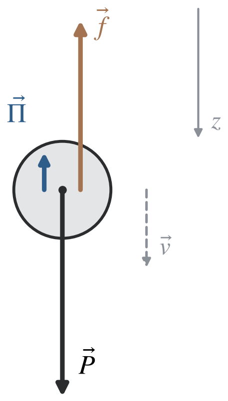{width=2.4cm}
:::

::: {custom-style="Legende"}
Figure 12. Forces exercées sur la bille pendant la chute
:::

::: {custom-style="QRappel"}
**2.** Rapport de la poussée d'Archimède au poids
:::

$$\dfrac{\Pi}{P} = \dfrac{\rho_{\text{miel}} \times V \times g}{\rho_{\text{acier}} \times V \times g} = \dfrac{\rho_{\text{miel}}}{\rho_{\text{acier}}} = \dfrac{1{,}42 \times 10^{3}}{7{,}80 \times 10^{3}} = 0{,}182$$

La poussée d'Archimède représente 18 % du poids : on ne peut pas la négliger.

::: {custom-style="QRappel"}
**3.** Équation différentielle
:::

La deuxième loi de Newton appliquée à la bille s'écrit :

$$m \times \vec{a} = \vec{P} + \vec{\Pi} + \vec{f}$$

En projection sur l'axe $(Oz)$ dirigé vers le bas :

$$m \times \dfrac{\mathrm{d}v}{\mathrm{d}t} = m \times g - \rho_{\text{miel}} \times V \times g - 6\pi \times \eta \times R \times v$$

On divise par $m = \rho_{\text{acier}} \times V$ :

$$\dfrac{\mathrm{d}v}{\mathrm{d}t} = g \times \left(1 - \dfrac{\rho_{\text{miel}}}{\rho_{\text{acier}}}\right) - \dfrac{6\pi \times \eta \times R}{m} \times v$$

Avec $m = \rho_{\text{acier}} \times \dfrac{4}{3}\pi R^{3}$ :

$$\dfrac{6\pi \times \eta \times R}{m} = \dfrac{6\pi \times \eta \times R \times 3}{4\pi \times \rho_{\text{acier}} \times R^{3}} = \dfrac{9 \times \eta}{2 \times \rho_{\text{acier}} \times R^{2}} = \dfrac{1}{\tau}$$

On obtient bien :

$$\dfrac{\mathrm{d}v}{\mathrm{d}t} = g \times \left(1 - \dfrac{\rho_{\text{miel}}}{\rho_{\text{acier}}}\right) - \dfrac{v}{\tau}$$

::: {custom-style="QRappel"}
**4.** Vitesse limite
:::

Quand la vitesse limite est atteinte, la vitesse ne varie plus : $\dfrac{\mathrm{d}v}{\mathrm{d}t} = 0$. L'équation différentielle donne :

$$\dfrac{v_{\text{lim}}}{\tau} = g \times \left(1 - \dfrac{\rho_{\text{miel}}}{\rho_{\text{acier}}}\right)$$

$$v_{\text{lim}} = \tau \times g \times \dfrac{\rho_{\text{acier}} - \rho_{\text{miel}}}{\rho_{\text{acier}}} = \dfrac{2 \times \rho_{\text{acier}} \times R^{2}}{9 \times \eta} \times g \times \dfrac{\rho_{\text{acier}} - \rho_{\text{miel}}}{\rho_{\text{acier}}}$$

::: {custom-style="Retenir"}
$v_{\text{lim}} = \dfrac{2 \times R^{2} \times g \times (\rho_{\text{acier}} - \rho_{\text{miel}})}{9 \times \eta}$
:::

::: {custom-style="QRappel"}
**5.** Durée d'établissement de la vitesse limite
:::

$$\tau = \dfrac{2 \times 7{,}80 \times 10^{3} \times (3{,}00 \times 10^{-3})^{2}}{9 \times 10{,}0} = 1{,}56 \times 10^{-3}\ \text{s}$$

La vitesse limite est atteinte au bout d'environ $5\tau \approx 7{,}8\ \text{ms}$. Pendant cette durée, la bille parcourt moins que $v_{\text{lim}} \times 5\tau$. D'après la relation de la question 4 avec $\eta = \eta_{\text{réf}}$, $v_{\text{lim}} = 1{,}25 \times 10^{-2}\ \text{m·s}^{-1}$, donc :

$$d < 1{,}25 \times 10^{-2} \times 7{,}8 \times 10^{-3} \approx 1 \times 10^{-4}\ \text{m}$$

La bille a parcouru moins de $0{,}1\ \text{mm}$, très peu devant $5{,}0\ \text{cm}$ : la vitesse limite est atteinte bien avant le repère 1.

::: {custom-style="QRappel"}
**6.** Vitesse limite et viscosité mesurées
:::

Entre les deux repères, le mouvement est rectiligne uniforme :

$$v_{\text{lim}} = \dfrac{L}{\Delta t} = \dfrac{0{,}100}{8{,}30} = 1{,}20 \times 10^{-2}\ \text{m·s}^{-1}$$

On isole la viscosité dans l'expression de la question 4 :

$$\eta = \dfrac{2 \times R^{2} \times g \times (\rho_{\text{acier}} - \rho_{\text{miel}})}{9 \times v_{\text{lim}}} = \dfrac{2 \times (3{,}00 \times 10^{-3})^{2} \times 9{,}81 \times (7{,}80 \times 10^{3} - 1{,}42 \times 10^{3})}{9 \times 1{,}20 \times 10^{-2}}$$

::: {custom-style="Retenir"}
$\eta = 10{,}4\ \text{Pa·s}$
:::

::: {custom-style="QRappel"}
**7.** Incertitude et comparaison à la valeur de référence
:::

$$u(\eta) = 10{,}4 \times \sqrt{\left(\dfrac{2 \times 0{,}03}{3{,}00}\right)^{2} + \left(\dfrac{0{,}10}{8{,}30}\right)^{2} + \left(\dfrac{0{,}1}{10{,}0}\right)^{2}} = 0{,}26\ \text{Pa·s}$$

On arrondit l'incertitude-type à un chiffre significatif : $u(\eta) = 0{,}3\ \text{Pa·s}$.

On compare ensuite l'écart à la valeur de référence avec l'incertitude-type :

$$z = \dfrac{\left|\eta - \eta_{\text{réf}}\right|}{u(\eta)} = \dfrac{\left|10{,}4 - 10{,}0\right|}{0{,}3} = 1{,}3$$

::: {custom-style="Redaction"}
[Rédaction.]{custom-style="EtiqRedaction"} « L'écart entre la valeur mesurée et la valeur de référence vaut 1,3 fois l'incertitude-type. Ce quotient est inférieur à 2 : la mesure est compatible avec la valeur du laboratoire. »
:::

::: {custom-style="Methode"}
[Méthode.]{custom-style="EtiqMethode"} Pour comparer une mesure $x$ à une valeur de référence $x_{\text{réf}}$, on calcule le quotient $z = \dfrac{\left|x - x_{\text{réf}}\right|}{u(x)}$. Si $z \leq 2$, la mesure est compatible avec la référence. Si $z > 2$, elle ne l'est pas : il faut alors chercher une source d'erreur dans le protocole ou dans le modèle.
:::

::: {custom-style="QRappel"}
**8.** Vérification de la solution
:::

À $t = 0$, $v(0) = v_{\text{lim}} \times (1 - 1) = 0$ : la condition initiale est respectée.

On dérive l'expression proposée :

$$\dfrac{\mathrm{d}v}{\mathrm{d}t} = \dfrac{v_{\text{lim}}}{\tau} \times e^{-t/\tau}$$

D'après la question 4, $g \times \left(1 - \dfrac{\rho_{\text{miel}}}{\rho_{\text{acier}}}\right) = \dfrac{v_{\text{lim}}}{\tau}$. Le second membre de l'équation différentielle vaut donc :

$$\dfrac{v_{\text{lim}}}{\tau} - \dfrac{v}{\tau} = \dfrac{v_{\text{lim}}}{\tau} - \dfrac{v_{\text{lim}}}{\tau} \times \left(1 - e^{-t/\tau}\right) = \dfrac{v_{\text{lim}}}{\tau} \times e^{-t/\tau}$$

Les deux membres sont égaux : l'expression proposée est bien solution.

::: {custom-style="QRappel"}
**9.** Précautions expérimentales
:::

Deux précautions parmi les suivantes :

- maintenir le miel à $20\ \text{°C}$, car la viscosité varie fortement avec la température ;
- lâcher la bille au centre de l'éprouvette, loin des parois ;
- placer le repère 1 assez bas pour que la vitesse limite soit atteinte ;
- répéter la mesure et prendre la moyenne des durées.

::: {custom-style="Renvoi"}
[CIBLE:ex2]{custom-style="BoutonEnonce"}
:::

::: {custom-style="Surtitre"}
Corrigés
:::

# Corrigés du thème 2 : écoulement de fluides {#c_theme2}

#### [Corrigé]{custom-style="NumCorrige"}\ \ Q.5 · Qu'est-ce qu'un fluide incompressible ? {#c_q5}

::: {custom-style="Renvoi"}
[CIBLE:q5]{custom-style="BoutonEnonce"}
:::

Un fluide est incompressible si sa masse volumique ne dépend pas de la pression : une quantité donnée de fluide occupe toujours le même volume.

::: {custom-style="Remarque"}
[Remarque.]{custom-style="EtiqRemarque"} Aucun fluide n'est rigoureusement incompressible. Le modèle convient très bien aux liquides, dont le volume varie très peu avec la pression. Il convient aussi à un gaz tant que sa pression varie peu pendant l'écoulement, ce qui est le cas de l'air à faible vitesse. Attention : incompressible ne veut pas dire indéformable. Un fluide qui s'écoule change de forme, mais une quantité donnée de fluide garde le même volume.
:::

#### [Corrigé]{custom-style="NumCorrige"}\ \ Q.6 · Définir le débit volumique {#c_q6}

::: {custom-style="Renvoi"}
[CIBLE:q6]{custom-style="BoutonEnonce"}
:::

Le débit volumique est le quotient du volume $V$ de fluide qui traverse une section de la conduite par la durée $\Delta t$ de son passage. Il s'écrit :

::: {custom-style="Retenir"}
$D = \dfrac{V}{\Delta t}$
:::

Unités :

- $V$ : en $\text{m}^{3}$ ;
- $\Delta t$ : en seconde (s) ;
- $D$ : en $\text{m}^{3}\text{·s}^{-1}$.

::: {custom-style="Piege"}
[Piège.]{custom-style="EtiqPiege"} Les énoncés donnent souvent le débit en litre par minute. Il faut le convertir avant tout calcul : $1\ \text{L·min}^{-1} = \dfrac{10^{-3}\ \text{m}^{3}}{60\ \text{s}} = 1{,}67 \times 10^{-5}\ \text{m}^{3}\text{·s}^{-1}$.
:::

#### [Corrigé]{custom-style="NumCorrige"}\ \ Q.7 · Dans une conduite cylindrique de section $S$ et de longueur $h$, exprimer le débit volumique d'un fluide traversant la tranche cylindrique pendant une durée $\Delta t$ en fonction de la section et de la vitesse du fluide. {#c_q7}

::: {custom-style="Renvoi"}
[CIBLE:q7]{custom-style="BoutonEnonce"}
:::

Par définition :

$$D = \dfrac{V}{\Delta t}$$

Or le volume de la tranche cylindrique de longueur $h$ s'exprime par :

$$V = S \times h$$

D'où :

$$D = \dfrac{S \times h}{\Delta t} = S \times \cR{\dfrac{h}{\Delta t}}$$

Le quotient $\dfrac{h}{\Delta t}$ correspond à la vitesse du fluide dans la tranche. De fait :

::: {custom-style="Retenir"}
$D = S \times v$
:::

Unités :

- $S$ (section) : en $\text{m}^{2}$ ;
- $v$ (vitesse du fluide) : en $\text{m·s}^{-1}$.

#### [Corrigé]{custom-style="NumCorrige"}\ \ Q.8 · Qu'appelle-t-on régime permanent ou stationnaire ? Montrer que dans ce cas la vitesse se conserve le long d'une conduite de section constante $S$. Que dire de la vitesse dans deux sections différentes ? {#c_q8}

::: {custom-style="Renvoi"}
[CIBLE:q8]{custom-style="BoutonEnonce"}
:::

Un régime est permanent (ou stationnaire) lorsque, en chaque point de l'écoulement, la vitesse et la pression du fluide ne varient pas au cours du temps. Pour un fluide incompressible en régime permanent, le débit volumique est le même à travers toutes les sections de la conduite : il se conserve. Dans une conduite de section constante $S$, pour deux points $A$ et $B$ situés dans deux sections droites différentes (voir Q.7) :

$$D_A = D_B$$

Soit :

$$S \times v_A = S \times v_B$$

Soit :

$$v_A = v_B$$

::: {custom-style="Figure"}
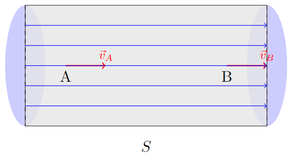{width=8.6cm}
:::

::: {custom-style="Legende"}
Figure 13. Écoulement dans un cylindre de section constante $S$
:::

::: {custom-style="Intertitre"}
Cas d'un changement de section
:::

Supposons qu'on passe d'une section $S$ à une section $S\text{′}$ plus petite. Avec la conservation du débit volumique on a :

$$D_A = D_B = D = S \times v_A = S\text{′} \times v_B$$

Ainsi :

$$\dfrac{v_A}{v_B} = \dfrac{S\text{′}}{S} < 1$$

Soit :

$$\dfrac{v_A}{v_B} < 1$$

Et enfin :

$$v_A < v_B$$

::: {custom-style="Figure"}
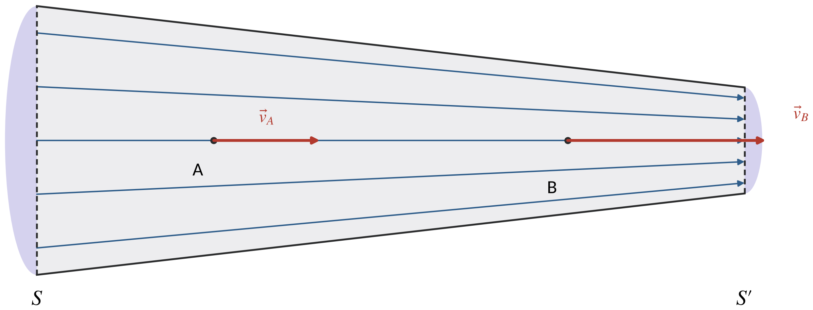{width=8.6cm}
:::

::: {custom-style="Legende"}
Figure 14. Écoulement dans un cylindre avec réduction de section $S$ à $S\text{′}$
:::

::: {custom-style="Retenir"}
Plus la section se réduit, plus la vitesse y est importante.
:::

#### [Corrigé]{custom-style="NumCorrige"}\ \ Q.9 · Énoncer la relation de Bernoulli (non exigible) {#c_q9}

::: {custom-style="Renvoi"}
[CIBLE:q9]{custom-style="BoutonEnonce"}
:::

En deux points $A$ et $B$, la relation de Bernoulli se traduit par :

$$P_A + \dfrac{1}{2}\rho v_A^{2} + \rho g z_A = P_B + \dfrac{1}{2}\rho v_B^{2} + \rho g z_B = \text{cte}$$

Avec $P$ : pression (en $\text{Pa}$) ; $\rho$ : masse volumique du fluide (en $\text{kg·m}^{-3}$) ; $v$ : vitesse du fluide (en $\text{m·s}^{-1}$) ; $z$ : altitude (en $\text{m}$) ; $g$ : intensité de la pesanteur (en $\text{m·s}^{-2}$).

::: {custom-style="Figure"}
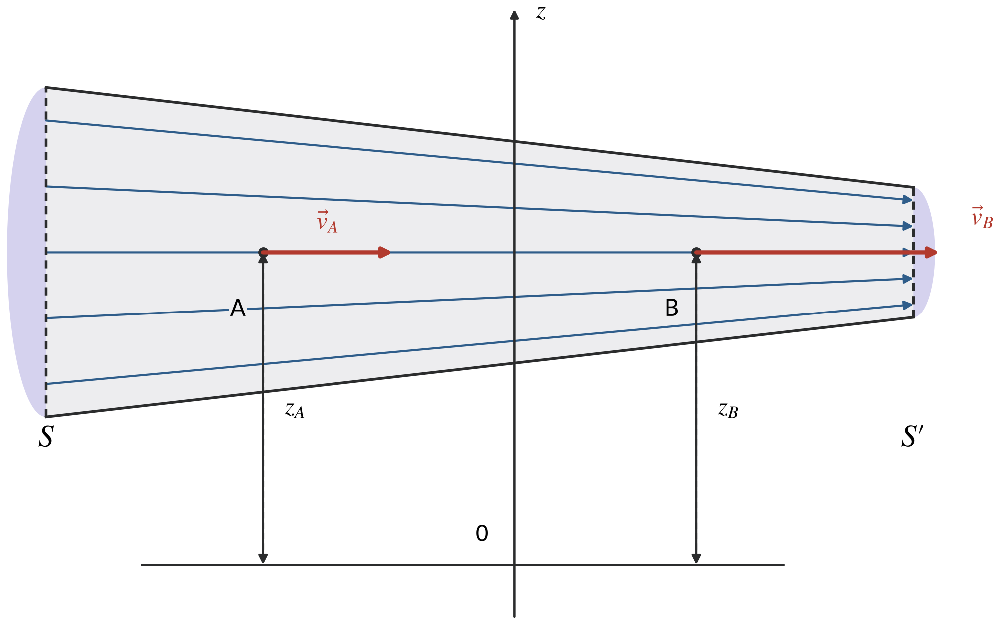{width=7.2cm}
:::

::: {custom-style="Legende"}
Figure 15. Points $A$ et $B$ d'un écoulement, repérés par leurs altitudes $z_A$ et $z_B$
:::

::: {custom-style="Remarque"}
[Remarque 1.]{custom-style="EtiqRemarque"} Sur la figure, les points $A$ et $B$ sont situés à la même hauteur donc $z_A = z_B$. La relation de Bernoulli se simplifie donc en :

$$P_A + \dfrac{1}{2}\rho v_A^{2} + \cR{\rho g z_A} = P_B + \dfrac{1}{2}\rho v_B^{2} + \cR{\rho g z_B}$$

$$P_A + \dfrac{1}{2}\rho v_A^{2} = P_B + \dfrac{1}{2}\rho v_B^{2}$$
:::

::: {custom-style="Remarque"}
[Remarque 2.]{custom-style="EtiqRemarque"} Lorsque le liquide est au repos en un point $C$, on a $v_C = 0$.
:::

::: {custom-style="Retenir"}
[Effet Venturi.]{custom-style="EtiqRetenir"} À altitude constante, la pression diminue là où la vitesse augmente, donc là où la section se réduit.
:::

::: {custom-style="Piege"}
[Piège.]{custom-style="EtiqPiege"} La relation s'applique entre deux points d'une même ligne de courant, pour un fluide incompressible en régime permanent. Dans les sujets, elle est fournie : on attend de savoir la simplifier (même altitude, fluide au repos, pression atmosphérique) puis l'exploiter. L'axe $(Oz)$ est vertical et dirigé vers le haut.
:::

#### [Corrigé]{custom-style="NumCorrige"}\ \ Q.10 · Que devient la relation de Bernoulli pour un fluide au repos ? Retrouver la loi fondamentale de la statique des fluides. {#c_q10}

::: {custom-style="Renvoi"}
[CIBLE:q10]{custom-style="BoutonEnonce"}
:::

Dans un fluide au repos, la vitesse est nulle en tout point : $v_A = v_B = 0$. La relation de Bernoulli devient :

$$P_A + \rho g z_A = P_B + \rho g z_B$$

Soit :

::: {custom-style="Retenir"}
$P_B - P_A = \rho \times g \times (z_A - z_B)$
:::

C'est la loi fondamentale de la statique des fluides, étudiée en classe de première. Si le point $B$ est situé à une profondeur $h$ sous le point $A$, alors $z_A - z_B = h$ et :

$$P_B = P_A + \rho \times g \times h$$

La pression augmente avec la profondeur.

**Exemple.** À $10{,}0\ \text{m}$ sous la surface d'un lac, avec $P_{\text{atm}} = 1{,}013 \times 10^{5}\ \text{Pa}$, $\rho_{\text{eau}} = 1{,}00 \times 10^{3}\ \text{kg·m}^{-3}$ et $g = 9{,}81\ \text{m·s}^{-2}$ :

$$P = P_{\text{atm}} + \rho_{\text{eau}} \times g \times h = 1{,}013 \times 10^{5} + 1{,}00 \times 10^{3} \times 9{,}81 \times 10{,}0 = 1{,}99 \times 10^{5}\ \text{Pa}$$

La pression est presque le double de la pression atmosphérique.

#### [Corrigé]{custom-style="NumCorrige"}\ \ Exercice 3 · Tube de Pitot {#c_ex3}

::: {custom-style="Renvoi"}
[CIBLE:ex3]{custom-style="BoutonEnonce"}
:::

::: {custom-style="QRappel"}
**1.** Écrire la relation de Bernoulli entre les deux points $A$ et $B$
:::

$$P_A + \dfrac{1}{2}\rho v_A^{2} + \rho g z_A = P_B + \dfrac{1}{2}\rho v_B^{2} + \rho g z_B$$

::: {custom-style="QRappel"}
**2.** En appliquant la relation de Bernoulli, exprimer la pression $P_A$ en fonction de la pression $P_B$
:::

D'après la question précédente, on a :

$$P_A + \dfrac{1}{2}\rho \cB{v_A^{2}} + \cV{\rho g z_A} = P_B + \dfrac{1}{2}\rho v_B^{2} + \cV{\rho g z_B}$$

L'eau étant au repos au point $A$, on a $v_A = 0$ : le terme $\dfrac{1}{2}\rho v_A^{2}$ est nul. Par ailleurs, $z_A = z_B$ : les termes $\rho g z_A$ et $\rho g z_B$ sont égaux et s'éliminent. Il reste :

$$P_A = P_B + \dfrac{1}{2}\rho v_B^{2}$$

::: {custom-style="QRappel"}
**3.** Écrire la relation fondamentale de l'hydrostatique entre $A$ et $\text{A′}$ puis entre $B$ et $\text{B′}$
:::

Entre deux points $M$ et $N$ d'un liquide au repos, la relation fondamentale de l'hydrostatique s'écrit :

$$P_M - P_N = \rho g (z_N - z_M)$$

L'eau est immobile dans chacun des deux tubes : on applique cette relation entre $A$ et $\text{A′}$, puis entre $B$ et $\text{B′}$.

**Appliquons aux points $A$ et $\text{A′}$ :**

$$P_A - P_{\text{A′}} = \rho g (z_{\text{A′}} - z_A)$$

$$\cV{P_A = P_{\text{A′}} + \rho g (z_{\text{A′}} - z_A)}$$

**Appliquons aux points $B$ et $\text{B′}$ :**

$$\cO{P_B = P_{\text{B′}} + \rho g (z_{\text{B′}} - z_B)}$$

::: {custom-style="QRappel"}
**4.** Exprimer la vitesse $v_B$ en fonction de $h$ (différence de hauteur entre les points $\text{B′}$ et $\text{A′}$)
:::

On remplace les expressions obtenues à la question précédente dans la relation de Bernoulli.

$$\cV{P_A} = \cO{P_B} + \dfrac{1}{2}\rho v_B^{2}$$

$$\cV{P_{\text{A′}} + \rho g (z_{\text{A′}} - z_A)} = \cO{P_{\text{B′}} + \rho g (z_{\text{B′}} - z_B)} + \dfrac{1}{2}\rho v_B^{2}$$

Or les points $\text{A′}$ et $\text{B′}$ sont au contact de l'air donc $P_{\text{A′}} = P_{\text{B′}} = P_{\text{atm}}$. La relation précédente se simplifie alors en :

$$\cV{\rho g (z_{\text{A′}} - z_A)} = \cO{\rho g (z_{\text{B′}} - z_B)} + \dfrac{1}{2}\rho v_B^{2}$$

Développons :

$$\rho g z_{\text{A′}} - \cR{\rho g z_A} = \rho g z_{\text{B′}} - \cR{\rho g z_B} + \dfrac{1}{2}\rho v_B^{2}$$

Or $z_A = z_B$, donc $\cR{\rho g z_A = \rho g z_B}$. On trouve ainsi :

$$\rho g z_{\text{A′}} = \rho g z_{\text{B′}} + \dfrac{1}{2}\rho v_B^{2}$$

$$\rho g z_{\text{A′}} - \rho g z_{\text{B′}} = \dfrac{1}{2}\rho v_B^{2}$$

$$\cR{\rho} g (z_{\text{A′}} - z_{\text{B′}}) = \dfrac{1}{2}\cR{\rho} v_B^{2}$$

$$g (z_{\text{A′}} - z_{\text{B′}}) = \dfrac{1}{2} v_B^{2}$$

Soit :

$$v_B^{2} = 2 g (z_{\text{A′}} - z_{\text{B′}})$$

$$v_B = \sqrt{2 g (z_{\text{A′}} - z_{\text{B′}})}$$

Or $z_{\text{A′}} - z_{\text{B′}} = h$. Finalement :

::: {custom-style="Retenir"}
$v_B = \sqrt{2 g h}$
:::

::: {custom-style="QRappel"}
**5.** En déduire le débit volumique dans la canalisation (le régime stationnaire étant atteint)
:::

Le débit est défini par la formule :

$$D = S \times v_B = \dfrac{\pi d^{2}}{4} \times v_B = \dfrac{\pi d^{2}}{4} \times \sqrt{2 g h}$$

::: {custom-style="QRappel"}
**6.** Application numérique
:::

Pour la vitesse, avec $h = 3{,}2 \times 10^{-2}\ \text{m}$ :

$$v_B = \sqrt{2 \times 9{,}81 \times 3{,}2 \times 10^{-2}} = 0{,}79\ \text{m·s}^{-1}$$

Pour le débit, avec $d = 2{,}0 \times 10^{-2}\ \text{m}$ et la valeur non arrondie de $v_B$ :

$$D = \dfrac{\pi \times (2{,}0 \times 10^{-2})^{2}}{4} \times 0{,}792 = 2{,}5 \times 10^{-4}\ \text{m}^{3}\text{·s}^{-1}$$

Soit $15\ \text{L·min}^{-1}$.

::: {custom-style="Renvoi"}
[CIBLE:ex3]{custom-style="BoutonEnonce"}
:::

#### [Corrigé]{custom-style="NumCorrige"}\ \ Exercice 4 · Phénomène de Venturi {#c_ex4}

::: {custom-style="Renvoi"}
[CIBLE:ex4]{custom-style="BoutonEnonce"}
:::

::: {custom-style="QRappel"}
**1.** En écrivant la relation de continuité dans la canalisation (conservation du débit volumique), exprimer la relation entre $v_A$, $v_B$ et $\beta$
:::

L'équation de continuité traduit la conservation du débit volumique au sein de la canalisation. On écrit ainsi l'équation de continuité entre la section $S_A$ et la section $S_B$ :

$$D_A = S_A \times v_A = D_B = S_B \times v_B$$

Soit :

$$S_A \times v_A = S_B \times v_B$$

On en déduit :

$$\dfrac{S_A}{S_B} = \dfrac{v_B}{v_A}$$

Or :

$$\beta = \dfrac{S_A}{S_B}$$

Donc :

$$\beta = \dfrac{v_B}{v_A}$$

Et :

$$v_B = \beta \times v_A$$

::: {custom-style="QRappel"}
**2.** En écrivant la relation de Bernoulli, trouver une relation entre $P_A$, $P_B$, $v_A$ et $\beta$
:::

On écrit la relation de Bernoulli appliquée aux points $A$ et $B$ :

$$P_A + \dfrac{1}{2}\rho v_A^{2} + \cV{\rho g z_A} = P_B + \dfrac{1}{2}\rho v_B^{2} + \cV{\rho g z_B}$$

Or $z_A = z_B$, donc :

$$P_A + \dfrac{1}{2}\rho v_A^{2} = P_B + \dfrac{1}{2}\rho v_B^{2}$$

On remplace la vitesse $v_B$ par l'expression déterminée à la question précédente :

$$P_A + \dfrac{1}{2}\rho v_A^{2} = P_B + \dfrac{1}{2}\rho \times (\beta \times v_A)^{2}$$

$$P_A + \cR{\dfrac{1}{2}\rho v_A^{2}} = \cB{P_B} + \dfrac{1}{2}\rho \times \beta^{2} \times v_A^{2}$$

$$P_A \cB{- P_B} = \dfrac{1}{2}\rho \times \beta^{2} \times v_A^{2} \cR{- \dfrac{1}{2}\rho v_A^{2}}$$

$$P_A - P_B = \dfrac{1}{2}\rho v_A^{2} \left(\beta^{2} - 1\right) \lbl{*}$$

::: {custom-style="QRappel"}
**3.** Écrire la relation fondamentale de l'hydrostatique entre $\text{A′}$ et $A$ puis entre $\text{B′}$ et $B$
:::

Relation fondamentale de l'hydrostatique entre $\text{A′}$ et $A$ :

$$P_A = P_{\text{A′}} + \rho g (z_{\text{A′}} - z_A) \lbl{**}$$

Relation fondamentale de l'hydrostatique entre $\text{B′}$ et $B$ :

$$P_B = P_{\text{B′}} + \rho g (z_{\text{B′}} - z_B) \lbl{***}$$

::: {custom-style="QRappel"}
**4.** En déduire la relation entre $v_A$ et $\beta$
:::

On reporte les relations (\*\*) et (\*\*\*) dans la relation (\*) :

$$P_A - P_B = \dfrac{1}{2}\rho v_A^{2} \left(\beta^{2} - 1\right)$$

$$P_{\text{A′}} + \rho g (z_{\text{A′}} - z_A) - P_{\text{B′}} - \rho g (z_{\text{B′}} - z_B) = \dfrac{1}{2}\rho v_A^{2} \left(\beta^{2} - 1\right)$$

On développe ensuite :

$$\cV{P_{\text{A′}}} + \rho g z_{\text{A′}} \cR{- \rho g z_A} \cV{- P_{\text{B′}}} - \rho g z_{\text{B′}} \cR{+ \rho g z_B} = \dfrac{1}{2}\rho v_A^{2} \left(\beta^{2} - 1\right)$$

Avec $z_A = z_B$ et $P_{\text{A′}} = P_{\text{B′}} = P_{\text{atm}}$ (les points $\text{A′}$ et $\text{B′}$ étant à la surface au contact de l'air) :

$$\rho g z_{\text{A′}} - \rho g z_{\text{B′}} = \dfrac{1}{2}\rho v_A^{2} \left(\beta^{2} - 1\right)$$

$$\rho g (z_{\text{A′}} - z_{\text{B′}}) = \dfrac{1}{2}\rho v_A^{2} \left(\beta^{2} - 1\right)$$

D'autre part $z_{\text{A′}} - z_{\text{B′}} = h$, d'où :

$$\cR{\rho} g h = \dfrac{1}{2}\cR{\rho} v_A^{2} \left(\beta^{2} - 1\right)$$

$$g h = \dfrac{1}{2} v_A^{2} \left(\beta^{2} - 1\right)$$

$$2 g h = v_A^{2} \left(\beta^{2} - 1\right)$$

$$\dfrac{2 g h}{\beta^{2} - 1} = v_A^{2}$$

::: {custom-style="Retenir"}
$v_A = \sqrt{\dfrac{2 g h}{\beta^{2} - 1}}$
:::

::: {custom-style="QRappel"}
**5.** Exprimer alors le débit volumique en fonction de $\beta$ et des données de l'énoncé
:::

Le débit volumique est constant (en régime stationnaire) et s'exprime par :

$$D_A = D_B = D = S_A \times \sqrt{\dfrac{2 g h}{\beta^{2} - 1}}$$

::: {custom-style="Retenir"}
$D = S_A \times \sqrt{\dfrac{2 g h}{\beta^{2} - 1}}$
:::

Si l'on connaît le diamètre $d$ de la conduite au niveau de la section $S_A$, alors $S_A = \dfrac{\pi d^{2}}{4}$ et :

$$D = \dfrac{\pi d^{2}}{4} \times \sqrt{\dfrac{2 g h}{\beta^{2} - 1}}$$

::: {custom-style="Renvoi"}
[CIBLE:ex4]{custom-style="BoutonEnonce"}
:::

#### [Corrigé]{custom-style="NumCorrige"}\ \ Exercice 5 · Liquide sortant d'un réservoir {#c_ex5}

::: {custom-style="Renvoi"}
[CIBLE:ex5]{custom-style="BoutonEnonce"}
:::

::: {custom-style="QRappel"}
**1.** Que vaut la vitesse au point $A$ au début de l'écoulement ?
:::

D'après la conservation du débit volumique, $S_A \times v_A = S_B \times v_B$, où $S_A$ est la section du réservoir et $S_B$ celle de l'orifice. Comme $S_A$ est très grande devant $S_B$, la vitesse $v_A$ est très petite devant $v_B$ : on considère que $v_A \approx 0$.

::: {custom-style="QRappel"}
**2.** Écrire la relation de Bernoulli entre les points $A$ et $B$ puis exprimer la vitesse de sortie $v_B$ en fonction de la hauteur $H$ au début de l'écoulement
:::

$$P_A + \dfrac{1}{2}\rho v_A^{2} + \rho g z_A = P_B + \dfrac{1}{2}\rho v_B^{2} + \rho g z_B$$

Avec $v_A = 0$ :

$$\cR{P_A} + \rho g z_A = \cR{P_B} + \dfrac{1}{2}\rho v_B^{2} + \rho g z_B$$

Les points $A$ et $B$ sont en contact avec l'air : $P_A = P_B = P_{\text{atm}}$. Donc :

$$\rho g z_A = \dfrac{1}{2}\rho v_B^{2} + \rho g z_B$$

$$\rho g (z_A - z_B) = \dfrac{1}{2}\rho v_B^{2}$$

Avec $z_A - z_B = H$, il vient :

$$\cR{\rho} g H = \dfrac{1}{2}\cR{\rho} v_B^{2}$$

$$g H = \dfrac{1}{2} v_B^{2}$$

D'où :

::: {custom-style="Retenir"}
$v_B = \sqrt{2 g H}$
:::

::: {custom-style="Renvoi"}
[CIBLE:ex5]{custom-style="BoutonEnonce"}
:::

#### [Corrigé]{custom-style="NumCorrige"}\ \ Exercice 6 · La trompe à eau du laboratoire {#c_ex6}

::: {custom-style="Renvoi"}
[CIBLE:ex6]{custom-style="BoutonEnonce"}
:::

::: {custom-style="QRappel"}
**1.** Conversion du débit
:::

$$D = 9{,}00\ \text{L·min}^{-1} = \dfrac{9{,}00 \times 10^{-3}\ \text{m}^{3}}{60\ \text{s}} = 1{,}50 \times 10^{-4}\ \text{m}^{3}\text{·s}^{-1}$$

::: {custom-style="QRappel"}
**2.** Vitesse de l'eau en $A$
:::

Le débit volumique s'écrit $D = S_A \times v_A$ (voir Q.7), avec :

$$S_A = \dfrac{\pi d_A^{2}}{4} = \dfrac{\pi \times (12{,}0 \times 10^{-3})^{2}}{4} = 1{,}13 \times 10^{-4}\ \text{m}^{2}$$

$$v_A = \dfrac{D}{S_A} = \dfrac{1{,}50 \times 10^{-4}}{1{,}13 \times 10^{-4}} = 1{,}33\ \text{m·s}^{-1}$$

::: {custom-style="QRappel"}
**3.** Vitesse de l'eau dans l'étranglement
:::

L'eau est un fluide incompressible et le régime est permanent : le débit volumique se conserve entre $A$ et $B$ (voir Q.8).

$$S_A \times v_A = S_B \times v_B$$

$$v_B = v_A \times \dfrac{S_A}{S_B} = v_A \times \dfrac{\dfrac{\pi d_A^{2}}{4}}{\dfrac{\pi d_B^{2}}{4}} = v_A \times \left(\dfrac{d_A}{d_B}\right)^{2}$$

Le rapport des diamètres vaut 3,00 : la vitesse est multipliée par 9,00. En conservant la valeur non arrondie de $v_A$ :

$$v_B = 9{,}00 \times v_A = 11{,}9\ \text{m·s}^{-1}$$

::: {custom-style="QRappel"}
**4.** Différence de pression
:::

Les points $A$ et $B$ sont à la même altitude, donc $z_A = z_B$ et la relation de Bernoulli devient :

$$P_A + \dfrac{1}{2}\rho v_A^{2} = P_B + \dfrac{1}{2}\rho v_B^{2}$$

$$P_A - P_B = \dfrac{1}{2}\rho \left(v_B^{2} - v_A^{2}\right) = \dfrac{1}{2} \times 1{,}00 \times 10^{3} \times \left(11{,}9^{2} - 1{,}33^{2}\right) = 7{,}04 \times 10^{4}\ \text{Pa}$$

Le calcul est mené avec les valeurs non arrondies de $v_A$ et de $v_B$.

::: {custom-style="QRappel"}
**5.** Pression dans l'étranglement et aspiration
:::

$$P_B = P_A - (P_A - P_B) = 1{,}50 \times 10^{5} - 0{,}704 \times 10^{5} = 7{,}96 \times 10^{4}\ \text{Pa}$$

La pression dans l'étranglement est inférieure à la pression atmosphérique qui règne dans la fiole : $7{,}96 \times 10^{4}\ \text{Pa} < 1{,}013 \times 10^{5}\ \text{Pa}$. L'air est donc poussé de la fiole vers l'étranglement : il est aspiré. C'est l'effet Venturi.

::: {custom-style="QRappel"}
**6.** Correction de l'affirmation
:::

::: {custom-style="Redaction"}
[Rédaction.]{custom-style="EtiqRedaction"} « Dans l'étranglement, la section diminue. Comme le débit volumique se conserve, la vitesse de l'eau augmente. D'après la relation de Bernoulli, à altitude constante, la somme $P + \dfrac{1}{2}\rho v^{2}$ garde la même valeur : si la vitesse augmente, la pression diminue. La pression est donc plus faible dans l'étranglement, et non plus élevée. »
:::

::: {custom-style="Renvoi"}
[CIBLE:ex6]{custom-style="BoutonEnonce"}
:::

#### [Corrigé]{custom-style="NumCorrige"}\ \ Exercice 7 · Le récupérateur d'eau de pluie {#c_ex7}

::: {custom-style="Renvoi"}
[CIBLE:ex7]{custom-style="BoutonEnonce"}
:::

::: {custom-style="QRappel"}
**1.** Volume recueilli et débit moyen
:::

Le volume d'eau tombé sur le toit est celui d'une couche d'eau de surface $S_{\text{toit}}$ et de hauteur $12{,}0\ \text{mm}$ :

$$V = S_{\text{toit}} \times h_{\text{pluie}} = 60{,}0 \times 12{,}0 \times 10^{-3} = 0{,}720\ \text{m}^{3}$$

Soit 720 L. Le débit volumique moyen vaut (voir Q.6) :

$$D = \dfrac{V}{\Delta t} = \dfrac{0{,}720}{30{,}0 \times 60} = 4{,}00 \times 10^{-4}\ \text{m}^{3}\text{·s}^{-1}$$

Soit $24{,}0\ \text{L·min}^{-1}$.

::: {custom-style="QRappel"}
**2.** Montée du niveau
:::

La section de la cuve vaut :

$$S_{\text{cuve}} = \dfrac{\pi d^{2}}{4} = \dfrac{\pi \times 1{,}00^{2}}{4} = 0{,}785\ \text{m}^{2}$$

Le volume recueilli occupe dans la cuve une hauteur $\Delta h$ telle que $V = S_{\text{cuve}} \times \Delta h$ :

$$\Delta h = \dfrac{V}{S_{\text{cuve}}} = \dfrac{0{,}720}{0{,}785} = 0{,}917\ \text{m}$$

::: {custom-style="QRappel"}
**3.** Pression au fond de la cuve
:::

Pour deux points $A$ et $B$ d'un fluide incompressible au repos, la loi fondamentale de la statique des fluides s'écrit (voir Q.10) :

$$P_B - P_A = \rho \times g \times (z_A - z_B)$$

On l'applique entre la surface libre, où la pression vaut $P_{\text{atm}}$, et le fond, situé à une profondeur $H$ :

::: {custom-style="Retenir"}
$P_{\text{fond}} = P_{\text{atm}} + \rho \times g \times H$
:::

::: {custom-style="QRappel"}
**4.** Hauteur d'eau
:::

$$H = \dfrac{P_{\text{fond}} - P_{\text{atm}}}{\rho \times g} = \dfrac{8{,}83 \times 10^{3}}{1{,}00 \times 10^{3} \times 9{,}81} = 0{,}900\ \text{m}$$

::: {custom-style="QRappel"}
**5.** Vitesse de sortie
:::

Le débit volumique se conserve entre la surface libre et la sortie du robinet : $S_{\text{cuve}} \times v_A = S_r \times v_B$, donc :

$$\dfrac{v_A}{v_B} = \dfrac{S_r}{S_{\text{cuve}}} = \left(\dfrac{d_r}{d}\right)^{2} = \left(\dfrac{12{,}0 \times 10^{-3}}{1{,}00}\right)^{2} = 1{,}44 \times 10^{-4}$$

La vitesse en $A$ est environ sept mille fois plus petite que celle en $B$ : on la néglige, $v_A \approx 0$.

On écrit la relation de Bernoulli entre $A$ et $B$ :

$$P_A + \dfrac{1}{2}\rho v_A^{2} + \rho g z_A = P_B + \dfrac{1}{2}\rho v_B^{2} + \rho g z_B$$

Les points $A$ et $B$ sont au contact de l'air, donc $P_A = P_B = P_{\text{atm}}$. Avec $v_A \approx 0$ :

$$\rho g z_A = \dfrac{1}{2}\rho v_B^{2} + \rho g z_B$$

$$\dfrac{1}{2} v_B^{2} = g (z_A - z_B) = g H$$

$$v_B = \sqrt{2 g H} = \sqrt{2 \times 9{,}81 \times 0{,}900} = 4{,}20\ \text{m·s}^{-1}$$

::: {custom-style="QRappel"}
**6.** Débit du robinet et durée de remplissage
:::

$$S_r = \dfrac{\pi d_r^{2}}{4} = \dfrac{\pi \times (12{,}0 \times 10^{-3})^{2}}{4} = 1{,}13 \times 10^{-4}\ \text{m}^{2}$$

$$D_r = S_r \times v_B = 1{,}13 \times 10^{-4} \times 4{,}20 = 4{,}75 \times 10^{-4}\ \text{m}^{3}\text{·s}^{-1}$$

L'arrosoir a un volume $V_a = 10{,}0\ \text{L} = 1{,}00 \times 10^{-2}\ \text{m}^{3}$ :

$$\Delta t = \dfrac{V_a}{D_r} = \dfrac{1{,}00 \times 10^{-2}}{4{,}75 \times 10^{-4}} \approx 21{,}0\ \text{s}$$

Pendant ce remplissage, le niveau ne baisse que d'environ 1 cm dans la cuve : considérer $H$ constant est justifié.

::: {custom-style="QRappel"}
**7.** Cuve presque vide
:::

::: {custom-style="Redaction"}
[Rédaction.]{custom-style="EtiqRedaction"} « Lorsque la cuve se vide, la hauteur d'eau $H$ diminue. La vitesse de sortie $v_B = \sqrt{2 g H}$ diminue donc aussi, et avec elle le débit volumique $D_r = S_r \times v_B$. Pour un même volume à remplir, la durée $\Delta t = \dfrac{V_a}{D_r}$ est plus grande. »
:::

::: {custom-style="Renvoi"}
[CIBLE:ex7]{custom-style="BoutonEnonce"}
:::

::: {custom-style="Surtitre"}
Corrigés
:::

# Corrigés du thème 3 : chute dans un fluide {#c_theme3}

#### [Corrigé]{custom-style="NumCorrige"}\ \ Q.11 · Faire le bilan des forces qui s'exercent sur un objet qui tombe dans un fluide {#c_q11}

::: {custom-style="Renvoi"}
[CIBLE:q11]{custom-style="BoutonEnonce"}
:::

On étudie le système {objet} dans le référentiel terrestre supposé galiléen. Un objet qui tombe dans un fluide (air, eau, huile) est soumis à trois forces :

- son poids $\vec{P}$, vertical, vers le bas, de norme $P = m \times g$ ;
- la poussée d'Archimède $\vec{\Pi}$ (voir Q.1), verticale, vers le haut, de norme $\Pi = \rho_{\text{fluide}} \times V \times g$ ;
- la force de frottement $\vec{f}$ exercée par le fluide, opposée à la vitesse, donc vers le haut pendant la chute. Sa norme augmente avec la vitesse : nulle au départ, elle finit par compenser le poids diminué de la poussée d'Archimède quand la vitesse limite est atteinte (figure 16).

::: {custom-style="Figure"}
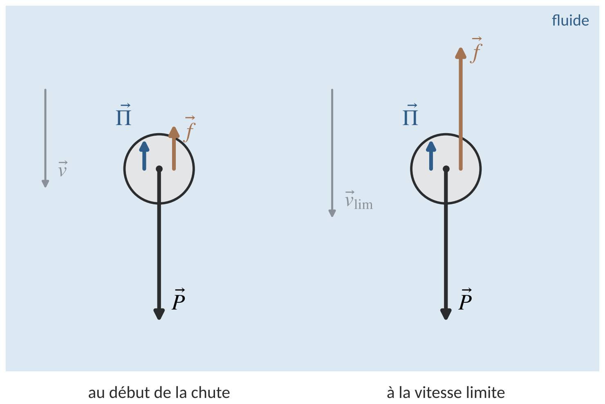{width=8.4cm}
:::

::: {custom-style="Legende"}
Figure 16. Forces exercées sur un objet qui tombe dans un fluide
:::

Pour la goutte de pluie, le volume $V$ est le même dans les deux expressions :

$$\dfrac{\Pi}{P} = \dfrac{\rho_{\text{air}} \times V \times g}{\rho_{\text{eau}} \times V \times g} = \dfrac{\rho_{\text{air}}}{\rho_{\text{eau}}} = \dfrac{1{,}2}{1{,}00 \times 10^{3}} = 1{,}2 \times 10^{-3}$$

::: {custom-style="Retenir"}
La poussée d'Archimède vaut 0,12 % du poids : elle est négligeable pour une goutte qui tombe dans l'air.
:::

Le rayon de la goutte n'intervient pas : seul compte le rapport des masses volumiques.

::: {custom-style="Piege"}
[Piège.]{custom-style="EtiqPiege"} Dans un liquide, la poussée d'Archimède n'est plus négligeable : pour une bille d'acier dans du miel, elle atteint 18 % du poids (exercice 2). Comparez toujours les masses volumiques avant de la négliger.
:::

#### [Corrigé]{custom-style="NumCorrige"}\ \ Q.12 · Déterminer l'unité d'un coefficient de frottement par analyse dimensionnelle {#c_q12}

::: {custom-style="Renvoi"}
[CIBLE:q12]{custom-style="BoutonEnonce"}
:::

Une force s'exprime en newton. D'après la deuxième loi de Newton, $F = m \times a$, donc $1\ \text{N} = 1\ \text{kg·m·s}^{-2}$.

Pour $f = k \times v$, on isole $k = \dfrac{f}{v}$, qui s'exprime en :

$$\dfrac{\text{kg·m·s}^{-2}}{\text{m·s}^{-1}} = \text{kg·s}^{-1}$$

Pour $f = K \times v^{2}$, on isole $K = \dfrac{f}{v^{2}}$, qui s'exprime en :

$$\dfrac{\text{kg·m·s}^{-2}}{\text{m}^{2}\text{·s}^{-2}} = \text{kg·m}^{-1}$$

Dans $\dfrac{1}{2}\rho \times C_x \times S$, le facteur $\dfrac{1}{2}$ et $C_x$ n'ont pas d'unité. Il reste :

$$\text{kg·m}^{-3} \times \text{m}^{2} = \text{kg·m}^{-1}$$

::: {custom-style="Retenir"}
$k$ s'exprime en $\text{kg·s}^{-1}$ ; $K$ et $\dfrac{1}{2}\rho \times C_x \times S$ s'expriment en $\text{kg·m}^{-1}$.
:::

::: {custom-style="Methode"}
[Méthode.]{custom-style="EtiqMethode"} Pour trouver l'unité d'un coefficient, on l'isole dans la relation, puis on remplace chaque grandeur par son unité exprimée en kilogramme, mètre et seconde. Le newton vaut $\text{kg·m·s}^{-2}$ et le pascal $\text{kg·m}^{-1}\text{·s}^{-2}$.
:::

::: {custom-style="Remarque"}
[Remarque.]{custom-style="EtiqRemarque"} Le coefficient $k = 6\pi \times \eta \times r$ de Q.13 et Q.14 s'exprime bien en $\text{kg·s}^{-1}$ : $\text{Pa·s} \times \text{m} = \text{kg·m}^{-1}\text{·s}^{-2} \times \text{s} \times \text{m} = \text{kg·s}^{-1}$.
:::

#### [Corrigé]{custom-style="NumCorrige"}\ \ Q.13 · Établir l'équation différentielle d'une chute avec un frottement $f = k \times v$ {#c_q13}

::: {custom-style="Renvoi"}
[CIBLE:q13]{custom-style="BoutonEnonce"}
:::

On étudie le système {gouttelette} dans le référentiel terrestre supposé galiléen, muni d'un axe $(Oz)$ vertical orienté vers le bas. La poussée d'Archimède est négligée (Q.11). La deuxième loi de Newton s'écrit :

$$m \times \vec{a} = \vec{P} + \vec{f}$$

En projection sur $(Oz)$, le poids est compté positivement et la force de frottement, opposée à la vitesse, négativement :

$$m \times \dfrac{\mathrm{d}v}{\mathrm{d}t} = m \times g - k \times v$$

On divise par $m$ :

$$\dfrac{\mathrm{d}v}{\mathrm{d}t} = g - \dfrac{k}{m} \times v$$

En posant $\tau = \dfrac{m}{k}$, qui s'exprime en $\dfrac{\text{kg}}{\text{kg·s}^{-1}} = \text{s}$ :

::: {custom-style="Retenir"}
$\dfrac{\mathrm{d}v}{\mathrm{d}t} + \dfrac{v}{\tau} = g$ avec $\tau = \dfrac{m}{k}$
:::

La masse de la gouttelette vaut :

$$m = \rho_{\text{eau}} \times \dfrac{4}{3}\pi r^{3} = 1{,}00 \times 10^{3} \times \dfrac{4}{3}\pi \times \left(10 \times 10^{-6}\right)^{3} = 4{,}2 \times 10^{-12}\ \text{kg}$$

et le coefficient de frottement :

$$k = 6\pi \times \eta \times r = 6\pi \times 1{,}8 \times 10^{-5} \times 10 \times 10^{-6} = 3{,}4 \times 10^{-9}\ \text{kg·s}^{-1}$$

::: {custom-style="Retenir"}
$\tau = \dfrac{m}{k} = \dfrac{4{,}2 \times 10^{-12}}{3{,}4 \times 10^{-9}} = 1{,}2 \times 10^{-3}\ \text{s}$
:::

::: {custom-style="Remarque"}
[Remarque.]{custom-style="EtiqRemarque"} C'est la même équation que pour la charge d'un condensateur (fiche 8). Avec $v(0) = 0$, sa solution est $v(t) = v_{\text{lim}} \times \left(1 - e^{-t/\tau}\right)$, avec $v_{\text{lim}} = g \times \tau$ : au bout de $5\tau$, soit $6\ \text{ms}$, la gouttelette a atteint sa vitesse limite à 1 % près.
:::

#### [Corrigé]{custom-style="NumCorrige"}\ \ Q.14 · Exprimer et calculer la vitesse limite d'un objet qui tombe dans un fluide {#c_q14}

::: {custom-style="Renvoi"}
[CIBLE:q14]{custom-style="BoutonEnonce"}
:::

Quand la vitesse limite est atteinte, la vitesse ne varie plus : le mouvement est rectiligne uniforme. D'après le principe d'inertie, les forces se compensent : la force de frottement compense le poids, diminué de la poussée d'Archimède si elle n'est pas négligeable.

Avec $f = k \times v$ et la poussée d'Archimède négligée :

$$k \times v_{\text{lim}} = m \times g \quad \text{donc} \quad v_{\text{lim}} = \dfrac{m \times g}{k}$$

Avec $f = K \times v^{2}$ :

$$K \times v_{\text{lim}}^{2} = m \times g \quad \text{donc} \quad v_{\text{lim}} = \sqrt{\dfrac{m \times g}{K}}$$

Pour la gouttelette :

::: {custom-style="Retenir"}
$v_{\text{lim}} = \dfrac{m \times g}{k} = \dfrac{4{,}2 \times 10^{-12} \times 9{,}81}{3{,}4 \times 10^{-9}} = 1{,}2 \times 10^{-2}\ \text{m·s}^{-1}$
:::

La vitesse limite est atteinte en quelques millisecondes (Q.13) : la chute de $1{,}0\ \text{m}$ se fait donc à vitesse constante.

$$\Delta t = \dfrac{d}{v_{\text{lim}}} = \dfrac{1{,}0}{1{,}2 \times 10^{-2}} \approx 83\ \text{s}$$

Une gouttelette met plus d'une minute pour descendre d'un mètre, et le moindre courant d'air ascendant suffit à la maintenir en suspension : le brouillard semble flotter.

::: {custom-style="Methode"}
[Méthode.]{custom-style="EtiqMethode"} Si l'équation différentielle est connue, on obtient aussi la vitesse limite en y écrivant $\dfrac{\mathrm{d}v}{\mathrm{d}t} = 0$. Avec l'équation de Q.13 : $\dfrac{v_{\text{lim}}}{\tau} = g$, soit $v_{\text{lim}} = g \times \tau$.
:::

::: {custom-style="Redaction"}
[Rédaction.]{custom-style="EtiqRedaction"} « Lorsque la vitesse limite est atteinte, le mouvement de la gouttelette est rectiligne uniforme. D'après le principe d'inertie, les forces qui s'exercent sur elle se compensent : $k \times v_{\text{lim}} = m \times g$. »
:::

#### [Corrigé]{custom-style="NumCorrige"}\ \ Q.15 · Exploiter la courbe de vitesse d'une bille qui tombe dans un liquide {#c_q15}

::: {custom-style="Renvoi"}
[CIBLE:q15]{custom-style="BoutonEnonce"}
:::

**Vitesse limite.** La courbe tend vers une asymptote horizontale :

::: {custom-style="Retenir"}
$v_{\text{lim}} \approx 1{,}5\ \text{cm·s}^{-1}$
:::

**Temps caractéristique.** Première méthode : la tangente à l'origine coupe la droite $v = v_{\text{lim}}$ au point d'abscisse $\tau$. Seconde méthode : $\tau$ est la date à laquelle la vitesse atteint 63 % de sa valeur limite, soit environ $0{,}94\ \text{cm·s}^{-1}$. Les deux méthodes donnent la même valeur (figure 17).

::: {custom-style="Retenir"}
$\tau \approx 1{,}7\ \text{ms}$
:::

::: {custom-style="Figure"}
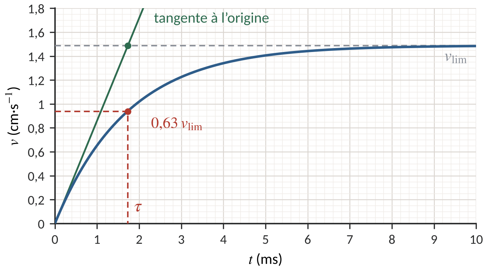{width=10cm}
:::

::: {custom-style="Legende"}
Figure 17. Vitesse limite et temps caractéristique de la chute de la bille
:::

**Valeur de $\dfrac{\mathrm{d}v}{\mathrm{d}t}$ à $t = 0$.** C'est le coefficient directeur de la tangente à l'origine, qui passe par le point de coordonnées $(1{,}0\ \text{ms} ; 0{,}86\ \text{cm·s}^{-1})$ :

$$\dfrac{\mathrm{d}v}{\mathrm{d}t}(0) = \dfrac{0{,}86 \times 10^{-2}}{1{,}0 \times 10^{-3}} = 8{,}6\ \text{m·s}^{-2}$$

À $t = 0$, la vitesse est nulle, donc la force de frottement aussi. La poussée d'Archimède, elle, ne l'est pas. La deuxième loi de Newton, projetée sur un axe vertical orienté vers le bas, donne :

$$m \times \dfrac{\mathrm{d}v}{\mathrm{d}t}(0) = \rho_{\text{acier}} \times V \times g - \rho_{\text{huile}} \times V \times g$$

$$\dfrac{\mathrm{d}v}{\mathrm{d}t}(0) = g \times \left(1 - \dfrac{\rho_{\text{huile}}}{\rho_{\text{acier}}}\right) = 9{,}81 \times \left(1 - \dfrac{9{,}70 \times 10^{2}}{7{,}80 \times 10^{3}}\right) = 8{,}6\ \text{m·s}^{-2}$$

La valeur est inférieure à $g$ parce que la poussée d'Archimède exercée par l'huile compense 12 % du poids de la bille.

::: {custom-style="Piege"}
[Piège.]{custom-style="EtiqPiege"} La méthode des 63 % ne vaut que si la vitesse suit une loi exponentielle, c'est-à-dire pour un frottement proportionnel à la vitesse. Pour un frottement en $v^{2}$, il faut utiliser la tangente à l'origine (exercice 9).
:::

#### [Corrigé]{custom-style="NumCorrige"}\ \ Q.16 · Justifier que l'on peut négliger, ou non, les frottements de l'air {#c_q16}

::: {custom-style="Renvoi"}
[CIBLE:q16]{custom-style="BoutonEnonce"}
:::

L'aire du disque de diamètre $d$ vaut $S = \dfrac{\pi d^{2}}{4}$. Pour la boule de pétanque :

$$f = \dfrac{1}{2} \times 1{,}2 \times 0{,}47 \times \dfrac{\pi \times \left(7{,}5 \times 10^{-2}\right)^{2}}{4} \times \left(10\right)^{2} = 0{,}12\ \text{N}$$

Son poids vaut $P = m \times g = 0{,}700 \times 9{,}81 = 6{,}9\ \text{N}$ : le frottement en représente environ 2 %.

Pour la balle de tennis de table :

$$f = \dfrac{1}{2} \times 1{,}2 \times 0{,}47 \times \dfrac{\pi \times \left(4{,}0 \times 10^{-2}\right)^{2}}{4} \times \left(10\right)^{2} = 3{,}5 \times 10^{-2}\ \text{N}$$

Son poids vaut $P = 2{,}7 \times 10^{-3} \times 9{,}81 = 2{,}6 \times 10^{-2}\ \text{N}$ : le frottement dépasse le poids.

::: {custom-style="Retenir"}
Boule de pétanque : le frottement est négligeable et le modèle de la chute libre convient. Balle de tennis de table : le frottement n'est pas négligeable.
:::

::: {custom-style="Remarque"}
[Remarque.]{custom-style="EtiqRemarque"} La vitesse limite de la balle de tennis de table, $\sqrt{\dfrac{m \times g}{K}}$ avec $K = \dfrac{1}{2}\rho_{\text{air}} \times C_x \times S$, ne vaut que $8{,}6\ \text{m·s}^{-1}$ : lancée vers le bas à $10\ \text{m·s}^{-1}$, elle ralentit.
:::

::: {custom-style="Redaction"}
[Rédaction.]{custom-style="EtiqRedaction"} « La force de frottement de l'air vaut environ 2 % du poids de la boule : on peut la négliger et modéliser le mouvement par une chute libre. »
:::

#### [Corrigé]{custom-style="NumCorrige"}\ \ Exercice 8 · Le thermomètre de Galilée {#c_ex8}

::: {custom-style="Renvoi"}
[CIBLE:ex8]{custom-style="BoutonEnonce"}
:::

::: {custom-style="QRappel"}
**1.** Bilan des forces et masse d'une boule
:::

On étudie une boule en équilibre au sein du liquide (sans contact avec le tube ni avec les autres boules), dans le référentiel terrestre supposé galiléen. Elle est soumise à son poids $\vec{P}$, vertical, vers le bas, de norme $P = m \times g$, et à la poussée d'Archimède $\vec{\Pi}$, verticale, vers le haut, de norme $\Pi = \rho \times V \times g$. Immobile, elle ne subit aucune force de frottement.

D'après le principe d'inertie, les forces qui s'exercent sur une boule immobile se compensent : $P = \Pi$. La boule « $\theta$ » est en équilibre lorsque le liquide est à la température $\theta$, donc :

$$m \times g = \rho(\theta) \times V \times g \quad \text{soit} \quad m = \rho(\theta) \times V$$

::: {custom-style="QRappel"}
**2.** Masse de la boule « 22 °C »
:::

$$\rho(22) = 880 - 0{,}80 \times (22 - 20) = 878{,}4\ \text{kg·m}^{-3}$$

::: {custom-style="Retenir"}
$m = 878{,}4 \times 12{,}00 \times 10^{-6} = 1{,}054 \times 10^{-2}\ \text{kg}$, soit $10{,}54\ \text{g}$
:::

D'une étiquette à la suivante, la température varie de 2 °C et la masse volumique du liquide de $0{,}80 \times 2 = 1{,}6\ \text{kg·m}^{-3}$ :

$$\Delta m = 1{,}6 \times 12{,}00 \times 10^{-6} = 1{,}9 \times 10^{-5}\ \text{kg}, \text{ soit } 19\ \text{mg}$$

Deux boules voisines ne diffèrent que de 19 mg, soit 0,2 % de leur masse : le fabricant doit ajuster chaque masse à quelques milligrammes près.

::: {custom-style="QRappel"}
**3.** Lecture de la figure 9
:::

La boule « 20 °C » est au fond : elle coule, donc son poids est supérieur à la poussée d'Archimède. Avec $\rho$ la masse volumique du liquide dans la pièce, $\rho(20) \times V \times g > \rho \times V \times g$, soit $\rho < \rho(20)$. Comme la masse volumique du liquide diminue quand la température augmente, la pièce est à plus de 20 °C.

La boule « 22 °C » flotte : de la même façon, $\rho > \rho(22)$, et la pièce est à moins de 22 °C.

::: {custom-style="Retenir"}
$20\ \text{°C} < \theta_{\text{pièce}} < 22\ \text{°C}$
:::

::: {custom-style="QRappel"}
**4.** La boule « 22 °C » dans le liquide à 23 °C
:::

$$\rho(23) = 880 - 0{,}80 \times (23 - 20) = 877{,}6\ \text{kg·m}^{-3}$$

Cette masse volumique est inférieure à $\rho(22)$ : la poussée d'Archimède devient plus petite que le poids. La résultante des deux forces est dirigée vers le bas, et la boule descend.

$$F = P - \Pi = \left(\rho(22) - \rho(23)\right) \times V \times g = 0{,}80 \times 12{,}00 \times 10^{-6} \times 9{,}81$$

::: {custom-style="Retenir"}
$F = 9{,}4 \times 10^{-5}\ \text{N}$
:::

Cette résultante vaut moins de 0,1 % du poids de la boule, qui est de $0{,}103\ \text{N}$.

::: {custom-style="QRappel"}
**5.** Vitesse limite et durée de la descente
:::

À vitesse constante, d'après le principe d'inertie, la force de frottement compense la résultante : $K \times v_{\text{lim}}^{2} = F$, d'où $v_{\text{lim}} = \sqrt{\dfrac{F}{K}}$.

Le rayon de la boule se déduit de son volume :

$$R = \sqrt[3]{\dfrac{3 \times V}{4\pi}} = \sqrt[3]{\dfrac{3 \times 12{,}00 \times 10^{-6}}{4\pi}} = 1{,}42 \times 10^{-2}\ \text{m}$$

$$S = \pi R^{2} = 6{,}34 \times 10^{-4}\ \text{m}^{2} \quad \text{et} \quad K = \dfrac{1}{2} \times 877{,}6 \times 0{,}47 \times 6{,}34 \times 10^{-4} = 0{,}131\ \text{kg·m}^{-1}$$

::: {custom-style="Retenir"}
$v_{\text{lim}} = \sqrt{\dfrac{9{,}4 \times 10^{-5}}{0{,}131}} = 2{,}7 \times 10^{-2}\ \text{m·s}^{-1}$
:::

Partie du repos, la boule va toujours moins vite que $v_{\text{lim}}$. Elle met donc au moins

$$\Delta t = \dfrac{0{,}25}{2{,}7 \times 10^{-2}} \approx 9\ \text{s}$$

pour descendre de 25 cm. Le thermomètre de Galilée réagit lentement, d'autant que le liquide doit d'abord prendre la température de la pièce.

::: {custom-style="Renvoi"}
[CIBLE:ex8]{custom-style="BoutonEnonce"}
:::

#### [Corrigé]{custom-style="NumCorrige"}\ \ Exercice 9 · Le saut en parachute {#c_ex9}

::: {custom-style="Renvoi"}
[CIBLE:ex9]{custom-style="BoutonEnonce"}
:::

::: {custom-style="QRappel"}
**1.** Bilan des forces
:::

Le système est soumis à son poids, vertical, vers le bas, à la poussée d'Archimède exercée par l'air, verticale, vers le haut, et à la force de frottement, opposée à la vitesse, donc vers le haut.

$$P = m \times g = 80{,}0 \times 9{,}81 = 785\ \text{N} \quad \text{et} \quad \Pi = \rho_{\text{air}} \times V \times g = 1{,}2 \times 0{,}080 \times 9{,}81 = 0{,}94\ \text{N}$$

Le rapport $\dfrac{\Pi}{P}$ vaut $1{,}2 \times 10^{-3}$ : la poussée d'Archimède est négligeable devant le poids.

::: {custom-style="QRappel"}
**2.** Équation différentielle
:::

La deuxième loi de Newton, appliquée au système en négligeant la poussée d'Archimède, s'écrit $m \times \vec{a} = \vec{P} + \vec{f}$. En projection sur l'axe $(Oz)$ orienté vers le bas :

$$m \times \dfrac{\mathrm{d}v}{\mathrm{d}t} = m \times g - K \times v^{2} \quad \text{soit} \quad \dfrac{\mathrm{d}v}{\mathrm{d}t} = g - \dfrac{K}{m} \times v^{2}$$

::: {custom-style="QRappel"}
**3.** Vitesse limite
:::

Quand la vitesse limite est atteinte, la vitesse ne varie plus : $\dfrac{\mathrm{d}v}{\mathrm{d}t} = 0$. Donc :

$$g = \dfrac{K}{m} \times v_{\text{lim}}^{2} \quad \text{soit} \quad v_{\text{lim}} = \sqrt{\dfrac{m \times g}{K}}$$

Unité : $\dfrac{\text{kg} \times \text{m·s}^{-2}}{\text{kg·m}^{-1}} = \text{m}^{2}\text{·s}^{-2}$, dont la racine carrée s'exprime en $\text{m·s}^{-1}$ : c'est bien une vitesse.

::: {custom-style="Retenir"}
$v_{\text{lim}} = \sqrt{\dfrac{80{,}0 \times 9{,}81}{0{,}280}} = 52{,}9\ \text{m·s}^{-1}$, soit $191\ \text{km·h}^{-1}$ (calcul mené avec la valeur non arrondie)
:::

C'est la valeur vers laquelle tend la courbe de la figure 10, environ $53\ \text{m·s}^{-1}$.

::: {custom-style="QRappel"}
**4.** Tangente à l'origine
:::

La tangente à l'origine passe par le point de coordonnées $(5{,}0\ \text{s} ; 49\ \text{m·s}^{-1})$ (figure 18). Son coefficient directeur vaut :

$$\dfrac{49 - 0}{5{,}0 - 0} = 9{,}8\ \text{m·s}^{-2}$$

C'est la valeur de $g$. Au début du saut, la vitesse est faible et le frottement, qui varie comme $v^{2}$, est négligeable : le mouvement commence comme une chute libre.

::: {custom-style="Figure"}
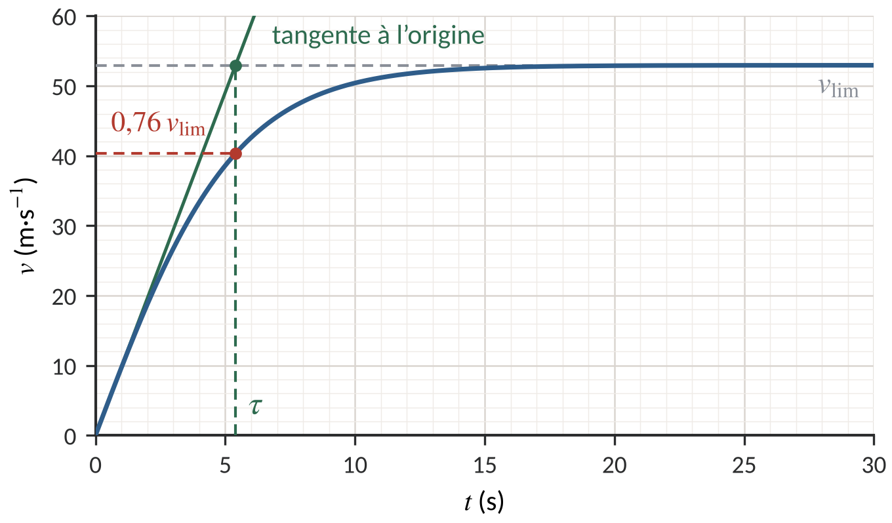{width=8.5cm}
:::

::: {custom-style="Legende"}
Figure 18. Tangente à l'origine et temps caractéristique de la chute
:::

::: {custom-style="QRappel"}
**5.** Temps caractéristique
:::

On lit $\tau \approx 5{,}4\ \text{s}$ (figure 18). La tangente a pour équation $v = g \times t$ ; elle atteint $v_{\text{lim}}$ quand $g \times \tau = v_{\text{lim}}$ :

::: {custom-style="Retenir"}
$\tau = \dfrac{v_{\text{lim}}}{g} = \dfrac{52{,}9}{9{,}81} = 5{,}4\ \text{s}$
:::

La règle des 63 % ne s'applique pas ici. À la date $\tau$, la vitesse vaut environ $40\ \text{m·s}^{-1}$, soit 76 % de $v_{\text{lim}}$. La règle des 63 % vient de la solution exponentielle $v_{\text{lim}} \times \left(1 - e^{-t/\tau}\right)$, obtenue pour un frottement proportionnel à la vitesse (Q.13) ; avec un frottement en $v^{2}$, la vitesse ne suit pas cette loi.

::: {custom-style="QRappel"}
**6.** Parachute ouvert
:::

La nouvelle vitesse limite, notée $v_2$, vaut :

$$v_2 = \sqrt{\dfrac{m \times g}{K\text{′}}} = \sqrt{\dfrac{80{,}0 \times 9{,}81}{28{,}0}} = 5{,}29\ \text{m·s}^{-1}$$

Le coefficient de frottement est multiplié par 100, donc la vitesse limite est divisée par $\sqrt{100} = 10$.

Sans frottement, un objet lâché sans vitesse initiale d'une hauteur $h$ arrive au sol avec une vitesse $v_2$ telle que $\dfrac{1}{2} m v_2^{2} = m g h$, par conservation de l'énergie mécanique :

::: {custom-style="Retenir"}
$h = \dfrac{v_2^{2}}{2 g} = \dfrac{5{,}29^{2}}{2 \times 9{,}81} = 1{,}43\ \text{m}$
:::

Atterrir parachute ouvert revient à sauter d'environ 1,4 m : c'est supportable en fléchissant les jambes.

::: {custom-style="Renvoi"}
[CIBLE:ex9]{custom-style="BoutonEnonce"}
:::

```{=openxml}
<w:p><w:r><w:br w:type="page"/></w:r></w:p>
```

# Index des notions {#index}

Chaque notion renvoie aux questions de cours (Q) et aux exercices (Ex.) où elle est travaillée.

| Notion | Où la travailler |
|---|---|
| Analyse dimensionnelle, unités | Q.12, Ex. 9 |
| Chute dans un fluide, force de frottement | Q.11 à Q.16, Ex. 2, Ex. 8, Ex. 9 |
| Conservation du débit volumique | Q.8, Ex. 4, Ex. 6, Ex. 7 |
| Débit volumique | Q.6, Q.7, Q.8, Ex. 3, Ex. 4, Ex. 6, Ex. 7 |
| Deuxième loi de Newton | Q.13, Q.15, Ex. 2, Ex. 9 |
| Effet Venturi | Q.9, Ex. 4, Ex. 6 |
| Équation différentielle du premier ordre | Q.13, Ex. 2, Ex. 9 |
| Équilibre, flottaison | Q.3, Q.4, Ex. 1, Ex. 8 |
| Fluide incompressible | Q.5 |
| Incertitude-type, compatibilité d'une mesure | Ex. 2 |
| Liquide au repos | Q.9, Q.10 |
| Masse volumique | Q.1, Q.3, Q.4, Q.11, Ex. 1, Ex. 2, Ex. 8 |
| Modèle de la chute libre | Q.16, Ex. 9 |
| Poussée d'Archimède | Q.1 à Q.4, Q.11, Q.15, Ex. 1, Ex. 2, Ex. 8, Ex. 9 |
| Pression, pression atmosphérique | Q.2, Q.9, Q.10, Ex. 3 à Ex. 7 |
| Principe d'inertie | Q.3, Q.14, Ex. 1, Ex. 8 |
| Régime permanent | Q.8 |
| Relation de Bernoulli | Q.9, Q.10, Ex. 3 à Ex. 7 |
| Relation fondamentale de l'hydrostatique (statique des fluides) | Q.2, Q.10, Ex. 3, Ex. 4, Ex. 7 |
| Section | Q.7, Q.8, Ex. 4, Ex. 6 |
| Temps caractéristique, tangente à l'origine | Q.13, Q.15, Ex. 9 |
| Viscosité | Q.13, Ex. 2 |
| Vitesse d'écoulement | Q.7, Q.8, Ex. 3 à Ex. 7 |
| Vitesse limite | Q.14, Q.15, Ex. 2, Ex. 8, Ex. 9 |

<!--fin:complet-->
