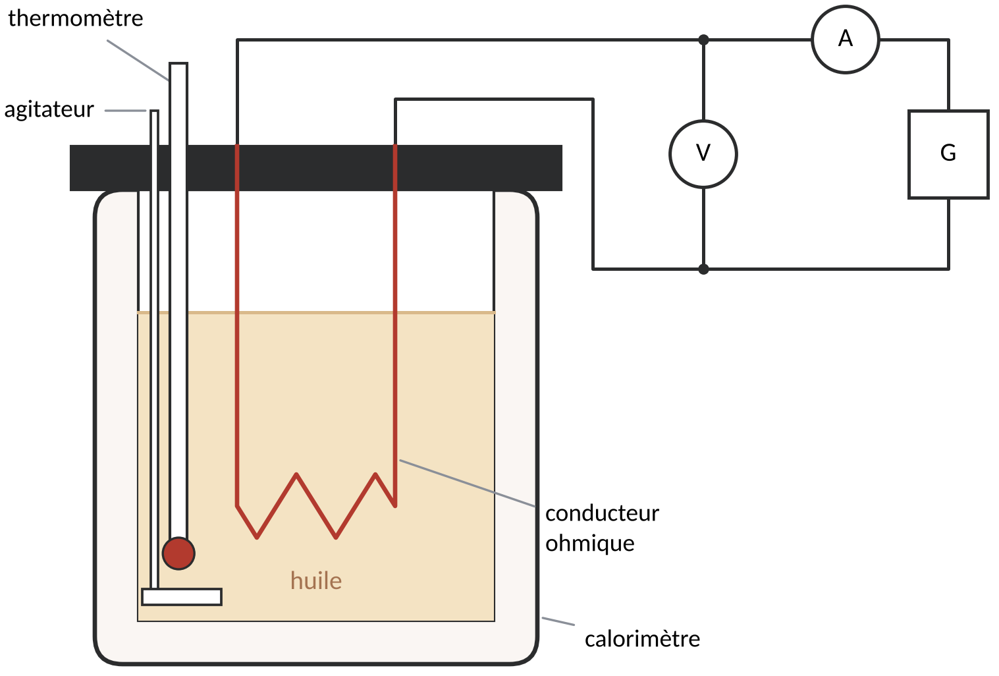
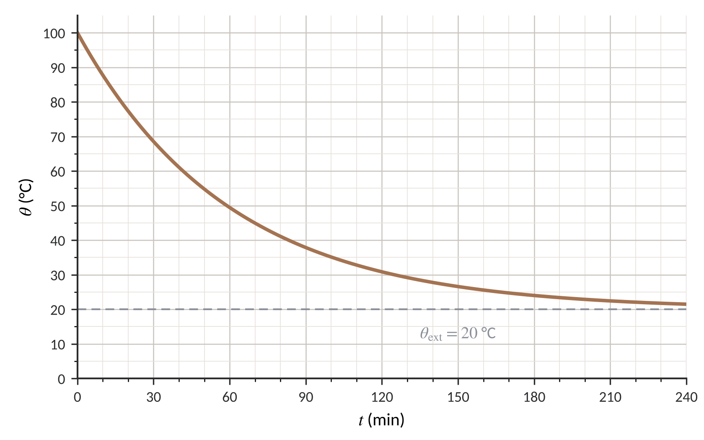
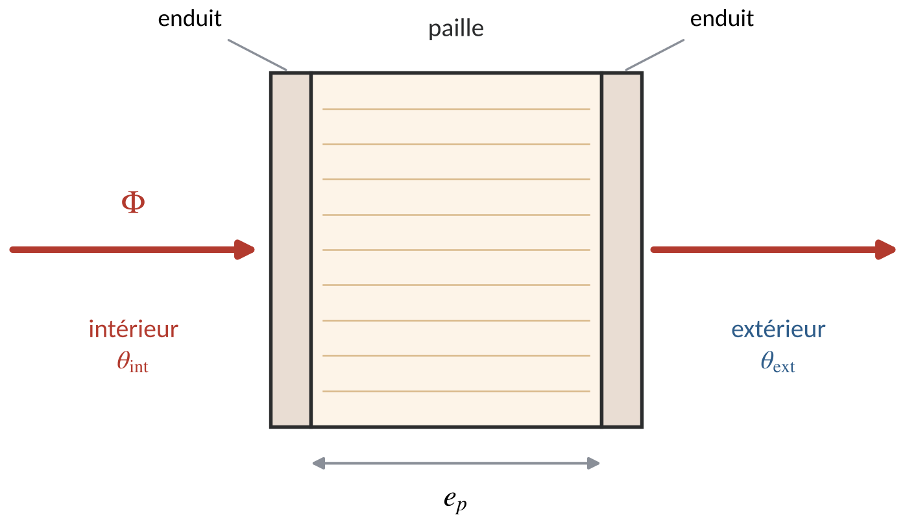
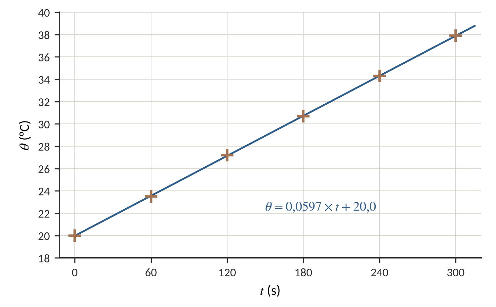
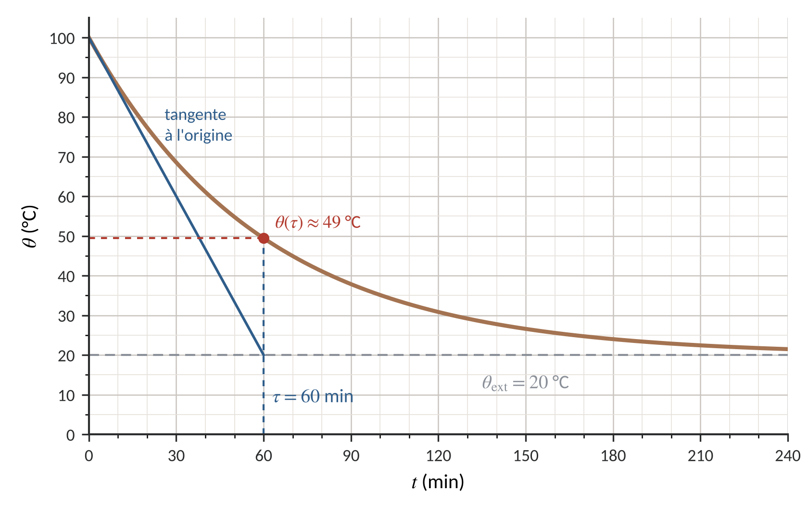
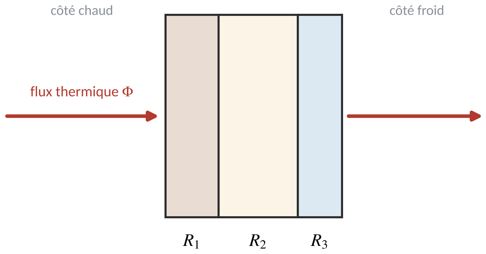
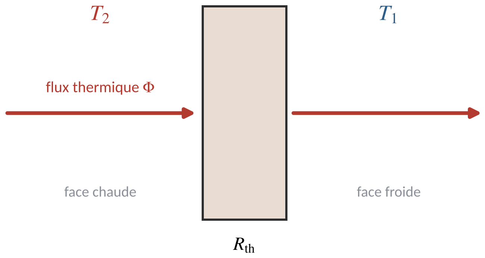
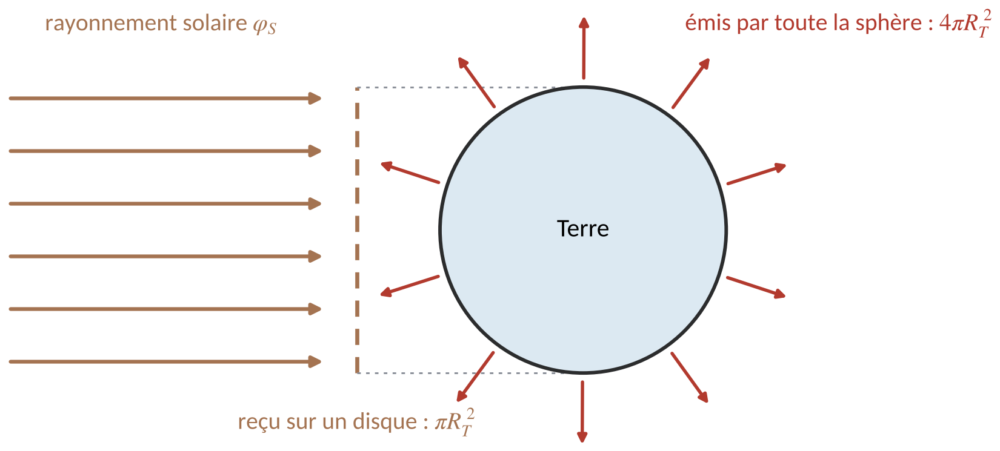

<!--meta {"numero": "5", "matiere": "Physique-Chimie", "titre": "Énergie : gaz parfait et transferts thermiques", "fichier": "MasterBac_PC_Fiche5_Energie", "fichier_cahier": "MasterBac_PC_Fiche5_Cahier_enonces"} -->

<!--inclure:ouverture-->

# L'essentiel en une page {#essentiel}

::: {custom-style="Rubrique"}
À connaître par cœur
:::

<!--colonnes: 22.5 33.5 44-->

| Notion | Relation | À retenir |
|---|---|---|
| Gaz parfait | $P \times V = n \times R \times T$ | $P$ en Pa, $V$ en $\text{m}^{3}$, $T$ en K avec $T = \theta + 273{,}15$. |
| Premier principe | $\Delta U = W + Q$ | $W$ et $Q$ sont positifs quand le système les reçoit. |
| Système incompressible | $\Delta U = m \times c \times \Delta\theta$ | $c$ en $\text{J·kg}^{-1}\text{·K}^{-1}$ ; $\Delta\theta$ identique en °C et en K. |
| Flux thermique | $\Phi = \dfrac{Q}{\Delta t}$ | En watt. Le transfert va du corps chaud vers le corps froid. |
| Paroi plane | $\Phi = \dfrac{\Delta T}{R_{\text{th}}}$ | $R_{\text{th}}$ en $\text{K·W}^{-1}$. $\Delta T$ : écart entre la face chaude et la face froide. |

::: {custom-style="Rubrique"}
À savoir retrouver
:::

<!--colonnes: 22.5 33.5 44-->

| Notion | Relation | Comment la retrouver |
|---|---|---|
| Masse volumique d'un gaz | $\rho = \dfrac{P \times M}{R \times T}$ | Dans l'équation d'état, remplacer $n$ par $m / M$, puis utiliser $\rho = m / V$, avec $M$ en $\text{kg·mol}^{-1}$. |
| Parois en série | $R_{\text{eq}} = R_1 + R_2 + R_3$ | Même flux $\Phi$ : les écarts $\Delta T$ s'ajoutent. |
| Contact avec un thermostat | $\theta(t) = (\theta_0 - \theta_{\text{th}}) \times e^{-t/\tau} + \theta_{\text{th}}$ avec $\tau = m \times c / (h \times S)$ | Premier principe pendant $\mathrm{d}t$ et loi de Newton, puis résolution : $\theta$ part de $\theta_0$ et tend vers $\theta_{\text{th}}$. |

::: {custom-style="Rubrique"}
Fourni par l'énoncé, à savoir exploiter
:::

Les sujets donnent la loi de Newton $\Phi = h \times S \times (\theta_{\text{th}} - \theta)$, la résistance thermique d'une paroi plane $R_{\text{th}} = e / (\lambda \times S)$ et la loi de Stefan-Boltzmann $P_{\text{émise}} = \sigma \times S \times T^{4}$, à combiner avec le premier principe.

::: {custom-style="Rubrique"}
Les pièges qui coûtent des points
:::

- Laisser un volume en litre ou une température en °C dans la loi des gaz parfaits.
- Écrire une variation à l'envers : c'est toujours la valeur finale moins la valeur initiale, $\Delta\theta = \theta_f - \theta_i$.
- Oublier la surface ou la conversion de l'épaisseur dans une résistance thermique.
- Terre : confondre la surface qui reçoit (un disque) et celle qui émet (une sphère).

::: {custom-style="Rubrique"}
Votre parcours selon votre objectif
:::

<!--colonnes: 12.5 39 48.5-->

| Objectif | Questions de cours | Exercices |
|---|---|---|
| [\ Objectif 10\ ]{custom-style="Niv10"} | Q.1, Q.2, Q.6 à Q.9, Q.15 à Q.21 | Exercice 1 (questions 1 à 4), exercice 4 (parties A et B) |
| [\ Objectif 14\ ]{custom-style="Niv14"} | Les précédentes, plus Q.3, Q.4 et Q.10 à Q.12 | Exercices 1 et 4 en entier, exercices 2 et 3 (parties A et B) |
| [\ Objectif 18\ ]{custom-style="Niv18"} | Toutes | Tous, avec la partie C des exercices 2 et 3 |

```{=openxml}
<w:p><w:r><w:br w:type="page"/></w:r></w:p>
```

# Ce qui est tombé aux BAC 2025 et 2026 {#tombe}

Les notions de cette fiche ont été demandées dans au moins onze exercices des sessions 2025 et 2026. Le tableau indique, pour chacun, ce qui était mobilisé et où s'y préparer dans la fiche.

<!--colonnes: 21 20 41 18-->

| Session | Exercice | Notions de cette fiche | Pour s'y préparer |
|---|---|---|---|
| Métropole, juin 2026, jour 1 | Étude d'un lave-linge | Gaz parfaits, énergie pour chauffer l'eau, durée de chauffage, modes de transfert, loi de Newton | Q.1, Q.8, Q.9, Q.15, Ex. 1, Ex. 3 |
| Métropole, juin 2026, jour 2 | La yaourtière | Énergie de chauffage, rendement, loi de Newton, solution donnée, temps caractéristique | Q.8, Q.11 à Q.13, Ex. 3 |
| Métropole, septembre 2026, jour 1 | Étude d'une éruption volcanique | Loi des gaz parfaits, loi de Newton, équation différentielle, temps caractéristique | Q.1, Q.11 à Q.13 |
| Amérique du Nord 2026, jour 2 | J'ai froid aux pieds sur le carrelage, je préfère le parquet ! | Calorimétrie, capacité thermique, loi de Newton, équation différentielle, temps caractéristique | Q.10 à Q.13, Ex. 2 |
| Antilles-Guyane 2026, jour 2 | Sécurité incendie | Premier principe, loi de Newton, résolution de l'équation différentielle, temps caractéristique | Q.11 à Q.14, Ex. 3 |
| Métropole, septembre 2025, jour 1 | La physique au service du vigneron | Bilan d'énergie avec plusieurs transferts, flux à travers une paroi | Q.8, Q.9, Q.18 |
| Métropole, septembre 2025, jour 2 | Le réfrigérateur | Loi de Newton, équation différentielle, temps caractéristique, gaz parfait à volume constant | Q.1, Q.11 à Q.14, Ex. 1, Ex. 3 |
| Asie 2025, jour 1 | Installation sanitaire | Résistance thermique, flux, variation d'énergie interne, rendement, durée de chauffage | Q.8, Q.16, Q.18, Ex. 3, Ex. 4 |
| Polynésie 2025, jour 1 | Performances des bolomètres de Planck | Loi de Stefan-Boltzmann, premier principe, équation différentielle, temps caractéristique | Q.12, Q.13, Q.21 |
| Amérique du Sud 2025, jour 1 | Tour Montparnasse | Masse volumique de l'air par la loi des gaz parfaits, modes de transfert, résistance thermique d'un vitrage, flux | Q.1, Q.3, Q.15, Q.16, Q.18, Ex. 4 |
| Amérique du Sud 2025, jour 2 | Chauffe-eau thermodynamique d'un chalet | Variation d'énergie interne, flux à travers une paroi, premier principe | Q.8, Q.9, Q.18 |

::: {custom-style="Intertitre"}
Ce qu'il faut en retenir
:::

- Le bilan d'énergie $Q = m \times c \times \Delta\theta$ est demandé dans plus de la moitié de ces exercices, souvent avec une puissance, un rendement ou une durée de chauffage.
- L'équation différentielle sur la température revient dans au moins cinq exercices : il faut savoir l'établir à partir de la loi de Newton, vérifier ou trouver sa solution et déterminer le temps caractéristique.
- La résistance thermique et le flux à travers une paroi sont revenus dans au moins quatre exercices en 2025, par exemple pour comparer deux isolants.
- La loi des gaz parfaits est revenue au moins quatre fois, toujours à l'intérieur d'un exercice plus large.
- La loi de Newton, l'expression de la résistance thermique et la loi de Stefan-Boltzmann sont fournies par l'énoncé : ce qui est noté, c'est la capacité à les exploiter.

::: {custom-style="Surtitre"}
Énoncés
:::

# Thème 1 : le modèle du gaz parfait {#theme1}

::: {custom-style="Rubrique"}
Questions de cours
:::

## [Q.1]{custom-style="QNum"}\ \ Énoncer la loi des gaz parfaits {#q1}

::: {custom-style="Meta"}
[\ Objectif 10\ ]{custom-style="Niv10"}\ \ Cours · Notions : pression, volume, quantité de matière, température absolue · Utilisée en 2025 et en 2026 (Métropole)\ \ \ [CIBLE:c_q1]{custom-style="BoutonCorrige"}
:::

## [Q.2]{custom-style="QNum"}\ \ Relier la pression et la température d'un gaz au comportement de ses molécules {#q2}

::: {custom-style="Meta"}
[\ Objectif 10\ ]{custom-style="Niv10"}\ \ Cours · Notions : agitation thermique, chocs sur les parois, masse volumique\ \ \ [CIBLE:c_q2]{custom-style="BoutonCorrige"}
:::

## [Q.3]{custom-style="QNum"}\ \ Exprimer la masse volumique d'un gaz parfait {#q3}

::: {custom-style="Meta"}
[\ Objectif 14\ ]{custom-style="Niv14"}\ \ Cours · Notions : masse molaire, équation d'état · Demandée en 2025 (Amérique du Sud, jour 1)\ \ \ [CIBLE:c_q3]{custom-style="BoutonCorrige"}
:::

## [Q.4]{custom-style="QNum"}\ \ Citer les limites du modèle du gaz parfait {#q4}

::: {custom-style="Meta"}
[\ Objectif 14\ ]{custom-style="Niv14"}\ \ Cours · Notions : hypothèses du modèle, pression élevée, interactions entre molécules\ \ \ [CIBLE:c_q4]{custom-style="BoutonCorrige"}
:::

## [Q.5]{custom-style="QNum"}\ \ Exprimer l'avancement d'une réaction en fonction de la pression {#q5}

::: {custom-style="Meta"}
[\ Objectif 18\ ]{custom-style="Niv18"}\ \ Application · Notions : tableau d'avancement, surpression, loi des gaz parfaits\ \ \ [CIBLE:c_q5]{custom-style="BoutonCorrige"}
:::

::: {custom-style="Enonce"}
Du zinc réagit avec une solution acide dans une enceinte fermée de volume $V$, à la température $T$. La pression dans l'enceinte vaut $P_i$ avant la transformation, $P$ à un instant quelconque et $P_{\text{max}}$ à l'état final. Le tableau d'avancement de la réaction est le suivant.
:::

<!--colonnes: 13 14 17 20 4 10 10 12-->

| État du système | Avancement (mol) | Zn(s) | \+ 2 H~3~O^+^(aq) | → | Zn^2+^(aq) | \+ H~2~(g) | \+ 2 H~2~O(ℓ) |
|:--|:-:|:-:|:-:|:-:|:-:|:-:|:-:|
| État initial | $0$ | $n(\text{Zn})_i$ | $n(\text{H}_3\text{O}^{\text{+}})_i$ | | $0$ | $0$ | excès |
| En cours | $x$ | $n(\text{Zn})_i - x$ | $n(\text{H}_3\text{O}^{\text{+}})_i - 2x$ | | $x$ | $x$ | excès |
| État final | $x_{\text{max}}$ | $n(\text{Zn})_i - x_{\text{max}}$ | $n(\text{H}_3\text{O}^{\text{+}})_i - 2x_{\text{max}}$ | | $x_{\text{max}}$ | $x_{\text{max}}$ | excès |

::: {custom-style="Enonce"}
On considère que le dihydrogène est un gaz parfait et qu'il est responsable de la surpression $P - P_i$, de sorte que $(P - P_i) \times V = n(\text{H}_2) \times R \times T$.

Montrer que l'avancement $x$ est lié à l'avancement maximal $x_{\text{max}}$ par la relation :

$$x = x_{\text{max}} \times \dfrac{P - P_i}{P_{\text{max}} - P_i}$$
:::

::: {custom-style="Rubrique"}
Exercices
:::

### [Exercice 1]{custom-style="QNum"}\ \ Le congélateur qui ne veut plus s'ouvrir [(voir BAC Métropole, septembre 2025)]{custom-style="VoirBac"} {#ex1}

::: {custom-style="Meta"}
[\ Objectif 10\ ]{custom-style="Niv10"}\ \ [Type BAC]{custom-style="TagBac"} · 3 points · 25 min · Questions 5 et 6 : objectif 14
:::

::: {custom-style="MentionBac"}
[Sujet du BAC correspondant.]{custom-style="EtiqBac"} Métropole, septembre 2025, jour 2, exercice 3 : « Le réfrigérateur » (partie sur la loi des gaz parfaits). Voir aussi Métropole, juin 2026, jour 1, exercice 1 : « Étude d'un lave-linge ».
:::

::: {custom-style="Enonce"}
Après avoir rangé ses courses, Lina referme le couvercle de son congélateur coffre. Elle veut le rouvrir aussitôt pour y glisser un sachet oublié : impossible, le couvercle semble collé.

Pendant l'ouverture, on admet que l'air froid du congélateur a été remplacé par l'air de la cuisine, à la température $\theta_1 = 20{,}0\ \text{°C}$ et à la pression $P_1 = 1{,}013 \times 10^{5}\ \text{Pa}$. Une fois le couvercle refermé, cet air se refroidit jusqu'à $\theta_2 = -18{,}0\ \text{°C}$. On suppose d'abord que le joint du couvercle est parfaitement étanche. L'air est modélisé par un gaz parfait.
:::

::: {custom-style="Enonce"}
**Données**
:::

::: {custom-style="EnonceDonnees"}
Volume d'air enfermé : $V = 200\ \text{L}$

Aire du couvercle : $S = 0{,}60\ \text{m}^{2}$

Constante des gaz parfaits : $R = 8{,}314\ \text{J·mol}^{-1}\text{·K}^{-1}$

Masse molaire de l'air : $M = 29{,}0\ \text{g·mol}^{-1}$

Intensité de la pesanteur : $g = 9{,}81\ \text{m·s}^{-2}$

Température absolue : $T = \theta + 273{,}15$, avec $T$ en kelvin et $\theta$ en degré Celsius

Norme de la force pressante exercée par un gaz à la pression $P$ sur une paroi d'aire $S$ : $F = P \times S$
:::

::: {custom-style="Enonce"}
**1.** Rappeler l'équation d'état du gaz parfait en précisant l'unité de chaque grandeur.

**2.** Calculer la quantité de matière d'air enfermée dans le congélateur, puis sa masse.

**3.** Que devient l'agitation des molécules quand l'air se refroidit ? En déduire, sans calcul, le sens d'évolution de la pression dans le congélateur.

**4.** Montrer que la pression finale vaut $P_2 = P_1 \times \dfrac{T_2}{T_1}$, puis la calculer.

**5.** L'air extérieur, à la pression $P_1$, appuie sur le dessus du couvercle. L'air intérieur, à la pression $P_2$, appuie sur le dessous. Calculer la norme $F$ de la résultante de ces deux forces pressantes. Quelle est la masse d'un objet dont le poids aurait la même norme ?

**6.** En réalité, le couvercle se rouvre sans effort après une minute d'attente. Quelle hypothèse faut-il remettre en cause ? Quelle grandeur de l'équation d'état varie alors ?
:::

::: {custom-style="Renvoi"}
[CIBLE:c_ex1]{custom-style="BoutonCorrige"}
:::

::: {custom-style="Surtitre"}
Énoncés
:::

# Thème 2 : premier principe et évolution de la température {#theme2}

::: {custom-style="Rubrique"}
Questions de cours
:::

## [Q.6]{custom-style="QNum"}\ \ Citer les contributions microscopiques à l'énergie interne d'un système {#q6}

::: {custom-style="Meta"}
[\ Objectif 10\ ]{custom-style="Niv10"}\ \ Cours · Notions : énergie interne, agitation thermique, interactions entre entités\ \ \ [CIBLE:c_q6]{custom-style="BoutonCorrige"}
:::

## [Q.7]{custom-style="QNum"}\ \ Prévoir le sens du transfert thermique $Q$ entre le système étudié et le milieu extérieur (ou encore un corps extérieur) {#q7}

::: {custom-style="Meta"}
[\ Objectif 10\ ]{custom-style="Niv10"}\ \ Cours · Notions : système, corps chaud, corps froid\ \ \ [CIBLE:c_q7]{custom-style="BoutonCorrige"}
:::

## [Q.8]{custom-style="QNum"}\ \ Écrire le premier principe de la thermodynamique en l'absence de travail mécanique $W$ (ou encore pour un système incompressible) et en déduire la relation entre $Q$, la masse du système $m$, la capacité thermique massique du système $c_s$ et la variation de température $\Delta\theta$ du système soumis au transfert thermique {#q8}

::: {custom-style="Meta"}
[\ Objectif 10\ ]{custom-style="Niv10"}\ \ Cours · Notions : premier principe, énergie interne, capacité thermique massique · Relation utilisée dans plus de la moitié des sujets de 2025 et 2026\ \ \ [CIBLE:c_q8]{custom-style="BoutonCorrige"}
:::

## [Q.9]{custom-style="QNum"}\ \ Exprimer le transfert thermique $Q$ en fonction du flux thermique $\Phi$ et de la durée $\Delta t$ {#q9}

::: {custom-style="Meta"}
[\ Objectif 10\ ]{custom-style="Niv10"}\ \ Cours · Notions : flux thermique, puissance\ \ \ [CIBLE:c_q9]{custom-style="BoutonCorrige"}
:::

## [Q.10]{custom-style="QNum"}\ \ Utiliser un calorimètre pour déterminer la capacité thermique massique d'un système {#q10}

::: {custom-style="Meta"}
[\ Objectif 14\ ]{custom-style="Niv14"}\ \ Méthode · Notions : calorimètre, système isolé, bilan d'énergie · Méthode du BAC 2022, reprise en 2026 (Amérique du Nord, jour 2)\ \ \ [CIBLE:c_q10]{custom-style="BoutonCorrige"}
:::

::: {custom-style="Enonce"}
Un calorimètre est un appareil de mesure isolé permettant de mesurer des échanges d'énergie thermique. Le principe est de plonger un système S de masse $m_s$, de température $\theta_s$ et de capacité thermique massique $c_s$ dans une masse d'eau $m_e$ de capacité thermique massique $c_{\text{eau}}$ et de température $\theta_e$. Le calorimètre est considéré comme étant parfaitement isolé. La température finale de l'ensemble est notée $\theta_f$.

Déterminer la capacité thermique massique $c_s$ du système.
:::

## [Q.11]{custom-style="QNum"}\ \ Donner une relation entre $h$, $S$, $\theta_{\text{th}}$, $\theta(t)$, $m$, $c_s$, $\Delta\theta$ et $\Delta t$ {#q11}

::: {custom-style="Meta"}
[\ Objectif 14\ ]{custom-style="Niv14"}\ \ Cours · Notions : loi de Newton, flux thermique, premier principe\ \ \ [CIBLE:c_q11]{custom-style="BoutonCorrige"}
:::

::: {custom-style="Enonce"}
Un système de masse $m$ et de capacité thermique massique $c_s$ est en contact avec un thermostat de température $\theta_{\text{th}}$, à travers une surface d'aire $S$. Le flux thermique reçu par le système est donné par la loi phénoménologique de Newton : $\Phi = h \times S \times (\theta_{\text{th}} - \theta(t))$.
:::

## [Q.12]{custom-style="QNum"}\ \ Déterminer l'équation différentielle donnant l'évolution de la température $\theta(t)$ du système en fonction du temps {#q12}

::: {custom-style="Meta"}
[\ Objectif 14\ ]{custom-style="Niv14"}\ \ Cours · Notions : équation différentielle du premier ordre, temps caractéristique · Présente dans au moins cinq sujets de 2025 et 2026\ \ \ [CIBLE:c_q12]{custom-style="BoutonCorrige"}
:::

## [Q.13]{custom-style="QNum"}\ \ Résoudre l'équation différentielle portant sur la température d'un système en contact avec un thermostat {#q13}

::: {custom-style="Meta"}
[\ Objectif 18\ ]{custom-style="Niv18"}\ \ Cours · Notions : solution d'une équation différentielle, condition initiale · Voir BAC 2022, Centres étrangers, jour 2, exercice 3\ \ \ [CIBLE:c_q13]{custom-style="BoutonCorrige"}
:::

::: {custom-style="Enonce"}
La solution générale est de la forme $\theta(t) = A \times e^{-t/\tau} + B$. L'équation établie en Q.12 s'écrit $\dfrac{\mathrm{d}\theta}{\mathrm{d}t} + \dfrac{\theta}{\tau} = \dfrac{\theta_{\text{th}}}{\tau}$, avec $\tau = \dfrac{m \times c_s}{h \times S}$. Déterminer les valeurs de $A$ et de $B$. La température initiale du système est notée $\theta_0$.
:::

## [Q.14]{custom-style="QNum"}\ \ Déterminer l'instant $t_1$ à partir duquel la température d'un système en contact avec un thermostat est supérieure à une valeur de température $b$ (par exemple $b = 60\ \text{°C}$) {#q14}

::: {custom-style="Meta"}
[\ Objectif 18\ ]{custom-style="Niv18"}\ \ Application · Notions : inéquation, logarithme népérien · Durée demandée en 2025 (Métropole, septembre, jour 2) et en 2026 (Antilles-Guyane, jour 2)\ \ \ [CIBLE:c_q14]{custom-style="BoutonCorrige"}
:::

::: {custom-style="Rubrique"}
Exercices
:::

### [Exercice 2]{custom-style="QNum"}\ \ Quelle huile pour un radiateur à bain d'huile ? [(voir BAC Amérique du Nord 2026)]{custom-style="VoirBac"} {#ex2}

::: {custom-style="Meta"}
[\ Objectif 14\ ]{custom-style="Niv14"}\ \ [Type BAC]{custom-style="TagBac"} · 5 points · 45 min · Partie C : objectif 18
:::

::: {custom-style="MentionBac"}
[Sujet du BAC correspondant.]{custom-style="EtiqBac"} Amérique du Nord 2026, jour 2, exercice 1 : « J'ai froid aux pieds sur le carrelage, je préfère le parquet ! » (calorimétrie, capacité thermique).
:::

::: {custom-style="Enonce"}
Dans un radiateur à bain d'huile, une résistance électrique chauffe une huile, qui cède ensuite son énergie à l'air de la pièce. Un fabricant annonce, pour son huile, une capacité thermique massique $c_{\text{réf}} = 1{,}90 \times 10^{3}\ \text{J·kg}^{-1}\text{·K}^{-1}$.

Pour vérifier cette valeur, on verse une masse $m$ d'huile dans un calorimètre. Un conducteur ohmique plongé dans l'huile est alimenté par un générateur : la tension $U$ à ses bornes et l'intensité $I$ du courant qui le traverse restent constantes (figure 1). On agite et on relève la température $\theta$ de l'huile chaque minute.
:::

::: {custom-style="Figure"}
{width=8.2cm}
:::

::: {custom-style="Legende"}
Figure 1. Mesure de la capacité thermique massique de l'huile
:::

<!--colonnes: 16 14 14 14 14 14 14-->

| *t* (s) | 0 | 60 | 120 | 180 | 240 | 300 |
|---|---|---|---|---|---|---|
| *θ* (°C) | 20,0 | 23,5 | 27,2 | 30,7 | 34,3 | 37,9 |

::: {custom-style="Enonce"}
**Données**
:::

::: {custom-style="EnonceDonnees"}
Masse d'huile : $m = 250{,}0\ \text{g}$

Tension et intensité : $U = 12{,}0\ \text{V}$ et $I = 2{,}50\ \text{A}$

Incertitudes-types : $u(U) = 0{,}1\ \text{V}$, $u(I) = 0{,}02\ \text{A}$, $u(m) = 0{,}1\ \text{g}$ et $u(a) = 0{,}0012\ \text{°C·s}^{-1}$, où $a$ est le coefficient directeur de la question 3

Incertitude-type sur la capacité thermique massique : $u(c) = c \times \sqrt{\left(\dfrac{u(U)}{U}\right)^{2} + \left(\dfrac{u(I)}{I}\right)^{2} + \left(\dfrac{u(m)}{m}\right)^{2} + \left(\dfrac{u(a)}{a}\right)^{2}}$

Capacité thermique du calorimètre et de ses accessoires : $C_{\text{cal}} = 30\ \text{J·K}^{-1}$
:::

::: {custom-style="Enonce"}

**Partie A. Le principe de la mesure**

**1.** Quelle conversion d'énergie le conducteur ohmique réalise-t-il ? Exprimer l'énergie $E$ qu'il reçoit pendant une durée $\Delta t$ en fonction de $U$, $I$ et $\Delta t$.

**2.** On suppose que toute cette énergie est transférée à l'huile et que le calorimètre est parfaitement isolé. En appliquant le premier principe de la thermodynamique à l'huile entre les dates $0$ et $t$, montrer que :

$$\theta(t) = \theta_0 + \dfrac{U \times I}{m \times c} \times t$$

où $\theta_0$ est la température de l'huile à la date $t = 0$.

**3.** Représenter $\theta$ en fonction de $t$. Les mesures sont-elles en accord avec cette expression ? Déterminer le coefficient directeur $a$ de la droite obtenue.

**4.** En déduire la valeur expérimentale de la capacité thermique massique $c$ de l'huile.

**Partie B. La mesure est-elle compatible avec la valeur du fabricant ?**

**5.** Calculer l'incertitude-type $u(c)$, puis écrire le résultat de la mesure.

**6.** Calculer le quotient $z = \dfrac{|c - c_{\text{réf}}|}{u(c)}$. La mesure est-elle compatible avec la valeur du fabricant ?

**Partie C. Une erreur de méthode**

**7.** Le calorimètre et ses accessoires s'échauffent en même temps que l'huile. Expliquer, sans calcul, pourquoi la valeur trouvée à la question 4 est trop grande.

**8.** En tenant compte de la capacité thermique $C_{\text{cal}}$, établir la nouvelle expression de $c$, la calculer et conclure. On admet que l'incertitude-type est inchangée.
:::

::: {custom-style="Renvoi"}
[CIBLE:c_ex2]{custom-style="BoutonCorrige"}
:::

### [Exercice 3]{custom-style="QNum"}\ \ La bouilloire et le thé vert [(voir BAC Métropole, juin 2026)]{custom-style="VoirBac"} {#ex3}

::: {custom-style="Meta"}
[\ Objectif 14\ ]{custom-style="Niv14"}\ \ [Type BAC]{custom-style="TagBac"} · 6 points · 50 min · Partie C : objectif 18
:::

::: {custom-style="MentionBac"}
[Sujet du BAC correspondant.]{custom-style="EtiqBac"} Métropole, juin 2026, jour 2, exercice 2 : « La yaourtière ». Voir aussi Métropole, septembre 2025, jour 2, exercice 3 : « Le réfrigérateur » (refroidissement de la bouteille).
:::

::: {custom-style="Enonce"}
Un thé vert s'infuse dans une eau à $75\ \text{°C}$ : plus chaude, elle le rend amer. Maël fait bouillir de l'eau dans une bouilloire électrique, puis la laisse refroidir, couvercle fermé, avant de la verser sur les feuilles. Il se demande combien de temps attendre.
:::

::: {custom-style="Enonce"}
**Données**
:::

::: {custom-style="EnonceDonnees"}
Masse d'eau : $m = 1{,}00\ \text{kg}$

Capacité thermique massique de l'eau : $c_{\text{eau}} = 4{,}18 \times 10^{3}\ \text{J·kg}^{-1}\text{·K}^{-1}$

Puissance électrique de la bouilloire : $P_{\text{élec}} = 2{,}20\ \text{kW}$

Rendement de la bouilloire, rapport de l'énergie reçue par l'eau à l'énergie électrique consommée : $\eta = 0{,}90$

Température initiale de l'eau : $\theta_i = 18\ \text{°C}$

Température de la cuisine : $\theta_{\text{ext}} = 20\ \text{°C}$

Aire de la surface d'échange entre la bouilloire et l'air : $S = 7{,}5 \times 10^{-2}\ \text{m}^{2}$

Loi de Newton : le flux thermique reçu par l'eau de la part de l'air s'écrit $\Phi = h \times S \times (\theta_{\text{ext}} - \theta)$, où $h$ est le coefficient d'échange
:::

::: {custom-style="Enonce"}

**Partie A. Faire bouillir l'eau**

**1.** Calculer la variation d'énergie interne $\Delta U$ de l'eau lorsqu'elle passe de $18\ \text{°C}$ à $100\ \text{°C}$.

**2.** En déduire l'énergie électrique consommée par la bouilloire, puis la durée du chauffage.

**Partie B. Laisser refroidir**

La bouilloire s'arrête à la date $t = 0$. L'eau, à la température $\theta_0 = 100\ \text{°C}$, échange alors de l'énergie avec l'air de la cuisine, qui joue le rôle de thermostat. On néglige la capacité thermique de la bouilloire.

**3.** Dans quel sens le transfert thermique s'effectue-t-il ? Quel est le signe du flux $\Phi$ reçu par l'eau ?

**4.** En appliquant le premier principe à l'eau pendant une durée très courte $\mathrm{d}t$, montrer que la température vérifie l'équation différentielle ci-dessous et donner l'expression de $\tau$.

$$\dfrac{\mathrm{d}\theta}{\mathrm{d}t} + \dfrac{\theta}{\tau} = \dfrac{\theta_{\text{ext}}}{\tau}$$

**5.** Vérifier que $\theta(t) = (\theta_0 - \theta_{\text{ext}}) \times e^{-t/\tau} + \theta_{\text{ext}}$ est solution de cette équation et qu'elle respecte la condition initiale.

**6.** La figure 2 donne l'évolution de la température de l'eau prévue par ce modèle. Déterminer graphiquement le temps caractéristique $\tau$ en expliquant la méthode.

**7.** En déduire la valeur du coefficient d'échange $h$.

**Partie C. Le bon moment**

**8.** Exprimer, puis calculer, la date $t_1$ à laquelle l'eau atteint $75\ \text{°C}$.

**9.** Une mesure montre que l'eau refroidit en réalité plus vite que ne le prévoit ce modèle. Citer deux transferts d'énergie qu'il ne prend pas en compte.
:::

::: {custom-style="Figure"}
{width=11.5cm}
:::

::: {custom-style="Legende"}
Figure 2. Température de l'eau de la bouilloire après l'arrêt du chauffage, d'après le modèle
:::

::: {custom-style="Renvoi"}
[CIBLE:c_ex3]{custom-style="BoutonCorrige"}
:::

::: {custom-style="Surtitre"}
Énoncés
:::

# Thème 3 : transferts thermiques et bilan radiatif de la Terre {#theme3}

::: {custom-style="Rubrique"}
Questions de cours
:::

## [Q.15]{custom-style="QNum"}\ \ Citer les trois modes de transfert thermique {#q15}

::: {custom-style="Meta"}
[\ Objectif 10\ ]{custom-style="Niv10"}\ \ Cours · Notions : conduction, convection, rayonnement · Demandée en 2025 et en 2026\ \ \ [CIBLE:c_q15]{custom-style="BoutonCorrige"}
:::

::: {custom-style="Enonce"}
Comment identifier le type de transfert thermique ayant lieu au cours d'une expérience ?
:::

## [Q.16]{custom-style="QNum"}\ \ Énoncer la résistance thermique d'un matériau selon ses caractéristiques géométriques {#q16}

::: {custom-style="Meta"}
[\ Objectif 10\ ]{custom-style="Niv10"}\ \ Cours · Notions : résistance et conductivité thermiques · Formule fournie\ \ \ [CIBLE:c_q16]{custom-style="BoutonCorrige"}
:::

## [Q.17]{custom-style="QNum"}\ \ Déterminer la résistance équivalente de matériaux assemblés en série {#q17}

::: {custom-style="Meta"}
[\ Objectif 10\ ]{custom-style="Niv10"}\ \ Cours · Notions : association en série\ \ \ [CIBLE:c_q17]{custom-style="BoutonCorrige"}
:::

## [Q.18]{custom-style="QNum"}\ \ Rappeler le flux thermique selon l'écart de température entre les parois {#q18}

::: {custom-style="Meta"}
[\ Objectif 10\ ]{custom-style="Niv10"}\ \ Cours · Notions : flux, résistance thermique · Quatre sujets au moins en 2025\ \ \ [CIBLE:c_q18]{custom-style="BoutonCorrige"}
:::

## [Q.19]{custom-style="QNum"}\ \ Donner l'expression du flux thermique surfacique {#q19}

::: {custom-style="Meta"}
[\ Objectif 10\ ]{custom-style="Niv10"}\ \ Cours · Notions : flux par unité de surface\ \ \ [CIBLE:c_q19]{custom-style="BoutonCorrige"}
:::

## [Q.20]{custom-style="QNum"}\ \ Définir l'albédo et donner la formule permettant de le calculer {#q20}

::: {custom-style="Meta"}
[\ Objectif 10\ ]{custom-style="Niv10"}\ \ Cours · Notions : énergie solaire réfléchie, énergie solaire incidente\ \ \ [CIBLE:c_q20]{custom-style="BoutonCorrige"}
:::

## [Q.21]{custom-style="QNum"}\ \ Énoncer la loi de Stefan-Boltzmann donnant la puissance émise par une surface {#q21}

::: {custom-style="Meta"}
[\ Objectif 10\ ]{custom-style="Niv10"}\ \ Cours · Notions : puissance rayonnée · Loi fournie, utilisée en 2025 (Polynésie)\ \ \ [CIBLE:c_q21]{custom-style="BoutonCorrige"}
:::

## [Q.22]{custom-style="QNum"}\ \ Calculer la température d'équilibre de la Terre sans atmosphère et justifier qu'on ne peut pas supprimer les gaz à effet de serre (flux solaire : $1370\ \text{W·m}^{-2}$) {#q22}

::: {custom-style="Meta"}
[\ Objectif 18\ ]{custom-style="Niv18"}\ \ Application · Notions : bilan radiatif, loi de Stefan-Boltzmann, albédo, effet de serre\ \ \ [CIBLE:c_q22]{custom-style="BoutonCorrige"}
:::

::: {custom-style="Enonce"}
Données : loi de Stefan-Boltzmann $P_{\text{émise}} = \sigma \times S \times T^{4}$, avec $\sigma = 5{,}67 \times 10^{-8}\ \text{W·m}^{-2}\text{·K}^{-4}$ ; albédo de la Terre : $0{,}30$.

On supposera d'abord que toute la puissance solaire reçue est absorbée, puis on tiendra compte de l'albédo.
:::

::: {custom-style="Rubrique"}
Exercices
:::

### [Exercice 4]{custom-style="QNum"}\ \ Une maison en paille [(voir BAC Asie 2025)]{custom-style="VoirBac"} {#ex4}

::: {custom-style="Meta"}
[\ Objectif 10\ ]{custom-style="Niv10"}\ \ [Type BAC]{custom-style="TagBac"} · 5 points · 40 min · Partie C : objectif 14
:::

::: {custom-style="MentionBac"}
[Sujet du BAC correspondant.]{custom-style="EtiqBac"} Asie 2025, jour 1, exercice 1 : « Installation sanitaire » (résistance thermique et flux à travers l'isolant, comparaison de deux isolants). Voir aussi Amérique du Sud 2025, jour 1, exercice 1 : « Tour Montparnasse ».
:::

::: {custom-style="Enonce"}
Pour les murs de sa future maison, Inès hésite entre des parpaings de béton et des bottes de paille recouvertes d'un enduit. Elle compare les pertes thermiques des deux solutions un jour d'hiver, quand la température vaut $\theta_{\text{int}} = 19\ \text{°C}$ à l'intérieur et $\theta_{\text{ext}} = -2\ \text{°C}$ à l'extérieur.
:::

::: {custom-style="Enonce"}
**Données**
:::

::: {custom-style="EnonceDonnees"}
Aire totale des murs : $S = 60\ \text{m}^{2}$

Résistance thermique d'une paroi plane d'épaisseur $e$, d'aire $S$ et de conductivité thermique $\lambda$ : $R_{\text{th}} = \dfrac{e}{\lambda \times S}$

Parpaing de béton : épaisseur $e_b = 20\ \text{cm}$, conductivité thermique $\lambda_b = 1{,}1\ \text{W·m}^{-1}\text{·K}^{-1}$

Botte de paille : épaisseur $e_p = 36\ \text{cm}$, conductivité thermique $\lambda_p = 0{,}052\ \text{W·m}^{-1}\text{·K}^{-1}$

Enduit, sur chaque face du mur en paille : épaisseur $e_e = 4{,}0\ \text{cm}$, conductivité thermique $\lambda_e = 0{,}80\ \text{W·m}^{-1}\text{·K}^{-1}$

Conversion : $1\ \text{kW·h} = 3{,}6 \times 10^{6}\ \text{J}$
:::

::: {custom-style="Figure"}
{width=8.6cm}
:::

::: {custom-style="Legende"}
Figure 3. Coupe du mur en paille enduit
:::

::: {custom-style="Enonce"}

**Partie A. Le mur en parpaings**

**1.** Citer les trois modes de transfert thermique. Lequel assure le transfert à travers le mur ?

**2.** Dans quel sens ce transfert s'effectue-t-il ? Justifier.

**3.** Calculer la résistance thermique $R_b$ du mur en parpaings, puis le flux thermique $\Phi_b$ qui le traverse.

**Partie B. Le mur en paille**

**4.** Calculer la résistance thermique $R_p$ de la paille seule. Quelle épaisseur de parpaing faudrait-il pour obtenir la même résistance thermique ?

**5.** Le mur réel est formé de trois couches : enduit, paille, enduit (figure 3). Calculer sa résistance thermique totale $R_{\text{tot}}$. L'enduit améliore-t-il beaucoup l'isolation ?

**6.** Calculer le flux thermique $\Phi_p$ à travers le mur en paille, puis l'énergie perdue en 24 heures, en joule et en kilowattheure.

**Partie C. Faut-il chauffer ?**

**7.** On suppose que les murs sont la seule cause de pertes. Quelle puissance de chauffage faut-il fournir, dans chaque cas, pour que la température intérieure reste constante ?

**8.** Deux personnes vivent dans la maison aux murs de paille. Chacune dégage une puissance thermique d'environ $100\ \text{W}$. Le chauffage est éteint : la température intérieure va-t-elle augmenter, diminuer ou rester stable ? Déterminer la température intérieure atteinte en régime permanent, puis commenter le modèle.
:::

::: {custom-style="Renvoi"}
[CIBLE:c_ex4]{custom-style="BoutonCorrige"}
:::

<!--debut:complet-->
::: {custom-style="Surtitre"}
Corrigés
:::

# Corrigés du thème 1 : le modèle du gaz parfait {#c_theme1}

#### [Corrigé]{custom-style="NumCorrige"}\ \ Q.1 · Énoncer la loi des gaz parfaits {#c_q1}
::: {custom-style="Renvoi"}
[CIBLE:q1]{custom-style="BoutonEnonce"}
:::

Pour un gaz considéré comme parfait, on a :

::: {custom-style="Retenir"}
$P \times V = n \times R \times T$
:::

avec :

- $P$ : pression du gaz, en pascal (Pa). On rappelle que $1\ \text{bar} = 10^{5}\ \text{Pa}$ et que $1\ \text{atm} = 1{,}013 \times 10^{5}\ \text{Pa}$ (atmosphère) ;
- $V$ : volume occupé par le gaz, en mètre cube ($\text{m}^{3}$) ;
- $n$ : quantité de matière, en mole (mol) ;
- $R$ : constante universelle des gaz parfaits, $R = 8{,}314\ \text{J·mol}^{-1}\text{·K}^{-1}$ ;
- $T$ : température absolue, en kelvin (K).

Pour rappel : $T(\text{K}) = \theta(\text{°C}) + 273{,}15$.

::: {custom-style="Remarque"}
[Remarque.]{custom-style="EtiqRemarque"} Le modèle du gaz parfait s'applique à température et à pression normales. Il consiste à assimiler les molécules d'un gaz à des particules ponctuelles avec des interactions moléculaires faibles (forces intermoléculaires négligeables). Les limites du modèle sont détaillées en Q.4.
:::

::: {custom-style="Piege"}
[Piège.]{custom-style="EtiqPiege"} Les énoncés donnent souvent le volume en litre et la température en degré Celsius. Avant tout calcul : $1\ \text{L} = 10^{-3}\ \text{m}^{3}$ et $T = \theta + 273{,}15$. Une pression en bar ou en hectopascal doit aussi être convertie en pascal ($1\ \text{hPa} = 10^{2}\ \text{Pa}$).
:::

#### [Corrigé]{custom-style="NumCorrige"}\ \ Q.2 · Relier la pression et la température d'un gaz au comportement de ses molécules {#c_q2}
::: {custom-style="Renvoi"}
[CIBLE:q2]{custom-style="BoutonEnonce"}
:::

À l'échelle microscopique, un gaz est formé d'un très grand nombre de molécules, éloignées les unes des autres, en mouvement incessant et désordonné. Les grandeurs que l'on mesure à l'échelle macroscopique traduisent ce comportement :

- la **température** mesure l'agitation des molécules : plus la température est élevée, plus leur énergie cinétique moyenne est grande, donc plus elles se déplacent vite ;
- la **pression** est due aux chocs des molécules sur les parois : plus les chocs sont nombreux et violents, plus la pression est élevée ;
- la **masse volumique** dépend du nombre de molécules par unité de volume et de la masse de chacune.

**Exemple.** On chauffe un gaz enfermé dans un récipient rigide. Les molécules se déplacent plus vite : elles frappent les parois plus souvent et plus fort, donc la pression augmente. C'est ce que prévoit l'équation d'état : à $n$ et $V$ constants, $P$ est proportionnelle à $T$.

::: {custom-style="Redaction"}
[Rédaction.]{custom-style="EtiqRedaction"} Dans une question qualitative, reliez toujours la grandeur mesurée à ce que font les molécules : « La température diminue, donc l'agitation des molécules diminue. Les chocs sur les parois sont moins fréquents et moins violents : la pression diminue. »
:::

#### [Corrigé]{custom-style="NumCorrige"}\ \ Q.3 · Exprimer la masse volumique d'un gaz parfait {#c_q3}
::: {custom-style="Renvoi"}
[CIBLE:q3]{custom-style="BoutonEnonce"}
:::

D'après la loi des gaz parfaits :

$$P \times V = n \times R \times T$$

Or $n = \dfrac{m}{M}$ et $\rho = \dfrac{m}{V}$. On tire donc de la deuxième expression $m = \rho \times V$, que l'on substitue dans l'expression de la quantité de matière :

$$n = \dfrac{\rho \times V}{M}$$

On remplace ensuite dans la loi des gaz parfaits :

$$P \times V = \dfrac{\rho \times V}{M} \times R \times T$$

Soit, en simplifiant par $V$ et en multipliant par $M$ :

$$P \times M = \rho \times R \times T$$

Et finalement :

::: {custom-style="Retenir"}
$\rho = \dfrac{P \times M}{R \times T}$
:::

**Exemple.** Pour l'air, de masse molaire $M = 29{,}0\ \text{g·mol}^{-1} = 29{,}0 \times 10^{-3}\ \text{kg·mol}^{-1}$, à $20{,}0\ \text{°C}$ et sous une pression de $1{,}013 \times 10^{5}\ \text{Pa}$ :

$$\rho = \dfrac{1{,}013 \times 10^{5} \times 29{,}0 \times 10^{-3}}{8{,}314 \times 293{,}15} = 1{,}21\ \text{kg·m}^{-3}$$

::: {custom-style="Piege"}
[Piège.]{custom-style="EtiqPiege"} Dans cette formule, la masse molaire doit être exprimée en $\text{kg·mol}^{-1}$ pour obtenir une masse volumique en $\text{kg·m}^{-3}$. Avec $M$ en $\text{g·mol}^{-1}$, le résultat est en $\text{g·m}^{-3}$.
:::

::: {custom-style="Remarque"}
[Remarque.]{custom-style="EtiqRemarque"} À pression constante, la masse volumique d'un gaz diminue quand sa température augmente. L'air chaud, moins dense que l'air froid, s'élève : c'est le principe de la montgolfière.
:::

#### [Corrigé]{custom-style="NumCorrige"}\ \ Q.4 · Citer les limites du modèle du gaz parfait {#c_q4}
::: {custom-style="Renvoi"}
[CIBLE:q4]{custom-style="BoutonEnonce"}
:::

Le modèle du gaz parfait repose sur deux hypothèses :

- les molécules sont assimilées à des points : leur volume propre est négligeable devant le volume occupé par le gaz ;
- les molécules n'exercent aucune action les unes sur les autres en dehors des chocs.

Ces hypothèses sont satisfaisantes quand les molécules sont très éloignées les unes des autres, c'est-à-dire pour un gaz peu dense : pression faible ou modérée, température suffisamment élevée.

Le modèle atteint ses limites dans deux situations :

- à **pression élevée** : les molécules sont proches les unes des autres, leur volume propre et leurs interactions ne sont plus négligeables ;
- à **basse température**, près de la liquéfaction : les interactions entre molécules deviennent déterminantes. Le modèle ne prévoit d'ailleurs pas le passage à l'état liquide.

::: {custom-style="Remarque"}
[Remarque.]{custom-style="EtiqRemarque"} Pour l'air à température ambiante et à la pression atmosphérique, l'écart entre le modèle et la réalité est inférieur à 1 %. C'est pourquoi les sujets de BAC modélisent presque toujours l'air par un gaz parfait.
:::

#### [Corrigé]{custom-style="NumCorrige"}\ \ Q.5 · Exprimer l'avancement d'une réaction en fonction de la pression {#c_q5}
::: {custom-style="Renvoi"}
[CIBLE:q5]{custom-style="BoutonEnonce"}
:::

À tout instant, on a $n(\text{H}_2) = x$, donc d'après la loi des gaz parfaits donnée dans l'énoncé :

$$(P - P_i) \times V = x \times R \times T$$

Soit :

$$x = \dfrac{(P - P_i) \times V}{R \times T} \lbl{*}$$

En particulier pour $x = x_{\text{max}}$ :

$$x_{\text{max}} = \dfrac{(P_{\text{max}} - P_i) \times V}{R \times T}$$

On en tire :

$$\dfrac{x_{\text{max}}}{P_{\text{max}} - P_i} = \dfrac{V}{R \times T}$$

On multiplie l'expression de part et d'autre par le terme $\cR{P - P_i}$ :

$$\dfrac{x_{\text{max}} \times \cR{(P - P_i)}}{P_{\text{max}} - P_i} = \dfrac{\cR{(P - P_i)} \times V}{R \times T}$$

Et d'après la relation (\*) :

$$\dfrac{x_{\text{max}} \times \cR{(P - P_i)}}{P_{\text{max}} - P_i} = \dfrac{\cR{(P - P_i)} \times V}{R \times T} = x$$

On retrouve bien :

::: {custom-style="Retenir"}
$x = x_{\text{max}} \times \dfrac{P - P_i}{P_{\text{max}} - P_i}$
:::

Cela signifie qu'en mesurant la pression $P$ à un instant donné, on est capable de déterminer la quantité de dihydrogène $\text{H}_2$ s'étant formée.

::: {custom-style="Remarque"}
[Remarque.]{custom-style="EtiqRemarque"} Ici, l'apparition de dihydrogène est caractérisée par une surpression, mais dans d'autres exercices il peut directement s'agir de la pression $p$ d'un produit. En d'autres termes, en lieu et place du terme $P - P_i$, on aurait simplement $p$. On aurait ainsi :

$$p \times V = n(\text{H}_2) \times R \times T$$

Et :

$$x = \dfrac{p \times V}{R \times T}$$
:::

#### [Corrigé]{custom-style="NumCorrige"}\ \ Exercice 1 · Le congélateur qui ne veut plus s'ouvrir {#c_ex1}
::: {custom-style="Renvoi"}
[CIBLE:ex1]{custom-style="BoutonEnonce"}
:::

::: {custom-style="QRappel"}
**1.** Équation d'état du gaz parfait
:::

$$P \times V = n \times R \times T$$

avec $P$ la pression en pascal (Pa), $V$ le volume en mètre cube ($\text{m}^{3}$), $n$ la quantité de matière en mole (mol), $T$ la température absolue en kelvin (K) et $R$ la constante des gaz parfaits en $\text{J·mol}^{-1}\text{·K}^{-1}$.

::: {custom-style="QRappel"}
**2.** Quantité de matière et masse d'air
:::

On convertit d'abord les données : $V = 200\ \text{L} = 0{,}200\ \text{m}^{3}$ et $T_1 = 20{,}0 + 273{,}15 = 293{,}15\ \text{K}$.

$$n = \dfrac{P_1 \times V}{R \times T_1} = \dfrac{1{,}013 \times 10^{5} \times 0{,}200}{8{,}314 \times 293{,}15} = 8{,}31\ \text{mol}$$

$$m = n \times M = 8{,}31 \times 29{,}0 = 241\ \text{g}$$

::: {custom-style="QRappel"}
**3.** Agitation des molécules et pression
:::

Quand la température diminue, l'agitation des molécules diminue : elles se déplacent moins vite. Le volume et le nombre de molécules ne changent pas, mais les chocs sur les parois sont moins fréquents et moins violents : la pression diminue.

::: {custom-style="QRappel"}
**4.** Pression finale
:::

Le congélateur est fermé et supposé étanche : la quantité de matière $n$ et le volume $V$ sont constants. On écrit l'équation d'état dans l'état initial, puis dans l'état final :

$$P_1 \times V = n \times R \times T_1$$

$$P_2 \times V = n \times R \times T_2$$

En divisant membre à membre :

$$\dfrac{P_2}{P_1} = \dfrac{T_2}{T_1}$$

Avec $T_2 = -18{,}0 + 273{,}15 = 255{,}15\ \text{K}$ :

::: {custom-style="Retenir"}
$P_2 = P_1 \times \dfrac{T_2}{T_1} = 1{,}013 \times 10^{5} \times \dfrac{255{,}15}{293{,}15} = 8{,}82 \times 10^{4}\ \text{Pa}$
:::

La pression a bien diminué, comme prévu à la question 3.

::: {custom-style="Piege"}
[Piège.]{custom-style="EtiqPiege"} Le rapport des températures se calcule en kelvin. Avec des degrés Celsius, on trouverait ici une pression négative, ce qui n'a aucun sens.
:::

::: {custom-style="QRappel"}
**5.** Force qui plaque le couvercle
:::

L'air extérieur exerce sur le couvercle une force pressante dirigée vers le bas, de norme $P_1 \times S$. L'air intérieur exerce une force pressante dirigée vers le haut, de norme $P_2 \times S$. Comme $P_1 > P_2$, la résultante est dirigée vers le bas et sa norme vaut :

$$F = P_1 \times S - P_2 \times S = (P_1 - P_2) \times S$$

$$F = (1{,}013 \times 10^{5} - 8{,}82 \times 10^{4}) \times 0{,}60 = 7{,}86 \times 10^{3}\ \text{N}$$

Cette force, d'environ $7{,}9 \times 10^{3}\ \text{N}$, est égale au poids d'un objet de masse :

$$m\text{′} = \dfrac{F}{g} = \dfrac{7{,}86 \times 10^{3}}{9{,}81} = 8{,}0 \times 10^{2}\ \text{kg}$$

Tout se passe comme si une masse de 800 kg était posée sur le couvercle : il est impossible de l'ouvrir à la main.

::: {custom-style="QRappel"}
**6.** Retour à la réalité
:::

Il faut remettre en cause l'hypothèse d'un joint parfaitement étanche. Comme la pression est plus faible à l'intérieur, de l'air extérieur entre peu à peu par le joint. La quantité de matière $n$ d'air enfermé augmente, donc la pression intérieure remonte jusqu'à la pression extérieure. Les deux forces pressantes se compensent alors et le couvercle s'ouvre sans effort.

::: {custom-style="Redaction"}
[Rédaction.]{custom-style="EtiqRedaction"} À la question 4, justifiez la relation avant de l'utiliser : « Le système est fermé et son volume est constant, donc $n$ et $V$ ne varient pas. D'après l'équation d'état, la pression est proportionnelle à la température absolue. »
:::

::: {custom-style="Surtitre"}
Corrigés
:::

# Corrigés du thème 2 : premier principe et évolution de la température {#c_theme2}

#### [Corrigé]{custom-style="NumCorrige"}\ \ Q.6 · Citer les contributions microscopiques à l'énergie interne d'un système {#c_q6}
::: {custom-style="Renvoi"}
[CIBLE:q6]{custom-style="BoutonEnonce"}
:::

L'énergie interne $U$ d'un système est la somme des énergies de toutes les entités microscopiques (atomes, molécules, ions) qui le constituent. Elle comporte deux contributions :

- l'**énergie cinétique microscopique**, liée à l'agitation thermique des entités. Elle augmente avec la température ;
- l'**énergie potentielle d'interaction** entre les entités : liaisons à l'intérieur des molécules et interactions entre les molécules. Elle est modifiée lors d'un changement d'état ou d'une transformation chimique.

L'énergie interne s'exprime en joule (J).

::: {custom-style="Remarque"}
[Remarque.]{custom-style="EtiqRemarque"} L'énergie totale d'un système est la somme de son énergie interne et de ses énergies macroscopiques (énergie cinétique et énergie potentielle du système pris dans son ensemble). Pour un système immobile à l'échelle macroscopique, une variation d'énergie totale se réduit à une variation d'énergie interne. Dans le modèle du gaz parfait, il n'y a pas d'interaction entre les molécules : l'énergie interne ne dépend que de la température.
:::

#### [Corrigé]{custom-style="NumCorrige"}\ \ Q.7 · Prévoir le sens du transfert thermique $Q$ entre le système étudié et le milieu extérieur (ou encore un corps extérieur) {#c_q7}
::: {custom-style="Renvoi"}
[CIBLE:q7]{custom-style="BoutonEnonce"}
:::

Le transfert thermique a toujours lieu du corps chaud vers le corps froid. Pour répondre à cette question, il faut donc identifier le système (en d'autres termes l'objet ou le milieu dont on étudie l'évolution de température) ainsi que sa température, puis la comparer à la température du milieu ou du corps extérieur avec lequel il est en interaction.

**Exemple.** Le système est un échantillon de nickel à une température $\theta = 30\ \text{°C}$. Il est en contact avec un thermostat (on peut prendre l'exemple de l'air) de température $\theta_{\text{air}} = 100\ \text{°C}$. Ici, le corps dont la température est la plus élevée est le thermostat. C'est donc ce dernier qui joue le rôle de corps chaud. Le système joue donc le rôle de corps froid. Étant donné que le transfert thermique s'effectue toujours du corps chaud vers le corps froid, on en déduit qu'il s'effectue du thermostat vers le système.

::: {custom-style="Remarque"}
[Remarque.]{custom-style="EtiqRemarque"} Le transfert thermique $Q$ est compté positivement quand le système reçoit de l'énergie et négativement quand il en cède. Dans l'exemple, le nickel reçoit de l'énergie : $Q > 0$. Un thermostat est un corps dont la température reste constante quels que soient les échanges.
:::

#### [Corrigé]{custom-style="NumCorrige"}\ \ Q.8 · Écrire le premier principe de la thermodynamique en l'absence de travail mécanique $W$ (ou encore pour un système incompressible) et en déduire la relation entre $Q$, la masse du système $m$, la capacité thermique massique du système $c_s$ et la variation de température $\Delta\theta$ du système soumis au transfert thermique {#c_q8}
::: {custom-style="Renvoi"}
[CIBLE:q8]{custom-style="BoutonEnonce"}
:::

Le premier principe de la thermodynamique s'écrit :

$$\Delta U = Q + W$$

En l'absence de travail mécanique $W$ mentionné dans l'exercice, ou pour le cas d'un système **incompressible**, on a $W = 0$.

Ainsi on a $\Delta U = Q$.

D'autre part, on a la relation suivante d'après le cours : $\cR{\Delta U = m \times c_s \times \Delta\theta}$, avec :

- $c_s$ : capacité thermique massique du système, en $\text{J·kg}^{-1}\text{·K}^{-1}$ ;
- $m$ : masse du système, en kilogramme (kg) ;
- $\Delta\theta$ : variation de température du système, en °C ou en K.

De ce qui précède, on déduit que :

::: {custom-style="Retenir"}
$\Delta U = Q = m \times c_s \times \Delta\theta$
:::

::: {custom-style="Piege"}
[Piège.]{custom-style="EtiqPiege"} Une variation se calcule toujours dans le même sens : $\Delta\theta = \theta_{\text{finale}} - \theta_{\text{initiale}}$. Si le système refroidit, $\Delta\theta$ est négatif et $Q$ aussi : le système cède de l'énergie. Un écart de température a la même valeur en degré Celsius et en kelvin : il est inutile de convertir.
:::

#### [Corrigé]{custom-style="NumCorrige"}\ \ Q.9 · Exprimer le transfert thermique $Q$ en fonction du flux thermique $\Phi$ et de la durée $\Delta t$ {#c_q9}
::: {custom-style="Renvoi"}
[CIBLE:q9]{custom-style="BoutonEnonce"}
:::

Par définition, pour un flux thermique $\Phi$ constant :

$$\Phi = \dfrac{Q}{\Delta t}$$

Soit :

::: {custom-style="Retenir"}
$Q = \Phi \times \Delta t$
:::

Le flux thermique $\Phi$ s'exprime en watt (W), le transfert thermique $Q$ en joule (J) et la durée $\Delta t$ en seconde (s).

::: {custom-style="Remarque"}
[Remarque.]{custom-style="EtiqRemarque"} Le flux thermique est une puissance : c'est l'énergie transférée par unité de temps ($1\ \text{W} = 1\ \text{J·s}^{-1}$). La même relation s'applique à un appareil électrique : s'il fonctionne à la puissance $P_{\text{élec}}$ pendant la durée $\Delta t$, il consomme l'énergie $E_{\text{élec}} = P_{\text{élec}} \times \Delta t$.
:::

#### [Corrigé]{custom-style="NumCorrige"}\ \ Q.10 · Utiliser un calorimètre pour déterminer la capacité thermique massique d'un système {#c_q10}
::: {custom-style="Renvoi"}
[CIBLE:q10]{custom-style="BoutonEnonce"}
:::

Pour déterminer la capacité thermique massique $c_s$ du système, on doit tout d'abord écrire le bilan total du système {eau + système S}. On écrit donc le premier principe de la thermodynamique appliqué au système {eau + système S} :

$$\Delta U_{\text{total}} = \Delta U_{\text{eau}} + \Delta U_{\text{système}} = W + Q$$

On rappelle que l'énergie interne totale d'un système est la somme des énergies internes de chaque sous-système constituant le système total. Il en est donc de même pour la variation de l'énergie interne totale du système.

Le calorimètre étant isolé, il n'y a aucun échange entre ce dernier et l'extérieur, ni sous forme de travail $W$, ni sous forme de transfert thermique $Q$ (c'est le principe du calorimètre). On peut ainsi écrire :

$$\Delta U_{\text{total}} = \Delta U_{\text{eau}} + \Delta U_{\text{système}} = 0 \lbl{1}$$

Pour l'eau et le système S, les variations d'énergie interne s'écrivent :

$$\Delta U_{\text{eau}} = m_e \times c_{\text{eau}} \times (\theta_f - \theta_e)$$

$$\Delta U_{\text{système}} = m_s \times c_s \times (\theta_f - \theta_s)$$

On remplace dans la relation (1), il vient :

$$\cR{m_e \times c_{\text{eau}} \times (\theta_f - \theta_e)} + m_s \times c_s \times (\theta_f - \theta_s) = 0$$

$$m_s \times c_s \times (\theta_f - \theta_s) = \cR{- m_e \times c_{\text{eau}} \times (\theta_f - \theta_e)}$$

$$c_s = - \dfrac{m_e \times c_{\text{eau}} \times (\theta_f - \theta_e)}{m_s \times (\theta_f - \theta_s)}$$

::: {custom-style="Retenir"}
$c_s = \dfrac{m_e \times c_{\text{eau}} \times (\theta_e - \theta_f)}{m_s \times (\theta_f - \theta_s)}$
:::

::: {custom-style="Remarque"}
[Remarque.]{custom-style="EtiqRemarque"} La valeur de la capacité thermique massique déterminée à l'aide du calorimètre sera en général différente de la valeur réelle de la capacité thermique massique du système S. En effet, le calorimètre n'est pas parfaitement isolé : il échange de l'énergie avec le milieu extérieur. De plus, le vase et les accessoires absorbent eux-mêmes une partie de l'énergie (voir l'exercice 2).
:::

#### [Corrigé]{custom-style="NumCorrige"}\ \ Q.11 · Donner une relation entre $h$, $S$, $\theta_{\text{th}}$, $\theta(t)$, $m$, $c_s$, $\Delta\theta$ et $\Delta t$ {#c_q11}
::: {custom-style="Renvoi"}
[CIBLE:q11]{custom-style="BoutonEnonce"}
:::

Rappelons le sens de chacune de ces grandeurs :

- $\theta_{\text{th}}$ : température du thermostat, qui influence la température du système ;
- $h$ (en $\text{W·m}^{-2}\text{·K}^{-1}$) : coefficient d'échange (conducto-convectif) entre le thermostat et le système ;
- $\theta(t)$ : température du système à l'instant $t$, dans la même unité que $\theta_{\text{th}}$ ;
- $c_s$ (en $\text{J·kg}^{-1}\text{·K}^{-1}$) : capacité thermique massique du système ;
- $m$ (en kg) : masse du système ;
- $\Delta\theta$ (en °C ou en K) : variation de température du système ;
- $\Delta t$ (en s) : durée du transfert thermique ;
- $S$ (en $\text{m}^{2}$) : surface de contact entre le thermostat et le système.

Ces rappels étant faits, voici comment procéder pour retrouver la relation entre ces différentes grandeurs.

**Étape 1 :** écrire le premier principe de la thermodynamique et en déduire la relation entre le transfert thermique reçu par le système et sa variation de température (voir Q.8).

On a $\Delta U = Q = m \times c_s \times \Delta\theta$. Seule la deuxième égalité est utile ici, on retient donc :

$$Q = m \times c_s \times \Delta\theta \lbl{1}$$

**Étape 2 :** exprimer le transfert thermique en fonction du flux thermique (voir Q.9).

Pendant une durée $\Delta t$ assez courte pour que la température, donc le flux, varie peu, $\Phi = \dfrac{Q}{\Delta t}$, soit :

$$Q = \Phi \times \Delta t \lbl{2}$$

On égale les expressions (1) et (2) :

$$m \times c_s \times \Delta\theta = \Phi \times \Delta t \lbl{3}$$

**Étape 3 :** utiliser la loi phénoménologique de Newton pour exprimer le flux en fonction de l'écart de température entre le thermostat et le système. Conclure.

D'après la loi phénoménologique de Newton : $\Phi = h \times S \times (\theta_{\text{th}} - \theta(t))$. On remplace ensuite dans la relation (3), il vient :

$$m \times c_s \times \Delta\theta = h \times S \times (\theta_{\text{th}} - \theta(t)) \times \Delta t$$

Il est préférable de mettre cette relation sous la forme :

::: {custom-style="Retenir"}
$m \times c_s \times \dfrac{\Delta\theta}{\Delta t} = h \times S \times (\theta_{\text{th}} - \theta(t))$
:::

::: {custom-style="Piege"}
[Piège.]{custom-style="EtiqPiege"} Dans la loi de Newton, l'ordre des températures dépend du flux que l'énoncé définit. Pour le flux **reçu** par le système, on écrit $\theta_{\text{th}} - \theta$ : le flux est positif si le thermostat est plus chaud que le système. Si l'énoncé définit le flux cédé par le système, la différence est inversée. Lisez la définition donnée avant d'écrire le bilan.
:::

#### [Corrigé]{custom-style="NumCorrige"}\ \ Q.12 · Déterminer l'équation différentielle donnant l'évolution de la température $\theta(t)$ du système en fonction du temps {#c_q12}
::: {custom-style="Renvoi"}
[CIBLE:q12]{custom-style="BoutonEnonce"}
:::

**Étape 1 :** faire la question Q.11 afin de trouver la relation entre $h$, $S$, $\theta_{\text{th}}$, $\theta(t)$, $m$, $c_s$, $\Delta\theta$ et $\Delta t$.

On a déjà montré que :

$$m \times c_s \times \dfrac{\Delta\theta}{\Delta t} = h \times S \times (\theta_{\text{th}} - \theta(t)) \lbl{1}$$

**Étape 2 :** faire tendre $\Delta t$ vers 0 pour passer en relation infinitésimale (dérivée).

En faisant tendre $\Delta t$ vers 0 dans la relation (1), on peut écrire :

$$\cR{m \times c_s \times \dfrac{\mathrm{d}\theta}{\mathrm{d}t} = h \times S \times (\theta_{\text{th}} - \theta(t))}$$

::: {custom-style="Remarque"}
[Remarque.]{custom-style="EtiqRemarque"} Vous pouvez aussi exprimer toutes les relations de Q.11 d'un point de vue infinitésimal. On aurait par exemple, pour la relation (1), $\mathrm{d}Q = m \times c_s \times \mathrm{d}\theta$ et, pour la relation (2), $\mathrm{d}Q = \Phi \times \mathrm{d}t$. En égalant les expressions comme dans les étapes précédentes, on retrouverait directement l'équation différentielle.
:::

Poursuivons. On divise toute l'équation obtenue à l'étape 2 par $h \times S$ :

$$\dfrac{m \times c_s}{h \times S} \times \dfrac{\mathrm{d}\theta}{\mathrm{d}t} = \dfrac{h \times S}{h \times S} \times (\theta_{\text{th}} - \theta(t))$$

$$\dfrac{m \times c_s}{h \times S} \times \dfrac{\mathrm{d}\theta}{\mathrm{d}t} = \theta_{\text{th}} - \theta(t) \lbl{2}$$

On pose $\tau = \dfrac{m \times c_s}{h \times S}$, la relation (2) s'écrit alors :

$$\tau \times \dfrac{\mathrm{d}\theta}{\mathrm{d}t} = \theta_{\text{th}} - \theta(t)$$

On divise ensuite toute l'équation par $\tau$, il vient :

$$\dfrac{\mathrm{d}\theta}{\mathrm{d}t} = \dfrac{\theta_{\text{th}} - \theta(t)}{\tau} = \dfrac{\theta_{\text{th}}}{\tau} - \dfrac{\theta(t)}{\tau}$$

::: {custom-style="Retenir"}
$\dfrac{\mathrm{d}\theta}{\mathrm{d}t} + \dfrac{\theta(t)}{\tau} = \dfrac{\theta_{\text{th}}}{\tau} \quad \text{avec} \quad \tau = \dfrac{m \times c_s}{h \times S}$
:::

::: {custom-style="Remarque"}
[Remarque.]{custom-style="EtiqRemarque"} La grandeur $\tau$ est le temps caractéristique (aussi appelé constante de temps) de l'évolution de la température. Elle s'exprime en seconde : $m \times c_s$ est en $\text{J·K}^{-1}$ et $h \times S$ en $\text{W·K}^{-1}$, donc leur quotient est en $\text{J·W}^{-1}$, c'est-à-dire en seconde. Plus $\tau$ est grand, plus la température évolue lentement : c'est le cas d'un système de grande masse ou d'un échange peu efficace ($h$ ou $S$ petits).
:::

#### [Corrigé]{custom-style="NumCorrige"}\ \ Q.13 · Résoudre l'équation différentielle portant sur la température d'un système en contact avec un thermostat {#c_q13}
::: {custom-style="Renvoi"}
[CIBLE:q13]{custom-style="BoutonEnonce"}
:::

Il s'agit donc de résoudre l'équation différentielle suivante (voir Q.12) :

$$\dfrac{\mathrm{d}\theta}{\mathrm{d}t} + \dfrac{\theta(t)}{\tau} = \dfrac{\theta_{\text{th}}}{\tau}$$

La solution générale est de la forme $\theta(t) = A \times e^{-t/\tau} + B$. On procède en deux étapes.

**Étape 1 :** utiliser la valeur finale de la température du système pour déterminer $B$.

Supposons, par exemple, le thermostat plus chaud que le système : le transfert thermique s'effectue du thermostat vers le système. Le système reçoit de l'énergie, ce qui a pour effet d'augmenter sa température.

Justification : si le système reçoit de l'énergie alors $Q > 0$, or $Q = m \times c_s \times \Delta\theta$. On en déduit que $\Delta\theta = \theta_f - \theta_i > 0$, soit $\theta_f > \theta_i$. De façon analogue, on peut démontrer que si le transfert thermique se fait du système vers l'extérieur, alors la température du système diminue.

Poursuivons le raisonnement. La température du système augmente donc et se rapproche de celle du thermostat. Plus l'écart diminue, plus le transfert thermique est faible : au bout d'un temps très long, la température du système tend vers $\theta_{\text{th}}$.

Or, quand $t$ tend vers $+\infty$, $e^{-t/\tau}$ tend vers 0, donc $\theta(t) = A \times e^{-t/\tau} + B$ tend vers $B$. On en déduit :

$$B = \theta_{\text{th}}$$

**Étape 2 :** utiliser la valeur initiale de la température du système pour trouver la valeur de $A$.

D'après l'étape 1, on a :

$$\theta(t) = A \times e^{-t/\tau} + \theta_{\text{th}}$$

Si l'on note $\theta_0$ la valeur initiale de la température du système, on a :

$$\theta(t = 0) = A \times e^{-0/\tau} + \theta_{\text{th}} = \theta_0$$

$$\theta(t = 0) = A \times e^{0} + \theta_{\text{th}} = \theta_0$$

$$\theta(t = 0) = A + \theta_{\text{th}} = \theta_0$$

On en déduit :

$$A = \theta_0 - \theta_{\text{th}}$$

La solution est donc (en remplaçant les expressions de $A$ et de $B$) :

::: {custom-style="Retenir"}
$\theta(t) = (\theta_0 - \theta_{\text{th}}) \times e^{-t/\tau} + \theta_{\text{th}}$
:::

::: {custom-style="Methode"}
[Méthode.]{custom-style="EtiqMethode"} On peut aussi trouver $B$ en remplaçant la solution proposée dans l'équation différentielle. Comme $\dfrac{\mathrm{d}\theta}{\mathrm{d}t} = -\dfrac{A}{\tau} \times e^{-t/\tau}$, on obtient :

$$\dfrac{\mathrm{d}\theta}{\mathrm{d}t} + \dfrac{\theta}{\tau} = -\dfrac{A}{\tau} \times e^{-t/\tau} + \dfrac{A}{\tau} \times e^{-t/\tau} + \dfrac{B}{\tau} = \dfrac{B}{\tau}$$

L'équation impose $\dfrac{B}{\tau} = \dfrac{\theta_{\text{th}}}{\tau}$, donc $B = \theta_{\text{th}}$. C'est aussi la démarche à suivre quand le sujet demande de vérifier qu'une expression est solution.
:::

#### [Corrigé]{custom-style="NumCorrige"}\ \ Q.14 · Déterminer l'instant $t_1$ à partir duquel la température d'un système en contact avec un thermostat est supérieure à une valeur de température $b$ (par exemple $b = 60\ \text{°C}$) {#c_q14}
::: {custom-style="Renvoi"}
[CIBLE:q14]{custom-style="BoutonEnonce"}
:::

On a vu (voir Q.13) que l'expression de la température d'un système de température initiale $\theta_0$ en contact avec un thermostat de température $\theta_{\text{th}}$ est :

$$\cR{\theta(t) = (\theta_0 - \theta_{\text{th}}) \times e^{-t/\tau} + \theta_{\text{th}}}$$

On cherche l'instant $t_1$ à partir duquel la température du système est supérieure à $b$. Cela se traduit par :

$$\cR{\theta(t) > b}$$

On remplace ensuite l'expression de $\theta(t)$ rappelée plus haut :

$$(\theta_0 - \theta_{\text{th}}) \times e^{-t/\tau} + \theta_{\text{th}} > b$$

$$(\theta_0 - \theta_{\text{th}}) \times e^{-t/\tau} > b - \theta_{\text{th}} \lbl{1}$$

On va supposer que la température du thermostat est supérieure à la température du système, autrement dit :

$$\theta_{\text{th}} > \theta_0 \quad \text{soit} \quad \theta_0 - \theta_{\text{th}} < 0 \lbl{2}$$

On divise ensuite la relation (1) par $(\theta_0 - \theta_{\text{th}})$. Attention, cette expression étant négative (voir relation (2)), il faut penser à changer le sens de l'inégalité. Il vient :

$$\cR{e^{-t/\tau} < \dfrac{b - \theta_{\text{th}}}{\theta_0 - \theta_{\text{th}}}}$$

On passe au logarithme :

$$\ln\left(e^{-t/\tau}\right) < \ln\left(\dfrac{b - \theta_{\text{th}}}{\theta_0 - \theta_{\text{th}}}\right)$$

$$-\dfrac{t}{\tau} < \ln\left(\dfrac{b - \theta_{\text{th}}}{\theta_0 - \theta_{\text{th}}}\right)$$

On multiplie enfin par $-\tau$, qui est négatif : le sens de l'inégalité change de nouveau.

$$t > -\tau \times \ln\left(\dfrac{b - \theta_{\text{th}}}{\theta_0 - \theta_{\text{th}}}\right)$$

Il suffit ensuite de faire l'application numérique pour trouver la valeur de $t_1$ :

::: {custom-style="Retenir"}
$t_1 = -\tau \times \ln\left(\dfrac{b - \theta_{\text{th}}}{\theta_0 - \theta_{\text{th}}}\right)$
:::

**Exemple.** Avec $\theta_0 = 20\ \text{°C}$, $\theta_{\text{th}} = 100\ \text{°C}$, $b = 60\ \text{°C}$ et $\tau = 150\ \text{s}$ :

$$t_1 = -150 \times \ln\left(\dfrac{60 - 100}{20 - 100}\right) = -150 \times \ln(0{,}50) = 1{,}0 \times 10^{2}\ \text{s}$$

::: {custom-style="Remarque"}
[Remarque.]{custom-style="EtiqRemarque"} Le quotient placé dans le logarithme est positif, car son numérateur et son dénominateur sont tous deux négatifs ($\theta_0 < b < \theta_{\text{th}}$). La formule reste valable pour un refroidissement : si le thermostat est plus froid que le système, elle donne l'instant à partir duquel la température devient inférieure à $b$. On l'écrit alors plutôt $t_1 = \tau \times \ln\left(\dfrac{\theta_0 - \theta_{\text{th}}}{b - \theta_{\text{th}}}\right)$, ce qui revient au même puisque $-\ln(x) = \ln\left(\dfrac{1}{x}\right)$.
:::

#### [Corrigé]{custom-style="NumCorrige"}\ \ Exercice 2 · Quelle huile pour un radiateur à bain d'huile ? {#c_ex2}
::: {custom-style="Renvoi"}
[CIBLE:ex2]{custom-style="BoutonEnonce"}
:::

::: {custom-style="QRappel"}
**1.** Conversion d'énergie et énergie reçue
:::

Le conducteur ohmique convertit l'énergie électrique qu'il reçoit en énergie thermique : c'est l'effet Joule. Il reçoit la puissance électrique $U \times I$, donc pendant une durée $\Delta t$ :

$$E = U \times I \times \Delta t$$

::: {custom-style="QRappel"}
**2.** Expression de la température
:::

On étudie le système {huile}, incompressible. Il ne reçoit aucun travail, donc le premier principe s'écrit $\Delta U = Q$.

Entre les dates $0$ et $t$, la température de l'huile passe de $\theta_0$ à $\theta(t)$ :

$$\Delta U_{\text{huile}} = m \times c \times (\theta(t) - \theta_0)$$

Toute l'énergie reçue par le conducteur ohmique est transférée à l'huile et le calorimètre est parfaitement isolé :

$$Q = E = U \times I \times t$$

On en déduit :

$$m \times c \times (\theta(t) - \theta_0) = U \times I \times t$$

::: {custom-style="Retenir"}
$\theta(t) = \theta_0 + \dfrac{U \times I}{m \times c} \times t$
:::

::: {custom-style="QRappel"}
**3.** Accord avec les mesures et coefficient directeur
:::

D'après cette expression, la température est une fonction affine du temps : sa représentation graphique est une droite d'ordonnée à l'origine $\theta_0$ et de coefficient directeur $a = \dfrac{U \times I}{m \times c}$.

Les points de mesure sont alignés (figure 4) et la droite passe par $\theta_0 = 20{,}0\ \text{°C}$ à la date $t = 0$ : les mesures sont en accord avec le modèle. On calcule le coefficient directeur entre deux points éloignés de la droite :

$$a = \dfrac{37{,}9 - 20{,}0}{300 - 0} = 5{,}97 \times 10^{-2}\ \text{°C·s}^{-1}$$

::: {custom-style="Figure"}
{width=10.5cm}
:::

::: {custom-style="Legende"}
Figure 4. Température de l'huile en fonction du temps : points de mesure et droite modèle
:::

::: {custom-style="QRappel"}
**4.** Capacité thermique massique de l'huile
:::

$$a = \dfrac{U \times I}{m \times c} \quad \text{donc} \quad c = \dfrac{U \times I}{m \times a}$$

Avec $m = 250{,}0\ \text{g} = 0{,}2500\ \text{kg}$ :

::: {custom-style="Retenir"}
$c = \dfrac{12{,}0 \times 2{,}50}{0{,}2500 \times 5{,}97 \times 10^{-2}} = 2{,}01 \times 10^{3}\ \text{J·kg}^{-1}\text{·K}^{-1}$
:::

::: {custom-style="QRappel"}
**5.** Incertitude-type et résultat de la mesure
:::

$$u(c) = 2{,}01 \times 10^{3} \times \sqrt{\left(\dfrac{0{,}1}{12{,}0}\right)^{2} + \left(\dfrac{0{,}02}{2{,}50}\right)^{2} + \left(\dfrac{0{,}1}{250{,}0}\right)^{2} + \left(\dfrac{0{,}0012}{0{,}0597}\right)^{2}} = 46{,}6\ \text{J·kg}^{-1}\text{·K}^{-1}$$

On arrondit l'incertitude-type à un chiffre significatif : $u(c) = 0{,}05 \times 10^{3}\ \text{J·kg}^{-1}\text{·K}^{-1}$. Le résultat de la mesure s'écrit :

$$c = 2{,}01 \times 10^{3}\ \text{J·kg}^{-1}\text{·K}^{-1} \quad \text{avec} \quad u(c) = 0{,}05 \times 10^{3}\ \text{J·kg}^{-1}\text{·K}^{-1}$$

Le terme lié au coefficient directeur est de loin le plus grand : c'est la lecture de la pente qui limite la précision de la mesure.

::: {custom-style="QRappel"}
**6.** Comparaison à la valeur du fabricant
:::

$$z = \dfrac{\left|c - c_{\text{réf}}\right|}{u(c)} = \dfrac{\left|2{,}01 \times 10^{3} - 1{,}90 \times 10^{3}\right|}{46{,}6} = 2{,}4$$

Le quotient est proche de 2 : on le calcule avec l'incertitude-type non arrondie (fiche 14, exercice 1). Il est supérieur à 2 : la mesure n'est pas compatible avec la valeur annoncée par le fabricant.

::: {custom-style="Methode"}
[Méthode.]{custom-style="EtiqMethode"} Pour comparer une mesure $x$ à une valeur de référence $x_{\text{réf}}$, on calcule le quotient $z = \dfrac{\left|x - x_{\text{réf}}\right|}{u(x)}$. Si $z \leq 2$, la mesure est compatible avec la référence. Si $z > 2$, elle ne l'est pas : il faut alors chercher une source d'erreur dans le protocole ou dans le modèle.
:::

::: {custom-style="QRappel"}
**7.** Origine de l'écart
:::

Le vase du calorimètre, l'agitateur, le thermomètre et le conducteur ohmique s'échauffent en même temps que l'huile : ils absorbent une partie de l'énergie fournie. L'huile reçoit donc moins que $U \times I \times t$. En lui attribuant toute l'énergie, on surestime l'énergie nécessaire pour élever sa température d'un degré : la valeur de $c$ trouvée est trop grande.

::: {custom-style="QRappel"}
**8.** Prise en compte du calorimètre
:::

On applique le premier principe au système {huile + calorimètre et accessoires}, dont tous les éléments sont à la même température :

$$(m \times c + C_{\text{cal}}) \times (\theta(t) - \theta_0) = U \times I \times t$$

Le coefficient directeur de la droite vaut maintenant $a = \dfrac{U \times I}{m \times c + C_{\text{cal}}}$, donc :

$$m \times c + C_{\text{cal}} = \dfrac{U \times I}{a}$$

::: {custom-style="Retenir"}
$c = \dfrac{1}{m} \times \left(\dfrac{U \times I}{a} - C_{\text{cal}}\right)$
:::

$$c = \dfrac{1}{0{,}2500} \times \left(\dfrac{12{,}0 \times 2{,}50}{5{,}97 \times 10^{-2}} - 30\right) = 1{,}89 \times 10^{3}\ \text{J·kg}^{-1}\text{·K}^{-1}$$

On compare de nouveau à la valeur du fabricant :

$$z = \dfrac{\left|1{,}89 \times 10^{3} - 1{,}90 \times 10^{3}\right|}{0{,}05 \times 10^{3}} = 0{,}2$$

Le quotient est inférieur à 2 : une fois la capacité thermique du calorimètre prise en compte, la mesure est compatible avec la valeur du fabricant. L'écart observé à la question 6 venait de la méthode, pas de l'huile.

::: {custom-style="Redaction"}
[Rédaction.]{custom-style="EtiqRedaction"} Dans tout bilan d'énergie, commencez par nommer le système entre accolades et par dire ce qu'il échange : « On étudie le système {huile}. Il ne reçoit aucun travail et reçoit le transfert thermique $Q$ du conducteur ohmique. » Le correcteur attend ces deux phrases avant la première relation.
:::

```{=openxml}
<w:p><w:r><w:br w:type="page"/></w:r></w:p>
```

#### [Corrigé]{custom-style="NumCorrige"}\ \ Exercice 3 · La bouilloire et le thé vert {#c_ex3}
::: {custom-style="Renvoi"}
[CIBLE:ex3]{custom-style="BoutonEnonce"}
:::

::: {custom-style="QRappel"}
**1.** Variation d'énergie interne de l'eau
:::

L'eau liquide est un système incompressible :

$$\Delta U = m \times c_{\text{eau}} \times (\theta_f - \theta_i) = 1{,}00 \times 4{,}18 \times 10^{3} \times (100 - 18) = 3{,}4 \times 10^{5}\ \text{J}$$

::: {custom-style="QRappel"}
**2.** Énergie électrique et durée du chauffage
:::

Le rendement est le rapport de l'énergie reçue par l'eau à l'énergie électrique consommée : $\eta = \dfrac{\Delta U}{E_{\text{élec}}}$. Donc :

$$E_{\text{élec}} = \dfrac{\Delta U}{\eta} = \dfrac{3{,}4 \times 10^{5}}{0{,}90} = 3{,}8 \times 10^{5}\ \text{J}$$

La bouilloire fonctionne à puissance constante, donc $E_{\text{élec}} = P_{\text{élec}} \times \Delta t$ :

$$\Delta t = \dfrac{E_{\text{élec}}}{P_{\text{élec}}} = \dfrac{3{,}8 \times 10^{5}}{2{,}20 \times 10^{3}} = 1{,}7 \times 10^{2}\ \text{s}$$

Il faut un peu moins de trois minutes pour porter l'eau à ébullition.

::: {custom-style="Piege"}
[Piège.]{custom-style="EtiqPiege"} Le rendement est inférieur à 1 : l'énergie électrique consommée est plus grande que l'énergie reçue par l'eau. Il faut donc diviser par $\eta$, et non multiplier. Pensez aussi à convertir la puissance en watt.
:::

::: {custom-style="QRappel"}
**3.** Sens du transfert thermique et signe du flux
:::

Le transfert thermique s'effectue du corps chaud vers le corps froid, donc de l'eau (à $100\ \text{°C}$ au départ) vers l'air de la cuisine (à $20\ \text{°C}$). L'eau cède de l'énergie : le flux $\Phi$ qu'elle reçoit est négatif. On le vérifie sur la loi de Newton : comme $\theta > \theta_{\text{ext}}$, la différence $\theta_{\text{ext}} - \theta$ est négative.

::: {custom-style="QRappel"}
**4.** Équation différentielle
:::

On étudie le système {eau}, incompressible, qui ne reçoit aucun travail. Pendant une durée très courte $\mathrm{d}t$, sa température varie de $\mathrm{d}\theta$ et il reçoit le transfert thermique $\Phi \times \mathrm{d}t$. Le premier principe s'écrit :

$$m \times c_{\text{eau}} \times \mathrm{d}\theta = \Phi \times \mathrm{d}t = h \times S \times (\theta_{\text{ext}} - \theta) \times \mathrm{d}t$$

On divise par $\mathrm{d}t$, puis par $m \times c_{\text{eau}}$ :

$$\dfrac{\mathrm{d}\theta}{\mathrm{d}t} = \dfrac{h \times S}{m \times c_{\text{eau}}} \times (\theta_{\text{ext}} - \theta)$$

En posant $\tau = \dfrac{m \times c_{\text{eau}}}{h \times S}$ :

$$\dfrac{\mathrm{d}\theta}{\mathrm{d}t} = \dfrac{\theta_{\text{ext}}}{\tau} - \dfrac{\theta}{\tau}$$

::: {custom-style="Retenir"}
$\dfrac{\mathrm{d}\theta}{\mathrm{d}t} + \dfrac{\theta}{\tau} = \dfrac{\theta_{\text{ext}}}{\tau} \quad \text{avec} \quad \tau = \dfrac{m \times c_{\text{eau}}}{h \times S}$
:::

::: {custom-style="QRappel"}
**5.** Vérification de la solution
:::

On dérive l'expression proposée :

$$\dfrac{\mathrm{d}\theta}{\mathrm{d}t} = -\dfrac{\theta_0 - \theta_{\text{ext}}}{\tau} \times e^{-t/\tau}$$

On remplace dans le membre de gauche de l'équation différentielle :

$$\dfrac{\mathrm{d}\theta}{\mathrm{d}t} + \dfrac{\theta}{\tau} = -\dfrac{\theta_0 - \theta_{\text{ext}}}{\tau} \times e^{-t/\tau} + \dfrac{\theta_0 - \theta_{\text{ext}}}{\tau} \times e^{-t/\tau} + \dfrac{\theta_{\text{ext}}}{\tau} = \dfrac{\theta_{\text{ext}}}{\tau}$$

On retrouve le membre de droite : l'expression est bien solution. De plus, à la date $t = 0$ :

$$\theta(0) = (\theta_0 - \theta_{\text{ext}}) \times e^{0} + \theta_{\text{ext}} = \theta_0$$

La condition initiale est respectée.

::: {custom-style="QRappel"}
**6.** Temps caractéristique
:::

Deux méthodes sont possibles (figure 5).

- **Tangente à l'origine.** On trace la tangente à la courbe à la date $t = 0$. Elle coupe l'asymptote horizontale $\theta = \theta_{\text{ext}} = 20\ \text{°C}$ à la date $t = \tau$.
- **Valeur à la date $\tau$.** D'après la solution, $\theta(\tau) = (\theta_0 - \theta_{\text{ext}}) \times e^{-1} + \theta_{\text{ext}} = 80 \times 0{,}368 + 20 = 49\ \text{°C}$. On lit sur la courbe la date à laquelle la température vaut $49\ \text{°C}$.

Les deux méthodes donnent :

::: {custom-style="Retenir"}
$\tau = 60\ \text{min} = 3{,}6 \times 10^{3}\ \text{s}$
:::

::: {custom-style="Figure"}
{width=11.5cm}
:::

::: {custom-style="Legende"}
Figure 5. Détermination graphique du temps caractéristique
:::

::: {custom-style="QRappel"}
**7.** Coefficient d'échange
:::

$$\tau = \dfrac{m \times c_{\text{eau}}}{h \times S} \quad \text{donc} \quad h = \dfrac{m \times c_{\text{eau}}}{\tau \times S}$$

$$h = \dfrac{1{,}00 \times 4{,}18 \times 10^{3}}{3{,}6 \times 10^{3} \times 7{,}5 \times 10^{-2}} = 15\ \text{W·m}^{-2}\text{·K}^{-1}$$

::: {custom-style="QRappel"}
**8.** Date à laquelle l'eau atteint 75 °C
:::

On note $\theta_1 = 75\ \text{°C}$. On cherche $t_1$ tel que $\theta(t_1) = \theta_1$ :

$$(\theta_0 - \theta_{\text{ext}}) \times e^{-t_1/\tau} + \theta_{\text{ext}} = \theta_1$$

$$e^{-t_1/\tau} = \dfrac{\theta_1 - \theta_{\text{ext}}}{\theta_0 - \theta_{\text{ext}}}$$

$$-\dfrac{t_1}{\tau} = \ln\left(\dfrac{\theta_1 - \theta_{\text{ext}}}{\theta_0 - \theta_{\text{ext}}}\right)$$

::: {custom-style="Retenir"}
$t_1 = \tau \times \ln\left(\dfrac{\theta_0 - \theta_{\text{ext}}}{\theta_1 - \theta_{\text{ext}}}\right) = 3{,}6 \times 10^{3} \times \ln\left(\dfrac{100 - 20}{75 - 20}\right) = 1{,}3 \times 10^{3}\ \text{s}$
:::

Maël doit attendre environ 22 minutes. On le vérifie sur la figure 2 : la courbe passe par $75\ \text{°C}$ un peu après 20 minutes.

::: {custom-style="QRappel"}
**9.** Limites du modèle
:::

Le modèle ne tient compte que de l'échange conducto-convectif avec l'air. Il néglige notamment :

- le transfert thermique par **rayonnement** : la bouilloire chaude émet un rayonnement infrarouge ;
- l'**évaporation** de l'eau : la vapeur qui s'échappe par le bec emporte de l'énergie ;
- la **conduction** à travers le socle, vers le plan de travail.

Deux réponses suffisent : ces transferts s'ajoutent à celui du modèle, donc l'eau refroidit plus vite.

::: {custom-style="Redaction"}
[Rédaction.]{custom-style="EtiqRedaction"} Pour une détermination graphique, décrivez la construction en une phrase et faites-la apparaître sur le document à rendre avec la copie : « La tangente à l'origine coupe l'asymptote $\theta = 20\ \text{°C}$ à la date $t = 60\ \text{min}$, donc $\tau = 60\ \text{min}$. »
:::

::: {custom-style="Surtitre"}
Corrigés
:::

# Corrigés du thème 3 : transferts thermiques et bilan radiatif de la Terre {#c_theme3}

#### [Corrigé]{custom-style="NumCorrige"}\ \ Q.15 · Citer les trois modes de transfert thermique {#c_q15}
::: {custom-style="Renvoi"}
[CIBLE:q15]{custom-style="BoutonEnonce"}
:::

- **Conduction** : transfert thermique par contact, de proche en proche, sans déplacement de matière. Exemple : un solide à $70\ \text{°C}$ au contact d'un glaçon.
- **Convection** : transfert thermique par déplacement de matière. Il concerne les fluides (liquides et gaz).
- **Rayonnement** : transfert thermique par rayonnement électromagnétique, sans support matériel. C'est le seul mode possible dans le vide.

::: {custom-style="Intertitre"}
Comment identifier le type de transfert thermique ayant lieu au cours d'une expérience ?
:::

Pour répondre à cette question, on peut se baser sur les définitions ci-dessus.

Pour la conduction, il faut identifier un contact entre deux systèmes. Il peut s'agir de deux solides (cas le plus évident), mais également d'un solide et d'un gaz (comme le contact entre l'air chaud venant de l'extérieur et les murs d'une maison).

Pour la convection, il faut identifier un déplacement de matière. On rencontrera souvent le cas d'un déplacement d'un flux d'air autour d'un système (il y a dans ce cas à la fois conduction et convection).

Pour le rayonnement, il s'agira en général de rayons issus du Soleil et qui arrivent sur le système, provoquant ainsi une élévation de température de ce dernier (voir Q.21 et Q.22).

::: {custom-style="Remarque"}
[Remarque.]{custom-style="EtiqRemarque"} À travers une paroi solide (mur, vitre, fond d'une casserole), le transfert se fait par conduction. Le Soleil n'est pas la seule source de rayonnement : tout corps émet un rayonnement thermique, d'autant plus intense que sa température est élevée (radiateur, braises, corps humain).
:::

#### [Corrigé]{custom-style="NumCorrige"}\ \ Q.16 · Énoncer la résistance thermique d'un matériau selon ses caractéristiques géométriques {#c_q16}
::: {custom-style="Renvoi"}
[CIBLE:q16]{custom-style="BoutonEnonce"}
:::

La résistance thermique d'une paroi désigne sa capacité à s'opposer au transfert thermique qui la traverse. Plus elle est grande, plus la paroi est isolante.

Pour un matériau, elle s'exprime par la formule :

::: {custom-style="Retenir"}
$R_{\text{th}} = \dfrac{e}{\lambda \times S}$
:::

Unités :

- $R_{\text{th}}$ : en $\text{K·W}^{-1}$ ;
- $e$ : épaisseur du matériau, en mètre (m) ;
- $\lambda$ : conductivité thermique du matériau, en $\text{W·m}^{-1}\text{·K}^{-1}$. Elle désigne la capacité du matériau à conduire la chaleur : plus $\lambda$ est grande, plus le transfert thermique est facile. C'est le raisonnement inverse de la résistance thermique ;
- $S$ : surface du matériau exposée à l'échange thermique, en $\text{m}^{2}$. En général, toute la surface du matériau sera exposée à l'échange.

Remarquons que plus la surface exposée au transfert thermique est grande, plus la résistance thermique est faible, et donc plus le transfert thermique est important : une grande baie vitrée laisse passer plus d'énergie qu'une petite fenêtre faite du même vitrage.

::: {custom-style="Piege"}
[Piège.]{custom-style="EtiqPiege"} L'épaisseur est souvent donnée en centimètre ou en millimètre : convertissez-la en mètre. Ne confondez pas non plus les deux grandeurs : un bon isolant a une conductivité thermique faible (de l'ordre de $0{,}04\ \text{W·m}^{-1}\text{·K}^{-1}$ pour la laine de verre), donc une résistance thermique élevée.
:::

#### [Corrigé]{custom-style="NumCorrige"}\ \ Q.17 · Déterminer la résistance équivalente de matériaux assemblés en série {#c_q17}
::: {custom-style="Renvoi"}
[CIBLE:q17]{custom-style="BoutonEnonce"}
:::

Lorsqu'on assemble des résistances en série, la résistance équivalente est égale à la somme des résistances.

Par exemple, pour une isolation comportant en série les matériaux de résistances $R_1$, $R_2$, $R_3$ comme sur la figure suivante :

::: {custom-style="Figure"}
{width=9.4cm}
:::

::: {custom-style="Legende"}
Figure 6. Trois matériaux assemblés en série, traversés par le même flux thermique
:::

Ces trois matériaux peuvent être remplacés par un seul matériau de résistance équivalente $R_{\text{eq}}$ tel que :

::: {custom-style="Retenir"}
$R_{\text{eq}} = R_1 + R_2 + R_3$
:::

::: {custom-style="Remarque"}
[Remarque.]{custom-style="EtiqRemarque"} Des parois sont en série quand elles sont traversées l'une après l'autre par le même flux thermique : les couches d'un mur, les éléments d'un double vitrage (verre, air, verre). La règle est la même que pour des conducteurs ohmiques en série. Ajouter une couche augmente toujours la résistance totale.
:::

#### [Corrigé]{custom-style="NumCorrige"}\ \ Q.18 · Rappeler le flux thermique selon l'écart de température entre les parois {#c_q18}
::: {custom-style="Renvoi"}
[CIBLE:q18]{custom-style="BoutonEnonce"}
:::

Considérons la situation ci-dessous :

::: {custom-style="Figure"}
{width=9cm}
:::

::: {custom-style="Legende"}
Figure 7. Paroi de résistance thermique $R_{\text{th}}$ soumise à un écart de température
:::

Le flux thermique est alors donné par l'expression :

::: {custom-style="Retenir"}
$\Phi = \dfrac{\Delta T}{R_{\text{th}}} = \dfrac{T_2 - T_1}{R_{\text{th}}}$
:::

De cette expression, on peut ainsi exprimer la différence de température :

$$\Delta T = R_{\text{th}} \times \Phi$$

On peut également exprimer la résistance thermique :

$$R_{\text{th}} = \dfrac{\Delta T}{\Phi}$$

Avec $R_{\text{th}} = \dfrac{e}{\lambda \times S}$, il vient :

$$\dfrac{e}{\lambda \times S} = \dfrac{\Delta T}{\Phi}$$

On peut ensuite déterminer l'une ou l'autre des différentes grandeurs intervenant dans ce calcul.

Unités :

- $\Phi$ : en watt (W) ;
- $R_{\text{th}}$ : en $\text{K·W}^{-1}$ ;
- $\Delta T$ : en kelvin ou en degré Celsius (un écart a la même valeur dans les deux unités).

::: {custom-style="Remarque"}
[Remarque.]{custom-style="EtiqRemarque"} Dans cette relation, $T_2$ est la température de la face chaude et $T_1$ celle de la face froide : le flux, positif, va de la face chaude vers la face froide. La relation est analogue à la loi d'Ohm : l'écart de température joue le rôle de la tension et le flux thermique celui de l'intensité.
:::

#### [Corrigé]{custom-style="NumCorrige"}\ \ Q.19 · Donner l'expression du flux thermique surfacique {#c_q19}
::: {custom-style="Renvoi"}
[CIBLE:q19]{custom-style="BoutonEnonce"}
:::

Il s'agit du flux par unité de surface. Il s'exprime donc par :

::: {custom-style="Retenir"}
$\varphi = \dfrac{\Phi}{S}$
:::

Il s'exprime en $\text{W·m}^{-2}$.

::: {custom-style="Remarque"}
[Remarque.]{custom-style="EtiqRemarque"} À l'inverse, $\Phi = \varphi \times S$ : on obtient un flux en multipliant le flux surfacique par la surface traversée. C'est ce que l'on fait en Q.22 avec la puissance surfacique du rayonnement solaire.
:::

#### [Corrigé]{custom-style="NumCorrige"}\ \ Q.20 · Définir l'albédo et donner la formule permettant de le calculer {#c_q20}
::: {custom-style="Renvoi"}
[CIBLE:q20]{custom-style="BoutonEnonce"}
:::

L'albédo est défini comme la proportion d'énergie solaire réfléchie par la Terre. Il se calcule par :

::: {custom-style="Retenir"}
$\text{albédo} = \dfrac{\text{énergie solaire réfléchie}}{\text{énergie solaire incidente}}$
:::

C'est un nombre sans unité, compris entre 0 et 1. On peut aussi le calculer avec les puissances.

Plusieurs éléments réfléchissent l'énergie solaire (glace, neige, nuages). Quand la température moyenne augmente, les surfaces de glace et de neige reculent : l'albédo diminue, la Terre absorbe davantage d'énergie solaire et sa température augmente encore. C'est un cercle vicieux !

Actuellement, l'albédo vaut environ 30 % (on a donc 30 % de l'énergie solaire réfléchie par la Terre).

::: {custom-style="Remarque"}
[Remarque.]{custom-style="EtiqRemarque"} On définit de la même façon l'albédo d'une surface quelconque : il vaut environ 0,8 pour la neige fraîche et moins de 0,1 pour l'océan. La fonte des glaces remplace donc une surface très réfléchissante par une surface très absorbante.
:::

#### [Corrigé]{custom-style="NumCorrige"}\ \ Q.21 · Énoncer la loi de Stefan-Boltzmann donnant la puissance émise par une surface {#c_q21}
::: {custom-style="Renvoi"}
[CIBLE:q21]{custom-style="BoutonEnonce"}
:::

La loi de Stefan-Boltzmann permet d'exprimer la puissance émise par une surface $S$ en fonction de sa température absolue $T$ :

::: {custom-style="Retenir"}
$P_{\text{émise}} = \sigma \times S \times T^{4}$
:::

Avec $\sigma = 5{,}67 \times 10^{-8}\ \text{W·m}^{-2}\text{·K}^{-4}$, la constante de Stefan-Boltzmann.

Unités :

- $P_{\text{émise}}$ : en watt (W) ;
- $S$ : en $\text{m}^{2}$ ;
- $T$ : en kelvin (K).

::: {custom-style="Piege"}
[Piège.]{custom-style="EtiqPiege"} La température est élevée à la puissance 4 : elle doit impérativement être exprimée en kelvin. La puissance émise augmente très vite avec la température : si $T$ double, $P_{\text{émise}}$ est multipliée par 16.
:::

::: {custom-style="Remarque"}
[Remarque.]{custom-style="EtiqRemarque"} La puissance émise par unité de surface vaut donc $\varphi = \sigma \times T^{4}$. Cette loi est fournie par l'énoncé. Elle s'applique à un corps noir, c'est-à-dire à un corps modèle qui absorbe tout le rayonnement qu'il reçoit.
:::

#### [Corrigé]{custom-style="NumCorrige"}\ \ Q.22 · Calculer la température d'équilibre de la Terre sans atmosphère et justifier qu'on ne peut pas supprimer les gaz à effet de serre (flux solaire : $1370\ \text{W·m}^{-2}$) {#c_q22}
::: {custom-style="Renvoi"}
[CIBLE:q22]{custom-style="BoutonEnonce"}
:::

On assimile la Terre à une sphère de rayon $R_T$ dont la température de surface $T$ est uniforme. À l'équilibre, elle émet autant de puissance qu'elle en absorbe.

::: {custom-style="Figure"}
{width=11.5cm}
:::

::: {custom-style="Legende"}
Figure 8. La Terre reçoit le rayonnement solaire sur un disque et émet par toute sa surface
:::

**Puissance reçue.** Vue du Soleil, la Terre se présente comme un disque de rayon $R_T$ (figure 8). Elle intercepte donc la puissance :

$$P_{\text{reçue}} = \varphi_S \times \pi R_T^{2}$$

avec $\varphi_S = 1370\ \text{W·m}^{-2}$ la puissance surfacique solaire. On suppose d'abord que toute cette puissance est absorbée.

**Puissance émise.** En l'absence d'atmosphère, la loi de Stefan-Boltzmann (voir Q.21) permet d'exprimer la puissance émise par la Terre en fonction de sa température d'équilibre. La Terre émet par toute sa surface, celle d'une sphère, $S_{\text{Terre}} = 4\pi R_T^{2}$ :

$$P_{\text{émise}} = \sigma \times S_{\text{Terre}} \times T^{4} = \sigma \times 4\pi R_T^{2} \times T^{4}$$

**Équilibre.** En situation d'équilibre, la puissance absorbée est égale à la puissance émise :

$$\varphi_S \times \cR{\pi R_T^{2}} = \sigma \times 4 \cR{\pi R_T^{2}} \times T^{4}$$

On trouve alors :

$$\dfrac{\varphi_S}{4} = \sigma \times T^{4}$$

D'où :

::: {custom-style="Retenir"}
$T = \left(\dfrac{\varphi_S}{4 \times \sigma}\right)^{1/4} = \left(\dfrac{1370}{4 \times 5{,}67 \times 10^{-8}}\right)^{1/4} = 279\ \text{K}$
:::

L'application numérique conduit à une température d'environ $6\ \text{°C}$.

**Avec l'albédo.** En tenant compte de l'albédo (en ne prenant donc que 70 % de l'énergie solaire reçue), la puissance absorbée vaut $0{,}70 \times \varphi_S \times \pi R_T^{2}$ et on trouve :

$$T = \left(\dfrac{0{,}70 \times 1370}{4 \times 5{,}67 \times 10^{-8}}\right)^{1/4} = 255\ \text{K}$$

soit une température d'environ $-18\ \text{°C}$. C'est plutôt froid ! Cela illustre bien la nécessité d'avoir un effet de serre permettant de réguler cette température. Aujourd'hui, l'effet de serre permet de maintenir une température moyenne d'environ $15\ \text{°C}$ à la surface de la Terre.

**Rôle des gaz à effet de serre.** L'atmosphère laisse passer l'essentiel du rayonnement solaire, mais ses gaz à effet de serre absorbent une grande partie du rayonnement infrarouge émis par le sol. Ils en renvoient une partie vers le sol, qui reçoit ainsi plus de puissance : sa température d'équilibre est plus élevée. Supprimer totalement ces gaz ramènerait la température moyenne vers $-18\ \text{°C}$ et l'eau serait gelée sur presque toute la planète. Le problème actuel n'est pas l'existence de l'effet de serre, mais son renforcement par les activités humaines.

::: {custom-style="Remarque"}
[Remarque.]{custom-style="EtiqRemarque"} Les principaux gaz à effet de serre sont la vapeur d'eau $\text{H}_2\text{O}$, qui contribue le plus à l'effet de serre naturel, le dioxyde de carbone $\text{CO}_2$, le méthane $\text{CH}_4$, le protoxyde d'azote $\text{N}_2\text{O}$ et l'ozone $\text{O}_3$. Le diazote et le dioxygène, qui forment 99 % de l'air sec, n'absorbent presque pas l'infrarouge. Les activités humaines (combustion du charbon, du pétrole et du gaz naturel, déforestation, élevage, engrais) augmentent les concentrations de $\text{CO}_2$, de $\text{CH}_4$ et de $\text{N}_2\text{O}$ : celle du dioxyde de carbone a augmenté d'environ 50 % depuis le début de l'ère industrielle. Cet effet de serre additionnel, qui s'ajoute à l'effet de serre naturel, est la principale cause du réchauffement climatique actuel.
:::

::: {custom-style="Piege"}
[Piège.]{custom-style="EtiqPiege"} Le facteur 4 vient du rapport entre l'aire de la sphère qui émet ($4\pi R_T^{2}$) et l'aire du disque qui reçoit ($\pi R_T^{2}$). Si on l'oublie, on trouve $394\ \text{K}$, soit plus de $120\ \text{°C}$ : un résultat absurde, qui doit alerter.
:::

#### [Corrigé]{custom-style="NumCorrige"}\ \ Exercice 4 · Une maison en paille {#c_ex4}
::: {custom-style="Renvoi"}
[CIBLE:ex4]{custom-style="BoutonEnonce"}
:::

::: {custom-style="QRappel"}
**1.** Modes de transfert thermique
:::

Les trois modes de transfert thermique sont la conduction, la convection et le rayonnement. À travers un mur, qui est un solide, le transfert se fait par conduction.

::: {custom-style="QRappel"}
**2.** Sens du transfert
:::

Le transfert thermique s'effectue du corps chaud vers le corps froid : ici de l'intérieur de la maison ($19\ \text{°C}$) vers l'extérieur ($-2\ \text{°C}$).

::: {custom-style="QRappel"}
**3.** Mur en parpaings
:::

Avec $e_b = 20\ \text{cm} = 0{,}20\ \text{m}$ :

$$R_b = \dfrac{e_b}{\lambda_b \times S} = \dfrac{0{,}20}{1{,}1 \times 60} = 3{,}0 \times 10^{-3}\ \text{K·W}^{-1}$$

L'écart de température vaut $\theta_{\text{int}} - \theta_{\text{ext}} = 19 - (-2) = 21\ \text{°C}$, soit $21\ \text{K}$ :

::: {custom-style="Retenir"}
$\Phi_b = \dfrac{\theta_{\text{int}} - \theta_{\text{ext}}}{R_b} = \dfrac{21}{3{,}03 \times 10^{-3}} = 6{,}9 \times 10^{3}\ \text{W}$
:::

::: {custom-style="Piege"}
[Piège.]{custom-style="EtiqPiege"} Pour calculer le flux, on utilise la valeur non arrondie de la résistance ($3{,}03 \times 10^{-3}\ \text{K·W}^{-1}$), conservée dans la calculatrice. Avec la valeur arrondie, on trouverait $7{,}0 \times 10^{3}\ \text{W}$ : les arrondis intermédiaires faussent le dernier chiffre.
:::

::: {custom-style="QRappel"}
**4.** Résistance thermique de la paille
:::

$$R_p = \dfrac{e_p}{\lambda_p \times S} = \dfrac{0{,}36}{0{,}052 \times 60} = 0{,}115\ \text{K·W}^{-1}$$

soit environ $0{,}12\ \text{K·W}^{-1}$. La paille seule résiste 38 fois mieux que le mur en parpaings. Pour obtenir la même résistance avec des parpaings, sur la même surface, il faudrait une épaisseur $e$ telle que :

$$\dfrac{e}{\lambda_b \times S} = \dfrac{e_p}{\lambda_p \times S} \quad \text{donc} \quad e = e_p \times \dfrac{\lambda_b}{\lambda_p} = 0{,}36 \times \dfrac{1{,}1}{0{,}052} = 7{,}6\ \text{m}$$

Il faudrait un mur de parpaings de plus de 7 mètres d'épaisseur.

::: {custom-style="QRappel"}
**5.** Résistance thermique du mur complet
:::

Chaque couche d'enduit a pour résistance thermique :

$$R_e = \dfrac{e_e}{\lambda_e \times S} = \dfrac{0{,}040}{0{,}80 \times 60} = 8{,}3 \times 10^{-4}\ \text{K·W}^{-1}$$

Les trois couches sont traversées par le même flux : elles sont en série et leurs résistances s'ajoutent (voir Q.17).

::: {custom-style="Retenir"}
$R_{\text{tot}} = R_e + R_p + R_e = 0{,}115 + 2 \times 8{,}3 \times 10^{-4} = 0{,}117\ \text{K·W}^{-1}$
:::

soit environ $0{,}12\ \text{K·W}^{-1}$. Les deux couches d'enduit n'apportent qu'un peu plus de 1 % de la résistance totale : l'enduit n'améliore presque pas l'isolation. Son rôle est de protéger la paille (humidité, feu, rongeurs).

::: {custom-style="QRappel"}
**6.** Flux et énergie perdue en 24 heures
:::

$$\Phi_p = \dfrac{\theta_{\text{int}} - \theta_{\text{ext}}}{R_{\text{tot}}} = \dfrac{21}{0{,}117} = 179\ \text{W}$$

soit environ $1{,}8 \times 10^{2}\ \text{W}$. En 24 heures, c'est-à-dire en $24 \times 3600 = 8{,}64 \times 10^{4}\ \text{s}$, l'énergie perdue vaut :

$$Q = \Phi_p \times \Delta t = 179 \times 8{,}64 \times 10^{4} = 1{,}55 \times 10^{7}\ \text{J}$$

soit environ $1{,}6 \times 10^{7}\ \text{J}$, ou, en kilowattheure :

$$Q = \dfrac{1{,}55 \times 10^{7}}{3{,}6 \times 10^{6}} = 4{,}3\ \text{kW·h}$$

Par comparaison, le mur en parpaings laisse passer $6{,}9\ \text{kW} \times 24\ \text{h}$, soit environ $1{,}7 \times 10^{2}\ \text{kW·h}$ par jour : près de 40 fois plus.

::: {custom-style="QRappel"}
**7.** Puissance de chauffage
:::

Pour que la température intérieure reste constante, l'énergie interne de l'air de la maison ne doit pas varier : le chauffage doit apporter, à chaque instant, autant d'énergie que les murs en laissent sortir. La puissance de chauffage est donc égale au flux thermique perdu :

- avec les parpaings : $P_{\text{chauffage}} = \Phi_b = 6{,}9\ \text{kW}$ ;
- avec la paille : $P_{\text{chauffage}} = \Phi_p = 0{,}18\ \text{kW}$.

::: {custom-style="QRappel"}
**8.** Sans chauffage
:::

Les deux occupants apportent une puissance de $2 \times 100 = 200\ \text{W}$. À $19\ \text{°C}$, les murs ne laissent sortir que $179\ \text{W}$ : la maison reçoit plus d'énergie qu'elle n'en perd, donc la température intérieure augmente.

Quand elle augmente, l'écart de température avec l'extérieur grandit et les pertes aussi. Le régime permanent est atteint quand les pertes compensent exactement les apports :

$$\dfrac{\theta\text{′}_{\text{int}} - \theta_{\text{ext}}}{R_{\text{tot}}} = 200\ \text{W}$$

::: {custom-style="Retenir"}
$\theta\text{′}_{\text{int}} = \theta_{\text{ext}} + R_{\text{tot}} \times 200 = -2 + 0{,}117 \times 200 = 21\ \text{°C}$
:::

Ce résultat est optimiste : le modèle ignore les pertes par les fenêtres, le toit, le sol et le renouvellement de l'air, qui sont en réalité les plus importantes. Il montre cependant que les pertes à travers des murs en paille sont très faibles.

::: {custom-style="Redaction"}
[Rédaction.]{custom-style="EtiqRedaction"} Pour comparer deux isolants, concluez toujours par une phrase chiffrée : « À surface et écart de température égaux, le mur en paille laisse passer un flux près de 40 fois plus faible que le mur en parpaings : c'est un bien meilleur isolant. »
:::

```{=openxml}
<w:p><w:r><w:br w:type="page"/></w:r></w:p>
```

# Index des notions {#index}

Chaque notion renvoie aux questions de cours (Q) et aux exercices (Ex.) où elle est travaillée.

| Notion | Où la travailler |
|---|---|
| Albédo | Q.20, Q.22 |
| Bilan radiatif de la Terre, effet de serre | Q.22 |
| Calorimétrie | Q.10, Ex. 2 |
| Capacité thermique massique | Q.8, Q.10, Ex. 2, Ex. 3 |
| Conduction, convection, rayonnement | Q.15, Ex. 3, Ex. 4 |
| Conductivité thermique | Q.16, Ex. 4 |
| Énergie interne | Q.6, Q.8, Q.10, Ex. 2, Ex. 3 |
| Équation d'état du gaz parfait | Q.1, Q.3, Q.5, Ex. 1 |
| Équation différentielle du premier ordre | Q.12, Q.13, Ex. 3 |
| Flux thermique | Q.9, Q.11, Q.18, Ex. 3, Ex. 4 |
| Flux thermique surfacique | Q.19, Q.22 |
| Force pressante | Ex. 1 |
| Incertitude-type, compatibilité d'une mesure | Ex. 2 |
| Loi de Newton | Q.11, Q.12, Ex. 3 |
| Loi de Stefan-Boltzmann | Q.21, Q.22 |
| Masse volumique d'un gaz | Q.2, Q.3 |
| Modèle du gaz parfait et ses limites | Q.1, Q.2, Q.4, Ex. 1 |
| Premier principe de la thermodynamique | Q.8, Q.10 à Q.12, Ex. 2, Ex. 3 |
| Puissance, rendement | Q.9, Ex. 2, Ex. 3, Ex. 4 |
| Résistance thermique | Q.16 à Q.18, Ex. 4 |
| Sens du transfert thermique | Q.7, Ex. 3, Ex. 4 |
| Tableau d'avancement | Q.5 |
| Temps caractéristique | Q.12 à Q.14, Ex. 3 |
| Thermostat | Q.7, Q.11 à Q.14, Ex. 3 |

<!--fin:complet-->
