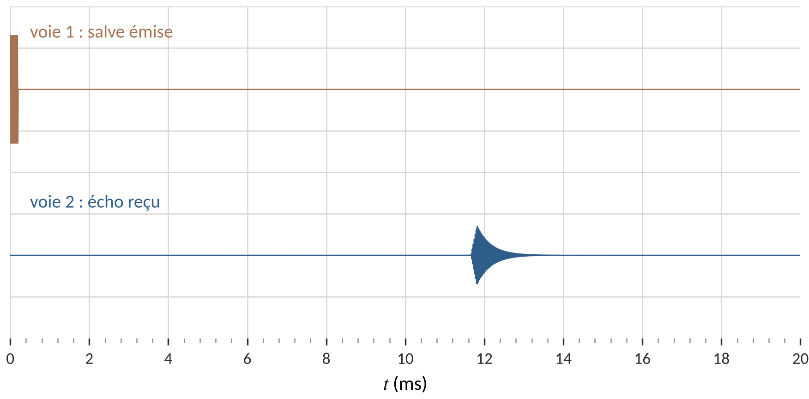
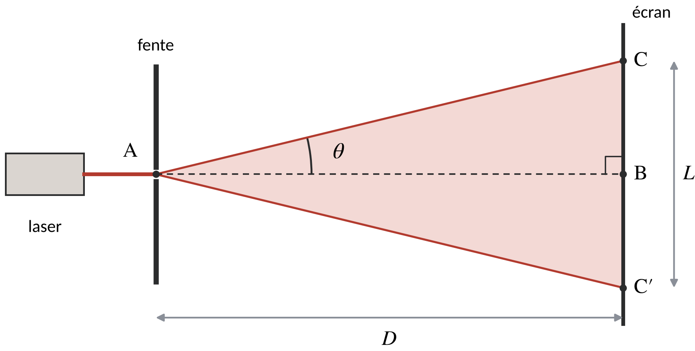
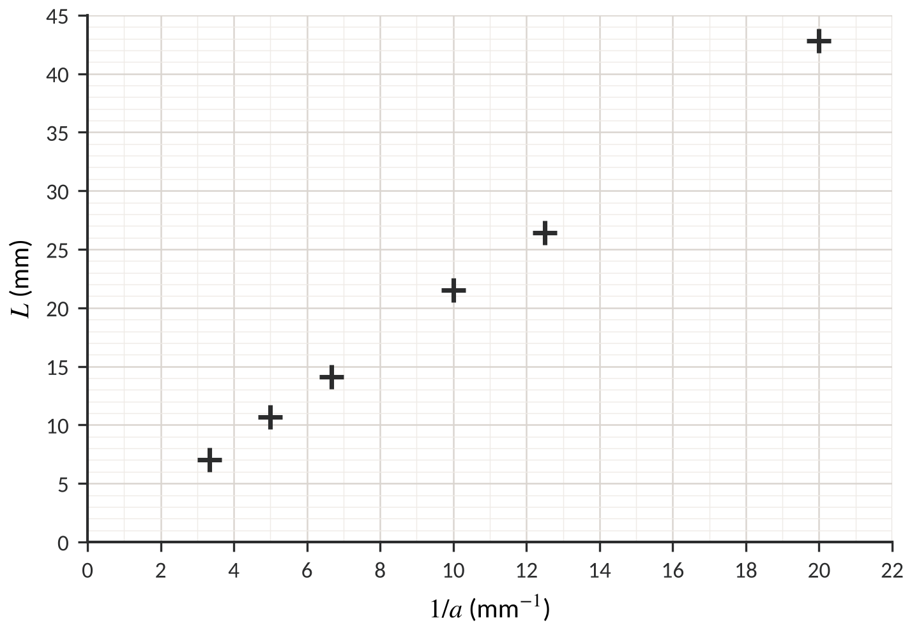
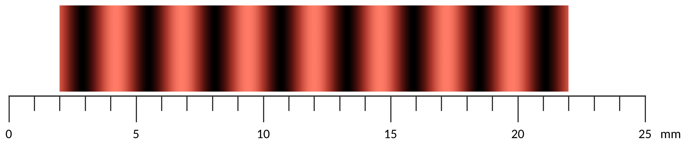
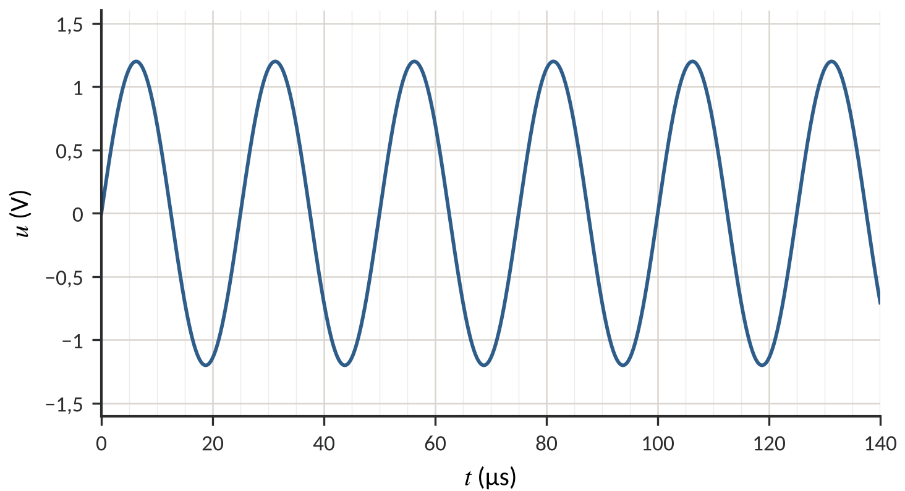
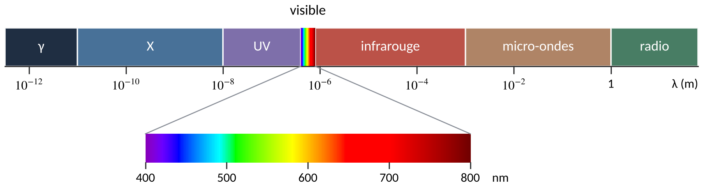
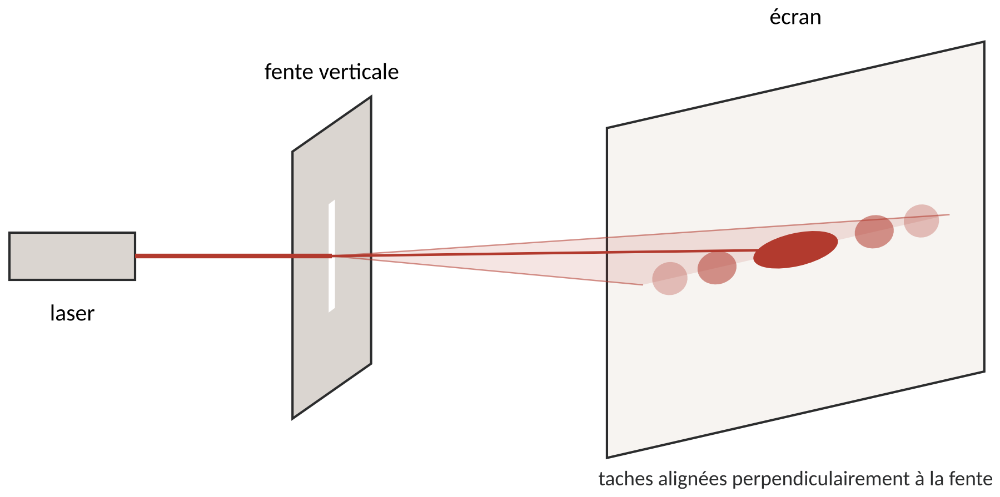
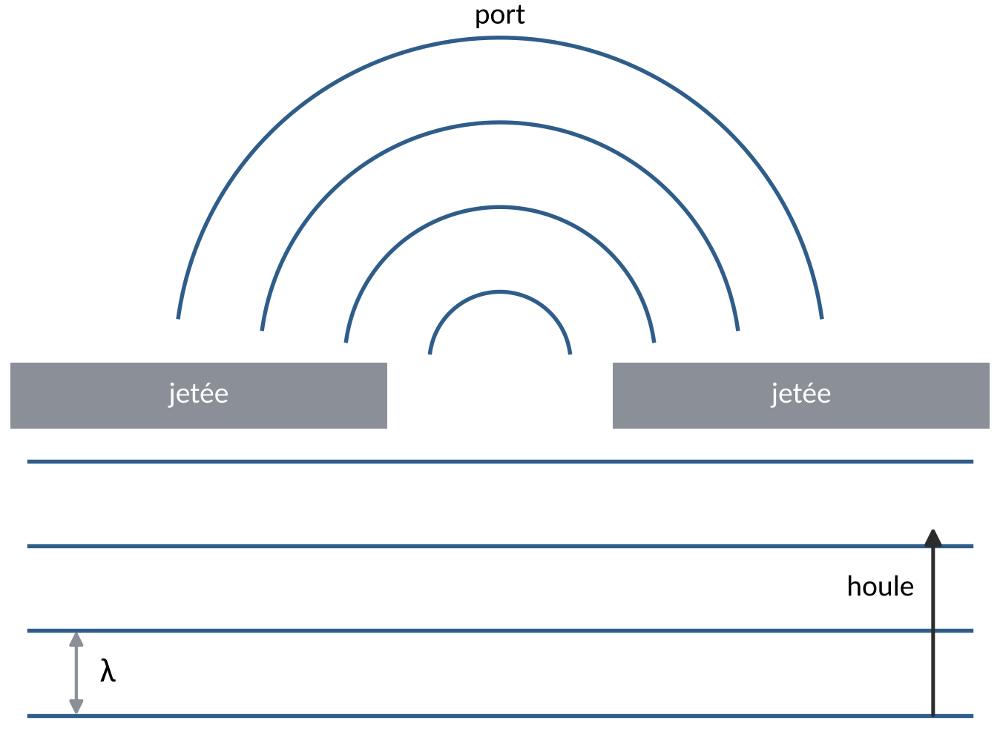
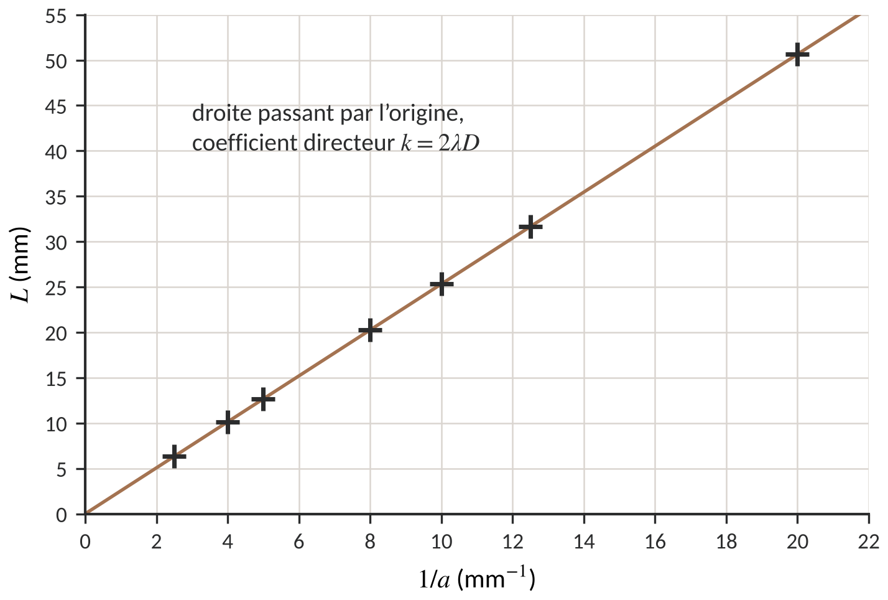
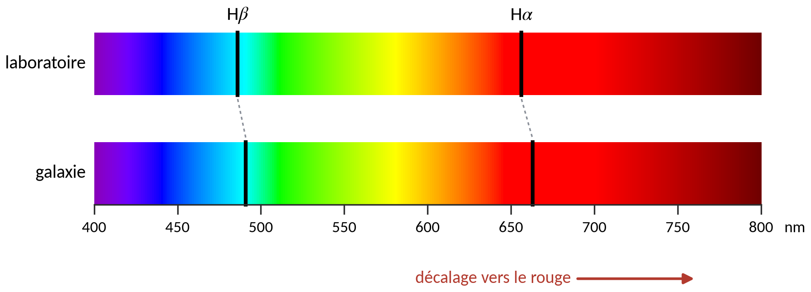

<!--meta {"numero": "6", "matiere": "Physique-Chimie", "titre": "Ondes : propagation, son, diffraction, interférences et effet Doppler", "titre_court": "Ondes et effet Doppler", "fichier": "MasterBac_PC_Fiche6_Ondes", "fichier_cahier": "MasterBac_PC_Fiche6_Cahier_enonces"} -->

<!--inclure:ouverture-->

# L'essentiel en une page {#essentiel}

::: {custom-style="Rubrique"}
À connaître par cœur
:::

<!--colonnes: 18 36 46-->

| Notion | Relation | À retenir |
|---|---|---|
| Onde progressive | $v = d/\Delta t \quad \text{et} \quad \lambda = v \times T = v/f$ | Retard $\tau = d/v$ et $f = 1/T$. |
| Lumière | $c = 3{,}00 \times 10^{8}\ \text{m·s}^{-1} \quad \text{et} \quad v = c/n$ | Elle se propage aussi dans le vide. |
| Son | $I = P/S$ et niveau $L = 10 \log(I/I_0)$ | Les intensités s'additionnent, pas les niveaux. |
| Diffraction | $\theta = \lambda/a$, en radian | Marquée si $a$ est de l'ordre de $\lambda$ ou plus petit. |
| Interférences | $\delta = k\lambda \quad \text{ou} \quad (k + 1/2)\lambda$, $k$ entier | Constructives, puis destructives ; ondes cohérentes. |
| Décalage Doppler | $\Delta f = f_R - f_E$ | Positif à l'approche, négatif à l'éloignement. |

::: {custom-style="Rubrique"}
À savoir retrouver
:::

<!--colonnes: 17 27 56-->

| Notion | Relation | Comment la retrouver |
|---|---|---|
| Écho | $2d = v \times \Delta t$ | L'onde parcourt l'aller et le retour, $2d$, pendant $\Delta t$. |
| Tache centrale | $L = 2\lambda D/a$ | Tache de largeur $L$, ouverture de taille $a$, écran à la distance $D$ : $\tan\theta = L/(2D) \approx \theta$ en radian, et $\theta = \lambda/a$. |
| Interfrange | $i = \lambda D/b$ | Fentes distantes de $b$, écran à la distance $D$ : d'une frange brillante à la suivante, $\delta = bx/D$ augmente de $\lambda$. |
| Effet Doppler | $f_R = f_E \times v_{\text{onde}}/(v_{\text{onde}} - v)$ | Émetteur qui approche à $v$ : $\lambda\text{′} = \lambda - v/f_E$, puis $f_R = v_{\text{onde}}/\lambda\text{′}$. |

::: {custom-style="Rubrique"}
Fourni par l'énoncé, à savoir exploiter
:::

Relations du radar et du décalage vers le rouge, différence de chemin optique, intensité sonore d'une source ponctuelle, atténuation géométrique, $I_0$ et célérités : en général données.

::: {custom-style="Rubrique"}
Les pièges qui coûtent des points
:::

- Oublier le facteur 2 d'un aller-retour, ou celui de la relation du radar.
- Additionner des niveaux en décibels au lieu des intensités.
- Prendre toute la largeur de la tache au lieu de la moitié pour calculer $\theta$, ou garder $\theta$ en degré.

::: {custom-style="Rubrique"}
Votre parcours selon votre objectif
:::

<!--colonnes: 13 49 38-->

| Objectif | Questions de cours | Exercices |
|---|---|---|
| [\ Objectif 10\ ]{custom-style="Niv10"} | Q.1 à Q.4, Q.6 à Q.8, Q.12 à Q.15, Q.19, Q.20, Q.23, Q.25 | Ex. 1 et Ex. 5 (questions 1 à 3), Ex. 2 (questions 1 et 3), Ex. 3 (questions 1 et 2) |
| [\ Objectif 14\ ]{custom-style="Niv14"} | Plus Q.5, Q.9 à Q.11, Q.16, Q.17, Q.21, Q.22, Q.26 à Q.28 | Tous, sauf Ex. 4 (question 7) |
| [\ Objectif 18\ ]{custom-style="Niv18"} | Toutes | Tous |

```{=openxml}
<w:p><w:r><w:br w:type="page"/></w:r></w:p>
```

# Ce qui est tombé aux BAC 2025 et 2026 {#tombe}

Au moins treize exercices des sessions 2025 et 2026 mobilisent cette fiche : le tableau dit où s'y préparer.

<!--colonnes: 22 27 37 14-->

| Session | Exercice | Notions de cette fiche | Pour s'y préparer |
|---|---|---|---|
| Antilles-Guyane 2026, jour 2 | Sécurité incendie | Fréquence d'un son, niveau d'intensité sonore, atténuation par une cloison | Q.3, Q.8, Q.11, Q.12 |
| Asie 2026, jour 1 | Sécurité acoustique | Niveau d'intensité sonore, addition de deux sources, atténuation, protection auditive | Q.8 à Q.11, Ex. 2 |
| Asie 2026, jour 2 | Jeu d'évasion | Interférences lumineuses, interfrange, écart des fentes d'Young | Q.19, Q.22, Q.23 |
| Centres étrangers 2026, jour 1 | Étude d'une harpe électrique au service des abeilles domestiques | Diffraction par un fil, petits angles, largeur de tache et diamètre, incertitude | Q.13, Q.15, Q.16, Ex. 3 |
| Métropole, juin 2025, jour 2 | Mesure de l'épaisseur d'un film alimentaire | Chemin optique, interférences dans une couche mince, spectre | Q.20, Q.24 |
| Métropole, septembre 2025, jour 2 | La couleur des scarabées | Interférences dans des couches minces, couleur perçue, Python | Q.20, Q.24 |
| Amérique du Nord 2025, jour 2 | Mostiglass®, le vitrage moustiquaire rafraîchissant | Condition et angle de diffraction, petits angles, largeur d'une fente, incertitude | Q.13 à Q.16, Ex. 3 |
| Amérique du Nord 2025, jour 2 (sujet de secours) | Écoulement du sang dans une artère | Effet Doppler en échographie, signe du décalage, vitesse d'écoulement | Q.25, Q.27 |
| Asie 2025, jour 2 | Slam dunk au golf | Radar et effet Doppler par réflexion sur la balle, vitesse initiale | Q.25, Q.27 |
| Centres étrangers 2025, jour 1 | Radar pédagogique équipé d'un panneau solaire | Effet Doppler, période et fréquence, célérité du son et température | Q.3, Q.5, Q.25, Q.27, Ex. 5 |
| Centres étrangers 2025, jour 2 | Le trombone de Koenig | Conditions d'interférences, différence de marche, célérité du son, Python | Q.3, Q.19, Q.20, Ex. 4 |
| Nouvelle-Calédonie 2025, jour 2 | Installation d'un panneau routier | Effet Doppler et radar, fréquence reçue à l'approche, vitesse d'un véhicule | Q.25, Q.27 |
| Polynésie 2025, jour 2 | Exploration du ciel profond par le télescope James Webb | Effet Doppler-Fizeau, décalage vers le rouge, vitesse d'une galaxie | Q.6, Q.25, Q.28 |

::: {custom-style="Intertitre"}
Ce qu'il faut en retenir
:::

- L'effet Doppler est le thème le plus demandé : cinq exercices, dont quatre avec une onde renvoyée par une cible mobile (radar, échographie), relation fournie à facteur 2 (Q.25 à Q.27).
- Les interférences suivent, quatre exercices : marche, interfrange, couches minces (Q.19 à Q.24).
- Les deux exercices de diffraction mesurent une petite dimension, un fil ou une fente, avec $\theta = \frac{\lambda}{a}$ et $\theta \approx \frac{L}{2D}$, puis comparent le résultat à une valeur de référence (Q.14 à Q.16, Ex. 3).
- Le son est tombé deux fois en 2026 : niveau sonore, intensités additives, atténuation (Q.8 à Q.11).

::: {custom-style="Surtitre"}
Énoncés
:::

# Thème 1 : propagation des ondes {#theme1}

::: {custom-style="Rubrique"}
Questions de cours
:::

## [Q.1]{custom-style="QNum"}\ \ Définir une onde mécanique progressive et sa célérité. Calculer un retard {#q1}

::: {custom-style="Meta"}
[\ Objectif 10\ ]{custom-style="Niv10"}\ \ Cours · Notions : onde progressive, célérité, retard\ \ \ [CIBLE:c_q1]{custom-style="BoutonCorrige"}
:::

::: {custom-style="Enonce"}
Application : un ébranlement parcourt une corde tendue sur $4{,}0\ \text{m}$ en $0{,}20\ \text{s}$. Calculer sa célérité, puis le retard $\tau$ d'un point de la corde situé à $1{,}5\ \text{m}$ de la source.
:::

## [Q.2]{custom-style="QNum"}\ \ Exprimer la durée d'un aller-retour d'une onde réfléchie, puis en déduire une distance {#q2}

::: {custom-style="Meta"}
[\ Objectif 10\ ]{custom-style="Niv10"}\ \ Cours · Notions : écho, sonar, radar\ \ \ [CIBLE:c_q2]{custom-style="BoutonCorrige"}
:::

::: {custom-style="Enonce"}
Application : le sondeur d'un bateau émet une salve d'ultrasons vers le fond. L'écho revient $0{,}24\ \text{s}$ après l'émission. La célérité des ultrasons dans l'eau de mer vaut $1{,}50 \times 10^{3}\ \text{m·s}^{-1}$. Calculer la profondeur.
:::

## [Q.3]{custom-style="QNum"}\ \ Relier la période, la fréquence, la longueur d'onde et la célérité d'une onde périodique {#q3}

::: {custom-style="Meta"}
[\ Objectif 10\ ]{custom-style="Niv10"}\ \ Cours · Notions : période, fréquence, longueur d'onde\ \ \ [CIBLE:c_q3]{custom-style="BoutonCorrige"}
:::

::: {custom-style="Enonce"}
Application : un émetteur produit des ultrasons de fréquence $f = 40{,}0\ \text{kHz}$ dans l'air, où leur célérité vaut $343\ \text{m·s}^{-1}$. Calculer leur période et leur longueur d'onde.
:::

## [Q.4]{custom-style="QNum"}\ \ Distinguer onde mécanique et onde électromagnétique. Donner la célérité de la lumière {#q4}

::: {custom-style="Meta"}
[\ Objectif 10\ ]{custom-style="Niv10"}\ \ Cours · Notions : milieu de propagation, indice\ \ \ [CIBLE:c_q4]{custom-style="BoutonCorrige"}
:::

::: {custom-style="Enonce"}
Application : calculer la célérité de la lumière dans un verre d'indice $n = 1{,}50$, puis dans l'eau d'indice $n = 1{,}33$.
:::

## [Q.5]{custom-style="QNum"}\ \ Donner la célérité du son dans l'air et exploiter sa variation avec la température {#q5}

::: {custom-style="Meta"}
[\ Objectif 14\ ]{custom-style="Niv14"}\ \ Cours · Notions : célérité du son, température absolue\ \ \ [CIBLE:c_q5]{custom-style="BoutonCorrige"}
:::

::: {custom-style="Enonce"}
Application : la célérité du son dans l'air vaut $331\ \text{m·s}^{-1}$ à $0\ \text{°C}$. À $11\ \text{km}$ d'altitude, elle n'est plus que de $295\ \text{m·s}^{-1}$. On admet qu'elle est proportionnelle à la racine carrée de la température absolue $T$, exprimée en kelvin, avec $T = \theta + 273{,}15$. Calculer la température de l'air à cette altitude.
:::

## [Q.6]{custom-style="QNum"}\ \ Situer les domaines du spectre électromagnétique par leurs longueurs d'onde {#q6}

::: {custom-style="Meta"}
[\ Objectif 10\ ]{custom-style="Niv10"}\ \ Cours · Notions : visible, infrarouge, micro-ondes, rayons X\ \ \ [CIBLE:c_q6]{custom-style="BoutonCorrige"}
:::

::: {custom-style="Enonce"}
Application : un four à micro-ondes fonctionne à la fréquence de $2{,}45\ \text{GHz}$. Calculer la longueur d'onde du rayonnement et le situer dans le spectre.
:::

::: {custom-style="Rubrique"}
Exercices
:::

## [Exercice 1]{custom-style="QNum"}\ \ Le télémètre à ultrasons {#ex1}

::: {custom-style="Meta"}
[\ Objectif 10\ ]{custom-style="Niv10"}\ \ Entraînement · 5 points · 40 min · Questions 4 à 6 : objectif 14
:::

::: {custom-style="Enonce"}
Un robot mesure sa distance à un mur avec un module à ultrasons. L'émetteur envoie une salve de huit périodes d'ultrasons de fréquence $f = 40{,}0\ \text{kHz}$. Le récepteur, placé à côté de lui, capte l'écho renvoyé par le mur. Un oscilloscope enregistre les deux signaux (figure 1). Le programme du module calcule la distance avec une célérité fixée à $340\ \text{m·s}^{-1}$. Dans la salle, à $20\ \text{°C}$, la célérité des ultrasons vaut $343\ \text{m·s}^{-1}$.
:::

::: {custom-style="Figure"}
{width=12cm}
:::

::: {custom-style="Legende"}
Figure 1. Salve émise (voie 1) et écho reçu (voie 2), 2 ms par division
:::

::: {custom-style="Enonce"}

**1.** Les ultrasons sont-ils une onde mécanique ou une onde électromagnétique ? Sont-ils audibles par l'oreille humaine ? Justifier.

**2.** Calculer la période et la longueur d'onde des ultrasons dans la salle.

**3.** Lire sur la figure 1 la durée $\Delta t$ entre le début de l'émission et le début de l'écho. En déduire la distance $d$ du mur, avec la célérité de la salle.

**4.** Le robot travaille aussi dans une chambre froide à $-10\ \text{°C}$. La célérité du son est proportionnelle à la racine carrée de la température absolue et vaut $331\ \text{m·s}^{-1}$ à $0\ \text{°C}$ ($273{,}15\ \text{K}$). Calculer la célérité des ultrasons dans la chambre froide.

**5.** Dans la chambre froide, le robot est à $2{,}00\ \text{m}$ d'un mur. Calculer la durée de l'aller-retour, puis la distance affichée par le module. Conclure.

**6.** L'écho n'est détecté que s'il arrive après la fin de la salve émise. Calculer la plus petite distance que le module peut mesurer dans la salle.
:::

::: {custom-style="Renvoi"}
[CIBLE:c_ex1]{custom-style="BoutonCorrige"}
:::

::: {custom-style="Surtitre"}
Énoncés
:::

# Thème 2 : le son et le niveau d'intensité sonore {#theme2}

::: {custom-style="Rubrique"}
Questions de cours
:::

## [Q.7]{custom-style="QNum"}\ \ Exprimer l'intensité sonore à la distance d d'une source de puissance P {#q7}

::: {custom-style="Meta"}
[\ Objectif 10\ ]{custom-style="Niv10"}\ \ Cours · Notions : intensité sonore, puissance\ \ \ [CIBLE:c_q7]{custom-style="BoutonCorrige"}
:::

::: {custom-style="Enonce"}
Application : une enceinte, assimilée à une source ponctuelle qui émet de la même façon dans toutes les directions, a une puissance sonore $P = 0{,}50\ \text{W}$. Calculer l'intensité sonore à $4{,}0\ \text{m}$.
:::

## [Q.8]{custom-style="QNum"}\ \ Calculer un niveau d'intensité sonore à partir d'une intensité sonore, et inversement {#q8}

::: {custom-style="Meta"}
[\ Objectif 10\ ]{custom-style="Niv10"}\ \ Cours · Notions : niveau d'intensité sonore · Demandée en 2026\ \ \ [CIBLE:c_q8]{custom-style="BoutonCorrige"}
:::

::: {custom-style="Enonce"}
Application : calculer le niveau d'intensité sonore d'un son d'intensité $I = 2{,}0 \times 10^{-5}\ \text{W·m}^{-2}$, puis l'intensité sonore d'un son de niveau $L = 95\ \text{dB}$. Donnée : $I_0 = 1{,}0 \times 10^{-12}\ \text{W·m}^{-2}$.
:::

## [Q.9]{custom-style="QNum"}\ \ Déterminer le niveau d'intensité sonore produit par plusieurs sources {#q9}

::: {custom-style="Meta"}
[\ Objectif 14\ ]{custom-style="Niv14"}\ \ Cours · Notions : addition des intensités · Demandée en 2026 (Asie)\ \ \ [CIBLE:c_q9]{custom-style="BoutonCorrige"}
:::

::: {custom-style="Enonce"}
Application : deux machines produisent chacune un niveau de $80\ \text{dB}$ au poste d'un ouvrier. Calculer le niveau quand elles fonctionnent ensemble. Même question pour deux machines de $80\ \text{dB}$ et $70\ \text{dB}$.
:::

## [Q.10]{custom-style="QNum"}\ \ Exprimer l'atténuation géométrique du niveau d'intensité sonore entre deux distances {#q10}

::: {custom-style="Meta"}
[\ Objectif 14\ ]{custom-style="Niv14"}\ \ Cours · Notions : atténuation géométrique · Demandée en 2026 (Asie)\ \ \ [CIBLE:c_q10]{custom-style="BoutonCorrige"}
:::

::: {custom-style="Enonce"}
Application : un marteau-piqueur produit un niveau de $96\ \text{dB}$ à $2{,}0\ \text{m}$. Calculer le niveau à $10\ \text{m}$, en ne tenant compte que de l'atténuation géométrique.
:::

## [Q.11]{custom-style="QNum"}\ \ Définir l'atténuation par absorption et l'exploiter {#q11}

::: {custom-style="Meta"}
[\ Objectif 14\ ]{custom-style="Niv14"}\ \ Cours · Notions : atténuation par absorption · Demandée en 2026\ \ \ [CIBLE:c_q11]{custom-style="BoutonCorrige"}
:::

::: {custom-style="Enonce"}
Application : un double vitrage réduit le bruit d'une rue de $74\ \text{dB}$ à $42\ \text{dB}$. Calculer son atténuation. Un casque antibruit atténue de $28\ \text{dB}$ : quel niveau perçoit un ouvrier exposé à $98\ \text{dB}$ ?
:::

## [Q.12]{custom-style="QNum"}\ \ Citer des ordres de grandeur sur le son : domaine audible, hauteur, niveaux {#q12}

::: {custom-style="Meta"}
[\ Objectif 10\ ]{custom-style="Niv10"}\ \ Cours · Notions : hauteur, domaine audible, échelle des niveaux\ \ \ [CIBLE:c_q12]{custom-style="BoutonCorrige"}
:::

::: {custom-style="Enonce"}
Application : un son a une période de $2{,}5\ \text{ms}$. Calculer sa fréquence. Est-il audible ? Est-il plus aigu ou plus grave qu'un son de $250\ \text{Hz}$ ?
:::

::: {custom-style="Rubrique"}
Exercices
:::

### [Exercice 2]{custom-style="QNum"}\ \ Protéger son audition à l'atelier [(voir BAC Asie 2026)]{custom-style="VoirBac"} {#ex2}

::: {custom-style="Meta"}
[\ Objectif 10\ ]{custom-style="Niv10"}\ \ [Type BAC]{custom-style="TagBac"} · 5 points · 45 min · Questions 2 et 4 à 6 : objectif 14
:::

::: {custom-style="MentionBac"}
[Sujet du BAC correspondant.]{custom-style="EtiqBac"} Asie 2026, jour 1, exercice 3 : « Sécurité acoustique » (niveau d'intensité sonore, addition de deux sources, atténuation géométrique, choix d'une protection auditive).
:::

::: {custom-style="Enonce"}
Dans un atelier de mécanique, un ouvrier travaille sur un tour. La réglementation impose une protection auditive individuelle dès $85\ \text{dB}$. Avec la protection, le niveau perçu doit rester entre $65\ \text{dB}$ et $80\ \text{dB}$ : plus bas, l'ouvrier risque de ne plus entendre les alarmes. Au poste de l'ouvrier, le tour produit seul une intensité sonore $I_1 = 5{,}0 \times 10^{-4}\ \text{W·m}^{-2}$ et la perceuse d'un collègue produit seule un niveau $L_2 = 82\ \text{dB}$. Une presse, placée à $25\ \text{m}$ du poste, produit $104\ \text{dB}$ à $5{,}0\ \text{m}$. Le bruit de l'atelier est surtout concentré autour de $2\ \text{kHz}$.
:::

::: {custom-style="EnonceDonnees"}
Données : $L = 10 \log\left(\dfrac{I}{I_0}\right)$ avec $I_0 = 1{,}0 \times 10^{-12}\ \text{W·m}^{-2}$ ; pour une source ponctuelle, entre les distances $d$ et $d\text{′}$ : $L\text{′} = L - 20 \log\left(\dfrac{d\text{′}}{d}\right)$.
:::

::: {custom-style="Figure"}
{width=9.5cm}
:::

::: {custom-style="Legende"}
Figure 2. Atténuation de deux protections auditives selon la fréquence
:::

::: {custom-style="Enonce"}

**1.** Calculer le niveau d'intensité sonore $L_1$ produit par le tour seul. Une protection est-elle obligatoire ?

**2.** Montrer que le tour et la perceuse, ensemble, produisent un niveau voisin de $88\ \text{dB}$ au poste.

**3.** Nommer le type d'atténuation qui fait baisser le niveau dû à la presse quand on s'en éloigne.

**4.** Calculer le niveau dû à la presse au poste de l'ouvrier.

**5.** À quelle distance minimale de la presse faudrait-il travailler pour que son niveau seul passe sous $85\ \text{dB}$ ? L'atelier mesure $30\ \text{m}$ de long : commenter.

**6.** Calculer le niveau total au poste, puis choisir à l'aide de la figure 2 la protection adaptée. Justifier.
:::

::: {custom-style="Renvoi"}
[CIBLE:c_ex2]{custom-style="BoutonCorrige"}
:::

::: {custom-style="Surtitre"}
Énoncés
:::

# Thème 3 : la diffraction {#theme3}

::: {custom-style="Rubrique"}
Questions de cours
:::

## [Q.13]{custom-style="QNum"}\ \ Décrire le phénomène de diffraction et donner sa condition d'observation {#q13}

::: {custom-style="Meta"}
[\ Objectif 10\ ]{custom-style="Niv10"}\ \ Cours · Notions : diffraction, ordre de grandeur · Demandée en 2025 et 2026\ \ \ [CIBLE:c_q13]{custom-style="BoutonCorrige"}
:::

::: {custom-style="Enonce"}
On éclaire une fente fine verticale avec un laser. Décrire ce que l'on observe sur un écran éloigné. Que révèle cette expérience sur la nature de la lumière ? Application : une houle de longueur d'onde $30\ \text{m}$ arrive sur l'entrée d'un port, large de $25\ \text{m}$. La diffraction sera-t-elle marquée ?
:::

## [Q.14]{custom-style="QNum"}\ \ Exprimer l'angle caractéristique de diffraction en fonction de la longueur d'onde et de la taille de l'ouverture {#q14}

::: {custom-style="Meta"}
[\ Objectif 10\ ]{custom-style="Niv10"}\ \ Cours · Notions : angle de diffraction, radian\ \ \ [CIBLE:c_q14]{custom-style="BoutonCorrige"}
:::

::: {custom-style="Enonce"}
Application : un laser de longueur d'onde $\lambda = 633\ \text{nm}$ éclaire une fente de largeur $a = 0{,}10\ \text{mm}$. Calculer l'angle caractéristique de diffraction, en radian puis en degré. Comment varie-t-il si la largeur de la fente est divisée par deux ?
:::

## [Q.15]{custom-style="QNum"}\ \ Relier l'angle θ à la largeur L de la tache centrale et à la distance D de l'écran {#q15}

::: {custom-style="Meta"}
[\ Objectif 10\ ]{custom-style="Niv10"}\ \ Cours · Notions : petits angles, tangente · Demandée en 2025 et 2026\ \ \ [CIBLE:c_q15]{custom-style="BoutonCorrige"}
:::

::: {custom-style="Enonce"}
La figure 3 représente, en vue de dessus, le faisceau diffracté par la fente et la tache centrale de largeur $L$ sur l'écran. Application : on mesure $L = 2{,}6\ \text{cm}$ sur un écran placé à $D = 2{,}0\ \text{m}$. Calculer $\theta$. Comment évolue $L$ si l'on éloigne l'écran ?
:::

::: {custom-style="Figure"}
{width=11cm}
:::

::: {custom-style="Legende"}
Figure 3. Tache centrale de diffraction, vue de dessus (échelle non respectée)
:::

## [Q.16]{custom-style="QNum"}\ \ Établir l'expression de la largeur de la tache centrale et exploiter le graphique de L en fonction de 1/a {#q16}

::: {custom-style="Meta"}
[\ Objectif 14\ ]{custom-style="Niv14"}\ \ Cours · Notions : modélisation linéaire · Demandée en 2025 et 2026\ \ \ [CIBLE:c_q16]{custom-style="BoutonCorrige"}
:::

::: {custom-style="Enonce"}
Application : avec $\lambda = 633\ \text{nm}$ et $D = 2{,}00\ \text{m}$, calculer la largeur de la tache centrale pour une fente de largeur $a = 0{,}10\ \text{mm}$. Avec la même fente, laquelle donne la tache la plus large : une lumière bleue ou une lumière rouge ?
:::

## [Q.17]{custom-style="QNum"}\ \ Mesurer la largeur de la tache centrale sur une image ou sur une courbe d'intensité lumineuse {#q17}

::: {custom-style="Meta"}
[\ Objectif 14\ ]{custom-style="Niv14"}\ \ Cours · Notions : lecture d'une échelle · Voir BAC 2022 (Métropole)\ \ \ [CIBLE:c_q17]{custom-style="BoutonCorrige"}
:::

::: {custom-style="Enonce"}
La figure 4 montre une figure de diffraction photographiée avec une règle graduée en millimètres, puis l'intensité lumineuse mesurée le long de l'écran. Déterminer la largeur $L$ de la tache centrale par les deux méthodes. Application : le laser a une longueur d'onde $\lambda = 650\ \text{nm}$ et l'écran est à $D = 2{,}00\ \text{m}$ de la fente. Calculer la largeur $a$ de la fente.
:::

::: {custom-style="Figure"}
{width=12cm}
:::

::: {custom-style="Legende"}
Figure 4. Figure de diffraction et intensité lumineuse le long de l'écran
:::

## [Q.18]{custom-style="QNum"}\ \ Ouverture circulaire : diamètre de la tache centrale et conséquences de la diffraction {#q18}

::: {custom-style="Meta"}
[\ Objectif 18\ ]{custom-style="Niv18"}\ \ Cours · Notions : ouverture circulaire, pouvoir de résolution\ \ \ [CIBLE:c_q18]{custom-style="BoutonCorrige"}
:::

::: {custom-style="Enonce"}
Pour une ouverture circulaire de diamètre $a$, l'énoncé donne $\theta = 1{,}22 \times \dfrac{\lambda}{a}$. Application : un laser de longueur d'onde $633\ \text{nm}$ éclaire un trou de diamètre $a = 0{,}20\ \text{mm}$. Calculer le diamètre de la tache centrale sur un écran placé à $2{,}0\ \text{m}$.
:::

::: {custom-style="Rubrique"}
Exercices
:::

### [Exercice 3]{custom-style="QNum"}\ \ Le fil de la harpe électrique [(voir BAC Centres étrangers 2026)]{custom-style="VoirBac"} {#ex3}

::: {custom-style="Meta"}
[\ Objectif 10\ ]{custom-style="Niv10"}\ \ [Type BAC]{custom-style="TagBac"} · 5 points · 45 min · Questions 3 à 7 : objectif 14
:::

::: {custom-style="MentionBac"}
[Sujet du BAC correspondant.]{custom-style="EtiqBac"} Centres étrangers 2026, jour 1, exercice 1 : « Étude d'une harpe électrique au service des abeilles domestiques » (partie 1 : diffraction par un fil, petits angles, modélisation, incertitude).
:::

::: {custom-style="Enonce"}
Pour protéger une ruche des frelons asiatiques, un apiculteur installe une harpe électrique : des fils d'acier verticaux, sous tension, laissent passer les abeilles mais électrocutent les frelons. Pour rester invisibles aux frelons, les fils doivent avoir un diamètre inférieur à $0{,}5\ \text{mm}$ ; la bobine achetée indique $0{,}45\ \text{mm}$. On place un fil de diamètre $a$ dans le faisceau d'un laser de longueur d'onde $\lambda = 532\ \text{nm}$ et on mesure la largeur $L$ de la tache centrale sur un écran situé à $D = 2{,}00\ \text{m}$, après un étalonnage avec des fils de diamètres connus.
:::

| *a* (µm) | 50 | 80 | 100 | 150 | 200 | 300 |
|---|---|---|---|---|---|---|
| *L* (mm) | 42,8 | 26,4 | 21,5 | 14,1 | 10,7 | 7,0 |

::: {custom-style="EnonceDonnees"}
Données : $\theta = \dfrac{\lambda}{a}$, avec $\theta$ le demi-angle de la tache centrale, en radian ; $\tan\theta \approx \theta$ pour les petits angles ; $\dfrac{u(a)}{a} = \sqrt{\left(\dfrac{u(k)}{k}\right)^{2} + \left(\dfrac{u(L)}{L}\right)^{2}}$ ; une mesure est compatible avec une valeur de référence si $\dfrac{|a - a_{\text{réf}}|}{u(a)} \leq 2$.
:::

::: {custom-style="Figure"}
{width=7cm}
:::

::: {custom-style="Legende"}
Figure 5. Étalonnage : largeur de la tache centrale en fonction de 1/a
:::

::: {custom-style="Enonce"}

**1.** Nommer le phénomène observé sur l'écran.

**2.** Exprimer $\theta$ en fonction de $L$ et de $D$.

**3.** Montrer que $L = \dfrac{k}{a}$ et exprimer $k$ en fonction de $\lambda$ et $D$.

**4.** Justifier que la figure 5 est en accord avec ce modèle.

**5.** Déterminer $k$ à l'aide de la figure et le comparer à la valeur attendue.

**6.** Un tableur donne $k = 2{,}13 \times 10^{-6}\ \text{m}^{2}$, avec $u(k) = 0{,}03 \times 10^{-6}\ \text{m}^{2}$. Avec le fil de la bobine, on mesure $L = 4{,}6\ \text{mm}$, avec $u(L) = 0{,}3\ \text{mm}$. Calculer son diamètre $a$.

**7.** Calculer $u(a)$, puis conclure : l'indication de la bobine est-elle correcte, et le fil convient-il ?
:::

::: {custom-style="Renvoi"}
[CIBLE:c_ex3]{custom-style="BoutonCorrige"}
:::

::: {custom-style="Surtitre"}
Énoncés
:::

# Thème 4 : les interférences {#theme4}

::: {custom-style="Rubrique"}
Questions de cours
:::

## [Q.19]{custom-style="QNum"}\ \ Donner les conditions d'observation des interférences et expliquer l'origine des franges brillantes et sombres {#q19}

::: {custom-style="Meta"}
[\ Objectif 10\ ]{custom-style="Niv10"}\ \ Cours · Notions : sources cohérentes · Demandée en 2025 et 2026\ \ \ [CIBLE:c_q19]{custom-style="BoutonCorrige"}
:::

## [Q.20]{custom-style="QNum"}\ \ Relier interférences constructives ou destructives et différence de chemin optique {#q20}

::: {custom-style="Meta"}
[\ Objectif 10\ ]{custom-style="Niv10"}\ \ Cours · Notions : différence de chemin optique · Trois sujets en 2025\ \ \ [CIBLE:c_q20]{custom-style="BoutonCorrige"}
:::

::: {custom-style="Enonce"}
Application : deux ondes lumineuses de longueur d'onde $\lambda = 600\ \text{nm}$, issues de deux sources en phase, arrivent en un point avec une différence de chemin optique $\delta$. Préciser la nature des interférences pour $\delta = 1{,}8\ \text{µm}$, $\delta = 1{,}5\ \text{µm}$ et $\delta = 2{,}0\ \text{µm}$.
:::

## [Q.21]{custom-style="QNum"}\ \ Fentes d'Young : exprimer la différence de chemin optique en un point d'abscisse x {#q21}

::: {custom-style="Meta"}
[\ Objectif 14\ ]{custom-style="Niv14"}\ \ Cours · Notions : fentes d'Young, petits angles · Voir BAC 2023\ \ \ [CIBLE:c_q21]{custom-style="BoutonCorrige"}
:::

::: {custom-style="Enonce"}
Deux fentes $\text{F}_1$ et $\text{F}_2$, distantes de $b$, sont éclairées par le même laser. Un point M de l'écran, placé à la distance $D$ des fentes, a pour abscisse $x$ (figure 6). H est le pied de la perpendiculaire menée de $\text{F}_1$ sur la droite $(\text{F}_2\text{M})$. L'écran étant très éloigné, les rayons $\text{F}_1\text{M}$ et $\text{F}_2\text{M}$ sont presque parallèles et la différence de chemin optique vaut $\delta = \text{F}_2\text{H}$.
:::

::: {custom-style="Figure"}
{width=12cm}
:::

::: {custom-style="Legende"}
Figure 6. Fentes d'Young et différence de chemin optique (échelle non respectée)
:::

## [Q.22]{custom-style="QNum"}\ \ Prévoir la position des franges brillantes et établir l'expression de l'interfrange {#q22}

::: {custom-style="Meta"}
[\ Objectif 14\ ]{custom-style="Niv14"}\ \ Cours · Notions : franges brillantes, interfrange · Demandée en 2026\ \ \ [CIBLE:c_q22]{custom-style="BoutonCorrige"}
:::

::: {custom-style="Enonce"}
Application : des fentes distantes de $b = 0{,}40\ \text{mm}$ sont éclairées par un laser de longueur d'onde $532\ \text{nm}$. Calculer l'interfrange sur un écran placé à $D = 1{,}50\ \text{m}$.
:::

## [Q.23]{custom-style="QNum"}\ \ Mesurer un interfrange sur une figure d'interférences et l'exploiter {#q23}

::: {custom-style="Meta"}
[\ Objectif 10\ ]{custom-style="Niv10"}\ \ Cours · Notions : mesure sur plusieurs interfranges · Demandée en 2026\ \ \ [CIBLE:c_q23]{custom-style="BoutonCorrige"}
:::

::: {custom-style="Enonce"}
La figure 7 montre les franges obtenues avec des fentes distantes de $b = 0{,}50\ \text{mm}$ et un écran placé à $D = 2{,}00\ \text{m}$. Mesurer l'interfrange le plus précisément possible, puis calculer la longueur d'onde du laser. Quel écart $b$ faudrait-il pour obtenir un interfrange de $4{,}0\ \text{mm}$ avec le même laser et le même écran ?
:::

::: {custom-style="Figure"}
{width=12cm}
:::

::: {custom-style="Legende"}
Figure 7. Franges d'interférences et règle graduée en millimètres
:::

## [Q.24]{custom-style="QNum"}\ \ Expliquer les couleurs d'une couche mince éclairée en lumière blanche {#q24}

::: {custom-style="Meta"}
[\ Objectif 18\ ]{custom-style="Niv18"}\ \ Cours · Notions : couches minces · Demandée deux fois en 2025\ \ \ [CIBLE:c_q24]{custom-style="BoutonCorrige"}
:::

::: {custom-style="Enonce"}
Une couche transparente d'épaisseur $e$ et d'indice $n$ est éclairée en lumière blanche, perpendiculairement à sa surface. Les rayons réfléchis par ses deux faces interfèrent. L'énoncé donne leur différence de chemin optique : $\delta = 2 \times n \times e + \dfrac{\lambda}{2}$. Application : avec $e = 300\ \text{nm}$ et $n = 1{,}33$, quelles longueurs d'onde du visible sont renforcées ? Quelle couleur domine ?
:::

::: {custom-style="Rubrique"}
Exercices
:::

### [Exercice 4]{custom-style="QNum"}\ \ Le trombone de Koenig [(voir BAC Centres étrangers 2025)]{custom-style="VoirBac"} {#ex4}

::: {custom-style="Meta"}
[\ Objectif 14\ ]{custom-style="Niv14"}\ \ [Type BAC]{custom-style="TagBac"} · 5 points · 45 min · Question 7 : objectif 18
:::

::: {custom-style="MentionBac"}
[Sujet du BAC correspondant.]{custom-style="EtiqBac"} Centres étrangers 2025, jour 2, exercice 2 : « Le trombone de Koenig » (conditions d'interférences, différence de marche, interférences constructives, célérité du son, Python).
:::

::: {custom-style="Enonce"}
Le trombone de Koenig sert à mesurer la célérité du son. Un haut-parleur, alimenté par un générateur de fréquence $f = 2\ 500\ \text{Hz}$, émet un son qui se partage entre deux tubes en U, l'un fixe, l'autre coulissant. Les deux ondes se rejoignent devant un microphone relié à un oscilloscope (figure 8). Quand on tire le tube mobile d'une longueur $D$, le chemin dans ce tube s'allonge de $2D$. Pour $D = 0$, les deux chemins ont la même longueur. Pour $D = 0$, avec les mêmes réglages, le signal du microphone a une amplitude comparable à celle de la voie 1. En tirant le tube, on observe que le signal du microphone redevient maximal pour la quatrième fois quand $D = 27{,}5\ \text{cm}$.
:::

::: {custom-style="Figure"}
{width=15cm}
:::

::: {custom-style="Legende"}
Figure 8. Trombone de Koenig et oscillogramme enregistré pour D = 3,4 cm
:::

::: {custom-style="Enonce"}

**1.** Justifier que les deux ondes qui arrivent au microphone peuvent interférer.

**2.** Les interférences sont-elles constructives ou destructives pour $D = 0$ ? Et pour l'oscillogramme de la figure 8 ? Justifier.

**3.** Exprimer la différence de marche $\delta$ entre les deux ondes en fonction de $D$.

**4.** Rappeler la condition d'interférences constructives. Montrer que les positions du tube qui donnent un maximum vérifient $D_k = \dfrac{k}{2} \times \dfrac{v}{f}$, avec $v$ la célérité du son.

**5.** En déduire $v$. Pourquoi vaut-il mieux repérer le quatrième maximum que le premier ?

**6.** Dans un programme Python, les variables f et D4 contiennent la fréquence, en hertz, et la position du quatrième maximum, en mètre. Écrire les deux lignes qui calculent la célérité v, puis la longueur d'onde lam.

**7.** Aux positions des minima, le signal du microphone n'est jamais tout à fait nul. Proposer une explication.
:::

::: {custom-style="Renvoi"}
[CIBLE:c_ex4]{custom-style="BoutonCorrige"}
:::

::: {custom-style="Surtitre"}
Énoncés
:::

# Thème 5 : l'effet Doppler {#theme5}

::: {custom-style="Rubrique"}
Questions de cours
:::

## [Q.25]{custom-style="QNum"}\ \ Décrire l'effet Doppler et définir le décalage Doppler {#q25}

::: {custom-style="Meta"}
[\ Objectif 10\ ]{custom-style="Niv10"}\ \ Cours · Notions : effet Doppler, décalage · Cinq sujets en 2025\ \ \ [CIBLE:c_q25]{custom-style="BoutonCorrige"}
:::

::: {custom-style="Enonce"}
Application : une ambulance passe devant un piéton immobile, sirène allumée. Décrire ce que perçoit le piéton. Quel est le signe du décalage Doppler pendant que l'ambulance approche ?
:::

## [Q.26]{custom-style="QNum"}\ \ Établir la fréquence perçue par un récepteur fixe quand l'émetteur s'approche ou s'éloigne {#q26}

::: {custom-style="Meta"}
[\ Objectif 14\ ]{custom-style="Niv14"}\ \ Cours · Notions : émetteur mobile · Voir BAC 2011 (Antilles)\ \ \ [CIBLE:c_q26]{custom-style="BoutonCorrige"}
:::

::: {custom-style="Enonce"}
Application : la sirène émet un son de fréquence $f_E = 900\ \text{Hz}$ et l'ambulance roule à $25\ \text{m·s}^{-1}$. La célérité du son vaut $340\ \text{m·s}^{-1}$. Calculer la fréquence perçue par le piéton pendant que l'ambulance approche, puis pendant qu'elle s'éloigne.
:::

## [Q.27]{custom-style="QNum"}\ \ Exploiter le décalage Doppler d'une onde renvoyée par une cible mobile pour mesurer sa vitesse {#q27}

::: {custom-style="Meta"}
[\ Objectif 14\ ]{custom-style="Niv14"}\ \ Cours · Notions : radar, échographie Doppler · Quatre sujets en 2025\ \ \ [CIBLE:c_q27]{custom-style="BoutonCorrige"}
:::

::: {custom-style="Enonce"}
Un radar fixe émet une onde de fréquence $f_E$ vers un véhicule qui s'approche à la vitesse $v$ et la reçoit après réflexion. L'énoncé donne la relation $|\Delta f| = \dfrac{2 \times f_E \times v}{c}$. Application : un radar routier émet à $24{,}0\ \text{GHz}$ et mesure un décalage de $2{,}40\ \text{kHz}$. Calculer la vitesse du véhicule en $\text{km·h}^{-1}$, avec $c = 3{,}00 \times 10^{8}\ \text{m·s}^{-1}$.
:::

## [Q.28]{custom-style="QNum"}\ \ Exploiter l'effet Doppler-Fizeau en astronomie : décalage vers le rouge et vitesse radiale {#q28}

::: {custom-style="Meta"}
[\ Objectif 14\ ]{custom-style="Niv14"}\ \ Cours · Notions : décalage vers le rouge · Demandée en 2025 (Polynésie)\ \ \ [CIBLE:c_q28]{custom-style="BoutonCorrige"}
:::

::: {custom-style="Enonce"}
Application : au laboratoire, la raie H$\alpha$ de l'hydrogène a pour longueur d'onde $\lambda_0 = 656{,}3\ \text{nm}$. Dans le spectre d'une galaxie, on la mesure à $\lambda = 662{,}9\ \text{nm}$. L'énoncé donne $\dfrac{\lambda - \lambda_0}{\lambda_0} = \dfrac{v}{c}$. La galaxie s'approche-t-elle ou s'éloigne-t-elle ? Calculer sa vitesse, puis sa distance avec la loi de Hubble-Lemaître $v = H_0 \times d$, où $H_0 = 70\ \text{km·s}^{-1}\text{·Mpc}^{-1}$. Le mégaparsec (Mpc) est une unité de longueur utilisée en astronomie : $1\ \text{Mpc} \approx 3{,}09 \times 10^{22}\ \text{m}$, soit environ 3,26 millions d'années-lumière.
:::

::: {custom-style="Rubrique"}
Exercices
:::

### [Exercice 5]{custom-style="QNum"}\ \ Le radar pédagogique [(voir BAC Centres étrangers 2025)]{custom-style="VoirBac"} {#ex5}

::: {custom-style="Meta"}
[\ Objectif 10\ ]{custom-style="Niv10"}\ \ [Type BAC]{custom-style="TagBac"} · 5 points · 45 min · Questions 4 à 7 : objectif 14
:::

::: {custom-style="MentionBac"}
[Sujet du BAC correspondant.]{custom-style="EtiqBac"} Centres étrangers 2025, jour 1, exercice 2 : « Radar pédagogique équipé d'un panneau solaire » (partie 2 : effet Doppler, période et fréquence, célérité du son selon la température, vitesse d'un chariot).
:::

::: {custom-style="Enonce"}
Un radar pédagogique affiche la vitesse des véhicules. En classe, on le modélise par un émetteur E et un récepteur R d'ultrasons placés côte à côte. Un chariot portant une plaque s'approche d'eux à vitesse constante, en ligne droite, et la plaque renvoie les ultrasons vers R. La salle est à $18{,}0\ \text{°C}$. Chariot immobile, R reçoit le signal de la figure 9. Chariot en mouvement, on mesure un décalage $\Delta f = f_R - f_E = 96\ \text{Hz}$.
:::

::: {custom-style="EnonceDonnees"}
Données : $\Delta f = \dfrac{2 \times f_E \times v_{\text{ch}}}{v_{\text{onde}}}$, avec $v_{\text{ch}}$ la vitesse du chariot et $v_{\text{onde}}$ la célérité de l'onde ; célérité des ultrasons dans l'air selon la température :
:::

| *θ* (°C) | 15 | 16 | 17 | 18 | 19 | 20 |
|---|---|---|---|---|---|---|
| *v*~onde~ (m·s⁻¹) | 340,3 | 340,9 | 341,5 | 342,0 | 342,6 | 343,2 |

::: {custom-style="Figure"}
{width=8cm}
:::

::: {custom-style="Legende"}
Figure 9. Signal reçu par R quand le chariot est immobile
:::

::: {custom-style="Enonce"}
Positions de la plaque relevées sur une vidéo du mouvement :
:::

| *t* (ms) | 0 | 40 | 80 | 120 | 160 | 200 |
|---|---|---|---|---|---|---|
| *x* (cm) | 0,0 | 1,6 | 3,3 | 4,9 | 6,6 | 8,2 |

::: {custom-style="Enonce"}

**1.** Décrire qualitativement l'effet Doppler. Pourquoi $f_R = f_E$ quand le chariot est immobile ?

**2.** Mesurer la période du signal de la figure 9 le plus précisément possible. Montrer que $f_E \approx 40\ \text{kHz}$.

**3.** Donner la célérité des ultrasons dans la salle.

**4.** Calculer la vitesse du chariot à partir du décalage Doppler.

**5.** Calculer la vitesse du chariot à partir des positions relevées, puis comparer.

**6.** Le chariot s'éloigne maintenant à la même vitesse. Prévoir la fréquence reçue par R.

**7.** Le vrai radar émet des ondes électromagnétiques de fréquence $24{,}0\ \text{GHz}$. Calculer le décalage pour une voiture qui s'approche à $50\ \text{km·h}^{-1}$, avec $c = 3{,}00 \times 10^{8}\ \text{m·s}^{-1}$.
:::

::: {custom-style="Renvoi"}
[CIBLE:c_ex5]{custom-style="BoutonCorrige"}
:::

<!--debut:complet-->
::: {custom-style="Surtitre"}
Corrigés
:::

# Corrigés du thème 1 : propagation des ondes {#c_theme1}

#### [Corrigé]{custom-style="NumCorrige"}\ \ Q.1 · Définir une onde mécanique progressive et sa célérité. Calculer un retard {#c_q1}

::: {custom-style="Renvoi"}
[CIBLE:q1]{custom-style="BoutonEnonce"}
:::

Une onde mécanique progressive est la propagation d'une perturbation dans un milieu matériel : une corde, l'air, l'eau, le sol. L'onde transporte de l'énergie, mais pas de matière. Chaque point du milieu reproduit le mouvement de la source, avec un retard.

La célérité $v$ d'une onde est la vitesse de propagation de la perturbation :

::: {custom-style="Retenir"}
$v = \dfrac{d}{\Delta t}$
:::

avec $d$ la distance parcourue par l'onde, en mètre, pendant la durée $\Delta t$, en seconde. La célérité s'exprime en $\text{m·s}^{-1}$.

Le retard $\tau$ d'un point M situé à la distance $d$ de la source est la durée que met l'onde pour l'atteindre :

::: {custom-style="Retenir"}
$\tau = \dfrac{d}{v}$
:::

**Célérité ou vitesse ?** Le mot célérité désigne la vitesse de propagation de l'onde. Les points du milieu, eux, oscillent sur place autour de leur position d'équilibre et ne voyagent pas avec l'onde : un bouchon posé sur l'eau monte et descend au passage d'une vague, sans avancer avec elle. Le mot vitesse est réservé au déplacement d'un objet : une voiture, une balle.

**Application numérique.**

$$v = \dfrac{4{,}0}{0{,}20} = 20\ \text{m·s}^{-1} \qquad \tau = \dfrac{1{,}5}{20} = 0{,}075\ \text{s} = 75\ \text{ms}$$

::: {custom-style="Remarque"}
[Remarque.]{custom-style="EtiqRemarque"} La célérité dépend du milieu et de son état (tension de la corde, température de l'air), pas de la forme ni de l'amplitude de la perturbation.
:::

#### [Corrigé]{custom-style="NumCorrige"}\ \ Q.2 · Exprimer la durée d'un aller-retour d'une onde réfléchie, puis en déduire une distance {#c_q2}

::: {custom-style="Renvoi"}
[CIBLE:q2]{custom-style="BoutonEnonce"}
:::

Dans un sonar, un radar, un télémètre ou un échographe, l'émetteur et le récepteur sont au même endroit. L'onde va jusqu'à l'obstacle, situé à la distance $d$, puis revient : elle parcourt $2d$ pendant la durée $\Delta t$ mesurée entre l'émission et la réception de l'écho.

::: {custom-style="Retenir"}
$2d = v \times \Delta t \quad \text{donc} \quad d = \dfrac{v \times \Delta t}{2} \quad \text{et} \quad \Delta t = \dfrac{2d}{v}$
:::

Pour un radar qui vise la surface de la mer à la distance $d$, l'onde est électromagnétique : $\Delta t = \dfrac{2d}{c}$, avec $c$ la célérité de la lumière.

**Application numérique.**

$$d = \dfrac{1{,}50 \times 10^{3} \times 0{,}24}{2} = 1{,}8 \times 10^{2}\ \text{m}$$

Le fond est à $180\ \text{m}$ de profondeur.

::: {custom-style="Piege"}
[Piège.]{custom-style="EtiqPiege"} Oublier le facteur 2 donne une distance deux fois trop grande. Il faut aussi prendre la célérité de l'onde dans le bon milieu : ultrasons dans l'eau, son dans l'air, lumière pour un radar.
:::

#### [Corrigé]{custom-style="NumCorrige"}\ \ Q.3 · Relier la période, la fréquence, la longueur d'onde et la célérité d'une onde périodique {#c_q3}

::: {custom-style="Renvoi"}
[CIBLE:q3]{custom-style="BoutonEnonce"}
:::

Une onde est périodique quand la perturbation se répète identique à elle-même. Elle possède deux périodes :

- la période temporelle $T$, en seconde : la plus petite durée au bout de laquelle un point du milieu retrouve le même état de vibration ;
- la longueur d'onde $\lambda$, en mètre : la distance parcourue par l'onde pendant une période, c'est aussi la plus petite distance entre deux points du milieu qui vibrent en phase.

La fréquence $f$, en hertz (Hz), est le nombre de périodes par seconde.

::: {custom-style="Retenir"}
$f = \dfrac{1}{T} \quad \text{et} \quad \lambda = v \times T = \dfrac{v}{f}$
:::

**Application numérique.**

$$T = \dfrac{1}{40{,}0 \times 10^{3}} = 2{,}50 \times 10^{-5}\ \text{s} = 25{,}0\ \text{µs} \qquad \lambda = \dfrac{343}{40{,}0 \times 10^{3}} = 8{,}58 \times 10^{-3}\ \text{m} = 8{,}58\ \text{mm}$$

::: {custom-style="Methode"}
[Méthode.]{custom-style="EtiqMethode"} Sur un oscillogramme, mesurez la durée de plusieurs périodes, puis divisez par leur nombre : l'erreur de lecture est la même, mais elle pèse beaucoup moins. Faites de même pour mesurer une longueur d'onde sur plusieurs longueurs d'onde.
:::

::: {custom-style="Remarque"}
[Remarque.]{custom-style="EtiqRemarque"} Quand une onde change de milieu, sa fréquence ne change pas, car elle est imposée par la source. Sa célérité change, donc sa longueur d'onde aussi.
:::

#### [Corrigé]{custom-style="NumCorrige"}\ \ Q.4 · Distinguer onde mécanique et onde électromagnétique. Donner la célérité de la lumière {#c_q4}

::: {custom-style="Renvoi"}
[CIBLE:q4]{custom-style="BoutonEnonce"}
:::

Une onde mécanique a besoin d'un milieu matériel pour se propager : le son, les vagues, les ondes sismiques. Elle ne se propage pas dans le vide.

Une onde électromagnétique est la propagation de variations d'un champ électrique et d'un champ magnétique. Elle se propage dans le vide et dans les milieux transparents : la lumière, les ondes radio, les rayons X. La lumière du Soleil parvient à la Terre à travers le vide spatial : c'est une onde électromagnétique, pas une onde mécanique.

::: {custom-style="Retenir"}
$c = 3{,}00 \times 10^{8}\ \text{m·s}^{-1} \quad \text{et} \quad v = \dfrac{c}{n}$
:::

$c$ est la célérité de la lumière dans le vide, pratiquement égale à celle dans l'air. Dans un milieu transparent d'indice de réfraction $n$, sans unité et supérieur à 1, la lumière est plus lente : $v < c$.

**Application numérique.**

$$v_{\text{verre}} = \dfrac{3{,}00 \times 10^{8}}{1{,}50} = 2{,}00 \times 10^{8}\ \text{m·s}^{-1} \qquad v_{\text{eau}} = \dfrac{3{,}00 \times 10^{8}}{1{,}33} = 2{,}26 \times 10^{8}\ \text{m·s}^{-1}$$

::: {custom-style="Piege"}
[Piège.]{custom-style="EtiqPiege"} Le son ne se propage pas dans le vide : dans l'espace, une explosion est silencieuse. La lumière, elle, n'a besoin d'aucun milieu.
:::

#### [Corrigé]{custom-style="NumCorrige"}\ \ Q.5 · Donner la célérité du son dans l'air et exploiter sa variation avec la température {#c_q5}

::: {custom-style="Renvoi"}
[CIBLE:q5]{custom-style="BoutonEnonce"}
:::

Dans l'air à $20\ \text{°C}$, la célérité du son vaut environ $343\ \text{m·s}^{-1}$ (on retient souvent $340\ \text{m·s}^{-1}$). Le son va plus vite dans les liquides et les solides : environ $1{,}5 \times 10^{3}\ \text{m·s}^{-1}$ dans l'eau, $5 \times 10^{3}\ \text{m·s}^{-1}$ dans l'acier.

Dans l'air, la célérité augmente avec la température. Le modèle proposé : $v$ est proportionnelle à la racine carrée de la température absolue $T$, en kelvin.

::: {custom-style="Retenir"}
$v = k \times \sqrt{T} \quad \text{donc} \quad \dfrac{v_1}{v_0} = \sqrt{\dfrac{T_1}{T_0}} \quad \text{et} \quad T_1 = T_0 \times \left(\dfrac{v_1}{v_0}\right)^{2}$
:::

avec $T = \theta + 273{,}15$, $\theta$ étant la température en degré Celsius.

**Application numérique.** $T_0 = 0 + 273{,}15 = 273{,}15\ \text{K}$ :

$$T_1 = 273{,}15 \times \left(\dfrac{295}{331}\right)^{2} = 273{,}15 \times 0{,}794 = 217\ \text{K} \qquad \theta_1 = 217 - 273{,}15 = -56\ \text{°C}$$

::: {custom-style="Piege"}
[Piège.]{custom-style="EtiqPiege"} La température doit être absolue, en kelvin. Avec $\theta$ en degré Celsius, le calcul n'a pas de sens : il faudrait diviser par $\sqrt{0}$ pour $\theta_0 = 0\ \text{°C}$.
:::

::: {custom-style="Remarque"}
[Remarque.]{custom-style="EtiqRemarque"} Vérification du modèle à $20\ \text{°C}$ : $331 \times \sqrt{\dfrac{293{,}15}{273{,}15}} = 343\ \text{m·s}^{-1}$, la valeur habituelle. Certains sujets donnent plutôt un tableau de célérités selon la température : il suffit de le lire.
:::

#### [Corrigé]{custom-style="NumCorrige"}\ \ Q.6 · Situer les domaines du spectre électromagnétique par leurs longueurs d'onde {#c_q6}

::: {custom-style="Renvoi"}
[CIBLE:q6]{custom-style="BoutonEnonce"}
:::

Les ondes électromagnétiques se classent selon leur longueur d'onde dans le vide. Les limites entre domaines sont des conventions : retenez les ordres de grandeur.

| Domaine | Longueur d'onde dans le vide | Exemples |
|---|---|---|
| Rayons gamma | moins de $10\ \text{pm}$ environ | radioactivité |
| Rayons X | de $10\ \text{pm}$ à $10\ \text{nm}$, de l'ordre de $0{,}1\ \text{nm}$ | radiographie |
| Ultraviolet | de $10\ \text{nm}$ à $400\ \text{nm}$ | bronzage, stérilisation |
| Visible | de $400\ \text{nm}$ (violet) à $800\ \text{nm}$ (rouge) | lumière |
| Infrarouge | de $800\ \text{nm}$ à $1\ \text{mm}$ | rayonnement thermique, télécommande |
| Micro-ondes | de $1\ \text{mm}$ à $1\ \text{m}$ environ | four, wifi, radar |
| Ondes radio | au-delà de $1\ \text{m}$ environ | radio, télévision |

::: {custom-style="Figure"}
{width=14cm}
:::

::: {custom-style="Legende"}
Figure 10. Domaines du spectre électromagnétique
:::

La fréquence se déduit de la longueur d'onde : $f = \dfrac{c}{\lambda}$. Pour le visible, elle va de $\dfrac{3{,}00 \times 10^{8}}{800 \times 10^{-9}} = 3{,}8 \times 10^{14}\ \text{Hz}$ (rouge) à $\dfrac{3{,}00 \times 10^{8}}{400 \times 10^{-9}} = 7{,}5 \times 10^{14}\ \text{Hz}$ (violet).

**Application numérique.**

$$\lambda = \dfrac{c}{f} = \dfrac{3{,}00 \times 10^{8}}{2{,}45 \times 10^{9}} = 0{,}122\ \text{m} = 12{,}2\ \text{cm}$$

Cette longueur d'onde est comprise entre $1\ \text{mm}$ et $1\ \text{m}$ : il s'agit bien de micro-ondes.

::: {custom-style="Piege"}
[Piège.]{custom-style="EtiqPiege"} Le préfixe « micro » des micro-ondes ne désigne pas le micromètre : leurs longueurs d'onde se comptent en centimètres. Une longueur d'onde de l'ordre du micromètre appartient à l'infrarouge.
:::

#### [Corrigé]{custom-style="NumCorrige"}\ \ Exercice 1 · Le télémètre à ultrasons {#c_ex1}

::: {custom-style="Renvoi"}
[CIBLE:ex1]{custom-style="BoutonEnonce"}
:::

::: {custom-style="QRappel"}
**1.** Nature des ultrasons
:::

Les ultrasons sont des ondes sonores : ce sont des ondes mécaniques, qui ont besoin d'un milieu matériel, ici l'air, pour se propager. Leur fréquence, $40{,}0\ \text{kHz}$, dépasse $20\ \text{kHz}$, limite supérieure de l'audition humaine : ils ne sont pas audibles.

::: {custom-style="QRappel"}
**2.** Période et longueur d'onde
:::

$$T = \dfrac{1}{f} = \dfrac{1}{40{,}0 \times 10^{3}} = 2{,}50 \times 10^{-5}\ \text{s} = 25{,}0\ \text{µs} \qquad \lambda = \dfrac{v}{f} = \dfrac{343}{40{,}0 \times 10^{3}} = 8{,}58 \times 10^{-3}\ \text{m}$$

La longueur d'onde vaut $8{,}58\ \text{mm}$.

::: {custom-style="QRappel"}
**3.** Durée de l'aller-retour et distance du mur
:::

L'écho commence vers 5,85 divisions, soit $\Delta t \approx 11{,}7\ \text{ms}$. Pendant cette durée, les ultrasons font l'aller-retour entre le module et le mur :

$$2d = v \times \Delta t \quad \text{donc} \quad d = \dfrac{343 \times 11{,}7 \times 10^{-3}}{2} = 2{,}01\ \text{m}$$

Le mur est à environ $2{,}0\ \text{m}$.

::: {custom-style="QRappel"}
**4.** Célérité dans la chambre froide
:::

La température absolue vaut $T = -10 + 273{,}15 = 263{,}15\ \text{K}$. La célérité étant proportionnelle à $\sqrt{T}$ :

$$v_{\text{froid}} = 331 \times \sqrt{\dfrac{263{,}15}{273{,}15}} = 331 \times 0{,}982 = 325\ \text{m·s}^{-1}$$

::: {custom-style="QRappel"}
**5.** Distance affichée dans la chambre froide
:::

Durée réelle de l'aller-retour, pour un mur à $2{,}00\ \text{m}$ :

$$\Delta t = \dfrac{2 \times 2{,}00}{325} = 1{,}23 \times 10^{-2}\ \text{s} = 12{,}3\ \text{ms}$$

Le module calcule la distance avec $340\ \text{m·s}^{-1}$ :

$$d_{\text{affichée}} = \dfrac{340 \times 12{,}3 \times 10^{-3}}{2} = 2{,}09\ \text{m}$$

Le module surestime la distance d'environ $9\ \text{cm}$, soit près de 5 %. Pour une mesure juste, il faudrait mesurer la température et corriger la célérité dans le programme.

::: {custom-style="QRappel"}
**6.** Distance minimale mesurable
:::

La salve dure huit périodes : $8 \times 25{,}0\ \text{µs} = 200\ \text{µs} = 2{,}00 \times 10^{-4}\ \text{s}$. L'écho doit arriver après la fin de la salve, donc $\Delta t > 2{,}00 \times 10^{-4}\ \text{s}$ :

$$d > \dfrac{343 \times 2{,}00 \times 10^{-4}}{2} = 3{,}4 \times 10^{-2}\ \text{m}$$

Le module ne mesure pas les distances inférieures à $3{,}4\ \text{cm}$ environ.

::: {custom-style="Redaction"}
[Rédaction.]{custom-style="EtiqRedaction"} Écrivez la relation littérale avant le calcul, $d = \frac{v \times \Delta t}{2}$, puis remplacez par les valeurs converties en unités du Système international : la moitié des erreurs vient des millisecondes non converties.
:::

# Corrigés du thème 2 : le son et le niveau d'intensité sonore {#c_theme2}

#### [Corrigé]{custom-style="NumCorrige"}\ \ Q.7 · Exprimer l'intensité sonore à la distance d d'une source de puissance P {#c_q7}

::: {custom-style="Renvoi"}
[CIBLE:q7]{custom-style="BoutonEnonce"}
:::

L'intensité sonore $I$ est la puissance sonore reçue par unité de surface, perpendiculairement à la propagation. Elle s'exprime en $\text{W·m}^{-2}$.

Une source ponctuelle qui émet de la même façon dans toutes les directions répartit sa puissance $P$ sur une sphère de rayon $d$, dont l'aire vaut $4\pi d^{2}$. Sans absorption par le milieu :

::: {custom-style="Retenir"}
$I = \dfrac{P}{4\pi d^{2}}$
:::

avec $P$ en watt et $d$ en mètre.

**Application numérique.**

$$I = \dfrac{0{,}50}{4\pi \times 4{,}0^{2}} = \dfrac{0{,}50}{201} = 2{,}5 \times 10^{-3}\ \text{W·m}^{-2}$$

::: {custom-style="Remarque"}
[Remarque.]{custom-style="EtiqRemarque"} Quand la distance double, l'aire de la sphère est multipliée par 4 : l'intensité sonore est divisée par 4. C'est l'origine de l'atténuation géométrique (Q.10).
:::

#### [Corrigé]{custom-style="NumCorrige"}\ \ Q.8 · Calculer un niveau d'intensité sonore à partir d'une intensité sonore, et inversement {#c_q8}

::: {custom-style="Renvoi"}
[CIBLE:q8]{custom-style="BoutonEnonce"}
:::

L'oreille perçoit des intensités sonores qui vont de $10^{-12}$ à $1\ \text{W·m}^{-2}$ environ. On utilise donc une échelle logarithmique, le niveau d'intensité sonore $L$, en décibel (dB) :

::: {custom-style="Retenir"}
$L = 10 \log\left(\dfrac{I}{I_0}\right) \quad \text{et} \quad I = I_0 \times 10^{L/10}$
:::

avec $I_0 = 1{,}0 \times 10^{-12}\ \text{W·m}^{-2}$, l'intensité sonore de référence, voisine du seuil d'audibilité. La seconde relation s'obtient en divisant par 10, puis en appliquant la fonction $x \mapsto 10^{x}$ aux deux membres :

$$\dfrac{L}{10} = \log\left(\dfrac{I}{I_0}\right) \quad \text{donc} \quad 10^{L/10} = \dfrac{I}{I_0}$$

**Application numérique.**

$$L = 10 \log\left(\dfrac{2{,}0 \times 10^{-5}}{1{,}0 \times 10^{-12}}\right) = 10 \log\left(2{,}0 \times 10^{7}\right) = 73\ \text{dB}$$

$$I = 1{,}0 \times 10^{-12} \times 10^{95/10} = 1{,}0 \times 10^{-12} \times 10^{9{,}5} = 3{,}2 \times 10^{-3}\ \text{W·m}^{-2}$$

En combinant avec la Q.7, on relie aussi la puissance de la source au niveau mesuré à la distance $d$ : $P = 4\pi d^{2} \times I_0 \times 10^{L/10}$. Pour l'enceinte de la Q.7, à $4{,}0\ \text{m}$, $L = 10 \log\left(\dfrac{2{,}5 \times 10^{-3}}{1{,}0 \times 10^{-12}}\right) = 94\ \text{dB}$.

::: {custom-style="Methode"}
[Méthode.]{custom-style="EtiqMethode"} Sur la calculatrice, log est le logarithme décimal, et sa réciproque est la touche $10^{x}$. Vérifiez l'ordre de grandeur : un niveau de 70 à 100 dB correspond à une intensité de $10^{-5}$ à $10^{-2}\ \text{W·m}^{-2}$.
:::

#### [Corrigé]{custom-style="NumCorrige"}\ \ Q.9 · Déterminer le niveau d'intensité sonore produit par plusieurs sources {#c_q9}

::: {custom-style="Renvoi"}
[CIBLE:q9]{custom-style="BoutonEnonce"}
:::

Quand plusieurs sources fonctionnent ensemble, leurs puissances s'ajoutent, donc leurs intensités sonores aussi. Les niveaux d'intensité sonore, eux, ne s'ajoutent pas, car l'échelle est logarithmique.

::: {custom-style="Retenir"}
$I = I_1 + I_2 \quad \text{puis} \quad L = 10 \log\left(\dfrac{I_1 + I_2}{I_0}\right)$
:::

**Application numérique.** Pour $80\ \text{dB}$ : $I_1 = I_2 = 1{,}0 \times 10^{-12} \times 10^{8} = 1{,}0 \times 10^{-4}\ \text{W·m}^{-2}$.

$$L = 10 \log\left(\dfrac{2{,}0 \times 10^{-4}}{1{,}0 \times 10^{-12}}\right) = 83\ \text{dB}$$

Pour $80\ \text{dB}$ et $70\ \text{dB}$ : $I_2 = 1{,}0 \times 10^{-5}\ \text{W·m}^{-2}$, donc :

$$L = 10 \log\left(\dfrac{1{,}0 \times 10^{-4} + 1{,}0 \times 10^{-5}}{1{,}0 \times 10^{-12}}\right) = 80{,}4\ \text{dB}$$

Doubler l'intensité ajoute $10 \log 2 = 3\ \text{dB}$. Une source dix fois moins intense ne change presque pas le niveau.

::: {custom-style="Piege"}
[Piège.]{custom-style="EtiqPiege"} $80\ \text{dB} + 80\ \text{dB}$ ne fait pas $160\ \text{dB}$ : il faut toujours repasser par les intensités.
:::

#### [Corrigé]{custom-style="NumCorrige"}\ \ Q.10 · Exprimer l'atténuation géométrique du niveau d'intensité sonore entre deux distances {#c_q10}

::: {custom-style="Renvoi"}
[CIBLE:q10]{custom-style="BoutonEnonce"}
:::

En s'éloignant de la source, la puissance se répartit sur une surface de plus en plus grande : l'intensité sonore diminue comme $\dfrac{1}{d^{2}}$. C'est l'atténuation géométrique.

Aux distances $d$ et $d\text{′}$ de la source, $L = 10 \log\left(\dfrac{P}{4\pi d^{2} I_0}\right)$ et $L\text{′} = 10 \log\left(\dfrac{P}{4\pi d\text{′}^{2} I_0}\right)$. Avec $\log a - \log b = \log\dfrac{a}{b}$ et $\log a^{2} = 2 \log a$ :

$$L - L\text{′} = 10 \log\left(\dfrac{d\text{′}^{2}}{d^{2}}\right) = 20 \log\left(\dfrac{d\text{′}}{d}\right)$$

::: {custom-style="Retenir"}
$A_{\text{géo}} = L - L\text{′} = 20 \log\left(\dfrac{d\text{′}}{d}\right)$
:::

**Application numérique.**

$$A_{\text{géo}} = 20 \log\left(\dfrac{10}{2{,}0}\right) = 20 \log 5 = 14\ \text{dB} \qquad L\text{′} = 96 - 14 = 82\ \text{dB}$$

::: {custom-style="Remarque"}
[Remarque.]{custom-style="EtiqRemarque"} Doubler la distance fait perdre $20 \log 2 = 6\ \text{dB}$. Certains sujets écrivent la relation dans l'autre sens, $L\text{′} - L = 20 \log\left(\dfrac{d}{d\text{′}}\right)$ : c'est la même, avec un résultat négatif quand on s'éloigne. Au BAC 2026 (Asie, jour 1), l'énoncé fournissait $L\text{′} = L - 10 \log\left(\dfrac{d\text{′}}{d}\right)$, avec le coefficient 10 : quand l'énoncé donne une relation, c'est elle qu'il faut appliquer, même si elle diffère de celle d'une source ponctuelle.
:::

#### [Corrigé]{custom-style="NumCorrige"}\ \ Q.11 · Définir l'atténuation par absorption et l'exploiter {#c_q11}

::: {custom-style="Renvoi"}
[CIBLE:q11]{custom-style="BoutonEnonce"}
:::

Quand le son traverse un matériau (mur, vitrage, bouchon d'oreille), une partie de son énergie est absorbée, convertie en énergie thermique, ou réfléchie. Le niveau transmis est plus faible : c'est l'atténuation par absorption. Elle dépend du matériau, de son épaisseur et de la fréquence du son.

::: {custom-style="Retenir"}
$A = L_{\text{avant}} - L_{\text{après}}$, en décibel
:::

**Application numérique.**

$$A_{\text{vitrage}} = 74 - 42 = 32\ \text{dB} \qquad L_{\text{perçu}} = 98 - 28 = 70\ \text{dB}$$

::: {custom-style="Remarque"}
[Remarque.]{custom-style="EtiqRemarque"} L'atténuation totale entre la source et l'auditeur est la somme, en décibel, de l'atténuation géométrique et des atténuations par absorption. Une protection auditive se choisit sur sa courbe d'atténuation, à la fréquence où le bruit est le plus fort.
:::

#### [Corrigé]{custom-style="NumCorrige"}\ \ Q.12 · Citer des ordres de grandeur sur le son : domaine audible, hauteur, niveaux {#c_q12}

::: {custom-style="Renvoi"}
[CIBLE:q12]{custom-style="BoutonEnonce"}
:::

L'oreille humaine perçoit les sons de fréquence comprise entre $20\ \text{Hz}$ et $20\ \text{kHz}$ environ. En dessous, ce sont des infrasons, au-dessus des ultrasons.

La hauteur d'un son est liée à sa fréquence : plus la fréquence est élevée, plus le son est aigu ; plus elle est basse, plus il est grave.

| Situation | Niveau d'intensité sonore |
|---|---|
| Seuil d'audibilité | $0\ \text{dB}$ |
| Chuchotement, bibliothèque | 20 à $30\ \text{dB}$ |
| Conversation normale | 50 à $60\ \text{dB}$ |
| Rue animée, classe bruyante | 70 à $80\ \text{dB}$ |
| Seuil de risque pour une exposition prolongée | 80 à $85\ \text{dB}$ |
| Concert, discothèque | 100 à $110\ \text{dB}$ |
| Seuil de douleur | $120\ \text{dB}$ |
| Avion au décollage, à proximité | 130 à $140\ \text{dB}$ |

**Application numérique.**

$$f = \dfrac{1}{T} = \dfrac{1}{2{,}5 \times 10^{-3}} = 4{,}0 \times 10^{2}\ \text{Hz}$$

$400\ \text{Hz}$ est compris entre $20\ \text{Hz}$ et $20\ \text{kHz}$ : le son est audible. Sa fréquence est plus élevée que $250\ \text{Hz}$ : il est plus aigu.

::: {custom-style="Remarque"}
[Remarque.]{custom-style="EtiqRemarque"} Le risque pour l'audition dépend du niveau et de la durée d'exposition : plus le niveau est élevé, plus la durée supportable sans danger est courte.
:::

#### [Corrigé]{custom-style="NumCorrige"}\ \ Exercice 2 · Protéger son audition à l'atelier {#c_ex2}

::: {custom-style="Renvoi"}
[CIBLE:ex2]{custom-style="BoutonEnonce"}
:::

::: {custom-style="QRappel"}
**1.** Niveau produit par le tour
:::

$$L_1 = 10 \log\left(\dfrac{5{,}0 \times 10^{-4}}{1{,}0 \times 10^{-12}}\right) = 10 \log\left(5{,}0 \times 10^{8}\right) = 87\ \text{dB}$$

Le niveau dépasse $85\ \text{dB}$ : une protection auditive est obligatoire.

::: {custom-style="QRappel"}
**2.** Tour et perceuse ensemble
:::

Les intensités s'additionnent. Intensité due à la perceuse :

$$I_2 = I_0 \times 10^{L_2/10} = 1{,}0 \times 10^{-12} \times 10^{8{,}2} = 1{,}6 \times 10^{-4}\ \text{W·m}^{-2}$$

$$L = 10 \log\left(\dfrac{5{,}0 \times 10^{-4} + 1{,}6 \times 10^{-4}}{1{,}0 \times 10^{-12}}\right) = 10 \log\left(6{,}6 \times 10^{8}\right) = 88\ \text{dB}$$

::: {custom-style="QRappel"}
**3.** Type d'atténuation
:::

C'est l'atténuation géométrique : en s'éloignant de la presse, la puissance sonore se répartit sur une surface plus grande.

::: {custom-style="QRappel"}
**4.** Niveau dû à la presse au poste
:::

$$L_3 = 104 - 20 \log\left(\dfrac{25}{5{,}0}\right) = 104 - 14 = 90\ \text{dB}$$

::: {custom-style="QRappel"}
**5.** Distance pour passer sous 85 dB
:::

Il faut $104 - 20 \log\left(\dfrac{d\text{′}}{5{,}0}\right) < 85$, soit $20 \log\left(\dfrac{d\text{′}}{5{,}0}\right) > 19$ :

$$\dfrac{d\text{′}}{5{,}0} > 10^{19/20} = 8{,}9 \quad \text{donc} \quad d\text{′} > 45\ \text{m}$$

L'atelier ne mesure que $30\ \text{m}$ : on ne peut pas s'éloigner assez de la presse. S'éloigner ne suffit pas, une protection est indispensable.

::: {custom-style="QRappel"}
**6.** Niveau total et choix de la protection
:::

Intensité due à la presse : $I_3 = 1{,}0 \times 10^{-12} \times 10^{9{,}0} = 1{,}0 \times 10^{-3}\ \text{W·m}^{-2}$.

$$L_{\text{total}} = 10 \log\left(\dfrac{5{,}0 \times 10^{-4} + 1{,}6 \times 10^{-4} + 1{,}0 \times 10^{-3}}{1{,}0 \times 10^{-12}}\right) = 10 \log\left(1{,}66 \times 10^{9}\right) = 92\ \text{dB}$$

À $2\ \text{kHz}$, la figure donne une atténuation de $32\ \text{dB}$ pour le casque et de $16\ \text{dB}$ pour les bouchons à filtre :

- avec le casque, $92 - 32 = 60\ \text{dB}$ : c'est sous $65\ \text{dB}$, l'ouvrier risque de ne plus entendre les alarmes ;
- avec les bouchons à filtre, $92 - 16 = 76\ \text{dB}$ : c'est entre $65$ et $80\ \text{dB}$.

Les bouchons moulés à filtre sont la protection adaptée.

::: {custom-style="Remarque"}
[Remarque.]{custom-style="EtiqRemarque"} La protection qui atténue le plus n'est pas toujours la meilleure : elle doit ramener le niveau dans la plage fixée, sans isoler l'ouvrier des signaux d'alerte.
:::

# Corrigés du thème 3 : la diffraction {#c_theme3}

#### [Corrigé]{custom-style="NumCorrige"}\ \ Q.13 · Décrire le phénomène de diffraction et donner sa condition d'observation {#c_q13}

::: {custom-style="Renvoi"}
[CIBLE:q13]{custom-style="BoutonEnonce"}
:::

Sur l'écran, on n'observe pas une simple tache de la taille du faisceau, mais une série de taches lumineuses alignées perpendiculairement à la fente : la fente est verticale, les taches s'alignent à l'horizontale. La tache centrale est la plus lumineuse et deux fois plus large que les autres. Les taches secondaires, moins lumineuses, sont symétriques et séparées par des zones sombres, les extinctions.

::: {custom-style="Figure"}
{width=12cm}
:::

::: {custom-style="Legende"}
Figure 11. Diffraction de la lumière d'un laser par une fente verticale
:::

C'est le phénomène de diffraction : une onde qui passe par une ouverture, ou rencontre un obstacle, de petite taille change de direction de propagation, sans changer de milieu. La diffraction est caractéristique des ondes : cette expérience montre que la lumière a un comportement ondulatoire.

::: {custom-style="Retenir"}
La diffraction est d'autant plus marquée que l'ouverture est petite. Elle est importante quand la taille $a$ de l'ouverture ou de l'obstacle est du même ordre de grandeur que la longueur d'onde $\lambda$, ou plus petite.
:::

Pour la lumière, des fentes ou des fils de quelques centièmes à quelques dixièmes de millimètre donnent déjà une figure mesurable sur un écran éloigné : l'angle est petit, mais, sur un écran placé à quelques mètres, la tache s'étale sur plusieurs millimètres.

La lumière n'a pas besoin d'être monochromatique pour être diffractée. En lumière blanche, chaque radiation donne une tache de largeur différente et la figure a des bords irisés. Le laser, monochromatique, donne une figure nette sur laquelle on peut mesurer la largeur de la tache centrale.

La diffraction concerne toutes les ondes. La houle qui entre dans un port par une passe étroite s'étale derrière les jetées. Le son, de longueur d'onde comprise entre quelques centimètres et quelques mètres, est diffracté par une porte : on entend une conversation sans voir ceux qui parlent.

::: {custom-style="Figure"}
{width=7cm}
:::

::: {custom-style="Legende"}
Figure 12. Diffraction de la houle par l'entrée d'un port (échelle non respectée)
:::

**Application.** La passe, large de $25\ \text{m}$, est du même ordre de grandeur que la longueur d'onde de la houle, $30\ \text{m}$ : la diffraction est très marquée et les vagues se propagent dans tout le port, y compris derrière les jetées.

::: {custom-style="Remarque"}
[Remarque.]{custom-style="EtiqRemarque"} Si l'on tourne la fente pour la mettre à l'horizontale, les taches s'alignent à la verticale : la figure est toujours perpendiculaire à la fente.
:::

#### [Corrigé]{custom-style="NumCorrige"}\ \ Q.14 · Exprimer l'angle caractéristique de diffraction en fonction de la longueur d'onde et de la taille de l'ouverture {#c_q14}

::: {custom-style="Renvoi"}
[CIBLE:q14]{custom-style="BoutonEnonce"}
:::

L'angle caractéristique de diffraction $\theta$ est le demi-angle sous lequel on voit la tache centrale depuis la fente : l'angle entre la direction du faisceau incident et la direction de la première extinction.

::: {custom-style="Retenir"}
$\theta = \dfrac{\lambda}{a}$
:::

avec $\theta$ en radian, $\lambda$ la longueur d'onde et $a$ la largeur de la fente, dans la même unité.

**Application numérique.**

$$\theta = \dfrac{633 \times 10^{-9}}{0{,}10 \times 10^{-3}} = 6{,}3 \times 10^{-3}\ \text{rad} \qquad \theta = 6{,}3 \times 10^{-3} \times \dfrac{180}{\pi} = 0{,}36\text{°}$$

Si la largeur de la fente est divisée par deux, l'angle double : $\theta = 1{,}3 \times 10^{-2}\ \text{rad}$. Plus l'ouverture est petite, plus la diffraction est marquée.

::: {custom-style="Piege"}
[Piège.]{custom-style="EtiqPiege"} Convertissez $\lambda$ et $a$ en mètre avant le calcul, et gardez $\theta$ en radian. Si vous utilisez la fonction tangente, la calculatrice doit être en mode radian.
:::

#### [Corrigé]{custom-style="NumCorrige"}\ \ Q.15 · Relier l'angle θ à la largeur L de la tache centrale et à la distance D de l'écran {#c_q15}

::: {custom-style="Renvoi"}
[CIBLE:q15]{custom-style="BoutonEnonce"}
:::

Dans le triangle ABC, rectangle en B (figure 3) :

$$\tan\theta = \dfrac{\text{BC}}{\text{AB}} = \dfrac{L/2}{D} = \dfrac{L}{2D}$$

L'angle est petit, exprimé en radian : $\tan\theta \approx \theta$.

::: {custom-style="Retenir"}
$\theta \approx \dfrac{L}{2D}$
:::

**Application numérique.**

$$\theta = \dfrac{2{,}6 \times 10^{-2}}{2 \times 2{,}0} = 6{,}5 \times 10^{-3}\ \text{rad}$$

Si l'on éloigne l'écran, l'angle $\theta$ ne change pas, car il ne dépend que de $\lambda$ et de $a$. Comme $L = 2D\theta$, la largeur de la tache augmente proportionnellement à $D$.

::: {custom-style="Piege"}
[Piège.]{custom-style="EtiqPiege"} Le triangle rectangle utilise la demi-largeur $\frac{L}{2}$, pas la largeur totale $L$ : oublier le 2 donne un angle deux fois trop grand.
:::

#### [Corrigé]{custom-style="NumCorrige"}\ \ Q.16 · Établir l'expression de la largeur de la tache centrale et exploiter le graphique de L en fonction de 1/a {#c_q16}

::: {custom-style="Renvoi"}
[CIBLE:q16]{custom-style="BoutonEnonce"}
:::

En égalant les deux expressions de l'angle, $\theta = \dfrac{\lambda}{a}$ (Q.14) et $\theta \approx \dfrac{L}{2D}$ (Q.15) :

$$\dfrac{L}{2D} = \dfrac{\lambda}{a}$$

::: {custom-style="Retenir"}
$L = \dfrac{2\lambda D}{a} \quad \text{et} \quad a = \dfrac{2\lambda D}{L}$
:::

On peut écrire $L = 2\lambda D \times \dfrac{1}{a}$ : la largeur de la tache est proportionnelle à $\dfrac{1}{a}$. La représentation graphique de $L$ en fonction de $\dfrac{1}{a}$ est une droite qui passe par l'origine, de coefficient directeur $k = 2\lambda D$. On en déduit $\lambda$ si $D$ est connue, ou l'inverse.

::: {custom-style="Figure"}
{width=8.5cm}
:::

::: {custom-style="Legende"}
Figure 13. Largeur de la tache centrale en fonction de 1/a, pour λ = 633 nm et D = 2,00 m
:::

La relation montre l'influence de chaque grandeur, les autres restant fixées : $L$ augmente quand on diminue $a$, quand on augmente $\lambda$ ou quand on éloigne l'écran.

**Application numérique.**

$$L = \dfrac{2 \times 633 \times 10^{-9} \times 2{,}00}{0{,}10 \times 10^{-3}} = 2{,}5 \times 10^{-2}\ \text{m} = 2{,}5\ \text{cm}$$

**Bleu ou rouge ?** La longueur d'onde du bleu (environ $450\ \text{nm}$) est plus petite que celle du rouge (environ $650\ \text{nm}$) : la tache est plus étroite en lumière bleue. C'est la lumière rouge qui donne la tache la plus large.

C'est pourquoi les disques optiques ont utilisé des longueurs d'onde de plus en plus courtes : rouge extrême à $780\ \text{nm}$, à la limite du visible et de l'infrarouge, pour le CD, rouge à $650\ \text{nm}$ pour le DVD, bleu-violet à $405\ \text{nm}$ pour le Blu-ray. Plus la longueur d'onde est petite, plus la tache lumineuse sur le disque est petite, et plus on peut graver d'informations sur la même surface.

::: {custom-style="Methode"}
[Méthode.]{custom-style="EtiqMethode"} Pour le coefficient directeur, prenez deux points de la droite tracée, éloignés l'un de l'autre, et non deux points de mesure. Calculez $\dfrac{\Delta L}{\Delta(1/a)}$ en gardant les unités : des $\text{mm}$ divisés par des $\text{mm}^{-1}$ donnent des $\text{mm}^{2}$.
:::

#### [Corrigé]{custom-style="NumCorrige"}\ \ Q.17 · Mesurer la largeur de la tache centrale sur une image ou sur une courbe d'intensité lumineuse {#c_q17}

::: {custom-style="Renvoi"}
[CIBLE:q17]{custom-style="BoutonEnonce"}
:::

**Sur l'image.** La tache centrale est limitée par les deux premières extinctions, de part et d'autre du centre. On lit leurs positions sur la règle : $-6{,}5\ \text{mm}$ et $+6{,}5\ \text{mm}$. Donc $L = 6{,}5 - (-6{,}5) = 13\ \text{mm}$.

**Sur la courbe.** $L$ est la distance entre les deux annulations de l'intensité qui encadrent le pic central, et non la largeur du pic à mi-hauteur. La courbe s'annule en $x = -6{,}5\ \text{mm}$ et $x = 6{,}5\ \text{mm}$ : $L = 13\ \text{mm}$.

**Application numérique.**

$$a = \dfrac{2\lambda D}{L} = \dfrac{2 \times 650 \times 10^{-9} \times 2{,}00}{13 \times 10^{-3}} = 2{,}0 \times 10^{-4}\ \text{m} = 0{,}20\ \text{mm}$$

::: {custom-style="Methode"}
[Méthode.]{custom-style="EtiqMethode"} Si l'image n'a qu'une barre d'échelle, mesurez la barre et la tache à la règle, puis utilisez la proportionnalité. Les taches secondaires sont deux fois moins larges que la tache centrale : c'est un bon moyen de vérifier votre lecture.
:::

#### [Corrigé]{custom-style="NumCorrige"}\ \ Q.18 · Ouverture circulaire : diamètre de la tache centrale et conséquences de la diffraction {#c_q18}

::: {custom-style="Renvoi"}
[CIBLE:q18]{custom-style="BoutonEnonce"}
:::

Une ouverture circulaire donne une tache centrale en forme de disque, entourée d'anneaux beaucoup moins lumineux. Le demi-angle de la tache centrale vaut $\theta = 1{,}22 \times \dfrac{\lambda}{a}$. Comme pour une fente, $\theta \approx \dfrac{d_{\text{tache}}/2}{D}$, donc :

::: {custom-style="Retenir"}
$d_{\text{tache}} = 2D\theta = \dfrac{2{,}44 \times \lambda \times D}{a}$
:::

**Application numérique.**

$$\theta = 1{,}22 \times \dfrac{633 \times 10^{-9}}{0{,}20 \times 10^{-3}} = 3{,}86 \times 10^{-3}\ \text{rad} \qquad d_{\text{tache}} = 2 \times 2{,}0 \times 3{,}86 \times 10^{-3} = 1{,}5 \times 10^{-2}\ \text{m}$$

La tache centrale a un diamètre de $1{,}5\ \text{cm}$.

**Conséquences de la diffraction.**

- Dans un instrument d'optique (œil, lunette, télescope, microscope), l'image d'un point est une petite tache. Deux points très proches donnent deux taches qui se recouvrent : la diffraction limite la finesse des détails observables. Un objectif ou un miroir plus large donne un angle plus petit, donc de meilleurs détails.
- La lecture des disques optiques : la taille du spot laser est limitée par la diffraction (Q.16).
- Les ondes radio, de grande longueur d'onde, contournent les bâtiments et les collines.

::: {custom-style="Remarque"}
[Remarque.]{custom-style="EtiqRemarque"} La diffraction par l'objectif d'une lunette n'empêche pas de voir un astre : elle limite seulement le pouvoir de séparer deux astres très proches.
:::

#### [Corrigé]{custom-style="NumCorrige"}\ \ Exercice 3 · Le fil de la harpe électrique {#c_ex3}

::: {custom-style="Renvoi"}
[CIBLE:ex3]{custom-style="BoutonEnonce"}
:::

::: {custom-style="QRappel"}
**1.** Phénomène observé
:::

Il s'agit de la diffraction de la lumière du laser par le fil, qui joue le rôle d'un obstacle de petite taille.

::: {custom-style="QRappel"}
**2.** Angle θ en fonction de L et D
:::

Dans le triangle rectangle formé par le fil, le centre de la tache et le bord de la tache centrale : $\tan\theta = \dfrac{L/2}{D}$. Pour les petits angles, $\theta \approx \dfrac{L}{2D}$.

::: {custom-style="QRappel"}
**3.** Expression de k
:::

$$\dfrac{L}{2D} = \dfrac{\lambda}{a} \quad \text{donc} \quad L = \dfrac{2\lambda D}{a} = \dfrac{k}{a} \quad \text{avec} \quad k = 2\lambda D$$

::: {custom-style="QRappel"}
**4.** Accord avec le modèle
:::

Les points de la figure 5 sont alignés sur une droite qui passe par l'origine : $L$ est proportionnelle à $\dfrac{1}{a}$, comme le prévoit le modèle $L = \dfrac{k}{a}$.

::: {custom-style="QRappel"}
**5.** Détermination de k
:::

On trace la droite qui passe par l'origine et au plus près des points. Elle passe par exemple par le point $\left(20\ \text{mm}^{-1}\ ;\ 42{,}6\ \text{mm}\right)$ :

$$k = \dfrac{42{,}6\ \text{mm}}{20\ \text{mm}^{-1}} = 2{,}13\ \text{mm}^{2} = 2{,}13 \times 10^{-6}\ \text{m}^{2}$$

Valeur attendue : $2\lambda D = 2 \times 532 \times 10^{-9} \times 2{,}00 = 2{,}13 \times 10^{-6}\ \text{m}^{2}$. Les deux valeurs sont en accord. La lecture se fait à $0{,}5\ \text{mm}$ près : toute valeur de $k$ comprise entre $2{,}10$ et $2{,}15\ \text{mm}^{2}$ convient.

::: {custom-style="QRappel"}
**6.** Diamètre du fil
:::

$$a = \dfrac{k}{L} = \dfrac{2{,}13 \times 10^{-6}}{4{,}6 \times 10^{-3}} = 4{,}63 \times 10^{-4}\ \text{m} = 0{,}463\ \text{mm}$$

Soit $a \approx 0{,}46\ \text{mm}$. On garde $0{,}463\ \text{mm}$ pour la question 7.

::: {custom-style="QRappel"}
**7.** Incertitude et conclusion
:::

$$\dfrac{u(a)}{a} = \sqrt{\left(\dfrac{0{,}03}{2{,}13}\right)^{2} + \left(\dfrac{0{,}3}{4{,}6}\right)^{2}} = 0{,}067 \qquad u(a) = 0{,}067 \times 0{,}463 = 0{,}031\ \text{mm}$$

On calcule l'écart normalisé (z-score) :

$$\dfrac{|a - a_{\text{réf}}|}{u(a)} = \dfrac{|0{,}463 - 0{,}45|}{0{,}031} = 0{,}4 < 2$$

La mesure, $a = 0{,}46\ \text{mm}$ avec $u(a) = 0{,}03\ \text{mm}$, est compatible avec l'indication de la bobine. Cette indication, $0{,}45\ \text{mm}$, est inférieure à $0{,}5\ \text{mm}$ : le fil convient pour la harpe.

::: {custom-style="Redaction"}
[Rédaction.]{custom-style="EtiqRedaction"} Concluez en deux temps, comme la question le demande : d'abord la compatibilité avec la valeur de référence, ensuite la réponse au problème posé, ici l'usage du fil.
:::

# Corrigés du thème 4 : les interférences {#c_theme4}

#### [Corrigé]{custom-style="NumCorrige"}\ \ Q.19 · Donner les conditions d'observation des interférences et expliquer l'origine des franges brillantes et sombres {#c_q19}

::: {custom-style="Renvoi"}
[CIBLE:q19]{custom-style="BoutonEnonce"}
:::

Il y a interférences quand deux ondes de même nature se superposent en un même point : la perturbation résultante est la somme des deux. Elle peut être renforcée ou au contraire affaiblie, jusqu'à s'annuler.

::: {custom-style="Retenir"}
Pour observer des interférences stables, les deux ondes doivent avoir la même fréquence et un déphasage constant dans le temps : elles sont dites cohérentes.
:::

Deux ondes de même fréquence sont dites synchrones.

En pratique, on obtient deux ondes cohérentes en partageant l'onde issue d'une seule source : deux fentes éclairées par le même laser, deux tubes alimentés par le même haut-parleur. Deux lampes distinctes, ou deux lasers distincts, ne donnent pas de franges stables.

**Origine des franges.** Les deux ondes parcourent des chemins de longueurs différentes jusqu'à chaque point de l'écran. Là où elles arrivent en phase, elles s'ajoutent : les interférences sont constructives et l'on observe une frange brillante. Là où elles arrivent en opposition de phase, elles s'annulent : les interférences sont destructives et l'on observe une frange sombre. L'alternance des franges forme la figure d'interférences.

::: {custom-style="Remarque"}
[Remarque.]{custom-style="EtiqRemarque"} Les interférences concernent toutes les ondes : la lumière, le son (deux haut-parleurs, le trombone de Koenig), les vagues dans une cuve à ondes. Avec une grille fine, chaque maille se comporte comme une source et toutes ces ondes interfèrent entre elles.
:::

#### [Corrigé]{custom-style="NumCorrige"}\ \ Q.20 · Relier interférences constructives ou destructives et différence de chemin optique {#c_q20}

::: {custom-style="Renvoi"}
[CIBLE:q20]{custom-style="BoutonEnonce"}
:::

Pour deux sources en phase, tout dépend de la différence de chemin optique $\delta$ entre les deux ondes au point considéré (on dit aussi différence de marche) :

::: {custom-style="Retenir"}
Interférences constructives : $\delta = k \times \lambda$. Interférences destructives : $\delta = \left(k + \dfrac{1}{2}\right) \times \lambda$. Avec $k$ entier relatif.
:::

Les ondes arrivent en phase quand l'une a parcouru un nombre entier de longueurs d'onde de plus que l'autre, en opposition de phase quand c'est un nombre demi-entier.

**Application numérique.** On calcule $\dfrac{\delta}{\lambda}$ avec $\lambda = 0{,}600\ \text{µm}$ :

- $\dfrac{1{,}8}{0{,}600} = 3$, entier : interférences constructives ;
- $\dfrac{1{,}5}{0{,}600} = 2{,}5$, demi-entier : interférences destructives ;
- $\dfrac{2{,}0}{0{,}600} = 3{,}33$, ni entier ni demi-entier : les interférences ne sont ni constructives ni destructives, l'éclairement est intermédiaire.

::: {custom-style="Methode"}
[Méthode.]{custom-style="EtiqMethode"} Quand l'énoncé fournit une formule de $\delta$, calculez $\delta$, puis le quotient $\frac{\delta}{\lambda}$ avec les deux grandeurs dans la même unité, et concluez sur sa valeur.
:::

#### [Corrigé]{custom-style="NumCorrige"}\ \ Q.21 · Fentes d'Young : exprimer la différence de chemin optique en un point d'abscisse x {#c_q21}

::: {custom-style="Renvoi"}
[CIBLE:q21]{custom-style="BoutonEnonce"}
:::

**Étape 1.** Dans le triangle $\text{F}_1\text{F}_2\text{H}$, rectangle en H (figure 6), l'angle en $\text{F}_1$ vaut $\theta$, car les côtés de cet angle sont perpendiculaires à ceux de l'angle $\theta$ marqué en O :

$$\sin\theta = \dfrac{\text{F}_2\text{H}}{\text{F}_1\text{F}_2} = \dfrac{\delta}{b} \quad \text{donc} \quad \delta = b \times \sin\theta \approx b \times \theta$$

**Étape 2.** Dans le triangle $\text{OO′M}$, rectangle en O′ :

$$\tan\theta = \dfrac{\text{O′M}}{\text{OO′}} = \dfrac{x}{D} \approx \theta$$

**Étape 3.** On remplace $\theta$ dans la première relation :

::: {custom-style="Retenir"}
$\delta = \dfrac{b \times x}{D}$
:::

Les approximations $\sin\theta \approx \theta$ et $\tan\theta \approx \theta$ sont valables car l'écran est très loin des fentes : $x$ et $b$ sont petits devant $D$.

::: {custom-style="Remarque"}
[Remarque.]{custom-style="EtiqRemarque"} Au BAC, cette expression est en général donnée : ce qu'on attend, c'est de savoir l'exploiter pour placer les franges (Q.22).
:::

#### [Corrigé]{custom-style="NumCorrige"}\ \ Q.22 · Prévoir la position des franges brillantes et établir l'expression de l'interfrange {#c_q22}

::: {custom-style="Renvoi"}
[CIBLE:q22]{custom-style="BoutonEnonce"}
:::

Une frange brillante correspond à des interférences constructives, $\delta = k \times \lambda$. Avec $\delta = \dfrac{b \times x}{D}$, la frange brillante d'ordre $k$ est à l'abscisse $x_k$ telle que :

$$\dfrac{b \times x_k}{D} = k \times \lambda \quad \text{donc} \quad x_k = \dfrac{k \times \lambda \times D}{b}$$

L'interfrange $i$ est la distance entre les centres de deux franges brillantes consécutives, ou de deux franges sombres consécutives :

$$i = x_{k+1} - x_k = \dfrac{(k+1) \times \lambda \times D}{b} - \dfrac{k \times \lambda \times D}{b} = \dfrac{\lambda \times D}{b}$$

::: {custom-style="Retenir"}
$i = \dfrac{\lambda D}{b}$
:::

Les franges sombres sont en $x = \left(k + \dfrac{1}{2}\right) \times \dfrac{\lambda D}{b}$, à mi-chemin entre deux franges brillantes. La frange centrale, en $x = 0$, est brillante : $\delta = 0$.

**Application numérique.**

$$i = \dfrac{532 \times 10^{-9} \times 1{,}50}{0{,}40 \times 10^{-3}} = 2{,}0 \times 10^{-3}\ \text{m} = 2{,}0\ \text{mm}$$

::: {custom-style="Remarque"}
[Remarque.]{custom-style="EtiqRemarque"} L'interfrange augmente avec $\lambda$ et avec $D$, et diminue quand l'écart $b$ entre les fentes augmente. Certains sujets comparent deux paires de fentes d'écarts différents : la paire la plus serrée donne les franges les plus espacées.
:::

#### [Corrigé]{custom-style="NumCorrige"}\ \ Q.23 · Mesurer un interfrange sur une figure d'interférences et l'exploiter {#c_q23}

::: {custom-style="Renvoi"}
[CIBLE:q23]{custom-style="BoutonEnonce"}
:::

On mesure sur le plus grand nombre possible d'interfranges. Les centres de la première et de la septième frange brillante sont à $4{,}2\ \text{mm}$ et $19{,}8\ \text{mm}$. Entre les deux, il y a six interfranges :

$$6 \times i = 19{,}8 - 4{,}2 = 15{,}6\ \text{mm} \quad \text{donc} \quad i = 2{,}6\ \text{mm}$$

On en déduit la longueur d'onde :

$$\lambda = \dfrac{i \times b}{D} = \dfrac{2{,}6 \times 10^{-3} \times 0{,}50 \times 10^{-3}}{2{,}00} = 6{,}5 \times 10^{-7}\ \text{m} = 650\ \text{nm}$$

C'est une lumière rouge. Pour obtenir $i = 4{,}0\ \text{mm}$ avec le même laser et le même écran :

$$b = \dfrac{\lambda \times D}{i} = \dfrac{650 \times 10^{-9} \times 2{,}00}{4{,}0 \times 10^{-3}} = 3{,}3 \times 10^{-4}\ \text{m} = 0{,}33\ \text{mm}$$

::: {custom-style="Piege"}
[Piège.]{custom-style="EtiqPiege"} Sept franges brillantes délimitent six interfranges, pas sept. Comptez les intervalles, pas les franges.
:::

#### [Corrigé]{custom-style="NumCorrige"}\ \ Q.24 · Expliquer les couleurs d'une couche mince éclairée en lumière blanche {#c_q24}

::: {custom-style="Renvoi"}
[CIBLE:q24]{custom-style="BoutonEnonce"}
:::

La lumière blanche contient toutes les radiations visibles. Pour une épaisseur $e$ donnée, la différence de chemin optique $\delta = 2 \times n \times e + \dfrac{\lambda}{2}$ dépend de la longueur d'onde : certaines radiations vérifient la condition d'interférences constructives et sont renforcées dans la lumière réfléchie, d'autres sont éteintes. La lumière réfléchie n'est plus blanche : la couche paraît colorée. C'est l'origine des couleurs des bulles de savon, des taches d'huile, des ailes de certains papillons et de la carapace de certains scarabées.

**Radiations renforcées.** Interférences constructives : $2 \times n \times e + \dfrac{\lambda}{2} = k \times \lambda$, donc :

$$\lambda_k = \dfrac{2 \times n \times e}{k - \dfrac{1}{2}} \quad \text{avec } k \text{ entier positif}$$

**Application numérique.** $2 \times n \times e = 2 \times 1{,}33 \times 300 = 798\ \text{nm}$ :

- $k = 1$ : $\lambda_1 = \dfrac{798}{0{,}5} = 1\ 596\ \text{nm}$, dans l'infrarouge ;
- $k = 2$ : $\lambda_2 = \dfrac{798}{1{,}5} = 532\ \text{nm}$, dans le visible ;
- $k = 3$ : $\lambda_3 = \dfrac{798}{2{,}5} = 319\ \text{nm}$, dans l'ultraviolet.

Seule la radiation de $532\ \text{nm}$ est renforcée dans le visible : la couche paraît verte.

::: {custom-style="Remarque"}
[Remarque.]{custom-style="EtiqRemarque"} La couleur dépend de l'épaisseur : une couche d'épaisseur variable, comme une bulle de savon, montre des bandes de couleurs. Inversement, mesurer les longueurs d'onde renforcées avec un spectromètre permet de calculer l'épaisseur d'un film très fin.
:::

#### [Corrigé]{custom-style="NumCorrige"}\ \ Exercice 4 · Le trombone de Koenig {#c_ex4}

::: {custom-style="Renvoi"}
[CIBLE:ex4]{custom-style="BoutonEnonce"}
:::

::: {custom-style="QRappel"}
**1.** Conditions d'interférences
:::

Les deux ondes sont de même nature, sonores, et proviennent du même haut-parleur : elles ont la même fréquence et un déphasage constant, elles sont cohérentes. Elles se superposent devant le microphone : elles peuvent interférer.

::: {custom-style="QRappel"}
**2.** Nature des interférences
:::

Pour $D = 0$, les deux chemins ont la même longueur : $\delta = 0 = 0 \times \lambda$. Les interférences sont constructives, le signal du microphone est maximal.

Sur l'oscillogramme, enregistré pour $D = 3{,}4\ \text{cm}$, le signal du microphone est presque plat, alors qu'il avait une amplitude comparable à celle de la voie 1 pour $D = 0$ : son amplitude est quasi nulle, les interférences sont destructives.

::: {custom-style="QRappel"}
**3.** Différence de marche
:::

Le tube mobile allonge le chemin de $D$ à l'aller et de $D$ au retour : $\delta = 2D$.

::: {custom-style="QRappel"}
**4.** Positions des maxima
:::

Interférences constructives : $\delta = k \times \lambda$, avec $k$ entier. Avec $\delta = 2D_k$ et $\lambda = \dfrac{v}{f}$ :

$$2D_k = k \times \dfrac{v}{f} \quad \text{donc} \quad D_k = \dfrac{k}{2} \times \dfrac{v}{f}$$

::: {custom-style="QRappel"}
**5.** Célérité du son
:::

Le départ correspond à $k = 0$ : le quatrième maximum suivant correspond à $k = 4$, soit $D_4 = 2 \times \dfrac{v}{f}$.

$$v = \dfrac{f \times D_4}{2} = \dfrac{2\ 500 \times 0{,}275}{2} = 344\ \text{m·s}^{-1}$$

C'est bien la célérité du son dans l'air à $20\ \text{°C}$ environ. L'erreur de lecture sur la position du tube est de quelques millimètres, quelle que soit la longueur mesurée : sur une longueur quatre fois plus grande, l'incertitude relative est quatre fois plus petite.

Vérification de la question 2 : $\lambda = \dfrac{344}{2\ 500} = 0{,}138\ \text{m}$ et $\delta = 2 \times 3{,}4 = 6{,}8\ \text{cm} \approx \dfrac{\lambda}{2}$. La position $D = 3{,}4\ \text{cm}$ est bien celle du premier minimum.

::: {custom-style="QRappel"}
**6.** Lignes du programme Python
:::

::: {custom-style="EnonceDonnees"}
v = f\*D4/2

lam = v/f
:::

::: {custom-style="QRappel"}
**7.** Minima non nuls
:::

Les interférences destructives n'annulent exactement le signal que si les deux ondes ont la même amplitude. Or l'onde qui passe par le tube mobile parcourt un chemin plus long et traverse les raccords : elle est un peu plus atténuée. Les deux amplitudes sont légèrement différentes et leur somme n'est jamais tout à fait nulle. Le bruit ambiant et les réflexions dans la salle s'ajoutent aussi au signal.

::: {custom-style="Redaction"}
[Rédaction.]{custom-style="EtiqRedaction"} Pour justifier une nature d'interférences, citez la condition ($\delta = k\lambda$ ou $\delta = (k + \frac{1}{2})\lambda$), calculez $\frac{\delta}{\lambda}$, puis concluez. Une affirmation sans calcul ne rapporte pas de points.
:::

# Corrigés du thème 5 : l'effet Doppler {#c_theme5}

#### [Corrigé]{custom-style="NumCorrige"}\ \ Q.25 · Décrire l'effet Doppler et définir le décalage Doppler {#c_q25}

::: {custom-style="Renvoi"}
[CIBLE:q25]{custom-style="BoutonEnonce"}
:::

L'effet Doppler est la modification de la fréquence reçue quand l'émetteur et le récepteur sont en mouvement l'un par rapport à l'autre, c'est-à-dire quand la distance qui les sépare varie :

- quand ils se rapprochent, la fréquence reçue $f_R$ est plus élevée que la fréquence émise $f_E$ : un son est perçu plus aigu ;
- quand ils s'éloignent, la fréquence reçue est plus basse : un son est perçu plus grave.

::: {custom-style="Retenir"}
Décalage Doppler : $\Delta f = f_R - f_E$, positif à l'approche, négatif à l'éloignement
:::

Certains énoncés utilisent la valeur absolue $|\Delta f|$ : le signe se discute alors à part, avec le sens du mouvement.

**Application.** Pendant que l'ambulance approche, le piéton entend un son plus aigu que celui que la sirène émet réellement. Au moment où elle passe devant lui, le son devient brusquement plus grave, et le reste pendant qu'elle s'éloigne. À l'approche, $f_R > f_E$ : le décalage Doppler est positif.

::: {custom-style="Remarque"}
[Remarque.]{custom-style="EtiqRemarque"} L'effet Doppler concerne toutes les ondes, sonores comme électromagnétiques. Il sert à mesurer des vitesses : radars routiers, échographie Doppler du sang, mouvement des étoiles et des galaxies (Q.27 et Q.28).
:::

#### [Corrigé]{custom-style="NumCorrige"}\ \ Q.26 · Établir la fréquence perçue par un récepteur fixe quand l'émetteur s'approche ou s'éloigne {#c_q26}

::: {custom-style="Renvoi"}
[CIBLE:q26]{custom-style="BoutonEnonce"}
:::

Un émetteur E se déplace à la vitesse $v$ vers un récepteur R fixe. Il émet un son de fréquence $f_E$, de période $T_E = \dfrac{1}{f_E}$, qui se propage à la célérité $v_{\text{onde}}$, avec $v < v_{\text{onde}}$.

::: {custom-style="Figure"}
{width=13cm}
:::

::: {custom-style="Legende"}
Figure 14. Fronts d'onde d'un émetteur immobile, puis en mouvement
:::

Pendant une période $T_E$, le front émis au début parcourt $v_{\text{onde}} \times T_E = \lambda$, et l'émetteur avance de $v \times T_E$ vers R. Le front suivant part donc de plus près. Devant l'émetteur, deux fronts successifs sont séparés de :

$$\lambda\text{′} = \lambda - v \times T_E = \dfrac{v_{\text{onde}} - v}{f_E}$$

Le récepteur perçoit la fréquence $f_R = \dfrac{v_{\text{onde}}}{\lambda\text{′}}$ :

::: {custom-style="Retenir"}
Émetteur qui approche : $f_R = f_E \times \dfrac{v_{\text{onde}}}{v_{\text{onde}} - v}$, donc $f_R > f_E$
:::

Quand l'émetteur s'éloigne, les fronts sont plus espacés derrière lui : $\lambda\text{″} = \lambda + v \times T_E = \dfrac{v_{\text{onde}} + v}{f_E}$.

::: {custom-style="Retenir"}
Émetteur qui s'éloigne : $f_R = f_E \times \dfrac{v_{\text{onde}}}{v_{\text{onde}} + v}$, donc $f_R < f_E$
:::

**Application numérique.**

$$f_{\text{approche}} = 900 \times \dfrac{340}{340 - 25} = 971\ \text{Hz} \qquad f_{\text{éloignement}} = 900 \times \dfrac{340}{340 + 25} = 838\ \text{Hz}$$

::: {custom-style="Piege"}
[Piège.]{custom-style="EtiqPiege"} La formule de l'éloignement ne s'obtient pas en échangeant $f_E$ et $f_R$ dans celle de l'approche : $f_E \times \frac{v_{\text{onde}} - v}{v_{\text{onde}}}$ est faux pour un émetteur qui s'éloigne. Refaites le raisonnement sur les fronts d'onde, avec $\lambda + v \times T_E$.
:::

::: {custom-style="Remarque"}
[Remarque.]{custom-style="EtiqRemarque"} Quand $v$ est très petite devant $v_{\text{onde}}$, $\Delta f \approx f_E \times \dfrac{v}{v_{\text{onde}}}$ en valeur absolue. Ici, $900 \times \dfrac{25}{340} = 66\ \text{Hz}$ au lieu de $71\ \text{Hz}$ : l'approximation n'est bonne que si $v \ll v_{\text{onde}}$.
:::

#### [Corrigé]{custom-style="NumCorrige"}\ \ Q.27 · Exploiter le décalage Doppler d'une onde renvoyée par une cible mobile pour mesurer sa vitesse {#c_q27}

::: {custom-style="Renvoi"}
[CIBLE:q27]{custom-style="BoutonEnonce"}
:::

La cible joue deux rôles : elle reçoit l'onde en se déplaçant, comme un récepteur mobile, puis la renvoie en se déplaçant, comme un émetteur mobile. L'effet Doppler se produit deux fois : c'est l'origine du facteur 2 dans la relation donnée, valable pour $v \ll c$.

::: {custom-style="Retenir"}
$|\Delta f| = \dfrac{2 \times f_E \times v}{c} \quad \text{donc} \quad v = \dfrac{c \times |\Delta f|}{2 \times f_E}$
:::

**Application numérique.**

$$v = \dfrac{3{,}00 \times 10^{8} \times 2{,}40 \times 10^{3}}{2 \times 24{,}0 \times 10^{9}} = 15{,}0\ \text{m·s}^{-1} = 15{,}0 \times 3{,}6\ \text{km·h}^{-1} = 54{,}0\ \text{km·h}^{-1}$$

Le véhicule approche : la fréquence reçue par le radar est plus élevée que la fréquence émise.

**Échographie Doppler.** Les ultrasons sont renvoyés par les globules rouges en mouvement. Le faisceau fait un angle $\theta$ avec l'écoulement : seule la composante de la vitesse dans l'axe du faisceau compte, et les sujets donnent alors $v = \dfrac{v_{\text{onde}} \times \Delta f}{2 \times f_E \times \cos\theta}$, avec $v_{\text{onde}}$ la célérité des ultrasons dans le sang, environ $1{,}5 \times 10^{3}\ \text{m·s}^{-1}$.

::: {custom-style="Methode"}
[Méthode.]{custom-style="EtiqMethode"} Identifiez la bonne célérité : celle de la lumière, $c$, pour un radar, ondes électromagnétiques ; celle du son ou des ultrasons dans le milieu traversé, $v_{\text{onde}}$, pour un dispositif acoustique.
:::

#### [Corrigé]{custom-style="NumCorrige"}\ \ Q.28 · Exploiter l'effet Doppler-Fizeau en astronomie : décalage vers le rouge et vitesse radiale {#c_q28}

::: {custom-style="Renvoi"}
[CIBLE:q28]{custom-style="BoutonEnonce"}
:::

L'effet Doppler appliqué à la lumière s'appelle effet Doppler-Fizeau. Une étoile ou une galaxie qui s'éloigne de la Terre envoie une lumière dont toutes les raies sont décalées vers les grandes longueurs d'onde, donc vers le rouge : c'est le décalage vers le rouge (en anglais, redshift). Si elle se rapproche, les raies sont décalées vers le bleu (blueshift).

::: {custom-style="Figure"}
{width=12cm}
:::

::: {custom-style="Legende"}
Figure 15. Raies de l'hydrogène au laboratoire et dans le spectre d'une galaxie qui s'éloigne
:::

::: {custom-style="Retenir"}
$\dfrac{\lambda - \lambda_0}{\lambda_0} = \dfrac{v}{c}$, pour $v \ll c$
:::

$v$ est la vitesse radiale, c'est-à-dire la vitesse le long de la ligne de visée. Le décalage est positif quand l'astre s'éloigne.

**Application numérique.** $\lambda - \lambda_0 = 662{,}9 - 656{,}3 = 6{,}6\ \text{nm} > 0$ : décalage vers le rouge, la galaxie s'éloigne.

$$v = c \times \dfrac{\lambda - \lambda_0}{\lambda_0} = 3{,}00 \times 10^{8} \times \dfrac{6{,}6}{656{,}3} = 3{,}0 \times 10^{6}\ \text{m·s}^{-1} = 3{,}0 \times 10^{3}\ \text{km·s}^{-1}$$

$$d = \dfrac{v}{H_0} = \dfrac{3{,}0 \times 10^{3}}{70} = 43\ \text{Mpc}$$

Soit $d \approx 43 \times 3{,}09 \times 10^{22} = 1{,}3 \times 10^{24}\ \text{m}$, environ 140 millions d'années-lumière.

::: {custom-style="Remarque"}
[Remarque.]{custom-style="EtiqRemarque"} Toutes les raies sont décalées de la même fraction de leur longueur d'onde : on reconnaît la série de raies, simplement déplacée. Pour les galaxies les plus lointaines, le décalage est si grand que des raies visibles au laboratoire arrivent dans l'infrarouge.
:::

#### [Corrigé]{custom-style="NumCorrige"}\ \ Exercice 5 · Le radar pédagogique {#c_ex5}

::: {custom-style="Renvoi"}
[CIBLE:ex5]{custom-style="BoutonEnonce"}
:::

::: {custom-style="QRappel"}
**1.** Effet Doppler
:::

Quand la plaque, qui renvoie les ultrasons, se rapproche de l'émetteur et du récepteur, la fréquence reçue est plus élevée que la fréquence émise. Quand elle s'éloigne, la fréquence reçue est plus basse que la fréquence émise. Chariot immobile, la distance ne varie pas : il n'y a pas d'effet Doppler et $f_R = f_E$.

::: {custom-style="QRappel"}
**2.** Période et fréquence émise
:::

Cinq périodes s'étendent de $0$ à $125\ \text{µs}$ : $5T = 125\ \text{µs}$, donc $T = 25{,}0\ \text{µs}$.

$$f_E = \dfrac{1}{T} = \dfrac{1}{25{,}0 \times 10^{-6}} = 4{,}00 \times 10^{4}\ \text{Hz} = 40{,}0\ \text{kHz}$$

::: {custom-style="QRappel"}
**3.** Célérité dans la salle
:::

D'après le tableau, à $18\ \text{°C}$ : $v_{\text{onde}} = 342{,}0\ \text{m·s}^{-1}$.

::: {custom-style="QRappel"}
**4.** Vitesse par l'effet Doppler
:::

$$v_{\text{ch}} = \dfrac{\Delta f \times v_{\text{onde}}}{2 \times f_E} = \dfrac{96 \times 342{,}0}{2 \times 40{,}0 \times 10^{3}} = 0{,}41\ \text{m·s}^{-1}$$

::: {custom-style="QRappel"}
**5.** Vitesse par les positions
:::

La plaque avance d'environ $1{,}6\ \text{cm}$ toutes les $40\ \text{ms}$ : le mouvement est uniforme.

$$v = \dfrac{\Delta x}{\Delta t} = \dfrac{8{,}2 \times 10^{-2}}{0{,}200} = 0{,}41\ \text{m·s}^{-1}$$

Les deux méthodes donnent la même vitesse.

::: {custom-style="QRappel"}
**6.** Chariot qui s'éloigne
:::

Le décalage change de signe : $\Delta f = -96\ \text{Hz}$, donc $f_R = 40\ 000 - 96 = 39\ 904\ \text{Hz}$, soit environ $39{,}90\ \text{kHz}$.

::: {custom-style="QRappel"}
**7.** Décalage du vrai radar
:::

$50\ \text{km·h}^{-1} = \dfrac{50}{3{,}6}\ \text{m·s}^{-1} = 13{,}9\ \text{m·s}^{-1}$ et, pour ces ondes électromagnétiques, $v_{\text{onde}} = c$ :

$$\Delta f = \dfrac{2 \times 24{,}0 \times 10^{9} \times 13{,}9}{3{,}00 \times 10^{8}} = 2{,}22 \times 10^{3}\ \text{Hz}$$

Le décalage vaut environ $2{,}2\ \text{kHz}$ : il se mesure facilement, alors que la fréquence émise vaut $24{,}0\ \text{GHz}$.

::: {custom-style="Redaction"}
[Rédaction.]{custom-style="EtiqRedaction"} Avant d'appliquer la relation fournie, écrivez la grandeur cherchée en fonction des autres, ici $v_{\text{ch}} = \frac{\Delta f \times v_{\text{onde}}}{2 f_E}$, puis remplacez. Précisez quelle célérité vous utilisez et pourquoi.
:::

```{=openxml}
<w:p><w:r><w:br w:type="page"/></w:r></w:p>
```

# Index des notions {#index}

Chaque notion renvoie aux questions de cours (Q) et aux exercices (Ex.) où elle est travaillée.

| Notion | Où la travailler |
|---|---|
| Aller-retour, écho | Q.2, Ex. 1 |
| Atténuation géométrique | Q.10, Ex. 2 |
| Atténuation par absorption | Q.11, Ex. 2 |
| Célérité d'une onde | Q.1, Q.4, Q.5, Ex. 1, Ex. 4 |
| Couches minces, couleurs interférentielles | Q.24 |
| Décalage vers le rouge (redshift) | Q.28 |
| Différence de chemin optique, différence de marche | Q.20, Q.21, Q.24, Ex. 4 |
| Diffraction, condition d'observation | Q.13 à Q.18, Ex. 3 |
| Domaine audible, hauteur d'un son | Q.12, Ex. 1 |
| Effet Doppler, décalage Doppler | Q.25 à Q.27, Ex. 5 |
| Effet Doppler-Fizeau | Q.28 |
| Fentes d'Young | Q.21 à Q.23 |
| Indice de réfraction | Q.4, Q.24 |
| Intensité sonore | Q.7 à Q.9, Ex. 2 |
| Interférences constructives et destructives | Q.19, Q.20, Ex. 4 |
| Interfrange | Q.22, Q.23 |
| Longueur d'onde | Q.3, Q.6, Ex. 1, Ex. 4 |
| Niveau d'intensité sonore | Q.8 à Q.11, Ex. 2 |
| Onde électromagnétique | Q.4, Q.6 |
| Onde mécanique progressive | Q.1, Q.4, Ex. 1 |
| Ondes cohérentes, ondes synchrones | Q.19, Ex. 4 |
| Ouverture circulaire, pouvoir de résolution | Q.18 |
| Période, fréquence | Q.3, Q.12, Ex. 1, Ex. 5 |
| Petits angles | Q.15, Q.21, Ex. 3 |
| Protection auditive | Q.11, Ex. 2 |
| Python | Ex. 4 |
| Radar, sonar, échographie | Q.2, Q.27, Ex. 5 |
| Retard | Q.1 |
| Spectre électromagnétique | Q.6 |
| Température et célérité du son | Q.5, Ex. 1, Ex. 5 |
| Z-score, incertitude | Ex. 3 |

<!--fin:complet-->
