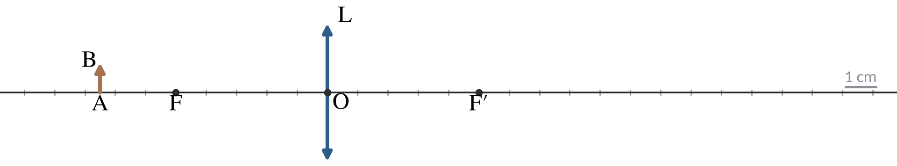
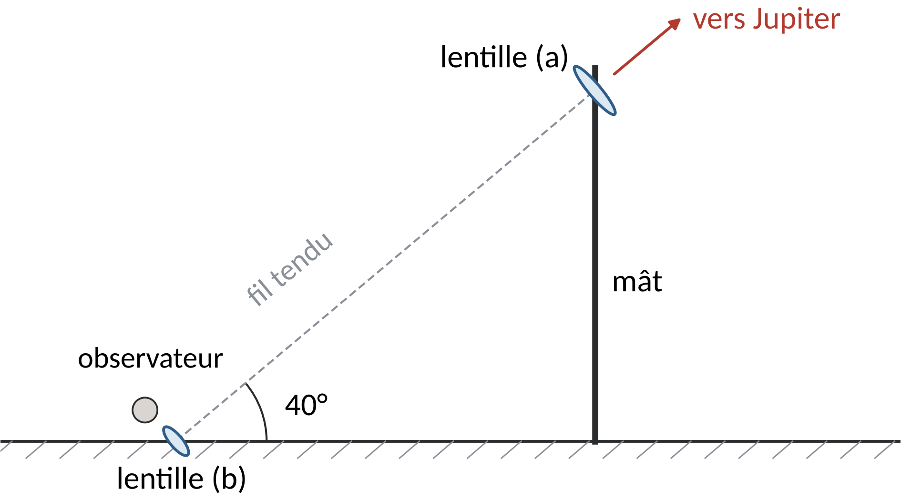
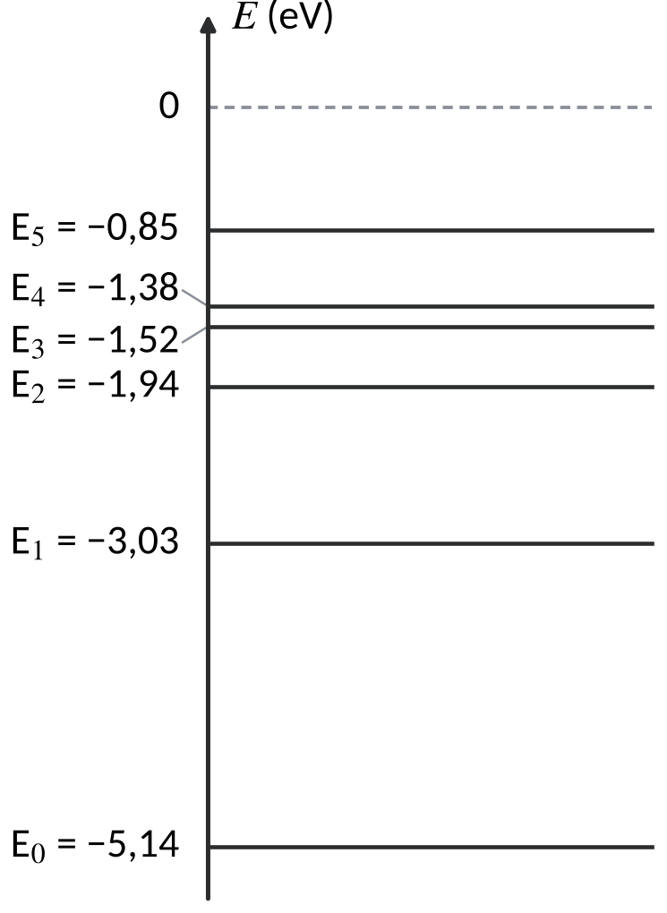
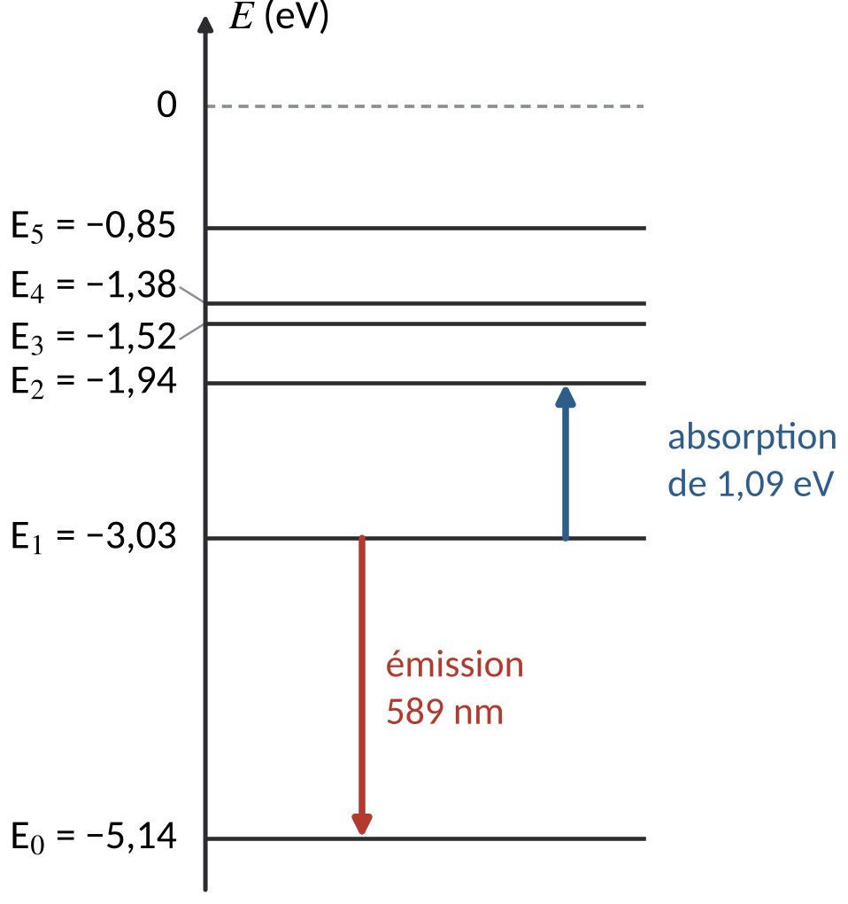
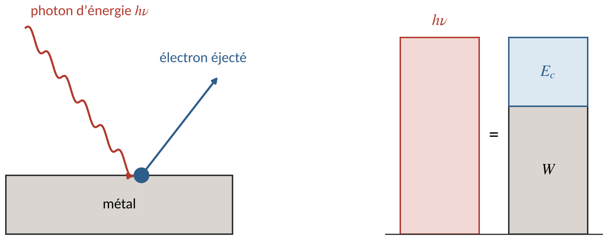

<!--meta {"numero": "7", "matiere": "Physique-Chimie", "titre": "Lumière : lentilles, lunette astronomique et photons", "titre_court": "Lunette astronomique et photons", "fichier": "MasterBac_PC_Fiche7_Lumiere", "fichier_cahier": "MasterBac_PC_Fiche7_Cahier_enonces"} -->

<!--inclure:ouverture-->

# L'essentiel en une page {#essentiel}

::: {custom-style="Rubrique"}
À connaître par cœur
:::

<!--colonnes: 21 32 47-->

| Notion | Relation | À retenir |
|---|---|---|
| Lunette afocale | $\text{F′}_1 = \text{F}_2 \quad \text{et} \quad \text{O}_1\text{O}_2 = f\text{′}_1 + f\text{′}_2$ | Objet à l'infini, image à l'infini : l'œil n'accommode pas. |
| Grossissement | $G = \theta\text{′} / \theta$ | $\theta$ : angle à l'œil nu ; $\theta\text{′}$ : angle à travers la lunette. |
| Photon | $E = h\nu = hc / \lambda$ | $E$ en joule, $\nu$ en hertz, $\lambda$ en mètre. |
| Transition atomique | $\Delta E = E_{\text{haut}} - E_{\text{bas}} = hc / \lambda$ | Photon absorbé seulement si $h\nu$ est exactement un écart entre niveaux, ou au moins l'énergie d'ionisation. |
| Effet photoélectrique | $h\nu \geq W$ | Condition pour qu'un photon extraie un électron. Sinon, aucun électron, même avec une lumière intense. |
| Cellule photovoltaïque | $\eta = P_{\text{él}} / P_{\text{lum}}$ | Rendement, sans unité. Énergie : $E = P \times \Delta t$. |

::: {custom-style="Rubrique"}
À savoir retrouver
:::

<!--colonnes: 21 32 47-->

| Notion | Relation | Comment la retrouver |
|---|---|---|
| Objet à l'infini | $\text{A′B′} = f\text{′} \times \theta$ | Image dans le plan focal image : triangle $\text{OF′B′}$ rectangle en $\text{F′}$, puis $\tan\theta \approx \theta$. |
| Rapport des focales | $G = f\text{′}_1 / f\text{′}_2$ | Petits angles : $\theta \approx \text{A}_1\text{B}_1 / f\text{′}_1$ et $\theta\text{′} \approx \text{A}_1\text{B}_1 / f\text{′}_2$. |
| Électron extrait | $E_{\text{c}} = h\nu - W \quad \text{et} \quad W = h\nu_{\text{s}}$ | Bilan d'énergie : $h\nu = W + E_{\text{c}}$ ; au seuil, $E_{\text{c}} = 0$. |

::: {custom-style="Rubrique"}
Fourni par l'énoncé, à savoir exploiter
:::

En général donnés : relations de conjugaison et de grandissement d'une lentille mince (distances algébriques), constante de Planck $h$, électronvolt, diagramme d'énergie, travail d'extraction, éclairement $E_{\text{e}}$ (puissance reçue $P_{\text{lum}} = E_{\text{e}} \times S$), pouvoir séparateur de l'œil, critère de diffraction.

::: {custom-style="Rubrique"}
Les pièges qui coûtent des points
:::

- Oublier le signe d'une distance algébrique : pour un objet réel, $\overline{\text{OA}} < 0$.
- Garder un angle en degré, ou des électronvolts dans une formule en joule.
- Confondre objectif et oculaire : l'objectif a la plus grande distance focale.

::: {custom-style="Rubrique"}
Votre parcours selon votre objectif
:::

| Objectif | Questions de cours | Exercices |
|---|---|---|
| [\ Objectif 10\ ]{custom-style="Niv10"} | Q.1 à Q.3, Q.5, Q.7, Q.8, Q.10, Q.12 à Q.15, Q.17 à Q.19, Q.21 | Ex. 1 (questions 1 à 3), Ex. 2 (questions 1 à 4), Ex. 3 (questions 1 à 4), Ex. 4 (questions 1 à 3) |
| [\ Objectif 14\ ]{custom-style="Niv14"} | Plus Q.4, Q.6, Q.9, Q.16, Q.20, Q.22, Q.23 | Tous, sauf Ex. 2 (question 7) |
| [\ Objectif 18\ ]{custom-style="Niv18"} | Toutes | Tous |

```{=openxml}
<w:p><w:r><w:br w:type="page"/></w:r></w:p>
```

# Ce qui est tombé aux BAC 2025 et 2026 {#tombe}

Les notions de cette fiche ont été demandées dans au moins huit exercices des sessions 2025 et 2026. Le tableau indique, pour chacun, ce qui était mobilisé et où s'y préparer dans la fiche.

<!--colonnes: 19 20 43 18-->

| Session | Exercice | Notions de cette fiche | Pour s'y préparer |
|---|---|---|---|
| Métropole 2026, jour 2 (sujet de secours) | L'astroscope | Objectif et oculaire, lunette afocale, tracé des rayons, grossissement, incertitude | Q.5, Q.6, Q.8, Q.9, Ex. 2 |
| Métropole, septembre 2026, jour 2 | Observer l'ISS | Lunette afocale, grossissement avec deux oculaires, diamètre apparent, pouvoir séparateur de l'œil | Q.5, Q.9, Q.10 |
| Amérique du Nord 2026, jour 1 | L'effet photoélectrique et ses applications | Effet photoélectrique, seuils, vitesse des électrons, courbes de puissance, rendement, nombre de panneaux | Q.12, Q.17 à Q.19, Q.21, Q.23, Ex. 4 |
| Antilles-Guyane 2026, jour 1 | L'astéroïde 2024 PT5 | Diamètre apparent, pouvoir séparateur de l'œil, tracé des rayons, grossissement | Q.6, Q.8 à Q.10 |
| Centres étrangers 2026, jour 1 | Étude d'une harpe électrique au service des abeilles domestiques | Effet photoélectrique dans le panneau qui alimente la harpe, puissance et rendement | Q.17, Q.21 |
| Amérique du Sud 2025, jour 1 | Tour Montparnasse | Panneaux sur la terrasse : rendement, énergie produite en un an, part des besoins couverts | Q.21, Ex. 4 |
| Centres étrangers 2025, jour 1 | Radar pédagogique équipé d'un panneau solaire | Caractéristique d'un panneau, puissance maximale, rendement comparé à celui annoncé | Q.21, Q.23 |
| Nouvelle-Calédonie 2025, jour 2 | Installation d'un panneau routier | Effet photoélectrique dans le silicium, longueur d'onde seuil, rendement | Q.17, Q.18, Q.21, Q.22 |

::: {custom-style="Intertitre"}
Ce qu'il faut en retenir
:::

- Le rendement d'un panneau photovoltaïque est la notion la plus demandée : cinq exercices, où il faut d'abord calculer la puissance reçue $P_{\text{lum}} = E_{\text{e}} \times S$, et parfois lire une puissance sur une courbe (Q.21, Q.23, Ex. 4).
- La lunette astronomique est tombée trois fois en 2026 : condition afocale, tracé des rayons, grossissement $G = f\text{′}_1 / f\text{′}_2$, puis comparaison de $\theta\text{′}$ au pouvoir séparateur de l'œil (Q.5 à Q.10, Ex. 2).
- L'effet photoélectrique apparaît dans trois exercices : description du phénomène, seuil en fréquence ou en longueur d'onde, lien avec la cellule photovoltaïque (Q.17 à Q.19, Q.22).
- Les niveaux d'énergie de l'atome n'apparaissent dans aucun de ces exercices, mais ils restent au programme (Q.13 à Q.16, Ex. 3).

::: {custom-style="Surtitre"}
Énoncés
:::

# Thème 1 : lentille convergente et images {#theme1}

::: {custom-style="Rubrique"}
Questions de cours
:::

## [Q.1]{custom-style="QNum"}\ \ Construire l'image d'un objet par une lentille mince convergente {#q1}

::: {custom-style="Meta"}
[\ Objectif 10\ ]{custom-style="Niv10"}\ \ Cours · Notions : rayons particuliers, foyers, image réelle\ \ \ [CIBLE:c_q1]{custom-style="BoutonCorrige"}
:::

::: {custom-style="Enonce"}
Application : sur la figure 1, la lentille L, de centre optique O, a pour foyers F et $\text{F′}$ ; une graduation de l'axe optique représente $1\ \text{cm}$, et l'échelle est la même dans la direction verticale : AB mesure $1{,}0\ \text{cm}$. Construire l'image $\text{A′B′}$ de l'objet AB, puis lire la position de $\text{A′}$ et la taille de l'image.
:::

::: {custom-style="Figure"}
{width=15cm}
:::

::: {custom-style="Legende"}
Figure 1. Objet AB devant une lentille mince convergente (une graduation : 1 cm)
:::

## [Q.2]{custom-style="QNum"}\ \ Exploiter la relation de conjugaison et l'expression du grandissement {#q2}

::: {custom-style="Meta"}
[\ Objectif 10\ ]{custom-style="Niv10"}\ \ Cours · Notions : distances algébriques, grandissement\ \ \ [CIBLE:c_q2]{custom-style="BoutonCorrige"}
:::

::: {custom-style="Enonce"}
Application : retrouver par le calcul les résultats de la construction de Q.1, avec $f\text{′} = 5{,}0\ \text{cm}$, $\overline{\text{OA}} = -7{,}5\ \text{cm}$ et $\overline{\text{AB}} = 1{,}0\ \text{cm}$.
:::

::: {custom-style="EnonceDonnees"}
Données : relation de conjugaison, $\dfrac{1}{\overline{\text{OA′}}} - \dfrac{1}{\overline{\text{OA}}} = \dfrac{1}{f\text{′}}$ ; grandissement, $\gamma = \dfrac{\overline{\text{A′B′}}}{\overline{\text{AB}}} = \dfrac{\overline{\text{OA′}}}{\overline{\text{OA}}}$.
:::

## [Q.3]{custom-style="QNum"}\ \ Déterminer la position et la taille de l'image d'un objet très éloigné {#q3}

::: {custom-style="Meta"}
[\ Objectif 10\ ]{custom-style="Niv10"}\ \ Cours · Notions : plan focal image, diamètre apparent\ \ \ [CIBLE:c_q3]{custom-style="BoutonCorrige"}
:::

::: {custom-style="Enonce"}
Application : la Lune est vue à l'œil nu sous un angle $\theta = 9{,}1 \times 10^{-3}\ \text{rad}$. Où se forme son image à travers un objectif de distance focale $f\text{′} = 1{,}00\ \text{m}$, et quelle est la taille de cette image ?
:::

## [Q.4]{custom-style="QNum"}\ \ Exploiter la relation de conjugaison pour la mise au point d'un appareil photographique {#q4}

::: {custom-style="Meta"}
[\ Objectif 14\ ]{custom-style="Niv14"}\ \ Cours · Notions : image nette sur un capteur\ \ \ [CIBLE:c_q4]{custom-style="BoutonCorrige"}
:::

::: {custom-style="Enonce"}
Application : l'objectif d'un appareil photographique est modélisé par une lentille mince convergente de distance focale $f\text{′} = 50{,}0\ \text{mm}$. Réglé pour un objet à l'infini, il forme l'image sur le capteur, placé dans son plan focal image. On photographie une personne située à $2{,}00\ \text{m}$ de l'objectif. De combien, et dans quel sens, faut-il déplacer l'objectif par rapport au capteur ?
:::

::: {custom-style="Rubrique"}
Exercices
:::

## [Exercice 1]{custom-style="QNum"}\ \ Le vidéoprojecteur {#ex1}

::: {custom-style="Meta"}
[\ Objectif 10\ ]{custom-style="Niv10"}\ \ Entraînement · 4 points · 35 min · Questions 4 et 5 : objectif 14
:::

::: {custom-style="Enonce"}
Dans un vidéoprojecteur, l'image est d'abord affichée sur une petite matrice lumineuse, l'objet AB, de largeur $2{,}00\ \text{cm}$. L'objectif projette cette image sur un écran placé à $D = 3{,}00\ \text{m}$ de lui, perpendiculairement à l'axe optique. On modélise l'objectif par une lentille mince convergente de centre O et de distance focale $f\text{′} = 5{,}00\ \text{cm}$.

**1.** Pour obtenir une image nette sur l'écran, la matrice doit-elle être placée entre le foyer objet F et la lentille, ou avant le foyer objet ? Justifier.

**2.** Calculer la distance entre la matrice et l'objectif. La comparer à la distance focale.

**3.** Calculer le grandissement, puis la largeur de l'image sur l'écran. L'image est-elle droite ou renversée ? Comment le vidéoprojecteur montre-t-il pourtant une image à l'endroit ?

**4.** Montrer que, si l'écran est très éloigné de l'objectif, la largeur de l'image vaut environ $\text{AB} \times \dfrac{D}{f\text{′}}$. Comparer cette estimation au résultat de la question 3.

**5.** On souhaite une image de $1{,}80\ \text{m}$ de large, l'écran restant à $3{,}00\ \text{m}$. Quelle distance focale l'objectif doit-il avoir ?
:::

::: {custom-style="Renvoi"}
[CIBLE:c_ex1]{custom-style="BoutonCorrige"}
:::

::: {custom-style="Surtitre"}
Énoncés
:::

# Thème 2 : la lunette astronomique {#theme2}

::: {custom-style="Rubrique"}
Questions de cours
:::

## [Q.5]{custom-style="QNum"}\ \ Définir un instrument afocal et donner la condition pour qu'une lunette soit afocale {#q5}

::: {custom-style="Meta"}
[\ Objectif 10\ ]{custom-style="Niv10"}\ \ Cours · Notions : objectif, oculaire, foyers · Demandée deux fois en 2026\ \ \ [CIBLE:c_q5]{custom-style="BoutonCorrige"}
:::

## [Q.6]{custom-style="QNum"}\ \ Construire la marche d'un faisceau dans une lunette afocale et placer les angles $\theta$ et $\theta\text{′}$ {#q6}

::: {custom-style="Meta"}
[\ Objectif 14\ ]{custom-style="Niv14"}\ \ Cours · Notions : image intermédiaire, rayons parallèles · Demandée en 2026\ \ \ [CIBLE:c_q6]{custom-style="BoutonCorrige"}
:::

::: {custom-style="Enonce"}
Application : compléter la figure 2. Placer les foyers de l'oculaire $\text{L}_2$, construire l'image intermédiaire $\text{A}_1\text{B}_1$ de l'astre et la marche des deux rayons jusqu'à leur sortie de la lunette, puis placer l'angle $\theta\text{′}$.
:::

::: {custom-style="Figure"}
{width=15cm}
:::

::: {custom-style="Legende"}
Figure 2. Faisceau issu du point B d'un astre, à l'entrée d'une lunette (échelle non respectée)
:::

## [Q.7]{custom-style="QNum"}\ \ Vérifier qu'une lunette astronomique est afocale à partir de ses caractéristiques {#q7}

::: {custom-style="Meta"}
[\ Objectif 10\ ]{custom-style="Niv10"}\ \ Cours · Notions : distance entre les lentilles · Voir BAC 2023 (Métropole)\ \ \ [CIBLE:c_q7]{custom-style="BoutonCorrige"}
:::

::: {custom-style="Enonce"}
Application : la lunette de Huygens associait un objectif de distance focale $f\text{′}_1 = 329\ \text{cm}$ et un oculaire de distance focale $f\text{′}_2 = 7{,}0\ \text{cm}$, dont les centres optiques étaient distants de $336\ \text{cm}$. Cette lunette était-elle afocale ?
:::

## [Q.8]{custom-style="QNum"}\ \ Définir le grossissement d'une lunette astronomique {#q8}

::: {custom-style="Meta"}
[\ Objectif 10\ ]{custom-style="Niv10"}\ \ Cours · Notions : diamètre apparent, angles en radian · Demandée en 2026\ \ \ [CIBLE:c_q8]{custom-style="BoutonCorrige"}
:::

::: {custom-style="Enonce"}
Application : à l'œil nu, la Lune est vue sous un angle de $9{,}1 \times 10^{-3}\ \text{rad}$. À travers une lunette, son image est vue sous un angle de $0{,}36\ \text{rad}$. Calculer le grossissement de cette lunette.
:::

## [Q.9]{custom-style="QNum"}\ \ Établir l'expression du grossissement en fonction des distances focales {#q9}

::: {custom-style="Meta"}
[\ Objectif 14\ ]{custom-style="Niv14"}\ \ Cours · Notions : petits angles, tangente · Demandée en 2026\ \ \ [CIBLE:c_q9]{custom-style="BoutonCorrige"}
:::

::: {custom-style="Enonce"}
Application : calculer le grossissement de la lunette de Huygens décrite à la question Q.7.
:::

## [Q.10]{custom-style="QNum"}\ \ Comparer l'angle sous lequel un détail est vu au pouvoir séparateur de l'œil {#q10}

::: {custom-style="Meta"}
[\ Objectif 10\ ]{custom-style="Niv10"}\ \ Cours · Notions : diamètre apparent, pouvoir séparateur · Deux sujets en 2026\ \ \ [CIBLE:c_q10]{custom-style="BoutonCorrige"}
:::

::: {custom-style="Enonce"}
Application : Saturne est à $1{,}42 \times 10^{9}\ \text{km}$ de la Terre, et la distance entre sa surface et son premier anneau brillant vaut $3{,}17 \times 10^{4}\ \text{km}$. Le pouvoir séparateur de l'œil vaut $\varepsilon = 3{,}0 \times 10^{-4}\ \text{rad}$. Peut-on distinguer cet anneau de la surface de la planète à l'œil nu ? Et avec la lunette de Huygens, de grossissement $G = 47$ ?
:::

## [Q.11]{custom-style="QNum"}\ \ Prendre en compte la diffraction par l'objectif : limite de résolution d'une lunette {#q11}

::: {custom-style="Meta"}
[\ Objectif 18\ ]{custom-style="Niv18"}\ \ Cours · Notions : diffraction, diamètre de l'objectif · Voir BAC 2023 (Métropole)\ \ \ [CIBLE:c_q11]{custom-style="BoutonCorrige"}
:::

::: {custom-style="Enonce"}
Application : deux détails sont séparés par une lunette si l'angle $\theta$ sous lequel on les voit à l'œil nu est supérieur à $\theta_{\text{diff}} = 1{,}22 \times \dfrac{\lambda}{a}$, où $a$ est le diamètre de l'objectif. Pour l'anneau de Saturne de Q.10, vu sous $\theta = 2{,}23 \times 10^{-5}\ \text{rad}$, et une lumière de longueur d'onde $\lambda = 550\ \text{nm}$, comparer la lunette de Galilée ($a = 29{,}0\ \text{mm}$) à celle de Huygens ($a = 51{,}0\ \text{mm}$).
:::

::: {custom-style="Rubrique"}
Exercices
:::

### [Exercice 2]{custom-style="QNum"}\ \ L'astroscope de Huygens [(voir BAC Métropole 2026, sujet de secours)]{custom-style="VoirBac"} {#ex2}

::: {custom-style="Meta"}
[\ Objectif 10\ ]{custom-style="Niv10"}\ \ [Type BAC]{custom-style="TagBac"} · 5 points · 45 min · Questions 5 et 6 : objectif 14, question 7 : objectif 18
:::

::: {custom-style="MentionBac"}
[Sujet du BAC correspondant.]{custom-style="EtiqBac"} Métropole 2026, jour 2 (sujet de secours), exercice 2 : « L'astroscope » (objectif et oculaire, lunette afocale, tracé des rayons, grossissement, incertitude).
:::

::: {custom-style="Enonce"}
En 1684, Christiaan Huygens décrit une lunette sans tube, l'astroscope : une lentille (a) est fixée en haut d'un mât, l'observateur tient une lentille (b), et un fil tendu les maintient alignées (figure 3). On le modélise par une lunette afocale : objectif $\text{L}_1$ de distance focale $f\text{′}_1 = 34{,}0\ \text{m}$, oculaire $\text{L}_2$ de distance focale $f\text{′}_2 = 7{,}0\ \text{cm}$. On observe Jupiter.
:::

::: {custom-style="EnonceDonnees"}
Données : diamètre apparent de Jupiter ce jour-là, $\theta_{\text{réf}} = 2{,}2 \times 10^{-4}\ \text{rad}$ ; distance Terre-Jupiter, $6{,}3 \times 10^{8}\ \text{km}$ ; pouvoir séparateur de l'œil, $\varepsilon = 3{,}0 \times 10^{-4}\ \text{rad}$ ; diffraction par l'objectif, de diamètre $a = 20\ \text{cm}$ : deux détails vus à l'œil nu sous l'angle $\theta$ ne sont séparés par l'instrument que si $\theta > \theta_{\text{diff}} = 1{,}22 \times \lambda / a$, avec $\lambda = 550\ \text{nm}$ ; $\tan\theta \approx \theta$ pour un petit angle en radian ; $u(\theta) = \theta \times u(\text{A}_1\text{B}_1) / \text{A}_1\text{B}_1$ ; compatibilité avec une valeur de référence si $|\theta - \theta_{\text{réf}}| / u(\theta) \leq 2$.
:::

::: {custom-style="Figure"}
{width=9.5cm}
:::

::: {custom-style="Legende"}
Figure 3. Principe de l'astroscope (échelle non respectée)
:::

::: {custom-style="Enonce"}

**1.** Identifier l'objectif et l'oculaire parmi les lentilles (a) et (b). Justifier.

**2.** Calculer la distance entre les lentilles pour que l'astroscope soit afocal, donc la longueur du fil.

**3.** Le fil fait un angle de $40°$ avec le sol. Calculer la hauteur de l'objectif, l'oculaire étant au sol.

**4.** Calculer le grossissement de l'astroscope.

**5.** Où se forme l'image intermédiaire $\text{A}_1\text{B}_1$ de Jupiter ? Montrer que $\text{A}_1\text{B}_1 = f\text{′}_1 \times \theta$, où $\theta$ est le diamètre apparent de Jupiter. Calculer la taille de cette image et l'angle $\theta\text{′}$ sous lequel l'observateur voit Jupiter, en prenant $\theta = \theta_{\text{réf}}$.

**6.** Une lame graduée placée dans le plan de l'image intermédiaire donne $\text{A}_1\text{B}_1 = 7{,}0\ \text{mm}$, avec $u(\text{A}_1\text{B}_1) = 0{,}3\ \text{mm}$. En déduire le diamètre apparent mesuré de Jupiter et son incertitude-type, puis le comparer à la valeur de référence.

**7.** La Grande Tache rouge de Jupiter mesure environ $1{,}6 \times 10^{4}\ \text{km}$. En tenant compte du pouvoir séparateur de l'œil et de la diffraction par l'objectif, montrer que l'astroscope permet de la distinguer.
:::

::: {custom-style="Renvoi"}
[CIBLE:c_ex2]{custom-style="BoutonCorrige"}
:::

::: {custom-style="Surtitre"}
Énoncés
:::

# Thème 3 : énergie de l'atome et photons {#theme3}

::: {custom-style="Rubrique"}
Questions de cours
:::

## [Q.12]{custom-style="QNum"}\ \ Calculer l'énergie d'un photon à partir de sa fréquence ou de sa longueur d'onde {#q12}

::: {custom-style="Meta"}
[\ Objectif 10\ ]{custom-style="Niv10"}\ \ Cours · Notions : photon, constante de Planck, électronvolt · Demandée en 2026\ \ \ [CIBLE:c_q12]{custom-style="BoutonCorrige"}
:::

::: {custom-style="Enonce"}
Application : calculer, en joule puis en électronvolt, l'énergie d'un photon de lumière rouge, de longueur d'onde $650\ \text{nm}$, et celle d'un photon ultraviolet, de longueur d'onde $250\ \text{nm}$.
:::

::: {custom-style="EnonceDonnees"}
Données, valables pour toutes les questions de cours des thèmes 3 et 4 : $h = 6{,}63 \times 10^{-34}\ \text{J·s}$ ; $c = 3{,}00 \times 10^{8}\ \text{m·s}^{-1}$ ; $1\ \text{eV} = 1{,}60 \times 10^{-19}\ \text{J}$.
:::

## [Q.13]{custom-style="QNum"}\ \ Expliquer la quantification des niveaux d'énergie d'un atome et lire un diagramme {#q13}

::: {custom-style="Meta"}
[\ Objectif 10\ ]{custom-style="Niv10"}\ \ Cours · Notions : état fondamental, états excités, ionisation\ \ \ [CIBLE:c_q13]{custom-style="BoutonCorrige"}
:::

::: {custom-style="Enonce"}
Application : la figure 4 donne les niveaux d'énergie de l'atome de sodium. Identifier l'état fondamental et les états excités, puis donner l'énergie minimale à fournir pour ioniser un atome de sodium pris dans son état fondamental.
:::

::: {custom-style="Figure"}
{width=5.5cm}
:::

::: {custom-style="Legende"}
Figure 4. Niveaux d'énergie de l'atome de sodium
:::

## [Q.14]{custom-style="QNum"}\ \ Calculer la longueur d'onde du photon émis lors d'une désexcitation de l'atome {#q14}

::: {custom-style="Meta"}
[\ Objectif 10\ ]{custom-style="Niv10"}\ \ Cours · Notions : émission, raie d'émission\ \ \ [CIBLE:c_q14]{custom-style="BoutonCorrige"}
:::

::: {custom-style="Enonce"}
Application : calculer la longueur d'onde du photon émis quand un atome de sodium passe du niveau $E_1$ au niveau $E_0$ (figure 4). À quoi correspond cette radiation ?
:::

## [Q.15]{custom-style="QNum"}\ \ Prévoir si un atome peut absorber un photon d'énergie donnée {#q15}

::: {custom-style="Meta"}
[\ Objectif 10\ ]{custom-style="Niv10"}\ \ Cours · Notions : absorption, transition\ \ \ [CIBLE:c_q15]{custom-style="BoutonCorrige"}
:::

::: {custom-style="Enonce"}
Application : avec les niveaux du sodium de la figure 4, que se passe-t-il dans chacun des cas suivants ? a) Un atome dans l'état fondamental reçoit un photon de $1{,}00\ \text{eV}$. b) Un atome dans l'état $E_1$ reçoit un photon de $2{,}00\ \text{eV}$. c) Un atome dans l'état $E_1$ reçoit un photon de $1{,}09\ \text{eV}$.
:::

## [Q.16]{custom-style="QNum"}\ \ Interpréter un spectre de raies d'émission ou d'absorption {#q16}

::: {custom-style="Meta"}
[\ Objectif 14\ ]{custom-style="Niv14"}\ \ Cours · Notions : spectre de raies, composition d'une étoile\ \ \ [CIBLE:c_q16]{custom-style="BoutonCorrige"}
:::

::: {custom-style="Enonce"}
Application : le spectre de la lumière du Soleil présente une raie noire à $589\ \text{nm}$. Interpréter cette raie à l'aide du résultat de Q.14.
:::

::: {custom-style="Rubrique"}
Exercices
:::

## [Exercice 3]{custom-style="QNum"}\ \ Les raies de l'atome d'hydrogène {#ex3}

::: {custom-style="Meta"}
[\ Objectif 10\ ]{custom-style="Niv10"}\ \ Entraînement · 5 points · 40 min · Questions 5 et 6 : objectif 14
:::

::: {custom-style="Enonce"}
Les niveaux d'énergie de l'atome d'hydrogène sont donnés, en électronvolt, par $E_n = -\dfrac{13{,}6}{n^{2}}$, où $n$ est un entier non nul. La figure 5 représente les quatre premiers niveaux et trois transitions, notées (a), (b) et (c).
:::

::: {custom-style="EnonceDonnees"}
Données : $h = 6{,}63 \times 10^{-34}\ \text{J·s}$ ; $c = 3{,}00 \times 10^{8}\ \text{m·s}^{-1}$ ; $1\ \text{eV} = 1{,}60 \times 10^{-19}\ \text{J}$ ; domaine visible : de $400$ à $800\ \text{nm}$.
:::

::: {custom-style="Figure"}
{width=7.5cm}
:::

::: {custom-style="Legende"}
Figure 5. Premiers niveaux d'énergie de l'atome d'hydrogène (axe interrompu)
:::

::: {custom-style="Enonce"}

**1.** Calculer $E_1$, $E_2$, $E_3$ et $E_4$, et vérifier les valeurs de la figure.

**2.** Comment appelle-t-on le niveau $n = 1$ ? Quelle énergie faut-il fournir à un atome dans ce niveau pour l'ioniser ?

**3.** Les transitions (a), (b) et (c) correspondent-elles à l'émission ou à l'absorption d'un photon ? Justifier.

**4.** Calculer la longueur d'onde $\lambda_a$ du photon associé à la transition (a). À quel domaine appartient-il ?

**5.** Sans calculer $\lambda_b$, montrer que $\lambda_b < \lambda_a$. Calculer $\lambda_c$ et expliquer pourquoi l'œil ne perçoit pas cette radiation.

**6.** Un atome dans l'état fondamental reçoit un photon. Que se passe-t-il dans chacun des trois cas suivants : le photon a une énergie de $10{,}2\ \text{eV}$ ; de $11{,}0\ \text{eV}$ ; de $15{,}0\ \text{eV}$ ?
:::

::: {custom-style="Renvoi"}
[CIBLE:c_ex3]{custom-style="BoutonCorrige"}
:::

::: {custom-style="Surtitre"}
Énoncés
:::

# Thème 4 : effet photoélectrique et photovoltaïque {#theme4}

::: {custom-style="Rubrique"}
Questions de cours
:::

::: {custom-style="EnonceDonnees"}
Données, valables pour les questions de cours de ce thème : $h = 6{,}63 \times 10^{-34}\ \text{J·s}$ ; $c = 3{,}00 \times 10^{8}\ \text{m·s}^{-1}$ ; $1\ \text{eV} = 1{,}60 \times 10^{-19}\ \text{J}$.
:::

## [Q.17]{custom-style="QNum"}\ \ Décrire l'effet photoélectrique et expliquer ce qu'il révèle de la nature de la lumière {#q17}

::: {custom-style="Meta"}
[\ Objectif 10\ ]{custom-style="Niv10"}\ \ Cours · Notions : photon, seuil, modèle particulaire · Trois sujets en 2025 et 2026\ \ \ [CIBLE:c_q17]{custom-style="BoutonCorrige"}
:::

## [Q.18]{custom-style="QNum"}\ \ Définir le travail d'extraction d'un métal, sa fréquence seuil et sa longueur d'onde seuil {#q18}

::: {custom-style="Meta"}
[\ Objectif 10\ ]{custom-style="Niv10"}\ \ Cours · Notions : travail d'extraction, seuil · Demandée en 2025 et 2026\ \ \ [CIBLE:c_q18]{custom-style="BoutonCorrige"}
:::

::: {custom-style="Enonce"}
Application : le travail d'extraction du calcium vaut $W = 2{,}9\ \text{eV}$. Calculer sa fréquence seuil et sa longueur d'onde seuil. Une lumière violette de longueur d'onde $400\ \text{nm}$ peut-elle extraire des électrons du calcium ?
:::

## [Q.19]{custom-style="QNum"}\ \ Calculer la vitesse des électrons extraits par un bilan d'énergie {#q19}

::: {custom-style="Meta"}
[\ Objectif 10\ ]{custom-style="Niv10"}\ \ Cours · Notions : énergie cinétique, conservation de l'énergie · Demandée en 2026\ \ \ [CIBLE:c_q19]{custom-style="BoutonCorrige"}
:::

::: {custom-style="Enonce"}
Application : calculer l'énergie cinétique maximale et la vitesse maximale des électrons extraits du calcium par la lumière de $400\ \text{nm}$ de Q.18. Masse de l'électron : $m_e = 9{,}11 \times 10^{-31}\ \text{kg}$.
:::

## [Q.20]{custom-style="QNum"}\ \ Déterminer la constante de Planck et un travail d'extraction à partir de mesures {#q20}

::: {custom-style="Meta"}
[\ Objectif 14\ ]{custom-style="Niv14"}\ \ Cours · Notions : modélisation affine, expérience de Millikan\ \ \ [CIBLE:c_q20]{custom-style="BoutonCorrige"}
:::

::: {custom-style="Enonce"}
Application : on éclaire un métal avec des radiations de fréquences $\nu$ différentes et on mesure l'énergie cinétique maximale $E_{\text{c}}$ des électrons extraits. Montrer que les mesures sont en accord avec la relation $E_{\text{c}} = h\nu - W$, puis déterminer $h$ et $W$. Identifier le métal parmi le césium ($1{,}9\ \text{eV}$), le potassium ($2{,}3\ \text{eV}$), le calcium ($2{,}9\ \text{eV}$) et le zinc ($4{,}3\ \text{eV}$).
:::

| *ν* (10^14^ Hz) | 7,0 | 9,0 | 11,0 | 13,0 |
|---|---|---|---|---|
| *E*~c~ (eV) | 0,60 | 1,43 | 2,26 | 3,09 |

## [Q.21]{custom-style="QNum"}\ \ Exprimer et calculer le rendement d'une cellule photovoltaïque {#q21}

::: {custom-style="Meta"}
[\ Objectif 10\ ]{custom-style="Niv10"}\ \ Cours · Notions : puissance lumineuse, éclairement · Cinq sujets en 2025 et 2026\ \ \ [CIBLE:c_q21]{custom-style="BoutonCorrige"}
:::

::: {custom-style="Enonce"}
Application : un panneau photovoltaïque de $1{,}70\ \text{m}$ sur $1{,}00\ \text{m}$ fournit une puissance électrique de $340\ \text{W}$ quand il reçoit un éclairement de $1\ 000\ \text{W·m}^{-2}$. Calculer son rendement.
:::

## [Q.22]{custom-style="QNum"}\ \ Expliquer le principe d'une cellule photovoltaïque et calculer son seuil {#q22}

::: {custom-style="Meta"}
[\ Objectif 14\ ]{custom-style="Niv14"}\ \ Cours · Notions : semi-conducteur, énergie de gap · Demandée en 2025\ \ \ [CIBLE:c_q22]{custom-style="BoutonCorrige"}
:::

::: {custom-style="Enonce"}
Application : dans le silicium, un électron doit recevoir au moins $1{,}12\ \text{eV}$ pour participer au courant. Calculer la longueur d'onde maximale des photons utiles. Pourquoi une partie du rayonnement solaire n'est-elle pas convertie ?
:::

## [Q.23]{custom-style="QNum"}\ \ Exploiter la caractéristique d'un panneau : puissance maximale et rendement {#q23}

::: {custom-style="Meta"}
[\ Objectif 14\ ]{custom-style="Niv14"}\ \ Cours · Notions : caractéristique, point de puissance maximale · Demandée en 2025 et 2026\ \ \ [CIBLE:c_q23]{custom-style="BoutonCorrige"}
:::

::: {custom-style="Enonce"}
Application : la figure 6 donne l'intensité $I$ et la puissance $P$ fournies par un petit panneau en fonction de la tension $U$ à ses bornes, sous un éclairement de $1\ 000\ \text{W·m}^{-2}$. Sa surface vaut $0{,}50\ \text{m}^{2}$. Déterminer sa puissance maximale, la tension et l'intensité correspondantes, puis son rendement.
:::

::: {custom-style="Figure"}
{width=15cm}
:::

::: {custom-style="Legende"}
Figure 6. Intensité et puissance fournies par le panneau en fonction de la tension
:::

::: {custom-style="Rubrique"}
Exercices
:::

### [Exercice 4]{custom-style="QNum"}\ \ L'effet photoélectrique et le panneau solaire [(voir BAC Amérique du Nord 2026)]{custom-style="VoirBac"} {#ex4}

::: {custom-style="Meta"}
[\ Objectif 10\ ]{custom-style="Niv10"}\ \ [Type BAC]{custom-style="TagBac"} · 6 points · 55 min · Questions 4 à 7 : objectif 14
:::

::: {custom-style="MentionBac"}
[Sujet du BAC correspondant.]{custom-style="EtiqBac"} Amérique du Nord 2026, jour 1, exercice 2 : « L'effet photoélectrique et ses applications » (expérience historique, seuils, vitesse des électrons, rendement et nombre de panneaux).
:::

::: {custom-style="EnonceDonnees"}
Données : $h = 6{,}63 \times 10^{-34}\ \text{J·s}$ ; $c = 3{,}00 \times 10^{8}\ \text{m·s}^{-1}$ ; $1\ \text{eV} = 1{,}60 \times 10^{-19}\ \text{J}$ ; masse de l'électron : $m_e = 9{,}11 \times 10^{-31}\ \text{kg}$ ; travail d'extraction du zinc : $W = 4{,}3\ \text{eV}$ ; puissance lumineuse reçue : $P_{\text{lum}} = E_{\text{e}} \times S$, avec $E_{\text{e}}$ l'éclairement.
:::

::: {custom-style="Enonce"}

**Partie A. Une expérience historique**

Une plaque de zinc chargée négativement, éclairée par une lampe qui émet un rayonnement ultraviolet de longueur d'onde $\lambda = 250\ \text{nm}$, se décharge. Éclairée par une lampe à incandescence très puissante, qui émet du visible et de l'infrarouge, elle reste chargée.

**1.** Calculer l'énergie d'un photon de longueur d'onde $250\ \text{nm}$, en joule puis en électronvolt.

**2.** Calculer la longueur d'onde seuil $\lambda_{\text{s}}$ du zinc et préciser à quel domaine elle appartient.

**3.** Expliquer les deux observations. En quoi conduisent-elles à décrire la lumière comme un ensemble de photons ?

**4.** Calculer la vitesse maximale des électrons extraits par le rayonnement de $250\ \text{nm}$.
:::

::: {custom-style="Figure"}
{width=9cm}
:::

::: {custom-style="Legende"}
Figure 7. Puissance fournie par le panneau pour trois éclairements
:::

::: {custom-style="Enonce"}

**Partie B. Un panneau photovoltaïque**

La figure 7 donne la puissance électrique fournie par un panneau de surface $S = 1{,}94\ \text{m}^{2}$ en fonction de la tension à ses bornes, pour trois éclairements.

**5.** Déterminer la puissance maximale du panneau sous $1\ 000\ \text{W·m}^{-2}$, puis son rendement.

**6.** Calculer le rendement sous $800\ \text{W·m}^{-2}$ et sous $400\ \text{W·m}^{-2}$. Conclure.

**7.** Sur le toit d'une maison, chaque mètre carré de panneau reçoit en moyenne $1\ 350\ \text{kWh}$ d'énergie lumineuse par an. Le foyer consomme $4\ 500\ \text{kWh}$ par an et veut en produire la moitié. Combien de panneaux faut-il installer, avec le rendement de la question 5 ?
:::


::: {custom-style="Renvoi"}
[CIBLE:c_ex4]{custom-style="BoutonCorrige"}
:::

<!--debut:complet-->
::: {custom-style="Surtitre"}
Corrigés
:::

# Corrigés du thème 1 : lentille convergente et images {#c_theme1}

#### [Corrigé]{custom-style="NumCorrige"}\ \ Q.1 · Construire l'image d'un objet par une lentille mince convergente {#c_q1}

::: {custom-style="Renvoi"}
[CIBLE:q1]{custom-style="BoutonEnonce"}
:::

Une lentille mince convergente est caractérisée par son centre optique O, son foyer objet F et son foyer image $\text{F′}$, symétriques l'un de l'autre par rapport à O. Sa distance focale $f\text{′} = \overline{\text{OF′}}$ est positive.

Pour construire l'image $\text{B′}$ du point B, on trace deux des trois rayons particuliers issus de B :

- le rayon qui passe par le centre optique O n'est pas dévié ;
- le rayon parallèle à l'axe optique ressort en passant par le foyer image $\text{F′}$ ;
- le rayon qui passe par le foyer objet F ressort parallèle à l'axe optique.

L'image $\text{B′}$ est à l'intersection des rayons émergents. L'image $\text{A′}$ du point A, placé sur l'axe, est sur l'axe, à la verticale de $\text{B′}$ : comme l'objet, l'image $\text{A′B′}$ est perpendiculaire à l'axe.

::: {custom-style="Figure"}
{width=15cm}
:::

::: {custom-style="Legende"}
Figure 8. Construction de l'image A′B′ avec les trois rayons particuliers
:::

**Lecture.** Une graduation représente $1\ \text{cm}$ : $\overline{\text{OA′}} = 15\ \text{cm}$ et $\overline{\text{A′B′}} = -2{,}0\ \text{cm}$. L'image est réelle, on peut la recueillir sur un écran. Elle est renversée et deux fois plus grande que l'objet.

::: {custom-style="Methode"}
[Méthode.]{custom-style="EtiqMethode"} Tracez deux rayons particuliers à la règle, puis vérifiez avec le troisième : les trois doivent se couper au même point. S'ils ne se coupent pas, un rayon est faux.
:::

::: {custom-style="Remarque"}
[Remarque.]{custom-style="EtiqRemarque"} Si l'objet est placé entre le foyer objet F et la lentille, les rayons émergents divergent. Leurs prolongements se coupent avant la lentille et donnent une image virtuelle, droite et plus grande que l'objet : c'est le principe de la loupe.
:::

#### [Corrigé]{custom-style="NumCorrige"}\ \ Q.2 · Exploiter la relation de conjugaison et l'expression du grandissement {#c_q2}

::: {custom-style="Renvoi"}
[CIBLE:q2]{custom-style="BoutonEnonce"}
:::

Les distances sont algébriques. Elles sont mesurées à partir du centre optique O, positivement dans le sens de propagation de la lumière, de gauche à droite sur les schémas. Les tailles sont comptées positivement vers le haut. Un objet réel placé avant la lentille a donc $\overline{\text{OA}} < 0$.

La relation de conjugaison donne la position de l'image :

::: {custom-style="Retenir"}
$\dfrac{1}{\overline{\text{OA′}}} - \dfrac{1}{\overline{\text{OA}}} = \dfrac{1}{f\text{′}}$
:::

Le grandissement donne sa taille et son sens :

::: {custom-style="Retenir"}
$\gamma = \dfrac{\overline{\text{A′B′}}}{\overline{\text{AB}}} = \dfrac{\overline{\text{OA′}}}{\overline{\text{OA}}}$
:::

Le grandissement est sans unité. Si $\gamma < 0$, l'image est renversée ; si $|\gamma| > 1$, elle est plus grande que l'objet.

Au bac, ces deux relations sont données par l'énoncé, comme ici : ce qui est évalué, c'est leur emploi avec les distances algébriques.

**Application numérique.**

$$\dfrac{1}{\overline{\text{OA′}}} = \dfrac{1}{f\text{′}} + \dfrac{1}{\overline{\text{OA}}} = \dfrac{1}{5{,}0} + \dfrac{1}{-7{,}5} = \dfrac{1}{15}\ \text{cm}^{-1} \quad \text{donc} \quad \overline{\text{OA′}} = 15\ \text{cm}$$

$$\gamma = \dfrac{15}{-7{,}5} = -2{,}0 \qquad \overline{\text{A′B′}} = \gamma \times \overline{\text{AB}} = -2{,}0 \times 1{,}0 = -2{,}0\ \text{cm}$$

On retrouve les résultats de la construction.

::: {custom-style="Piege"}
[Piège.]{custom-style="EtiqPiege"} Gardez les signes : $\overline{\text{OA}} = -7{,}5\ \text{cm}$, et non $7{,}5\ \text{cm}$. Oublier le signe moins donne une image fausse. Exprimez aussi toutes les distances dans la même unité.
:::

#### [Corrigé]{custom-style="NumCorrige"}\ \ Q.3 · Déterminer la position et la taille de l'image d'un objet très éloigné {#c_q3}

::: {custom-style="Renvoi"}
[CIBLE:q3]{custom-style="BoutonEnonce"}
:::

Un objet très éloigné, comme un astre, est considéré comme à l'infini : les rayons issus d'un même point de l'objet arrivent parallèles entre eux sur la lentille.

- Les rayons issus du point A, sur l'axe, arrivent parallèles à l'axe : ils convergent au foyer image $\text{F′}$.
- Les rayons issus du point B arrivent inclinés de l'angle $\theta$, le diamètre apparent de l'objet. Ils convergent en un point $\text{B′}$ du plan focal image, le plan perpendiculaire à l'axe qui passe par $\text{F′}$.

L'image d'un objet à l'infini se forme donc dans le plan focal image. Le rayon issu de B qui passe par O n'est pas dévié. Dans le triangle $\text{OF′B′}$, rectangle en $\text{F′}$ :

$$\tan\theta = \dfrac{\text{A′B′}}{\text{OF′}} = \dfrac{\text{A′B′}}{f\text{′}}$$

Pour un petit angle exprimé en radian, $\tan\theta \approx \theta$ :

::: {custom-style="Retenir"}
$\text{A′B′} = f\text{′} \times \theta$
:::

**Application numérique.** L'image de la Lune se forme dans le plan focal image, à $1{,}00\ \text{m}$ de l'objectif :

$$\text{A′B′} = 1{,}00 \times 9{,}1 \times 10^{-3} = 9{,}1 \times 10^{-3}\ \text{m} = 9{,}1\ \text{mm}$$

::: {custom-style="Remarque"}
[Remarque.]{custom-style="EtiqRemarque"} C'est ce qui se passe dans l'objectif d'une lunette : l'image intermédiaire $\text{A}_1\text{B}_1$ d'un astre se forme dans le plan focal image de l'objectif (Q.6). Plus la distance focale est grande, plus cette image est grande.
:::

#### [Corrigé]{custom-style="NumCorrige"}\ \ Q.4 · Exploiter la relation de conjugaison pour la mise au point d'un appareil photographique {#c_q4}

::: {custom-style="Renvoi"}
[CIBLE:q4]{custom-style="BoutonEnonce"}
:::

Pour que la photographie soit nette, l'image doit se former exactement sur le capteur. Pour un objet à l'infini, elle est dans le plan focal image : le capteur est à la distance $f\text{′}$ de l'objectif. Pour un objet plus proche, l'image se forme au-delà de $\text{F′}$ : il faut éloigner l'objectif du capteur. C'est la mise au point.

**Application numérique.** L'objet est à $2{,}00\ \text{m}$ avant l'objectif : $\overline{\text{OA}} = -2{,}00\ \text{m}$ et $f\text{′} = 0{,}0500\ \text{m}$.

$$\dfrac{1}{\overline{\text{OA′}}} = \dfrac{1}{0{,}0500} + \dfrac{1}{-2{,}00} = 19{,}5\ \text{m}^{-1} \quad \text{donc} \quad \overline{\text{OA′}} = 5{,}13 \times 10^{-2}\ \text{m} = 51{,}3\ \text{mm}$$

Le capteur doit être à $51{,}3\ \text{mm}$ de l'objectif au lieu de $50{,}0\ \text{mm}$ : il faut éloigner l'objectif du capteur d'environ $1{,}3\ \text{mm}$.

::: {custom-style="Methode"}
[Méthode.]{custom-style="EtiqMethode"} Isolez d'abord l'inverse de l'inconnue, ici $\dfrac{1}{\overline{\text{OA′}}} = \dfrac{1}{f\text{′}} + \dfrac{1}{\overline{\text{OA}}}$, calculez cette valeur, puis prenez son inverse. N'inversez pas chaque terme séparément : l'inverse d'une somme n'est pas la somme des inverses.
:::

#### [Corrigé]{custom-style="NumCorrige"}\ \ Exercice 1 · Le vidéoprojecteur {#c_ex1}

::: {custom-style="Renvoi"}
[CIBLE:ex1]{custom-style="BoutonEnonce"}
:::

::: {custom-style="QRappel"}
**1.** Position de la matrice
:::

Une lentille convergente ne donne une image réelle, que l'on peut recueillir sur un écran, que si l'objet est placé avant le foyer objet F. Placé entre F et la lentille, l'objet donnerait une image virtuelle, comme avec une loupe. La matrice doit donc être placée avant F.

::: {custom-style="QRappel"}
**2.** Distance entre la matrice et l'objectif
:::

$\overline{\text{OA′}} = D = 3{,}00\ \text{m}$ et $f\text{′} = 5{,}00 \times 10^{-2}\ \text{m}$ :

$$\dfrac{1}{\overline{\text{OA}}} = \dfrac{1}{\overline{\text{OA′}}} - \dfrac{1}{f\text{′}} = \dfrac{1}{3{,}00} - \dfrac{1}{5{,}00 \times 10^{-2}} = -19{,}67\ \text{m}^{-1} \quad \text{donc} \quad \overline{\text{OA}} = -5{,}08 \times 10^{-2}\ \text{m}$$

La matrice est à $5{,}08\ \text{cm}$ de l'objectif : un peu avant le foyer objet, à moins d'un millimètre de lui.

::: {custom-style="QRappel"}
**3.** Grandissement et largeur de l'image
:::

$$\gamma = \dfrac{\overline{\text{OA′}}}{\overline{\text{OA}}} = \dfrac{3{,}00}{-5{,}085 \times 10^{-2}} = -59{,}0$$

La largeur de l'image vaut $59{,}0 \times 2{,}00 = 118\ \text{cm}$, soit $1{,}18\ \text{m}$. Le grandissement est négatif : l'image est renversée. Pour que le spectateur voie une image à l'endroit, la matrice affiche l'image retournée, tête en bas et inversée de gauche à droite.

::: {custom-style="QRappel"}
**4.** Estimation pour un écran éloigné
:::

Quand $D$ est très grand devant $f\text{′}$, le terme $\dfrac{1}{D}$ est négligeable devant $\dfrac{1}{f\text{′}}$ : $\overline{\text{OA}} \approx -f\text{′}$, la matrice est pratiquement dans le plan focal objet. Alors :

$$|\gamma| = \dfrac{D}{|\overline{\text{OA}}|} \approx \dfrac{D}{f\text{′}} \quad \text{et} \quad \text{largeur} \approx \text{AB} \times \dfrac{D}{f\text{′}} = 2{,}00 \times \dfrac{3{,}00}{5{,}00 \times 10^{-2}} = 120\ \text{cm}$$

L'estimation, $1{,}20\ \text{m}$, diffère de moins de $2\ \%$ du résultat exact, $1{,}18\ \text{m}$. La largeur de l'image est proportionnelle à la distance de l'écran : en reculant le vidéoprojecteur, on agrandit l'image.

::: {custom-style="QRappel"}
**5.** Distance focale pour une image de 1,80 m
:::

Le grandissement doit valoir $\gamma = -\dfrac{1{,}80}{2{,}00 \times 10^{-2}} = -90{,}0$, donc $\overline{\text{OA}} = \dfrac{\overline{\text{OA′}}}{\gamma} = \dfrac{3{,}00}{-90{,}0} = -3{,}33 \times 10^{-2}\ \text{m}$.

$$\dfrac{1}{f\text{′}} = \dfrac{1}{\overline{\text{OA′}}} - \dfrac{1}{\overline{\text{OA}}} = \dfrac{1}{3{,}00} + \dfrac{1}{3{,}333 \times 10^{-2}} = 30{,}34\ \text{m}^{-1} \quad \text{donc} \quad f\text{′} = 3{,}30 \times 10^{-2}\ \text{m}$$

Il faut un objectif de distance focale $3{,}3\ \text{cm}$ : une distance focale plus courte donne une image plus grande. L'estimation de la question 4 donne presque la même valeur : $f\text{′} \approx \dfrac{2{,}00 \times 10^{-2} \times 3{,}00}{1{,}80} = 3{,}33 \times 10^{-2}\ \text{m}$.

::: {custom-style="Redaction"}
[Rédaction.]{custom-style="EtiqRedaction"} Écrivez la relation de conjugaison avec les distances algébriques, isolez l'inconnue, faites l'application numérique avec les signes, puis concluez par une phrase qui donne la distance réelle, positive, entre les deux éléments.
:::

::: {custom-style="Surtitre"}
Corrigés
:::

# Corrigés du thème 2 : la lunette astronomique {#c_theme2}

#### [Corrigé]{custom-style="NumCorrige"}\ \ Q.5 · Définir un instrument afocal et donner la condition pour qu'une lunette soit afocale {#c_q5}

::: {custom-style="Renvoi"}
[CIBLE:q5]{custom-style="BoutonEnonce"}
:::

Un instrument d'optique est afocal s'il donne d'un objet à l'infini une image à l'infini. L'œil observe alors l'image sans accommoder, donc sans se fatiguer.

Une lunette astronomique est formée de deux lentilles convergentes de même axe optique :

- l'objectif $\text{L}_1$, tourné vers l'astre, de grande distance focale $f\text{′}_1$ : il donne de l'astre une image intermédiaire $\text{A}_1\text{B}_1$, dans son plan focal image ;
- l'oculaire $\text{L}_2$, placé du côté de l'œil, de petite distance focale $f\text{′}_2$ : il joue le rôle d'une loupe et donne de $\text{A}_1\text{B}_1$ l'image finale.

Pour que l'image finale soit à l'infini, l'image intermédiaire doit se trouver dans le plan focal objet de l'oculaire. La lunette est afocale si le foyer image de l'objectif est confondu avec le foyer objet de l'oculaire :

::: {custom-style="Retenir"}
$\text{F′}_1 = \text{F}_2 \quad \text{donc} \quad \text{O}_1\text{O}_2 = f\text{′}_1 + f\text{′}_2$
:::

::: {custom-style="Piege"}
[Piège.]{custom-style="EtiqPiege"} Ne confondez pas objectif et oculaire. L'objectif reçoit la lumière de l'astre et a la plus grande distance focale ; l'oculaire est contre l'œil.
:::

#### [Corrigé]{custom-style="NumCorrige"}\ \ Q.6 · Construire la marche d'un faisceau dans une lunette afocale et placer les angles $\theta$ et $\theta\text{′}$ {#c_q6}

::: {custom-style="Renvoi"}
[CIBLE:q6]{custom-style="BoutonEnonce"}
:::

**Étape 1. Placer les foyers de l'oculaire.** La lunette est afocale : le foyer objet $\text{F}_2$ de l'oculaire est confondu avec $\text{F′}_1$. Le foyer image $\text{F′}_2$ est le symétrique de $\text{F}_2$ par rapport à $\text{O}_2$.

**Étape 2. Construire l'image intermédiaire.** L'astre est à l'infini : son image $\text{A}_1\text{B}_1$ par l'objectif est dans le plan focal image de $\text{L}_1$. Le rayon issu de B qui passe par $\text{O}_1$ n'est pas dévié : il coupe ce plan en $\text{B}_1$. L'autre rayon, parallèle au premier, converge lui aussi en $\text{B}_1$.

**Étape 3. Traverser l'oculaire.** $\text{B}_1$ est dans le plan focal objet de l'oculaire : les rayons issus de $\text{B}_1$ ressortent parallèles entre eux. Leur direction est celle du rayon issu de $\text{B}_1$ qui passe par $\text{O}_2$ sans être dévié, tracé en pointillé sur la figure 9.

**Étape 4. Placer les angles.** $\theta$ est l'angle entre l'axe optique et les rayons incidents : c'est le diamètre apparent de l'astre à l'œil nu. $\theta\text{′}$ est l'angle entre l'axe optique et les rayons émergents : c'est l'angle sous lequel l'astre est vu à travers la lunette.

::: {custom-style="Figure"}
{width=15cm}
:::

::: {custom-style="Legende"}
Figure 9. Marche du faisceau dans la lunette afocale, angles θ et θ′
:::

::: {custom-style="Methode"}
[Méthode.]{custom-style="EtiqMethode"} Pour un faisceau parallèle qui arrive sur une lentille, tracez d'abord le rayon qui passe par le centre optique : il n'est pas dévié et donne le point du plan focal où convergent tous les rayons du faisceau.
:::

::: {custom-style="Remarque"}
[Remarque.]{custom-style="EtiqRemarque"} Le faisceau sort plus incliné qu'il n'est entré : $\theta\text{′} > \theta$, l'astre paraît plus grand. Les rayons émergents montent alors que les rayons incidents descendaient : l'image est renversée, ce qui ne gêne pas en astronomie.
:::

#### [Corrigé]{custom-style="NumCorrige"}\ \ Q.7 · Vérifier qu'une lunette astronomique est afocale à partir de ses caractéristiques {#c_q7}

::: {custom-style="Renvoi"}
[CIBLE:q7]{custom-style="BoutonEnonce"}
:::

Une lunette est afocale si la distance entre les centres optiques de ses deux lentilles est égale à la somme de leurs distances focales :

$$\text{O}_1\text{O}_2 = f\text{′}_1 + f\text{′}_2$$

**Application numérique.**

$$f\text{′}_1 + f\text{′}_2 = 329 + 7{,}0 = 336\ \text{cm} = \text{O}_1\text{O}_2$$

La lunette de Huygens était afocale.

::: {custom-style="Redaction"}
[Rédaction.]{custom-style="EtiqRedaction"} Écrivez la condition, calculez la somme, puis comparez-la explicitement à la distance donnée avant de conclure. Dans un sujet, cette distance est parfois à déduire d'un schéma coté, par exemple la longueur du tube moins la partie qui dépasse.
:::

#### [Corrigé]{custom-style="NumCorrige"}\ \ Q.8 · Définir le grossissement d'une lunette astronomique {#c_q8}

::: {custom-style="Renvoi"}
[CIBLE:q8]{custom-style="BoutonEnonce"}
:::

Le grossissement $G$ compare l'angle $\theta\text{′}$ sous lequel on voit l'image à travers la lunette à l'angle $\theta$ sous lequel on voit l'objet à l'œil nu :

::: {custom-style="Retenir"}
$G = \dfrac{\theta\text{′}}{\theta}$
:::

$G$ est sans unité : les deux angles sont exprimés dans la même unité, en général le radian. L'angle $\theta$ est le diamètre apparent de l'objet : pour un objet de taille $d$ vu à la distance $D$, $\theta \approx \dfrac{d}{D}$ si l'angle est petit.

**Application numérique.**

$$G = \dfrac{0{,}36}{9{,}1 \times 10^{-3}} = 40$$

À travers la lunette, la Lune est vue sous un angle quarante fois plus grand qu'à l'œil nu.

#### [Corrigé]{custom-style="NumCorrige"}\ \ Q.9 · Établir l'expression du grossissement en fonction des distances focales {#c_q9}

::: {custom-style="Renvoi"}
[CIBLE:q9]{custom-style="BoutonEnonce"}
:::

On s'appuie sur la figure 9 et sur l'image intermédiaire $\text{A}_1\text{B}_1$.

**Étape 1.** Dans le triangle $\text{O}_1\text{A}_1\text{B}_1$, rectangle en $\text{A}_1$, avec $\text{O}_1\text{A}_1 = f\text{′}_1$ :

$$\tan\theta = \dfrac{\text{A}_1\text{B}_1}{f\text{′}_1} \approx \theta$$

**Étape 2.** Dans le triangle $\text{O}_2\text{A}_1\text{B}_1$, rectangle en $\text{A}_1$, avec $\text{O}_2\text{A}_1 = f\text{′}_2$ car $\text{A}_1$ est au foyer objet de l'oculaire :

$$\tan\theta\text{′} = \dfrac{\text{A}_1\text{B}_1}{f\text{′}_2} \approx \theta\text{′}$$

**Étape 3.** On forme le quotient :

$$G = \dfrac{\theta\text{′}}{\theta} = \dfrac{\text{A}_1\text{B}_1}{f\text{′}_2} \times \dfrac{f\text{′}_1}{\text{A}_1\text{B}_1}$$

::: {custom-style="Retenir"}
$G = \dfrac{f\text{′}_1}{f\text{′}_2}$
:::

**Application numérique.**

$$G = \dfrac{329}{7{,}0} = 47$$

::: {custom-style="Piege"}
[Piège.]{custom-style="EtiqPiege"} Dans le triangle de l'oculaire, le côté adjacent à $\theta\text{′}$ est $\text{O}_2\text{A}_1 = f\text{′}_2$, la distance focale de l'oculaire, et non celle de l'objectif. Les deux distances focales doivent être dans la même unité.
:::

::: {custom-style="Remarque"}
[Remarque.]{custom-style="EtiqRemarque"} Un fort grossissement demande un objectif de grande distance focale et un oculaire de petite distance focale. Changer d'oculaire permet de changer le grossissement d'une même lunette.
:::

#### [Corrigé]{custom-style="NumCorrige"}\ \ Q.10 · Comparer l'angle sous lequel un détail est vu au pouvoir séparateur de l'œil {#c_q10}

::: {custom-style="Renvoi"}
[CIBLE:q10]{custom-style="BoutonEnonce"}
:::

L'œil ne distingue deux points que si l'angle sous lequel il les voit dépasse son pouvoir séparateur $\varepsilon$, de l'ordre de $3 \times 10^{-4}\ \text{rad}$. Sinon, les deux points sont vus comme un seul.

**Étape 1. Angle à l'œil nu.** Pour un écart $d$ vu à la distance $D$, avec un petit angle :

$$\theta \approx \dfrac{d}{D} = \dfrac{3{,}17 \times 10^{4}}{1{,}42 \times 10^{9}} = 2{,}23 \times 10^{-5}\ \text{rad}$$

Les deux distances sont en kilomètre : leur quotient est sans unité. $\theta < \varepsilon$ : à l'œil nu, l'anneau n'est pas distingué de la surface de Saturne.

**Étape 2. Angle à travers la lunette.**

$$\theta\text{′} = G \times \theta = 47 \times 2{,}23 \times 10^{-5} = 1{,}0 \times 10^{-3}\ \text{rad}$$

$\theta\text{′} > \varepsilon$ : à travers la lunette, l'anneau est séparé de la surface de la planète.

::: {custom-style="Redaction"}
[Rédaction.]{custom-style="EtiqRedaction"} Concluez par une comparaison écrite avec les deux valeurs : « $\theta\text{′} = 1{,}0 \times 10^{-3}\ \text{rad}$ est supérieur à $\varepsilon = 3{,}0 \times 10^{-4}\ \text{rad}$, donc l'anneau est distingué ». Un résultat sans comparaison ne répond pas à la question.
:::

#### [Corrigé]{custom-style="NumCorrige"}\ \ Q.11 · Prendre en compte la diffraction par l'objectif : limite de résolution d'une lunette {#c_q11}

::: {custom-style="Renvoi"}
[CIBLE:q11]{custom-style="BoutonEnonce"}
:::

Grossir ne suffit pas toujours. La lumière est diffractée par l'objectif, une ouverture circulaire de diamètre $a$ : l'image d'un point n'est pas un point, mais une petite tache, de rayon angulaire

::: {custom-style="Retenir"}
$\theta_{\text{diff}} = 1{,}22 \times \dfrac{\lambda}{a}$
:::

Si deux détails sont vus sous un angle $\theta$ inférieur à $\theta_{\text{diff}}$, leurs taches se recouvrent : la lunette ne les sépare pas, quel que soit son grossissement. Ils sont séparés si $\theta > \theta_{\text{diff}}$. Ce critère est rappelé par l'énoncé : il n'est pas à retenir.

**Application numérique.**

$$\text{Galilée :} \quad \theta_{\text{diff}} = 1{,}22 \times \dfrac{550 \times 10^{-9}}{29{,}0 \times 10^{-3}} = 2{,}31 \times 10^{-5}\ \text{rad}$$

$$\text{Huygens :} \quad \theta_{\text{diff}} = 1{,}22 \times \dfrac{550 \times 10^{-9}}{51{,}0 \times 10^{-3}} = 1{,}32 \times 10^{-5}\ \text{rad}$$

Avec la lunette de Galilée, $\theta = 2{,}23 \times 10^{-5}\ \text{rad} < \theta_{\text{diff}}$ : les taches de l'anneau et du bord de la planète se recouvrent, la lunette ne les sépare pas. Avec celle de Huygens, $\theta > \theta_{\text{diff}}$ : l'anneau est séparé, et l'angle $\theta\text{′}$ de Q.10 est assez grand pour que l'œil le distingue. Galilée avait vu Saturne entourée de deux excroissances ; Huygens a reconnu un anneau.

::: {custom-style="Piege"}
[Piège.]{custom-style="EtiqPiege"} $\theta_{\text{diff}}$ n'est pas l'angle sous lequel on voit l'objet : c'est la taille angulaire de la tache de diffraction. On lui compare l'angle $\theta$ des détails à l'œil nu, et non $\theta\text{′}$ : la diffraction a lieu à l'entrée de la lunette, et le grossissement agrandit les taches autant que les détails.
:::

::: {custom-style="Methode"}
[Méthode.]{custom-style="EtiqMethode"} Le diamètre de l'objectif n'est pas toujours donné dans la question : il figure souvent plus loin dans l'énoncé, dans le tableau des caractéristiques de la lunette. Parcourez tout le sujet avant de commencer.
:::

#### [Corrigé]{custom-style="NumCorrige"}\ \ Exercice 2 · L'astroscope de Huygens {#c_ex2}

::: {custom-style="Renvoi"}
[CIBLE:ex2]{custom-style="BoutonEnonce"}
:::

::: {custom-style="QRappel"}
**1.** Objectif et oculaire
:::

L'objectif est la lentille (a), en haut du mât : elle reçoit la lumière de Jupiter et a la grande distance focale, $34{,}0\ \text{m}$. L'oculaire est la lentille (b), que l'observateur place devant son œil : elle a la petite distance focale, $7{,}0\ \text{cm}$.

::: {custom-style="QRappel"}
**2.** Distance entre les lentilles
:::

L'astroscope est afocal si le foyer image de l'objectif est confondu avec le foyer objet de l'oculaire :

$$\text{O}_1\text{O}_2 = f\text{′}_1 + f\text{′}_2 = 34{,}0 + 0{,}070 = 34{,}07\ \text{m}$$

Le fil tendu entre les deux lentilles mesure environ $34{,}1\ \text{m}$.

::: {custom-style="QRappel"}
**3.** Hauteur de l'objectif
:::

Le fil, le sol et le mât forment un triangle rectangle dont le fil est l'hypoténuse :

$$h = \text{O}_1\text{O}_2 \times \sin 40° = 34{,}07 \times 0{,}643 = 21{,}9\ \text{m}$$

L'objectif doit être placé à environ $22\ \text{m}$ de hauteur.

::: {custom-style="QRappel"}
**4.** Grossissement
:::

$$G = \dfrac{f\text{′}_1}{f\text{′}_2} = \dfrac{34{,}0}{7{,}0 \times 10^{-2}} = 4{,}9 \times 10^{2}$$

Les deux distances focales sont exprimées dans la même unité, le mètre.

::: {custom-style="QRappel"}
**5.** Image intermédiaire et angle θ′
:::

Jupiter est à l'infini : son image intermédiaire se forme dans le plan focal image de l'objectif. Le rayon issu du bord B de Jupiter qui passe par $\text{O}_1$ n'est pas dévié. Dans le triangle $\text{O}_1\text{A}_1\text{B}_1$, rectangle en $\text{A}_1$ :

$$\tan\theta = \dfrac{\text{A}_1\text{B}_1}{f\text{′}_1} \approx \theta \quad \text{donc} \quad \text{A}_1\text{B}_1 = f\text{′}_1 \times \theta$$

Avec $\theta = \theta_{\text{réf}}$ :

$$\text{A}_1\text{B}_1 = f\text{′}_1 \times \theta_{\text{réf}} = 34{,}0 \times 2{,}2 \times 10^{-4} = 7{,}5 \times 10^{-3}\ \text{m}$$

$$\theta\text{′} = G \times \theta_{\text{réf}} = 4{,}9 \times 10^{2} \times 2{,}2 \times 10^{-4} = 0{,}11\ \text{rad}$$

L'image intermédiaire mesure $7{,}5\ \text{mm}$, et Jupiter est vu sous un angle d'environ $0{,}11\ \text{rad}$, soit $6°$.

::: {custom-style="QRappel"}
**6.** Mesure du diamètre apparent
:::

$$\theta = \dfrac{\text{A}_1\text{B}_1}{f\text{′}_1} = \dfrac{7{,}0 \times 10^{-3}}{34{,}0} = 2{,}06 \times 10^{-4}\ \text{rad} \qquad u(\theta) = 2{,}06 \times 10^{-4} \times \dfrac{0{,}3}{7{,}0} = 0{,}09 \times 10^{-4}\ \text{rad}$$

$$\dfrac{|\theta - \theta_{\text{réf}}|}{u(\theta)} = \dfrac{|2{,}06 - 2{,}2| \times 10^{-4}}{0{,}09 \times 10^{-4}} = 1{,}6 < 2$$

La mesure, $\theta = 2{,}06 \times 10^{-4}\ \text{rad}$ avec $u(\theta) = 0{,}09 \times 10^{-4}\ \text{rad}$, est compatible avec la valeur de référence.

::: {custom-style="QRappel"}
**7.** La Grande Tache rouge
:::

**À l'œil nu.** $\theta_{\text{T}} = \dfrac{1{,}6 \times 10^{4}}{6{,}3 \times 10^{8}} = 2{,}5 \times 10^{-5}\ \text{rad}$, inférieur à $\varepsilon$ : la tache n'est pas visible.

**Pouvoir séparateur de l'œil.** À travers l'astroscope, $\theta\text{′}_{\text{T}} = G \times \theta_{\text{T}} = 4{,}9 \times 10^{2} \times 2{,}5 \times 10^{-5} = 1{,}2 \times 10^{-2}\ \text{rad}$, bien supérieur à $\varepsilon = 3{,}0 \times 10^{-4}\ \text{rad}$.

**Diffraction.** $\theta_{\text{diff}} = 1{,}22 \times \dfrac{550 \times 10^{-9}}{0{,}20} = 3{,}4 \times 10^{-6}\ \text{rad}$, inférieur à $\theta_{\text{T}}$ : la diffraction par l'objectif ne brouille pas la tache.

Les deux conditions sont remplies : l'astroscope permet de distinguer la Grande Tache rouge.

::: {custom-style="Redaction"}
[Rédaction.]{custom-style="EtiqRedaction"} Quand on vous demande de montrer qu'un détail est visible, vérifiez chaque condition séparément, avec un calcul et une comparaison, puis concluez par une phrase qui les rassemble.
:::

::: {custom-style="Surtitre"}
Corrigés
:::

# Corrigés du thème 3 : énergie de l'atome et photons {#c_theme3}

#### [Corrigé]{custom-style="NumCorrige"}\ \ Q.12 · Calculer l'énergie d'un photon à partir de sa fréquence ou de sa longueur d'onde {#c_q12}

::: {custom-style="Renvoi"}
[CIBLE:q12]{custom-style="BoutonEnonce"}
:::

La lumière peut être décrite comme un ensemble de particules sans masse, les photons. Chaque photon transporte une énergie proportionnelle à la fréquence $\nu$ de la radiation :

::: {custom-style="Retenir"}
$E = h \times \nu = \dfrac{h \times c}{\lambda}$
:::

avec $E$ en joule, $h = 6{,}63 \times 10^{-34}\ \text{J·s}$ la constante de Planck, $\nu$ en hertz, $c = 3{,}00 \times 10^{8}\ \text{m·s}^{-1}$ et $\lambda$ en mètre. À l'échelle de l'atome, on utilise aussi l'électronvolt : $1\ \text{eV} = 1{,}60 \times 10^{-19}\ \text{J}$.

**Application numérique.**

$$E_{\text{rouge}} = \dfrac{6{,}63 \times 10^{-34} \times 3{,}00 \times 10^{8}}{650 \times 10^{-9}} = 3{,}06 \times 10^{-19}\ \text{J} = \dfrac{3{,}06 \times 10^{-19}}{1{,}60 \times 10^{-19}} = 1{,}91\ \text{eV}$$

$$E_{\text{UV}} = \dfrac{6{,}63 \times 10^{-34} \times 3{,}00 \times 10^{8}}{250 \times 10^{-9}} = 7{,}96 \times 10^{-19}\ \text{J} = 4{,}97\ \text{eV}$$

Le photon ultraviolet est le plus énergétique : l'énergie d'un photon est inversement proportionnelle à sa longueur d'onde.

::: {custom-style="Piege"}
[Piège.]{custom-style="EtiqPiege"} La lettre grecque $\nu$, « nu », désigne la fréquence : ne la confondez pas avec la vitesse $v$. Convertissez la longueur d'onde en mètre : $650\ \text{nm} = 650 \times 10^{-9}\ \text{m}$.
:::

::: {custom-style="Methode"}
[Méthode.]{custom-style="EtiqMethode"} Pour passer des joules aux électronvolts, divisez par $1{,}60 \times 10^{-19}$ ; pour passer des électronvolts aux joules, multipliez.
:::

#### [Corrigé]{custom-style="NumCorrige"}\ \ Q.13 · Expliquer la quantification des niveaux d'énergie d'un atome et lire un diagramme {#c_q13}

::: {custom-style="Renvoi"}
[CIBLE:q13]{custom-style="BoutonEnonce"}
:::

L'énergie d'un atome ne peut prendre que certaines valeurs bien déterminées, ses niveaux d'énergie : on dit qu'elle est quantifiée. Un diagramme d'énergie représente ces niveaux par des traits horizontaux, placés selon leur valeur.

- Le niveau de plus basse énergie est l'état fondamental : c'est l'état stable de l'atome.
- Les niveaux supérieurs sont les états excités.
- Le niveau $E = 0$ correspond à l'atome ionisé, dont l'électron a été arraché. Les niveaux de l'atome sont donc négatifs.

Un atome ne passe d'un niveau à un autre qu'en échangeant exactement l'énergie qui les sépare.

**Application.** Sur la figure 4, l'état fondamental du sodium est le niveau $E_0 = -5{,}14\ \text{eV}$ ; les niveaux $E_1$ à $E_5$ sont des états excités. Pour ioniser l'atome depuis l'état fondamental, il faut lui fournir au moins :

$$E_{\text{ion}} = 0 - E_0 = 5{,}14\ \text{eV}$$

::: {custom-style="Remarque"}
[Remarque.]{custom-style="EtiqRemarque"} Chaque élément chimique a ses propres niveaux. L'état fondamental vaut $-5{,}14\ \text{eV}$ pour le sodium et $-13{,}6\ \text{eV}$ pour l'hydrogène (exercice 3). Regardez toujours de quel atome parle le diagramme de l'énoncé.
:::

#### [Corrigé]{custom-style="NumCorrige"}\ \ Q.14 · Calculer la longueur d'onde du photon émis lors d'une désexcitation de l'atome {#c_q14}

::: {custom-style="Renvoi"}
[CIBLE:q14]{custom-style="BoutonEnonce"}
:::

Quand l'atome passe d'un niveau $E_{\text{haut}}$ à un niveau inférieur $E_{\text{bas}}$, il émet un photon qui emporte exactement la différence d'énergie :

::: {custom-style="Retenir"}
$\Delta E = E_{\text{haut}} - E_{\text{bas}} = h\nu = \dfrac{hc}{\lambda} \quad \text{donc} \quad \lambda = \dfrac{hc}{\Delta E}$
:::

avec $\Delta E$ en joule dans cette formule.

**Application numérique.** De $E_1$ à $E_0$ :

$$\Delta E = -3{,}03 - (-5{,}14) = 2{,}11\ \text{eV} \qquad \lambda = \dfrac{6{,}63 \times 10^{-34} \times 3{,}00 \times 10^{8}}{2{,}11 \times 1{,}60 \times 10^{-19}} = 5{,}89 \times 10^{-7}\ \text{m} = 589\ \text{nm}$$

C'est la raie jaune-orangé du sodium, qui donnait leur couleur aux anciennes lampes d'éclairage public à vapeur de sodium.

::: {custom-style="Remarque"}
[Remarque.]{custom-style="EtiqRemarque"} Plus l'écart d'énergie est grand, plus la longueur d'onde est petite. Les transitions vers les niveaux les plus bas, très écartés, produisent souvent des ultraviolets.
:::

#### [Corrigé]{custom-style="NumCorrige"}\ \ Q.15 · Prévoir si un atome peut absorber un photon d'énergie donnée {#c_q15}

::: {custom-style="Renvoi"}
[CIBLE:q15]{custom-style="BoutonEnonce"}
:::

Un atome n'absorbe un photon que si l'énergie du photon est exactement égale à l'écart entre son niveau de départ et un niveau supérieur. Sinon, le photon n'interagit pas avec l'atome. On calcule donc $E_{\text{départ}} + E_{\text{photon}}$ : l'absorption n'a lieu que si le résultat est un niveau du diagramme.

**a)** $E_0 + 1{,}00 = -5{,}14 + 1{,}00 = -4{,}14\ \text{eV}$ : aucun niveau n'a cette valeur, le plus petit écart depuis l'état fondamental valant $E_1 - E_0 = 2{,}11\ \text{eV}$. Le photon n'est pas absorbé.

**b)** $E_1 + 2{,}00 = -3{,}03 + 2{,}00 = -1{,}03\ \text{eV}$ : aucun niveau n'a cette valeur, qui tombe entre $E_4 = -1{,}38\ \text{eV}$ et $E_5 = -0{,}85\ \text{eV}$. Le photon n'est pas absorbé.

**c)** $E_1 + 1{,}09 = -3{,}03 + 1{,}09 = -1{,}94\ \text{eV} = E_2$ : le photon est absorbé et l'atome passe au niveau $E_2$ (figure 10).

::: {custom-style="Figure"}
{width=6.5cm}
:::

::: {custom-style="Legende"}
Figure 10. Émission à 589 nm et absorption d'un photon de 1,09 eV par l'atome de sodium
:::

::: {custom-style="Piege"}
[Piège.]{custom-style="EtiqPiege"} Un photon trop énergétique n'est pas absorbé « en partie » : sans niveau qui corresponde exactement, il n'y a pas d'absorption. Seule exception, l'ionisation : un photon d'énergie supérieure à l'énergie d'ionisation arrache l'électron, qui emporte l'excédent sous forme d'énergie cinétique.
:::

#### [Corrigé]{custom-style="NumCorrige"}\ \ Q.16 · Interpréter un spectre de raies d'émission ou d'absorption {#c_q16}

::: {custom-style="Renvoi"}
[CIBLE:q16]{custom-style="BoutonEnonce"}
:::

Un gaz d'atomes excités n'émet que les radiations qui correspondent à ses transitions : son spectre d'émission est formé de raies colorées sur fond noir. Éclairé en lumière blanche, le même gaz absorbe exactement les mêmes radiations : son spectre d'absorption est le spectre continu de la lumière blanche, barré de raies noires aux mêmes longueurs d'onde.

Les raies sont caractéristiques de l'élément chimique, comme une empreinte : elles permettent d'identifier les atomes présents dans une source de lumière ou dans un gaz traversé par la lumière.

**Application.** La raie noire à $589\ \text{nm}$ a la même longueur d'onde que la raie d'émission du sodium calculée à la question Q.14. Elle est due à des atomes de sodium dans l'état fondamental, présents dans l'atmosphère du Soleil, qui absorbent les photons de $2{,}11\ \text{eV}$ et passent au niveau $E_1$. L'atmosphère du Soleil contient donc du sodium.

::: {custom-style="Remarque"}
[Remarque.]{custom-style="EtiqRemarque"} C'est ainsi que l'on connaît la composition des étoiles : leurs spectres présentent des raies d'absorption caractéristiques des éléments présents dans leur atmosphère.
:::

#### [Corrigé]{custom-style="NumCorrige"}\ \ Exercice 3 · Les raies de l'atome d'hydrogène {#c_ex3}

::: {custom-style="Renvoi"}
[CIBLE:ex3]{custom-style="BoutonEnonce"}
:::

::: {custom-style="QRappel"}
**1.** Valeurs des niveaux
:::

$$E_1 = -\dfrac{13{,}6}{1^{2}} = -13{,}6\ \text{eV} \qquad E_2 = -\dfrac{13{,}6}{2^{2}} = -3{,}40\ \text{eV}$$

$$E_3 = -\dfrac{13{,}6}{3^{2}} = -1{,}51\ \text{eV} \qquad E_4 = -\dfrac{13{,}6}{4^{2}} = -0{,}85\ \text{eV}$$

Ce sont les valeurs de la figure 5.

::: {custom-style="QRappel"}
**2.** État fondamental et ionisation
:::

Le niveau $n = 1$, de plus basse énergie, est l'état fondamental. Pour ioniser l'atome depuis cet état, il faut lui fournir au moins $0 - E_1 = 13{,}6\ \text{eV}$.

::: {custom-style="QRappel"}
**3.** Émission ou absorption
:::

Les trois flèches descendent : l'atome passe d'un niveau à un niveau d'énergie plus basse. Il perd de l'énergie, qu'il émet sous forme d'un photon. Ce sont trois émissions.

::: {custom-style="QRappel"}
**4.** Longueur d'onde de la transition (a)
:::

$$\Delta E_a = E_3 - E_2 = -1{,}51 - (-3{,}40) = 1{,}89\ \text{eV} \qquad \lambda_a = \dfrac{6{,}63 \times 10^{-34} \times 3{,}00 \times 10^{8}}{1{,}89 \times 1{,}60 \times 10^{-19}} = 6{,}58 \times 10^{-7}\ \text{m} = 658\ \text{nm}$$

Cette radiation appartient au domaine visible : elle est rouge.

::: {custom-style="QRappel"}
**5.** Transitions (b) et (c)
:::

La transition (b) part du niveau $n = 4$, plus haut que le niveau $n = 3$, et arrive au même niveau $n = 2$ : $\Delta E_b > \Delta E_a$. La longueur d'onde est inversement proportionnelle à l'énergie du photon, donc $\lambda_b < \lambda_a$. Le calcul le confirme : $\lambda_b = 4{,}88 \times 10^{-7}\ \text{m}$, soit $488\ \text{nm}$, une radiation bleue.

$$\Delta E_c = E_2 - E_1 = -3{,}40 - (-13{,}6) = 10{,}2\ \text{eV} \qquad \lambda_c = \dfrac{6{,}63 \times 10^{-34} \times 3{,}00 \times 10^{8}}{10{,}2 \times 1{,}60 \times 10^{-19}} = 1{,}22 \times 10^{-7}\ \text{m} = 122\ \text{nm}$$

$\lambda_c$ est inférieure à $400\ \text{nm}$ : c'est un rayonnement ultraviolet, auquel l'œil n'est pas sensible.

::: {custom-style="QRappel"}
**6.** Photons reçus par un atome dans l'état fondamental
:::

**Photon de 10,2 eV.** $E_1 + 10{,}2 = -13{,}6 + 10{,}2 = -3{,}40\ \text{eV} = E_2$ : le photon est absorbé et l'atome passe au niveau $n = 2$. C'est la transition (c) parcourue dans l'autre sens.

**Photon de 11,0 eV.** $-13{,}6 + 11{,}0 = -2{,}6\ \text{eV}$ : aucun niveau ne correspond, cette valeur tombant entre $E_2$ et $E_3$. Le photon n'est pas absorbé.

**Photon de 15,0 eV.** Son énergie dépasse l'énergie d'ionisation, $13{,}6\ \text{eV}$ : le photon est absorbé et l'électron est arraché. L'électron emporte l'excédent sous forme d'énergie cinétique : $E_{\text{c}} = 15{,}0 - 13{,}6 = 1{,}4\ \text{eV}$.

::: {custom-style="Redaction"}
[Rédaction.]{custom-style="EtiqRedaction"} Pour chaque photon, écrivez le calcul « niveau de départ + énergie du photon », comparez le résultat aux niveaux du diagramme, puis concluez par une phrase. Trois cas, trois conclusions.
:::

::: {custom-style="Surtitre"}
Corrigés
:::

# Corrigés du thème 4 : effet photoélectrique et photovoltaïque {#c_theme4}

#### [Corrigé]{custom-style="NumCorrige"}\ \ Q.17 · Décrire l'effet photoélectrique et expliquer ce qu'il révèle de la nature de la lumière {#c_q17}

::: {custom-style="Renvoi"}
[CIBLE:q17]{custom-style="BoutonEnonce"}
:::

L'effet photoélectrique est l'extraction d'électrons d'un métal par la lumière qui l'éclaire. Il présente trois caractéristiques :

- il ne se produit que si la fréquence $\nu$ de la lumière dépasse une fréquence seuil $\nu_{\text{s}}$, propre au métal, c'est-à-dire si sa longueur d'onde est inférieure à une longueur d'onde seuil $\lambda_{\text{s}}$ ;
- en dessous du seuil, aucun électron n'est extrait, même avec une lumière très intense, même longtemps ;
- au-dessus du seuil, l'extraction est immédiate, même avec une lumière très faible : l'intensité de la lumière ne change que le nombre d'électrons extraits.

Le modèle ondulatoire ne l'explique pas : une onde intense devrait finir par apporter assez d'énergie, quelle que soit sa fréquence. En 1905, Einstein propose un modèle particulaire : la lumière est formée de photons d'énergie $h\nu$, et chaque électron est extrait par un seul photon, qui doit apporter à lui seul assez d'énergie. Cette interprétation lui a valu le prix Nobel de physique de 1921.

L'effet photoélectrique est à la base des cellules photovoltaïques et de nombreux capteurs de lumière, comme ceux des appareils photographiques ou des portes automatiques.

::: {custom-style="Remarque"}
[Remarque.]{custom-style="EtiqRemarque"} La lumière a un double comportement : elle se comporte comme une onde dans la diffraction et les interférences, et comme un ensemble de particules dans l'effet photoélectrique.
:::

#### [Corrigé]{custom-style="NumCorrige"}\ \ Q.18 · Définir le travail d'extraction d'un métal, sa fréquence seuil et sa longueur d'onde seuil {#c_q18}

::: {custom-style="Renvoi"}
[CIBLE:q18]{custom-style="BoutonEnonce"}
:::

Le travail d'extraction $W$ d'un métal est l'énergie minimale qu'il faut fournir à un électron pour le faire sortir de ce métal. Il dépend du métal. Un photon extrait un électron s'il apporte au moins cette énergie : $h\nu \geq W$. Le seuil correspond à $h\nu_{\text{s}} = W$ :

::: {custom-style="Retenir"}
$\nu_{\text{s}} = \dfrac{W}{h} \quad \text{et} \quad \lambda_{\text{s}} = \dfrac{c}{\nu_{\text{s}}} = \dfrac{hc}{W}$
:::

L'effet photoélectrique a lieu si $\nu \geq \nu_{\text{s}}$, c'est-à-dire si $\lambda \leq \lambda_{\text{s}}$.

**Application numérique.** $W = 2{,}9 \times 1{,}60 \times 10^{-19} = 4{,}64 \times 10^{-19}\ \text{J}$.

$$\nu_{\text{s}} = \dfrac{4{,}64 \times 10^{-19}}{6{,}63 \times 10^{-34}} = 7{,}0 \times 10^{14}\ \text{Hz} \qquad \lambda_{\text{s}} = \dfrac{3{,}00 \times 10^{8}}{7{,}0 \times 10^{14}} = 4{,}3 \times 10^{-7}\ \text{m} = 4{,}3 \times 10^{2}\ \text{nm}$$

$400\ \text{nm} < \lambda_{\text{s}}$ : la lumière violette extrait des électrons du calcium.

::: {custom-style="Piege"}
[Piège.]{custom-style="EtiqPiege"} Le travail d'extraction est une propriété du métal, pas du photon : c'est l'énergie à fournir à un électron pour qu'il sorte du métal.
:::

#### [Corrigé]{custom-style="NumCorrige"}\ \ Q.19 · Calculer la vitesse des électrons extraits par un bilan d'énergie {#c_q19}

::: {custom-style="Renvoi"}
[CIBLE:q19]{custom-style="BoutonEnonce"}
:::

Le photon absorbé cède toute son énergie $h\nu$ à un électron. Une partie, au moins égale à $W$, sert à extraire l'électron du métal ; le reste devient son énergie cinétique (figure 11). Elle est maximale pour les électrons les moins liés, qui ne dépensent que $W$ :

::: {custom-style="Retenir"}
$h\nu = W + E_{\text{c}} \quad \text{donc} \quad E_{\text{c}} = h\nu - W$
:::

Avec $E_{\text{c}} = \dfrac{1}{2} m_e v^{2}$, la vitesse maximale des électrons extraits vaut $v = \sqrt{\dfrac{2 \times (h\nu - W)}{m_e}}$.

::: {custom-style="Figure"}
{width=12cm}
:::

::: {custom-style="Legende"}
Figure 11. Bilan d'énergie : l'énergie du photon extrait l'électron, le reste est son énergie cinétique
:::

**Application numérique.**

$$h\nu = \dfrac{6{,}63 \times 10^{-34} \times 3{,}00 \times 10^{8}}{400 \times 10^{-9}} = 4{,}97 \times 10^{-19}\ \text{J}$$

$$E_{\text{c}} = 4{,}97 \times 10^{-19} - 4{,}64 \times 10^{-19} = 3{,}3 \times 10^{-20}\ \text{J} = 0{,}21\ \text{eV}$$

$$v = \sqrt{\dfrac{2 \times 3{,}3 \times 10^{-20}}{9{,}11 \times 10^{-31}}} = 2{,}7 \times 10^{5}\ \text{m·s}^{-1}$$

::: {custom-style="Methode"}
[Méthode.]{custom-style="EtiqMethode"} Faites tout le bilan en joule avant de calculer la vitesse : la formule de l'énergie cinétique demande des joules et des kilogrammes, et donne la vitesse en mètre par seconde.
:::

#### [Corrigé]{custom-style="NumCorrige"}\ \ Q.20 · Déterminer la constante de Planck et un travail d'extraction à partir de mesures {#c_q20}

::: {custom-style="Renvoi"}
[CIBLE:q20]{custom-style="BoutonEnonce"}
:::

D'après le bilan d'énergie, $E_{\text{c}} = h\nu - W$ : l'énergie cinétique maximale est une fonction affine de la fréquence, de coefficient directeur $h$ et d'ordonnée à l'origine $-W$. Elle s'annule pour $\nu = \nu_{\text{s}}$.

**Étape 1. Vérifier le modèle.** Les variations entre mesures successives sont proportionnelles :

$$\dfrac{1{,}43 - 0{,}60}{(9{,}0 - 7{,}0) \times 10^{14}} = \dfrac{2{,}26 - 1{,}43}{2{,}0 \times 10^{14}} = \dfrac{3{,}09 - 2{,}26}{2{,}0 \times 10^{14}} = 4{,}15 \times 10^{-15}\ \text{eV·s}$$

Les points sont alignés : les mesures sont en accord avec une relation affine.

**Étape 2. Constante de Planck.** Le coefficient directeur vaut $h = 4{,}15 \times 10^{-15}\ \text{eV·s} = 4{,}15 \times 10^{-15} \times 1{,}60 \times 10^{-19} = 6{,}64 \times 10^{-34}\ \text{J·s}$, en accord avec la valeur tabulée, $6{,}63 \times 10^{-34}\ \text{J·s}$.

**Étape 3. Travail d'extraction.** Avec le premier point :

$$W = h\nu - E_{\text{c}} = 4{,}15 \times 10^{-15} \times 7{,}0 \times 10^{14} - 0{,}60 = 2{,}3\ \text{eV}$$

Le métal est le potassium. Sa fréquence seuil vaut $\nu_{\text{s}} = \dfrac{W}{h} = \dfrac{2{,}3}{4{,}15 \times 10^{-15}} = 5{,}5 \times 10^{14}\ \text{Hz}$.

::: {custom-style="Methode"}
[Méthode.]{custom-style="EtiqMethode"} Une régression linéaire à la calculatrice ou au tableur donne directement le coefficient directeur et l'ordonnée à l'origine. Sur un graphique tracé à la main, prenez deux points de la droite éloignés l'un de l'autre.
:::

::: {custom-style="Remarque"}
[Remarque.]{custom-style="EtiqRemarque"} Millikan a fait cette mesure en 1916 pour tester la théorie d'Einstein : il a obtenu une droite, et une valeur de $h$ très proche de celle de Planck.
:::

#### [Corrigé]{custom-style="NumCorrige"}\ \ Q.21 · Exprimer et calculer le rendement d'une cellule photovoltaïque {#c_q21}

::: {custom-style="Renvoi"}
[CIBLE:q21]{custom-style="BoutonEnonce"}
:::

Une cellule photovoltaïque convertit une partie de la puissance lumineuse qu'elle reçoit en puissance électrique. La puissance lumineuse reçue est proportionnelle à la surface éclairée :

$$P_{\text{lum}} = E_{\text{e}} \times S$$

avec $E_{\text{e}}$ l'éclairement, en $\text{W·m}^{-2}$, et $S$ la surface, en $\text{m}^{2}$. Les sujets notent souvent l'éclairement $E$ : ne le confondez pas avec une énergie. Le rendement est le rapport de la puissance utile, électrique, à la puissance reçue :

::: {custom-style="Retenir"}
$\eta = \dfrac{P_{\text{él}}}{P_{\text{lum}}} = \dfrac{P_{\text{él}}}{E_{\text{e}} \times S}$
:::

Le rendement est sans unité, compris entre 0 et 1, souvent donné en pourcentage. On peut aussi l'écrire avec les énergies reçue et produite pendant une même durée : $\eta = \dfrac{E_{\text{él}}}{E_{\text{lum}}}$, avec $E_{\text{él}} = P_{\text{él}} \times \Delta t$.

**Application numérique.**

$$S = 1{,}70 \times 1{,}00 = 1{,}70\ \text{m}^{2} \qquad \eta = \dfrac{340}{1\ 000 \times 1{,}70} = 0{,}200 = 20{,}0\ \%$$

::: {custom-style="Remarque"}
[Remarque.]{custom-style="EtiqRemarque"} Le rendement des panneaux courants est de l'ordre de $20\ \%$. Le reste de la puissance reçue est surtout perdu par transfert thermique : le panneau chauffe, ce qui diminue encore son rendement.
:::

#### [Corrigé]{custom-style="NumCorrige"}\ \ Q.22 · Expliquer le principe d'une cellule photovoltaïque et calculer son seuil {#c_q22}

::: {custom-style="Renvoi"}
[CIBLE:q22]{custom-style="BoutonEnonce"}
:::

Une cellule photovoltaïque est faite d'un semi-conducteur, le plus souvent du silicium. Un photon absorbé peut fournir à un électron l'énergie qui le rend libre de se déplacer dans le matériau : l'électron peut alors participer à un courant électrique. Il faut pour cela que le photon apporte au moins une énergie minimale, l'énergie de gap $E_{\text{g}}$, propre au matériau. C'est un effet photoélectrique : l'électron ne quitte pas le matériau, mais il est libéré à l'intérieur.

La longueur d'onde maximale des photons utiles vérifie $\dfrac{hc}{\lambda_{\text{max}}} = E_{\text{g}}$ :

::: {custom-style="Retenir"}
$\lambda_{\text{max}} = \dfrac{hc}{E_{\text{g}}}$
:::

**Application numérique.**

$$\lambda_{\text{max}} = \dfrac{6{,}63 \times 10^{-34} \times 3{,}00 \times 10^{8}}{1{,}12 \times 1{,}60 \times 10^{-19}} = 1{,}11 \times 10^{-6}\ \text{m} = 1{,}11\ \text{µm}$$

Le rayonnement solaire contient des infrarouges de longueur d'onde supérieure à $1{,}11\ \text{µm}$ : leurs photons n'apportent pas assez d'énergie et ne sont pas convertis. Les photons plus énergétiques que nécessaire ne fournissent au courant que l'énergie de gap : le reste chauffe la cellule. Ces deux pertes limitent le rendement.

#### [Corrigé]{custom-style="NumCorrige"}\ \ Q.23 · Exploiter la caractéristique d'un panneau : puissance maximale et rendement {#c_q23}

::: {custom-style="Renvoi"}
[CIBLE:q23]{custom-style="BoutonEnonce"}
:::

La caractéristique d'un panneau donne l'intensité $I$ qu'il débite en fonction de la tension $U$ à ses bornes. La puissance fournie vaut $P = U \times I$ : elle est nulle en court-circuit, quand $U = 0$, et à vide, quand $I = 0$, et passe par un maximum entre les deux. Un régulateur fait fonctionner le panneau près de ce point de puissance maximale.

**Lecture.** Sur la courbe de puissance de la figure 6, le maximum vaut environ $P_{\text{max}} = 84\ \text{W}$, pour $U = 18\ \text{V}$. Sur la caractéristique, pour $U = 18\ \text{V}$, on lit $I = 4{,}7\ \text{A}$. Vérification : $18 \times 4{,}7 = 85\ \text{W}$, en accord avec la lecture.

**Rendement.**

$$\eta = \dfrac{P_{\text{max}}}{E_{\text{e}} \times S} = \dfrac{84}{1\ 000 \times 0{,}50} = 0{,}17 = 17\ \%$$

::: {custom-style="Methode"}
[Méthode.]{custom-style="EtiqMethode"} Pour lire un maximum, tracez une droite horizontale tangente au sommet de la courbe : son ordonnée donne la puissance maximale, l'abscisse du point de contact donne la tension correspondante. Reportez ensuite cette abscisse sur l'autre courbe pour lire l'intensité.
:::

#### [Corrigé]{custom-style="NumCorrige"}\ \ Exercice 4 · L'effet photoélectrique et le panneau solaire {#c_ex4}

::: {custom-style="Renvoi"}
[CIBLE:ex4]{custom-style="BoutonEnonce"}
:::

::: {custom-style="QRappel"}
**1.** Énergie d'un photon de 250 nm
:::

$$E = \dfrac{hc}{\lambda} = \dfrac{6{,}63 \times 10^{-34} \times 3{,}00 \times 10^{8}}{250 \times 10^{-9}} = 7{,}96 \times 10^{-19}\ \text{J} = \dfrac{7{,}956 \times 10^{-19}}{1{,}60 \times 10^{-19}} = 4{,}97\ \text{eV}$$

::: {custom-style="QRappel"}
**2.** Longueur d'onde seuil du zinc
:::

$$\lambda_{\text{s}} = \dfrac{hc}{W} = \dfrac{6{,}63 \times 10^{-34} \times 3{,}00 \times 10^{8}}{4{,}3 \times 1{,}60 \times 10^{-19}} = 2{,}9 \times 10^{-7}\ \text{m} = 2{,}9 \times 10^{2}\ \text{nm}$$

Cette longueur d'onde est inférieure à $400\ \text{nm}$ : elle appartient au domaine des ultraviolets.

::: {custom-style="QRappel"}
**3.** Interprétation des deux observations
:::

Sous la lampe ultraviolette, $\lambda = 250\ \text{nm} < \lambda_{\text{s}}$ : chaque photon apporte $4{,}97\ \text{eV}$, plus que le travail d'extraction du zinc, $4{,}3\ \text{eV}$. Des électrons sont extraits et la plaque se décharge.

La lampe à incandescence émet du visible et de l'infrarouge, de longueurs d'onde bien supérieures à $\lambda_{\text{s}}$ : aucun de ses photons n'a assez d'énergie, et aucun électron n'est extrait, quelle que soit la puissance de la lampe.

Dans le modèle ondulatoire, une lumière très intense devrait finir par apporter assez d'énergie. Un seuil en fréquence, indépendant de l'intensité, s'explique au contraire si la lumière est formée de photons et si chaque électron est extrait par un seul photon.

::: {custom-style="QRappel"}
**4.** Vitesse maximale des électrons
:::

$$E_{\text{c}} = E - W = 7{,}96 \times 10^{-19} - 4{,}3 \times 1{,}60 \times 10^{-19} = 1{,}1 \times 10^{-19}\ \text{J}$$

$$v = \sqrt{\dfrac{2 E_{\text{c}}}{m_e}} = \sqrt{\dfrac{2 \times 1{,}1 \times 10^{-19}}{9{,}11 \times 10^{-31}}} = 4{,}9 \times 10^{5}\ \text{m·s}^{-1}$$

::: {custom-style="QRappel"}
**5.** Puissance maximale et rendement
:::

On lit au sommet de la courbe $P_{\text{max}} \approx 378\ \text{W}$, pour $U \approx 35\ \text{V}$.

$$\eta = \dfrac{P_{\text{max}}}{E_{\text{e}} \times S} = \dfrac{378}{1\ 000 \times 1{,}94} = 0{,}195 = 19{,}5\ \%$$

Toute lecture entre $375$ et $380\ \text{W}$ est acceptable : le rendement vaut alors entre $19{,}3\ \%$ et $19{,}6\ \%$.

::: {custom-style="QRappel"}
**6.** Rendements pour les deux autres éclairements
:::

On lit $300\ \text{W}$ et environ $147\ \text{W}$ :

$$\eta_{800} = \dfrac{300}{800 \times 1{,}94} = 19{,}3\ \% \qquad \eta_{400} = \dfrac{147}{400 \times 1{,}94} = 18{,}9\ \%$$

Le rendement varie peu et reste proche de $19\ \%$. La puissance maximale est donc à peu près proportionnelle à l'éclairement.

::: {custom-style="QRappel"}
**7.** Nombre de panneaux
:::

Énergie lumineuse reçue par un panneau en un an : $E_{\text{lum}} = 1\ 350 \times 1{,}94 = 2\ 619\ \text{kWh}$.

Énergie électrique produite par un panneau : $E_{\text{él}} = \eta \times E_{\text{lum}} = 0{,}195 \times 2\ 619 = 511\ \text{kWh}$.

Énergie à produire : $\dfrac{4\ 500}{2} = 2\ 250\ \text{kWh}$, donc :

$$N = \dfrac{2\ 250}{511} = 4{,}4$$

Il faut installer 5 panneaux : avec 4, la production serait insuffisante.

::: {custom-style="Redaction"}
[Rédaction.]{custom-style="EtiqRedaction"} Un nombre de panneaux est un entier : quand il faut couvrir un besoin, arrondissez à l'entier supérieur, et dites pourquoi.
:::

```{=openxml}
<w:p><w:r><w:br w:type="page"/></w:r></w:p>
```

# Index des notions {#index}

Chaque notion renvoie aux questions de cours (Q) et aux exercices (Ex.) où elle est travaillée.

| Notion | Où la travailler |
|---|---|
| Absorption d'un photon | Q.15, Q.16, Ex. 3 |
| Caractéristique d'un panneau, puissance maximale | Q.23, Ex. 4 |
| Constante de Planck, énergie d'un photon | Q.12, Q.20, Ex. 4 |
| Diamètre apparent | Q.3, Q.8, Q.10, Ex. 2 |
| Diffraction par l'objectif | Q.11, Ex. 2 |
| Distance focale, foyers | Q.1, Q.3, Q.4, Q.5 |
| Données de l'énoncé, lecture du sujet | Q.11 |
| Effet photoélectrique | Q.17 à Q.20, Ex. 4 |
| Émission d'un photon, raies d'émission | Q.14, Q.16, Ex. 3 |
| Énergie de gap, semi-conducteur | Q.22 |
| Grandissement | Q.2, Ex. 1 |
| Grossissement | Q.8, Q.9, Ex. 2 |
| Image d'un objet à l'infini, plan focal | Q.3, Q.6, Ex. 2 |
| Incertitude, compatibilité | Ex. 2 |
| Ionisation | Q.13, Ex. 3 |
| Lunette afocale | Q.5 à Q.7, Ex. 2 |
| Mise au point | Q.4, Ex. 1 |
| Niveaux d'énergie, état fondamental | Q.13, Q.15, Ex. 3 |
| Petits angles | Q.3, Q.9, Q.10, Ex. 2 |
| Pouvoir séparateur de l'œil | Q.10, Ex. 2 |
| Relation de conjugaison | Q.2, Q.4, Ex. 1 |
| Rendement d'une cellule photovoltaïque | Q.21, Q.23, Ex. 4 |
| Spectre de raies | Q.16 |
| Tracé de rayons | Q.1, Q.6 |
| Travail d'extraction, seuil | Q.18, Q.20, Ex. 4 |
| Vitesse des électrons extraits | Q.19, Ex. 4 |

<!--fin:complet-->
