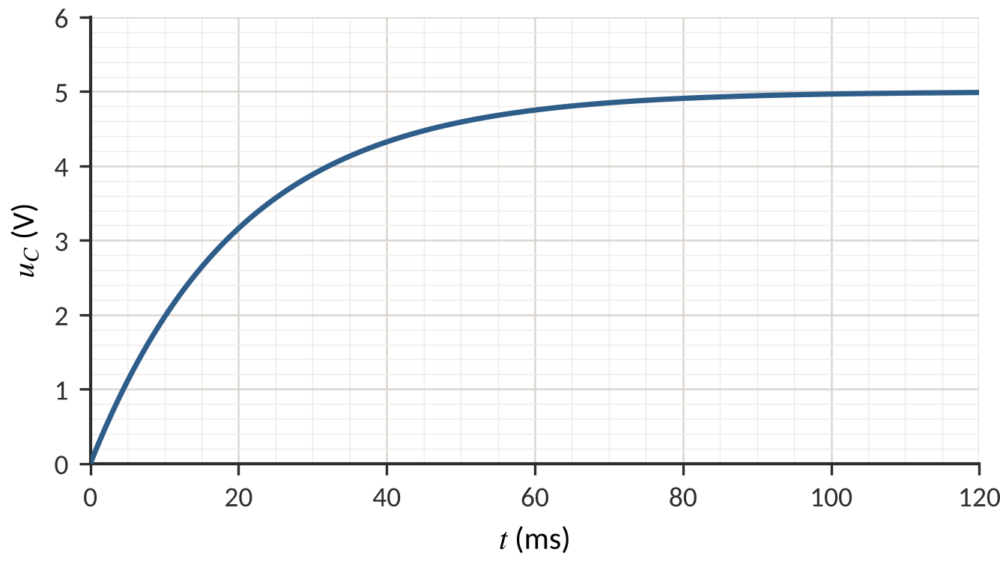
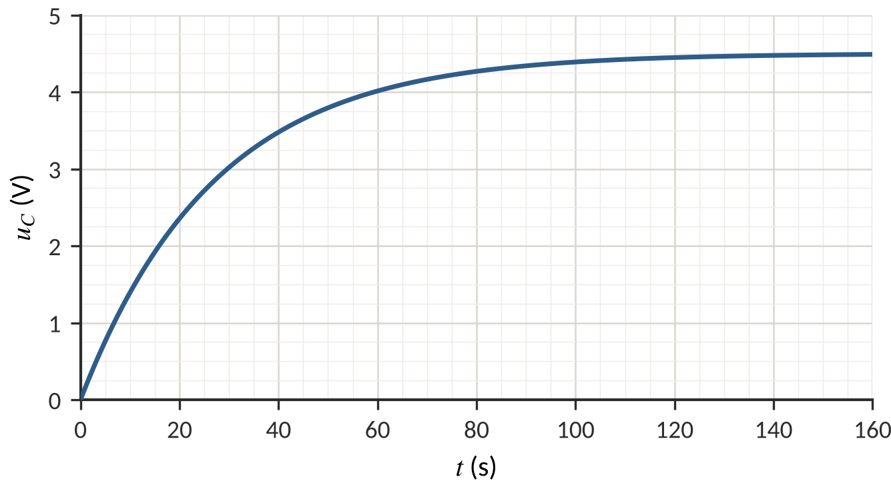
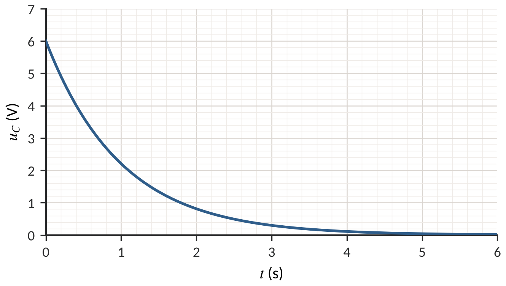
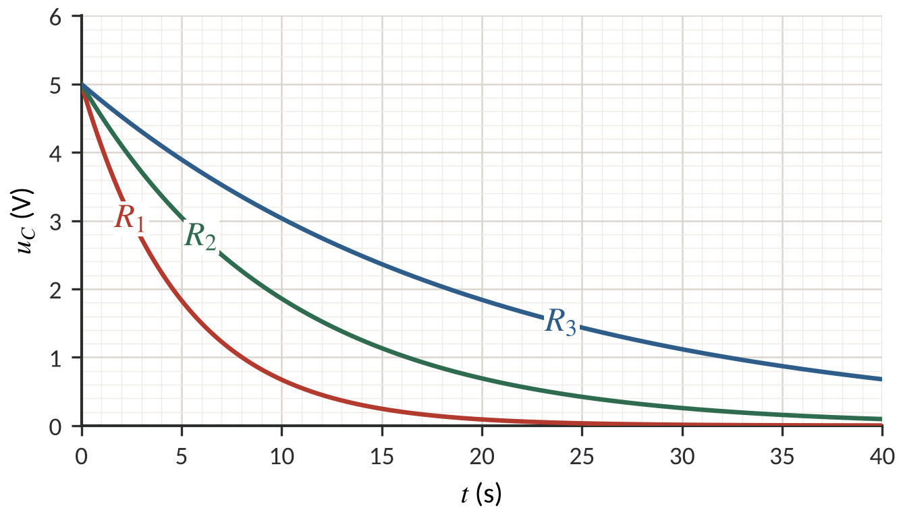
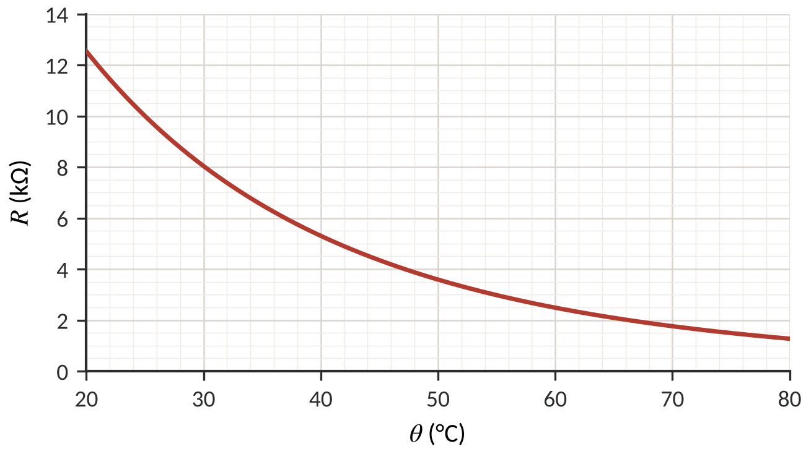
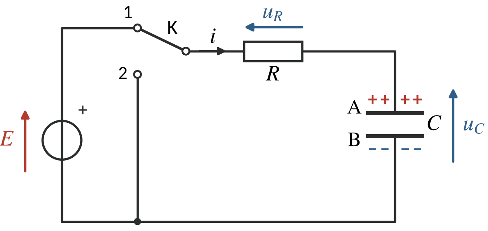
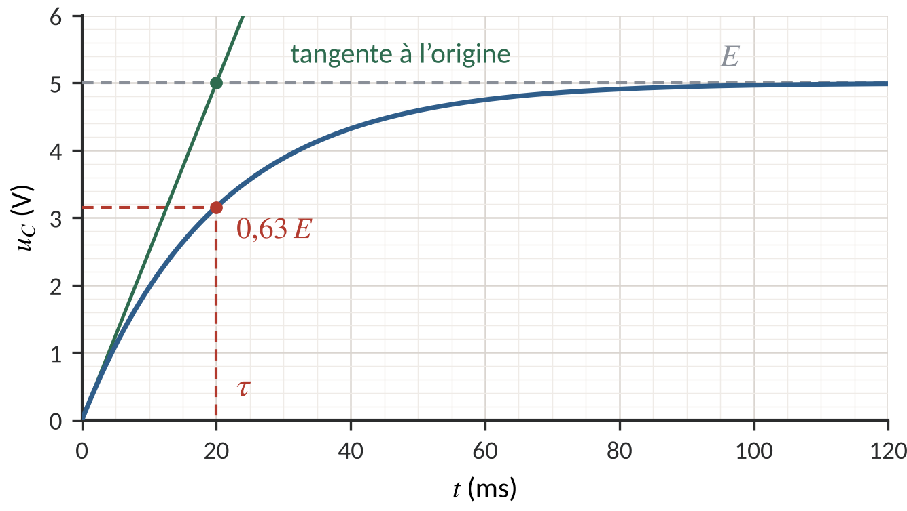
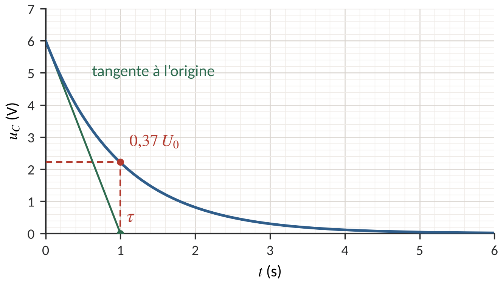
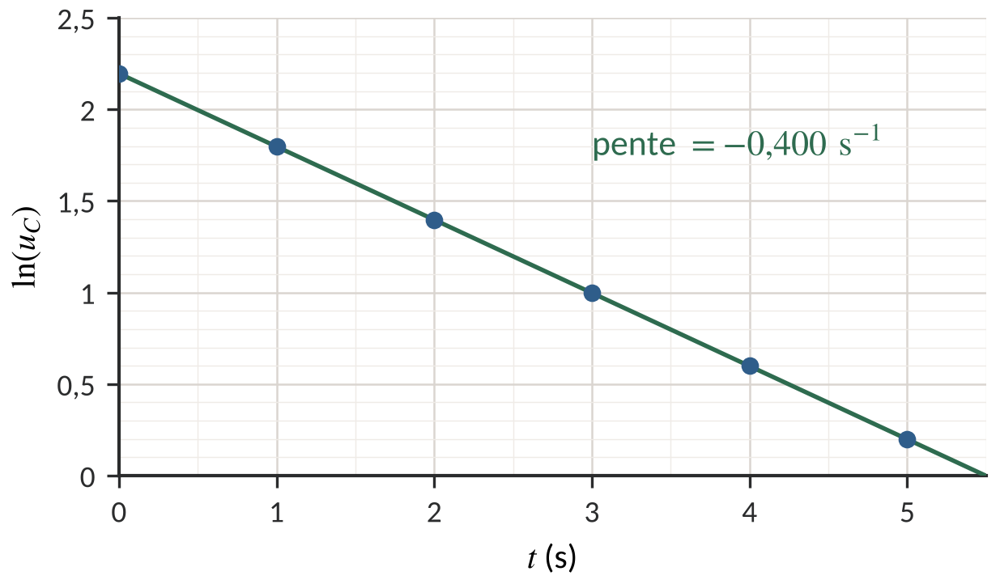

<!--meta {"numero": "8", "matiere": "Physique-Chimie", "titre": "Circuit RC : condensateur, charge et décharge", "titre_court": "Condensateur et circuit RC", "fichier": "MasterBac_PC_Fiche8_Circuit_RC", "fichier_cahier": "MasterBac_PC_Fiche8_Cahier_enonces"} -->

<!--inclure:ouverture-->

# L'essentiel en une page {#essentiel}

::: {custom-style="Rubrique"}
À connaître par cœur
:::

<!--colonnes: 20 42 38-->

| Notion | Relation | À retenir |
|---|---|---|
| Intensité | $i = \dfrac{\mathrm{d}q}{\mathrm{d}t}$ | Débit de charges : $q$ en coulomb (C), $i$ en ampère (A). |
| Condensateur | $q_A = C \times u_C \quad \text{et} \quad i = C \times \dfrac{\mathrm{d}u_C}{\mathrm{d}t}$ | Convention récepteur : $i$ et $u_C$ fléchés en sens opposés. $q_B = -q_A$. |
| Constante de temps | $\tau = R \times C$ | Temps caractéristique, en seconde (s). |

::: {custom-style="Rubrique"}
À savoir retrouver
:::

<!--colonnes: 20 42 38-->

| Notion | Relation | Comment la retrouver |
|---|---|---|
| Charge sous $E$ | $\dfrac{\mathrm{d}u_C}{\mathrm{d}t} + \dfrac{u_C}{\tau} = \dfrac{E}{\tau} \quad \text{et} \quad u_C = E\left(1 - e^{-t/\tau}\right)$ | Loi des mailles et relations des dipôles, puis $u_C(0) = 0$ et valeur finale $E$. |
| Décharge | $\dfrac{\mathrm{d}u_C}{\mathrm{d}t} + \dfrac{u_C}{\tau} = 0 \quad \text{et} \quad u_C = U_0\, e^{-t/\tau}$ | Même démarche sans générateur, avec $u_C(0) = U_0$ et valeur finale nulle. |
| Valeurs remarquables | $u_C(\tau) = 0{,}63\,E$ (charge), $0{,}37\,U_0$ (décharge) | Remplacez $t$ par $\tau$, puis par $5\tau$ (fin). |
| Intensité pendant la charge | $i = \dfrac{E}{R}\, e^{-t/\tau} \quad \text{et} \quad u_R = E\, e^{-t/\tau}$ | Dérivez $u_C$ (relation du condensateur), puis appliquez la loi d'Ohm. |
| Instant d'un seuil $U_s$ | $t_s = \tau \ln \dfrac{E}{E - U_s}$ (charge), $\tau \ln \dfrac{U_0}{U_s}$ (décharge) | Écrivez $u_C(t_s) = U_s$, isolez l'exponentielle, puis prenez le logarithme. |

::: {custom-style="Rubrique"}
Fourni par l'énoncé, à savoir exploiter
:::

Condensateur plan ($C$ croît avec $S$ et $\varepsilon_r$, décroît avec $e$), $\varepsilon_0$, énergie stockée, souvent la solution.

::: {custom-style="Rubrique"}
Les pièges qui coûtent des points
:::

- Écrire $i = C \times \mathrm{d}u_C/\mathrm{d}t$ sans vérifier la convention récepteur : sinon, il manque un signe moins.
- Lire $\tau$ à 63 % de la tension initiale pendant une décharge : à $t = \tau$, il en reste 37 %.
- Oublier les préfixes : $1\ \text{µF} = 10^{-6}\ \text{F}$, $1\ \text{nF} = 10^{-9}\ \text{F}$ et $1\ \text{pF} = 10^{-12}\ \text{F}$.

::: {custom-style="Rubrique"}
Votre parcours selon votre objectif
:::

| Objectif | Questions de cours | Exercices |
|---|---|---|
| [\ Objectif 10\ ]{custom-style="Niv10"} | Q.1 à Q.4, Q.6 à Q.9, Q.12 à Q.14, Q.17 | Ex. 1 et Ex. 2 (questions 1 à 3), Ex. 3 (questions 1, 2 et 4), Ex. 4 (questions 1 à 4) |
| [\ Objectif 14\ ]{custom-style="Niv14"} | Plus Q.5, Q.10, Q.11, Q.15, Q.18, Q.19 | Tous, sauf Ex. 4 (question 7) |
| [\ Objectif 18\ ]{custom-style="Niv18"} | Toutes | Tous |

```{=openxml}
<w:p><w:r><w:br w:type="page"/></w:r></w:p>
```

# Ce qui est tombé aux BAC 2025 et 2026 {#tombe}

Les notions de cette fiche ont été demandées dans au moins sept exercices des sessions 2025 et 2026. Le tableau indique, pour chacun, ce qui était mobilisé et où s'y préparer dans la fiche.

<!--colonnes: 19 20 43 18-->

| Session | Exercice | Notions de cette fiche | Pour s'y préparer |
|---|---|---|---|
| Métropole, juin 2026, jour 1 | Étude d'un lave-linge | Partie 2 : équation de charge, tension aux bornes du conducteur ohmique, instant de fin de temporisation, choix d'une résistance, début de la décharge, constante de temps lue sur un enregistrement | Q.6, Q.7, Q.9 à Q.11, Q.15, Ex. 2 |
| Asie 2026, jour 2 | Jeu d'évasion | Partie 2 : équation de décharge et sa solution, durée entre deux seuils de tension, constante de temps lue sur des courbes, résistance à régler | Q.13, Q.14, Ex. 3 |
| Centres étrangers 2026, jour 1 | Étude d'une harpe électrique au service des abeilles domestiques | Partie 3 : équation de charge, constante de la solution, constante de temps, capacité, énergie libérée sous $1\ 500\ \text{V}$ | Q.6, Q.7, Q.9, Q.12 |
| Polynésie 2026, jour 2 | Mesure du niveau d'un liquide | Capteur capacitif, relation entre $i$ et $u_C$, équation de charge, 63 %, constante de temps, étalonnage et volume de liquide | Q.3, Q.6, Q.8, Q.9, Q.17, Ex. 4 |
| Métropole, juin 2025, jour 2 | Mesure de l'épaisseur d'un film alimentaire | Partie 1 : équation de charge, constante de la solution, constante de temps, capacité, condensateur plan, épaisseur du film | Q.4, Q.6, Q.7, Q.9 |
| Métropole, septembre 2025, jour 1 | La physique au service du vigneron | Partie 1 : capteur de niveau capacitif, capacité d'un condensateur plan selon la hauteur de liquide, équation de charge, constantes de la solution, constante de temps | Q.4 à Q.7, Q.9, Q.17, Ex. 4 |
| Asie 2025, jour 2 | Paiement sans contact | Relation entre $i$ et $u_C$, équation de charge, unité de $\tau$, vérification de la solution, constante de temps, validité du modèle | Q.3, Q.6 à Q.9 |

::: {custom-style="Intertitre"}
Ce qu'il faut en retenir
:::

- L'équation différentielle et la constante de temps sont demandées dans les sept exercices : on établit l'équation par la loi des mailles, puis on lit $\tau$ sur une courbe pour en déduire $R$ ou $C$ (Q.6, Q.9, Q.13, Q.14).
- Trois exercices utilisent le condensateur comme capteur : la grandeur mesurée, épaisseur d'un film ou hauteur d'un liquide, modifie la capacité, que l'on déduit de $\tau$ (Q.4, Q.5, Q.17, Ex. 4).
- Deux sujets de 2026 demandent un instant ou une durée entre deux seuils de tension : on isole l'exponentielle, puis on prend le logarithme (Q.10, Ex. 2, Ex. 3).
- La décharge apparaît dans deux sujets, et l'énergie stockée, dont l'expression est toujours donnée par l'énoncé, dans un seul : ce sont des points faciles à gagner (Q.12 à Q.16).

::: {custom-style="Surtitre"}
Énoncés
:::

# Thème 1 : condensateur et capacité {#theme1}

::: {custom-style="Rubrique"}
Questions de cours
:::

## [Q.1]{custom-style="QNum"}\ \ Relier l'intensité d'un courant au débit de charges électriques {#q1}

::: {custom-style="Meta"}
[\ Objectif 10\ ]{custom-style="Niv10"}\ \ Cours · Notions : charge électrique, régime variable\ \ \ [CIBLE:c_q1]{custom-style="BoutonCorrige"}
:::

::: {custom-style="Enonce"}
Application : un coup de foudre transporte environ $5{,}0\ \text{C}$ du nuage au sol en $0{,}20\ \text{ms}$. Calculer l'intensité moyenne.
:::

## [Q.2]{custom-style="QNum"}\ \ Décrire le modèle du condensateur et placer les charges sur ses armatures {#q2}

::: {custom-style="Meta"}
[\ Objectif 10\ ]{custom-style="Niv10"}\ \ Cours · Notions : armatures, isolant, relation entre charge et tension\ \ \ [CIBLE:c_q2]{custom-style="BoutonCorrige"}
:::

::: {custom-style="Enonce"}
Application : dans le circuit de la figure 1, K est en position 1 et le condensateur se charge. Indiquer le signe des charges des armatures A et B, puis calculer $q_A$ et $q_B$ pour $C = 470\ \text{µF}$ et $u_C = 6{,}0\ \text{V}$.
:::

::: {custom-style="Figure"}
{width=6.4cm}
:::

::: {custom-style="Legende"}
Figure 1. Circuit RC série : en position 1, le condensateur se charge ; en position 2, il se décharge
:::

## [Q.3]{custom-style="QNum"}\ \ Établir la relation entre l'intensité et la tension aux bornes d'un condensateur {#q3}

::: {custom-style="Meta"}
[\ Objectif 10\ ]{custom-style="Niv10"}\ \ Cours · Notions : convention récepteur, dérivée · Demandée en 2025 et 2026\ \ \ [CIBLE:c_q3]{custom-style="BoutonCorrige"}
:::

::: {custom-style="Enonce"}
Application : un condensateur de capacité $C = 22\ \text{µF}$, initialement déchargé, est chargé par un courant d'intensité constante $I = 0{,}10\ \text{mA}$. Calculer la tension à ses bornes au bout de $2{,}0\ \text{s}$.
:::

## [Q.4]{custom-style="QNum"}\ \ Exprimer la capacité d'un condensateur plan et citer des ordres de grandeur {#q4}

::: {custom-style="Meta"}
[\ Objectif 10\ ]{custom-style="Niv10"}\ \ Cours · Notions : permittivité, surface en regard, épaisseur · Demandée deux fois en 2025\ \ \ [CIBLE:c_q4]{custom-style="BoutonCorrige"}
:::

::: {custom-style="Enonce"}
Application : calculer la capacité de deux feuilles d'aluminium de $20\ \text{cm} \times 30\ \text{cm}$ séparées par du papier d'épaisseur $0{,}10\ \text{mm}$, de permittivité relative $3{,}0$ ($\varepsilon_0 = 8{,}85 \times 10^{-12}\ \text{F·m}^{-1}$).
:::

## [Q.5]{custom-style="QNum"}\ \ Prévoir l'effet de la géométrie et de l'isolant sur la capacité {#q5}

::: {custom-style="Meta"}
[\ Objectif 14\ ]{custom-style="Niv14"}\ \ Cours · Notions : proportionnalité, capteurs de déplacement · Demandée en 2025\ \ \ [CIBLE:c_q5]{custom-style="BoutonCorrige"}
:::

::: {custom-style="Enonce"}
Application : un condensateur plan à air a une capacité $C_0 = 12\ \text{pF}$. Que devient-elle si a) la distance $e$ entre les armatures passe de $0{,}50$ à $0{,}40\ \text{mm}$ ; b) l'air est remplacé par une huile ($\varepsilon_r = 2{,}2$) ; c) la surface en regard perd un tiers ?
:::

::: {custom-style="Rubrique"}
Exercices
:::

## [Exercice 1]{custom-style="QNum"}\ \ Le microphone électrostatique {#ex1}

::: {custom-style="Meta"}
[\ Objectif 10\ ]{custom-style="Niv10"}\ \ Entraînement · 4 points · 35 min · Questions 4 et 5 : objectif 14
:::

::: {custom-style="EnonceDonnees"}
Données : $\varepsilon_0 = 8{,}85 \times 10^{-12}\ \text{F·m}^{-1}$ ; permittivité relative de l'air : $\varepsilon_r = 1{,}00$ ; capacité d'un condensateur plan : $C = \dfrac{\varepsilon_0 \times \varepsilon_r \times S}{e}$.
:::

::: {custom-style="Enonce"}
Dans un microphone électrostatique, une membrane métallisée très fine fait face à une armature fixe. Ce sont deux disques de diamètre $d = 12{,}0\ \text{mm}$, séparés au repos par une couche d'air d'épaisseur $e_0 = 25{,}0\ \text{µm}$. Une source maintient une tension $U = 48\ \text{V}$ entre eux, à travers un conducteur ohmique de résistance $R = 1{,}0\ \text{MΩ}$ (figure 2). Quand un son arrive, la membrane vibre et la distance $e$ entre les armatures varie.
:::

::: {custom-style="Figure"}
{width=10cm}
:::

::: {custom-style="Legende"}
Figure 2. Principe d'un microphone électrostatique (échelle non respectée)
:::

::: {custom-style="Enonce"}

**1.** Pourquoi ce dispositif se comporte-t-il comme un condensateur ? Préciser ses armatures et son isolant.

**2.** Indiquer le signe de la charge portée par chacune des deux armatures.

**3.** Calculer la capacité $C_0$ du microphone au repos, puis la charge $q_0$ de l'armature chargée positivement. On admet que la tension aux bornes du condensateur reste égale à $U$.

**4.** Sous l'effet d'un son, la membrane se rapproche de l'armature fixe de $0{,}50\ \text{µm}$. Calculer la nouvelle capacité. La charge des armatures augmente-t-elle ou diminue-t-elle ? En déduire le sens du courant dans le conducteur ohmique.

**5.** Ce déplacement dure $0{,}25\ \text{ms}$. Calculer l'intensité moyenne du courant, puis la tension moyenne $u_R$ aux bornes du conducteur ohmique : c'est le signal électrique du microphone. Comparer $u_R$ à $U$ et commenter l'hypothèse de la question 3.
:::

::: {custom-style="Renvoi"}
[CIBLE:c_ex1]{custom-style="BoutonCorrige"}
:::

::: {custom-style="Surtitre"}
Énoncés
:::

# Thème 2 : charge d'un condensateur {#theme2}

::: {custom-style="Rubrique"}
Questions de cours
:::

## [Q.6]{custom-style="QNum"}\ \ Établir l'équation différentielle de la charge d'un condensateur {#q6}

::: {custom-style="Meta"}
[\ Objectif 10\ ]{custom-style="Niv10"}\ \ Cours · Notions : loi des mailles, loi d'Ohm · Six sujets en 2025 et 2026\ \ \ [CIBLE:c_q6]{custom-style="BoutonCorrige"}
:::

::: {custom-style="Enonce"}
Application : dans le circuit de la figure 1, le condensateur est déchargé et l'on bascule K en position 1 à la date $t = 0$. Montrer que la tension $u_C$ vérifie l'équation $\dfrac{\mathrm{d}u_C}{\mathrm{d}t} + \dfrac{u_C}{\tau} = \dfrac{E}{\tau}$, et exprimer $\tau$.
:::

## [Q.7]{custom-style="QNum"}\ \ Résoudre l'équation différentielle de la charge {#q7}

::: {custom-style="Meta"}
[\ Objectif 10\ ]{custom-style="Niv10"}\ \ Cours · Notions : solution exponentielle · Cinq sujets en 2025 et 2026\ \ \ [CIBLE:c_q7]{custom-style="BoutonCorrige"}
:::

::: {custom-style="Enonce"}
Application : dans la situation de Q.6 (condensateur déchargé à la date $t = 0$), la solution est de la forme $u_C(t) = A \times e^{-t/\tau} + B$. Déterminer $A$ et $B$. Avec $E = 5{,}0\ \text{V}$ et $\tau = 2{,}0\ \text{s}$, calculer $u_C$ aux dates $t = 1{,}0\ \text{s}$ et $t = 10\ \text{s}$.
:::

## [Q.8]{custom-style="QNum"}\ \ Interpréter la constante de temps $\tau = RC$ {#q8}

::: {custom-style="Meta"}
[\ Objectif 10\ ]{custom-style="Niv10"}\ \ Cours · Notions : unité, durée de la charge · Demandée en 2025 et 2026\ \ \ [CIBLE:c_q8]{custom-style="BoutonCorrige"}
:::

::: {custom-style="Enonce"}
Application : on charge un condensateur de capacité $C = 470\ \text{µF}$ à travers un conducteur ohmique de résistance $R = 10\ \text{kΩ}$. Calculer $\tau$, puis estimer la durée de la charge. Quelle résistance faudrait-il pour obtenir $\tau = 2{,}0\ \text{s}$ ?
:::

## [Q.9]{custom-style="QNum"}\ \ Déterminer graphiquement la constante de temps et en déduire la capacité {#q9}

::: {custom-style="Meta"}
[\ Objectif 10\ ]{custom-style="Niv10"}\ \ Cours · Notions : 63 %, tangente à l'origine · Six sujets en 2025 et 2026\ \ \ [CIBLE:c_q9]{custom-style="BoutonCorrige"}
:::

::: {custom-style="Enonce"}
Application : la figure 3 montre la charge d'un condensateur sous $E = 5{,}0\ \text{V}$, à travers un conducteur ohmique de résistance $R = 10\ \text{kΩ}$. Déterminer $\tau$ par deux méthodes, puis la capacité du condensateur.
:::

::: {custom-style="Figure"}
{width=10cm}
:::

::: {custom-style="Legende"}
Figure 3. Charge d'un condensateur sous une tension de 5,0 V
:::

## [Q.10]{custom-style="QNum"}\ \ Calculer l'instant où la tension atteint une valeur seuil {#q10}

::: {custom-style="Meta"}
[\ Objectif 14\ ]{custom-style="Niv14"}\ \ Cours · Notions : logarithme népérien · Demandée en 2026\ \ \ [CIBLE:c_q10]{custom-style="BoutonCorrige"}
:::

::: {custom-style="Enonce"}
Application : le condensateur de Q.9 commande une veilleuse, qui s'allume dès que $u_C$ atteint $U_s = 4{,}0\ \text{V}$. À quelle date s'allume-t-elle ? Répondre par le calcul, puis vérifier sur la figure 3.
:::

## [Q.11]{custom-style="QNum"}\ \ Exprimer l'intensité du courant et la tension aux bornes du conducteur ohmique pendant la charge {#q11}

::: {custom-style="Meta"}
[\ Objectif 14\ ]{custom-style="Niv14"}\ \ Cours · Notions : dérivée, intensité maximale · Demandée en 2026\ \ \ [CIBLE:c_q11]{custom-style="BoutonCorrige"}
:::

::: {custom-style="Enonce"}
Application : avec les valeurs de Q.9, calculer l'intensité du courant à la fermeture du circuit, puis à la date $t = \tau$. Au bout de combien de temps l'intensité est-elle divisée par 10 ?
:::

## [Q.12]{custom-style="QNum"}\ \ Calculer l'énergie stockée dans un condensateur chargé {#q12}

::: {custom-style="Meta"}
[\ Objectif 10\ ]{custom-style="Niv10"}\ \ Cours · Notions : énergie, relation donnée · Demandée en 2026\ \ \ [CIBLE:c_q12]{custom-style="BoutonCorrige"}
:::

::: {custom-style="Enonce"}
Application : le condensateur d'un défibrillateur, de capacité $C = 32\ \text{µF}$, est chargé sous une tension de $5{,}0\ \text{kV}$. Calculer l'énergie qu'il stocke. Donnée : $E_{\text{cond}} = \dfrac{1}{2}\, C\, U^2$.
:::

::: {custom-style="Rubrique"}
Exercices
:::

### [Exercice 2]{custom-style="QNum"}\ \ La temporisation d'un lave-linge [(voir BAC Métropole, juin 2026)]{custom-style="VoirBac"} {#ex2}

::: {custom-style="Meta"}
[\ Objectif 10\ ]{custom-style="Niv10"}\ \ [Type BAC]{custom-style="TagBac"} · 5 points · 45 min · Questions 4 à 6 : objectif 14
:::

::: {custom-style="MentionBac"}
[Sujet du BAC correspondant.]{custom-style="EtiqBac"} Métropole, juin 2026, jour 1, exercice 1 : « Étude d'un lave-linge » (partie 2 : durée de temporisation).
:::

::: {custom-style="EnonceDonnees"}
Données : $E = 4{,}5\ \text{V}$ ; capacité du condensateur : $C = 4{,}70\ \text{mF}$, à $20\ \%$ près selon le fabricant ; résistances disponibles : $470\ \text{Ω}$, $5{,}0\ \text{kΩ}$ et $100\ \text{kΩ}$.
:::

::: {custom-style="Enonce"}
Avant la vidange, le tambour d'un lave-linge doit tourner pendant environ $30\ \text{s}$. Cette durée est fixée par un temporisateur, modélisé par le circuit de la figure 1. À la date $t = 0$, le condensateur est déchargé et l'on bascule K en position 1. Un comparateur surveille la tension $u_R$ aux bornes du conducteur ohmique : la temporisation s'arrête quand $u_R$ devient égale à $\dfrac{E}{3}$.

**1.** Établir l'équation différentielle vérifiée par la tension $u_C$ pendant la charge.

**2.** La solution est de la forme $u_C(t) = A\left(1 - e^{-t/\tau}\right)$, avec $\tau = RC$. Déterminer $A$.

**3.** En déduire l'expression de la tension $u_R(t)$.

**4.** Montrer que la temporisation s'arrête à la date $t_{\text{seuil}} = \tau \ln 3$.

**5.** Quelle résistance faut-il choisir ? Calculer la durée de la temporisation obtenue.

**6.** Avec la résistance choisie, on enregistre la charge du condensateur (figure 4). Déterminer la constante de temps. Est-elle compatible avec les indications du fabricant ? Quelle est la durée réelle de la temporisation ?
:::

::: {custom-style="Figure"}
{width=10cm}
:::

::: {custom-style="Legende"}
Figure 4. Charge du condensateur du temporisateur
:::

::: {custom-style="Renvoi"}
[CIBLE:c_ex2]{custom-style="BoutonCorrige"}
:::

::: {custom-style="Surtitre"}
Énoncés
:::

# Thème 3 : décharge d'un condensateur {#theme3}

::: {custom-style="Rubrique"}
Questions de cours
:::

## [Q.13]{custom-style="QNum"}\ \ Établir et résoudre l'équation différentielle de la décharge {#q13}

::: {custom-style="Meta"}
[\ Objectif 10\ ]{custom-style="Niv10"}\ \ Cours · Notions : loi des mailles, solution exponentielle · Demandée en 2026\ \ \ [CIBLE:c_q13]{custom-style="BoutonCorrige"}
:::

::: {custom-style="Enonce"}
Application : le condensateur du circuit de la figure 1 est chargé sous la tension $U_0$. À la date $t = 0$, on bascule K en position 2. Établir l'équation différentielle vérifiée par $u_C$, puis la résoudre.
:::

## [Q.14]{custom-style="QNum"}\ \ Déterminer la constante de temps sur une courbe de décharge {#q14}

::: {custom-style="Meta"}
[\ Objectif 10\ ]{custom-style="Niv10"}\ \ Cours · Notions : 37 %, tangente à l'origine · Demandée en 2026\ \ \ [CIBLE:c_q14]{custom-style="BoutonCorrige"}
:::

::: {custom-style="Enonce"}
Application : la figure 5 montre la décharge d'un condensateur à travers un conducteur ohmique de résistance $R = 10\ \text{kΩ}$. Déterminer $\tau$ par deux méthodes, puis la capacité du condensateur.
:::

::: {custom-style="Figure"}
{width=9cm}
:::

::: {custom-style="Legende"}
Figure 5. Décharge d'un condensateur chargé sous 6,0 V
:::

## [Q.15]{custom-style="QNum"}\ \ Exprimer l'intensité pendant la décharge et interpréter son signe {#q15}

::: {custom-style="Meta"}
[\ Objectif 14\ ]{custom-style="Niv14"}\ \ Cours · Notions : convention récepteur, sens réel du courant · Demandée en 2026\ \ \ [CIBLE:c_q15]{custom-style="BoutonCorrige"}
:::

::: {custom-style="Enonce"}
Application : un défibrillateur décharge son condensateur ($C = 32\ \text{µF}$, chargé sous $5{,}0\ \text{kV}$) à travers le thorax du patient, modélisé par un conducteur ohmique de $50\ \text{Ω}$. Calculer la constante de temps et l'intensité au début de la décharge.
:::

## [Q.16]{custom-style="QNum"}\ \ Linéariser une courbe de décharge pour déterminer $\tau$ avec précision {#q16}

::: {custom-style="Meta"}
[\ Objectif 18\ ]{custom-style="Niv18"}\ \ Cours · Notions : logarithme népérien, régression linéaire\ \ \ [CIBLE:c_q16]{custom-style="BoutonCorrige"}
:::

::: {custom-style="Enonce"}
Application : on a relevé la tension aux bornes d'un condensateur qui se décharge. Montrer que $\ln(u_C)$, $u_C$ en volt, est une fonction affine du temps, puis déterminer $\tau$ avec toutes les mesures.
:::

| *t* (s) | 0 | 1,0 | 2,0 | 3,0 | 4,0 | 5,0 |
|---|---|---|---|---|---|---|
| *u*~C~ (V) | 9,00 | 6,03 | 4,04 | 2,71 | 1,82 | 1,22 |

::: {custom-style="Rubrique"}
Exercices
:::

### [Exercice 3]{custom-style="QNum"}\ \ Le coffre-fort du jeu d'évasion [(voir BAC Asie 2026)]{custom-style="VoirBac"} {#ex3}

::: {custom-style="Meta"}
[\ Objectif 10\ ]{custom-style="Niv10"}\ \ [Type BAC]{custom-style="TagBac"} · 5 points · 45 min · Questions 3, 5 et 6 : objectif 14
:::

::: {custom-style="MentionBac"}
[Sujet du BAC correspondant.]{custom-style="EtiqBac"} Asie 2026, jour 2, exercice 1 : « Jeu d'évasion » (partie 2 : résistance à régler).
:::

::: {custom-style="EnonceDonnees"}
Données : $C = 47\ \text{µF}$ ; $U_0 = 5{,}0\ \text{V}$ ; énergie stockée dans un condensateur : $E_{\text{cond}} = \dfrac{1}{2}\, C\, u_C^2$.
:::

::: {custom-style="Enonce"}
Dans un jeu d'évasion, un coffre-fort ne s'ouvre que si l'aiguille d'une horloge, partie de zéro, s'arrête exactement sur la graduation $14\ \text{s}$. L'aiguille tourne pendant la décharge d'un condensateur, dans le circuit de la figure 1 : elle démarre quand $u_C$ descend à $4{,}0\ \text{V}$ et s'arrête quand $u_C$ atteint $1{,}0\ \text{V}$. Les joueurs règlent la résistance $R$ du conducteur ohmique. Le condensateur est chargé sous la tension $U_0$, puis K est basculé en position 2 à la date $t = 0$.

**1.** Établir l'équation différentielle vérifiée par $u_C$, et exprimer la constante de temps $\tau$.

**2.** Vérifier que $u_C(t) = A \times e^{-t/\tau}$ est solution de cette équation, puis déterminer $A$.

**3.** Exprimer les dates $t_1$ et $t_2$ du départ et de l'arrêt de l'aiguille, puis montrer que l'aiguille tourne pendant $\Delta t = \tau \ln 4$.

**4.** En déduire la constante de temps, puis la résistance que les joueurs doivent régler.

**5.** La figure 6 montre la décharge pour trois réglages de la résistance. Déterminer graphiquement le réglage qui ouvre le coffre.

**6.** Calculer l'énergie dissipée dans le conducteur ohmique pendant que l'aiguille tourne.
:::

::: {custom-style="Figure"}
{width=10cm}
:::

::: {custom-style="Legende"}
Figure 6. Décharge du condensateur pour trois réglages *R*~1~, *R*~2~ et *R*~3~ de la résistance
:::

::: {custom-style="Renvoi"}
[CIBLE:c_ex3]{custom-style="BoutonCorrige"}
:::

::: {custom-style="Surtitre"}
Énoncés
:::

# Thème 4 : mesurer avec un circuit RC {#theme4}

::: {custom-style="Rubrique"}
Questions de cours
:::

## [Q.17]{custom-style="QNum"}\ \ Expliquer le principe de fonctionnement d'un capteur capacitif {#q17}

::: {custom-style="Meta"}
[\ Objectif 10\ ]{custom-style="Niv10"}\ \ Cours · Notions : capacité variable, mesure de τ · Demandée en 2025 et 2026\ \ \ [CIBLE:c_q17]{custom-style="BoutonCorrige"}
:::

::: {custom-style="Enonce"}
Application : quand un doigt s'approche d'une touche tactile, la capacité de son électrode passe de $10\ \text{pF}$ à $12\ \text{pF}$. Un microcontrôleur charge cette électrode à travers un conducteur ohmique de résistance $R = 1{,}0\ \text{MΩ}$. Comment détecte-t-il le doigt ?
:::

## [Q.18]{custom-style="QNum"}\ \ Exploiter un capteur capacitif à épaisseur variable : la balance {#q18}

::: {custom-style="Meta"}
[\ Objectif 14\ ]{custom-style="Niv14"}\ \ Cours · Notions : condensateur plan, ressort · Voir BAC 2022 (Centres étrangers)\ \ \ [CIBLE:c_q18]{custom-style="BoutonCorrige"}
:::

::: {custom-style="Enonce"}
Application : le plateau d'une balance repose sur des ressorts de raideur totale $k = 1{,}5 \times 10^{4}\ \text{N·m}^{-1}$. Sous le plateau, une armature de $5{,}0\ \text{cm} \times 4{,}0\ \text{cm}$ fait face à une armature fixe, à la distance $e_0 = 0{,}40\ \text{mm}$ quand le plateau est vide ; l'isolant est l'air. On pose un objet, qui fait descendre le plateau. Avec un conducteur ohmique de résistance $R = 10\ \text{MΩ}$, on mesure alors une constante de temps $\tau = 0{,}50\ \text{ms}$. Calculer la masse de l'objet. Données : $\varepsilon_0 = 8{,}85 \times 10^{-12}\ \text{F·m}^{-1}$ ; $g = 9{,}81\ \text{m·s}^{-2}$ ; quand le plateau descend de $\Delta e$, la force exercée par les ressorts augmente de $k \times \Delta e$.
:::

## [Q.19]{custom-style="QNum"}\ \ Exploiter un circuit RC dont la résistance dépend de la température {#q19}

::: {custom-style="Meta"}
[\ Objectif 14\ ]{custom-style="Niv14"}\ \ Cours · Notions : thermistance, courbe d'étalonnage\ \ \ [CIBLE:c_q19]{custom-style="BoutonCorrige"}
:::

::: {custom-style="Enonce"}
Application : une sonde de température associe une thermistance, dont la résistance varie avec la température selon la figure 7, et un condensateur de capacité $C = 1{,}0\ \text{µF}$. On mesure la constante de temps de la charge : $\tau = 4{,}0\ \text{ms}$. Quelle est la température de la sonde ?
:::

::: {custom-style="Figure"}
{width=10cm}
:::

::: {custom-style="Legende"}
Figure 7. Résistance de la thermistance en fonction de la température
:::

::: {custom-style="Rubrique"}
Exercices
:::

### [Exercice 4]{custom-style="QNum"}\ \ Le niveau d'huile dans un fût [(voir BAC Polynésie 2026)]{custom-style="VoirBac"} {#ex4}

::: {custom-style="Meta"}
[\ Objectif 10\ ]{custom-style="Niv10"}\ \ [Type BAC]{custom-style="TagBac"} · 6 points · 55 min · Questions 5 et 6 : objectif 14, question 7 : objectif 18
:::

::: {custom-style="MentionBac"}
[Sujet du BAC correspondant.]{custom-style="EtiqBac"} Polynésie 2026, jour 2, exercice 2 : « Mesure du niveau d'un liquide » (capteur capacitif, constante de temps, étalonnage et volume de liquide).
:::

::: {custom-style="EnonceDonnees"}
Données : permittivités relatives : air $1{,}0$ ; huile $2{,}2$ ; volume d'un cylindre de diamètre $D$ et de hauteur $H$ : $V = \dfrac{\pi \times D^2}{4} \times H$.
:::

::: {custom-style="Enonce"}
Un fût cylindrique opaque, de diamètre $D = 0{,}580\ \text{m}$, contient de l'huile. Pour connaître le niveau sans le voir, on y a installé verticalement un capteur formé de deux plaques métalliques parallèles, de $80\ \text{cm}$ de haut, dont le bas est à $5{,}0\ \text{cm}$ du fond. Entre les plaques, il y a de l'huile jusqu'à la hauteur $h$, comptée depuis le bas du capteur, puis de l'air. Pour mesurer la capacité $C$ du capteur, on le charge sous $E = 5{,}0\ \text{V}$ à travers un conducteur ohmique de résistance $R = 330\ \text{kΩ}$, dans un circuit identique à celui de la figure 1, K en position 1 (figure 8, graphique a). Le graphique b donne la capacité du capteur en fonction de $h$.

**1.** Expliquer pourquoi la capacité du capteur augmente quand le niveau d'huile monte.

**2.** Rappeler la relation entre l'intensité $i$ et la tension $u_C$, puis établir l'équation différentielle vérifiée par $u_C$ pendant la charge.

**3.** La solution est $u_C(t) = E\left(1 - e^{-t/\tau}\right)$. Montrer qu'à la date $t = \tau$, $u_C$ vaut environ $63\ \%$ de $E$, et calculer cette tension.

**4.** Comment la durée de la charge complète du capteur varie-t-elle quand le niveau d'huile monte ?

**5.** Déterminer $\tau$ sur le graphique a, puis la capacité du capteur.

**6.** Déterminer la hauteur d'huile dans le fût, puis le volume d'huile qu'il contient.

**7.** Le microcontrôleur mesure $\tau$ à $1\ \text{µs}$ près. Avec quelle précision connaît-on la hauteur d'huile ?
:::

::: {custom-style="Figure"}
{width=15cm}
:::

::: {custom-style="Legende"}
Figure 8. a. Charge du capteur ; b. Capacité du capteur selon la hauteur h d'huile entre les plaques
:::

::: {custom-style="Renvoi"}
[CIBLE:c_ex4]{custom-style="BoutonCorrige"}
:::

<!--debut:complet-->
::: {custom-style="Surtitre"}
Corrigés
:::

# Corrigés du thème 1 : condensateur et capacité {#c_theme1}

#### [Corrigé]{custom-style="NumCorrige"}\ \ Q.1 · Relier l'intensité d'un courant au débit de charges électriques {#c_q1}

::: {custom-style="Renvoi"}
[CIBLE:q1]{custom-style="BoutonEnonce"}
:::

L'intensité d'un courant mesure le débit de charges électriques à travers une section du circuit : c'est la charge qui traverse cette section par unité de temps.

- En régime continu, ce débit est constant : une charge $Q$ traverse la section pendant la durée $\Delta t$, et $I = \dfrac{Q}{\Delta t}$.
- En régime variable, l'intensité change à chaque instant. On la définit sur une durée très courte $\mathrm{d}t$, pendant laquelle passe la charge $\mathrm{d}q$ : l'intensité est la dérivée de la charge par rapport au temps.

::: {custom-style="Retenir"}
$i(t) = \dfrac{\mathrm{d}q}{\mathrm{d}t}$
:::

La charge s'exprime en coulomb (C), le temps en seconde et l'intensité en ampère : $1\ \text{A} = 1\ \text{C·s}^{-1}$.

**Application numérique.** On calcule une intensité moyenne, avec $\Delta t = 0{,}20\ \text{ms} = 0{,}20 \times 10^{-3}\ \text{s}$ :

$$I = \dfrac{Q}{\Delta t} = \dfrac{5{,}0}{0{,}20 \times 10^{-3}} = 2{,}5 \times 10^{4}\ \text{A}$$

Le courant de foudre atteint $25\ \text{kA}$, des milliers de fois l'intensité qui traverse un appareil électrique domestique.

::: {custom-style="Piege"}
[Piège.]{custom-style="EtiqPiege"} Ne confondez pas la capacité $C$ d'un condensateur, une grandeur qui s'exprime en farad, et le coulomb, l'unité de charge, de symbole C. Dans un calcul, la capacité est écrite en italique, l'unité en caractère droit.
:::

#### [Corrigé]{custom-style="NumCorrige"}\ \ Q.2 · Décrire le modèle du condensateur et placer les charges sur ses armatures {#c_q2}

::: {custom-style="Renvoi"}
[CIBLE:q2]{custom-style="BoutonEnonce"}
:::

Un condensateur est formé de deux conducteurs en regard, les armatures, séparés par un isolant : air, papier, plastique ou céramique. Le courant ne traverse pas l'isolant. Pendant la charge, des électrons quittent une armature, parcourent le reste du circuit et s'accumulent sur l'autre armature. Les deux armatures portent alors des charges opposées :

$$q_B = -q_A$$

**Signe des charges.** K en position 1, le courant sort de la borne positive du générateur, traverse le conducteur ohmique et arrive sur l'armature A : il y apporte des charges positives, puisque des électrons quittent A dans l'autre sens. L'armature A se charge positivement, l'armature B négativement.

::: {custom-style="Figure"}
{width=8.7cm}
:::

::: {custom-style="Legende"}
Figure 9. Charges des armatures pendant la charge (K en position 1)
:::

**Relation entre charge et tension.** La charge de l'armature A est proportionnelle à la tension $u_C = u_{AB} = V_A - V_B$, fléchée vers l'armature A. Les grandeurs $V_A$ et $V_B$ sont les potentiels électriques des armatures ; l'armature positive est celle dont le potentiel est le plus élevé. Ainsi :

::: {custom-style="Retenir"}
$q_A = C \times u_C$
:::

Le coefficient $C$ est la capacité du condensateur, en farad (F). Plus la capacité est grande, plus le condensateur stocke de charge sous une même tension.

**Application numérique.** Avec $C = 470\ \text{µF} = 470 \times 10^{-6}\ \text{F}$ :

$$q_A = 470 \times 10^{-6} \times 6{,}0 = 2{,}8 \times 10^{-3}\ \text{C} \qquad q_B = -2{,}8 \times 10^{-3}\ \text{C}$$

::: {custom-style="Methode"}
[Méthode.]{custom-style="EtiqMethode"} Pour trouver l'armature positive pendant une charge, suivez le courant depuis la borne positive du générateur : l'armature sur laquelle il arrive se charge positivement.
:::

::: {custom-style="Remarque"}
[Remarque.]{custom-style="EtiqRemarque"} On retrouve des charges opposées sur des surfaces en regard dans bien d'autres situations : la base d'un nuage d'orage et le sol, les deux faces de la membrane d'une cellule nerveuse, un doigt posé sur un écran tactile et l'électrode située sous la vitre. Ces systèmes ont un comportement capacitif.
:::

#### [Corrigé]{custom-style="NumCorrige"}\ \ Q.3 · Établir la relation entre l'intensité et la tension aux bornes d'un condensateur {#c_q3}

::: {custom-style="Renvoi"}
[CIBLE:q3]{custom-style="BoutonEnonce"}
:::

L'intensité $i$ est orientée vers l'armature A. La charge qui arrive sur A pendant $\mathrm{d}t$ est $\mathrm{d}q_A$, donc, d'après Q.1 :

$$i = \dfrac{\mathrm{d}q_A}{\mathrm{d}t}$$

D'après Q.2, $q_A = C \times u_C$, et la capacité $C$ est une constante : elle sort de la dérivée.

$$i = \dfrac{\mathrm{d}(C \times u_C)}{\mathrm{d}t} = C \times \dfrac{\mathrm{d}u_C}{\mathrm{d}t}$$

::: {custom-style="Retenir"}
$i = C \times \dfrac{\mathrm{d}u_C}{\mathrm{d}t}$ en convention récepteur
:::

```{=openxml}
<w:p><w:r><w:br w:type="page"/></w:r></w:p>
```

Deux conséquences à connaître :

- si la tension est constante, $i = 0$ : en régime permanent, le condensateur ne laisse pas passer le courant, il se comporte comme un interrupteur ouvert ;
- la tension aux bornes d'un condensateur ne peut pas varier brusquement, car il faudrait une intensité infinie. Juste après une manœuvre de l'interrupteur, $u_C$ garde la valeur qu'elle avait juste avant.

**Application numérique.** L'intensité est constante, donc la tension croît à vitesse constante :

$$\dfrac{\mathrm{d}u_C}{\mathrm{d}t} = \dfrac{I}{C} \quad \text{donc} \quad u_C = \dfrac{I \times t}{C} = \dfrac{0{,}10 \times 10^{-3} \times 2{,}0}{22 \times 10^{-6}} = 9{,}1\ \text{V}$$

::: {custom-style="Piege"}
[Piège.]{custom-style="EtiqPiege"} Cette relation suppose la convention récepteur : $i$ et $u_C$ sont fléchés en sens opposés, comme sur la figure 1. Si la tension est fléchée dans le même sens que le courant, il faut écrire $i = -C \times \dfrac{\mathrm{d}u_C}{\mathrm{d}t}$.
:::

#### [Corrigé]{custom-style="NumCorrige"}\ \ Q.4 · Exprimer la capacité d'un condensateur plan et citer des ordres de grandeur {#c_q4}

::: {custom-style="Renvoi"}
[CIBLE:q4]{custom-style="BoutonEnonce"}
:::

Pour un condensateur plan, la capacité dépend de sa géométrie et de son isolant :

::: {custom-style="Retenir"}
$C = \dfrac{\varepsilon_0 \times \varepsilon_r \times S}{e}$
:::

- $S$ : surface des armatures en regard, en $\text{m}^2$ ;
- $e$ : distance entre les armatures, c'est-à-dire épaisseur de l'isolant, en mètre ;
- $\varepsilon_0 = 8{,}85 \times 10^{-12}\ \text{F·m}^{-1}$ : permittivité du vide ;
- $\varepsilon_r$ : permittivité relative de l'isolant, aussi appelé diélectrique, sans unité ($1{,}0$ pour l'air).

Certains énoncés notent $\varepsilon = \varepsilon_0 \times \varepsilon_r$, la permittivité de l'isolant, et écrivent $C = \dfrac{\varepsilon \times S}{e}$. Cette expression est en général donnée.

**Ordres de grandeur.** Le farad est une très grande unité :

- quelques picofarads : capteurs, touches tactiles, deux pistes voisines d'un circuit imprimé ;
- du nanofarad au microfarad : condensateurs des circuits électroniques ;
- du microfarad au millifarad : condensateurs des alimentations, des flashs et des défibrillateurs ;
- du farad à quelques milliers de farads : supercondensateurs, qui stockent l'énergie de bus ou de tramways.

**Application numérique.** $S = 0{,}20 \times 0{,}30 = 6{,}0 \times 10^{-2}\ \text{m}^2$ et $e = 0{,}10\ \text{mm} = 1{,}0 \times 10^{-4}\ \text{m}$ :

$$C = \dfrac{8{,}85 \times 10^{-12} \times 3{,}0 \times 6{,}0 \times 10^{-2}}{1{,}0 \times 10^{-4}} = 1{,}6 \times 10^{-8}\ \text{F} = 16\ \text{nF}$$

Malgré des armatures de la taille d'une feuille, la capacité reste faible.

::: {custom-style="Methode"}
[Méthode.]{custom-style="EtiqMethode"} Convertissez toutes les longueurs en mètre avant le calcul, et la surface en mètre carré : $1\ \text{cm}^2 = 10^{-4}\ \text{m}^2$ et $1\ \text{mm}^2 = 10^{-6}\ \text{m}^2$.
:::

#### [Corrigé]{custom-style="NumCorrige"}\ \ Q.5 · Prévoir l'effet de la géométrie et de l'isolant sur la capacité {#c_q5}

::: {custom-style="Renvoi"}
[CIBLE:q5]{custom-style="BoutonEnonce"}
:::

D'après $C = \dfrac{\varepsilon_0 \times \varepsilon_r \times S}{e}$, la capacité est proportionnelle à $S$ et à $\varepsilon_r$, et inversement proportionnelle à $e$ :

- elle augmente si les armatures se rapprochent, si la surface en regard augmente ou si l'isolant a une plus grande permittivité ;
- elle diminue dans les cas contraires.

**Application numérique.** On écrit à chaque fois le rapport des deux capacités ; les grandeurs qui ne changent pas se simplifient.

a) Seule $e$ change : $\dfrac{C}{C_0} = \dfrac{e_0}{e}$, donc $C = 12 \times \dfrac{0{,}50}{0{,}40} = 15\ \text{pF}$.

b) Seule $\varepsilon_r$ change, de $1{,}0$ à $2{,}2$ : $C = 2{,}2 \times 12 = 26\ \text{pF}$.

c) La surface devient les deux tiers de la surface initiale : $C = \dfrac{2}{3} \times 12 = 8{,}0\ \text{pF}$.

::: {custom-style="Methode"}
[Méthode.]{custom-style="EtiqMethode"} Pour comparer deux situations, passez par le rapport $\dfrac{C}{C_0}$ : il n'est alors besoin ni de $\varepsilon_0$, ni de la surface.
:::

::: {custom-style="Remarque"}
[Remarque.]{custom-style="EtiqRemarque"} C'est le principe des capteurs capacitifs (Q.17) : un déplacement modifie $e$ ou $S$, un changement de milieu modifie $\varepsilon_r$. L'accéléromètre d'un smartphone, par exemple, contient de minuscules armatures mobiles.
:::

#### [Corrigé]{custom-style="NumCorrige"}\ \ Exercice 1 · Le microphone électrostatique {#c_ex1}

::: {custom-style="Renvoi"}
[CIBLE:ex1]{custom-style="BoutonEnonce"}
:::

::: {custom-style="QRappel"}
**1.** Un condensateur
:::

Le microphone est formé de deux conducteurs en regard, la membrane métallisée et l'armature fixe, séparés par un isolant, l'air : c'est un condensateur plan. Ses armatures sont la membrane et l'armature fixe.

::: {custom-style="QRappel"}
**2.** Signe des charges
:::

L'armature fixe est reliée, à travers le conducteur ohmique, à la borne positive de la source : elle porte une charge positive. La membrane, reliée à la borne négative, porte une charge négative, opposée.

::: {custom-style="QRappel"}
**3.** Capacité et charge au repos
:::

$$S = \pi \times \left(\dfrac{d}{2}\right)^2 = \pi \times (6{,}00 \times 10^{-3})^2 = 1{,}13 \times 10^{-4}\ \text{m}^2$$

$$C_0 = \dfrac{\varepsilon_0 \times \varepsilon_r \times S}{e_0} = \dfrac{8{,}85 \times 10^{-12} \times 1{,}00 \times 1{,}13 \times 10^{-4}}{25{,}0 \times 10^{-6}} = 4{,}00 \times 10^{-11}\ \text{F} = 40{,}0\ \text{pF}$$

$$q_0 = C_0 \times U = 4{,}00 \times 10^{-11} \times 48 = 1{,}9 \times 10^{-9}\ \text{C}$$

::: {custom-style="QRappel"}
**4.** La membrane se rapproche
:::

La distance devient $e = 25{,}0 - 0{,}50 = 24{,}5\ \text{µm}$. La capacité est inversement proportionnelle à $e$ :

$$C = C_0 \times \dfrac{e_0}{e} = 40{,}0 \times \dfrac{25{,}0}{24{,}5} = 40{,}8\ \text{pF}$$

La capacité augmente. La tension restant égale à $U$, la charge $q = C \times U$ augmente aussi : la source apporte des charges positives à l'armature fixe. Le courant circule donc de la source vers l'armature fixe à travers le conducteur ohmique, dans le sens de la flèche $i$ : $i > 0$.

::: {custom-style="QRappel"}
**5.** Signal du microphone
:::

La capacité a augmenté de $\Delta C = C_0 \times \left(\dfrac{e_0}{e} - 1\right) = 40{,}0 \times 0{,}0204 = 0{,}82\ \text{pF}$, d'où :

$$\Delta q = U \times \Delta C = 48 \times 0{,}82 \times 10^{-12} = 3{,}9 \times 10^{-11}\ \text{C}$$

$$I_{\text{moy}} = \dfrac{\Delta q}{\Delta t} = \dfrac{3{,}9 \times 10^{-11}}{0{,}25 \times 10^{-3}} = 1{,}6 \times 10^{-7}\ \text{A} \qquad u_R = R \times I_{\text{moy}} = 1{,}0 \times 10^{6} \times 1{,}6 \times 10^{-7} = 0{,}16\ \text{V}$$

La tension $u_R = 0{,}16\ \text{V}$ est très petite devant $U = 48\ \text{V}$ : la tension aux bornes du condensateur, $U - u_R$, reste égale à $U$ à moins de 0,4 % près. L'hypothèse de la question 3 est justifiée.

::: {custom-style="Redaction"}
[Rédaction.]{custom-style="EtiqRedaction"} Pour commenter une hypothèse, comparez deux grandeurs de même unité et chiffrez l'écart relatif : « $\dfrac{u_R}{U} = \dfrac{0{,}16}{48} = 0{,}3\ \%$, donc la tension aux bornes du condensateur reste pratiquement égale à $U$ ».
:::

::: {custom-style="Surtitre"}
Corrigés
:::

# Corrigés du thème 2 : charge d'un condensateur {#c_theme2}

#### [Corrigé]{custom-style="NumCorrige"}\ \ Q.6 · Établir l'équation différentielle de la charge d'un condensateur {#c_q6}

::: {custom-style="Renvoi"}
[CIBLE:q6]{custom-style="BoutonEnonce"}
:::

K est en position 1 : le générateur, le conducteur ohmique et le condensateur forment une seule maille. On écrit trois relations, puis on les combine pour ne garder que $u_C$.

**Loi des mailles.**

$$E = u_R + u_C \lbl{1}$$

**Loi d'Ohm**, le conducteur ohmique étant en convention récepteur :

$$u_R = R \times i \lbl{2}$$

**Relation du condensateur** (Q.3), en convention récepteur :

$$i = C \times \dfrac{\mathrm{d}u_C}{\mathrm{d}t} \lbl{3}$$

On remplace (3) dans (2), puis (2) dans (1) :

$$u_R = R \times C \times \dfrac{\mathrm{d}u_C}{\mathrm{d}t} \quad \text{donc} \quad R \times C \times \dfrac{\mathrm{d}u_C}{\mathrm{d}t} + u_C = E$$

On divise tous les termes par $R \times C$ :

::: {custom-style="Retenir"}
$\dfrac{\mathrm{d}u_C}{\mathrm{d}t} + \dfrac{u_C}{\tau} = \dfrac{E}{\tau} \quad \text{avec} \quad \tau = R \times C$
:::

La grandeur $\tau$ est la constante de temps du circuit (Q.8).

::: {custom-style="Methode"}
[Méthode.]{custom-style="EtiqMethode"} Procédez toujours dans cet ordre : loi des mailles, relation de chaque dipôle, puis substitutions jusqu'à ne garder que l'inconnue $u_C$. Numérotez les relations : le correcteur suit votre raisonnement et vous ne perdez pas de points sur la démarche.
:::

#### [Corrigé]{custom-style="NumCorrige"}\ \ Q.7 · Résoudre l'équation différentielle de la charge {#c_q7}

::: {custom-style="Renvoi"}
[CIBLE:q7]{custom-style="BoutonEnonce"}
:::

Il s'agit de résoudre l'équation de Q.6 :

$$\dfrac{\mathrm{d}u_C}{\mathrm{d}t} + \dfrac{u_C}{\tau} = \dfrac{E}{\tau}$$

La solution est de la forme $u_C(t) = A \times e^{-t/\tau} + B$. On procède en deux étapes.

**Étape 1 : la valeur finale donne $B$.** Quand $t$ tend vers $+\infty$, $e^{-t/\tau}$ tend vers 0, donc $u_C$ tend vers $B$. Or, en régime permanent, $u_C$ est constante : $\dfrac{\mathrm{d}u_C}{\mathrm{d}t} = 0$, et l'équation donne $\dfrac{u_C}{\tau} = \dfrac{E}{\tau}$, soit $u_C = E$. Donc :

$$B = E$$

**Étape 2 : la valeur initiale donne $A$.** À la date $t = 0$, le condensateur est déchargé, et sa tension ne varie pas brusquement (Q.3) :

$$u_C(0) = A \times e^{0} + E = A + E = 0 \quad \text{donc} \quad A = -E$$

::: {custom-style="Retenir"}
$u_C(t) = E\left(1 - e^{-t/\tau}\right)$
:::

::: {custom-style="Methode"}
[Méthode.]{custom-style="EtiqMethode"} Si l'énoncé donne la solution, il suffit de la vérifier. On dérive : $\dfrac{\mathrm{d}u_C}{\mathrm{d}t} = \dfrac{E}{\tau}\, e^{-t/\tau}$. On remplace dans l'équation : $\dfrac{E}{\tau}\, e^{-t/\tau} + \dfrac{E - E\, e^{-t/\tau}}{\tau} = \dfrac{E}{\tau}$. L'égalité est vraie à chaque instant : la solution convient.
:::

::: {custom-style="Remarque"}
[Remarque.]{custom-style="EtiqRemarque"} Si l'énoncé laisse $\tau$ inconnue dans la solution, remplacez la solution dans l'équation $R \times C \times \dfrac{\mathrm{d}u_C}{\mathrm{d}t} + u_C = E$ : l'égalité doit être vraie à chaque instant, ce qui impose $\tau = R \times C$.
:::

**Application numérique.**

$$u_C(1{,}0\ \text{s}) = 5{,}0 \times \left(1 - e^{-1{,}0/2{,}0}\right) = 5{,}0 \times (1 - 0{,}61) = 2{,}0\ \text{V}$$

$$u_C(10\ \text{s}) = 5{,}0 \times \left(1 - e^{-10/2{,}0}\right) = 5{,}0 \times (1 - 0{,}007) = 5{,}0\ \text{V}$$

Au bout de $10\ \text{s}$, soit $5\tau$, le condensateur est pratiquement chargé.

::: {custom-style="Piege"}
[Piège.]{custom-style="EtiqPiege"} À la calculatrice, mettez tout l'exposant entre parenthèses : $e^{-1{,}0/2{,}0}$ se tape exp(−1,0/2,0), et non exp(−1,0)/2,0.
:::

#### [Corrigé]{custom-style="NumCorrige"}\ \ Q.8 · Interpréter la constante de temps $\tau = RC$ {#c_q8}

::: {custom-style="Renvoi"}
[CIBLE:q8]{custom-style="BoutonEnonce"}
:::

**Unité.** On fait une analyse dimensionnelle. D'après la loi d'Ohm, $R = \dfrac{U}{I}$ ; d'après la relation du condensateur, $C = \dfrac{Q}{U}$. Donc :

$$[\tau] = [R] \times [C] = \dfrac{[U]}{[I]} \times \dfrac{[Q]}{[U]} = \dfrac{[Q]}{[I]}$$

Or $I = \dfrac{Q}{\Delta t}$, donc $\dfrac{Q}{I}$ est une durée : $\tau$ s'exprime en seconde, et $1\ \text{Ω} \times 1\ \text{F} = 1\ \text{s}$.

::: {custom-style="Intertitre"}
Valeurs remarquables, d'après Q.7 : $\dfrac{u_C}{E} = 1 - e^{-t/\tau}$
:::

| *t* | *τ* | 2*τ* | 3*τ* | 5*τ* |
|---|---|---|---|---|
| *u*~C~ / *E* | 0,63 | 0,86 | 0,95 | 0,99 |

::: {custom-style="Retenir"}
$u_C(\tau) = 0{,}63\,E$ et la charge est terminée au bout de $5\tau$ environ
:::

**Régime permanent.** Après $5\tau$, $u_C = E$ et $i = C \times \dfrac{\mathrm{d}u_C}{\mathrm{d}t} = 0$ : le courant ne circule plus.

**Rapidité de la charge.** La constante de temps $\tau$ (ou temps caractéristique) est d'autant plus grande que la charge est lente. Pour modifier $\tau$, on change $R$ ou $C$ ; changer $E$ modifie la tension finale, pas la durée de la charge.

**Application numérique.**

$$\tau = R \times C = 10 \times 10^{3} \times 470 \times 10^{-6} = 4{,}7\ \text{s}$$

La charge dure environ $5\tau = 24\ \text{s}$. Pour obtenir $\tau = 2{,}0\ \text{s}$ avec le même condensateur :

$$R = \dfrac{\tau}{C} = \dfrac{2{,}0}{470 \times 10^{-6}} = 4{,}3 \times 10^{3}\ \text{Ω} = 4{,}3\ \text{kΩ}$$

#### [Corrigé]{custom-style="NumCorrige"}\ \ Q.9 · Déterminer graphiquement la constante de temps et en déduire la capacité {#c_q9}

::: {custom-style="Renvoi"}
[CIBLE:q9]{custom-style="BoutonEnonce"}
:::

**Méthode 1 : les 63 %.** D'après Q.8, à la date $t = \tau$, la tension vaut $0{,}63\,E = 0{,}63 \times 5{,}0 = 3{,}2\ \text{V}$. L'horizontale $u_C = 3{,}2\ \text{V}$ coupe la courbe à l'abscisse $\tau$.

**Méthode 2 : la tangente à l'origine.** On trace la tangente à la courbe en $t = 0$ et l'asymptote horizontale $u_C = E$. Elles se coupent à la date $t = \tau$. En effet, la pente à l'origine vaut $\dfrac{\mathrm{d}u_C}{\mathrm{d}t}(0) = \dfrac{E}{\tau}$ : la tangente a pour équation $u = \dfrac{E}{\tau} \times t$, et elle atteint $E$ à la date $\tau$.

::: {custom-style="Figure"}
{width=8.5cm}
:::

::: {custom-style="Legende"}
Figure 10. Les deux constructions donnent τ = 20 ms
:::

Les deux méthodes donnent $\tau = 20\ \text{ms}$. On en déduit la capacité :

$$C = \dfrac{\tau}{R} = \dfrac{20 \times 10^{-3}}{10 \times 10^{3}} = 2{,}0 \times 10^{-6}\ \text{F} = 2{,}0\ \text{µF}$$

::: {custom-style="Methode"}
[Méthode.]{custom-style="EtiqMethode"} Préférez la méthode des 63 % : elle se réduit à une lecture directe sur la courbe, alors qu'une tangente tracée à la main est souvent imprécise.
:::

::: {custom-style="Redaction"}
[Rédaction.]{custom-style="EtiqRedaction"} Laissez les traits de construction sur le graphique ou l'annexe, et écrivez la valeur de $0{,}63\,E$ que vous avez utilisée : la démarche est notée, même si la lecture finale est un peu imprécise.
:::

#### [Corrigé]{custom-style="NumCorrige"}\ \ Q.10 · Calculer l'instant où la tension atteint une valeur seuil {#c_q10}

::: {custom-style="Renvoi"}
[CIBLE:q10]{custom-style="BoutonEnonce"}
:::

On cherche la date $t_s$ telle que $u_C(t_s) = U_s$. On isole d'abord l'exponentielle :

$$E\left(1 - e^{-t_s/\tau}\right) = U_s \quad \text{donc} \quad e^{-t_s/\tau} = 1 - \dfrac{U_s}{E} = \dfrac{E - U_s}{E}$$

On prend ensuite le logarithme népérien des deux membres, avec $\ln\left(e^{x}\right) = x$ :

$$-\dfrac{t_s}{\tau} = \ln\left(\dfrac{E - U_s}{E}\right)$$

Comme $-\ln\left(\dfrac{a}{b}\right) = \ln\left(\dfrac{b}{a}\right)$ :

::: {custom-style="Retenir"}
$t_s = \tau \times \ln\left(\dfrac{E}{E - U_s}\right)$
:::

**Application numérique.**

$$t_s = 20 \times \ln\left(\dfrac{5{,}0}{5{,}0 - 4{,}0}\right) = 20 \times \ln 5 = 32\ \text{ms}$$

Sur la figure 3, l'horizontale $u_C = 4{,}0\ \text{V}$ coupe bien la courbe vers $32\ \text{ms}$ : la veilleuse s'allume environ $32\ \text{ms}$ après la fermeture du circuit.

::: {custom-style="Remarque"}
[Remarque.]{custom-style="EtiqRemarque"} Choisissez un seuil nettement inférieur à $E$. Près de l'asymptote, la tension varie très lentement : une petite erreur sur le seuil décale beaucoup l'instant du déclenchement. Et si $U_s \geq E$, le seuil n'est jamais atteint.
:::

#### [Corrigé]{custom-style="NumCorrige"}\ \ Q.11 · Exprimer l'intensité du courant et la tension aux bornes du conducteur ohmique pendant la charge {#c_q11}

::: {custom-style="Renvoi"}
[CIBLE:q11]{custom-style="BoutonEnonce"}
:::

On dérive la solution de Q.7, $u_C = E\left(1 - e^{-t/\tau}\right)$, puis on applique les relations du condensateur et du conducteur ohmique :

$$i = C \times \dfrac{\mathrm{d}u_C}{\mathrm{d}t} = C \times \dfrac{E}{\tau}\, e^{-t/\tau} = \dfrac{C \times E}{R \times C}\, e^{-t/\tau}$$

::: {custom-style="Retenir"}
$i(t) = \dfrac{E}{R}\, e^{-t/\tau} \quad \text{et} \quad u_R(t) = R \times i = E\, e^{-t/\tau}$
:::

On vérifie la loi des mailles : $u_R + u_C = E\, e^{-t/\tau} + E - E\, e^{-t/\tau} = E$.

À la fermeture du circuit, le condensateur est déchargé : toute la tension $E$ se retrouve aux bornes du conducteur ohmique, et l'intensité est maximale, $I_0 = \dfrac{E}{R}$. Puis l'intensité et $u_R$ décroissent vers 0, pendant que $u_C$ croît vers $E$.

**Application numérique.**

$$I_0 = \dfrac{E}{R} = \dfrac{5{,}0}{10 \times 10^{3}} = 5{,}0 \times 10^{-4}\ \text{A} = 0{,}50\ \text{mA} \qquad i(\tau) = I_0 \times e^{-1} = 0{,}18\ \text{mA}$$

L'intensité est divisée par 10 quand $e^{-t/\tau} = \dfrac{1}{10}$, soit $t = \tau \times \ln 10 = 20 \times 2{,}30 = 46\ \text{ms}$.

::: {custom-style="Remarque"}
[Remarque.]{custom-style="EtiqRemarque"} Un comparateur peut surveiller $u_R$ plutôt que $u_C$ : c'est le cas du temporisateur de l'exercice 2.
:::

#### [Corrigé]{custom-style="NumCorrige"}\ \ Q.12 · Calculer l'énergie stockée dans un condensateur chargé {#c_q12}

::: {custom-style="Renvoi"}
[CIBLE:q12]{custom-style="BoutonEnonce"}
:::

Un condensateur chargé sous la tension $U$ stocke une énergie :

::: {custom-style="Retenir"}
$E_{\text{cond}} = \dfrac{1}{2}\, C\, U^2$
:::

L'énergie s'exprime en joule, la capacité en farad et la tension en volt. Avec $q = C \times U$, on peut aussi écrire $E_{\text{cond}} = \dfrac{1}{2}\, q\, U = \dfrac{q^2}{2C}$. Cette relation est donnée par l'énoncé, mais il faut savoir l'utiliser : le condensateur restitue cette énergie lors de sa décharge.

**Application numérique.**

$$E_{\text{cond}} = \dfrac{1}{2} \times 32 \times 10^{-6} \times \left(5{,}0 \times 10^{3}\right)^2 = 4{,}0 \times 10^{2}\ \text{J}$$

::: {custom-style="Remarque"}
[Remarque.]{custom-style="EtiqRemarque"} Une pile LR6 de 1,5 V stocke bien plus d'énergie, environ $10\ \text{kJ}$. L'intérêt du condensateur est ailleurs : il libère son énergie en quelques millisecondes (Q.15), ce qui correspond à une puissance de plusieurs dizaines de kilowatts.
:::

::: {custom-style="Piege"}
[Piège.]{custom-style="EtiqPiege"} Ne confondez pas $E$, la tension du générateur, en volt, et $E_{\text{cond}}$, une énergie, en joule. N'oubliez pas d'élever la tension au carré.
:::

#### [Corrigé]{custom-style="NumCorrige"}\ \ Exercice 2 · La temporisation d'un lave-linge {#c_ex2}

::: {custom-style="Renvoi"}
[CIBLE:ex2]{custom-style="BoutonEnonce"}
:::

::: {custom-style="QRappel"}
**1.** Équation différentielle
:::

K est en position 1. Loi des mailles : $E = u_R + u_C$. Loi d'Ohm : $u_R = R \times i$. Condensateur : $i = C \times \dfrac{\mathrm{d}u_C}{\mathrm{d}t}$. Donc :

$$R \times C \times \dfrac{\mathrm{d}u_C}{\mathrm{d}t} + u_C = E \quad \text{soit} \quad \dfrac{\mathrm{d}u_C}{\mathrm{d}t} + \dfrac{u_C}{R \times C} = \dfrac{E}{R \times C}$$

::: {custom-style="QRappel"}
**2.** Constante $A$
:::

Quand $t$ tend vers $+\infty$, $e^{-t/\tau}$ tend vers 0 et $u_C$ tend vers $A$. En régime permanent, le courant ne circule plus : $u_R = 0$ et $u_C = E$. Donc $A = E$. À $t = 0$, $u_C(0) = A(1 - 1) = 0$ : le condensateur est bien déchargé.

::: {custom-style="QRappel"}
**3.** Tension aux bornes du conducteur ohmique
:::

$$u_R = E - u_C = E - E\left(1 - e^{-t/\tau}\right) = E\, e^{-t/\tau}$$

::: {custom-style="QRappel"}
**4.** Fin de la temporisation
:::

$$E\, e^{-t_{\text{seuil}}/\tau} = \dfrac{E}{3} \quad \text{donc} \quad e^{-t_{\text{seuil}}/\tau} = \dfrac{1}{3} \quad \text{donc} \quad -\dfrac{t_{\text{seuil}}}{\tau} = \ln\left(\dfrac{1}{3}\right) = -\ln 3$$

On obtient bien $t_{\text{seuil}} = \tau \ln 3$.

::: {custom-style="QRappel"}
**5.** Choix de la résistance
:::

Pour $t_{\text{seuil}} = 30\ \text{s}$ : $R = \dfrac{t_{\text{seuil}}}{C \times \ln 3} = \dfrac{30}{4{,}70 \times 10^{-3} \times \ln 3} = 5{,}8 \times 10^{3}\ \text{Ω}$.

La résistance disponible la plus proche est $5{,}0\ \text{kΩ}$. Elle donne $\tau = 5{,}0 \times 10^{3} \times 4{,}70 \times 10^{-3} = 23{,}5\ \text{s}$ et une temporisation de $23{,}5 \times \ln 3 = 26\ \text{s}$. Les deux autres conviennent mal : $2{,}4\ \text{s}$ avec $470\ \text{Ω}$, et $5{,}2 \times 10^{2}\ \text{s}$, près de 9 minutes, avec $100\ \text{kΩ}$.

::: {custom-style="QRappel"}
**6.** Enregistrement de la charge
:::

À $t = \tau$, $u_C = 0{,}632 \times 4{,}5 = 2{,}84\ \text{V}$ (on garde trois chiffres pour la lecture). Sur la figure 4, cette tension est atteinte vers $\tau_{\text{exp}} = 27\ \text{s}$, plus que les $23{,}5\ \text{s}$ prévues. La capacité réelle vaut donc :

$$C_{\text{exp}} = \dfrac{\tau_{\text{exp}}}{R} = \dfrac{27}{5{,}0 \times 10^{3}} = 5{,}4 \times 10^{-3}\ \text{F} \qquad \dfrac{C_{\text{exp}} - C}{C} = \dfrac{5{,}4 - 4{,}70}{4{,}70} = 15\ \%$$

L'écart, $15\ \%$, est inférieur aux $20\ \%$ annoncés : le condensateur est conforme. La temporisation réelle dure $27 \times \ln 3 = 30\ \text{s}$, la durée souhaitée.

::: {custom-style="Redaction"}
[Rédaction.]{custom-style="EtiqRedaction"} Pour conclure sur une tolérance, calculez l'écart relatif à la valeur annoncée, comparez-le explicitement à la tolérance, puis concluez par une phrase.
:::

::: {custom-style="Surtitre"}
Corrigés
:::

# Corrigés du thème 3 : décharge d'un condensateur {#c_theme3}

#### [Corrigé]{custom-style="NumCorrige"}\ \ Q.13 · Établir et résoudre l'équation différentielle de la décharge {#c_q13}

::: {custom-style="Renvoi"}
[CIBLE:q13]{custom-style="BoutonEnonce"}
:::

K est en position 2 : le générateur est hors du circuit, et la maille ne comporte plus que le conducteur ohmique et le condensateur. On garde les orientations de la figure 1, en convention récepteur pour les deux dipôles.

**Loi des mailles.** Il n'y a plus de générateur :

$$u_R + u_C = 0 \lbl{1}$$

**Relations des dipôles.** $u_R = R \times i$ et $i = C \times \dfrac{\mathrm{d}u_C}{\mathrm{d}t}$, donc $u_R = R \times C \times \dfrac{\mathrm{d}u_C}{\mathrm{d}t}$. On remplace dans (1), puis on divise par $R \times C$ :

::: {custom-style="Retenir"}
$\dfrac{\mathrm{d}u_C}{\mathrm{d}t} + \dfrac{u_C}{\tau} = 0 \quad \text{avec} \quad \tau = R \times C$
:::

**Résolution.** La solution est de la forme $u_C(t) = A \times e^{-t/\tau} + B$.

- Valeur finale : en régime permanent, le courant ne circule plus, donc $u_R = 0$ et, d'après (1), $u_C = 0$. Quand $t$ tend vers $+\infty$, $u_C$ tend vers $B$ : $B = 0$.
- Valeur initiale : la tension d'un condensateur ne varie pas brusquement (Q.3), donc $u_C(0) = U_0$, soit $A \times e^{0} = A = U_0$.

::: {custom-style="Retenir"}
$u_C(t) = U_0 \times e^{-t/\tau}$
:::

La constante de temps est la même que pour la charge à travers le même conducteur ohmique, et la décharge est pratiquement terminée au bout de $5\tau$.

::: {custom-style="Remarque"}
[Remarque.]{custom-style="EtiqRemarque"} Si l'on relie directement les deux armatures par un fil, on met le condensateur en court-circuit : la résistance du circuit est alors très faible, $\tau = R \times C$ est presque nulle et la décharge est quasi instantanée, avec un courant très intense. D'où l'étincelle, dangereuse avec un condensateur de grande capacité chargé sous une tension élevée.

Dans un montage où le générateur reste branché, un interrupteur fermé en dérivation aux bornes du condensateur le maintient déchargé : $u_C$ reste nulle, et la charge ne commence qu'à l'ouverture de cet interrupteur. On remet ainsi à zéro une temporisation, ou l'on empêche une alarme d'atteindre sa tension de déclenchement.
:::

#### [Corrigé]{custom-style="NumCorrige"}\ \ Q.14 · Déterminer la constante de temps sur une courbe de décharge {#c_q14}

::: {custom-style="Renvoi"}
[CIBLE:q14]{custom-style="BoutonEnonce"}
:::

**Méthode 1 : les 37 %.** À la date $t = \tau$, $u_C(\tau) = U_0 \times e^{-1} = 0{,}37\,U_0$. Ici, $0{,}37 \times 6{,}0 = 2{,}2\ \text{V}$ : l'horizontale $u_C = 2{,}2\ \text{V}$ coupe la courbe à la date $\tau$.

**Méthode 2 : la tangente à l'origine.** La tangente à la courbe en $t = 0$ a pour pente $-\dfrac{U_0}{\tau}$, donc pour équation $u = U_0 - \dfrac{U_0}{\tau} \times t$ : elle coupe l'axe des temps, l'asymptote $u_C = 0$, à la date $t = \tau$.

::: {custom-style="Figure"}
{width=10cm}
:::

::: {custom-style="Legende"}
Figure 11. Les deux constructions donnent τ = 1,0 s
:::

Les deux méthodes donnent $\tau = 1{,}0\ \text{s}$. On en déduit :

$$C = \dfrac{\tau}{R} = \dfrac{1{,}0}{10 \times 10^{3}} = 1{,}0 \times 10^{-4}\ \text{F} = 100\ \text{µF}$$

::: {custom-style="Piege"}
[Piège.]{custom-style="EtiqPiege"} Pendant une décharge, la méthode des 63 % est fausse : à la date $\tau$, le condensateur a perdu 63 % de sa tension, il lui en reste 37 %. Et la tangente à l'origine coupe l'axe des temps, et non la droite $u_C = U_0$.
:::

#### [Corrigé]{custom-style="NumCorrige"}\ \ Q.15 · Exprimer l'intensité pendant la décharge et interpréter son signe {#c_q15}

::: {custom-style="Renvoi"}
[CIBLE:q15]{custom-style="BoutonEnonce"}
:::

On dérive la solution de Q.13, $u_C = U_0 \times e^{-t/\tau}$ :

$$i = C \times \dfrac{\mathrm{d}u_C}{\mathrm{d}t} = C \times \left(-\dfrac{U_0}{\tau}\right) e^{-t/\tau} = -\dfrac{C \times U_0}{R \times C}\, e^{-t/\tau}$$

::: {custom-style="Retenir"}
$i(t) = -\dfrac{U_0}{R}\, e^{-t/\tau} \quad \text{et} \quad u_R(t) = R \times i = -U_0\, e^{-t/\tau}$
:::

**Interprétation.** L'intensité est négative : le courant circule dans le sens opposé à la flèche $i$. Il sort de l'armature A, chargée positivement, traverse le conducteur ohmique et rejoint l'armature B. Le condensateur se comporte comme un générateur : il restitue l'énergie qu'il avait stockée, dissipée par effet Joule dans le conducteur ohmique.

Au début de la décharge, $u_R(0) = -U_0$ : la tension aux bornes du conducteur ohmique passe brusquement de 0 à $-U_0$, ce que l'on retrouve avec la loi des mailles, $u_R = -u_C$.

**Application numérique.**

$$\tau = R \times C = 50 \times 32 \times 10^{-6} = 1{,}6 \times 10^{-3}\ \text{s} = 1{,}6\ \text{ms} \qquad i(0) = -\dfrac{U_0}{R} = -\dfrac{5{,}0 \times 10^{3}}{50} = -1{,}0 \times 10^{2}\ \text{A}$$

Un courant de $100\ \text{A}$ traverse le thorax au début de la décharge, qui est terminée en $5\tau = 8\ \text{ms}$ environ.

::: {custom-style="Remarque"}
[Remarque.]{custom-style="EtiqRemarque"} Certains documents orientent le courant dans le sens réel de la décharge et placent le condensateur en convention générateur, avec $i = -\dfrac{\mathrm{d}q}{\mathrm{d}t}$. Ils trouvent une intensité positive, $\dfrac{U_0}{R}\, e^{-t/\tau}$ : c'est le même courant, décrit avec une autre orientation. Gardez celle du schéma de l'énoncé du début à la fin.
:::

#### [Corrigé]{custom-style="NumCorrige"}\ \ Q.16 · Linéariser une courbe de décharge pour déterminer $\tau$ avec précision {#c_q16}

::: {custom-style="Renvoi"}
[CIBLE:q16]{custom-style="BoutonEnonce"}
:::

Le logarithme s'applique à un nombre : on prend la valeur de $u_C$ exprimée en volt. On part de $u_C = U_0 \times e^{-t/\tau}$ et on prend le logarithme des deux membres, avec $\ln(a \times b) = \ln a + \ln b$ :

::: {custom-style="Retenir"}
$\ln(u_C) = \ln(U_0) - \dfrac{t}{\tau}$
:::

$\ln(u_C)$ est donc une fonction affine du temps, de pente $-\dfrac{1}{\tau}$ et d'ordonnée à l'origine $\ln(U_0)$.

**Application numérique.** On calcule $\ln(u_C)$ pour chaque mesure :

| *t* (s) | 0 | 1,0 | 2,0 | 3,0 | 4,0 | 5,0 |
|---|---|---|---|---|---|---|
| ln(*u*~C~) | 2,197 | 1,797 | 1,396 | 0,997 | 0,599 | 0,199 |

::: {custom-style="Figure"}
{width=10cm}
:::

::: {custom-style="Legende"}
Figure 12. Les points sont alignés : la décharge suit bien une loi exponentielle
:::

La régression linéaire (calculatrice ou Python) donne une pente $a = -0{,}400\ \text{s}^{-1}$ et une ordonnée à l'origine $b = 2{,}196$. Donc :

$$\tau = -\dfrac{1}{a} = \dfrac{1}{0{,}400} = 2{,}50\ \text{s} \qquad U_0 = e^{b} = e^{2{,}196} = 8{,}99\ \text{V}$$

On retrouve la tension initiale mesurée, $9{,}00\ \text{V}$, ce qui confirme le modèle.

::: {custom-style="Methode"}
[Méthode.]{custom-style="EtiqMethode"} La régression utilise toutes les mesures et compense en partie leurs erreurs, alors que la méthode des 37 % ne repose que sur un point. En Python, la fonction polyfit de la bibliothèque numpy, appelée avec les listes $t$ et $\ln(u_C)$ et le degré 1, renvoie la pente puis l'ordonnée à l'origine.
:::

#### [Corrigé]{custom-style="NumCorrige"}\ \ Exercice 3 · Le coffre-fort du jeu d'évasion {#c_ex3}

::: {custom-style="Renvoi"}
[CIBLE:ex3]{custom-style="BoutonEnonce"}
:::

::: {custom-style="QRappel"}
**1.** Équation différentielle
:::

K est en position 2. Loi des mailles : $u_R + u_C = 0$, avec $u_R = R \times i$ et $i = C \times \dfrac{\mathrm{d}u_C}{\mathrm{d}t}$. Donc :

$$R \times C \times \dfrac{\mathrm{d}u_C}{\mathrm{d}t} + u_C = 0 \quad \text{soit} \quad \dfrac{\mathrm{d}u_C}{\mathrm{d}t} + \dfrac{u_C}{\tau} = 0 \quad \text{avec} \quad \tau = R \times C$$

::: {custom-style="QRappel"}
**2.** Solution
:::

$\dfrac{\mathrm{d}u_C}{\mathrm{d}t} = -\dfrac{A}{\tau}\, e^{-t/\tau}$, donc $\dfrac{\mathrm{d}u_C}{\mathrm{d}t} + \dfrac{u_C}{\tau} = -\dfrac{A}{\tau}\, e^{-t/\tau} + \dfrac{A}{\tau}\, e^{-t/\tau} = 0$ : l'équation est vérifiée à chaque instant. À la date $t = 0$, $u_C(0) = A = U_0 = 5{,}0\ \text{V}$.

::: {custom-style="QRappel"}
**3.** Durée de rotation
:::

$U_0\, e^{-t_1/\tau} = 4{,}0\ \text{V}$ donne $t_1 = \tau \ln\left(\dfrac{5{,}0}{4{,}0}\right)$ ; de même, $t_2 = \tau \ln\left(\dfrac{5{,}0}{1{,}0}\right) = \tau \ln 5$. Avec $\ln a - \ln b = \ln\left(\dfrac{a}{b}\right)$ :

$$\Delta t = t_2 - t_1 = \tau \left[\ln 5 - \ln\left(\dfrac{5{,}0}{4{,}0}\right)\right] = \tau \ln\left(\dfrac{5}{1{,}25}\right) = \tau \ln 4$$

::: {custom-style="QRappel"}
**4.** Réglage de la résistance
:::

$$\tau = \dfrac{\Delta t}{\ln 4} = \dfrac{14}{\ln 4} = 10{,}1\ \text{s} \qquad R = \dfrac{\tau}{C} = \dfrac{10{,}1}{47 \times 10^{-6}} = 2{,}1 \times 10^{5}\ \text{Ω} = 0{,}21\ \text{MΩ}$$

::: {custom-style="QRappel"}
**5.** Lecture graphique
:::

On trace les horizontales $u_C = 4{,}0\ \text{V}$ et $u_C = 1{,}0\ \text{V}$, et on lit les dates de passage : $1{,}1\ \text{s}$ et $8{,}0\ \text{s}$ pour $R_1$, soit $6{,}9\ \text{s}$ de rotation ; $2{,}3\ \text{s}$ et $16{,}3\ \text{s}$ pour $R_2$, soit $14\ \text{s}$ ; $4{,}5\ \text{s}$ et $32{,}2\ \text{s}$ pour $R_3$, soit $28\ \text{s}$. Le réglage $R_2$ ouvre le coffre.

::: {custom-style="Methode"}
[Méthode.]{custom-style="EtiqMethode"} Plus rapide : la question 4 donne $\tau = 10{,}1\ \text{s}$. On cherche la courbe qui passe par $0{,}37 \times 5{,}0 = 1{,}85\ \text{V}$ à cette date : c'est $R_2$. Les courbes $R_1$ et $R_3$ y passent vers $5\ \text{s}$ et $20\ \text{s}$.
:::

::: {custom-style="QRappel"}
**6.** Énergie dissipée
:::

L'énergie perdue par le condensateur entre $4{,}0\ \text{V}$ et $1{,}0\ \text{V}$ est dissipée par effet Joule dans le conducteur ohmique :

$$E_{\text{diss}} = \dfrac{1}{2} \times C \times \left(4{,}0^2 - 1{,}0^2\right) = \dfrac{1}{2} \times 47 \times 10^{-6} \times 15 = 3{,}5 \times 10^{-4}\ \text{J}$$

::: {custom-style="Redaction"}
[Rédaction.]{custom-style="EtiqRedaction"} Terminez une question de choix par une phrase qui cite la valeur décisive : « avec $R_2$, l'aiguille tourne pendant $14\ \text{s}$, donc ce réglage ouvre le coffre ».
:::

::: {custom-style="Surtitre"}
Corrigés
:::

# Corrigés du thème 4 : mesurer avec un circuit RC {#c_theme4}

#### [Corrigé]{custom-style="NumCorrige"}\ \ Q.17 · Expliquer le principe de fonctionnement d'un capteur capacitif {#c_q17}

::: {custom-style="Renvoi"}
[CIBLE:q17]{custom-style="BoutonEnonce"}
:::

Un capteur capacitif est un condensateur dont la capacité dépend de la grandeur à mesurer : une position, un déplacement, une pression, le niveau d'un liquide, l'humidité ou la présence d'un doigt. D'après $C = \dfrac{\varepsilon_0 \times \varepsilon_r \times S}{e}$, cette grandeur agit sur la surface en regard $S$, sur la distance $e$ ou sur la permittivité $\varepsilon_r$.

**Chaîne de mesure.** Le capteur est placé dans un circuit RC. Un microcontrôleur mesure la constante de temps, par exemple la durée nécessaire pour atteindre 63 % de la tension finale ; il en déduit la capacité, $C = \dfrac{\tau}{R}$, puis la grandeur mesurée, grâce à une courbe d'étalonnage.

Quelques exemples :

- écran ou touche tactile : le doigt, conducteur, forme avec l'électrode un condensateur supplémentaire, et la capacité augmente ;
- accéléromètre : une armature mobile se déplace quand l'appareil accélère, et $e$ varie ;
- microphone (exercice 1) et balance (Q.18) : la distance $e$ varie ;
- capteur de niveau (exercice 4) : le liquide remplace l'air entre les armatures, et $\varepsilon_r$ augmente.

**Application numérique.** Sans doigt, $\tau = R \times C = 1{,}0 \times 10^{6} \times 10 \times 10^{-12} = 1{,}0 \times 10^{-5}\ \text{s} = 10\ \text{µs}$. Avec le doigt, $\tau = 1{,}0 \times 10^{6} \times 12 \times 10^{-12} = 12\ \text{µs}$.

Le microcontrôleur mesure la constante de temps, c'est-à-dire la durée que met $u_C$ pour atteindre 63 % de la tension finale : si elle dépasse un seuil choisi entre les deux valeurs, par exemple $11\ \text{µs}$, il détecte le doigt.

#### [Corrigé]{custom-style="NumCorrige"}\ \ Q.18 · Exploiter un capteur capacitif à épaisseur variable : la balance {#c_q18}

::: {custom-style="Renvoi"}
[CIBLE:q18]{custom-style="BoutonEnonce"}
:::

On remonte la chaîne de mesure : constante de temps, puis capacité, puis distance entre les armatures, puis force, puis masse.

**Capacité.**

$$C = \dfrac{\tau}{R} = \dfrac{0{,}50 \times 10^{-3}}{10 \times 10^{6}} = 5{,}0 \times 10^{-11}\ \text{F} = 50\ \text{pF}$$

Avec $S = 5{,}0 \times 4{,}0 = 20\ \text{cm}^2 = 2{,}0 \times 10^{-3}\ \text{m}^2$, plateau vide, $C_0 = \dfrac{\varepsilon_0 \times S}{e_0} = \dfrac{8{,}85 \times 10^{-12} \times 2{,}0 \times 10^{-3}}{0{,}40 \times 10^{-3}} = 4{,}4 \times 10^{-11}\ \text{F}$, soit $44\ \text{pF}$ : la capacité a bien augmenté, car les armatures se sont rapprochées.

**Distance entre les armatures.**

$$e = \dfrac{\varepsilon_0 \times S}{C} = \dfrac{8{,}85 \times 10^{-12} \times 2{,}0 \times 10^{-3}}{5{,}0 \times 10^{-11}} = 3{,}54 \times 10^{-4}\ \text{m} = 0{,}354\ \text{mm}$$

Le plateau est descendu de $\Delta e = 0{,}40 - 0{,}354 = 0{,}046\ \text{mm} = 4{,}6 \times 10^{-5}\ \text{m}$.

**Masse.** À l'équilibre, la force supplémentaire exercée par les ressorts compense le poids de l'objet : $m \times g = k \times \Delta e$.

$$m = \dfrac{k \times \Delta e}{g} = \dfrac{1{,}5 \times 10^{4} \times 4{,}6 \times 10^{-5}}{9{,}81} = 7{,}0 \times 10^{-2}\ \text{kg} = 70\ \text{g}$$

::: {custom-style="Remarque"}
[Remarque.]{custom-style="EtiqRemarque"} La capacité n'est pas proportionnelle à la masse, car elle varie comme $\dfrac{1}{e}$. Une balance réelle est donc étalonnée avec des masses connues, ou calcule la masse comme ici.
:::

#### [Corrigé]{custom-style="NumCorrige"}\ \ Q.19 · Exploiter un circuit RC dont la résistance dépend de la température {#c_q19}

::: {custom-style="Renvoi"}
[CIBLE:q19]{custom-style="BoutonEnonce"}
:::

Ici, c'est la résistance, et non la capacité, qui dépend de la grandeur mesurée. La constante de temps reste l'intermédiaire de la mesure :

$$R = \dfrac{\tau}{C} = \dfrac{4{,}0 \times 10^{-3}}{1{,}0 \times 10^{-6}} = 4{,}0 \times 10^{3}\ \text{Ω} = 4{,}0\ \text{kΩ}$$

Sur la figure 7, on trace l'horizontale $R = 4{,}0\ \text{kΩ}$ jusqu'à la courbe, puis la verticale jusqu'à l'axe des températures : $\theta = 47\ \text{°C}$ environ.

::: {custom-style="Methode"}
[Méthode.]{custom-style="EtiqMethode"} Sur une courbe d'étalonnage, partez toujours de la grandeur mesurée, ici la résistance, et lisez la grandeur cherchée sur l'autre axe. Laissez les traits de lecture sur le graphique.
:::

::: {custom-style="Remarque"}
[Remarque.]{custom-style="EtiqRemarque"} La résistance de cette thermistance diminue quand la température augmente : c'est une thermistance à coefficient de température négatif. On procède de la même façon avec une photorésistance, dont la résistance dépend de l'éclairement.

La courbe d'étalonnage s'obtient en enregistrant la charge à plusieurs températures connues : pour chacune, on lit $\tau$, on calcule $R = \dfrac{\tau}{C}$, puis on reporte $R$ en fonction de $\theta$.
:::

#### [Corrigé]{custom-style="NumCorrige"}\ \ Exercice 4 · Le niveau d'huile dans un fût {#c_ex4}

::: {custom-style="Renvoi"}
[CIBLE:ex4]{custom-style="BoutonEnonce"}
:::

::: {custom-style="QRappel"}
**1.** Effet du niveau d'huile
:::

La capacité d'un condensateur plan est proportionnelle à la permittivité de son isolant. Entre les plaques, l'huile a une permittivité relative de $2{,}2$, plus grande que celle de l'air, $1{,}0$. Quand le niveau monte, la partie du capteur remplie d'huile s'agrandit et la capacité augmente.

::: {custom-style="QRappel"}
**2.** Équation différentielle
:::

En convention récepteur, $i = C \times \dfrac{\mathrm{d}u_C}{\mathrm{d}t}$. Loi des mailles : $E = u_R + u_C$, avec $u_R = R \times i = R \times C \times \dfrac{\mathrm{d}u_C}{\mathrm{d}t}$. On divise par $R \times C$ :

$$\dfrac{\mathrm{d}u_C}{\mathrm{d}t} + \dfrac{u_C}{\tau} = \dfrac{E}{\tau} \quad \text{avec} \quad \tau = R \times C$$

::: {custom-style="QRappel"}
**3.** Tension à la date τ
:::

$$u_C(\tau) = E\left(1 - e^{-1}\right) = 0{,}632 \times E \qquad u_C(\tau) = 0{,}63 \times 5{,}0 = 3{,}2\ \text{V}$$

::: {custom-style="QRappel"}
**4.** Durée de la charge
:::

La charge est complète au bout de $5\tau = 5 \times R \times C$. Quand le niveau monte, $C$ augmente, donc $\tau$ et la durée de la charge augmentent.

::: {custom-style="QRappel"}
**5.** Constante de temps et capacité
:::

Sur le graphique a, la tension atteint $3{,}2\ \text{V}$ à la date $\tau = 120\ \text{µs} = 1{,}2 \times 10^{-4}\ \text{s}$.

$$C = \dfrac{\tau}{R} = \dfrac{1{,}2 \times 10^{-4}}{330 \times 10^{3}} = 3{,}64 \times 10^{-10}\ \text{F} = 364\ \text{pF}$$

On garde trois chiffres pour la lecture suivante.

::: {custom-style="QRappel"}
**6.** Hauteur et volume d'huile
:::

Sur le graphique b, $C = 364\ \text{pF}$ correspond à $h = 70\ \text{cm}$ environ. Le bas du capteur est à $5{,}0\ \text{cm}$ du fond, donc la hauteur d'huile dans le fût vaut $H = 70 + 5{,}0 = 75\ \text{cm}$.

$$V = \dfrac{\pi \times D^2}{4} \times H = \dfrac{\pi \times 0{,}580^2}{4} \times 0{,}75 = 0{,}20\ \text{m}^3$$

Le fût contient environ $0{,}20\ \text{m}^3$ d'huile, soit $2{,}0 \times 10^{2}\ \text{L}$.

::: {custom-style="QRappel"}
**7.** Précision de la mesure
:::

Une erreur de $1\ \text{µs}$ sur $\tau$ donne une erreur sur la capacité de :

$$\Delta C = \dfrac{\Delta \tau}{R} = \dfrac{1 \times 10^{-6}}{330 \times 10^{3}} = 3{,}0 \times 10^{-12}\ \text{F} = 3{,}0\ \text{pF}$$

La droite d'étalonnage monte de $389 - 177 = 212\ \text{pF}$ sur $80\ \text{cm}$, soit $2{,}65\ \text{pF}$ par centimètre. L'erreur sur la hauteur vaut donc $\Delta h = \dfrac{3{,}0}{2{,}65} = 1{,}1\ \text{cm}$ : on connaît le niveau d'huile à environ $1\ \text{cm}$ près, soit environ $3\ \text{L}$.

::: {custom-style="Redaction"}
[Rédaction.]{custom-style="EtiqRedaction"} Dans une question où il faut construire la démarche, annoncez la chaîne de calcul avant de la dérouler : « on lit $\tau$, on en déduit $C$, puis $h$ sur l'étalonnage, puis $H$ et enfin $V$ ». Une démarche claire est valorisée, même si un résultat intermédiaire est faux.
:::

```{=openxml}
<w:p><w:r><w:br w:type="page"/></w:r></w:p>
```

# Index des notions {#index}

Chaque notion renvoie aux questions de cours (Q) et aux exercices (Ex.) où elle est travaillée.

| Notion | Où la travailler |
|---|---|
| Armatures, isolant, diélectrique | Q.2, Q.4, Ex. 1 |
| Capacité d'un condensateur plan | Q.4, Q.5, Q.18, Ex. 1 |
| Capteur capacitif | Q.5, Q.17, Q.18, Ex. 1, Ex. 4 |
| Charge d'un condensateur | Q.6 à Q.11, Ex. 2, Ex. 4 |
| Constante de temps, détermination graphique | Q.9, Q.14, Ex. 2, Ex. 3, Ex. 4 |
| Constante de temps (temps caractéristique), unité et interprétation | Q.8, Q.17 |
| Convention récepteur | Q.3, Q.15 |
| Courbe d'étalonnage | Q.19, Ex. 4 |
| Décharge d'un condensateur | Q.13 à Q.16, Ex. 3 |
| Énergie stockée | Q.12, Ex. 3 |
| Équation différentielle | Q.6, Q.13, Ex. 2, Ex. 3, Ex. 4 |
| Intensité et débit de charges | Q.1, Q.3, Ex. 1 |
| Intensité pendant la charge ou la décharge | Q.11, Q.15 |
| Linéarisation, logarithme | Q.16 |
| Ordres de grandeur des capacités | Q.4 |
| Régime permanent | Q.3, Q.7, Q.8 |
| Relation entre charge et tension | Q.2, Ex. 1 |
| Résolution de l'équation différentielle | Q.7, Q.13, Ex. 3 |
| Seuil de tension, temporisation | Q.10, Ex. 2, Ex. 3 |
| Tension aux bornes du conducteur ohmique | Q.11, Q.15, Ex. 2 |
| Thermistance | Q.19 |
| Tolérance d'un composant | Ex. 2 |

<!--fin:complet-->
