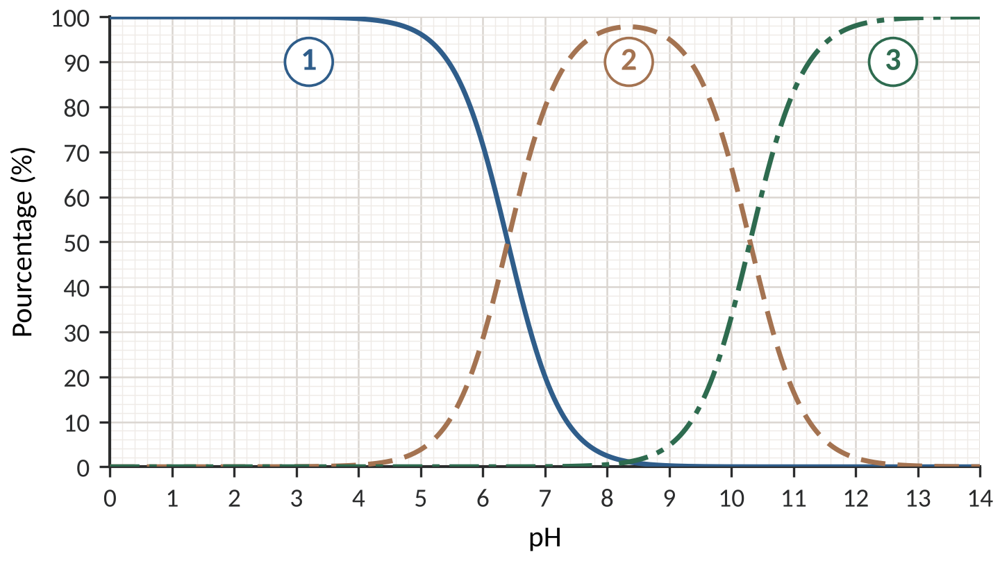
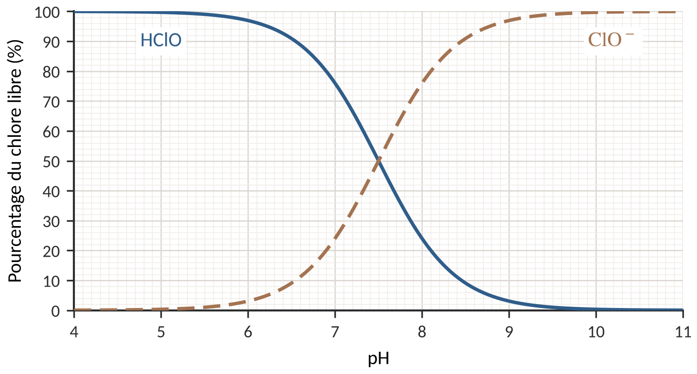
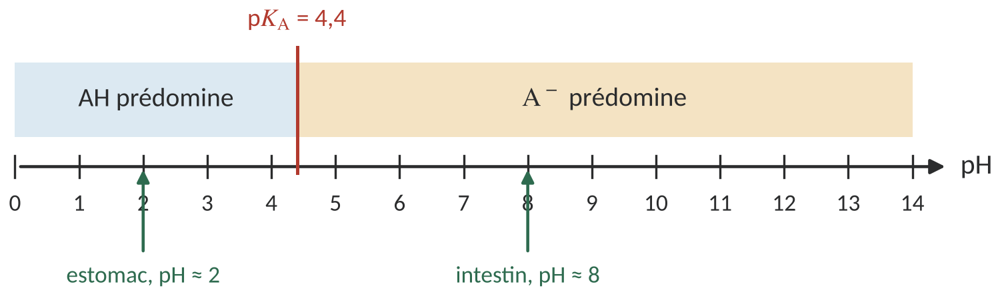
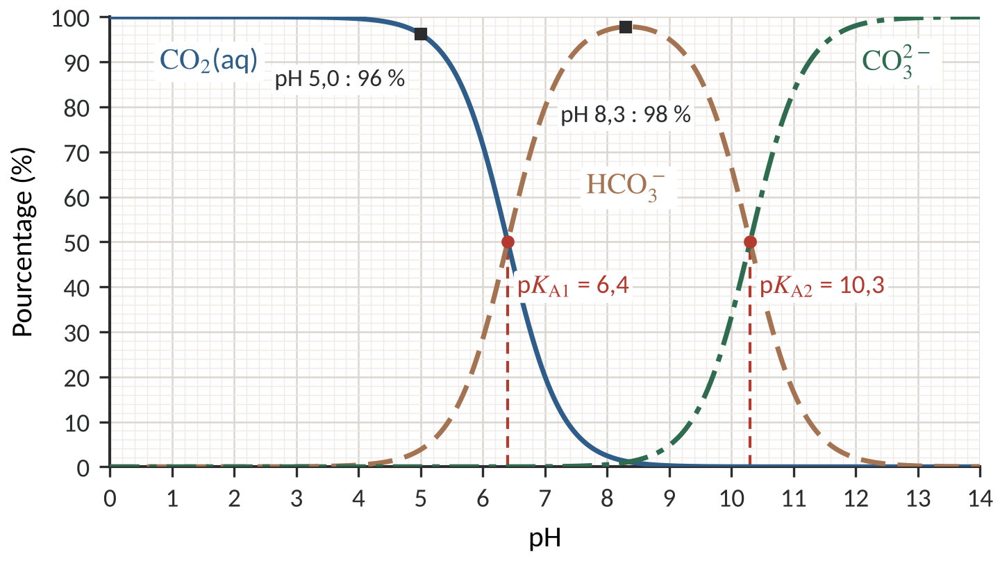
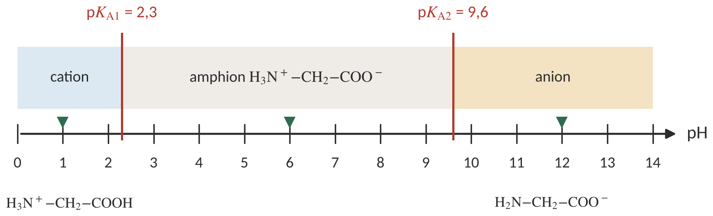
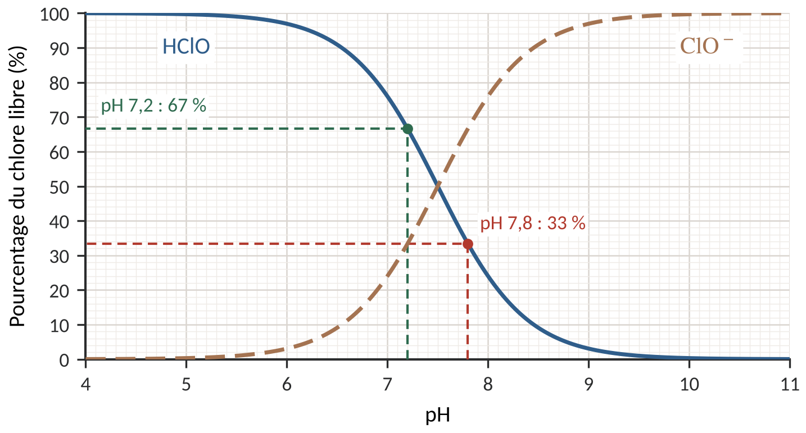

<!--meta {"numero": "9", "matiere": "Physique-Chimie", "titre": "Acides et bases : solutions, pH, force des acides et diagrammes", "titre_court": "Acides et bases", "fichier": "MasterBac_PC_Fiche9_Acides_et_bases", "fichier_cahier": "MasterBac_PC_Fiche9_Cahier_enonces"} -->

<!--inclure:ouverture-->

# L'essentiel en une page {#essentiel}

::: {custom-style="Rubrique"}
À connaître par cœur
:::

<!--colonnes: 22.5 31 46.5-->

| Notion | Relation | À retenir |
|---|---|---|
| Quantité de matière | $n = m/M = C \times V$ ; gaz : $n = V_\text{gaz}/V_\text{m}$ | $C_\text{m} = C \times M$ ; titre massique : rapport de masses. |
| Dilution | $C_\text{mère} \times V_\text{mère} = C_\text{fille} \times V_\text{fille}$ | Facteur $F = V_\text{fille}/V_\text{mère}$ ; pipette puis fiole jaugées. |
| pH | $\text{pH} = -\log([\text{H}_3\text{O}^{\text{+}}]/c^\circ)$ | $c^\circ = 1\ \text{mol·L}^{-1}$ ; $[\text{H}_3\text{O}^{\text{+}}] = c^\circ \times 10^{-\text{pH}}$ ; produit ionique de l'eau : $[\text{H}_3\text{O}^{\text{+}}] \times [\text{HO}^-] = K_\text{e}\, c^{\circ 2}$. |
| Taux d'avancement final | $\tau = x_\text{f}/x_\text{max}$ | $\tau = 1$ : transformation totale ; $\tau < 1$ : non totale. |
| Constante d'acidité | $K_\text{A} = \dfrac{[\text{A}^-]_\text{éq} \times [\text{H}_3\text{O}^{\text{+}}]_\text{éq}}{[\text{AH}]_\text{éq} \times c^\circ}$ | $\text{p}K_\text{A} = -\log K_\text{A}$ : plus il est petit, plus l'acide est fort et sa base conjuguée faible. |
| Prédominance | AH si $\text{pH} < \text{p}K_\text{A}$, $\text{A}^-$ au-delà | Un indicateur coloré vire autour de son $\text{p}K_\text{A}$. |

::: {custom-style="Rubrique"}
À savoir retrouver
:::

<!--colonnes: 19 34 47-->

| Notion | Relation | Comment la retrouver |
|---|---|---|
| Acide AH dans l'eau | $\tau = [\text{H}_3\text{O}^{\text{+}}]_\text{f}/C$ | Tableau d'avancement de l'acide avec l'eau (Q.14). |
| pH et $\text{p}K_\text{A}$ | $\text{pH} = \text{p}K_\text{A} + \log([\text{A}^-]/[\text{AH}])$ | Logarithme de l'expression de $K_\text{A}$ (Q.20). |

::: {custom-style="Rubrique"}
Fourni par l'énoncé, à savoir exploiter
:::

Masses molaires, volume molaire, $K_\text{e}$, $\text{p}K_\text{A}$, zones de virage des indicateurs et diagrammes de distribution.

::: {custom-style="Rubrique"}
Les pièges qui coûtent des points
:::

- Prendre un titre massique, pourcentage sans unité, pour une concentration massique en $\text{g·L}^{-1}$.
- Affirmer que $x_\text{f} = x_\text{max}$ : ce n'est vrai que pour une transformation totale.
- Juger la force d'un acide à son nombre d'atomes d'hydrogène : on compare les $\text{p}K_\text{A}$.
- Lire un diagramme de distribution à l'envers : aux faibles pH, la forme la plus acide l'emporte.

::: {custom-style="Rubrique"}
Votre parcours selon votre objectif
:::

| Objectif | Questions de cours | Exercices |
|---|---|---|
| [\ Objectif 10\ ]{custom-style="Niv10"} | Q.1, Q.2, Q.4, Q.6, Q.7, Q.9 à Q.11, Q.14, Q.16, Q.19, Q.22, Q.24 | Ex. 1 (questions 2 à 4 et 6), Ex. 2 (questions 1 à 3) |
| [\ Objectif 14\ ]{custom-style="Niv14"} | Plus Q.3, Q.5, Q.8, Q.12, Q.13, Q.15, Q.17, Q.20, Q.21, Q.23 | Ex. 1 et Ex. 2, Ex. 3 et Ex. 4 (questions 1 à 5) |
| [\ Objectif 18\ ]{custom-style="Niv18"} | Toutes | Tous |

```{=openxml}
<w:p><w:r><w:br w:type="page"/></w:r></w:p>
```

# Ce qui est tombé aux BAC 2025 et 2026 {#tombe}

Ces notions sont tombées dans au moins quinze exercices des sessions 2025 et 2026.

<!--colonnes: 20 22 41 17-->

| Session | Exercice | Notions de cette fiche | Pour s'y préparer |
|---|---|---|---|
| Amérique du Nord 2026, jour 1 | Valorisation du dioxyde de carbone dans les cimenteries | Concentration d'une solution à 20 % en masse, diagramme de prédominance, base faible, taux d'avancement final à partir du pH | Q.3, Q.15, Q.19, Ex. 3 |
| Amérique du Nord 2026, jour 2 | La lessive de cendre | Base au sens de Brønsted, concentration d'une solution, base faible | Q.1, Q.9, Q.15, Ex. 2 |
| Antilles-Guyane 2026, jour 2 | Traitement de l'eau d'une piscine | Acide au sens de Brønsted, constante d'acidité, lien entre pH et rapport des concentrations | Q.9, Q.16, Q.20, Ex. 4 |
| Asie 2026, jour 1 | Acidité des sols | Diagramme de distribution, espèce amphotère, forme prédominante | Q.9, Q.19, Q.21 |
| Centres étrangers 2026, jour 1 | Analyse d'un comprimé | Facteur de dilution, choix de la verrerie | Q.4 |
| Métropole, septembre 2026, jour 1 | Loi de dilution d'Ostwald | Forme prédominante selon le pH, constante d'acidité, force d'un acide | Q.16, Q.19 |
| Métropole, septembre 2026, jour 2 | De l'acide salicylique à l'aspirine | Espèce amphotère, acide faible, constante d'acidité et $\text{p}K_\text{A}$, diagramme de prédominance | Q.9, Q.16, Q.19 |
| Métropole, juin 2025, jour 1 | Un emballage intelligent au rayon poissonnerie | Indicateur coloré, espèce amphotère, concentration d'une solution commerciale | Q.3, Q.9, Q.22 |
| Métropole, septembre 2025, jour 1 | Étude d'une lessive « multi-usages » | Propriétés acido-basiques de l'ion carbonate, équation de réaction | Q.9, Q.10 |
| Métropole, septembre 2025, jour 2 | Les pluies acides | Diagramme de distribution, constante d'acidité et pH, réactif limitant | Q.6, Q.17, Q.21 |
| Amérique du Nord 2025, jour 2 | Le Schweppes® : un bon antipaludique sans risque pour la santé ? | Prédominance avec deux $\text{p}K_\text{A}$, indicateur coloré, dilution | Q.4, Q.19, Q.22, Q.23 |
| Amérique du Nord 2025, jour 2 (sujet de secours) | L'atropine | Forme acide ou basique selon le pH | Q.19 |
| Amérique du Sud 2025, jour 2 | Infusion à la framboise | Acide au sens de Brønsted, diagramme de prédominance, titre massique et densité d'un détartrant, dilution | Q.2 à Q.4, Q.9, Q.19, Ex. 1 |
| Asie 2025, jour 1 | Pollution ammoniacale | Acide au sens de Brønsted | Q.9 |
| Nouvelle-Calédonie 2025, jour 1 | De l'aspirine pour favoriser l'écoulement sanguin | Forme prédominante dans l'estomac | Q.19 |

::: {custom-style="Intertitre"}
Ce qu'il faut en retenir
:::

- La forme prédominante selon le pH revient dans au moins dix des quinze exercices : c'est la priorité (Q.19 à Q.21, Q.23, Ex. 3, Ex. 4).
- La définition de Brønsted, avec le couple à écrire, est demandée dans au moins huit exercices (Q.9).
- Les calculs de concentration (titre massique, densité, dilution) accompagnent au moins six exercices (Q.1 à Q.5, Ex. 1).
- Le taux d'avancement final et le $\text{p}K_\text{A}$ comparent la force des acides et des bases dans au moins six exercices (Q.14 à Q.18, Ex. 2, Ex. 3).

::: {custom-style="Surtitre"}
Énoncés
:::

# Thème 1 : solutions et avancement d'une réaction {#theme1}

::: {custom-style="Rubrique"}
Questions de cours
:::

## [Q.1]{custom-style="QNum"}\ \ Calculer une quantité de matière à partir d'une masse, d'une concentration ou d'un volume de gaz {#q1}

::: {custom-style="Meta"}
[\ Objectif 10\ ]{custom-style="Niv10"}\ \ Cours · Notions : masse molaire, concentration, volume molaire · Demandé en 2026 (Amérique du Nord)\ \ \ [CIBLE:c_q1]{custom-style="BoutonCorrige"}
:::

::: {custom-style="Enonce"}
Application : l'acide malique, de formule brute $\text{C}_4\text{H}_6\text{O}_5$, donne au jus de pomme une partie de son acidité. Calculer sa masse molaire, puis la masse d'acide malique à peser pour préparer $250{,}0\ \text{mL}$ d'une solution de concentration $2{,}00 \times 10^{-2}\ \text{mol·L}^{-1}$. Une réaction libère par ailleurs $1{,}0 \times 10^{-2}\ \text{mol}$ de dioxyde de carbone : quel volume ce gaz occupe-t-il à $20\ \text{°C}$ sous $1\,013\ \text{hPa}$ ?

Données : $M(\text{H}) = 1{,}0\ \text{g·mol}^{-1}$ ; $M(\text{C}) = 12{,}0\ \text{g·mol}^{-1}$ ; $M(\text{O}) = 16{,}0\ \text{g·mol}^{-1}$ ; volume molaire des gaz à $20\ \text{°C}$ sous $1\,013\ \text{hPa}$ : $V_\text{m} = 24{,}0\ \text{L·mol}^{-1}$.
:::

## [Q.2]{custom-style="QNum"}\ \ Distinguer concentration en quantité de matière, concentration massique et titre massique {#q2}

::: {custom-style="Meta"}
[\ Objectif 10\ ]{custom-style="Niv10"}\ \ Cours · Notions : concentration massique, titre massique, masse volumique · Demandé en 2025 (Amérique du Sud)\ \ \ [CIBLE:c_q2]{custom-style="BoutonCorrige"}
:::

::: {custom-style="Enonce"}
Application : un vinaigre contient de l'acide éthanoïque $\text{CH}_3\text{COOH}$, de masse molaire $60{,}0\ \text{g·mol}^{-1}$, à la concentration $C = 1{,}2\ \text{mol·L}^{-1}$. Calculer sa concentration massique (ou concentration en masse) en acide éthanoïque. L'étiquette indique un titre massique de $7\ \%$ ; un élève en déduit que la concentration massique vaut $7\ \text{g·L}^{-1}$. Expliquer son erreur, puis vérifier que l'étiquette est cohérente avec le premier calcul, sachant qu'un litre de ce vinaigre a une masse de $1{,}01\ \text{kg}$.
:::

## [Q.3]{custom-style="QNum"}\ \ Calculer la concentration d'une solution commerciale à partir de son titre massique et de sa densité {#q3}

::: {custom-style="Meta"}
[\ Objectif 14\ ]{custom-style="Niv14"}\ \ Méthode · Notions : titre massique, densité, masse volumique · Demandé en 2025 et 2026\ \ \ [CIBLE:c_q3]{custom-style="BoutonCorrige"}
:::

::: {custom-style="Enonce"}
Application : l'étiquette d'une solution commerciale d'acide chlorhydrique indique un titre massique en chlorure d'hydrogène de $37\ \%$ et une densité de $1{,}18$. Calculer la concentration en quantité de matière de chlorure d'hydrogène apporté.

Données : $M(\text{HCl}) = 36{,}5\ \text{g·mol}^{-1}$ ; masse volumique de l'eau : $\rho_\text{eau} = 1{,}00\ \text{kg·L}^{-1}$.
:::

## [Q.4]{custom-style="QNum"}\ \ Préparer une solution par dilution : volume à prélever, verrerie et protocole {#q4}

::: {custom-style="Meta"}
[\ Objectif 10\ ]{custom-style="Niv10"}\ \ Méthode · Notions : facteur de dilution, pipette jaugée, fiole jaugée · Demandé en 2025 et 2026\ \ \ [CIBLE:c_q4]{custom-style="BoutonCorrige"}
:::

::: {custom-style="Enonce"}
Application : on veut préparer $100{,}0\ \text{mL}$ d'une solution fille cinq fois moins concentrée qu'une solution mère. Calculer le volume de solution mère à prélever, choisir la verrerie adaptée parmi la liste suivante, puis rédiger le protocole : bécher de $100\ \text{mL}$, éprouvette graduée de $25\ \text{mL}$, pipette graduée de $10\ \text{mL}$, pipette jaugée de $20{,}0\ \text{mL}$, fiole jaugée de $50{,}0\ \text{mL}$, fiole jaugée de $100{,}0\ \text{mL}$.
:::

## [Q.5]{custom-style="QNum"}\ \ Enchaîner deux dilutions et exprimer une teneur en éthanol {#q5}

::: {custom-style="Meta"}
[\ Objectif 14\ ]{custom-style="Niv14"}\ \ Méthode · Notions : dilutions successives, facteur de dilution global, masse volumique\ \ \ [CIBLE:c_q5]{custom-style="BoutonCorrige"}
:::

::: {custom-style="Enonce"}
Application : pour doser l'éthanol d'un vin, on distille $20{,}0\ \text{mL}$ de vin de façon à en recueillir tout l'éthanol, et l'on complète le distillat à $200{,}0\ \text{mL}$ avec de l'eau distillée : c'est la solution A. On dilue ensuite la solution A 40 fois pour obtenir la solution B. Un dosage donne, pour B, une concentration massique en éthanol de $0{,}250\ \text{g·L}^{-1}$. Calculer la concentration massique en éthanol du vin, puis son degré alcoolique, c'est-à-dire le volume d'éthanol, en millilitre, contenu dans $100\ \text{mL}$ de vin.

Donnée : masse volumique de l'éthanol : $\rho = 0{,}789\ \text{g·mL}^{-1}$.
:::

## [Q.6]{custom-style="QNum"}\ \ Déterminer le réactif limitant et l'avancement maximal d'une transformation totale {#q6}

::: {custom-style="Meta"}
[\ Objectif 10\ ]{custom-style="Niv10"}\ \ Méthode · Notions : tableau d'avancement, réactif limitant, volume de gaz · Demandé en 2025 (Métropole, septembre)\ \ \ [CIBLE:c_q6]{custom-style="BoutonCorrige"}
:::

::: {custom-style="Enonce"}
Application : on verse $50{,}0\ \text{mL}$ d'acide chlorhydrique, de concentration en ions oxonium $0{,}50\ \text{mol·L}^{-1}$, sur $2{,}0\ \text{g}$ de calcaire $\text{CaCO}_3(\text{s})$. La transformation, totale, est modélisée par la réaction d'équation :

$$\text{CaCO}_3(\text{s}) + 2\,\text{H}_3\text{O}^{\text{+}}(\text{aq}) \rightarrow \text{Ca}^{\text{2+}}(\text{aq}) + \text{CO}_2(\text{g}) + 3\,\text{H}_2\text{O}(\ell)$$

Déterminer le réactif limitant et l'avancement maximal, puis calculer le volume de dioxyde de carbone dégagé et la masse de calcaire restante.

Données : $M(\text{CaCO}_3) = 100{,}1\ \text{g·mol}^{-1}$ ; $V_\text{m} = 24{,}0\ \text{L·mol}^{-1}$.
:::

## [Q.7]{custom-style="QNum"}\ \ Distinguer l'avancement final de l'avancement maximal {#q7}

::: {custom-style="Meta"}
[\ Objectif 10\ ]{custom-style="Niv10"}\ \ Cours · Notions : avancement maximal, avancement final, transformation totale ou non totale\ \ \ [CIBLE:c_q7]{custom-style="BoutonCorrige"}
:::

::: {custom-style="Enonce"}
Application : expliquer simplement ce qui distingue l'avancement maximal $x_\text{max}$ de l'avancement final $x_\text{f}$ d'une réaction : comment obtient-on chacun d'eux, et dans quel cas sont-ils égaux ? On dissout ensuite $1{,}0 \times 10^{-3}\ \text{mol}$ d'acide éthanoïque $\text{CH}_3\text{COOH}$ dans de l'eau. Chaque molécule d'acide qui réagit avec l'eau forme un ion oxonium $\text{H}_3\text{O}^{\text{+}}$. Quand le système n'évolue plus, la solution contient $4{,}0 \times 10^{-5}\ \text{mol}$ d'ions oxonium formés par cette réaction. Déterminer $x_\text{max}$ et $x_\text{f}$, puis conclure sur le caractère total ou non de la transformation.
:::

## [Q.8]{custom-style="QNum"}\ \ Calculer un taux d'avancement final et conclure sur le caractère total de la transformation {#q8}

::: {custom-style="Meta"}
[\ Objectif 14\ ]{custom-style="Niv14"}\ \ Méthode · Notions : avancement final, avancement maximal, taux d'avancement final\ \ \ [CIBLE:c_q8]{custom-style="BoutonCorrige"}
:::

::: {custom-style="Enonce"}
Application : on chauffe à reflux $9{,}0\ \text{g}$ d'acide éthanoïque, de masse molaire $60{,}0\ \text{g·mol}^{-1}$, avec $0{,}15\ \text{mol}$ d'éthanol. La réaction a pour équation :

$$\text{CH}_3\text{COOH}(\ell) + \text{C}_2\text{H}_5\text{OH}(\ell) \rightarrow \text{CH}_3\text{COOC}_2\text{H}_5(\ell) + \text{H}_2\text{O}(\ell)$$

Quand la composition du mélange n'évolue plus, un titrage montre qu'il reste $5{,}0 \times 10^{-2}\ \text{mol}$ d'acide éthanoïque. Déterminer l'avancement maximal, l'avancement final et le taux d'avancement final. La transformation est-elle totale ? Calculer la masse d'ester obtenue, sachant que sa masse molaire vaut $88{,}0\ \text{g·mol}^{-1}$.
:::

::: {custom-style="Rubrique"}
Exercices
:::

### [Exercice 1]{custom-style="QNum"}\ \ Le détartrant de la bouilloire [(voir BAC Amérique du Sud 2025)]{custom-style="VoirBac"} {#ex1}

::: {custom-style="Meta"}
[\ Objectif 10\ ]{custom-style="Niv10"}\ \ [Type BAC]{custom-style="TagBac"} · 5 points · 45 min · Questions 1 et 5 : objectif 14
:::

::: {custom-style="MentionBac"}
[Sujet du BAC correspondant.]{custom-style="EtiqBac"} Amérique du Sud 2025, jour 2, exercice 1 : « Infusion à la framboise » (partie 2, détartrage de la bouilloire).
:::

::: {custom-style="Enonce"}
Le tartre qui se dépose dans une bouilloire est essentiellement du carbonate de calcium $\text{CaCO}_3(\text{s})$. Pour l'éliminer, un fabricant recommande un détartrant liquide à base d'acide lactique, noté AH, de formule brute $\text{C}_3\text{H}_6\text{O}_3$. Le mode d'emploi indique de verser une dose de $50{,}0\ \text{mL}$ de détartrant dans la bouilloire, de compléter avec de l'eau jusqu'à $1{,}00\ \text{L}$ et de laisser agir. On admet que l'acide lactique se répartit uniformément dans ce litre de solution, notée S.
:::

::: {custom-style="Enonce"}
**Données**
:::

::: {custom-style="EnonceDonnees"}
Détartrant : titre massique en acide lactique $w = 55{,}0\ \%$ ; densité $d = 1{,}25$.

Masses molaires : $M(\text{AH}) = 90{,}1\ \text{g·mol}^{-1}$ ; $M(\text{CaCO}_3) = 100{,}1\ \text{g·mol}^{-1}$. Masse volumique de l'eau : $\rho_\text{eau} = 1{,}00\ \text{kg·L}^{-1}$.

Volume molaire des gaz dans les conditions de l'expérience : $V_\text{m} = 24{,}0\ \text{L·mol}^{-1}$.

Réaction du détartrage, supposée totale : $\text{CaCO}_3(\text{s}) + 2\,\text{AH}(\text{aq}) \rightarrow \text{Ca}^{\text{2+}}(\text{aq}) + 2\,\text{A}^-(\text{aq}) + \text{CO}_2(\text{g}) + \text{H}_2\text{O}(\ell)$

Taux d'avancement final de la réaction d'un acide AH avec l'eau : $\tau = \dfrac{[\text{H}_3\text{O}^{\text{+}}]_\text{f}}{C}$, où $C$ est la concentration en acide apporté.
:::

::: {custom-style="Enonce"}
**1.** Montrer que la concentration en acide lactique du détartrant vaut $C_0 = 7{,}63\ \text{mol·L}^{-1}$.

**2.** Calculer la quantité d'acide lactique apportée par une dose, puis la concentration $C$ en acide lactique apporté dans la solution S.

**3.** La bouilloire contient $15{,}0\ \text{g}$ de tartre. À l'aide d'un tableau d'avancement, montrer qu'une dose suffit à dissoudre tout le tartre.

**4.** Calculer le volume de dioxyde de carbone libéré.

**5.** Quelle masse maximale de tartre une dose de détartrant permet-elle de dissoudre ?

**6.** Avant le détartrage, le pH de la solution S vaut $2{,}10$. Calculer le taux d'avancement final de la réaction de l'acide lactique avec l'eau. L'acide lactique est-il un acide fort ou un acide faible ?
:::

::: {custom-style="Renvoi"}
[CIBLE:c_ex1]{custom-style="BoutonCorrige"}
:::

```{=openxml}
<w:p><w:r><w:br w:type="page"/></w:r></w:p>
```

# Thème 2 : acides, bases et pH {#theme2}

::: {custom-style="Rubrique"}
Questions de cours
:::

## [Q.9]{custom-style="QNum"}\ \ Définir un acide et une base au sens de Brønsted et écrire un couple acide-base {#q9}

::: {custom-style="Meta"}
[\ Objectif 10\ ]{custom-style="Niv10"}\ \ Cours · Notions : couple acide-base, demi-équation, espèce amphotère · Demandé dans au moins huit exercices en 2025 et 2026\ \ \ [CIBLE:c_q9]{custom-style="BoutonCorrige"}
:::

::: {custom-style="Enonce"}
Application : définir un acide et une base au sens de Brønsted. Écrire le couple de l'acide butanoïque $\text{C}_3\text{H}_7\text{COOH}$ (odeur du beurre rance) et sa demi-équation, puis les deux couples de l'eau. Les couples $\text{CO}_2,\text{H}_2\text{O}/\text{HCO}_3^-$ et $\text{HCO}_3^-/\text{CO}_3^{2-}$ contiennent tous deux l'ion hydrogénocarbonate : comment qualifier cette espèce ?
:::

## [Q.10]{custom-style="QNum"}\ \ Écrire l'équation d'une réaction acide-base à partir de deux couples {#q10}

::: {custom-style="Meta"}
[\ Objectif 10\ ]{custom-style="Niv10"}\ \ Cours · Notions : demi-équations, transfert d'un proton · Demandé en 2025 (Métropole, septembre)\ \ \ [CIBLE:c_q10]{custom-style="BoutonCorrige"}
:::

::: {custom-style="Enonce"}
Application : écrire l'équation de la réaction de l'ammoniac $\text{NH}_3$ avec l'eau, puis de l'acide éthanoïque $\text{CH}_3\text{COOH}$ avec les ions hydroxyde $\text{HO}^-$. Couples : $\text{NH}_4^{\text{+}}/\text{NH}_3$ ; $\text{CH}_3\text{COOH}/\text{CH}_3\text{COO}^-$ ; $\text{H}_3\text{O}^{\text{+}}/\text{H}_2\text{O}$ ; $\text{H}_2\text{O}/\text{HO}^-$. Identifier enfin les couples de la réaction $\text{HCOOH}(\text{aq}) + \text{NH}_3(\text{aq}) \rightarrow \text{HCOO}^-(\text{aq}) + \text{NH}_4^{\text{+}}(\text{aq})$.
:::

## [Q.11]{custom-style="QNum"}\ \ Calculer un pH ou une concentration en ions oxonium {#q11}

::: {custom-style="Meta"}
[\ Objectif 10\ ]{custom-style="Niv10"}\ \ Cours · Notions : définition du pH, logarithme décimal, chiffres significatifs\ \ \ [CIBLE:c_q11]{custom-style="BoutonCorrige"}
:::

::: {custom-style="Enonce"}
Application : le pH d'un jus de citron vaut $2{,}70$ ; calculer sa concentration en ions oxonium. Une solution d'hydrogénocarbonate de sodium contient des ions oxonium à la concentration $4{,}0 \times 10^{-9}\ \text{mol·L}^{-1}$ ; calculer son pH. Ces deux solutions sont-elles acides, neutres ou basiques à $25\ \text{°C}$ ?
:::

## [Q.12]{custom-style="QNum"}\ \ Utiliser le produit ionique de l'eau {#q12}

::: {custom-style="Meta"}
[\ Objectif 14\ ]{custom-style="Niv14"}\ \ Cours · Notions : autoprotolyse de l'eau, $K_\text{e}$, solution neutre\ \ \ [CIBLE:c_q12]{custom-style="BoutonCorrige"}
:::

::: {custom-style="Enonce"}
Application : écrire l'équation de l'autoprotolyse de l'eau et l'expression de son produit ionique $K_\text{e}$. À $25\ \text{°C}$, où $K_\text{e} = 1{,}0 \times 10^{-14}$, calculer la concentration en ions hydroxyde d'une solution de pH $11{,}20$, puis de pH $3{,}50$. À $37\ \text{°C}$, $K_\text{e} = 2{,}4 \times 10^{-14}$ : quel est le pH d'une solution neutre à cette température ?
:::

## [Q.13]{custom-style="QNum"}\ \ Calculer le pH d'une solution d'acide fort ou de base forte {#q13}

::: {custom-style="Meta"}
[\ Objectif 14\ ]{custom-style="Niv14"}\ \ Méthode · Notions : acide fort, base forte, effet d'une dilution\ \ \ [CIBLE:c_q13]{custom-style="BoutonCorrige"}
:::

::: {custom-style="Enonce"}
Application : à $25\ \text{°C}$ ($K_\text{e} = 1{,}0 \times 10^{-14}$), calculer le pH d'une solution d'acide chlorhydrique, acide fort, à $5{,}0 \times 10^{-3}\ \text{mol·L}^{-1}$, puis diluée 10 fois. Même question pour l'hydroxyde de sodium, base forte, à $2{,}0 \times 10^{-2}\ \text{mol·L}^{-1}$, diluée 100 fois. Enfin, on ajoute $0{,}20\ \text{mmol}$ d'acide chlorhydrique à $10{,}0\ \text{mL}$ de solution de pH $6{,}30$, sans changement de volume : calculer le pH final.
:::

<!--sans-saut-->

::: {custom-style="Rubrique"}
Exercices
:::

### [Exercice 2]{custom-style="QNum"}\ \ La lessive de cendre [(voir BAC Amérique du Nord 2026)]{custom-style="VoirBac"} {#ex2}

::: {custom-style="Meta"}
[\ Objectif 10\ ]{custom-style="Niv10"}\ \ [Type BAC]{custom-style="TagBac"} · 4 points · 35 min · Questions 4 et 5 : objectif 14
:::

::: {custom-style="MentionBac"}
[Sujet du BAC correspondant.]{custom-style="EtiqBac"} Amérique du Nord 2026, jour 2, exercice 3 : « La lessive de cendre » (partie 1, étude de l'ion carbonate).
:::

::: {custom-style="Enonce"}
La lessive de cendre s'obtient en laissant tremper de la cendre de bois tamisée dans de l'eau, puis en filtrant. Son pouvoir lavant vient surtout du carbonate de potassium qu'elle contient. Au laboratoire, on modélise cette lessive par une solution S, préparée en dissolvant $13{,}82\ \text{g}$ de carbonate de potassium $\text{K}_2\text{CO}_3(\text{s})$ dans de l'eau distillée, dans une fiole jaugée de $1{,}000\ \text{L}$. Le pH de la solution S vaut $11{,}60$ à $25\ \text{°C}$.
:::

::: {custom-style="Enonce"}
**Données**
:::

::: {custom-style="EnonceDonnees"}
Masse molaire du carbonate de potassium : $M(\text{K}_2\text{CO}_3) = 138{,}2\ \text{g·mol}^{-1}$.

Dissolution totale du solide dans l'eau : $\text{K}_2\text{CO}_3(\text{s}) \rightarrow 2\,\text{K}^{\text{+}}(\text{aq}) + \text{CO}_3^{2-}(\text{aq})$

Couples : $\text{HCO}_3^-(\text{aq})/\text{CO}_3^{2-}(\text{aq})$ ; $\text{H}_2\text{O}(\ell)/\text{HO}^-(\text{aq})$. Produit ionique de l'eau à $25\ \text{°C}$ : $K_\text{e} = 1{,}0 \times 10^{-14}$.
:::

::: {custom-style="Enonce"}
**1.** Définir une base au sens de Brønsted. Justifier que l'ion carbonate est une base.

**2.** Calculer la concentration $C$ en carbonate de potassium apporté dans la solution S, puis les concentrations en ions potassium et en ions carbonate apportés.

**3.** Écrire l'équation de la réaction entre l'ion carbonate et l'eau.

**4.** Calculer la concentration en ions hydroxyde dans la solution S.

**5.** Quelle serait cette concentration si la réaction de la question 3 était totale ? Calculer le taux d'avancement final de la réaction et conclure sur la force de la base. Quelle concentration faudrait-il donner à une solution d'hydroxyde de sodium pour qu'elle ait le même pH que la solution S ?
:::

::: {custom-style="Renvoi"}
[CIBLE:c_ex2]{custom-style="BoutonCorrige"}
:::

# Thème 3 : force des acides et des bases {#theme3}

::: {custom-style="Rubrique"}
Questions de cours
:::

## [Q.14]{custom-style="QNum"}\ \ Distinguer un acide fort d'un acide faible par une mesure de pH {#q14}

::: {custom-style="Meta"}
[\ Objectif 10\ ]{custom-style="Niv10"}\ \ Cours · Notions : acide fort, acide faible, taux d'avancement final\ \ \ [CIBLE:c_q14]{custom-style="BoutonCorrige"}
:::

::: {custom-style="Enonce"}
Application : on mesure à $25\ \text{°C}$ le pH de deux solutions d'acides de même concentration apportée $C = 1{,}0 \times 10^{-2}\ \text{mol·L}^{-1}$ : l'acide chlorhydrique a un pH de $2{,}00$, l'acide éthanoïque un pH de $3{,}40$. Calculer le taux d'avancement final de la réaction de chaque acide avec l'eau, puis conclure.
:::

## [Q.15]{custom-style="QNum"}\ \ Calculer le taux d'avancement final de la réaction d'une base avec l'eau {#q15}

::: {custom-style="Meta"}
[\ Objectif 14\ ]{custom-style="Niv14"}\ \ Méthode · Notions : base faible, produit ionique de l'eau · Demandé en 2026 (Amérique du Nord)\ \ \ [CIBLE:c_q15]{custom-style="BoutonCorrige"}
:::

::: {custom-style="Enonce"}
Application : une solution d'ammoniac de concentration apportée $C = 1{,}0 \times 10^{-2}\ \text{mol·L}^{-1}$ a un pH de $10{,}60$ à $25\ \text{°C}$. Écrire l'équation de la réaction de l'ammoniac avec l'eau, calculer le taux d'avancement final de cette réaction et conclure sur la force de cette base. Donnée : $K_\text{e} = 1{,}0 \times 10^{-14}$.
:::

## [Q.16]{custom-style="QNum"}\ \ Associer constante d'acidité et $\text{p}K_\text{A}$, et classer des acides selon leur force {#q16}

::: {custom-style="Meta"}
[\ Objectif 10\ ]{custom-style="Niv10"}\ \ Cours · Notions : constante d'acidité, $\text{p}K_\text{A}$, base conjuguée · Demandé en 2026 (Antilles-Guyane, Métropole)\ \ \ [CIBLE:c_q16]{custom-style="BoutonCorrige"}
:::

::: {custom-style="Enonce"}
Application : écrire l'expression de la constante d'acidité $K_\text{A}$ du couple $\text{HClO}(\text{aq})/\text{ClO}^-(\text{aq})$, puis calculer sa valeur sachant que son $\text{p}K_\text{A}$ vaut $7{,}5$. Classer ensuite par force croissante les acides suivants, puis leurs bases conjuguées : acide méthanoïque $\text{HCOOH}$ ($\text{p}K_\text{A} = 3{,}8$) ; acide éthanoïque $\text{CH}_3\text{COOH}$ ($\text{p}K_\text{A} = 4{,}8$) ; acide hypochloreux $\text{HClO}$ ($\text{p}K_\text{A} = 7{,}5$) ; ion ammonium $\text{NH}_4^{\text{+}}$ ($\text{p}K_\text{A} = 9{,}2$).
:::

## [Q.17]{custom-style="QNum"}\ \ Déterminer une constante d'acidité à partir d'une mesure de pH {#q17}

::: {custom-style="Meta"}
[\ Objectif 14\ ]{custom-style="Niv14"}\ \ Méthode · Notions : état final, concentrations à l'équilibre, $K_\text{A}$ · Demandé en 2025 (Métropole, septembre)\ \ \ [CIBLE:c_q17]{custom-style="BoutonCorrige"}
:::

::: {custom-style="Enonce"}
Application : une solution d'acide éthanoïque de concentration apportée $C = 1{,}0 \times 10^{-2}\ \text{mol·L}^{-1}$ a un pH de $3{,}40$ à $25\ \text{°C}$. Déterminer les concentrations de l'acide éthanoïque et de l'ion éthanoate à l'état final, puis calculer la constante d'acidité et le $\text{p}K_\text{A}$ du couple $\text{CH}_3\text{COOH}/\text{CH}_3\text{COO}^-$.
:::

## [Q.18]{custom-style="QNum"}\ \ Prévoir l'état final d'une solution d'acide faible : équation du second degré, pH et taux d'avancement {#q18}

::: {custom-style="Meta"}
[\ Objectif 18\ ]{custom-style="Niv18"}\ \ Méthode · Notions : état final, constante d'acidité, équation du second degré, taux d'avancement final\ \ \ [CIBLE:c_q18]{custom-style="BoutonCorrige"}
:::

::: {custom-style="Enonce"}
Application : on prépare $V = 100{,}0\ \text{mL}$ d'une solution d'acide éthanoïque de concentration apportée $C = 1{,}0 \times 10^{-2}\ \text{mol·L}^{-1}$, à $25\ \text{°C}$. La constante d'acidité du couple $\text{CH}_3\text{COOH}/\text{CH}_3\text{COO}^-$ vaut $K_\text{A} = 1{,}7 \times 10^{-5}$. En notant $x_\text{f}$ l'avancement final de la réaction de l'acide avec l'eau, établir l'équation du second degré que vérifie $x_\text{f}$, la résoudre, puis calculer le pH de la solution et le taux d'avancement final.
:::

::: {custom-style="Rubrique"}
Exercices
:::

### [Exercice 3]{custom-style="QNum"}\ \ La base qui capte le dioxyde de carbone [(voir BAC Amérique du Nord 2026)]{custom-style="VoirBac"} {#ex3}

::: {custom-style="Meta"}
[\ Objectif 14\ ]{custom-style="Niv14"}\ \ [Type BAC]{custom-style="TagBac"} · 5 points · 45 min · Question 6 : objectif 18
:::

::: {custom-style="MentionBac"}
[Sujet du BAC correspondant.]{custom-style="EtiqBac"} Amérique du Nord 2026, jour 1, exercice 1 : « Valorisation du dioxyde de carbone dans les cimenteries » (partie 1, captage du dioxyde de carbone par l'éthanolamine).
:::

::: {custom-style="Enonce"}
Pour limiter leurs rejets, certaines usines font barboter leurs fumées dans une solution aqueuse d'éthanolamine $\text{HO-CH}_2\text{-CH}_2\text{-NH}_2$, notée B, qui retient le dioxyde de carbone. Le groupe amino $\text{-NH}_2$ de l'éthanolamine peut capter un proton : on note $\text{BH}^{\text{+}}$ l'acide conjugué de B. Un technicien prépare une solution S d'éthanolamine de concentration apportée $C = 0{,}10\ \text{mol·L}^{-1}$ ; il mesure un pH de $11{,}25$ à $25\ \text{°C}$.
:::

::: {custom-style="Enonce"}
**Données**
:::

::: {custom-style="EnonceDonnees"}
$\text{p}K_\text{A}(\text{BH}^{\text{+}}/\text{B}) = 9{,}5$ ; $\text{p}K_\text{A}(\text{CO}_2,\text{H}_2\text{O}/\text{HCO}_3^-) = 6{,}4$ ; produit ionique de l'eau à $25\ \text{°C}$ : $K_\text{e} = 1{,}0 \times 10^{-14}$.
:::

::: {custom-style="Enonce"}
**1.** Justifier que l'éthanolamine est une base au sens de Brønsted, puis écrire l'équation de sa réaction avec l'eau.

**2.** Calculer la concentration en ions hydroxyde dans la solution S, puis le taux d'avancement final de la réaction de la question 1. L'éthanolamine est-elle une base forte ou une base faible ?

**3.** Écrire l'expression de la constante d'acidité du couple $\text{BH}^{\text{+}}/\text{B}$ et calculer sa valeur.

**4.** Calculer le rapport $\dfrac{[\text{B}]}{[\text{BH}^{\text{+}}]}$ dans la solution S. Quelle espèce prédomine ? Vérifier la cohérence avec le résultat de la question 2.

**5.** Représenter, au-dessus d'un même axe gradué en pH, les diagrammes de prédominance des couples $\text{BH}^{\text{+}}/\text{B}$ et $\text{CO}_2,\text{H}_2\text{O}/\text{HCO}_3^-$.

**6.** Après avoir absorbé du dioxyde de carbone, la solution a un pH de $8{,}5$. Indiquer, en justifiant, la forme prédominante de l'éthanolamine et celle du carbone dissous. En déduire l'équation de la réaction de captage du dioxyde de carbone dissous par l'éthanolamine.
:::

::: {custom-style="Renvoi"}
[CIBLE:c_ex3]{custom-style="BoutonCorrige"}
:::

<!--debut:complet-->
```{=openxml}
<w:p><w:r><w:br w:type="page"/></w:r></w:p>
```

<!--fin:complet-->
# Thème 4 : diagrammes, indicateurs colorés et solutions tampons {#theme4}

::: {custom-style="Rubrique"}
Questions de cours
:::

## [Q.19]{custom-style="QNum"}\ \ Tracer un diagramme de prédominance et en déduire la forme prédominante {#q19}

::: {custom-style="Meta"}
[\ Objectif 10\ ]{custom-style="Niv10"}\ \ Cours · Notions : $\text{p}K_\text{A}$, forme acide, forme basique · Demandé dans au moins huit exercices en 2025 et 2026\ \ \ [CIBLE:c_q19]{custom-style="BoutonCorrige"}
:::

::: {custom-style="Enonce"}
Application : l'ibuprofène, principe actif de nombreux anti-inflammatoires, est un acide carboxylique noté AH ; le $\text{p}K_\text{A}$ du couple $\text{AH}/\text{A}^-$ vaut $4{,}4$. Tracer le diagramme de prédominance de ce couple. Sous quelle forme l'ibuprofène se trouve-t-il majoritairement dans l'estomac, où le pH vaut environ 2, puis dans l'intestin, où il vaut environ 8 ?
:::

## [Q.20]{custom-style="QNum"}\ \ Relier le pH, le $\text{p}K_\text{A}$ et le rapport des concentrations des deux formes {#q20}

::: {custom-style="Meta"}
[\ Objectif 14\ ]{custom-style="Niv14"}\ \ Méthode · Notions : constante d'acidité, rapport des concentrations, pourcentage d'une forme · Demandé en 2026 (Antilles-Guyane)\ \ \ [CIBLE:c_q20]{custom-style="BoutonCorrige"}
:::

::: {custom-style="Enonce"}
Application : dans le sang, le pH vaut $7{,}40$ et le couple $\text{CO}_2,\text{H}_2\text{O}/\text{HCO}_3^-$ a un $\text{p}K_\text{A}$ de $6{,}10$ à $37\ \text{°C}$. À partir de l'expression de la constante d'acidité, établir la relation entre le pH, le $\text{p}K_\text{A}$ et le rapport $[\text{HCO}_3^-]/[\text{CO}_2]$, puis calculer ce rapport. Quel pourcentage du carbone dissous de ce couple se trouve sous forme $\text{HCO}_3^-$ ?
:::

## [Q.21]{custom-style="QNum"}\ \ Exploiter un diagramme de distribution {#q21}

::: {custom-style="Meta"}
[\ Objectif 14\ ]{custom-style="Niv14"}\ \ Méthode · Notions : courbes de distribution, lecture des $\text{p}K_\text{A}$, espèce amphotère · Demandé en 2025 et 2026\ \ \ [CIBLE:c_q21]{custom-style="BoutonCorrige"}
:::

::: {custom-style="Enonce"}
Application : la figure 1 donne le pourcentage de chacune des trois espèces $\text{CO}_2(\text{aq})$, $\text{HCO}_3^-(\text{aq})$ et $\text{CO}_3^{2-}(\text{aq})$ en fonction du pH. Attribuer chaque courbe à une espèce, en justifiant. Lire les deux valeurs de $\text{p}K_\text{A}$. Déterminer la composition d'une eau de pluie de pH $5{,}0$, puis celle d'une eau de pH $8{,}3$.
:::

::: {custom-style="Figure"}
{width=10cm}
:::

::: {custom-style="Legende"}
Figure 1. Diagramme de distribution des espèces issues du dioxyde de carbone dissous
:::

## [Q.22]{custom-style="QNum"}\ \ Choisir un indicateur coloré de fin de titrage {#q22}

::: {custom-style="Meta"}
[\ Objectif 10\ ]{custom-style="Niv10"}\ \ Cours · Notions : zone de virage, teinte acide, teinte basique · Demandé en 2025 (Métropole, Amérique du Nord)\ \ \ [CIBLE:c_q22]{custom-style="BoutonCorrige"}
:::

::: {custom-style="Enonce"}
Application : on dispose des trois indicateurs colorés du tableau ci-dessous. Donner la couleur de chacun dans une solution de pH $5{,}0$. Pour repérer l'équivalence d'un titrage dont le pH à l'équivalence vaut $8{,}7$, quel indicateur faut-il choisir ?
:::

<!--colonnes: 34 22 22 22-->

| Indicateur | Teinte acide | Zone de virage | Teinte basique |
|---|---|---|---|
| Hélianthine | rouge | 3,1 à 4,4 | jaune |
| Bleu de bromothymol | jaune | 6,0 à 7,6 | bleu |
| Phénolphtaléine | incolore | 8,2 à 10,0 | rose |

## [Q.23]{custom-style="QNum"}\ \ Exploiter un diagramme de prédominance à deux $\text{p}K_\text{A}$ {#q23}

::: {custom-style="Meta"}
[\ Objectif 14\ ]{custom-style="Niv14"}\ \ Méthode · Notions : acide α-aminé, amphion, espèce amphotère · Demandé en 2025 (Amérique du Nord)\ \ \ [CIBLE:c_q23]{custom-style="BoutonCorrige"}
:::

::: {custom-style="Enonce"}
Application : la glycine, le plus simple des acides α-aminés, existe sous trois formes en solution aqueuse : un cation $\text{H}_3\text{N}^{\text{+}}\text{-CH}_2\text{-COOH}$, un amphion $\text{H}_3\text{N}^{\text{+}}\text{-CH}_2\text{-COO}^-$ et un anion $\text{H}_2\text{N-CH}_2\text{-COO}^-$. Les deux couples qu'elles forment ont pour $\text{p}K_\text{A}$ $2{,}3$ et $9{,}6$. Associer chaque $\text{p}K_\text{A}$ à un couple, tracer le diagramme de prédominance, puis indiquer la forme prédominante à pH 1, à pH 6 et à pH 12.
:::

## [Q.24]{custom-style="QNum"}\ \ Citer les propriétés d'une solution tampon {#q24}

::: {custom-style="Meta"}
[\ Objectif 10\ ]{custom-style="Niv10"}\ \ Cours · Notions : solution tampon, mélange d'un acide et de sa base conjuguée\ \ \ [CIBLE:c_q24]{custom-style="BoutonCorrige"}
:::

::: {custom-style="Enonce"}
Application : on mélange des volumes égaux d'une solution d'acide éthanoïque et d'une solution d'éthanoate de sodium de même concentration. Quel est le pH du mélange, sachant que le $\text{p}K_\text{A}$ du couple vaut $4{,}8$ ? Quelles sont les propriétés d'une telle solution tampon ? Citer un milieu dont le pH est maintenu par une solution tampon.
:::

::: {custom-style="Rubrique"}
Exercices
:::

### [Exercice 4]{custom-style="QNum"}\ \ L'eau de la piscine [(voir BAC Antilles-Guyane 2026)]{custom-style="VoirBac"} {#ex4}

::: {custom-style="Meta"}
[\ Objectif 14\ ]{custom-style="Niv14"}\ \ [Type BAC]{custom-style="TagBac"} · 5 points · 45 min · Question 6 : objectif 18
:::

::: {custom-style="MentionBac"}
[Sujet du BAC correspondant.]{custom-style="EtiqBac"} Antilles-Guyane 2026, jour 2, exercice 3 : « Traitement de l'eau d'une piscine ».
:::

::: {custom-style="Enonce"}
L'eau d'une piscine est désinfectée par le « chlore libre », constitué de l'acide hypochloreux $\text{HClO}$ et de sa base conjuguée, l'ion hypochlorite $\text{ClO}^-$. L'acide hypochloreux est un désinfectant bien plus efficace que l'ion hypochlorite. Le responsable d'une piscine mesure un pH de $7{,}8$ et se demande s'il doit le corriger. La figure 2 donne le pourcentage de chacune des deux formes du chlore libre en fonction du pH.
:::

::: {custom-style="Figure"}
{width=11cm}
:::

::: {custom-style="Legende"}
Figure 2. Répartition du chlore libre entre ses deux formes selon le pH
:::

::: {custom-style="Enonce"}
**Données**
:::

::: {custom-style="EnonceDonnees"}
$\text{p}K_\text{A}(\text{HClO}/\text{ClO}^-) = 7{,}5$ à $25\ \text{°C}$. Recommandation usuelle : maintenir le pH de l'eau d'une piscine entre $7{,}2$ et $7{,}6$.
:::

::: {custom-style="Enonce"}
**1.** Justifier que l'acide hypochloreux est un acide au sens de Brønsted et écrire l'équation de sa réaction avec l'eau.

**2.** Écrire l'expression de la constante d'acidité du couple $\text{HClO}/\text{ClO}^-$ et calculer sa valeur.

**3.** Tracer le diagramme de prédominance du couple. Quelle forme prédomine dans l'eau de la piscine ?

**4.** Montrer que $\text{pH} = \text{p}K_\text{A} + \log\dfrac{[\text{ClO}^-]}{[\text{HClO}]}$, puis calculer le pourcentage du chlore libre présent sous forme HClO à pH $7{,}8$. Vérifier ce résultat sur la figure 2.

**5.** Le responsable abaisse le pH à $7{,}2$. Calculer le nouveau pourcentage de HClO. Pourquoi cette correction améliore-t-elle la désinfection ?

**6.** Il souhaiterait que $60\ \%$ du chlore libre soit sous forme HClO. Quel pH doit-il viser ? Ce choix respecte-t-il la recommandation ?
:::

::: {custom-style="Renvoi"}
[CIBLE:c_ex4]{custom-style="BoutonCorrige"}
:::

<!--debut:complet-->
::: {custom-style="Surtitre"}
Corrigés
:::

# Corrigés du thème 1 : solutions et avancement d'une réaction {#c_theme1}

#### [Corrigé]{custom-style="NumCorrige"}\ \ Q.1 · Calculer une quantité de matière à partir d'une masse, d'une concentration ou d'un volume de gaz {#c_q1}

::: {custom-style="Renvoi"}
[CIBLE:q1]{custom-style="BoutonEnonce"}
:::

La masse molaire d'une molécule est la somme des masses molaires des atomes qui la composent :

$$M = 4 \times 12{,}0 + 6 \times 1{,}0 + 5 \times 16{,}0 = 134{,}0\ \text{g·mol}^{-1}$$

La quantité d'acide malique à dissoudre vaut $n = C \times V$, avec le volume en litre ; la masse à peser vaut ensuite $m = n \times M$ :

$$n = 2{,}00 \times 10^{-2} \times 0{,}2500 = 5{,}00 \times 10^{-3}\ \text{mol} \qquad m = 5{,}00 \times 10^{-3} \times 134{,}0 = 0{,}670\ \text{g}$$

Pour un gaz, $n = \dfrac{V}{V_\text{m}}$, donc $V = n \times V_\text{m} = 1{,}0 \times 10^{-2} \times 24{,}0 = 0{,}24\ \text{L}$.

::: {custom-style="Retenir"}
$n = \dfrac{m}{M} = C \times V$ ; pour un gaz, $n = \dfrac{V_\text{gaz}}{V_\text{m}}$, avec les volumes en litre et $V_\text{m}$ en $\text{L·mol}^{-1}$
:::

::: {custom-style="Piege"}
[Piège.]{custom-style="EtiqPiege"} Le volume molaire s'exprime en litre par mole, $\text{L·mol}^{-1}$, et non en mole par litre : c'est le volume occupé par une mole de gaz. L'analyse des unités suffit à retrouver $V = n \times V_\text{m}$.
:::

#### [Corrigé]{custom-style="NumCorrige"}\ \ Q.2 · Distinguer concentration en quantité de matière, concentration massique et titre massique {#c_q2}

::: {custom-style="Renvoi"}
[CIBLE:q2]{custom-style="BoutonEnonce"}
:::

La concentration massique, ou concentration en masse, est la masse de soluté dissous par litre de solution :

$$C_\text{m} = C \times M = 1{,}2 \times 60{,}0 = 72\ \text{g·L}^{-1}$$

Le titre massique est un rapport de deux masses, sans unité : $w = \dfrac{m_\text{soluté}}{m_\text{solution}}$. Un titre de $7\ \%$ signifie que $100\ \text{g}$ de vinaigre contiennent $7\ \text{g}$ d'acide éthanoïque, et non qu'un litre en contient $7\ \text{g}$ : l'élève a confondu une masse de solution avec un volume de solution.

Vérification : un litre de vinaigre a une masse de $1\,010\ \text{g}$ ; il contient donc $0{,}07 \times 1\,010 = 71\ \text{g}$ d'acide éthanoïque, soit $C_\text{m} \approx 71\ \text{g·L}^{-1}$. L'écart avec $72\ \text{g·L}^{-1}$ vient de l'arrondi du titre à l'unité : l'étiquette est cohérente.

::: {custom-style="Retenir"}
$C_\text{m} = \dfrac{m_\text{soluté}}{V_\text{solution}}$ en $\text{g·L}^{-1}$ ; $w = \dfrac{m_\text{soluté}}{m_\text{solution}}$, sans unité ; $C_\text{m} = w \times \rho_\text{solution}$
:::

::: {custom-style="Remarque"}
[Remarque.]{custom-style="EtiqRemarque"} Certains ouvrages anciens appellent « titre massique » la concentration massique. Dans les sujets actuels, le titre massique, aussi appelé pourcentage massique, désigne toujours un rapport de deux masses.
:::

#### [Corrigé]{custom-style="NumCorrige"}\ \ Q.3 · Calculer la concentration d'une solution commerciale à partir de son titre massique et de sa densité {#c_q3}

::: {custom-style="Renvoi"}
[CIBLE:q3]{custom-style="BoutonEnonce"}
:::

::: {custom-style="Methode"}
[Méthode.]{custom-style="EtiqMethode"} Raisonner sur $1{,}00\ \text{L}$ de solution : calculer sa masse grâce à la densité, puis la masse de soluté grâce au titre massique, enfin la quantité de soluté grâce à la masse molaire.
:::

La densité compare la masse volumique de la solution à celle de l'eau : $\rho = d \times \rho_\text{eau} = 1{,}18\ \text{kg·L}^{-1}$. Un litre de solution a donc une masse de $1\,180\ \text{g}$, dont $37\ \%$ de chlorure d'hydrogène :

$$m(\text{HCl}) = 0{,}37 \times 1\,180 = 436{,}6\ \text{g} \qquad n(\text{HCl}) = \dfrac{436{,}6}{36{,}5} = 11{,}96\ \text{mol}$$

::: {custom-style="Retenir"}
$C = \dfrac{w \times d \times \rho_\text{eau}}{M} = 12\ \text{mol·L}^{-1}$, avec $\rho_\text{eau} = 1\,000\ \text{g·L}^{-1}$ et deux chiffres significatifs comme le titre massique
:::

::: {custom-style="Piege"}
[Piège.]{custom-style="EtiqPiege"} La densité n'a pas d'unité. Il faut repasser par la masse volumique, en $\text{g·L}^{-1}$, pour obtenir une masse : multiplier directement par $1{,}18$ donne un résultat mille fois trop petit.
:::

#### [Corrigé]{custom-style="NumCorrige"}\ \ Q.4 · Préparer une solution par dilution : volume à prélever, verrerie et protocole {#c_q4}

::: {custom-style="Renvoi"}
[CIBLE:q4]{custom-style="BoutonEnonce"}
:::

Le facteur de dilution vaut $F = \dfrac{C_\text{mère}}{C_\text{fille}} = 5{,}00$. Toute la quantité de soluté prélevée se retrouve dans la solution fille : $C_\text{mère} \times V_\text{mère} = C_\text{fille} \times V_\text{fille}$, d'où :

$$V_\text{mère} = \dfrac{V_\text{fille}}{F} = \dfrac{100{,}0}{5{,}00} = 20{,}0\ \text{mL}$$

Le volume prélevé et le volume final doivent être connus avec précision : on choisit la pipette jaugée de $20{,}0\ \text{mL}$, munie d'une propipette, et la fiole jaugée de $100{,}0\ \text{mL}$. L'éprouvette et la pipette graduée sont moins précises ; le bécher sert seulement à contenir la solution mère avant le prélèvement. Quand l'énoncé demande de prélever « environ » un volume, l'éprouvette graduée suffit.

Protocole :

1. Verser un peu de solution mère dans un bécher propre et sec.
2. Prélever $20{,}0\ \text{mL}$ de solution mère avec la pipette jaugée munie d'une propipette, en ajustant le bas du ménisque sur le trait de jauge.
3. Verser ce volume dans la fiole jaugée de $100{,}0\ \text{mL}$.
4. Ajouter de l'eau distillée jusqu'aux trois quarts environ, boucher la fiole et agiter.
5. Compléter avec de l'eau distillée jusqu'au trait de jauge, boucher, puis retourner plusieurs fois la fiole pour homogénéiser.

::: {custom-style="Piege"}
[Piège.]{custom-style="EtiqPiege"} Oublier d'homogénéiser : on bouche et on retourne la fiole jaugée une première fois aux trois quarts, puis après l'ajustement au trait de jauge. C'est la fiole que l'on bouche, jamais la pipette, et l'on ne pipette pas à la bouche : la propipette est obligatoire.
:::

::: {custom-style="Remarque"}
[Remarque.]{custom-style="EtiqRemarque"} Une dilution de facteur $F = 100$ est aussi appelée dilution au $1/100^\text{e}$ : c'est le cas de $1{,}0\ \text{mL}$ de solution mère complétés à $100{,}0\ \text{mL}$ dans une fiole jaugée.
:::

#### [Corrigé]{custom-style="NumCorrige"}\ \ Q.5 · Enchaîner deux dilutions et exprimer une teneur en éthanol {#c_q5}

::: {custom-style="Renvoi"}
[CIBLE:q5]{custom-style="BoutonEnonce"}
:::

La solution A contient tout l'éthanol des $20{,}0\ \text{mL}$ de vin dans un volume de $200{,}0\ \text{mL}$ : la première dilution a pour facteur $F_1 = \dfrac{200{,}0}{20{,}0} = 10{,}0$. La seconde a pour facteur $F_2 = 40$. Les facteurs se multiplient : le vin est $F_1 \times F_2 = 400$ fois plus concentré que la solution B.

$$C_\text{m}(\text{vin}) = 400 \times 0{,}250 = 100\ \text{g·L}^{-1}$$

Dans $100\ \text{mL}$ de vin, soit $0{,}100\ \text{L}$, la masse d'éthanol vaut $100 \times 0{,}100 = 10{,}0\ \text{g}$, ce qui correspond au volume :

$$V = \dfrac{m}{\rho} = \dfrac{10{,}0}{0{,}789} = 12{,}7\ \text{mL}$$

::: {custom-style="Retenir"}
Le vin contient $12{,}7\ \text{mL}$ d'éthanol pour $100\ \text{mL}$ : son degré alcoolique vaut $12{,}7\ \%$ vol.
:::

::: {custom-style="Piege"}
[Piège.]{custom-style="EtiqPiege"} « Compléter à $200{,}0\ \text{mL}$ » signifie que le volume final vaut $200{,}0\ \text{mL}$ : le facteur est 10, et non 11 comme si l'on avait ajouté $200{,}0\ \text{mL}$ d'eau aux $20{,}0\ \text{mL}$ de vin. De même, les facteurs de deux dilutions successives se multiplient, ils ne s'additionnent pas.
:::

#### [Corrigé]{custom-style="NumCorrige"}\ \ Q.6 · Déterminer le réactif limitant et l'avancement maximal d'une transformation totale {#c_q6}

::: {custom-style="Renvoi"}
[CIBLE:q6]{custom-style="BoutonEnonce"}
:::

Les quantités initiales valent :

$$n(\text{CaCO}_3) = \dfrac{2{,}0}{100{,}1} = 2{,}0 \times 10^{-2}\ \text{mol} \qquad n(\text{H}_3\text{O}^{\text{+}}) = 0{,}50 \times 0{,}0500 = 2{,}5 \times 10^{-2}\ \text{mol}$$

Si le calcaire était limitant, on aurait $x_\text{max} = 2{,}0 \times 10^{-2}\ \text{mol}$ ; si les ions oxonium l'étaient, $2{,}5 \times 10^{-2} - 2\,x_\text{max} = 0$, soit $x_\text{max} = 1{,}25 \times 10^{-2}\ \text{mol}$. L'avancement maximal est la plus petite de ces deux valeurs : les ions oxonium sont le réactif limitant et $x_\text{max} = 1{,}25 \times 10^{-2}\ \text{mol}$. L'eau, solvant, est en excès : on ne suit pas sa quantité.

Le tableau d'avancement résume l'évolution du système.

<!--colonnes: 10.5 12.8 16.4 17.6 4.1 13 13 12.6-->

| État du système | Avancement (mol) | CaCO~3~(s) | \+ 2 H~3~O^+^(aq) | → | Ca^2+^(aq) | \+ CO~2~(g) | \+ 3 H~2~O(ℓ) |
|:--|:-:|:-:|:-:|:-:|:-:|:-:|:-:|
| État initial | $0$ | $2{,}0 \times 10^{-2}$ | $2{,}5 \times 10^{-2}$ | | $0$ | $0$ | excès |
| En cours | $x$ | $2{,}0 \times 10^{-2} - x$ | $2{,}5 \times 10^{-2} - 2x$ | | $x$ | $x$ | excès |
| État final | $x_\text{max}$ | $7{,}5 \times 10^{-3}$ | $0$ | | $1{,}25 \times 10^{-2}$ | $1{,}25 \times 10^{-2}$ | excès |

Le volume de gaz dégagé et la masse de calcaire restante valent :

$$V(\text{CO}_2) = x_\text{max} \times V_\text{m} = 1{,}25 \times 10^{-2} \times 24{,}0 = 0{,}30\ \text{L} \qquad m(\text{CaCO}_3) = 7{,}5 \times 10^{-3} \times 100{,}1 = 0{,}75\ \text{g}$$

::: {custom-style="Retenir"}
Le réactif limitant est celui qui conduit à la plus petite valeur de $x_\text{max}$, compte tenu des nombres stœchiométriques
:::

::: {custom-style="Piege"}
[Piège.]{custom-style="EtiqPiege"} Comparer directement les quantités initiales. Il y a plus d'ions oxonium que de calcaire, et pourtant ce sont eux qui manquent : il en faut deux pour chaque entité de carbonate de calcium.
:::

::: {custom-style="Remarque"}
[Remarque.]{custom-style="EtiqRemarque"} Un mélange est stœchiométrique quand les réactifs sont dans les proportions de l'équation : ils disparaissent alors ensemble, et $x_\text{max}$ est le même pour chacun. Il ne faut pas le confondre avec un mélange équimolaire, où les quantités initiales sont égales. Ici, le mélange stœchiométrique demanderait $n(\text{H}_3\text{O}^{\text{+}}) = 2\,n(\text{CaCO}_3)$.
:::

#### [Corrigé]{custom-style="NumCorrige"}\ \ Q.7 · Distinguer l'avancement final de l'avancement maximal {#c_q7}

::: {custom-style="Renvoi"}
[CIBLE:q7]{custom-style="BoutonEnonce"}
:::

L'avancement $x$ compte, en mole, combien de fois la réaction s'est produite telle que l'écrit son équation. Deux valeurs sont à distinguer :

- l'avancement maximal $x_\text{max}$ est la valeur qu'atteindrait $x$ si la réaction ne s'arrêtait qu'à l'épuisement du réactif limitant. Il se calcule sur le papier, avant toute mesure, à partir des quantités initiales et de l'équation (Q.6) ;
- l'avancement final $x_\text{f}$ est la valeur réellement atteinte quand le système n'évolue plus. Il se déduit d'une mesure faite dans l'état final (pH, titrage, volume de gaz, masse de produit), ou se calcule avec la constante d'équilibre (Q.18).

Une réaction ne peut pas consommer plus de réactif qu'il n'y en a : $x_\text{f} \leq x_\text{max}$. Si $x_\text{f} = x_\text{max}$, le réactif limitant a disparu : la transformation est totale. Si $x_\text{f} < x_\text{max}$, la transformation s'arrête alors qu'il reste de chaque réactif : elle est non totale, et l'état final contient tous les réactifs et tous les produits.

Une image aide à retenir la différence. Pour un sandwich, il faut deux tranches de pain et une tranche de jambon. Avec dix tranches de pain et trois de jambon, on peut en faire trois au plus : le jambon est le « réactif limitant », et ce maximum, connu avant de commencer, joue le rôle de $x_\text{max}$. Le nombre de sandwichs vraiment prêts à la fin, que l'on compte, joue le rôle de $x_\text{f}$. S'il y en a trois, il ne reste plus de jambon : la transformation est totale. S'il n'y en a que deux alors qu'il reste du pain et du jambon, elle est non totale. Imaginez un second cuisinier chargé de défaire les sandwichs : une fois deux sandwichs prêts, il en défait autant que le premier en prépare, et leur nombre ne bouge plus. En chimie, à l'état final, la réaction inverse défait les produits au même rythme que la réaction directe les forme : l'avancement reste égal à $x_\text{f}$.

Pour l'acide éthanoïque, l'eau est le solvant, en excès : l'acide est le réactif limitant, et $x_\text{max}$ est la quantité d'acide apportée. Chaque molécule d'acide qui réagit forme un ion oxonium : $x_\text{f}$ est la quantité d'ions oxonium formés.

$$x_\text{max} = n_\text{i}(\text{CH}_3\text{COOH}) = 1{,}0 \times 10^{-3}\ \text{mol} \qquad x_\text{f} = n_\text{f}(\text{H}_3\text{O}^{\text{+}}) = 4{,}0 \times 10^{-5}\ \text{mol}$$

L'avancement final est 25 fois plus petit que l'avancement maximal : il reste $1{,}0 \times 10^{-3} - 4{,}0 \times 10^{-5} = 9{,}6 \times 10^{-4}\ \text{mol}$ d'acide, presque tout l'acide apporté. La transformation n'est pas totale et son équation s'écrit avec le symbole $\rightleftarrows$. Le tableau d'avancement place côte à côte l'état final observé et celui qu'atteindrait une transformation totale.

<!--colonnes: 12 19 16 12 5 18 18-->

| État du système | Avancement (mol) | CH~3~COOH(aq) | \+ H~2~O(ℓ) | ⇄ | CH~3~COO^−^(aq) | \+ H~3~O^+^(aq) |
|:--|:-:|:-:|:-:|:-:|:-:|:-:|
| État initial | $0$ | $1{,}0 \times 10^{-3}$ | excès | | $0$ | $0$ |
| État final | $x_\text{f} = 4{,}0 \times 10^{-5}$ | $9{,}6 \times 10^{-4}$ | excès | | $4{,}0 \times 10^{-5}$ | $4{,}0 \times 10^{-5}$ |
| Si totale | $x_\text{max} = 1{,}0 \times 10^{-3}$ | $0$ | excès | | $1{,}0 \times 10^{-3}$ | $1{,}0 \times 10^{-3}$ |

Le rapport $\dfrac{x_\text{f}}{x_\text{max}} = 0{,}040$ est le taux d'avancement final (Q.8) : seules $4{,}0\ \%$ des molécules d'acide ont réagi avec l'eau.

::: {custom-style="Retenir"}
$x_\text{max}$ se calcule à partir de l'état initial, en supposant le réactif limitant épuisé ; $x_\text{f}$ décrit l'état final réellement atteint. On a toujours $x_\text{f} \leq x_\text{max}$ ; l'égalité n'a lieu que pour une transformation totale.
:::

::: {custom-style="Piege"}
[Piège.]{custom-style="EtiqPiege"} Confondre « non totale » et « lente ». Une transformation lente mais totale finit par atteindre $x_\text{max}$ ; une transformation non totale s'arrête à $x_\text{f} < x_\text{max}$, et attendre plus longtemps n'y change rien.
:::

#### [Corrigé]{custom-style="NumCorrige"}\ \ Q.8 · Calculer un taux d'avancement final et conclure sur le caractère total de la transformation {#c_q8}

::: {custom-style="Renvoi"}
[CIBLE:q8]{custom-style="BoutonEnonce"}
:::

L'acide éthanoïque apporte $n_0 = \dfrac{9{,}0}{60{,}0} = 0{,}15\ \text{mol}$. Les deux réactifs réagissent mole à mole et sont apportés en quantités égales : aucun n'est en excès et $x_\text{max} = 0{,}15\ \text{mol}$.

À l'état final, il reste $n_0 - x_\text{f} = 5{,}0 \times 10^{-2}\ \text{mol}$ d'acide, donc $x_\text{f} = 0{,}15 - 0{,}050 = 0{,}10\ \text{mol}$ et :

$$\tau = \dfrac{x_\text{f}}{x_\text{max}} = \dfrac{0{,}10}{0{,}15} = 0{,}67$$

Le taux d'avancement final est inférieur à 1 : la transformation n'est pas totale, et son équation s'écrit avec le symbole $\rightleftarrows$. Il s'est formé $x_\text{f} = 0{,}10\ \text{mol}$ d'ester, soit une masse $m = 0{,}10 \times 88{,}0 = 8{,}8\ \text{g}$.

::: {custom-style="Retenir"}
$\tau = \dfrac{x_\text{f}}{x_\text{max}}$ ; $\tau = 1$ : transformation totale ; $\tau < 1$ : transformation non totale
:::

::: {custom-style="Piege"}
[Piège.]{custom-style="EtiqPiege"} Écrire « l'avancement final vaut $x_\text{max}$ » sans le justifier. Ce n'est vrai que pour une transformation totale ; ici, $x_\text{f}$ ne vaut que les deux tiers de $x_\text{max}$, et c'est avec $x_\text{f}$ que se calcule la masse d'ester obtenue.
:::

#### [Corrigé]{custom-style="NumCorrige"}\ \ Exercice 1 · Le détartrant de la bouilloire {#c_ex1}

::: {custom-style="Renvoi"}
[CIBLE:ex1]{custom-style="BoutonEnonce"}
:::

::: {custom-style="QRappel"}
**1.** Concentration du détartrant
:::

On raisonne sur $1{,}00\ \text{L}$ de détartrant. Sa masse volumique vaut $\rho = d \times \rho_\text{eau} = 1{,}25\ \text{kg·L}^{-1}$ : ce litre a une masse de $1\,250\ \text{g}$, dont $55{,}0\ \%$ d'acide lactique.

$$m(\text{AH}) = 0{,}550 \times 1\,250 = 687{,}5\ \text{g} \qquad n(\text{AH}) = \dfrac{687{,}5}{90{,}1} = 7{,}63\ \text{mol}$$

Un litre de détartrant contient $7{,}63\ \text{mol}$ d'acide lactique : $C_0 = 7{,}63\ \text{mol·L}^{-1}$.

::: {custom-style="QRappel"}
**2.** Quantité apportée par une dose
:::

$$n = C_0 \times V = 7{,}63 \times 0{,}0500 = 0{,}382\ \text{mol} \qquad C = \dfrac{n}{V_\text{S}} = \dfrac{0{,}382}{1{,}00} = 0{,}382\ \text{mol·L}^{-1}$$

La dose est diluée 20 fois dans la bouilloire.

::: {custom-style="QRappel"}
**3.** Le tartre peut-il être entièrement dissous ?
:::

Le tartre apporte $n(\text{CaCO}_3) = \dfrac{15{,}0}{100{,}1} = 0{,}150\ \text{mol}$. Le tableau d'avancement de la réaction de détartrage est le suivant.

<!--colonnes: 10.3 12.6 14.1 15.6 4.1 10.3 11.5 10.6 10.9-->

| État du système | Avancement (mol) | CaCO~3~(s) | \+ 2 AH(aq) | → | Ca^2+^(aq) | \+ 2 A^−^(aq) | \+ CO~2~(g) | \+ H~2~O(ℓ) |
|:--|:-:|:-:|:-:|:-:|:-:|:-:|:-:|:-:|
| État initial | $0$ | $0{,}150$ | $0{,}382$ | | $0$ | $0$ | $0$ | excès |
| En cours | $x$ | $0{,}150 - x$ | $0{,}382 - 2x$ | | $x$ | $2x$ | $x$ | excès |
| État final | $x_\text{max}$ | $0{,}150 - x_\text{max}$ | $0{,}382 - 2x_\text{max}$ | | $x_\text{max}$ | $2x_\text{max}$ | $x_\text{max}$ | excès |

Si le tartre est limitant, $x_\text{max} = 0{,}150\ \text{mol}$ ; si l'acide l'est, $x_\text{max} = \dfrac{0{,}382}{2} = 0{,}191\ \text{mol}$. La plus petite valeur l'emporte : le tartre est le réactif limitant, $x_\text{max} = 0{,}150\ \text{mol}$, et il est entièrement dissous. Il reste $0{,}382 - 2 \times 0{,}150 = 0{,}082\ \text{mol}$ d'acide lactique.

::: {custom-style="QRappel"}
**4.** Volume de dioxyde de carbone
:::

$$V(\text{CO}_2) = x_\text{max} \times V_\text{m} = 0{,}150 \times 24{,}0 = 3{,}60\ \text{L}$$

::: {custom-style="QRappel"}
**5.** Masse maximale de tartre dissoute par une dose
:::

Une dose dissout le plus de tartre possible lorsque l'acide lactique devient le réactif limitant : $x_\text{max} = 0{,}191\ \text{mol}$, ce qui correspond à $0{,}191\ \text{mol}$ de carbonate de calcium consommé.

$$m_\text{max} = 0{,}191 \times 100{,}1 = 19{,}1\ \text{g}$$

::: {custom-style="QRappel"}
**6.** Force de l'acide lactique
:::

$$[\text{H}_3\text{O}^{\text{+}}]_\text{f} = c^\circ \times 10^{-\text{pH}} = 10^{-2{,}10} = 7{,}9 \times 10^{-3}\ \text{mol·L}^{-1} \qquad \tau = \dfrac{7{,}9 \times 10^{-3}}{0{,}382} = 2{,}1 \times 10^{-2}$$

Seules $2{,}1\ \%$ des molécules d'acide lactique ont réagi avec l'eau : la transformation n'est pas totale, l'acide lactique est un acide faible.

::: {custom-style="Redaction"}
[Rédaction.]{custom-style="EtiqRedaction"} « Le taux d'avancement final vaut $0{,}021$, soit $2{,}1\ \%$, très inférieur à 1 : la réaction de l'acide lactique avec l'eau n'est pas totale, l'acide lactique est un acide faible. »
:::

::: {custom-style="Remarque"}
[Remarque.]{custom-style="EtiqRemarque"} La réaction de détartrage peut être totale bien que l'acide soit faible : le dioxyde de carbone quitte le milieu au fur et à mesure qu'il se forme.
:::

# Corrigés du thème 2 : acides, bases et pH {#c_theme2}

#### [Corrigé]{custom-style="NumCorrige"}\ \ Q.9 · Définir un acide et une base au sens de Brønsted et écrire un couple acide-base {#c_q9}

::: {custom-style="Renvoi"}
[CIBLE:q9]{custom-style="BoutonEnonce"}
:::

Au sens de Brønsted, un acide est une espèce chimique capable de céder un proton $\text{H}^{\text{+}}$ ; une base est une espèce chimique capable de capter un proton $\text{H}^{\text{+}}$. Un acide AH et sa base conjuguée $\text{A}^-$ forment un couple acide-base, noté $\text{AH}/\text{A}^-$, et sont reliés par une demi-équation.

L'acide butanoïque cède le proton de son groupe carboxyle :

$$\text{C}_3\text{H}_7\text{COOH} = \text{C}_3\text{H}_7\text{COO}^- + \text{H}^{\text{+}} \qquad \text{couple}\ \text{C}_3\text{H}_7\text{COOH}/\text{C}_3\text{H}_7\text{COO}^-$$

L'eau est la base du couple $\text{H}_3\text{O}^{\text{+}}/\text{H}_2\text{O}$ et l'acide du couple $\text{H}_2\text{O}/\text{HO}^-$. $\text{H}_3\text{O}^{\text{+}}$ est l'ion oxonium, $\text{HO}^-$ l'ion hydroxyde.

L'ion hydrogénocarbonate est la base du premier couple et l'acide du second : c'est une espèce amphotère, ou ampholyte.

::: {custom-style="Retenir"}
Couple $\text{AH}/\text{A}^-$ : $\text{AH} = \text{A}^- + \text{H}^{\text{+}}$. Une espèce à la fois acide et base est amphotère.
:::

::: {custom-style="Piege"}
[Piège.]{custom-style="EtiqPiege"} Juger l'acidité au nombre d'atomes d'hydrogène. L'acide butanoïque en compte huit mais n'en cède qu'un, celui du groupe $\text{-COOH}$ ; le méthane $\text{CH}_4$ n'est pas un acide. La force d'un acide se compare avec son $\text{p}K_\text{A}$ (thème 3).
:::

#### [Corrigé]{custom-style="NumCorrige"}\ \ Q.10 · Écrire l'équation d'une réaction acide-base à partir de deux couples {#c_q10}

::: {custom-style="Renvoi"}
[CIBLE:q10]{custom-style="BoutonEnonce"}
:::

::: {custom-style="Methode"}
[Méthode.]{custom-style="EtiqMethode"} Repérer l'acide et la base qui réagissent, écrire les deux demi-équations, puis les additionner de façon que le proton $\text{H}^{\text{+}}$ n'apparaisse plus.
:::

L'ammoniac est une base ; l'eau joue face à lui le rôle d'acide, dans le couple $\text{H}_2\text{O}/\text{HO}^-$ :

$$\text{NH}_3 + \text{H}^{\text{+}} = \text{NH}_4^{\text{+}} \qquad \text{H}_2\text{O} = \text{HO}^- + \text{H}^{\text{+}}$$

$$\text{NH}_3(\text{aq}) + \text{H}_2\text{O}(\ell) \rightleftarrows \text{NH}_4^{\text{+}}(\text{aq}) + \text{HO}^-(\text{aq})$$

L'acide éthanoïque cède un proton à l'ion hydroxyde, qui devient une molécule d'eau :

$$\text{CH}_3\text{COOH}(\text{aq}) + \text{HO}^-(\text{aq}) \rightarrow \text{CH}_3\text{COO}^-(\text{aq}) + \text{H}_2\text{O}(\ell)$$

Pour retrouver les couples d'une équation donnée, on part d'un réactif et l'on cherche, parmi les produits, l'espèce qu'il donne en perdant ou en gagnant un proton. L'acide méthanoïque $\text{HCOOH}$ perd un proton pour donner $\text{HCOO}^-$, qui figure parmi les produits : couple $\text{HCOOH}/\text{HCOO}^-$. L'ammoniac $\text{NH}_3$ gagne un proton pour donner $\text{NH}_4^{\text{+}}$, lui aussi présent parmi les produits : couple $\text{NH}_4^{\text{+}}/\text{NH}_3$.

::: {custom-style="Remarque"}
[Remarque.]{custom-style="EtiqRemarque"} Le symbole $\rightleftarrows$ signale une transformation non totale : l'ammoniac est une base faible (Q.15). La réaction d'un acide avec les ions hydroxyde est au contraire totale, ce qui permet de l'utiliser pour un titrage.
:::

::: {custom-style="Piege"}
[Piège.]{custom-style="EtiqPiege"} Laisser des protons $\text{H}^{\text{+}}$ dans l'équation finale : ils doivent disparaître quand on additionne les deux demi-équations.
:::

#### [Corrigé]{custom-style="NumCorrige"}\ \ Q.11 · Calculer un pH ou une concentration en ions oxonium {#c_q11}

::: {custom-style="Renvoi"}
[CIBLE:q11]{custom-style="BoutonEnonce"}
:::

Avec la concentration standard $c^\circ = 1\ \text{mol·L}^{-1}$ :

$$[\text{H}_3\text{O}^{\text{+}}] = c^\circ \times 10^{-\text{pH}} = 10^{-2{,}70} = 2{,}0 \times 10^{-3}\ \text{mol·L}^{-1}$$

$$\text{pH} = -\log\dfrac{[\text{H}_3\text{O}^{\text{+}}]}{c^\circ} = -\log\left(4{,}0 \times 10^{-9}\right) = 8{,}40$$

À $25\ \text{°C}$, une solution est acide si son pH est inférieur à 7, neutre s'il vaut 7 et basique s'il est supérieur à 7 : le jus de citron est acide, la solution d'hydrogénocarbonate de sodium est basique.

::: {custom-style="Retenir"}
Le pH s'écrit avec autant de décimales que la concentration en ions oxonium a de chiffres significatifs : $2{,}0 \times 10^{-3}\ \text{mol·L}^{-1}$ correspond à $\text{pH} = 2{,}70$.
:::

::: {custom-style="Methode"}
[Méthode.]{custom-style="EtiqMethode"} À la calculatrice, la touche $10^x$ donne la concentration à partir du pH, la touche log donne le pH à partir de la concentration ; on n'oublie pas le signe moins.
:::

#### [Corrigé]{custom-style="NumCorrige"}\ \ Q.12 · Utiliser le produit ionique de l'eau {#c_q12}

::: {custom-style="Renvoi"}
[CIBLE:q12]{custom-style="BoutonEnonce"}
:::

$$2\,\text{H}_2\text{O}(\ell) \rightleftarrows \text{H}_3\text{O}^{\text{+}}(\text{aq}) + \text{HO}^-(\text{aq}) \qquad K_\text{e} = \dfrac{[\text{H}_3\text{O}^{\text{+}}] \times [\text{HO}^-]}{c^{\circ 2}}$$

On en déduit $[\text{HO}^-] = \dfrac{K_\text{e} \times c^{\circ 2}}{[\text{H}_3\text{O}^{\text{+}}]}$. À pH $11{,}20$, $[\text{H}_3\text{O}^{\text{+}}] = 10^{-11{,}20} = 6{,}3 \times 10^{-12}\ \text{mol·L}^{-1}$, donc :

$$[\text{HO}^-] = \dfrac{1{,}0 \times 10^{-14}}{6{,}3 \times 10^{-12}} = 1{,}6 \times 10^{-3}\ \text{mol·L}^{-1}$$

À pH $3{,}50$, $[\text{H}_3\text{O}^{\text{+}}] = 3{,}2 \times 10^{-4}\ \text{mol·L}^{-1}$ et $[\text{HO}^-] = 3{,}2 \times 10^{-11}\ \text{mol·L}^{-1}$ : en milieu acide, les ions hydroxyde sont très minoritaires.

Dans une solution neutre, $[\text{H}_3\text{O}^{\text{+}}] = [\text{HO}^-]$, donc $[\text{H}_3\text{O}^{\text{+}}] = c^\circ \times \sqrt{K_\text{e}}$. À $37\ \text{°C}$ :

$$[\text{H}_3\text{O}^{\text{+}}] = \sqrt{2{,}4 \times 10^{-14}} = 1{,}55 \times 10^{-7}\ \text{mol·L}^{-1} \qquad \text{pH} = 6{,}81$$

::: {custom-style="Retenir"}
À $25\ \text{°C}$ : $[\text{HO}^-] = c^\circ \times 10^{\text{pH} - 14}$. Le pH d'une solution neutre ne vaut 7 qu'à $25\ \text{°C}$.
:::

#### [Corrigé]{custom-style="NumCorrige"}\ \ Q.13 · Calculer le pH d'une solution d'acide fort ou de base forte {#c_q13}

::: {custom-style="Renvoi"}
[CIBLE:q13]{custom-style="BoutonEnonce"}
:::

Le chlorure d'hydrogène, acide fort, réagit totalement avec l'eau : $[\text{H}_3\text{O}^{\text{+}}] = C$.

$$\text{pH} = -\log\left(5{,}0 \times 10^{-3}\right) = 2{,}30 \qquad \text{après dilution} : \text{pH} = -\log\left(5{,}0 \times 10^{-4}\right) = 3{,}30$$

L'hydroxyde de sodium, base forte, libère tous ses ions hydroxyde : $[\text{HO}^-] = C$, d'où $[\text{H}_3\text{O}^{\text{+}}] = \dfrac{K_\text{e} \times c^{\circ 2}}{C}$.

$$[\text{H}_3\text{O}^{\text{+}}] = \dfrac{1{,}0 \times 10^{-14}}{2{,}0 \times 10^{-2}} = 5{,}0 \times 10^{-13}\ \text{mol·L}^{-1} \qquad \text{pH} = 12{,}30$$

Après une dilution par 100, $[\text{HO}^-] = 2{,}0 \times 10^{-4}\ \text{mol·L}^{-1}$ et le pH vaut $10{,}30$.

Pour l'ajout d'acide, on raisonne sur les quantités de matière : la solution de départ contient $n = 10^{-6{,}30} \times 0{,}0100 = 5{,}0 \times 10^{-9}\ \text{mol}$ d'ions oxonium, quantité négligeable devant les $2{,}0 \times 10^{-4}\ \text{mol}$ apportées par l'acide fort. Donc :

$$[\text{H}_3\text{O}^{\text{+}}] = \dfrac{2{,}0 \times 10^{-4}}{0{,}0100} = 2{,}0 \times 10^{-2}\ \text{mol·L}^{-1} \qquad \text{pH} = 1{,}70$$

::: {custom-style="Retenir"}
Acide fort : $\text{pH} = -\log\dfrac{C}{c^\circ}$. Base forte à $25\ \text{°C}$ : $\text{pH} = 14 + \log\dfrac{C}{c^\circ}$. Diluer 10 fois rapproche le pH de 7 d'une unité.
:::

::: {custom-style="Remarque"}
[Remarque.]{custom-style="EtiqRemarque"} Ces relations cessent d'être valables pour des solutions très diluées : une solution d'acide chlorhydrique que l'on dilue sans cesse ne devient jamais basique, son pH tend vers 7.
:::

::: {custom-style="Remarque"}
[Remarque.]{custom-style="EtiqRemarque"} Espèces dissoutes dans les solutions courantes. Acide chlorhydrique : $\text{H}_3\text{O}^{\text{+}}(\text{aq})$ et $\text{Cl}^-(\text{aq})$ ; acide nitrique : $\text{H}_3\text{O}^{\text{+}}(\text{aq})$ et $\text{NO}_3^-(\text{aq})$ ; soude, ou solution d'hydroxyde de sodium : $\text{Na}^{\text{+}}(\text{aq})$ et $\text{HO}^-(\text{aq})$. Dans une solution d'acide éthanoïque $\text{CH}_3\text{COOH}(\text{aq})$ ou d'ammoniac $\text{NH}_3(\text{aq})$, ce sont surtout les molécules qui subsistent, l'acide et la base étant faibles.
:::

#### [Corrigé]{custom-style="NumCorrige"}\ \ Exercice 2 · La lessive de cendre {#c_ex2}

::: {custom-style="Renvoi"}
[CIBLE:ex2]{custom-style="BoutonEnonce"}
:::

::: {custom-style="QRappel"}
**1.** L'ion carbonate, une base
:::

Une base au sens de Brønsted est une espèce chimique capable de capter un proton $\text{H}^{\text{+}}$. L'ion carbonate est la base du couple $\text{HCO}_3^-/\text{CO}_3^{2-}$ : $\text{CO}_3^{2-} + \text{H}^{\text{+}} = \text{HCO}_3^-$.

::: {custom-style="QRappel"}
**2.** Concentrations apportées
:::

$$C = \dfrac{m}{M \times V} = \dfrac{13{,}82}{138{,}2 \times 1{,}000} = 0{,}1000\ \text{mol·L}^{-1}, \text{ soit } 0{,}100\ \text{mol·L}^{-1}$$

D'après l'équation de dissolution, chaque unité $\text{K}_2\text{CO}_3$ libère deux ions potassium et un ion carbonate : $[\text{K}^{\text{+}}] = 2C = 0{,}200\ \text{mol·L}^{-1}$ et la concentration en ions carbonate apportés vaut $C = 0{,}100\ \text{mol·L}^{-1}$.

::: {custom-style="QRappel"}
**3.** Réaction de l'ion carbonate avec l'eau
:::

L'eau joue le rôle d'acide, dans le couple $\text{H}_2\text{O}/\text{HO}^-$ :

$$\text{CO}_3^{2-}(\text{aq}) + \text{H}_2\text{O}(\ell) \rightleftarrows \text{HCO}_3^-(\text{aq}) + \text{HO}^-(\text{aq})$$

::: {custom-style="QRappel"}
**4.** Concentration en ions hydroxyde
:::

$$[\text{HO}^-] = \dfrac{K_\text{e} \times c^{\circ 2}}{[\text{H}_3\text{O}^{\text{+}}]} = \dfrac{1{,}0 \times 10^{-14}}{10^{-11{,}60}} = 4{,}0 \times 10^{-3}\ \text{mol·L}^{-1}$$

::: {custom-style="QRappel"}
**5.** Une base faible
:::

Si la réaction était totale, chaque ion carbonate formerait un ion hydroxyde : on aurait $[\text{HO}^-] = C = 0{,}100\ \text{mol·L}^{-1}$, soit un pH de $13{,}00$. Le taux d'avancement final vaut :

$$\tau = \dfrac{[\text{HO}^-]_\text{f}}{C} = \dfrac{4{,}0 \times 10^{-3}}{0{,}100} = 4{,}0 \times 10^{-2}$$

Seuls $4{,}0\ \%$ des ions carbonate ont réagi : la transformation n'est pas totale, l'ion carbonate est une base faible. Une solution d'hydroxyde de sodium, base forte, aurait le même pH avec une concentration de $4{,}0 \times 10^{-3}\ \text{mol·L}^{-1}$ seulement, 25 fois plus faible.

::: {custom-style="Redaction"}
[Rédaction.]{custom-style="EtiqRedaction"} « Le taux d'avancement final vaut $4{,}0\ \%$ : l'ion carbonate est une base faible. Presque tous les ions carbonate restent sous cette forme, et la lessive peut être assimilée à une solution d'ions carbonate. »
:::

```{=openxml}
<w:p><w:r><w:br w:type="page"/></w:r></w:p>
```

# Corrigés du thème 3 : force des acides et des bases {#c_theme3}

#### [Corrigé]{custom-style="NumCorrige"}\ \ Q.14 · Distinguer un acide fort d'un acide faible par une mesure de pH {#c_q14}

::: {custom-style="Renvoi"}
[CIBLE:q14]{custom-style="BoutonEnonce"}
:::

Pour un acide AH apporté à la concentration $C$ dans un volume $V$, la réaction avec l'eau s'écrit $\text{AH} + \text{H}_2\text{O} \rightleftarrows \text{A}^- + \text{H}_3\text{O}^{\text{+}}$. Si elle était totale, tout l'acide réagirait : $x_\text{max} = C \times V$. L'avancement final vaut $x_\text{f} = [\text{H}_3\text{O}^{\text{+}}]_\text{f} \times V$, donc $\tau = \dfrac{x_\text{f}}{x_\text{max}} = \dfrac{[\text{H}_3\text{O}^{\text{+}}]_\text{f}}{C}$.

<!--colonnes: 12 19 17 13 5 16 18-->

| État du système | Avancement (mol) | AH(aq) | \+ H~2~O(ℓ) | ⇄ | A^−^(aq) | \+ H~3~O^+^(aq) |
|:--|:-:|:-:|:-:|:-:|:-:|:-:|
| État initial | $0$ | $C \times V$ | excès | | $0$ | $0$ |
| État final | $x_\text{f}$ | $C \times V - x_\text{f}$ | excès | | $x_\text{f}$ | $x_\text{f}$ |
| Si totale | $x_\text{max} = C \times V$ | $0$ | excès | | $C \times V$ | $C \times V$ |

On en tire $[\text{A}^-]_\text{f} = [\text{H}_3\text{O}^{\text{+}}]_\text{f}$ et $[\text{AH}]_\text{f} = C - [\text{H}_3\text{O}^{\text{+}}]_\text{f}$.

Acide chlorhydrique : $[\text{H}_3\text{O}^{\text{+}}]_\text{f} = 10^{-2{,}00} = 1{,}0 \times 10^{-2}\ \text{mol·L}^{-1}$, donc $\tau = 1$. La réaction est totale : le chlorure d'hydrogène est un acide fort.

Acide éthanoïque : $[\text{H}_3\text{O}^{\text{+}}]_\text{f} = 10^{-3{,}40} = 4{,}0 \times 10^{-4}\ \text{mol·L}^{-1}$, donc :

$$\tau = \dfrac{4{,}0 \times 10^{-4}}{1{,}0 \times 10^{-2}} = 4{,}0 \times 10^{-2}$$

Seules $4{,}0\ \%$ des molécules ont réagi : l'acide éthanoïque est un acide faible.

::: {custom-style="Retenir"}
Acide fort : réaction totale avec l'eau et $\text{pH} = -\log\dfrac{C}{c^\circ}$. Acide faible : réaction non totale, et son pH est supérieur à $-\log\dfrac{C}{c^\circ}$.
:::

::: {custom-style="Remarque"}
[Remarque.]{custom-style="EtiqRemarque"} On néglige ici les ions oxonium apportés par l'autoprotolyse de l'eau, ce qui est légitime tant que le pH reste nettement inférieur à 7. À volume constant, on peut aussi raisonner avec l'avancement volumique $y = x/V$, en $\text{mol·L}^{-1}$ : $y_\text{f} = [\text{H}_3\text{O}^{\text{+}}]_\text{f}$ et $y_\text{max} = C$.
:::

#### [Corrigé]{custom-style="NumCorrige"}\ \ Q.15 · Calculer le taux d'avancement final de la réaction d'une base avec l'eau {#c_q15}

::: {custom-style="Renvoi"}
[CIBLE:q15]{custom-style="BoutonEnonce"}
:::

$$\text{NH}_3(\text{aq}) + \text{H}_2\text{O}(\ell) \rightleftarrows \text{NH}_4^{\text{+}}(\text{aq}) + \text{HO}^-(\text{aq})$$

L'avancement se mesure ici par la concentration en ions hydroxyde formés ; si la réaction était totale, on aurait $[\text{HO}^-] = C$. Pour un volume $V$ de solution, $x_\text{f} = [\text{HO}^-]_\text{f} \times V$ et $x_\text{max} = C \times V$, donc $\tau = \dfrac{[\text{HO}^-]_\text{f}}{C}$.

$$[\text{HO}^-]_\text{f} = c^\circ \times 10^{\text{pH} - 14} = 10^{-3{,}40} = 4{,}0 \times 10^{-4}\ \text{mol·L}^{-1} \qquad \tau = \dfrac{4{,}0 \times 10^{-4}}{1{,}0 \times 10^{-2}} = 4{,}0 \times 10^{-2}$$

Le taux d'avancement final vaut $4{,}0\ \%$ : la transformation n'est pas totale, l'ammoniac est une base faible.

::: {custom-style="Retenir"}
Base apportée à la concentration $C$ : $\tau = \dfrac{[\text{HO}^-]_\text{f}}{C}$ ; $\tau = 1$ pour une base forte, $\tau < 1$ pour une base faible
:::

::: {custom-style="Piege"}
[Piège.]{custom-style="EtiqPiege"} Diviser $[\text{H}_3\text{O}^{\text{+}}]$ par $C$. Pour une base, ce sont les ions hydroxyde qui se forment, et il faut passer par $K_\text{e}$ pour obtenir leur concentration.
:::

#### [Corrigé]{custom-style="NumCorrige"}\ \ Q.16 · Associer constante d'acidité et $\text{p}K_\text{A}$, et classer des acides selon leur force {#c_q16}

::: {custom-style="Renvoi"}
[CIBLE:q16]{custom-style="BoutonEnonce"}
:::

$$K_\text{A} = \dfrac{[\text{ClO}^-]_\text{éq} \times [\text{H}_3\text{O}^{\text{+}}]_\text{éq}}{[\text{HClO}]_\text{éq} \times c^\circ} \qquad K_\text{A} = 10^{-\text{p}K_\text{A}} = 10^{-7{,}5} = 3{,}2 \times 10^{-8}$$

Plus un acide cède facilement son proton, plus il est fort : sa constante d'acidité est plus grande et son $\text{p}K_\text{A}$ plus petit. Par force croissante :

$$\text{NH}_4^{\text{+}} < \text{HClO} < \text{CH}_3\text{COOH} < \text{HCOOH}$$

Plus un acide est fort, plus sa base conjuguée est faible : les bases se classent dans l'ordre inverse. Par force croissante :

$$\text{HCOO}^- < \text{CH}_3\text{COO}^- < \text{ClO}^- < \text{NH}_3$$

::: {custom-style="Retenir"}
$\text{p}K_\text{A} = -\log K_\text{A}$ et $K_\text{A} = 10^{-\text{p}K_\text{A}}$ ; plus le $\text{p}K_\text{A}$ est petit, plus l'acide est fort
:::

::: {custom-style="Remarque"}
[Remarque.]{custom-style="EtiqRemarque"} $K_\text{A}$ est sans unité, car les concentrations y sont divisées par $c^\circ = 1\ \text{mol·L}^{-1}$. Sa valeur ne dépend que de la température. Un $\text{p}K_\text{A}$ donné avec une décimale ne fixe $K_\text{A}$ qu'à un chiffre significatif ; on en garde deux dans les calculs.
:::

#### [Corrigé]{custom-style="NumCorrige"}\ \ Q.17 · Déterminer une constante d'acidité à partir d'une mesure de pH {#c_q17}

::: {custom-style="Renvoi"}
[CIBLE:q17]{custom-style="BoutonEnonce"}
:::

::: {custom-style="Methode"}
[Méthode.]{custom-style="EtiqMethode"} Calculer $[\text{H}_3\text{O}^{\text{+}}]$ à partir du pH, en déduire la concentration de la base formée, puis celle de l'acide restant par différence avec la concentration apportée ; reporter enfin ces valeurs dans l'expression de $K_\text{A}$.
:::

La réaction $\text{CH}_3\text{COOH} + \text{H}_2\text{O} \rightleftarrows \text{CH}_3\text{COO}^- + \text{H}_3\text{O}^{\text{+}}$ forme autant d'ions éthanoate que d'ions oxonium, ceux de l'autoprotolyse de l'eau étant négligeables :

$$[\text{CH}_3\text{COO}^-]_\text{éq} = [\text{H}_3\text{O}^{\text{+}}]_\text{éq} = 10^{-3{,}40} = 4{,}0 \times 10^{-4}\ \text{mol·L}^{-1}$$

$$[\text{CH}_3\text{COOH}]_\text{éq} = C - [\text{CH}_3\text{COO}^-]_\text{éq} = 1{,}0 \times 10^{-2} - 4{,}0 \times 10^{-4} = 9{,}6 \times 10^{-3}\ \text{mol·L}^{-1}$$

$$K_\text{A} = \dfrac{\left(4{,}0 \times 10^{-4}\right)^2}{9{,}6 \times 10^{-3}} = 1{,}7 \times 10^{-5} \qquad \text{p}K_\text{A} = -\log\left(1{,}7 \times 10^{-5}\right) = 4{,}77$$

Soit $\text{p}K_\text{A} = 4{,}8$ avec deux chiffres significatifs.

::: {custom-style="Piege"}
[Piège.]{custom-style="EtiqPiege"} Prendre $[\text{CH}_3\text{COOH}]_\text{éq} = C$ sans le dire. Cette approximation n'est acceptable que si l'acide a très peu réagi, et elle doit être signalée.
:::

#### [Corrigé]{custom-style="NumCorrige"}\ \ Q.18 · Prévoir l'état final d'une solution d'acide faible : équation du second degré, pH et taux d'avancement {#c_q18}

::: {custom-style="Renvoi"}
[CIBLE:q18]{custom-style="BoutonEnonce"}
:::

::: {custom-style="Methode"}
[Méthode.]{custom-style="EtiqMethode"} Exprimer les quantités à l'état final avec $x_\text{f}$, reporter les concentrations dans l'expression de $K_\text{A}$, ordonner l'équation obtenue en équation du second degré, puis ne garder que la racine qui a un sens physique.
:::

La réaction de l'acide avec l'eau, $\text{CH}_3\text{COOH} + \text{H}_2\text{O} \rightleftarrows \text{CH}_3\text{COO}^- + \text{H}_3\text{O}^{\text{+}}$, aurait pour avancement maximal, si elle était totale, $x_\text{max} = C \times V = 1{,}0 \times 10^{-2} \times 0{,}1000 = 1{,}0 \times 10^{-3}\ \text{mol}$ ; l'eau, solvant, est en excès.

<!--colonnes: 13 15 18 13 5 19 17-->

| État du système | Avancement (mol) | CH~3~COOH(aq) | \+ H~2~O(ℓ) | ⇄ | CH~3~COO^−^(aq) | \+ H~3~O^+^(aq) |
|:--|:-:|:-:|:-:|:-:|:-:|:-:|
| État initial | $0$ | $C \times V$ | excès | | $0$ | $0$ |
| État final | $x_\text{f}$ | $C \times V - x_\text{f}$ | excès | | $x_\text{f}$ | $x_\text{f}$ |

Les ions de l'autoprotolyse de l'eau sont négligeables : $[\text{CH}_3\text{COO}^-]_\text{éq} = [\text{H}_3\text{O}^{\text{+}}]_\text{éq} = \dfrac{x_\text{f}}{V}$ et $[\text{CH}_3\text{COOH}]_\text{éq} = \dfrac{C \times V - x_\text{f}}{V}$. En exprimant $C$ en $\text{mol·L}^{-1}$ et $V$ en litre, ce qui revient à diviser les concentrations par $c^\circ = 1\ \text{mol·L}^{-1}$, l'expression de $K_\text{A}$ devient :

$$K_\text{A} = \dfrac{(x_\text{f}/V)^2}{(C \times V - x_\text{f})/V} = \dfrac{x_\text{f}^2}{V \times (C \times V - x_\text{f})}$$

On multiplie par le dénominateur, puis on ordonne :

$$x_\text{f}^2 + K_\text{A} \times V \times x_\text{f} - K_\text{A} \times C \times V^2 = 0$$

Avec les données, $K_\text{A} \times V = 1{,}7 \times 10^{-6}$ et $K_\text{A} \times C \times V^2 = 1{,}7 \times 10^{-9}$ :

$$x_\text{f}^2 + 1{,}7 \times 10^{-6}\, x_\text{f} - 1{,}7 \times 10^{-9} = 0 \qquad \Delta = \left(1{,}7 \times 10^{-6}\right)^2 + 4 \times 1{,}7 \times 10^{-9} = 6{,}80 \times 10^{-9}$$

$$x_1 = \dfrac{-1{,}7 \times 10^{-6} + \sqrt{6{,}80 \times 10^{-9}}}{2} = 4{,}04 \times 10^{-5}\ \text{mol}$$

$$x_2 = \dfrac{-1{,}7 \times 10^{-6} - \sqrt{6{,}80 \times 10^{-9}}}{2} = -4{,}21 \times 10^{-5}\ \text{mol}$$

Un avancement final est positif et inférieur à $x_\text{max}$ : seule la racine $x_1$ convient, donc $x_\text{f} = 4{,}04 \times 10^{-5}\ \text{mol}$. On garde ici un chiffre significatif de plus dans les résultats intermédiaires.

$$[\text{H}_3\text{O}^{\text{+}}]_\text{éq} = \dfrac{x_\text{f}}{V} = \dfrac{4{,}04 \times 10^{-5}}{0{,}1000} = 4{,}04 \times 10^{-4}\ \text{mol·L}^{-1} \qquad \text{pH} = -\log\left(4{,}04 \times 10^{-4}\right) = 3{,}39$$

$$\tau = \dfrac{x_\text{f}}{x_\text{max}} = \dfrac{4{,}04 \times 10^{-5}}{1{,}0 \times 10^{-3}} = 4{,}0 \times 10^{-2}$$

Le taux d'avancement final vaut $4{,}0\ \%$ : la transformation n'est pas totale. On retrouve, à l'arrondi de $K_\text{A}$ près, le pH de $3{,}40$ et le taux de $4{,}0\ \%$ de l'acide éthanoïque à la même concentration (Q.14 et Q.17).

::: {custom-style="Retenir"}
Acide faible AH de concentration apportée $C$, avec $h = [\text{H}_3\text{O}^{\text{+}}]_\text{éq}$ : $K_\text{A} = \dfrac{h^2}{(C - h)\,c^\circ}$, d'où $h^2 + K_\text{A}\,c^\circ\,h - K_\text{A}\,c^\circ\,C = 0$ ; on garde la racine positive, puis $\text{pH} = -\log\dfrac{h}{c^\circ}$ et $\tau = \dfrac{h}{C}$
:::

::: {custom-style="Piege"}
[Piège.]{custom-style="EtiqPiege"} Garder la racine négative, ou oublier de diviser $x_\text{f}$ par $V$ pour obtenir la concentration en ions oxonium : $x_\text{f}$ est en mol, $[\text{H}_3\text{O}^{\text{+}}]$ en $\text{mol·L}^{-1}$.
:::

::: {custom-style="Remarque"}
[Remarque.]{custom-style="EtiqRemarque"} Quand $\tau$ est très inférieur à 1, on peut remplacer $[\text{CH}_3\text{COOH}]_\text{éq}$ par $C$ : $h = \sqrt{K_\text{A} \times C\,c^\circ}$, soit ici un pH de $3{,}38$. Cette approximation n'est à employer que si l'énoncé l'autorise ou si l'on vérifie ensuite que $\tau$ est faible.
:::

::: {custom-style="Methode"}
[Méthode.]{custom-style="EtiqMethode"} Le programme de terminale demande aussi de déterminer le taux d'avancement final à l'aide d'un langage de programmation. Le script suivant résout l'équation du second degré et affiche $x_\text{f}$, le pH et $\tau$ : il donne $x_\text{f} = 4{,}04 \times 10^{-5}\ \text{mol}$, $\text{pH} = 3{,}39$ et $\tau = 0{,}040$.
:::

```
 1  from math import sqrt, log10
 2  Ka, C, V = 1.7e-5, 1.0e-2, 0.1000      # Ka sans unité, C en mol/L, V en L
 3  a, b, c = 1, Ka * V, -Ka * C * V**2    # xf**2 + Ka*V*xf - Ka*C*V**2 = 0
 4  delta = b**2 - 4 * a * c
 5  xf = (-b + sqrt(delta)) / (2 * a)      # la seule racine positive
 6  xmax = C * V
 7  print("xf =", xf, "mol")
 8  print("pH =", -log10(xf / V))
 9  print("tau =", xf / xmax)
```

#### [Corrigé]{custom-style="NumCorrige"}\ \ Exercice 3 · La base qui capte le dioxyde de carbone {#c_ex3}

::: {custom-style="Renvoi"}
[CIBLE:ex3]{custom-style="BoutonEnonce"}
:::

::: {custom-style="QRappel"}
**1.** L'éthanolamine, une base
:::

L'atome d'azote du groupe amino porte un doublet non liant qui peut capter un proton $\text{H}^{\text{+}}$ : l'éthanolamine est une base au sens de Brønsted, du couple $\text{BH}^{\text{+}}/\text{B}$, avec $\text{B} + \text{H}^{\text{+}} = \text{BH}^{\text{+}}$.

$$\text{B}(\text{aq}) + \text{H}_2\text{O}(\ell) \rightleftarrows \text{BH}^{\text{+}}(\text{aq}) + \text{HO}^-(\text{aq})$$

::: {custom-style="QRappel"}
**2.** Une base faible
:::

$$[\text{HO}^-]_\text{f} = c^\circ \times 10^{\text{pH} - 14} = 10^{-2{,}75} = 1{,}8 \times 10^{-3}\ \text{mol·L}^{-1} \qquad \tau = \dfrac{1{,}8 \times 10^{-3}}{0{,}10} = 1{,}8 \times 10^{-2}$$

Seules $1{,}8\ \%$ des molécules d'éthanolamine ont réagi : la transformation n'est pas totale, l'éthanolamine est une base faible.

::: {custom-style="QRappel"}
**3.** Constante d'acidité
:::

$$K_\text{A} = \dfrac{[\text{B}]_\text{éq} \times [\text{H}_3\text{O}^{\text{+}}]_\text{éq}}{[\text{BH}^{\text{+}}]_\text{éq} \times c^\circ} = 10^{-9{,}5} = 3{,}2 \times 10^{-10}$$

::: {custom-style="QRappel"}
**4.** Espèce prédominante dans la solution S
:::

En prenant le logarithme de l'expression de $K_\text{A}$ (étapes détaillées en Q.20), on obtient $\text{pH} = \text{p}K_\text{A} + \log\dfrac{[\text{B}]}{[\text{BH}^{\text{+}}]}$, d'où :

$$\dfrac{[\text{B}]}{[\text{BH}^{\text{+}}]} = 10^{\text{pH} - \text{p}K_\text{A}} = 10^{11{,}25 - 9{,}5} = 10^{1{,}75} = 56$$

La base B prédomine largement. Vérification avec la question 2 : $[\text{BH}^{\text{+}}] = [\text{HO}^-] = 1{,}8 \times 10^{-3}\ \text{mol·L}^{-1}$ et $[\text{B}] = 0{,}10 - 0{,}0018 = 9{,}8 \times 10^{-2}\ \text{mol·L}^{-1}$, soit un rapport voisin de 55. Les deux calculs concordent.

::: {custom-style="QRappel"}
**5.** Diagrammes de prédominance
:::

Chaque couple a sa forme acide à gauche de son $\text{p}K_\text{A}$ et sa forme basique à droite (figure 3).

::: {custom-style="Figure"}
{width=12cm}
:::

::: {custom-style="Legende"}
Figure 3. Diagrammes de prédominance des couples de l'éthanolamine et du dioxyde de carbone dissous
:::

::: {custom-style="Remarque"}
[Remarque.]{custom-style="EtiqRemarque"} Le diagramme du haut ne décrit que le couple $\text{CO}_2,\text{H}_2\text{O}/\text{HCO}_3^-$. Au-delà de pH $10{,}3$, l'ion $\text{HCO}_3^-$ cède à son tour un proton et c'est $\text{CO}_3^{2-}$ qui prédomine (Q.21).
:::

::: {custom-style="QRappel"}
**6.** Réaction de captage
:::

À pH $8{,}5$, supérieur à $6{,}4$, le carbone dissous est surtout sous forme $\text{HCO}_3^-$ ; ce pH étant inférieur à $9{,}5$, l'éthanolamine est surtout sous forme $\text{BH}^{\text{+}}$. Le dioxyde de carbone dissous a donc cédé un proton, que l'éthanolamine a capté. En additionnant les demi-équations $\text{CO}_2 + \text{H}_2\text{O} = \text{HCO}_3^- + \text{H}^{\text{+}}$ et $\text{B} + \text{H}^{\text{+}} = \text{BH}^{\text{+}}$ :

$$\text{CO}_2(\text{aq}) + \text{H}_2\text{O}(\ell) + \text{B}(\text{aq}) \rightleftarrows \text{HCO}_3^-(\text{aq}) + \text{BH}^{\text{+}}(\text{aq})$$

::: {custom-style="Remarque"}
[Remarque.]{custom-style="EtiqRemarque"} Les domaines de prédominance de $\text{CO}_2,\text{H}_2\text{O}$ et de B n'ont aucune partie commune : ces deux espèces ne peuvent pas être toutes deux majoritaires dans une même solution, elles réagissent l'une sur l'autre. C'est ce qui rend le captage efficace.
:::

# Corrigés du thème 4 : diagrammes, indicateurs colorés et solutions tampons {#c_theme4}

#### [Corrigé]{custom-style="NumCorrige"}\ \ Q.19 · Tracer un diagramme de prédominance et en déduire la forme prédominante {#c_q19}

::: {custom-style="Renvoi"}
[CIBLE:q19]{custom-style="BoutonEnonce"}
:::

Pour $\text{pH} < \text{p}K_\text{A} = 4{,}4$, la forme acide AH prédomine ; pour $\text{pH} > 4{,}4$, c'est la forme basique $\text{A}^-$ (figure 4).

::: {custom-style="Figure"}
{width=11cm}
:::

::: {custom-style="Legende"}
Figure 4. Diagramme de prédominance de l'ibuprofène
:::

Dans l'estomac, $\text{pH} \approx 2 < 4{,}4$ : l'ibuprofène est surtout sous sa forme acide AH. Dans l'intestin, $\text{pH} \approx 8 > 4{,}4$ : il est surtout sous sa forme basique $\text{A}^-$.

::: {custom-style="Retenir"}
$\text{pH} < \text{p}K_\text{A}$ : la forme acide prédomine ; $\text{pH} > \text{p}K_\text{A}$ : la forme basique prédomine ; $\text{pH} = \text{p}K_\text{A}$ : les deux formes sont en quantités égales
:::

::: {custom-style="Redaction"}
[Rédaction.]{custom-style="EtiqRedaction"} « Dans l'estomac, le pH, voisin de 2, est inférieur au $\text{p}K_\text{A}$ du couple, égal à 4,4 : la forme acide AH de l'ibuprofène prédomine. »
:::

#### [Corrigé]{custom-style="NumCorrige"}\ \ Q.20 · Relier le pH, le $\text{p}K_\text{A}$ et le rapport des concentrations des deux formes {#c_q20}

::: {custom-style="Renvoi"}
[CIBLE:q20]{custom-style="BoutonEnonce"}
:::

On part de l'expression de la constante d'acidité et on l'écrit comme le produit de deux rapports, celui des concentrations des deux formes du couple et celui qui contient les ions oxonium :

$$K_\text{A} = \dfrac{[\text{HCO}_3^-] \times [\text{H}_3\text{O}^{\text{+}}]}{[\text{CO}_2] \times c^\circ} = \dfrac{[\text{HCO}_3^-]}{[\text{CO}_2]} \times \dfrac{[\text{H}_3\text{O}^{\text{+}}]}{c^\circ}$$

On prend le logarithme décimal des deux membres. Le logarithme d'un produit est la somme des logarithmes, $\log(a \times b) = \log a + \log b$ :

$$\log K_\text{A} = \log\dfrac{[\text{HCO}_3^-]}{[\text{CO}_2]} + \log\dfrac{[\text{H}_3\text{O}^{\text{+}}]}{c^\circ}$$

On fait alors apparaître le $\text{p}K_\text{A}$ et le pH. Leurs définitions contiennent toutes deux un signe moins, et c'est de là que viennent les termes $-\text{p}K_\text{A}$ et $-\text{pH}$ :

$$\text{p}K_\text{A} = -\log K_\text{A} \quad \text{donc} \quad \log K_\text{A} = -\text{p}K_\text{A}$$

$$\text{pH} = -\log\dfrac{[\text{H}_3\text{O}^{\text{+}}]}{c^\circ} \quad \text{donc} \quad \log\dfrac{[\text{H}_3\text{O}^{\text{+}}]}{c^\circ} = -\text{pH}$$

En remplaçant ces deux termes dans l'égalité précédente :

$$-\text{p}K_\text{A} = \log\dfrac{[\text{HCO}_3^-]}{[\text{CO}_2]} - \text{pH}$$

On isole le pH en ajoutant $\text{pH} + \text{p}K_\text{A}$ aux deux membres :

$$\text{pH} = \text{p}K_\text{A} + \log\dfrac{[\text{HCO}_3^-]}{[\text{CO}_2]}$$

Le rapport s'en déduit : $\log\dfrac{[\text{HCO}_3^-]}{[\text{CO}_2]} = \text{pH} - \text{p}K_\text{A}$, et comme $\log y = a$ équivaut à $y = 10^a$ :

$$\dfrac{[\text{HCO}_3^-]}{[\text{CO}_2]} = 10^{\text{pH} - \text{p}K_\text{A}} = 10^{7{,}40 - 6{,}10} = 10^{1{,}30} = 20$$

Le sang contient 20 ions $\text{HCO}_3^-$ pour une molécule de $\text{CO}_2$ : la forme $\text{HCO}_3^-$ représente $\dfrac{20}{20 + 1} = 0{,}95$, soit $95\ \%$ du carbone dissous de ce couple.

::: {custom-style="Retenir"}
$\text{pH} = \text{p}K_\text{A} + \log\dfrac{[\text{A}^-]}{[\text{AH}]}$ ; pourcentage de la forme basique : $\dfrac{r}{1 + r}$, avec $r = \dfrac{[\text{A}^-]}{[\text{AH}]}$
:::

::: {custom-style="Piege"}
[Piège.]{custom-style="EtiqPiege"} Confondre rapport et pourcentage : un rapport de 20 ne signifie pas $20\ \%$, mais 20 parts de $\text{HCO}_3^-$ pour une part de $\text{CO}_2$.
:::

#### [Corrigé]{custom-style="NumCorrige"}\ \ Q.21 · Exploiter un diagramme de distribution {#c_q21}

::: {custom-style="Renvoi"}
[CIBLE:q21]{custom-style="BoutonEnonce"}
:::

La forme la plus acide, $\text{CO}_2(\text{aq})$, prédomine aux faibles pH : c'est la courbe 1. La forme la plus basique, $\text{CO}_3^{2-}$, prédomine aux pH élevés : c'est la courbe 3. L'ion $\text{HCO}_3^-$, amphotère, prédomine entre les deux : c'est la courbe 2.

Un $\text{p}K_\text{A}$ est le pH auquel les deux formes du couple sont en quantités égales : il se lit à l'intersection de leurs courbes, à $50\ \%$. On lit $\text{p}K_\text{A1} = 6{,}4$ pour le couple $\text{CO}_2,\text{H}_2\text{O}/\text{HCO}_3^-$ et $\text{p}K_\text{A2} = 10{,}3$ pour le couple $\text{HCO}_3^-/\text{CO}_3^{2-}$ (figure 5).

::: {custom-style="Figure"}
{width=11cm}
:::

::: {custom-style="Legende"}
Figure 5. Lectures sur le diagramme de distribution
:::

À pH $5{,}0$, l'eau de pluie contient environ $96\ \%$ de $\text{CO}_2(\text{aq})$ et $4\ \%$ de $\text{HCO}_3^-$. À pH $8{,}3$, l'eau contient environ $98\ \%$ de $\text{HCO}_3^-$ et à peine $1\ \%$ de chacune des deux autres espèces.

::: {custom-style="Retenir"}
Sur un diagramme de distribution, un $\text{p}K_\text{A}$ se lit à l'intersection des courbes des deux formes du couple, à $50\ \%$
:::

::: {custom-style="Piege"}
[Piège.]{custom-style="EtiqPiege"} Lire un $\text{p}K_\text{A}$ au sommet de la courbe de $\text{HCO}_3^-$ : ce maximum, vers pH 8,3, se situe entre les deux $\text{p}K_\text{A}$.
:::

#### [Corrigé]{custom-style="NumCorrige"}\ \ Q.22 · Choisir un indicateur coloré de fin de titrage {#c_q22}

::: {custom-style="Renvoi"}
[CIBLE:q22]{custom-style="BoutonEnonce"}
:::

À pH $5{,}0$ : l'hélianthine est jaune, car ce pH est supérieur à 4,4, fin de sa zone de virage ; le bleu de bromothymol est jaune, car le pH est inférieur à 6,0 ; la phénolphtaléine est incolore, car le pH est inférieur à 8,2.

Pour repérer l'équivalence, la zone de virage de l'indicateur doit contenir le pH à l'équivalence : seule la phénolphtaléine, qui vire entre 8,2 et 10,0, convient pour un pH de 8,7. Lors du titrage d'un acide par une solution d'hydroxyde de sodium, la solution devient rose à l'équivalence.

::: {custom-style="Retenir"}
On choisit un indicateur coloré dont la zone de virage contient le pH à l'équivalence
:::

::: {custom-style="Remarque"}
[Remarque.]{custom-style="EtiqRemarque"} Dans sa zone de virage, l'indicateur prend une teinte intermédiaire, mélange des deux autres : orange pour l'hélianthine, vert pour le bleu de bromothymol. Cette zone encadre le $\text{p}K_\text{A}$ de l'indicateur ; elle s'étend sur une à deux unités de pH. Pour une indication rapide du pH, par exemple pendant une synthèse, on utilise du papier pH.
:::

#### [Corrigé]{custom-style="NumCorrige"}\ \ Q.23 · Exploiter un diagramme de prédominance à deux $\text{p}K_\text{A}$ {#c_q23}

::: {custom-style="Renvoi"}
[CIBLE:q23]{custom-style="BoutonEnonce"}
:::

Le cation, qui porte le plus de protons, est la forme la plus acide ; l'anion est la forme la plus basique. Le cation cède d'abord le proton de son groupe carboxyle, puis l'amphion cède celui de son groupe $\text{-NH}_3^{\text{+}}$ :

- $\text{p}K_\text{A1} = 2{,}3$ : couple cation/amphion, $\text{H}_3\text{N}^{\text{+}}\text{-CH}_2\text{-COOH}/\text{H}_3\text{N}^{\text{+}}\text{-CH}_2\text{-COO}^-$ ;
- $\text{p}K_\text{A2} = 9{,}6$ : couple amphion/anion, $\text{H}_3\text{N}^{\text{+}}\text{-CH}_2\text{-COO}^-/\text{H}_2\text{N-CH}_2\text{-COO}^-$.

L'amphion, base du premier couple et acide du second, est une espèce amphotère ; il prédomine entre les deux $\text{p}K_\text{A}$ (figure 6).

::: {custom-style="Figure"}
{width=12cm}
:::

::: {custom-style="Legende"}
Figure 6. Diagramme de prédominance de la glycine
:::

À pH 1, inférieur à 2,3, le cation prédomine. À pH 6, compris entre 2,3 et 9,6, c'est l'amphion. À pH 12, supérieur à 9,6, c'est l'anion.

::: {custom-style="Retenir"}
Pour une espèce à deux $\text{p}K_\text{A}$, la forme intermédiaire, amphotère, prédomine entre $\text{p}K_\text{A1}$ et $\text{p}K_\text{A2}$
:::

#### [Corrigé]{custom-style="NumCorrige"}\ \ Q.24 · Citer les propriétés d'une solution tampon {#c_q24}

::: {custom-style="Renvoi"}
[CIBLE:q24]{custom-style="BoutonEnonce"}
:::

Les deux solutions ont la même concentration et le même volume ; l'acide éthanoïque et l'ion éthanoate réagissant très peu avec l'eau, le mélange contient autant de l'un que de l'autre. Donc :

$$\text{pH} = \text{p}K_\text{A} + \log\dfrac{[\text{CH}_3\text{COO}^-]}{[\text{CH}_3\text{COOH}]} = \text{p}K_\text{A} + \log 1 = 4{,}8$$

Une solution tampon est une solution dont le pH varie peu lorsqu'on y ajoute une quantité modérée d'acide ou de base, ou lorsqu'on la dilue modérément. Le sang en est un exemple : son pH, voisin de 7,4, est maintenu notamment par le couple $\text{CO}_2,\text{H}_2\text{O}/\text{HCO}_3^-$. Les solutions d'étalonnage d'un pH-mètre sont aussi des solutions tampons.

::: {custom-style="Retenir"}
Un mélange d'un acide faible et de sa base conjuguée en quantités voisines est une solution tampon, de pH voisin du $\text{p}K_\text{A}$ du couple
:::

::: {custom-style="Remarque"}
[Remarque.]{custom-style="EtiqRemarque"} Une solution tampon se prépare de trois façons : en mélangeant l'acide et sa base conjuguée ; en acidifiant une solution de la base, par une quantité d'acide fort inférieure à celle de la base ; en ajoutant une base forte à une solution de l'acide, en quantité inférieure à celle de l'acide.
:::

#### [Corrigé]{custom-style="NumCorrige"}\ \ Exercice 4 · L'eau de la piscine {#c_ex4}

::: {custom-style="Renvoi"}
[CIBLE:ex4]{custom-style="BoutonEnonce"}
:::

::: {custom-style="QRappel"}
**1.** L'acide hypochloreux, un acide
:::

L'acide hypochloreux peut céder un proton, selon $\text{HClO} = \text{ClO}^- + \text{H}^{\text{+}}$ : c'est un acide au sens de Brønsted.

$$\text{HClO}(\text{aq}) + \text{H}_2\text{O}(\ell) \rightleftarrows \text{ClO}^-(\text{aq}) + \text{H}_3\text{O}^{\text{+}}(\text{aq})$$

::: {custom-style="QRappel"}
**2.** Constante d'acidité
:::

$$K_\text{A} = \dfrac{[\text{ClO}^-]_\text{éq} \times [\text{H}_3\text{O}^{\text{+}}]_\text{éq}}{[\text{HClO}]_\text{éq} \times c^\circ} = 10^{-7{,}5} = 3{,}2 \times 10^{-8}$$

::: {custom-style="QRappel"}
**3.** Forme prédominante
:::

<!--colonnes: 34 33 33-->

| pH | de 0 à 7,5 | de 7,5 à 14 |
|---|---|---|
| Forme prédominante | $\text{HClO}$ | $\text{ClO}^-$ |

Sur un axe gradué en pH, on repère $\text{p}K_\text{A} = 7{,}5$ : $\text{HClO}$ prédomine à gauche et $\text{ClO}^-$ à droite, comme sur la figure 4.

À pH $7{,}8$, supérieur au $\text{p}K_\text{A}$, l'ion hypochlorite $\text{ClO}^-$ prédomine : la forme la plus efficace est minoritaire.

::: {custom-style="QRappel"}
**4.** Pourcentage de HClO à pH 7,8
:::

En prenant le logarithme de l'expression de $K_\text{A}$ : $\log K_\text{A} = \log\dfrac{[\text{ClO}^-]}{[\text{HClO}]} + \log\dfrac{[\text{H}_3\text{O}^{\text{+}}]}{c^\circ}$. Comme $\log K_\text{A} = -\text{p}K_\text{A}$ et $\log\dfrac{[\text{H}_3\text{O}^{\text{+}}]}{c^\circ} = -\text{pH}$, il vient $-\text{p}K_\text{A} = \log\dfrac{[\text{ClO}^-]}{[\text{HClO}]} - \text{pH}$ ; en ajoutant $\text{pH} + \text{p}K_\text{A}$ aux deux membres, on obtient la relation demandée (étapes détaillées en Q.20). À pH $7{,}8$ :

$$\dfrac{[\text{ClO}^-]}{[\text{HClO}]} = 10^{7{,}8 - 7{,}5} = 10^{0{,}3} = 2{,}0 \qquad \text{part de HClO} : \dfrac{1}{1 + 2{,}0} = 0{,}33$$

Un tiers seulement du chlore libre, $33\ \%$, est sous forme HClO, ce que confirme la lecture de la figure 7.

::: {custom-style="Figure"}
{width=11cm}
:::

::: {custom-style="Legende"}
Figure 7. Lectures sur le diagramme de distribution du chlore libre
:::

::: {custom-style="QRappel"}
**5.** Effet de la correction du pH
:::

$$\dfrac{[\text{ClO}^-]}{[\text{HClO}]} = 10^{7{,}2 - 7{,}5} = 10^{-0{,}3} = 0{,}50 \qquad \text{part de HClO} : \dfrac{1}{1 + 0{,}50} = 0{,}67$$

À pH $7{,}2$, $67\ \%$ du chlore libre est sous forme HClO : la proportion de la forme la plus désinfectante double, sans ajouter de chlore.

::: {custom-style="QRappel"}
**6.** pH à viser
:::

::: {custom-style="Methode"}
[Méthode.]{custom-style="EtiqMethode"} Partir du pourcentage voulu, en déduire le rapport des concentrations, puis le pH grâce à la relation de la question 4.
:::

Avec $60\ \%$ de HClO et donc $40\ \%$ de $\text{ClO}^-$ :

$$\text{pH} = \text{p}K_\text{A} + \log\dfrac{40}{60} = 7{,}5 + \log 0{,}67 = 7{,}5 - 0{,}18 = 7{,}3$$

Ce pH est compris entre 7,2 et 7,6 : le choix respecte la recommandation.

::: {custom-style="Redaction"}
[Rédaction.]{custom-style="EtiqRedaction"} « Pour que $60\ \%$ du chlore libre soit sous forme HClO, il faut un rapport $\dfrac{[\text{ClO}^-]}{[\text{HClO}]} = \dfrac{40}{60}$, soit un pH de 7,3, compris dans l'intervalle recommandé. »
:::

```{=openxml}
<w:p><w:r><w:br w:type="page"/></w:r></w:p>
```

# Index des notions {#index}

Chaque notion renvoie aux questions de cours (Q) et aux exercices (Ex.) où elle est travaillée.

| Notion | Où la travailler |
|---|---|
| Acide fort, base forte | Q.13, Q.14 |
| Acide ou base au sens de Brønsted, couple acide-base | Q.9, Ex. 2, Ex. 3, Ex. 4 |
| Autoprotolyse de l'eau, produit ionique $K_\text{e}$ | Q.12, Q.13, Q.15, Ex. 2, Ex. 3 |
| Avancement final et avancement maximal, transformation totale ou non totale | Q.7, Q.8, Q.14, Q.18 |
| Concentration en quantité de matière, concentration massique (concentration en masse) | Q.1, Q.2, Ex. 2 |
| Constante d'acidité $K_\text{A}$, $\text{p}K_\text{A}$ | Q.16, Q.17, Q.18, Ex. 3, Ex. 4 |
| Diagramme de distribution | Q.21, Ex. 4 |
| Diagramme de prédominance | Q.19, Q.23, Ex. 3, Ex. 4 |
| Dilution, facteur de dilution, verrerie | Q.4, Q.5, Ex. 1 |
| Équation d'une réaction acide-base | Q.10, Ex. 2, Ex. 3, Ex. 4 |
| Équation du second degré, état final d'un acide faible | Q.18 |
| Espèce amphotère | Q.9, Q.21, Q.23 |
| Indicateur coloré | Q.22 |
| pH, concentration en ions oxonium | Q.11, Q.13, Q.18 |
| Python : taux d'avancement final d'un acide faible | Q.18 |
| Réactif limitant, avancement maximal | Q.6, Q.7, Q.8, Ex. 1 |
| Relation entre pH, $\text{p}K_\text{A}$ et rapport des concentrations | Q.20, Ex. 3, Ex. 4 |
| Solution tampon | Q.24 |
| Taux d'avancement final | Q.7, Q.8, Q.14, Q.15, Q.18, Ex. 1, Ex. 2, Ex. 3 |
| Titre massique, densité | Q.2, Q.3, Ex. 1 |
| Volume molaire d'un gaz | Q.1, Q.6, Ex. 1 |

<!--fin:complet-->
