<!--meta {"numero": "10", "matiere": "Physique-Chimie", "titre": "Dosages : étalonnage, titrages pH-métrique, conductimétrique et colorimétrique", "titre_court": "Dosages", "fichier": "MasterBac_PC_Fiche10_Dosages", "fichier_cahier": "MasterBac_PC_Fiche10_Cahier_enonces"} -->

<!--inclure:ouverture-->

# L'essentiel en une page {#essentiel}

::: {custom-style="Rubrique"}
À connaître par cœur
:::

<!--colonnes: 20 40 40-->

| Notion | Relation | À retenir |
|---|---|---|
| Loi de Beer-Lambert | $A = k \times C$ | Mesure à $\lambda_\text{max}$, après avoir fait le blanc ; solutions diluées, dans le domaine de la gamme d'étalonnage. |
| Loi de Kohlrausch | $\sigma = \sum \lambda_i\, [X_i]$ | $\sigma$ en $\text{S·m}^{-1}$, $\lambda_i$ en $\text{S·m}^{2}\text{·mol}^{-1}$, $[X_i]$ en $\text{mol·m}^{-3}$ : $1\ \text{mol·L}^{-1} = 1\,000\ \text{mol·m}^{-3}$. |
| Équivalence | $a\,\text{A} + b\,\text{B} \rightarrow \ldots$ : $\dfrac{n_\text{A}}{a} = \dfrac{n_{\text{B,E}}}{b}$ | Réactifs introduits dans les proportions stœchiométriques : le réactif limitant change. |
| Titrage pH-métrique | $V_\text{E}$ : saut de pH, extremum de $\dfrac{\text{dpH}}{\text{d}V}$ | Acide faible titré : $\text{pH} = \text{p}K_\text{A}$ à la demi-équivalence. |
| Titrage conductimétrique | $V_\text{E}$ : intersection des deux segments | Ajouter beaucoup d'eau à la solution titrée pour que la courbe soit formée de deux segments de droite. |
| Titrage colorimétrique | Indicateur : zone de virage contenant le pH à l'équivalence | Ou espèce colorée qui disparaît ou persiste à l'équivalence. |

::: {custom-style="Rubrique"}
Fourni par l'énoncé, à savoir exploiter
:::

Les couples ou l'équation d'une réaction support d'oxydoréduction, les conductivités molaires ioniques, les spectres d'absorption, les zones de virage et les courbes de titrage. L'équation d'un titrage acide-base ou par précipitation est en revanche souvent à écrire (Q.7, Ex. 3, Ex. 4).

::: {custom-style="Rubrique"}
Les pièges qui coûtent des points
:::

- Oublier de convertir les concentrations en $\text{mol·m}^{-3}$ dans la loi de Kohlrausch.
- Écrire $C_\text{A} V_\text{A} = C_\text{B} V_\text{E}$ sans tenir compte des nombres stœchiométriques.
- Oublier la dilution, ou le fait qu'on n'a titré qu'une partie de la solution.
- Exploiter une absorbance située hors de la gamme d'étalonnage au lieu de diluer d'abord.

::: {custom-style="Rubrique"}
Votre parcours selon votre objectif
:::

| Objectif | Questions de cours | Exercices |
|---|---|---|
| [\ Objectif 10\ ]{custom-style="Niv10"} | Q.1, Q.2, Q.4, Q.6 à Q.11, Q.13, Q.17, Q.18 | Ex. 1 (questions 1 à 4), Ex. 4 (questions 1 à 4) |
| [\ Objectif 14\ ]{custom-style="Niv14"} | Plus Q.3, Q.5, Q.12, Q.14 à Q.16, Q.19 | Ex. 1 et Ex. 4 en entier ; Ex. 2 et Ex. 3 (questions 1 à 5) |
| [\ Objectif 18\ ]{custom-style="Niv18"} | Toutes | Tous |

```{=openxml}
<w:p><w:r><w:br w:type="page"/></w:r></w:p>
```

# Ce qui est tombé aux BAC 2025 et 2026 {#tombe}

Les notions de cette fiche ont été demandées dans au moins dix-neuf exercices des sessions 2025 et 2026.

<!--colonnes: 21 22 40 17-->

| Session | Exercice | Notions de cette fiche | Pour s'y préparer |
|---|---|---|---|
| Métropole, juin 2026, jour 1 | Coloration de la laine | Relation à l'équivalence d'un titrage acide-base, solution diluée | Q.7, Q.8 |
| Métropole, juin 2026, jour 2 | Le kéfir de fruit | Titrage conductimétrique des ions chlorure par les ions argent | Q.17 à Q.19, Ex. 4 |
| Métropole, septembre 2026, jour 1 | Synthèse de l'alcool de champignon | Titrage colorimétrique, relation à l'équivalence, incertitude-type | Q.8, Q.16 |
| Métropole, septembre 2026, jour 2 | De l'acide salicylique à l'aspirine | Dosage par étalonnage, dilution, accord avec la valeur de la notice | Q.2, Q.3, Q.16 |
| Amérique du Nord 2026, jour 1 | Valorisation du dioxyde de carbone dans les cimenteries | Titrage pH-métrique d'une base, solution diluée 50 fois | Q.11, Q.15 |
| Amérique du Nord 2026, jour 2 | La lessive de cendre | Titrage des ions carbonate d'une solution diluée 10 fois | Q.8, Q.15 |
| Antilles-Guyane 2026, jour 1 | Les 200 ans de la pastille de Vichy | Titrage pH-métrique, indicateur coloré, incertitude-type | Q.11, Q.13, Q.16 |
| Asie 2026, jour 2 | Phytoremédiation | Titrage du diiode par oxydoréduction, relation à l'équivalence | Q.10, Ex. 2 |
| Centres étrangers 2026, jour 1 | Analyse d'un comprimé | Titrage pH-métrique de l'aspirine, prise d'essai | Q.15, Ex. 3 |
| Métropole, juin 2025, jour 1 | Un emballage intelligent au rayon poissonnerie | Équivalence, volume équivalent par la courbe dérivée | Q.7, Q.11 |
| Métropole, juin 2025, jour 2 | Eau de Quinton | Titrage conductimétrique des ions chlorure | Q.19, Ex. 4 |
| Métropole, juin 2025, jour 2 | Un parfum de rose | Titrage pH-métrique, équation support, quantité de matière restante | Q.8, Q.11 |
| Métropole, septembre 2025, jour 1 | Étude d'une lessive « multi-usages » | Titrage pH-métrique à deux équivalences, schéma, verrerie | Q.9, Q.14 |
| Métropole, septembre 2025, jour 2 | Les pluies acides | Titrage des ions oxonium, relation entre quantités de matière | Q.8 |
| Métropole 2025, jour 2 (sujet de secours) | Savon : parfum, synthèse et utilisation | Équation support, relation à l'équivalence, incertitude-type | Q.7, Q.8, Q.16 |
| Amérique du Nord 2025, jour 1 | Étude d'un vernis à ongles | Dosage spectrophotométrique par étalonnage, loi de Beer-Lambert | Q.1, Q.2, Ex. 1 |
| Amérique du Sud 2025, jour 1 | Étude d'un herbicide | Titrage pH-métrique, méthode des tangentes, indicateur coloré | Q.11, Q.13 |
| Asie 2025, jour 1 | Pollution ammoniacale | Titrage conductimétrique, allure de la courbe | Q.17, Q.18 |
| Centres étrangers 2025, jour 1 | Autour du géranium rosat | Schéma du titrage, qualités de la réaction support, équivalence | Q.7, Q.9 |

::: {custom-style="Intertitre"}
Ce qu'il faut en retenir
:::

- Sept des dix-neuf exercices font exploiter une courbe de titrage pH-métrique : volume équivalent, deux équivalences ou indicateur (Q.11 à Q.14, Ex. 3).
- Le titrage conductimétrique, souvent celui des ions chlorure par les ions argent, revient dans trois exercices (Q.17 à Q.19, Ex. 4).
- Remonter de la prise d'essai ou de la solution diluée à l'échantillon est demandé dans au moins quatre exercices de 2026 (Q.8, Q.15).
- Le dosage par étalonnage est tombé au moins trois fois à l'écrit : spectrophotométrie (vernis) et fluorescence (quinine) en 2025, collyre en 2026. Il revient souvent en ECE (Q.1 à Q.3, Ex. 1).

::: {custom-style="Surtitre"}
Énoncés
:::

# Thème 1 : dosages par étalonnage {#theme1}

::: {custom-style="Rubrique"}
Questions de cours
:::

## [Q.1]{custom-style="QNum"}\ \ Choisir la longueur d'onde de travail d'un spectrophotomètre {#q1}

::: {custom-style="Meta"}
[\ Objectif 10\ ]{custom-style="Niv10"}\ \ Cours · Notions : spectre d'absorption, blanc · Demandé en 2025 (Amérique du Nord)\ \ \ [CIBLE:c_q1]{custom-style="BoutonCorrige"}
:::

::: {custom-style="Enonce"}
Application : le spectre d'absorption d'une solution de permanganate de potassium présente un maximum à $525\ \text{nm}$, dans le vert. Quelle est la couleur de cette solution ? À quelle longueur d'onde régler le spectrophotomètre, et pourquoi ? Que faire avant la première mesure ? Donnée : couleurs complémentaires : rouge et cyan, vert et magenta, bleu et jaune.
:::

## [Q.2]{custom-style="QNum"}\ \ Exploiter une gamme d'étalonnage et la loi de Beer-Lambert {#q2}

::: {custom-style="Meta"}
[\ Objectif 10\ ]{custom-style="Niv10"}\ \ Méthode · Notions : loi de Beer-Lambert, concentration massique · Demandé en 2025 et 2026\ \ \ [CIBLE:c_q2]{custom-style="BoutonCorrige"}
:::

::: {custom-style="Enonce"}
Application : pour doser le colorant bleu E133 d'une boisson, on mesure à $630\ \text{nm}$ l'absorbance d'étalons. Vérifier la loi de Beer-Lambert, puis déterminer la concentration en colorant d'une boisson d'absorbance $0{,}455$ et sa concentration massique, en $\text{mg·L}^{-1}$. Donnée : $M(\text{E133}) = 792{,}8\ \text{g·mol}^{-1}$.
:::

<!--colonnes: 40 12 12 12 12 12-->

| Concentration C (µmol·L⁻¹) | 1,0 | 2,0 | 3,0 | 4,0 | 5,0 |
|---|---|---|---|---|---|
| Absorbance A | 0,13 | 0,26 | 0,39 | 0,52 | 0,65 |

## [Q.3]{custom-style="QNum"}\ \ Vérifier qu'une mesure est dans la gamme d'étalonnage et diluer si nécessaire {#q3}

::: {custom-style="Meta"}
[\ Objectif 14\ ]{custom-style="Niv14"}\ \ Méthode · Notions : domaine de validité, facteur de dilution · Demandé en 2026 (Métropole, septembre)\ \ \ [CIBLE:c_q3]{custom-style="BoutonCorrige"}
:::

::: {custom-style="Enonce"}
Application : avec la gamme de la question précédente, un sirop contenant le même colorant donne une absorbance de $2{,}0$. Peut-on en déduire directement sa concentration ? On dilue le sirop 10 fois : l'absorbance devient $0{,}26$. Calculer la concentration massique du colorant dans le sirop.
:::

## [Q.4]{custom-style="QNum"}\ \ Calculer une conductivité avec la loi de Kohlrausch {#q4}

::: {custom-style="Meta"}
[\ Objectif 10\ ]{custom-style="Niv10"}\ \ Cours · Notions : conductivité, conductivité molaire ionique, unités\ \ \ [CIBLE:c_q4]{custom-style="BoutonCorrige"}
:::

::: {custom-style="Enonce"}
Application : calculer la conductivité de solutions de chlorure de sodium et d'acide chlorhydrique de même concentration $2{,}00 \times 10^{-3}\ \text{mol·L}^{-1}$. Pourquoi la seconde conduit-elle mieux le courant ? Conductivités molaires ioniques, en $\text{mS·m}^{2}\text{·mol}^{-1}$ : $\text{Na}^{\text{+}}$ : $5{,}01$ ; $\text{Cl}^-$ : $7{,}63$ ; $\text{H}_3\text{O}^{\text{+}}$ : $35{,}0$.
:::

## [Q.5]{custom-style="QNum"}\ \ Réaliser un dosage par étalonnage conductimétrique {#q5}

::: {custom-style="Meta"}
[\ Objectif 14\ ]{custom-style="Niv14"}\ \ Méthode · Notions : courbe d'étalonnage, solution diluée, concentration massique\ \ \ [CIBLE:c_q5]{custom-style="BoutonCorrige"}
:::

::: {custom-style="Enonce"}
Application : un sérum physiologique, dilué 100 fois, a une conductivité de $19{,}5\ \text{mS·m}^{-1}$. À l'aide des étalons ci-dessous, déterminer la concentration en chlorure de sodium du sérum non dilué, puis sa concentration massique. Est-ce cohérent avec l'étiquette, qui annonce $0{,}9\ \%$ en masse ? Données : $M(\text{NaCl}) = 58{,}5\ \text{g·mol}^{-1}$ ; masse volumique du sérum : $1{,}00\ \text{kg·L}^{-1}$.
:::

<!--colonnes: 40 15 15 15 15-->

| Concentration C (mmol·L⁻¹) | 0,50 | 1,00 | 1,50 | 2,00 |
|---|---|---|---|---|
| Conductivité σ (mS·m⁻¹) | 6,3 | 12,6 | 19,0 | 25,3 |

## [Q.6]{custom-style="QNum"}\ \ Choisir une méthode de dosage adaptée {#q6}

::: {custom-style="Meta"}
[\ Objectif 10\ ]{custom-style="Niv10"}\ \ Cours · Notions : dosage par étalonnage, titrage, méthode destructive\ \ \ [CIBLE:c_q6]{custom-style="BoutonCorrige"}
:::

::: {custom-style="Enonce"}
Application : proposer une méthode pour doser le colorant d'un sirop, l'acide d'un détartrant, les ions chlorure d'une eau de mer et les ions cuivre(II), bleus, d'une bouillie bordelaise. La méthode détruit-elle l'échantillon ?
:::

::: {custom-style="Rubrique"}
Exercices
:::

### [Exercice 1]{custom-style="QNum"}\ \ Le pigment d'un vernis à ongles [(voir BAC Amérique du Nord 2025)]{custom-style="VoirBac"} {#ex1}

::: {custom-style="Meta"}
[\ Objectif 10\ ]{custom-style="Niv10"}\ \ [Type BAC]{custom-style="TagBac"} · 5 points · 45 min · Questions 5 et 6 : objectif 14
:::

::: {custom-style="MentionBac"}
[Sujet du BAC correspondant.]{custom-style="EtiqBac"} Amérique du Nord 2025, jour 1, exercice 1 : « Étude d'un vernis à ongles » (partie 2, pourcentage massique du pigment).
:::

::: {custom-style="Enonce"}
Un vernis rouge contient un pigment, l'oxyde de fer(III) $\text{Fe}_2\text{O}_3$, à $5{,}0\ \%$ en masse selon le fabricant. On traite un échantillon de masse $m_\text{v} = 20{,}0\ \text{mg}$ (dissolution, puis réduction du fer) : tout le fer se retrouve en solution sous forme d'ions $\text{Fe}^{\text{2+}}$, deux par entité $\text{Fe}_2\text{O}_3$. On ajoute de l'orthophénanthroline, qui forme avec eux une espèce rouge, et l'on complète à $100{,}0\ \text{mL}$ : c'est la solution S. Les étalons sont préparés dans des fioles jaugées de $50{,}0\ \text{mL}$, à partir d'une solution mère d'ions fer(II) à $C_0 = 1{,}00 \times 10^{-4}\ \text{mol·L}^{-1}$.
:::

::: {custom-style="Figure"}
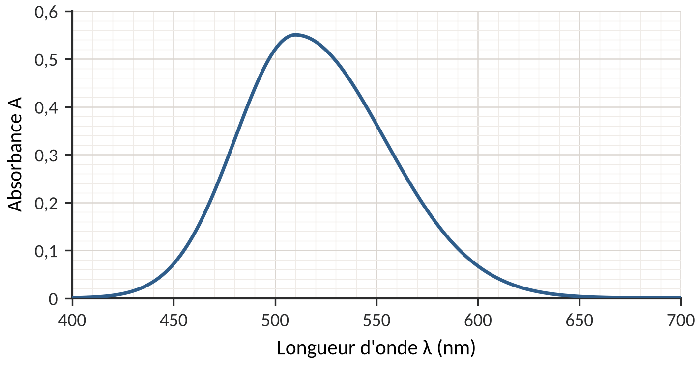{width=6.8cm}
:::

::: {custom-style="Legende"}
Figure 1. Spectre d'absorption de l'espèce formée par les ions fer(II) et l'orthophénanthroline
:::

::: {custom-style="Figure"}
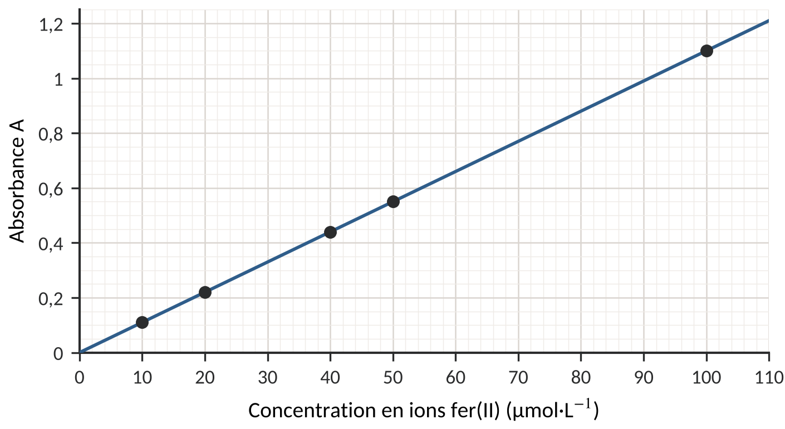{width=6.8cm}
:::

::: {custom-style="Legende"}
Figure 2. Courbe d'étalonnage
:::

::: {custom-style="Enonce"}
**Données**
:::

::: {custom-style="EnonceDonnees"}
$M(\text{Fe}_2\text{O}_3) = 159{,}7\ \text{g·mol}^{-1}$. La solution S, diluée 2 fois, a une absorbance de $0{,}66$. Incertitude-type sur le pourcentage massique mesuré $w$ : $u(w) = 0{,}2\ \%$ (même unité que $w$).
:::

::: {custom-style="Enonce"}
**1.** Pourquoi faut-il ajouter de l'orthophénanthroline aux solutions d'ions fer(II) ?

**2.** À l'aide de la figure 1, choisir la longueur d'onde de travail du spectrophotomètre. Justifier.

**3.** Indiquer la verrerie et le volume de solution mère à prélever pour préparer l'étalon de concentration $40\ \text{µmol·L}^{-1}$.

**4.** Montrer que la figure 2 est en accord avec la loi de Beer-Lambert et déterminer le coefficient $k$.

**5.** Déterminer la quantité d'ions fer(II) contenue dans la solution S, puis la masse d'oxyde de fer(III) dans l'échantillon.

**6.** Calculer le pourcentage massique du pigment. Est-il compatible avec la valeur annoncée ?
:::

::: {custom-style="Renvoi"}
[CIBLE:c_ex1]{custom-style="BoutonCorrige"}
:::

# Thème 2 : titrage et équivalence {#theme2}

::: {custom-style="Rubrique"}
Questions de cours
:::

## [Q.7]{custom-style="QNum"}\ \ Définir l'équivalence et les qualités d'une réaction support de titrage {#q7}

::: {custom-style="Meta"}
[\ Objectif 10\ ]{custom-style="Niv10"}\ \ Cours · Notions : réactif titré, réactif titrant, équivalence · Demandé en 2025 et 2026\ \ \ [CIBLE:c_q7]{custom-style="BoutonCorrige"}
:::

::: {custom-style="Enonce"}
Application : on titre, par une solution d'hydroxyde de sodium, l'acide éthanoïque d'un vinaigre dilué. Nommer le réactif titré et le réactif titrant, écrire l'équation de la réaction support, définir l'équivalence et citer les trois qualités que doit présenter cette réaction.
:::

## [Q.8]{custom-style="QNum"}\ \ Écrire la relation à l'équivalence et calculer une concentration {#q8}

::: {custom-style="Meta"}
[\ Objectif 10\ ]{custom-style="Niv10"}\ \ Méthode · Notions : relation à l'équivalence, stœchiométrie · Demandé en 2025 et 2026\ \ \ [CIBLE:c_q8]{custom-style="BoutonCorrige"}
:::

::: {custom-style="Enonce"}
Application : un vinaigre est dilué 10 fois ; $V = 10{,}0\ \text{mL}$ de solution diluée sont titrés par de la soude de concentration $c = 0{,}100\ \text{mol·L}^{-1}$ : $V_\text{E} = 12{,}0\ \text{mL}$. Calculer la concentration en acide éthanoïque du vinaigre. Puis $V = 20{,}0\ \text{mL}$ d'une solution de diiode sont titrés par du thiosulfate de sodium de concentration $c_2 = 2{,}0 \times 10^{-2}\ \text{mol·L}^{-1}$ : $V_\text{E} = 15{,}0\ \text{mL}$. Avec l'équation $\text{I}_2(\text{aq}) + 2\,\text{S}_2\text{O}_3^{2-}(\text{aq}) \rightarrow 2\,\text{I}^-(\text{aq}) + \text{S}_4\text{O}_6^{2-}(\text{aq})$, calculer la concentration en diiode.
:::

## [Q.9]{custom-style="QNum"}\ \ Schématiser un dispositif de titrage {#q9}

::: {custom-style="Meta"}
[\ Objectif 10\ ]{custom-style="Niv10"}\ \ Cours · Notions : burette, pipette jaugée, électrode · Demandé en 2025 (Métropole, Centres étrangers)\ \ \ [CIBLE:c_q9]{custom-style="BoutonCorrige"}
:::

::: {custom-style="Enonce"}
Application : réaliser le schéma légendé du dispositif d'un titrage avec suivi pH-métrique. Que faut-il changer pour un suivi conductimétrique, puis pour un titrage colorimétrique ?
:::

## [Q.10]{custom-style="QNum"}\ \ Repérer l'équivalence d'un titrage colorimétrique d'oxydoréduction {#q10}

::: {custom-style="Meta"}
[\ Objectif 10\ ]{custom-style="Niv10"}\ \ Méthode · Notions : oxydant, réducteur, changement de couleur · Demandé en 2026 (Asie)\ \ \ [CIBLE:c_q10]{custom-style="BoutonCorrige"}
:::

::: {custom-style="Enonce"}
Application : on titre $V = 10{,}0\ \text{mL}$ d'une solution d'ions fer(II), presque incolore, par une solution violette de permanganate de potassium de concentration $c = 2{,}00 \times 10^{-2}\ \text{mol·L}^{-1}$, en milieu acide, selon $\text{MnO}_4^-(\text{aq}) + 5\,\text{Fe}^{\text{2+}}(\text{aq}) + 8\,\text{H}^{\text{+}}(\text{aq}) \rightarrow \text{Mn}^{\text{2+}}(\text{aq}) + 5\,\text{Fe}^{\text{3+}}(\text{aq}) + 4\,\text{H}_2\text{O}(\ell)$ ; seuls les ions permanganate sont colorés. Comment repère-t-on l'équivalence ? Avec $V_\text{E} = 12{,}4\ \text{mL}$, calculer la concentration en ions fer(II).
:::

::: {custom-style="Rubrique"}
Exercices
:::

### [Exercice 2]{custom-style="QNum"}\ \ Le cuivre d'une terre de vigne [(voir BAC Asie 2026)]{custom-style="VoirBac"} {#ex2}

::: {custom-style="Meta"}
[\ Objectif 14\ ]{custom-style="Niv14"}\ \ [Type BAC]{custom-style="TagBac"} · 5 points · 45 min · Question 6 : objectif 18
:::

::: {custom-style="MentionBac"}
[Sujet du BAC correspondant.]{custom-style="EtiqBac"} Asie 2026, jour 2, exercice 3 : « Phytoremédiation ».
:::

::: {custom-style="Enonce"}
Les traitements à la bouillie bordelaise enrichissent en cuivre la terre des vignes. Un viticulteur qui veut passer en agriculture biologique doit ramener la teneur en cuivre de sa terre sous une valeur limite, en cultivant des plantes qui absorbent le cuivre. Pour connaître la teneur de départ, on traite $1{,}00\ \text{kg}$ de terre de façon à faire passer tout le cuivre en solution sous forme d'ions $\text{Cu}^{\text{2+}}$ : on obtient $1{,}00\ \text{L}$ de solution $\text{S}_0$. On en prélève $V_1 = 50{,}0\ \text{mL}$, auxquels on ajoute des ions iodure en excès : la transformation, totale, forme du diiode selon $2\,\text{Cu}^{\text{2+}}(\text{aq}) + 4\,\text{I}^-(\text{aq}) \rightarrow 2\,\text{CuI}(\text{s}) + \text{I}_2(\text{aq})$. Le diiode formé est ensuite titré par une solution de thiosulfate de sodium de concentration $c_2 = 2{,}00 \times 10^{-2}\ \text{mol·L}^{-1}$, en présence d'empois d'amidon. L'équivalence est obtenue pour $V_\text{E} = 12{,}0\ \text{mL}$.
:::

::: {custom-style="Enonce"}
**Données**
:::

::: {custom-style="EnonceDonnees"}
Réaction support du titrage : $\text{I}_2(\text{aq}) + 2\,\text{S}_2\text{O}_3^{2-}(\text{aq}) \rightarrow 2\,\text{I}^-(\text{aq}) + \text{S}_4\text{O}_6^{2-}(\text{aq})$. Couples : $\text{I}_2(\text{aq})/\text{I}^-(\text{aq})$ ; $\text{S}_4\text{O}_6^{2-}(\text{aq})/\text{S}_2\text{O}_3^{2-}(\text{aq})$.

L'empois d'amidon donne une couleur bleu foncé en présence de diiode, même en très faible quantité ; les autres espèces sont incolores.

$M(\text{Cu}) = 63{,}5\ \text{g·mol}^{-1}$. Teneur limite retenue dans cet exercice : $100\ \text{mg}$ de cuivre par kilogramme de terre. On admet qu'un cycle de culture retire $40\ \text{mg}$ de cuivre par kilogramme de terre.
:::

::: {custom-style="Enonce"}
**1.** Définir l'équivalence d'un titrage.

**2.** Écrire les demi-équations des deux couples, puis identifier l'oxydant et le réducteur de la réaction support du titrage.

**3.** Décrire le changement de couleur qui permet de repérer l'équivalence.

**4.** Établir la relation entre la quantité de diiode titré et la quantité d'ions thiosulfate versés à l'équivalence, puis calculer la quantité de diiode.

**5.** Montrer que la quantité d'ions cuivre(II) contenue dans le prélèvement vaut $n(\text{Cu}^{\text{2+}}) = c_2 \times V_\text{E}$ et la calculer.

**6.** Déterminer la teneur en cuivre de la terre, en milligramme par kilogramme, puis le nombre de cycles de culture nécessaires pour passer sous la teneur limite.
:::

::: {custom-style="Renvoi"}
[CIBLE:c_ex2]{custom-style="BoutonCorrige"}
:::

# Thème 3 : titrage avec suivi pH-métrique {#theme3}

::: {custom-style="Rubrique"}
Questions de cours
:::

## [Q.11]{custom-style="QNum"}\ \ Déterminer le volume équivalent sur une courbe de titrage pH-métrique {#q11}

::: {custom-style="Meta"}
[\ Objectif 10\ ]{custom-style="Niv10"}\ \ Méthode · Notions : saut de pH, méthode des tangentes, méthode de la dérivée · Demandé dans cinq exercices en 2025 et 2026\ \ \ [CIBLE:c_q11]{custom-style="BoutonCorrige"}
:::

::: {custom-style="Enonce"}
Application : la figure 3 représente le titrage de $V = 10{,}0\ \text{mL}$ d'une solution d'acide éthanoïque par une solution d'hydroxyde de sodium de concentration $c = 0{,}100\ \text{mol·L}^{-1}$, avec la dérivée $\dfrac{\text{dpH}}{\text{d}V}$. Déterminer le volume équivalent par deux méthodes, puis la concentration de la solution titrée.
:::

::: {custom-style="Figure"}
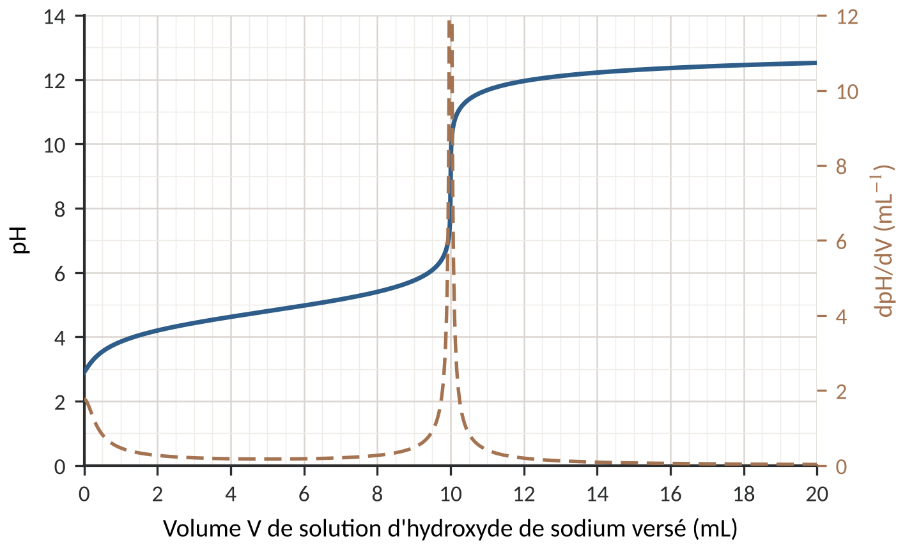{width=10.5cm}
:::

::: {custom-style="Legende"}
Figure 3. Titrage de l'acide éthanoïque par la soude : pH (trait plein, axe de gauche) et dérivée du pH (tirets, axe de droite)
:::

## [Q.12]{custom-style="QNum"}\ \ Déterminer le $\text{p}K_\text{A}$ d'un couple à la demi-équivalence {#q12}

::: {custom-style="Meta"}
[\ Objectif 14\ ]{custom-style="Niv14"}\ \ Méthode · Notions : demi-équivalence, constante d'acidité\ \ \ [CIBLE:c_q12]{custom-style="BoutonCorrige"}
:::

::: {custom-style="Enonce"}
Application : à l'aide de la figure 3, déterminer le pH à la demi-équivalence. Montrer qu'il est égal au $\text{p}K_\text{A}$ du couple $\text{CH}_3\text{COOH}/\text{CH}_3\text{COO}^-$.
:::

## [Q.13]{custom-style="QNum"}\ \ Interpréter l'allure d'une courbe de titrage et choisir un indicateur coloré {#q13}

::: {custom-style="Meta"}
[\ Objectif 10\ ]{custom-style="Niv10"}\ \ Cours · Notions : espèces majoritaires, pH à l'équivalence, zone de virage · Demandé en 2025 et 2026\ \ \ [CIBLE:c_q13]{custom-style="BoutonCorrige"}
:::

::: {custom-style="Enonce"}
Application : pour le titrage de la figure 3, indiquer les espèces majoritaires avant l'équivalence, à l'équivalence et après. Pourquoi le pH à l'équivalence est-il supérieur à 7 ? Choisir l'indicateur adapté parmi l'hélianthine (zone de virage 3,1 à 4,4), le bleu de bromothymol (6,0 à 7,6) et la phénolphtaléine (8,2 à 10,0).
:::

## [Q.14]{custom-style="QNum"}\ \ Exploiter un titrage à deux équivalences {#q14}

::: {custom-style="Meta"}
[\ Objectif 14\ ]{custom-style="Niv14"}\ \ Méthode · Notions : ions carbonate et hydrogénocarbonate, deux sauts de pH · Demandé en 2025 (Métropole, septembre)\ \ \ [CIBLE:c_q14]{custom-style="BoutonCorrige"}
:::

::: {custom-style="Enonce"}
Application : on titre $V = 10{,}0\ \text{mL}$ d'une lessive contenant des ions carbonate par de l'acide chlorhydrique de concentration $c = 0{,}100\ \text{mol·L}^{-1}$. La courbe présente deux sauts de pH, pour $V_{\text{E1}} = 9{,}6\ \text{mL}$ et $V_{\text{E2}} = 21{,}8\ \text{mL}$. Écrire les deux réactions successives et calculer la concentration en ions carbonate. Pourquoi $V_{\text{E2}}$ est-il supérieur à $2\,V_{\text{E1}}$ ? En déduire la concentration en ions hydrogénocarbonate initialement présents.
:::

## [Q.15]{custom-style="QNum"}\ \ Remonter d'une prise d'essai à l'échantillon {#q15}

::: {custom-style="Meta"}
[\ Objectif 14\ ]{custom-style="Niv14"}\ \ Méthode · Notions : solution mère, prise d'essai, comprimé · Demandé en 2026 (Amérique du Nord, Centres étrangers)\ \ \ [CIBLE:c_q15]{custom-style="BoutonCorrige"}
:::

::: {custom-style="Enonce"}
Application : un comprimé de vitamine C, l'acide ascorbique, est dissous dans de l'eau distillée pour obtenir $200{,}0\ \text{mL}$ de solution. On titre une prise d'essai de $20{,}0\ \text{mL}$ par une solution d'hydroxyde de sodium de concentration $c = 2{,}00 \times 10^{-2}\ \text{mol·L}^{-1}$ : $V_\text{E} = 14{,}1\ \text{mL}$. L'acide ascorbique réagit mole à mole avec les ions hydroxyde. Calculer la masse d'acide ascorbique du comprimé et la comparer à l'étiquette, qui annonce $500\ \text{mg}$. Donnée : $M = 176{,}1\ \text{g·mol}^{-1}$.
:::

## [Q.16]{custom-style="QNum"}\ \ Comparer le résultat d'un dosage à une valeur annoncée {#q16}

::: {custom-style="Meta"}
[\ Objectif 14\ ]{custom-style="Niv14"}\ \ Méthode · Notions : écart relatif, incertitude-type, quotient $z$ · Demandé en 2025 et 2026\ \ \ [CIBLE:c_q16]{custom-style="BoutonCorrige"}
:::

::: {custom-style="Enonce"}
Application : un titrage donne pour un comprimé une masse d'aspirine $m = 486\ \text{mg}$, avec une incertitude-type $u(m) = 8\ \text{mg}$. L'étiquette indique $500\ \text{mg}$. Le résultat est-il compatible avec l'étiquette ? Calculer aussi l'écart relatif.
:::

::: {custom-style="Rubrique"}
Exercices
:::

### [Exercice 3]{custom-style="QNum"}\ \ Des comprimés saisis par les douanes [(voir BAC Centres étrangers 2026)]{custom-style="VoirBac"} {#ex3}

::: {custom-style="Meta"}
[\ Objectif 14\ ]{custom-style="Niv14"}\ \ [Type BAC]{custom-style="TagBac"} · 5 points · 45 min · Question 6 : objectif 18
:::

::: {custom-style="MentionBac"}
[Sujet du BAC correspondant.]{custom-style="EtiqBac"} Centres étrangers 2026, jour 1, exercice 3 : « Analyse d'un comprimé » (partie 2, titrage avec suivi pH-métrique).
:::

::: {custom-style="Enonce"}
Des comprimés vendus comme de l'aspirine dosée à $500\ \text{mg}$ ont été saisis. Pour contrôler leur teneur, on dissout un comprimé dans de l'eau distillée de façon à obtenir $V = 500{,}0\ \text{mL}$ de solution S. On titre un volume $V_1 = 50{,}0\ \text{mL}$ de la solution S par une solution d'hydroxyde de sodium de concentration $c = 2{,}00 \times 10^{-2}\ \text{mol·L}^{-1}$, avec un suivi pH-métrique (figure 4). L'aspirine, notée AH, est un acide faible.
:::

::: {custom-style="Figure"}
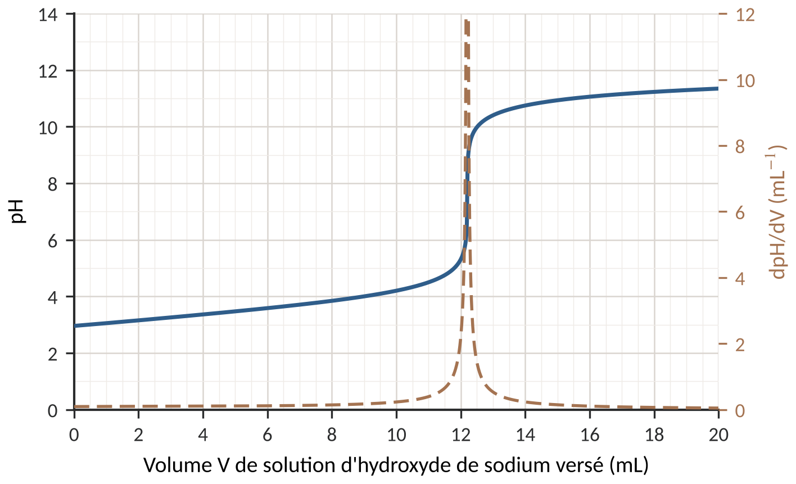{width=10.5cm}
:::

::: {custom-style="Legende"}
Figure 4. Titrage de la solution S : pH (trait plein, axe de gauche) et dérivée du pH (tirets, axe de droite)
:::

::: {custom-style="Enonce"}
**Données**
:::

::: {custom-style="EnonceDonnees"}
$M(\text{aspirine}) = 180{,}2\ \text{g·mol}^{-1}$. Critère retenu dans cet exercice : un comprimé est commercialisable si sa masse d'aspirine s'écarte de moins de $5\ \%$ de la valeur affichée.
:::

::: {custom-style="Enonce"}
**1.** Écrire l'équation de la réaction support du titrage et citer deux qualités qu'elle doit présenter.

**2.** Indiquer la verrerie utilisée pour prélever le volume $V_1$.

**3.** Déterminer le volume équivalent à l'aide de la figure 4, en précisant la méthode.

**4.** Calculer la quantité d'aspirine contenue dans le volume $V_1$.

**5.** En déduire la masse d'aspirine contenue dans le comprimé.

**6.** Établir l'expression littérale de la masse $m$ d'aspirine du comprimé en fonction de $c$, $V_\text{E}$, $V$, $V_1$ et de la masse molaire $M$ de l'aspirine, puis vérifier qu'elle redonne la valeur de la question 5. Les comprimés saisis sont-ils commercialisables ? Justifier.
:::

::: {custom-style="Renvoi"}
[CIBLE:c_ex3]{custom-style="BoutonCorrige"}
:::

# Thème 4 : titrage avec suivi conductimétrique {#theme4}

::: {custom-style="Rubrique"}
Questions de cours
:::

## [Q.17]{custom-style="QNum"}\ \ Prévoir l'évolution de la conductivité au cours d'un titrage {#q17}

::: {custom-style="Meta"}
[\ Objectif 10\ ]{custom-style="Niv10"}\ \ Méthode · Notions : conductivités molaires ioniques, ions spectateurs · Demandé en 2025 et 2026\ \ \ [CIBLE:c_q17]{custom-style="BoutonCorrige"}
:::

::: {custom-style="Enonce"}
Application : on titre de l'acide chlorhydrique $(\text{H}_3\text{O}^{\text{+}} + \text{Cl}^-)$ par de la soude $(\text{Na}^{\text{+}} + \text{HO}^-)$. Prévoir l'évolution de la quantité de matière de chaque ion, puis de la conductivité, avant et après l'équivalence. Conductivités molaires ioniques, en $\text{mS·m}^{2}\text{·mol}^{-1}$ : $\text{H}_3\text{O}^{\text{+}}$ : $35{,}0$ ; $\text{HO}^-$ : $19{,}9$ ; $\text{Na}^{\text{+}}$ : $5{,}01$ ; $\text{Cl}^-$ : $7{,}63$.
:::

## [Q.18]{custom-style="QNum"}\ \ Déterminer le volume équivalent d'un titrage conductimétrique {#q18}

::: {custom-style="Meta"}
[\ Objectif 10\ ]{custom-style="Niv10"}\ \ Méthode · Notions : intersection de deux droites, dilution négligeable · Demandé en 2025 et 2026\ \ \ [CIBLE:c_q18]{custom-style="BoutonCorrige"}
:::

::: {custom-style="Enonce"}
Application : on place $V_0 = 10{,}0\ \text{mL}$ d'acide chlorhydrique et environ $190\ \text{mL}$ d'eau distillée dans un bécher, puis on titre par une solution d'hydroxyde de sodium de concentration $c = 0{,}100\ \text{mol·L}^{-1}$ (figure 5). Pourquoi ajoute-t-on de l'eau ? Déterminer le volume équivalent et la concentration de l'acide chlorhydrique.
:::

::: {custom-style="Figure"}
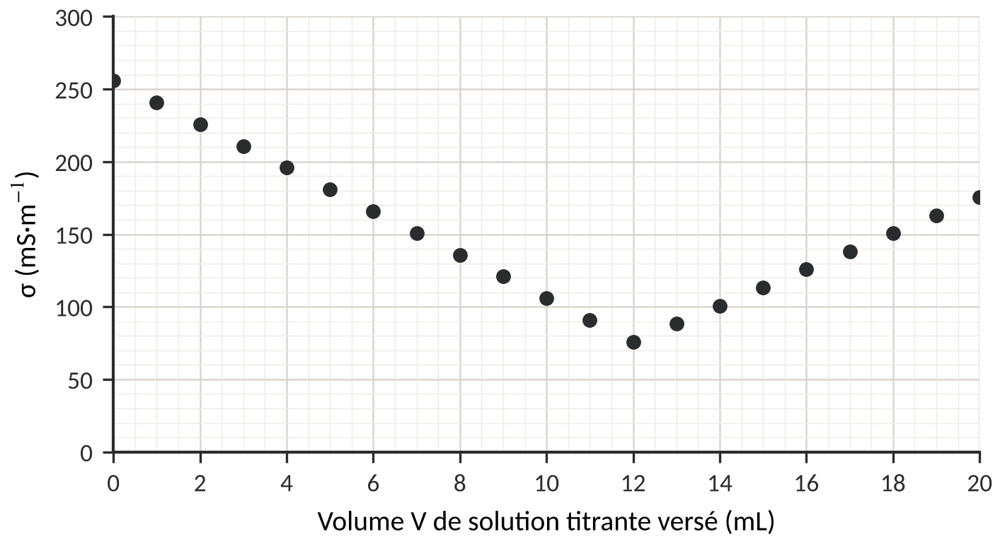{width=8cm}
:::

::: {custom-style="Legende"}
Figure 5. Titrage conductimétrique de l'acide chlorhydrique par la soude
:::

## [Q.19]{custom-style="QNum"}\ \ Titrer des ions chlorure par précipitation {#q19}

::: {custom-style="Meta"}
[\ Objectif 14\ ]{custom-style="Niv14"}\ \ Méthode · Notions : précipité, ions spectateurs, concentration massique · Demandé en 2025 et 2026\ \ \ [CIBLE:c_q19]{custom-style="BoutonCorrige"}
:::

::: {custom-style="Enonce"}
Application : on titre $V_0 = 20{,}0\ \text{mL}$ d'une eau minérale, diluée par $180\ \text{mL}$ d'eau distillée, par du nitrate d'argent $(\text{Ag}^{\text{+}} + \text{NO}_3^-)$ de concentration $c = 5{,}00 \times 10^{-3}\ \text{mol·L}^{-1}$ : $\text{Ag}^{\text{+}}(\text{aq}) + \text{Cl}^-(\text{aq}) \rightarrow \text{AgCl}(\text{s})$. Justifier que la conductivité diminue légèrement avant l'équivalence, puis augmente. Avec $V_\text{E} = 9{,}6\ \text{mL}$, calculer la concentration massique en ions chlorure. Données : conductivités molaires ioniques, en $\text{mS·m}^{2}\text{·mol}^{-1}$ : $\text{Cl}^-$ : $7{,}63$ ; $\text{NO}_3^-$ : $7{,}14$ ; $\text{Ag}^{\text{+}}$ : $6{,}19$. $M(\text{Cl}) = 35{,}5\ \text{g·mol}^{-1}$.
:::

::: {custom-style="Rubrique"}
Exercices
:::

### [Exercice 4]{custom-style="QNum"}\ \ L'eau de Quinton [(voir BAC Métropole, juin 2025)]{custom-style="VoirBac"} {#ex4}

::: {custom-style="Meta"}
[\ Objectif 10\ ]{custom-style="Niv10"}\ \ [Type BAC]{custom-style="TagBac"} · 4 points · 35 min · Question 5 : objectif 14
:::

::: {custom-style="MentionBac"}
[Sujet du BAC correspondant.]{custom-style="EtiqBac"} Métropole, juin 2025, jour 2, exercice 2 : « Eau de Quinton ».
:::

::: {custom-style="Enonce"}
L'eau de Quinton hypertonique est de l'eau de mer prélevée au large, puis filtrée. On l'assimile à une solution de chlorure de sodium. Pour déterminer sa teneur en ions chlorure, on la dilue 10 fois : c'est la solution D. On place $V_0 = 10{,}0\ \text{mL}$ de D et $190\ \text{mL}$ d'eau distillée dans un bécher, puis on titre par une solution de nitrate d'argent de concentration $c = 0{,}100\ \text{mol·L}^{-1}$, avec un suivi conductimétrique (figure 6). Les ions argent et les ions chlorure forment un précipité de chlorure d'argent ; la transformation est totale et rapide.
:::

::: {custom-style="Figure"}
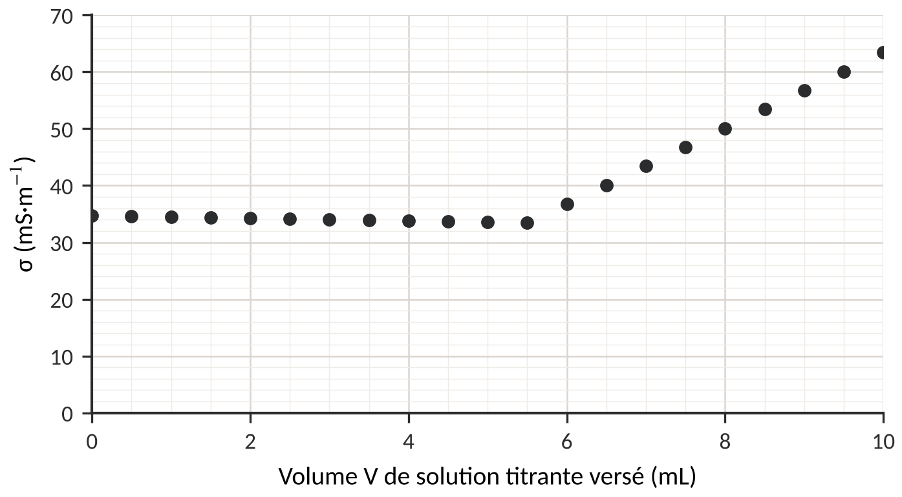{width=9.5cm}
:::

::: {custom-style="Legende"}
Figure 6. Titrage conductimétrique de la solution D par le nitrate d'argent
:::

::: {custom-style="Enonce"}
**Données**
:::

::: {custom-style="EnonceDonnees"}
Conductivités molaires ioniques, en $\text{mS·m}^{2}\text{·mol}^{-1}$ : $\text{Na}^{\text{+}}$ : $5{,}01$ ; $\text{Cl}^-$ : $7{,}63$ ; $\text{Ag}^{\text{+}}$ : $6{,}19$ ; $\text{NO}_3^-$ : $7{,}14$. $M(\text{Cl}) = 35{,}5\ \text{g·mol}^{-1}$.

Concentration massique moyenne en ions chlorure de l'eau de mer : $19{,}4\ \text{g·L}^{-1}$. Concentration en ions chlorure du sang : de 100 à $110\ \text{mmol·L}^{-1}$.
:::

::: {custom-style="Enonce"}
**1.** Écrire l'équation de la réaction support du titrage.

**2.** Pourquoi ajoute-t-on $190\ \text{mL}$ d'eau distillée avant de titrer ?

**3.** Justifier l'allure de la courbe avant puis après l'équivalence.

**4.** Déterminer le volume équivalent, puis la concentration en ions chlorure de la solution D et celle de l'eau de Quinton.

**5.** Calculer la concentration massique en ions chlorure de l'eau de Quinton et la comparer à celle de l'eau de mer. Par quel facteur faudrait-il la diluer pour obtenir la concentration en ions chlorure du sang ?
:::

::: {custom-style="Renvoi"}
[CIBLE:c_ex4]{custom-style="BoutonCorrige"}
:::

<!--debut:complet-->
::: {custom-style="Surtitre"}
Corrigés
:::

# Corrigés du thème 1 : dosages par étalonnage {#c_theme1}

#### [Corrigé]{custom-style="NumCorrige"}\ \ Q.1 · Choisir la longueur d'onde de travail d'un spectrophotomètre {#c_q1}

::: {custom-style="Renvoi"}
[CIBLE:q1]{custom-style="BoutonEnonce"}
:::

La solution absorbe surtout le vert : sa couleur est la couleur complémentaire du vert, le magenta, ce rose violacé caractéristique des solutions de permanganate.

On règle le spectrophotomètre à $\lambda_\text{max} = 525\ \text{nm}$ : l'absorbance y est la plus grande, donc la mesure est la plus sensible ; de plus, autour du maximum, une petite erreur sur la longueur d'onde modifie peu l'absorbance.

Avant la première mesure, on fait le blanc : on règle l'absorbance à zéro avec une cuve remplie du solvant seul, ici de l'eau distillée, pour ne mesurer que l'absorption due à l'espèce dosée.

::: {custom-style="Retenir"}
On mesure à $\lambda_\text{max}$ ; la couleur perçue est la couleur complémentaire de la couleur absorbée
:::

::: {custom-style="Piege"}
[Piège.]{custom-style="EtiqPiege"} Régler le spectrophotomètre sur la couleur de la solution : une solution magenta n'absorbe pas le magenta, elle absorbe le vert.
:::

::: {custom-style="Remarque"}
[Remarque.]{custom-style="EtiqRemarque"} Si la solution contient deux espèces colorées, comme les formes acide et basique d'un même couple, on choisit la longueur d'onde où l'espèce suivie absorbe presque au maximum et l'autre presque pas : l'absorbance ne dépend alors que de la concentration de l'espèce suivie.
:::

#### [Corrigé]{custom-style="NumCorrige"}\ \ Q.2 · Exploiter une gamme d'étalonnage et la loi de Beer-Lambert {#c_q2}

::: {custom-style="Renvoi"}
[CIBLE:q2]{custom-style="BoutonEnonce"}
:::

Pour chaque étalon, le rapport $\dfrac{A}{C}$ vaut $0{,}13\ \text{L·µmol}^{-1}$ : l'absorbance est proportionnelle à la concentration, la courbe $A = f(C)$ est une droite passant par l'origine. La loi de Beer-Lambert $A = k \times C$ est vérifiée, avec $k = 0{,}13\ \text{L·µmol}^{-1}$.

$$C = \dfrac{A}{k} = \dfrac{0{,}455}{0{,}13} = 3{,}5\ \text{µmol·L}^{-1} \qquad C_\text{m} = C \times M = 3{,}5 \times 10^{-6} \times 792{,}8 = 2{,}8 \times 10^{-3}\ \text{g·L}^{-1}$$

La boisson contient $2{,}8\ \text{mg}$ de colorant par litre.

::: {custom-style="Retenir"}
Loi de Beer-Lambert : $A = k \times C$, où $k$ s'exprime dans l'unité inverse de celle de $C$
:::

::: {custom-style="Methode"}
[Méthode.]{custom-style="EtiqMethode"} Sur un graphique, lire l'abscisse du point de la droite dont l'ordonnée est l'absorbance mesurée ; avec un tableau, calculer $k$ comme le rapport $\dfrac{A}{C}$.
:::

::: {custom-style="Remarque"}
[Remarque.]{custom-style="EtiqRemarque"} La loi s'écrit aussi $A = \varepsilon \times \ell \times C$, où $\varepsilon$ est le coefficient d'extinction molaire et $\ell$ la longueur de la cuve : la pente est $k = \varepsilon \times \ell$. L'absorbance est aussi proportionnelle à la concentration massique, $A = k_1 \times C_\text{m}$ avec $k_1 = \dfrac{k}{M}$, et l'axe d'une courbe d'étalonnage peut être gradué en $\text{g·L}^{-1}$. Si l'énoncé donne des spectres de solutions de concentrations différentes au lieu d'un tableau, on relève l'absorbance de chacune à $\lambda_\text{max}$ et l'on trace $A$ en fonction de $C$.
:::

#### [Corrigé]{custom-style="NumCorrige"}\ \ Q.3 · Vérifier qu'une mesure est dans la gamme d'étalonnage et diluer si nécessaire {#c_q3}

::: {custom-style="Renvoi"}
[CIBLE:q3]{custom-style="BoutonEnonce"}
:::

Non : la plus forte absorbance de la gamme vaut $0{,}65$. Rien ne garantit que la loi de Beer-Lambert reste valable jusqu'à $2{,}0$, et une absorbance aussi forte est mal mesurée, car presque toute la lumière est absorbée. On ne prolonge pas la droite hors de la gamme : on dilue.

Après dilution, $A' = 0{,}26$ est dans la gamme :

$$C' = \dfrac{0{,}26}{0{,}13} = 2{,}0\ \text{µmol·L}^{-1} \qquad C = 10 \times C' = 20\ \text{µmol·L}^{-1}$$

$$C_\text{m} = 20 \times 10^{-6} \times 792{,}8 = 1{,}6 \times 10^{-2}\ \text{g·L}^{-1}, \text{ soit } 16\ \text{mg·L}^{-1}$$

La lecture directe donnerait $\dfrac{2{,}0}{0{,}13} = 15\ \text{µmol·L}^{-1}$, valeur trop faible : au-delà de la gamme, l'absorbance mesurée n'est plus proportionnelle à la concentration.

::: {custom-style="Piege"}
[Piège.]{custom-style="EtiqPiege"} Oublier le facteur de dilution : la concentration lue sur la gamme est celle de la solution diluée, pas celle du sirop.
:::

::: {custom-style="Remarque"}
[Remarque.]{custom-style="EtiqRemarque"} La loi de Beer-Lambert suppose une lumière monochromatique, une solution homogène et peu concentrée, et un soluté qui ne réagit pas à la lumière.
:::

#### [Corrigé]{custom-style="NumCorrige"}\ \ Q.4 · Calculer une conductivité avec la loi de Kohlrausch {#c_q4}

::: {custom-style="Renvoi"}
[CIBLE:q4]{custom-style="BoutonEnonce"}
:::

Dans la loi de Kohlrausch, les concentrations s'expriment en $\text{mol·m}^{-3}$ : $C = 2{,}00 \times 10^{-3}\ \text{mol·L}^{-1} = 2{,}00\ \text{mol·m}^{-3}$. Chaque solution contient deux sortes d'ions, à la même concentration $C$ :

$$\sigma(\text{NaCl}) = (5{,}01 + 7{,}63) \times 2{,}00 = 25{,}3\ \text{mS·m}^{-1} \qquad \sigma(\text{HCl}) = (35{,}0 + 7{,}63) \times 2{,}00 = 85{,}3\ \text{mS·m}^{-1}$$

L'ion oxonium a une conductivité molaire ionique environ sept fois plus grande que celle de l'ion sodium : la solution d'acide chlorhydrique conduit nettement mieux le courant.

::: {custom-style="Retenir"}
$\sigma = \sum \lambda_i\, [X_i]$, avec $\lambda_i$ en $\text{S·m}^{2}\text{·mol}^{-1}$ et $[X_i]$ en $\text{mol·m}^{-3}$ ; $\sigma$ est alors en $\text{S·m}^{-1}$
:::

::: {custom-style="Piege"}
[Piège.]{custom-style="EtiqPiege"} Garder les concentrations en $\text{mol·L}^{-1}$ : le résultat est alors mille fois trop petit.
:::

::: {custom-style="Remarque"}
[Remarque.]{custom-style="EtiqRemarque"} La loi s'utilise aussi à l'envers : une solution d'acide chlorhydrique de conductivité $128\ \text{mS·m}^{-1}$ a pour concentration $C = \dfrac{\sigma}{\lambda(\text{H}_3\text{O}^{\text{+}}) + \lambda(\text{Cl}^-)} = \dfrac{128}{35{,}0 + 7{,}63} = 3{,}00\ \text{mol·m}^{-3}$, soit $3{,}00 \times 10^{-3}\ \text{mol·L}^{-1}$. Pour un acide faible AH, les ions sont $\text{A}^-$ et $\text{H}_3\text{O}^{\text{+}}$ en même concentration : $[\text{H}_3\text{O}^{\text{+}}]_\text{f} = \dfrac{\sigma}{\lambda(\text{A}^-) + \lambda(\text{H}_3\text{O}^{\text{+}})}$, d'où l'avancement final et le taux d'avancement.
:::

#### [Corrigé]{custom-style="NumCorrige"}\ \ Q.5 · Réaliser un dosage par étalonnage conductimétrique {#c_q5}

::: {custom-style="Renvoi"}
[CIBLE:q5]{custom-style="BoutonEnonce"}
:::

Le rapport $\dfrac{\sigma}{C}$ est pratiquement constant, de $12{,}6$ à $12{,}7\ \text{mS·m}^{-1}$ pour $1\ \text{mmol·L}^{-1}$ : la conductivité est proportionnelle à la concentration, $\sigma = k \times C$, avec en moyenne $k = 12{,}63\ \text{mS·m}^{-1}$ pour $1\ \text{mmol·L}^{-1}$. Pour le sérum dilué :

$$C' = \dfrac{19{,}5}{12{,}63} = 1{,}54\ \text{mmol·L}^{-1} \qquad C = 100 \times C' = 0{,}154\ \text{mol·L}^{-1}$$

$$C_\text{m} = C \times M = 0{,}154 \times 58{,}5 = 9{,}0\ \text{g·L}^{-1}$$

Le résultat est cohérent avec l'étiquette : un litre de sérum, de masse $1{,}00\ \text{kg}$, contient $9{,}0\ \text{g}$ de chlorure de sodium, soit $0{,}90\ \%$ en masse.

::: {custom-style="Remarque"}
[Remarque.]{custom-style="EtiqRemarque"} La dilution est indispensable : la loi de Kohlrausch, et donc la proportionnalité entre $\sigma$ et $C$, ne vaut que pour des solutions diluées, de concentration inférieure à environ $10^{-2}\ \text{mol·L}^{-1}$.
:::

#### [Corrigé]{custom-style="NumCorrige"}\ \ Q.6 · Choisir une méthode de dosage adaptée {#c_q6}

::: {custom-style="Renvoi"}
[CIBLE:q6]{custom-style="BoutonEnonce"}
:::

Doser une espèce chimique, c'est déterminer sa quantité de matière, ou sa concentration, dans une solution.

<!--colonnes: 30 46 24-->

| Espèce à doser | Méthode | Échantillon |
|---|---|---|
| Colorant d'un sirop | Étalonnage par spectrophotométrie, après dilution | Conservé |
| Acide d'un détartrant | Titrage par une base, avec suivi pH-métrique ou un indicateur coloré | Détruit |
| Ions chlorure d'une eau de mer | Titrage par les ions argent, avec suivi conductimétrique | Détruit |
| Ions cuivre(II), bleus | Étalonnage par spectrophotométrie, ou titrage indirect : on titre le diiode qu'ils forment avec des ions iodure (Ex. 2) | Conservé ou détruit |

::: {custom-style="Retenir"}
Un dosage par étalonnage compare l'échantillon à des étalons sans le transformer ; un titrage le consomme par une réaction
:::

#### [Corrigé]{custom-style="NumCorrige"}\ \ Exercice 1 · Le pigment d'un vernis à ongles {#c_ex1}

::: {custom-style="Renvoi"}
[CIBLE:ex1]{custom-style="BoutonEnonce"}
:::

::: {custom-style="QRappel"}
**1.** Rôle de l'orthophénanthroline
:::

Les ions fer(II) en solution diluée sont presque incolores : ils absorbent très peu la lumière visible. L'orthophénanthroline forme avec eux une espèce rouge qui absorbe fortement ; on peut alors mesurer une absorbance proportionnelle à la concentration en ions fer(II).

::: {custom-style="QRappel"}
**2.** Longueur d'onde de travail
:::

On choisit $\lambda = 510\ \text{nm}$, longueur d'onde du maximum d'absorption : la mesure y est la plus sensible et la moins affectée par un petit écart de réglage.

::: {custom-style="QRappel"}
**3.** Préparation d'un étalon
:::

Le facteur de dilution vaut $F = \dfrac{100}{40} = 2{,}5$, d'où $V = \dfrac{50{,}0}{2{,}5} = 20{,}0\ \text{mL}$ de solution mère, prélevés à la pipette jaugée de $20{,}0\ \text{mL}$ et versés dans une fiole jaugée de $50{,}0\ \text{mL}$ ; on ajoute l'orthophénanthroline, puis on complète à l'eau distillée jusqu'au trait de jauge.

::: {custom-style="QRappel"}
**4.** Loi de Beer-Lambert
:::

Les points sont alignés sur une droite passant par l'origine : l'absorbance est proportionnelle à la concentration, conformément à la loi de Beer-Lambert. Avec le point $(100\ \text{µmol·L}^{-1} ; 1{,}10)$ :

$$k = \dfrac{1{,}10}{100} = 1{,}10 \times 10^{-2}\ \text{L·µmol}^{-1}$$

::: {custom-style="QRappel"}
**5.** Masse d'oxyde de fer(III)
:::

L'absorbance $0{,}66$ correspond à une concentration de $60\ \text{µmol·L}^{-1}$ dans la solution diluée (figure 7).

::: {custom-style="Figure"}
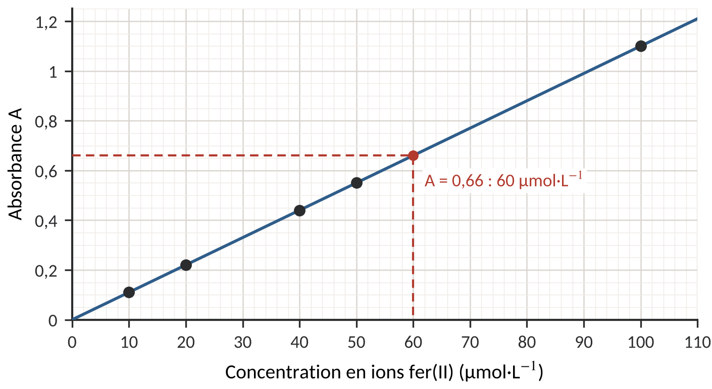{width=9.5cm}
:::

::: {custom-style="Legende"}
Figure 7. Lecture de la concentration sur la courbe d'étalonnage
:::

La solution S, diluée 2 fois avant la mesure, a donc une concentration $C_\text{S} = 2 \times 60 = 120\ \text{µmol·L}^{-1} = 1{,}2 \times 10^{-4}\ \text{mol·L}^{-1}$ :

$$n(\text{Fe}^{\text{2+}}) = C_\text{S} \times V_\text{S} = 1{,}2 \times 10^{-4} \times 0{,}1000 = 1{,}2 \times 10^{-5}\ \text{mol}$$

Chaque entité $\text{Fe}_2\text{O}_3$ libère deux ions fer : $n(\text{Fe}_2\text{O}_3) = \dfrac{1{,}2 \times 10^{-5}}{2} = 6{,}0 \times 10^{-6}\ \text{mol}$, soit :

$$m(\text{Fe}_2\text{O}_3) = 6{,}0 \times 10^{-6} \times 159{,}7 = 9{,}6 \times 10^{-4}\ \text{g} = 0{,}96\ \text{mg}$$

::: {custom-style="QRappel"}
**6.** Pourcentage massique et comparaison
:::

$$w = \dfrac{0{,}96}{20{,}0} = 4{,}8 \times 10^{-2}, \text{ soit } 4{,}8\ \% \qquad z = \dfrac{\left|4{,}8 - 5{,}0\right|}{0{,}2} = 1{,}0$$

Le quotient $z$ est inférieur à 2 : le résultat est compatible avec les $5{,}0\ \%$ annoncés par le fabricant.

::: {custom-style="Piege"}
[Piège.]{custom-style="EtiqPiege"} Oublier l'un des deux facteurs 2 : la dilution de la solution S avant la mesure, puis les deux ions fer libérés par chaque entité $\text{Fe}_2\text{O}_3$.
:::

# Corrigés du thème 2 : titrage et équivalence {#c_theme2}

#### [Corrigé]{custom-style="NumCorrige"}\ \ Q.7 · Définir l'équivalence et les qualités d'une réaction support de titrage {#c_q7}

::: {custom-style="Renvoi"}
[CIBLE:q7]{custom-style="BoutonEnonce"}
:::

Le réactif titré est l'acide éthanoïque, placé dans le bécher ; le réactif titrant est l'ion hydroxyde, apporté par la burette.

$$\text{CH}_3\text{COOH}(\text{aq}) + \text{HO}^-(\text{aq}) \rightarrow \text{CH}_3\text{COO}^-(\text{aq}) + \text{H}_2\text{O}(\ell)$$

L'équivalence est atteinte lorsque les réactifs ont été introduits dans les proportions stœchiométriques de la réaction support. Avant l'équivalence, les ions hydroxyde versés sont entièrement consommés : ils sont le réactif limitant. Après, c'est l'acide éthanoïque qui a disparu : le réactif limitant a changé.

La réaction support doit être totale, rapide et unique : aucune autre réaction ne doit consommer le réactif titrant.

::: {custom-style="Retenir"}
À l'équivalence, les réactifs ont été introduits dans les proportions stœchiométriques et le réactif limitant change
:::

#### [Corrigé]{custom-style="NumCorrige"}\ \ Q.8 · Écrire la relation à l'équivalence et calculer une concentration {#c_q8}

::: {custom-style="Renvoi"}
[CIBLE:q8]{custom-style="BoutonEnonce"}
:::

L'acide et les ions hydroxyde réagissent mole à mole : $n(\text{CH}_3\text{COOH}) = n_\text{E}(\text{HO}^-)$, soit $C' \times V = c \times V_\text{E}$.

$$C' = \dfrac{c \times V_\text{E}}{V} = \dfrac{0{,}100 \times 12{,}0}{10{,}0} = 0{,}120\ \text{mol·L}^{-1} \qquad C = 10 \times C' = 1{,}20\ \text{mol·L}^{-1}$$

Pour le diiode, il faut deux ions thiosulfate par molécule : $n(\text{I}_2) = \dfrac{n_\text{E}(\text{S}_2\text{O}_3^{2-})}{2}$, soit :

$$C(\text{I}_2) = \dfrac{c_2 \times V_\text{E}}{2\,V} = \dfrac{2{,}0 \times 10^{-2} \times 15{,}0}{2 \times 20{,}0} = 7{,}5 \times 10^{-3}\ \text{mol·L}^{-1}$$

::: {custom-style="Retenir"}
Pour $a\,\text{A} + b\,\text{B} \rightarrow \ldots$, à l'équivalence : $\dfrac{n_\text{A}}{a} = \dfrac{n_{\text{B,E}}}{b}$
:::

::: {custom-style="Piege"}
[Piège.]{custom-style="EtiqPiege"} Écrire $C \times V = c \times V_\text{E}$ sans regarder l'équation : pour le diiode, ce raccourci donne une concentration deux fois trop grande.
:::

#### [Corrigé]{custom-style="NumCorrige"}\ \ Q.9 · Schématiser un dispositif de titrage {#c_q9}

::: {custom-style="Renvoi"}
[CIBLE:q9]{custom-style="BoutonEnonce"}
:::

Le schéma doit nommer la verrerie et les solutions (figure 8).

::: {custom-style="Figure"}
{width=10cm}
:::

::: {custom-style="Legende"}
Figure 8. Dispositif d'un titrage avec suivi pH-métrique
:::

Pour un suivi conductimétrique, on remplace l'électrode et le pH-mètre par une cellule conductimétrique reliée à un conductimètre, et l'on ajoute de l'eau distillée dans le bécher. Pour un titrage colorimétrique, on retire l'appareil de mesure et l'on ajoute quelques gouttes d'indicateur coloré, sauf si l'un des réactifs est lui-même coloré (Q.10).

::: {custom-style="Redaction"}
[Rédaction.]{custom-style="EtiqRedaction"} Sur chaque légende, nommer l'objet et ce qu'il contient : « burette graduée : solution d'hydroxyde de sodium de concentration $c$ ».
:::

#### [Corrigé]{custom-style="NumCorrige"}\ \ Q.10 · Repérer l'équivalence d'un titrage colorimétrique d'oxydoréduction {#c_q10}

::: {custom-style="Renvoi"}
[CIBLE:q10]{custom-style="BoutonEnonce"}
:::

Avant l'équivalence, chaque ion permanganate versé est aussitôt consommé par les ions fer(II) en excès : la teinte violette disparaît et la solution reste presque incolore. Après l'équivalence, les ions permanganate ne réagissent plus et s'accumulent : la solution prend une teinte rose violacé. L'équivalence est repérée à la première goutte qui donne une teinte rose persistante.

D'après l'équation, il faut cinq ions fer(II) par ion permanganate : $\dfrac{n(\text{Fe}^{\text{2+}})}{5} = n_\text{E}(\text{MnO}_4^-)$, d'où :

$$C(\text{Fe}^{\text{2+}}) = \dfrac{5\,c\,V_\text{E}}{V} = \dfrac{5 \times 2{,}00 \times 10^{-2} \times 12{,}4}{10{,}0} = 0{,}124\ \text{mol·L}^{-1}$$

::: {custom-style="Remarque"}
[Remarque.]{custom-style="EtiqRemarque"} L'ion permanganate est l'oxydant, il capte des électrons : $\text{MnO}_4^- + 8\,\text{H}^{\text{+}} + 5\,\text{e}^- = \text{Mn}^{\text{2+}} + 4\,\text{H}_2\text{O}$. L'ion fer(II) est le réducteur, il en cède : $\text{Fe}^{\text{2+}} = \text{Fe}^{\text{3+}} + \text{e}^-$.
:::

#### [Corrigé]{custom-style="NumCorrige"}\ \ Exercice 2 · Le cuivre d'une terre de vigne {#c_ex2}

::: {custom-style="Renvoi"}
[CIBLE:ex2]{custom-style="BoutonEnonce"}
:::

::: {custom-style="QRappel"}
**1.** Équivalence
:::

L'équivalence est atteinte lorsque les réactifs titré et titrant ont été introduits dans les proportions stœchiométriques de la réaction support.

::: {custom-style="QRappel"}
**2.** Oxydant et réducteur
:::

$$\text{I}_2 + 2\,\text{e}^- = 2\,\text{I}^- \qquad 2\,\text{S}_2\text{O}_3^{2-} = \text{S}_4\text{O}_6^{2-} + 2\,\text{e}^-$$

Le diiode capte des électrons : c'est l'oxydant. Les ions thiosulfate en cèdent : ce sont les réducteurs.

::: {custom-style="QRappel"}
**3.** Repérage de l'équivalence
:::

Avant l'équivalence, il reste du diiode dans le bécher : la solution est bleu foncé en présence d'empois d'amidon. À l'équivalence, la dernière trace de diiode est consommée : la couleur bleue disparaît, la solution devient incolore.

::: {custom-style="QRappel"}
**4.** Quantité de diiode
:::

D'après l'équation du titrage, il faut deux ions thiosulfate par molécule de diiode :

$$n(\text{I}_2) = \dfrac{n_\text{E}(\text{S}_2\text{O}_3^{2-})}{2} = \dfrac{c_2 \times V_\text{E}}{2} = \dfrac{2{,}00 \times 10^{-2} \times 12{,}0 \times 10^{-3}}{2} = 1{,}20 \times 10^{-4}\ \text{mol}$$

::: {custom-style="QRappel"}
**5.** Quantité d'ions cuivre(II) du prélèvement
:::

La première réaction, totale, forme une molécule de diiode pour deux ions cuivre(II) : $n(\text{Cu}^{\text{2+}}) = 2\,n(\text{I}_2) = 2 \times \dfrac{c_2\,V_\text{E}}{2} = c_2 \times V_\text{E}$.

$$n(\text{Cu}^{\text{2+}}) = 2{,}00 \times 10^{-2} \times 12{,}0 \times 10^{-3} = 2{,}40 \times 10^{-4}\ \text{mol}$$

::: {custom-style="QRappel"}
**6.** Teneur en cuivre et nombre de cycles
:::

Le prélèvement de $50{,}0\ \text{mL}$ représente le vingtième de la solution $\text{S}_0$, qui contient tout le cuivre de $1{,}00\ \text{kg}$ de terre :

$$n = 20 \times 2{,}40 \times 10^{-4} = 4{,}80 \times 10^{-3}\ \text{mol} \qquad m = 4{,}80 \times 10^{-3} \times 63{,}5 = 0{,}305\ \text{g}$$

La terre contient $305\ \text{mg}$ de cuivre par kilogramme. Il faut en retirer plus de $305 - 100 = 205\ \text{mg}$, soit $\dfrac{205}{40} = 5{,}1$ cycles : cinq cycles laissent encore $105\ \text{mg·kg}^{-1}$, il en faut donc six.

::: {custom-style="Redaction"}
[Rédaction.]{custom-style="EtiqRedaction"} « Après cinq cycles, la teneur vaudrait $305 - 5 \times 40 = 105\ \text{mg·kg}^{-1}$, encore supérieure à la limite : six cycles de culture sont nécessaires. »
:::

# Corrigés du thème 3 : titrage avec suivi pH-métrique {#c_theme3}

#### [Corrigé]{custom-style="NumCorrige"}\ \ Q.11 · Déterminer le volume équivalent sur une courbe de titrage pH-métrique {#c_q11}

::: {custom-style="Renvoi"}
[CIBLE:q11]{custom-style="BoutonEnonce"}
:::

Méthode de la dérivée : le volume équivalent est l'abscisse du maximum de $\dfrac{\text{dpH}}{\text{d}V}$, ici $V_\text{E} = 10{,}0\ \text{mL}$.

Méthode des tangentes : on trace deux tangentes à la courbe, parallèles entre elles, de part et d'autre du saut de pH, puis la parallèle située à égale distance des deux. Elle coupe la courbe au point d'équivalence E, d'abscisse $10{,}0\ \text{mL}$ et d'ordonnée voisine de $8{,}7$ (figure 9).

::: {custom-style="Figure"}
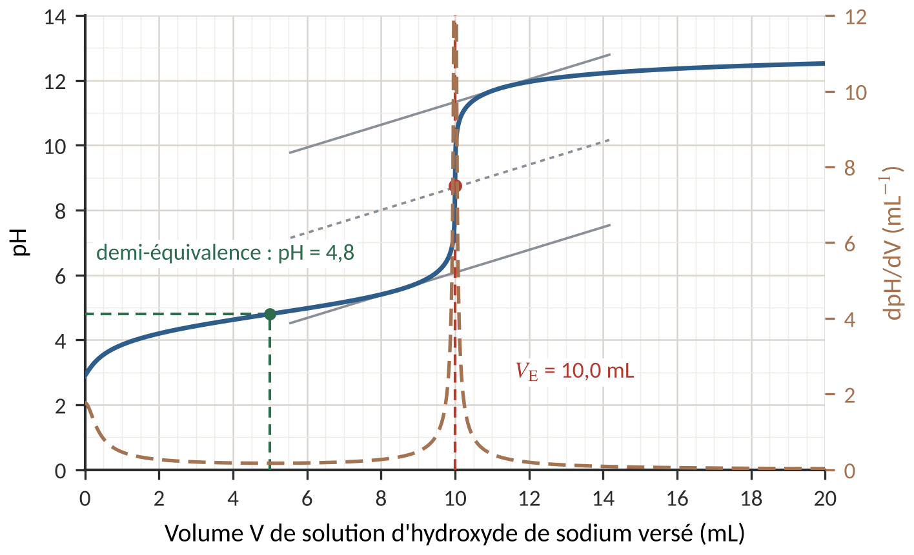{width=10.5cm}
:::

::: {custom-style="Legende"}
Figure 9. Équivalence et demi-équivalence sur la courbe de titrage
:::

$$C = \dfrac{c \times V_\text{E}}{V} = \dfrac{0{,}100 \times 10{,}0}{10{,}0} = 0{,}100\ \text{mol·L}^{-1}$$

::: {custom-style="Retenir"}
$V_\text{E}$ : extremum de la dérivée (maximum si le pH augmente, minimum s'il diminue) ou intersection de la courbe avec la parallèle médiane des deux tangentes
:::

::: {custom-style="Remarque"}
[Remarque.]{custom-style="EtiqRemarque"} Si l'on titre une base par un acide, le pH diminue : le saut de pH est dirigé vers le bas, la dérivée $\dfrac{\text{dpH}}{\text{d}V}$ est négative et passe par un minimum à l'équivalence. Les deux méthodes restent valables.
:::

#### [Corrigé]{custom-style="NumCorrige"}\ \ Q.12 · Déterminer le $\text{p}K_\text{A}$ d'un couple à la demi-équivalence {#c_q12}

::: {custom-style="Renvoi"}
[CIBLE:q12]{custom-style="BoutonEnonce"}
:::

À la demi-équivalence, $V = \dfrac{V_\text{E}}{2} = 5{,}0\ \text{mL}$ : la moitié de l'acide a été transformée en ion éthanoate, il reste autant d'acide que de base, $[\text{CH}_3\text{COOH}] = [\text{CH}_3\text{COO}^-]$. Donc :

$$\text{pH} = \text{p}K_\text{A} + \log\dfrac{[\text{CH}_3\text{COO}^-]}{[\text{CH}_3\text{COOH}]} = \text{p}K_\text{A} + \log 1 = \text{p}K_\text{A}$$

On lit $\text{pH} = 4{,}8$ pour $V = 5{,}0\ \text{mL}$ (figure 9) : $\text{p}K_\text{A} = 4{,}8$.

::: {custom-style="Remarque"}
[Remarque.]{custom-style="EtiqRemarque"} Ce résultat suppose que l'acide réagit peu avec l'eau. Pour un acide plus fort ou une solution très diluée, le pH à la demi-équivalence s'écarte un peu du $\text{p}K_\text{A}$.
:::

#### [Corrigé]{custom-style="NumCorrige"}\ \ Q.13 · Interpréter l'allure d'une courbe de titrage et choisir un indicateur coloré {#c_q13}

::: {custom-style="Renvoi"}
[CIBLE:q13]{custom-style="BoutonEnonce"}
:::

Avant l'équivalence, la solution contient surtout de l'acide éthanoïque, en excès, des ions éthanoate et des ions sodium ; le pH varie lentement. À l'équivalence, elle ne contient plus que des ions éthanoate et des ions sodium : l'ion éthanoate est une base faible, le pH est donc supérieur à 7, voisin de $8{,}7$. Après l'équivalence, les ions hydroxyde versés s'ajoutent aux ions éthanoate et sodium ; ils s'accumulent et le pH dépasse 12 ($12{,}5$ pour $20\ \text{mL}$).

L'indicateur doit avoir une zone de virage contenant le pH à l'équivalence : c'est la phénolphtaléine, qui vire entre 8,2 et 10,0.

::: {custom-style="Piege"}
[Piège.]{custom-style="EtiqPiege"} Croire que le pH à l'équivalence vaut toujours 7 : ce n'est le cas que pour le titrage d'un acide fort par une base forte.
:::

::: {custom-style="Remarque"}
[Remarque.]{custom-style="EtiqRemarque"} Si deux indicateurs conviennent, parce que leurs zones de virage contiennent toutes deux le pH à l'équivalence, on tranche avec un autre critère : la zone de virage la mieux centrée sur ce pH, ou le changement de couleur le plus facile à repérer.
:::

#### [Corrigé]{custom-style="NumCorrige"}\ \ Q.14 · Exploiter un titrage à deux équivalences {#c_q14}

::: {custom-style="Renvoi"}
[CIBLE:q14]{custom-style="BoutonEnonce"}
:::

L'ion carbonate est une dibase : il capte successivement deux protons.

$$\text{CO}_3^{2-}(\text{aq}) + \text{H}_3\text{O}^{\text{+}}(\text{aq}) \rightarrow \text{HCO}_3^-(\text{aq}) + \text{H}_2\text{O}(\ell) \qquad \text{HCO}_3^-(\text{aq}) + \text{H}_3\text{O}^{\text{+}}(\text{aq}) \rightarrow \text{CO}_2(\text{aq}) + 2\,\text{H}_2\text{O}(\ell)$$

La première équivalence donne la quantité d'ions carbonate : $n = c \times V_{\text{E1}} = 0{,}100 \times 9{,}6 \times 10^{-3} = 9{,}6 \times 10^{-4}\ \text{mol}$, soit $C = 9{,}6 \times 10^{-2}\ \text{mol·L}^{-1}$.

Les ions hydrogénocarbonate formés réclament ensuite le même volume d'acide : sans autre espèce, on aurait $V_{\text{E2}} = 2\,V_{\text{E1}} = 19{,}2\ \text{mL}$. Les $2{,}6\ \text{mL}$ supplémentaires titrent des ions hydrogénocarbonate déjà présents dans la lessive :

$$n(\text{HCO}_3^-) = 0{,}100 \times 2{,}6 \times 10^{-3} = 2{,}6 \times 10^{-4}\ \text{mol} \qquad C(\text{HCO}_3^-) = 2{,}6 \times 10^{-2}\ \text{mol·L}^{-1}$$

#### [Corrigé]{custom-style="NumCorrige"}\ \ Q.15 · Remonter d'une prise d'essai à l'échantillon {#c_q15}

::: {custom-style="Renvoi"}
[CIBLE:q15]{custom-style="BoutonEnonce"}
:::

La prise d'essai contient $n = c \times V_\text{E} = 2{,}00 \times 10^{-2} \times 14{,}1 \times 10^{-3} = 2{,}82 \times 10^{-4}\ \text{mol}$ d'acide ascorbique. Elle ne représente que le dixième de la solution : le comprimé en contient dix fois plus.

$$n_\text{comprimé} = 10 \times 2{,}82 \times 10^{-4} = 2{,}82 \times 10^{-3}\ \text{mol} \qquad m = 2{,}82 \times 10^{-3} \times 176{,}1 = 0{,}497\ \text{g}$$

Le comprimé contient $497\ \text{mg}$ d'acide ascorbique, soit un écart inférieur à $1\ \%$ avec l'étiquette.

::: {custom-style="Piege"}
[Piège.]{custom-style="EtiqPiege"} Donner la masse contenue dans la prise d'essai comme celle du comprimé : il faut multiplier par le rapport $\dfrac{200{,}0}{20{,}0} = 10$.
:::

::: {custom-style="Remarque"}
[Remarque.]{custom-style="EtiqRemarque"} Dans un dosage par excès, on introduit une quantité connue $n_2$ d'un réactif B en excès, puis on titre la quantité $n_\text{r}(\text{B})$ qui reste : pour $a\,\text{A} + b\,\text{B} \rightarrow \ldots$, on a $n(\text{A}) = \dfrac{a}{b} \times (n_2 - n_\text{r}(\text{B}))$.
:::

#### [Corrigé]{custom-style="NumCorrige"}\ \ Q.16 · Comparer le résultat d'un dosage à une valeur annoncée {#c_q16}

::: {custom-style="Renvoi"}
[CIBLE:q16]{custom-style="BoutonEnonce"}
:::

$$z = \dfrac{\left|m - m_\text{réf}\right|}{u(m)} = \dfrac{\left|486 - 500\right|}{8} = 1{,}75 \qquad \text{écart relatif} = \dfrac{\left|486 - 500\right|}{500} = 2{,}8 \times 10^{-2}$$

Le quotient $z$ est inférieur à 2 : la masse mesurée est compatible avec celle de l'étiquette. L'écart relatif vaut $2{,}8\ \%$.

::: {custom-style="Methode"}
[Méthode.]{custom-style="EtiqMethode"} Si l'énoncé donne une incertitude-type, calculer $z$ et conclure avec le seuil de 2 ; s'il donne une tolérance, comparer l'écart relatif à cette tolérance.
:::

::: {custom-style="Remarque"}
[Remarque.]{custom-style="EtiqRemarque"} Un écart entre la valeur mesurée et la valeur annoncée s'explique par les incertitudes de mesure (volumes, repérage de l'équivalence), par une teneur réelle différente de celle de l'étiquette ou par des impuretés : la quantité réelle de réactif titré peut être inférieure à celle annoncée.
:::

#### [Corrigé]{custom-style="NumCorrige"}\ \ Exercice 3 · Des comprimés saisis par les douanes {#c_ex3}

::: {custom-style="Renvoi"}
[CIBLE:ex3]{custom-style="BoutonEnonce"}
:::

::: {custom-style="QRappel"}
**1.** Réaction support
:::

$$\text{AH}(\text{aq}) + \text{HO}^-(\text{aq}) \rightarrow \text{A}^-(\text{aq}) + \text{H}_2\text{O}(\ell)$$

Elle doit être totale et rapide ; elle doit aussi être unique.

::: {custom-style="QRappel"}
**2.** Verrerie
:::

Une pipette jaugée de $50{,}0\ \text{mL}$, munie d'une propipette.

::: {custom-style="QRappel"}
**3.** Volume équivalent
:::

Par la méthode de la dérivée, le volume équivalent est l'abscisse du maximum de $\dfrac{\text{dpH}}{\text{d}V}$ : $V_\text{E} = 12{,}2\ \text{mL}$ (figure 10), lu à $0{,}1\ \text{mL}$ près.

::: {custom-style="Figure"}
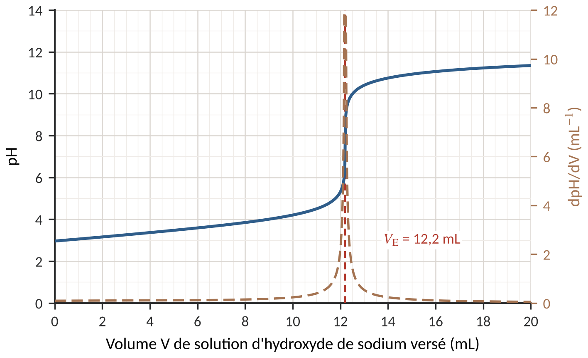{width=10.5cm}
:::

::: {custom-style="Legende"}
Figure 10. Volume équivalent du titrage de la solution S
:::

::: {custom-style="QRappel"}
**4.** Quantité d'aspirine titrée
:::

$$n(\text{AH}) = c \times V_\text{E} = 2{,}00 \times 10^{-2} \times 12{,}2 \times 10^{-3} = 2{,}44 \times 10^{-4}\ \text{mol}$$

::: {custom-style="QRappel"}
**5.** Masse d'aspirine du comprimé
:::

On n'a titré que $50{,}0\ \text{mL}$ des $500{,}0\ \text{mL}$ de la solution S, soit le dixième :

$$n = 10 \times 2{,}44 \times 10^{-4} = 2{,}44 \times 10^{-3}\ \text{mol} \qquad m = 2{,}44 \times 10^{-3} \times 180{,}2 = 0{,}440\ \text{g}$$

::: {custom-style="QRappel"}
**6.** Conformité
:::

L'aspirine réagit mole à mole avec les ions hydroxyde : la quantité titrée dans $V_1$ vaut $c \times V_\text{E}$. Le volume $V_1$ est la fraction $\dfrac{V_1}{V}$ de la solution S, donc le comprimé contient $\dfrac{V}{V_1}$ fois plus :

$$m = \dfrac{V}{V_1} \times c \times V_\text{E} \times M = \dfrac{500{,}0}{50{,}0} \times 2{,}00 \times 10^{-2} \times 12{,}2 \times 10^{-3} \times 180{,}2 = 0{,}440\ \text{g}$$

On retrouve la valeur de la question 5.

$$\text{écart relatif} = \dfrac{\left|440 - 500\right|}{500} = 0{,}12$$

L'écart vaut $12\ \%$, bien au-delà des $5\ \%$ tolérés : les comprimés sont sous-dosés et ne sont pas commercialisables. Une lecture de $V_\text{E}$ à $0{,}3\ \text{mL}$ près ne changerait pas cette conclusion : l'écart resterait supérieur à $5\ \%$.

::: {custom-style="Redaction"}
[Rédaction.]{custom-style="EtiqRedaction"} « Le comprimé contient $440\ \text{mg}$ d'aspirine au lieu des $500\ \text{mg}$ affichés, soit un écart de $12\ \%$, supérieur aux $5\ \%$ tolérés : ces comprimés ne sont pas commercialisables. »
:::

# Corrigés du thème 4 : titrage avec suivi conductimétrique {#c_theme4}

#### [Corrigé]{custom-style="NumCorrige"}\ \ Q.17 · Prévoir l'évolution de la conductivité au cours d'un titrage {#c_q17}

::: {custom-style="Renvoi"}
[CIBLE:q17]{custom-style="BoutonEnonce"}
:::

La réaction support s'écrit $\text{H}_3\text{O}^{\text{+}}(\text{aq}) + \text{HO}^-(\text{aq}) \rightarrow 2\,\text{H}_2\text{O}(\ell)$ ; les ions $\text{Na}^{\text{+}}$ et $\text{Cl}^-$ sont spectateurs.

<!--colonnes: 22 39 39-->

| Ion (quantité de matière) | Avant l'équivalence | Après l'équivalence |
|---|---|---|
| $\text{H}_3\text{O}^{\text{+}}$ | Diminue : il est consommé | Nul |
| $\text{HO}^-$ | Nul : consommé dès son ajout | Augmente |
| $\text{Na}^{\text{+}}$ | Augmente | Augmente |
| $\text{Cl}^-$ | Constant | Constant |

Avant l'équivalence, chaque ion oxonium consommé est remplacé par un ion sodium, de conductivité molaire ionique bien plus faible ($5{,}01$ contre $35{,}0$) : la conductivité diminue. Après l'équivalence, les ions sodium et hydroxyde s'accumulent : la conductivité augmente.

::: {custom-style="Methode"}
[Méthode.]{custom-style="EtiqMethode"} Dresser le tableau de l'évolution de chaque ion, puis comparer les conductivités molaires ioniques des ions qui se remplacent.
:::

#### [Corrigé]{custom-style="NumCorrige"}\ \ Q.18 · Déterminer le volume équivalent d'un titrage conductimétrique {#c_q18}

::: {custom-style="Renvoi"}
[CIBLE:q18]{custom-style="BoutonEnonce"}
:::

L'ajout d'un grand volume d'eau rend négligeable la dilution due à la solution titrante : la conductivité varie alors linéairement avec le volume versé, de part et d'autre de l'équivalence. Ce volume d'eau n'a pas besoin d'être mesuré précisément (« environ $190\ \text{mL}$ ») : une éprouvette graduée suffit. On trace les deux droites ; leur intersection donne $V_\text{E} = 12{,}0\ \text{mL}$ (figure 11).

::: {custom-style="Figure"}
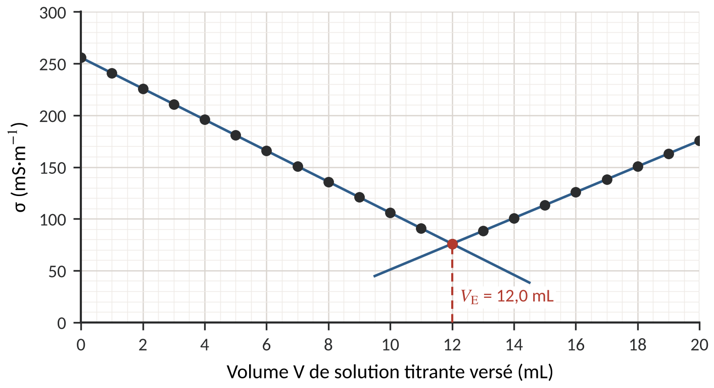{width=9.5cm}
:::

::: {custom-style="Legende"}
Figure 11. Volume équivalent à l'intersection des deux droites
:::

$$C = \dfrac{c \times V_\text{E}}{V_0} = \dfrac{0{,}100 \times 12{,}0}{10{,}0} = 0{,}120\ \text{mol·L}^{-1}$$

::: {custom-style="Piege"}
[Piège.]{custom-style="EtiqPiege"} Compter l'eau ajoutée dans le volume titré : seule la quantité d'acide compte, et elle est contenue dans les $10{,}0\ \text{mL}$ prélevés.
:::

#### [Corrigé]{custom-style="NumCorrige"}\ \ Q.19 · Titrer des ions chlorure par précipitation {#c_q19}

::: {custom-style="Renvoi"}
[CIBLE:q19]{custom-style="BoutonEnonce"}
:::

Avant l'équivalence, chaque ion chlorure qui précipite est remplacé par un ion nitrate apporté par la burette, de conductivité molaire ionique un peu plus faible ($7{,}14$ contre $7{,}63$) : la conductivité diminue légèrement. Après l'équivalence, les ions argent et nitrate versés s'accumulent : la conductivité augmente nettement.

$$n(\text{Cl}^-) = c \times V_\text{E} = 5{,}00 \times 10^{-3} \times 9{,}6 \times 10^{-3} = 4{,}8 \times 10^{-5}\ \text{mol} \qquad C = \dfrac{4{,}8 \times 10^{-5}}{20{,}0 \times 10^{-3}} = 2{,}4 \times 10^{-3}\ \text{mol·L}^{-1}$$

$$C_\text{m} = C \times M(\text{Cl}) = 2{,}4 \times 10^{-3} \times 35{,}5 = 8{,}5 \times 10^{-2}\ \text{g·L}^{-1}, \text{ soit } 85\ \text{mg·L}^{-1}$$

#### [Corrigé]{custom-style="NumCorrige"}\ \ Exercice 4 · L'eau de Quinton {#c_ex4}

::: {custom-style="Renvoi"}
[CIBLE:ex4]{custom-style="BoutonEnonce"}
:::

::: {custom-style="QRappel"}
**1.** Réaction support
:::

$$\text{Ag}^{\text{+}}(\text{aq}) + \text{Cl}^-(\text{aq}) \rightarrow \text{AgCl}(\text{s})$$

::: {custom-style="QRappel"}
**2.** Rôle de l'eau ajoutée
:::

Avec $200\ \text{mL}$ dans le bécher, les quelques millilitres de solution titrante versés diluent très peu le mélange : la conductivité varie linéairement avec le volume versé, et les deux portions de courbe sont des droites.

::: {custom-style="QRappel"}
**3.** Allure de la courbe
:::

Avant l'équivalence, chaque ion chlorure qui précipite est remplacé par un ion nitrate, de conductivité molaire ionique légèrement plus faible : la conductivité diminue un peu. Après l'équivalence, les ions argent et nitrate s'accumulent : la conductivité augmente nettement.

::: {custom-style="QRappel"}
**4.** Volume équivalent et concentrations
:::

Les deux droites se coupent pour $V_\text{E} = 5{,}5\ \text{mL}$ (figure 12).

::: {custom-style="Figure"}
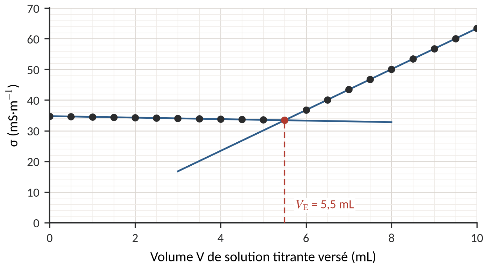{width=9.5cm}
:::

::: {custom-style="Legende"}
Figure 12. Volume équivalent du titrage de la solution D
:::

$$n(\text{Cl}^-) = c \times V_\text{E} = 0{,}100 \times 5{,}5 \times 10^{-3} = 5{,}5 \times 10^{-4}\ \text{mol} \qquad C_\text{D} = \dfrac{5{,}5 \times 10^{-4}}{10{,}0 \times 10^{-3}} = 5{,}5 \times 10^{-2}\ \text{mol·L}^{-1}$$

L'eau de Quinton est dix fois plus concentrée : $C = 0{,}55\ \text{mol·L}^{-1}$.

::: {custom-style="QRappel"}
**5.** Comparaisons
:::

$$C_\text{m} = 0{,}55 \times 35{,}5 = 19{,}5\ \text{g·L}^{-1}$$

Soit environ $20\ \text{g·L}^{-1}$ avec deux chiffres significatifs, valeur compatible avec celle de l'eau de mer, $19{,}4\ \text{g·L}^{-1}$ : l'eau de Quinton hypertonique est bien de l'eau de mer. Pour atteindre environ $105\ \text{mmol·L}^{-1}$, il faudrait la diluer d'un facteur $\dfrac{0{,}55}{0{,}105} \approx 5$.

```{=openxml}
<w:p><w:r><w:br w:type="page"/></w:r></w:p>
```

# Index des notions {#index}

Chaque notion renvoie aux questions de cours (Q) et aux exercices (Ex.) où elle est travaillée.

| Notion | Où la travailler |
|---|---|
| Absorbance, loi de Beer-Lambert | Q.1 à Q.3, Ex. 1 |
| Choix d'une méthode de dosage | Q.6 |
| Conductivité, loi de Kohlrausch | Q.4, Q.5, Q.17 |
| Conformité d'un résultat, quotient $z$ | Q.16, Ex. 1, Ex. 3 |
| Courbe d'étalonnage | Q.2, Q.5, Ex. 1 |
| Demi-équivalence, $\text{p}K_\text{A}$ | Q.12 |
| Dilution, prise d'essai | Q.3, Q.5, Q.8, Q.15, Ex. 1 à Ex. 4 |
| Dosage, définition | Q.6 |
| Équivalence, relation à l'équivalence | Q.7, Q.8, Q.10, Ex. 2 |
| Indicateur coloré | Q.13 |
| Oxydoréduction, titrage colorimétrique | Q.10, Ex. 2 |
| Réaction support de titrage | Q.7, Ex. 3, Ex. 4 |
| Schéma d'un dispositif de titrage | Q.9 |
| Spectre d'absorption, longueur d'onde de travail | Q.1, Ex. 1 |
| Titrage à deux équivalences | Q.14 |
| Titrage conductimétrique | Q.17 à Q.19, Ex. 4 |
| Titrage par précipitation | Q.19, Ex. 4 |
| Titrage pH-métrique, méthodes des tangentes et de la dérivée | Q.11, Q.13, Ex. 3 |

<!--fin:complet-->
