<!--meta {"numero": "11", "matiere": "Physique-Chimie", "titre": "Cinétique chimique et radioactivité : vitesse, loi d'ordre 1, mécanismes et décroissance radioactive", "titre_court": "Cinétique et radioactivité", "fichier": "MasterBac_PC_Fiche11_Cinetique_et_radioactivite", "fichier_cahier": "MasterBac_PC_Fiche11_Cahier_enonces"} -->

<!--inclure:ouverture-->

# L'essentiel en une page {#essentiel}

::: {custom-style="Rubrique"}
À connaître par cœur
:::

<!--colonnes: 15 37 48-->

| Notion | Relation | À retenir |
|---|---|---|
| Vitesse volumique | $v_\text{app}(\text{P}) = \dfrac{\text{d}[\text{P}]}{\text{d}t}$ ; $v_\text{disp}(\text{R}) = -\dfrac{\text{d}[\text{R}]}{\text{d}t}$ | En $\text{mol·L}^{-1}\text{·s}^{-1}$ : pente de la tangente à la courbe $[\text{P}](t)$, opposé de la pente pour $[\text{R}](t)$. |
| Temps de demi-réaction | $x(t_{1/2}) = x_\text{f} / 2$ | Lu sur la courbe $x(t)$ ou $[\text{P}](t)$ ; ce n'est pas la moitié de la durée de la transformation. |
| Loi d'ordre 1 | $v_\text{disp}(\text{A}) = k\,[\text{A}]$ | Constante de vitesse $k$ en $\text{s}^{-1}$. |
| Mécanisme | Flèche courbe : d'un doublet vers l'atome qui le reçoit | Intermédiaire : formé puis consommé. Catalyseur : consommé puis régénéré. |
| Désintégration | Sommes des $A$ et des $Z$ conservées | $\alpha$ : ${}^{4}_{2}\text{He}$ ; $\beta^-$ : ${}^{0}_{-1}\text{e}$ ; $\beta^{\text{+}}$ : ${}^{0}_{1}\text{e}$ ; $\gamma$ : désexcitation du noyau. |
| Activité | $A = -\text{d}N/\text{d}t = \lambda N$ | En becquerels (désintégrations par seconde) ; $\lambda$ en $\text{s}^{-1}$. |

::: {custom-style="Rubrique"}
À savoir retrouver
:::

<!--colonnes: 14 34 52-->

| Notion | Relation | Comment la retrouver |
|---|---|---|
| Ordre 1 | $[\text{A}](t) = [\text{A}]_0\,\text{e}^{-kt}$ ; $t_{1/2} = \ln 2 / k$ | Résoudre $\text{d}[\text{A}]/\text{d}t = -k\,[\text{A}]$ ; à $t_{1/2}$, $[\text{A}] = [\text{A}]_0 / 2$ ; $\ln[\text{A}]$ est affine en $t$, de pente $-k$. |
| Décroissance | $N(t) = N_0\,\text{e}^{-\lambda t}$ ; $t_{1/2} = \ln 2 / \lambda$ | Résoudre $\text{d}N/\text{d}t = -\lambda N$ ; à $t_{1/2}$ (demi-vie), $N = N_0 / 2$. |

::: {custom-style="Rubrique"}
Fourni par l'énoncé, à savoir exploiter
:::

Courbes de suivi, mécanismes, électronégativités, diagramme (N, Z), classification périodique, demi-vies.

::: {custom-style="Rubrique"}
Les pièges qui coûtent des points
:::

- Prendre la moitié de $x_\text{max}$ au lieu de la moitié de $x_\text{f}$ pour une transformation non totale.
- Faire partir une flèche courbe d'un atome ou d'une charge positive, et non d'un doublet.
- Confondre catalyseur et intermédiaire réactionnel.
- Mélanger les unités de temps, par exemple $\lambda$ en $\text{an}^{-1}$ avec $t$ en secondes.

::: {custom-style="Rubrique"}
Votre parcours selon votre objectif
:::

| Objectif | Questions de cours | Exercices |
|---|---|---|
| [\ Objectif 10\ ]{custom-style="Niv10"} | Q.1, Q.2, Q.4, Q.7, Q.9, Q.12, Q.13, Q.15, Q.17 à Q.19, Q.22, Q.23 | Ex. 1 (questions 1 à 4), Ex. 4 (questions 1 à 4) |
| [\ Objectif 14\ ]{custom-style="Niv14"} | Plus Q.3, Q.5, Q.6, Q.8, Q.10, Q.11, Q.14, Q.16, Q.20, Q.21, Q.24 à Q.26 | Ex. 1 à Ex. 4, Ex. 5 (questions 1 à 5) |
| [\ Objectif 18\ ]{custom-style="Niv18"} | Toutes | Tous |

```{=openxml}
<w:p><w:r><w:br w:type="page"/></w:r></w:p>
```

# Ce qui est tombé aux BAC 2025 et 2026 {#tombe}

Les notions de cette fiche ont été demandées dans au moins quinze exercices des sessions 2025 et 2026. Le tableau indique, pour chacun, ce qui était mobilisé et où s'y préparer dans la fiche.

<!--colonnes: 21 25 37 17-->

| Session | Exercice | Notions de cette fiche | Pour s'y préparer |
|---|---|---|---|
| Métropole, juin 2026, jour 1 | L'odeur de Jasmin | Trempe, temps de demi-réaction, vitesse volumique à $t = 0$, facteur cinétique | Q.1 à Q.4, Ex. 1 |
| Métropole, juin 2026, jour 1 | Coloration de la laine | Intermédiaires réactionnels, sites donneur et accepteur, flèches courbes | Q.13 à Q.15 |
| Métropole, juin 2026, jour 2 | Le kéfir de fruit | Suivi, loi d'ordre 1, équation différentielle, temps de demi-réaction | Q.5, Q.7 à Q.10 |
| Métropole 2026, jour 2 (sujet de secours) | La tomate, un fruit plein de ressources | Temps de demi-réaction, vitesse de disparition, ordre 1 | Q.2, Q.4, Q.10 |
| Amérique du Nord 2026, jour 1 | Valorisation du dioxyde de carbone dans les cimenteries | Intermédiaire réactionnel, flèches courbes et leur sens | Q.13 à Q.15 |
| Antilles-Guyane 2026, jour 1 | Le césium 137 et l'essai Trinity | Composition, désintégration $\beta^-$, équation différentielle, demi-vie, activité | Q.17, Q.19, Q.21 à Q.23 |
| Antilles-Guyane 2026, jour 2 | Le paracétamol | Vitesse de disparition, loi d'ordre 1, durée pour atteindre une concentration | Q.2, Q.7, Q.8, Q.11, Ex. 2 |
| Antilles-Guyane 2026, jour 2 | Traitement de l'eau d'une piscine | Flèches courbes d'un acte élémentaire, équation de la réaction modélisée | Q.14, Q.15 |
| Asie 2026, jour 2 | Datation | Isotopes, désintégration $\beta^-$, $\lambda$ et demi-vie, âge d'une roche lunaire | Q.17 à Q.19, Q.22, Q.25 |
| Centres étrangers 2026, jour 2 | Le cyclotron Arronax | Équations nucléaires, $\beta^{\text{+}}$, décroissance, demi-vie, durée pour qu'il reste 1 % | Q.18, Q.19, Q.21, Q.22, Q.25, Ex. 5 |
| Métropole, juin 2025, jour 1 | Datation d'une roche | Isotopes, désintégration $\beta^-$, demi-vie, solution $N(t)$, âge d'une roche | Q.17, Q.18, Q.21, Q.22, Q.25 |
| Métropole, juin 2025, jour 2 | Un parfum de rose | Catalyseur, flèches courbes, équation à partir du mécanisme, chauffage | Q.1, Q.14, Q.15 |
| Métropole 2025, jour 2 (sujet de secours) | Savon : parfum, synthèse et utilisation | Vitesse d'apparition, facteur cinétique, catalyseur, saponification | Q.1, Q.2, Q.12 à Q.14, Ex. 3 |
| Métropole 2025, jour 2 (sujet de secours) | Utilisation médicale du technétium | Isotopes, diagramme (N, Z), décroissance, demi-vie, durée de précaution | Q.17, Q.20 à Q.22, Q.25 |
| Amérique du Nord 2025, jour 2 | Combustible MOX pour limiter les déchets nucléaires | Composition du noyau, isotopes, diagramme N/Z, désintégrations successives, $\lambda$ et demi-vie | Q.17, Q.19, Q.20, Q.22, Ex. 4 |

::: {custom-style="Intertitre"}
Ce qu'il faut en retenir
:::

- Radioactivité : six exercices sur la demi-vie ; quatre font calculer une durée (Q.22, Q.25).
- Cinétique : cinq exercices, dont trois de 2026 sur une loi d'ordre 1 (Q.4, Q.8 à Q.11).
- Mécanisme : cinq exercices font tracer des flèches courbes (Q.13 à Q.15).

::: {custom-style="Surtitre"}
Énoncés
:::

# Thème 1 : vitesse et suivi d'une transformation {#theme1}

::: {custom-style="Rubrique"}
Questions de cours
:::

## [Q.1]{custom-style="QNum"}\ \ Reconnaître une transformation lente et les facteurs cinétiques {#q1}

::: {custom-style="Meta"}
[\ Objectif 10\ ]{custom-style="Niv10"}\ \ Cours · Notions : transformation lente ou rapide, facteurs cinétiques, trempe · Demandé en 2025 et 2026\ \ \ [CIBLE:c_q1]{custom-style="BoutonCorrige"}
:::

::: {custom-style="Enonce"}
Application : classer en rapides ou lentes la précipitation du chlorure d'argent quand on mélange des solutions d'ions argent et d'ions chlorure, l'oxydation des ions iodure par l'eau oxygénée, au cours de laquelle la solution brunit en quelques minutes, et la formation de la rouille sur un clou. Citer trois facteurs cinétiques. Pourquoi verse-t-on chaque prélèvement d'un mélange réactionnel dans de l'eau glacée avant de le titrer ?
:::

## [Q.2]{custom-style="QNum"}\ \ Définir et calculer une vitesse volumique {#q2}

::: {custom-style="Meta"}
[\ Objectif 10\ ]{custom-style="Niv10"}\ \ Cours · Notions : vitesse volumique d'apparition et de disparition, avancement · Demandé dans quatre exercices en 2025 et 2026\ \ \ [CIBLE:c_q2]{custom-style="BoutonCorrige"}
:::

::: {custom-style="Enonce"}
Application : dans un volume $V = 100\ \text{mL}$, on étudie la transformation modélisée par $\text{H}_2\text{O}_2(\text{aq}) + 2\,\text{I}^-(\text{aq}) + 2\,\text{H}^{\text{+}}(\text{aq}) \rightarrow \text{I}_2(\text{aq}) + 2\,\text{H}_2\text{O}(\ell)$. Exprimer la vitesse volumique d'apparition du diiode et celle de disparition de l'eau oxygénée, d'abord à l'aide des concentrations, puis de l'avancement $x$. Entre $t = 0$ et $t = 5{,}0\ \text{min}$, la concentration en diiode passe de $0$ à $3{,}0\ \text{mmol·L}^{-1}$ : calculer la vitesse volumique moyenne d'apparition du diiode sur cet intervalle.
:::

## [Q.3]{custom-style="QNum"}\ \ Déterminer une vitesse volumique sur une courbe {#q3}

::: {custom-style="Meta"}
[\ Objectif 14\ ]{custom-style="Niv14"}\ \ Méthode · Notions : tangente, coefficient directeur, évolution de la vitesse · Demandé en 2026 (Métropole)\ \ \ [CIBLE:c_q3]{custom-style="BoutonCorrige"}
:::

::: {custom-style="Enonce"}
Application : la figure 1 représente la concentration en diiode au cours d'une autre expérience. Déterminer la vitesse volumique d'apparition du diiode à $t = 0$ et à $t = 10\ \text{min}$. Comment évolue-t-elle, et pourquoi ?
:::

::: {custom-style="Figure"}
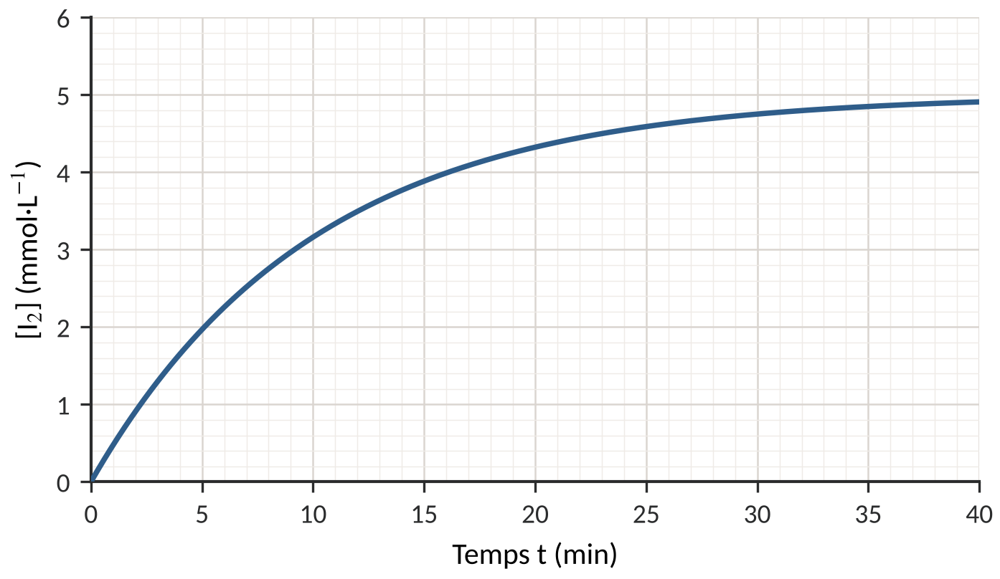{width=9cm}
:::

::: {custom-style="Legende"}
Figure 1. Concentration en diiode au cours du temps
:::

## [Q.4]{custom-style="QNum"}\ \ Définir et déterminer un temps de demi-réaction {#q4}

::: {custom-style="Meta"}
[\ Objectif 10\ ]{custom-style="Niv10"}\ \ Cours · Notions : temps de demi-réaction, avancement final, lecture graphique · Demandé en 2026 (Métropole)\ \ \ [CIBLE:c_q4]{custom-style="BoutonCorrige"}
:::

::: {custom-style="Enonce"}
Application : définir le temps de demi-réaction, puis le déterminer pour la transformation de la figure 1, que l'on considère comme totale. La concentration finale en diiode vaut $5{,}0\ \text{mmol·L}^{-1}$. Au bout de combien de temps la concentration a-t-elle atteint cette valeur à $2\ \%$ près ?
:::

## [Q.5]{custom-style="QNum"}\ \ Choisir une méthode de suivi cinétique {#q5}

::: {custom-style="Meta"}
[\ Objectif 14\ ]{custom-style="Niv14"}\ \ Cours · Notions : suivi par une grandeur physique, titrages successifs · Demandé en 2026 (Métropole)\ \ \ [CIBLE:c_q5]{custom-style="BoutonCorrige"}
:::

::: {custom-style="Enonce"}
Application : proposer une méthode pour suivre chacune des transformations suivantes, et préciser la condition que doit remplir la durée de chaque mesure.

- $2\,\text{I}^-(\text{aq}) + \text{S}_2\text{O}_8^{2-}(\text{aq}) \rightarrow \text{I}_2(\text{aq}) + 2\,\text{SO}_4^{2-}(\text{aq})$ : seul le diiode est coloré.
- $(\text{CH}_3)_3\text{C-Cl}(\ell) + 2\,\text{H}_2\text{O}(\ell) \rightarrow (\text{CH}_3)_3\text{C-OH}(\text{aq}) + \text{H}_3\text{O}^{\text{+}}(\text{aq}) + \text{Cl}^-(\text{aq})$.
- $\text{Mg}(\text{s}) + 2\,\text{H}^{\text{+}}(\text{aq}) \rightarrow \text{Mg}^{\text{2+}}(\text{aq}) + \text{H}_2(\text{g})$.
- Une estérification lente, dont seul l'acide carboxylique peut être titré.
:::

## [Q.6]{custom-style="QNum"}\ \ Attribuer des courbes à des conditions expérimentales {#q6}

::: {custom-style="Meta"}
[\ Objectif 14\ ]{custom-style="Niv14"}\ \ Méthode · Notions : température, concentration initiale, réactif limitant\ \ \ [CIBLE:c_q6]{custom-style="BoutonCorrige"}
:::

::: {custom-style="Enonce"}
Application : on réalise trois fois la transformation totale $\text{A} \rightarrow \text{P}$, dans les conditions du tableau. Attribuer à chaque expérience l'une des courbes de la figure 2, en justifiant. Que remarque-t-on sur les temps de demi-réaction des courbes b et c ?
:::

<!--colonnes: 40 20 20 20-->

| Expérience | 1 | 2 | 3 |
|---|---|---|---|
| Concentration initiale $[\text{A}]_0$ (mmol·L⁻¹) | 10 | 10 | 20 |
| Température (°C) | 25 | 40 | 40 |

::: {custom-style="Figure"}
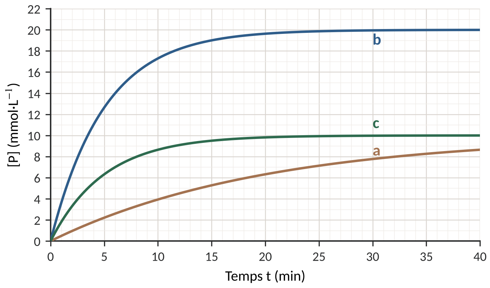{width=9cm}
:::

::: {custom-style="Legende"}
Figure 2. Concentration en produit au cours du temps, pour les trois expériences
:::

::: {custom-style="Rubrique"}
Exercices
:::

### [Exercice 1]{custom-style="QNum"}\ \ L'arôme de jasmin [(voir BAC Métropole, juin 2026)]{custom-style="VoirBac"} {#ex1}

::: {custom-style="Meta"}
[\ Objectif 10\ ]{custom-style="Niv10"}\ \ [Type BAC]{custom-style="TagBac"} · 4 points · 35 min · Questions 5 et 6 : objectif 14
:::

::: {custom-style="MentionBac"}
[Sujet du BAC correspondant.]{custom-style="EtiqBac"} Métropole, juin 2026, jour 1, exercice 2 : « L'odeur de Jasmin » (suivi par titrages, temps de demi-réaction, vitesse volumique, facteur cinétique).
:::

::: {custom-style="Enonce"}
L'éthanoate de benzyle, noté E, a une odeur proche de celle du jasmin. On le synthétise à partir d'acide éthanoïque et d'alcool benzylique, en présence de quelques gouttes d'acide sulfurique :

$$\text{C}_2\text{H}_4\text{O}_2(\ell) + \text{C}_7\text{H}_8\text{O}(\ell) \rightleftarrows \text{C}_9\text{H}_{10}\text{O}_2(\ell) + \text{H}_2\text{O}(\ell)$$

Des tubes identiques, contenant chacun $0{,}600\ \text{mL}$ d'acide éthanoïque et $1{,}40\ \text{mL}$ d'alcool benzylique, sont placés à $t = 0$ dans un bain chaud. À différentes dates, on sort un tube, on verse son contenu dans de l'eau glacée et l'on titre l'acide restant, de quantité $n_\text{ac}$.
:::

<!--colonnes: 22 7.8 7.8 7.8 7.8 7.8 7.8 7.8 7.8 7.8 7.8-->

| *t* (min) | 0 | 2 | 4 | 6 | 10 | 15 | 20 | 30 | 45 | 60 |
|---|---|---|---|---|---|---|---|---|---|---|
| $n_\text{ac}$ (mmol) | 10,5 | 8,3 | 6,7 | 5,5 | 4,1 | 3,2 | 2,9 | 2,7 | 2,6 | 2,6 |

::: {custom-style="Figure"}
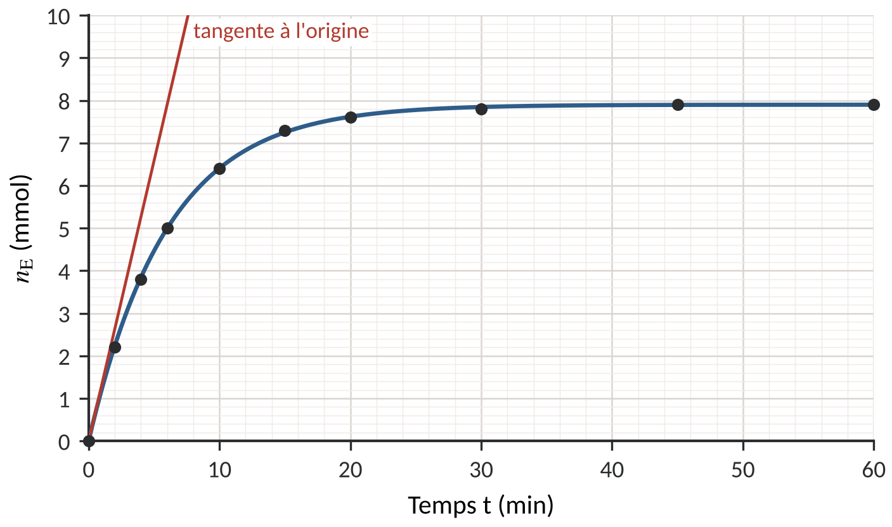{width=7.6cm}
:::

::: {custom-style="Legende"}
Figure 3. Quantité d'ester formé au cours du temps, avec la tangente à l'origine
:::

::: {custom-style="Enonce"}
**Données**
:::

::: {custom-style="EnonceDonnees"}
Acide éthanoïque : $M = 60{,}1\ \text{g·mol}^{-1}$, $\rho = 1{,}05\ \text{g·mL}^{-1}$. Alcool benzylique : $M = 108\ \text{g·mol}^{-1}$, $\rho = 1{,}04\ \text{g·mL}^{-1}$. Le volume du mélange réactionnel reste égal à $V = 2{,}0\ \text{mL}$.
:::

::: {custom-style="Enonce"}
**1.** Quel est le rôle de l'acide sulfurique ? Pourquoi verse-t-on le contenu de chaque tube dans de l'eau glacée avant le titrage ?

**2.** Calculer les quantités initiales d'acide éthanoïque et d'alcool benzylique dans un tube. Quel est le réactif limitant ?

**3.** Exprimer la quantité d'ester formé $n_\text{E}(t)$ en fonction de $n_\text{ac}(t)$ et de la quantité initiale d'acide $n_0$. Calculer la quantité finale d'ester et le rendement de la synthèse.

**4.** Définir le temps de demi-réaction et le déterminer à l'aide de la figure 3.

**5.** Exprimer la vitesse volumique d'apparition de l'ester en fonction de $V$ et de $n_\text{E}$, puis la calculer à $t = 0$ à l'aide de la tangente tracée.

**6.** Comment cette vitesse évolue-t-elle ensuite ? Quel facteur cinétique l'explique ? Proposer une modification du protocole qui permettrait d'atteindre plus vite l'état final.
:::

::: {custom-style="Renvoi"}
[CIBLE:c_ex1]{custom-style="BoutonCorrige"}
:::

# Thème 2 : loi de vitesse d'ordre 1 {#theme2}

::: {custom-style="Rubrique"}
Questions de cours
:::

## [Q.7]{custom-style="QNum"}\ \ Écrire une loi de vitesse d'ordre 1 et l'unité de la constante de vitesse {#q7}

::: {custom-style="Meta"}
[\ Objectif 10\ ]{custom-style="Niv10"}\ \ Cours · Notions : loi d'ordre 1, constante de vitesse, unité · Demandé en 2026 (Métropole, Antilles-Guyane)\ \ \ [CIBLE:c_q7]{custom-style="BoutonCorrige"}
:::

::: {custom-style="Enonce"}
Application : la vitesse volumique de disparition de A vaut $10$ ; $5{,}0$ et $2{,}5\ \text{µmol·L}^{-1}\text{·s}^{-1}$ pour $[\text{A}]$ égale à $5{,}0$ ; $2{,}5$ et $1{,}25\ \text{mmol·L}^{-1}$. Montrer qu'elle suit une loi d'ordre 1, puis calculer $k$ et trouver son unité par une analyse dimensionnelle.
:::

## [Q.8]{custom-style="QNum"}\ \ Établir et résoudre l'équation différentielle d'une loi d'ordre 1 {#q8}

::: {custom-style="Meta"}
[\ Objectif 14\ ]{custom-style="Niv14"}\ \ Méthode · Notions : équation différentielle, solution exponentielle · Demandé en 2026 (Métropole, Antilles-Guyane)\ \ \ [CIBLE:c_q8]{custom-style="BoutonCorrige"}
:::

::: {custom-style="Enonce"}
Application : établir l'équation différentielle vérifiée par $[\text{A}](t)$ pour une loi d'ordre 1, puis la résoudre. Pour $[\text{A}]_0 = 2{,}0 \times 10^{-2}\ \text{mol·L}^{-1}$ et $k = 2{,}0 \times 10^{-3}\ \text{s}^{-1}$, calculer $[\text{A}]$ à la date $t = 10\ \text{min}$.
:::

## [Q.9]{custom-style="QNum"}\ \ Relier temps de demi-réaction et constante de vitesse {#q9}

::: {custom-style="Meta"}
[\ Objectif 10\ ]{custom-style="Niv10"}\ \ Cours · Notions : temps de demi-réaction, logarithme · Demandé en 2026 (Métropole)\ \ \ [CIBLE:c_q9]{custom-style="BoutonCorrige"}
:::

::: {custom-style="Enonce"}
Application : on admet que, pour une loi d'ordre 1, $[\text{A}](t) = [\text{A}]_0\,\text{e}^{-kt}$ (Q.8). Montrer que $t_{1/2} = \ln 2 / k$ et que cette durée ne dépend pas de $[\text{A}]_0$. Calculer $t_{1/2}$ pour $k = 2{,}0 \times 10^{-3}\ \text{s}^{-1}$. Quelle fraction de A reste-t-il au bout de $3\,t_{1/2}$ ?
:::

```{=openxml}
<w:p><w:r><w:br w:type="page"/></w:r></w:p>
```

## [Q.10]{custom-style="QNum"}\ \ Vérifier qu'une transformation suit une loi d'ordre 1 {#q10}

::: {custom-style="Meta"}
[\ Objectif 14\ ]{custom-style="Niv14"}\ \ Méthode · Notions : demi-réactions successives, tracé de $\ln[\text{A}]$ · Demandé en 2026 (Métropole)\ \ \ [CIBLE:c_q10]{custom-style="BoutonCorrige"}
:::

::: {custom-style="Enonce"}
Application : le cristal violet, noté CV, est décoloré par des ions hydroxyde en large excès. Vérifier par deux méthodes que la décoloration suit une loi d'ordre 1 par rapport au cristal violet, puis déterminer $k$.
:::

<!--colonnes: 34 11 11 11 11 11 11-->

| *t* (min) | 0 | 4 | 8 | 12 | 16 | 24 |
|---|---|---|---|---|---|---|
| $[\text{CV}]$ (µmol·L⁻¹) | 20,0 | 14,1 | 10,0 | 7,1 | 5,0 | 2,5 |

## [Q.11]{custom-style="QNum"}\ \ Prévoir une durée avec une loi d'ordre 1 {#q11}

::: {custom-style="Meta"}
[\ Objectif 14\ ]{custom-style="Niv14"}\ \ Méthode · Notions : logarithme, durée en temps de demi-réaction · Demandé en 2026 (Antilles-Guyane)\ \ \ [CIBLE:c_q11]{custom-style="BoutonCorrige"}
:::

::: {custom-style="Enonce"}
Application : pour la décoloration de la question précédente, au bout de combien de temps $90\ \%$ du cristal violet ont-ils été consommés ? Et $99\ \%$ ? Exprimer ces durées en nombre de temps de demi-réaction.
:::

::: {custom-style="Rubrique"}
Exercices
:::

### [Exercice 2]{custom-style="QNum"}\ \ Le paracétamol dans l'organisme [(voir BAC Antilles-Guyane 2026)]{custom-style="VoirBac"} {#ex2}

::: {custom-style="Meta"}
[\ Objectif 14\ ]{custom-style="Niv14"}\ \ [Type BAC]{custom-style="TagBac"} · 5 points · 45 min
:::

::: {custom-style="MentionBac"}
[Sujet du BAC correspondant.]{custom-style="EtiqBac"} Antilles-Guyane 2026, jour 2, exercice 2 : « Le paracétamol » (loi de vitesse d'ordre 1, durée de l'effet d'un médicament).
:::

::: {custom-style="Enonce"}
Après la prise d'un gramme de paracétamol, noté P, sa concentration dans le sang est maximale au bout d'environ $30\ \text{min}$. On prend cet instant comme origine des dates : le paracétamol est ensuite éliminé par l'organisme. Des dosages sanguins donnent les valeurs suivantes.
:::

<!--colonnes: 30 10 10 10 10 10 10 10-->

| *t* (h) | 0 | 1,0 | 2,0 | 3,0 | 4,0 | 6,0 | 8,0 |
|---|---|---|---|---|---|---|---|
| $[\text{P}]$ (µmol·L⁻¹) | 120 | 91,6 | 69,9 | 53,4 | 40,8 | 23,7 | 13,8 |

::: {custom-style="Figure"}
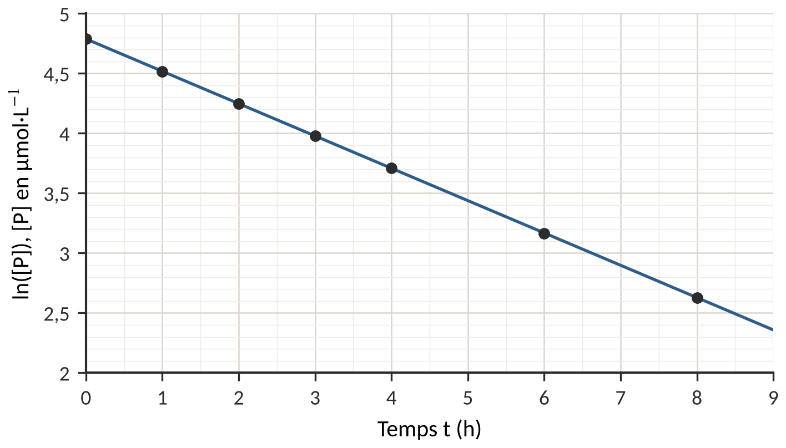{width=9cm}
:::

::: {custom-style="Legende"}
Figure 4. Logarithme de la concentration en paracétamol au cours du temps
:::

::: {custom-style="Enonce"}
**Données**
:::

::: {custom-style="EnonceDonnees"}
$M(\text{P}) = 151\ \text{g·mol}^{-1}$. En dessous de $C_\text{m,lim} = 8{,}0\ \text{mg·L}^{-1}$ de paracétamol dans le sang, l'effet contre la douleur est fortement atténué. La notice demande d'attendre au moins $6\ \text{h}$ entre deux prises.
:::

::: {custom-style="Enonce"}
**1.** Exprimer la vitesse volumique de disparition du paracétamol en fonction de $[\text{P}]$. Pour une loi d'ordre 1, en déduire l'équation différentielle vérifiée par $[\text{P}](t)$. Montrer, sans calcul de dérivée, que cette vitesse diminue au cours du temps.

**2.** Vérifier que $[\text{P}](t) = [\text{P}]_0\,\text{e}^{-kt}$ est solution de cette équation et respecte la condition initiale.

**3.** Montrer que la figure 4 confirme que la disparition suit une loi d'ordre 1, et déterminer $k$.

**4.** Calculer le temps de demi-réaction, puis le vérifier à l'aide du tableau.

**5.** Calculer la concentration limite en $\text{µmol·L}^{-1}$, puis la durée, comptée depuis la prise du médicament, au bout de laquelle l'effet contre la douleur s'atténue fortement.

**6.** Commenter la recommandation de la notice.
:::

::: {custom-style="Renvoi"}
[CIBLE:c_ex2]{custom-style="BoutonCorrige"}
:::

<!--debut:cahier-->
```{=openxml}
<w:p><w:r><w:br w:type="page"/></w:r></w:p>
```

<!--fin:cahier-->
# Thème 3 : mécanisme réactionnel {#theme3}

::: {custom-style="Rubrique"}
Questions de cours
:::

## [Q.12]{custom-style="QNum"}\ \ Repérer une liaison polarisée grâce à l'électronégativité {#q12}

::: {custom-style="Meta"}
[\ Objectif 10\ ]{custom-style="Niv10"}\ \ Cours · Notions : électronégativité, liaison polarisée, charges partielles · Demandé en 2025 (Métropole, sujet de secours)\ \ \ [CIBLE:c_q12]{custom-style="BoutonCorrige"}
:::

::: {custom-style="Enonce"}
Application : parmi les liaisons $\text{C-H}$, $\text{C-O}$, $\text{O-H}$, $\text{C-Cl}$ et $\text{C=O}$, lesquelles sont polarisées ? Indiquer les charges partielles portées par les atomes.

Électronégativités : $\chi(\text{H}) = 2{,}20$ ; $\chi(\text{C}) = 2{,}55$ ; $\chi(\text{O}) = 3{,}44$ ; $\chi(\text{Cl}) = 3{,}16$.
:::

## [Q.13]{custom-style="QNum"}\ \ Identifier les sites donneur et accepteur de doublet d'électrons {#q13}

::: {custom-style="Meta"}
[\ Objectif 10\ ]{custom-style="Niv10"}\ \ Cours · Notions : doublet non liant, charge partielle, lacune électronique · Demandé en 2025 et 2026\ \ \ [CIBLE:c_q13]{custom-style="BoutonCorrige"}
:::

::: {custom-style="Enonce"}
Application : pour la réaction $\text{CH}_3\text{-Br} + \text{HO}^- \rightarrow \text{CH}_3\text{-OH} + \text{Br}^-$, identifier le site donneur et le site accepteur de doublet d'électrons. Même question pour $\text{H}_2\text{O} + \text{H}^{\text{+}} \rightarrow \text{H}_3\text{O}^{\text{+}}$. Données : $\chi(\text{C}) = 2{,}55$ ; $\chi(\text{Br}) = 2{,}96$.
:::

## [Q.14]{custom-style="QNum"}\ \ Représenter et justifier des flèches courbes {#q14}

::: {custom-style="Meta"}
[\ Objectif 14\ ]{custom-style="Niv14"}\ \ Méthode · Notions : flèche courbe, formation et rupture de liaison · Demandé dans cinq exercices en 2025 et 2026\ \ \ [CIBLE:c_q14]{custom-style="BoutonCorrige"}
:::

::: {custom-style="Enonce"}
Application : recopier les deux actes élémentaires de la figure 5 et les compléter par des flèches courbes. Justifier leur sens.
:::

::: {custom-style="Figure"}
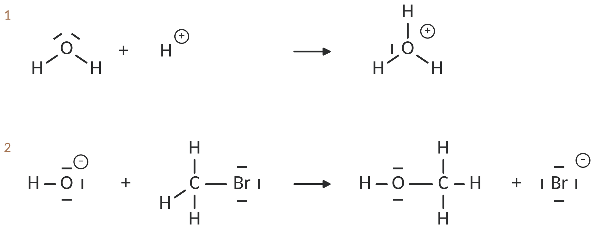{width=14cm}
:::

::: {custom-style="Legende"}
Figure 5. Deux actes élémentaires, sans leurs flèches courbes
:::

<!--debut:cahier-->
```{=openxml}
<w:p><w:r><w:br w:type="page"/></w:r></w:p>
```

<!--fin:cahier-->
## [Q.15]{custom-style="QNum"}\ \ Identifier intermédiaire réactionnel et catalyseur dans un mécanisme {#q15}

::: {custom-style="Meta"}
[\ Objectif 10\ ]{custom-style="Niv10"}\ \ Cours · Notions : acte élémentaire, intermédiaire réactionnel, catalyseur, équation de la réaction · Demandé dans quatre exercices en 2025 et 2026\ \ \ [CIBLE:c_q15]{custom-style="BoutonCorrige"}
:::

::: {custom-style="Enonce"}
Application : en présence d'ions iodure, la décomposition de l'eau oxygénée est modélisée par deux actes élémentaires. Identifier l'intermédiaire réactionnel et le catalyseur, puis établir l'équation de la réaction modélisée.

$$\text{Étape 1 :} \quad \text{H}_2\text{O}_2(\text{aq}) + \text{I}^-(\text{aq}) \rightarrow \text{H}_2\text{O}(\ell) + \text{IO}^-(\text{aq})$$

$$\text{Étape 2 :} \quad \text{H}_2\text{O}_2(\text{aq}) + \text{IO}^-(\text{aq}) \rightarrow \text{H}_2\text{O}(\ell) + \text{O}_2(\text{g}) + \text{I}^-(\text{aq})$$
:::

## [Q.16]{custom-style="QNum"}\ \ Interpréter les facteurs cinétiques à l'échelle microscopique {#q16}

::: {custom-style="Meta"}
[\ Objectif 14\ ]{custom-style="Niv14"}\ \ Cours · Notions : chocs efficaces, agitation thermique, rôle d'un catalyseur\ \ \ [CIBLE:c_q16]{custom-style="BoutonCorrige"}
:::

::: {custom-style="Enonce"}
Application : interpréter à l'échelle microscopique l'effet d'une hausse de la température et de la concentration des réactifs sur la vitesse d'une transformation. Comment un catalyseur peut-il l'accélérer sans être consommé ?
:::

::: {custom-style="Rubrique"}
Exercices
:::

### [Exercice 3]{custom-style="QNum"}\ \ La fabrication d'un savon [(voir BAC Métropole 2025, sujet de secours)]{custom-style="VoirBac"} {#ex3}

::: {custom-style="Meta"}
[\ Objectif 14\ ]{custom-style="Niv14"}\ \ [Type BAC]{custom-style="TagBac"} · 5 points · 45 min
:::

::: {custom-style="MentionBac"}
[Sujet du BAC correspondant.]{custom-style="EtiqBac"} Métropole 2025, jour 2 (sujet de secours), exercice 1 : « Savon : parfum, synthèse et utilisation » (mécanisme de la saponification, vitesse d'apparition, catalyseur).
:::

::: {custom-style="Enonce"}
Un savon est constitué d'ions carboxylate à longue chaîne carbonée. On le fabrique par saponification d'un ester, noté $\text{R}_1\text{-COO-R}_2$, par les ions hydroxyde : la transformation est lente et totale à froid, et l'on chauffe à reflux pendant $30\ \text{min}$. Le mécanisme proposé comporte les trois étapes de la figure 6, où $\text{R}_1$ et $\text{R}_2$ sont des groupes d'atomes qui ne participent pas à la réaction.
:::

::: {custom-style="Figure"}
{width=12.4cm}
:::

::: {custom-style="Legende"}
Figure 6. Mécanisme de la saponification d'un ester
:::

::: {custom-style="Enonce"}
**Données**
:::

::: {custom-style="EnonceDonnees"}
Électronégativités : $\chi(\text{H}) = 2{,}20$ ; $\chi(\text{C}) = 2{,}55$ ; $\chi(\text{O}) = 3{,}44$.
:::

::: {custom-style="Enonce"}
**1.** À l'aide des électronégativités, montrer que l'atome de carbone du groupe $\text{C=O}$ de l'ester est un site accepteur de doublet d'électrons. Quel est le site donneur de l'étape 1 ?

**2.** Recopier les trois étapes et les compléter par des flèches courbes.

**3.** Identifier les intermédiaires réactionnels. Quelle est la nature de l'étape 3 ?

**4.** Établir l'équation de la réaction modélisée par ce mécanisme. L'ion hydroxyde joue-t-il le rôle de catalyseur ?

**5.** Expliquer, à l'échelle microscopique, pourquoi on chauffe le mélange. La vitesse volumique d'apparition de l'ion carboxylate reste-t-elle constante pendant le chauffage ?

**6.** Pour synthétiser l'ester lui-même, par une estérification lente et non totale, on ajoute une petite quantité d'un acide, l'APTS. Quel est son rôle ? Modifie-t-il le rendement de la synthèse ?
:::

::: {custom-style="Renvoi"}
[CIBLE:c_ex3]{custom-style="BoutonCorrige"}
:::

# Thème 4 : noyaux et désintégrations radioactives {#theme4}

::: {custom-style="Rubrique"}
Questions de cours
:::

## [Q.17]{custom-style="QNum"}\ \ Décrire la composition d'un noyau et reconnaître des isotopes {#q17}

::: {custom-style="Meta"}
[\ Objectif 10\ ]{custom-style="Niv10"}\ \ Cours · Notions : nombre de masse, numéro atomique, isotopes · Demandé dans cinq exercices en 2025 et 2026\ \ \ [CIBLE:c_q17]{custom-style="BoutonCorrige"}
:::

::: {custom-style="Enonce"}
Application : donner la composition des noyaux ${}^{63}_{28}\text{Ni}$, ${}^{12}_{6}\text{C}$ et ${}^{14}_{6}\text{C}$. Lesquels sont isotopes ? Calculer la charge électrique du noyau de nickel 63. Donnée : $e = 1{,}60 \times 10^{-19}\ \text{C}$.
:::

## [Q.18]{custom-style="QNum"}\ \ Identifier le type de radioactivité {#q18}

::: {custom-style="Meta"}
[\ Objectif 10\ ]{custom-style="Niv10"}\ \ Cours · Notions : noyau radioactif, radioactivités $\alpha$, $\beta^-$ et $\beta^{\text{+}}$, émission $\gamma$ · Demandé en 2025 et 2026\ \ \ [CIBLE:c_q18]{custom-style="BoutonCorrige"}
:::

::: {custom-style="Enonce"}
Application : qu'est-ce qu'un noyau radioactif ? Donner le type de radioactivité : le nickel 63 émet des électrons, le radium 226 des noyaux d'hélium, le fluor 18 des positons. Qu'est-ce que l'émission $\gamma$ ?
:::

## [Q.19]{custom-style="QNum"}\ \ Écrire l'équation d'une désintégration {#q19}

::: {custom-style="Meta"}
[\ Objectif 10\ ]{custom-style="Niv10"}\ \ Méthode · Notions : lois de conservation, noyau fils · Demandé dans quatre exercices en 2025 et 2026\ \ \ [CIBLE:c_q19]{custom-style="BoutonCorrige"}
:::

::: {custom-style="Enonce"}
Application : écrire les équations des trois désintégrations de la question précédente et identifier chaque noyau fils, puis celle du plutonium 239, émetteur $\alpha$. Numéros atomiques : O 8 ; F 9 ; Co 27 ; Ni 28 ; Cu 29 ; Rn 86 ; Ra 88 ; U 92 ; Pu 94.
:::

## [Q.20]{custom-style="QNum"}\ \ Exploiter un diagramme (N, Z) {#q20}

::: {custom-style="Meta"}
[\ Objectif 14\ ]{custom-style="Niv14"}\ \ Méthode · Notions : vallée de stabilité, excès de neutrons · Demandé en 2025 (Métropole, Amérique du Nord)\ \ \ [CIBLE:c_q20]{custom-style="BoutonCorrige"}
:::

::: {custom-style="Enonce"}
Application : à l'aide de l'extrait de la figure 7, prévoir le type de radioactivité du carbone 14 et du carbone 11, et leur noyau fils. Comment le point d'un noyau se déplace-t-il lors d'une désintégration $\beta^-$, $\beta^{\text{+}}$ ou $\alpha$ ?
:::

::: {custom-style="Figure"}
{width=7cm}
:::

::: {custom-style="Legende"}
Figure 7. Extrait du diagramme (N, Z) pour les noyaux légers
:::

::: {custom-style="Rubrique"}
Exercices
:::

### [Exercice 4]{custom-style="QNum"}\ \ Du plutonium dans le combustible MOX [(voir BAC Amérique du Nord 2025)]{custom-style="VoirBac"} {#ex4}

::: {custom-style="Meta"}
[\ Objectif 10\ ]{custom-style="Niv10"}\ \ [Type BAC]{custom-style="TagBac"} · 5 points · 45 min · Questions 5 et 6 : objectif 14, à traiter après Q.22 à Q.24
:::

::: {custom-style="MentionBac"}
[Sujet du BAC correspondant.]{custom-style="EtiqBac"} Amérique du Nord 2025, jour 2, exercice 2 : « Combustible MOX pour limiter les déchets nucléaires » (diagramme N/Z, désintégrations successives, constante radioactive).
:::

::: {custom-style="Enonce"}
Le combustible des centrales nucléaires contient de l'uranium 238 et un peu d'uranium 235. Dans le réacteur, des noyaux d'uranium 238 captent un neutron ; le noyau formé se transforme, par deux désintégrations successives, en plutonium 239. Récupéré dans le combustible usé, le plutonium est recyclé dans un nouveau combustible, le MOX, mélange d'oxydes d'uranium et de plutonium. La figure 8 donne un extrait du diagramme (N, Z) et le type de radioactivité des noyaux concernés.
:::

::: {custom-style="Figure"}
{width=8.5cm}
:::

::: {custom-style="Legende"}
Figure 8. Extrait du diagramme (N, Z) autour de l'uranium et du plutonium
:::

::: {custom-style="Enonce"}
**Données**
:::

::: {custom-style="EnonceDonnees"}
Demi-vie du plutonium 239 : $t_{1/2} = 24\,100\ \text{ans}$ ; $1\ \text{an} = 3{,}16 \times 10^{7}\ \text{s}$ ; $M(\text{Pu}) = 239\ \text{g·mol}^{-1}$ ; $N_\text{A} = 6{,}02 \times 10^{23}\ \text{mol}^{-1}$. Classement simplifié des déchets radioactifs, d'après l'Andra : très faible activité en dessous de $10^{2}\ \text{Bq·g}^{-1}$, faible activité de $10^{2}$ à $10^{6}\ \text{Bq·g}^{-1}$, moyenne activité de $10^{6}$ à $10^{9}\ \text{Bq·g}^{-1}$, haute activité au-delà ; vie courte si la demi-vie est inférieure ou égale à 31 ans, vie longue au-delà.
:::

::: {custom-style="Enonce"}
**1.** Donner la composition des noyaux d'uranium 235 et d'uranium 238. Sont-ils isotopes ?

**2.** Écrire l'équation de la capture d'un neutron ${}^{1}_{0}\text{n}$ par un noyau d'uranium 238.

**3.** À l'aide de la figure 8, écrire les équations des deux désintégrations qui conduisent au plutonium 239. Nommer la particule émise.

**4.** Le plutonium 239 se désintègre en uranium 235. Écrire l'équation de cette désintégration et donner le type de radioactivité.

**5.** Établir l'expression de la constante radioactive $\lambda$ en fonction de la demi-vie, puis montrer que, pour le plutonium 239, $\lambda = 9{,}1 \times 10^{-13}\ \text{s}^{-1}$.

**6.** Calculer l'activité d'un gramme de plutonium 239. À quelle catégorie de déchets appartiendrait-il ? En déduire l'intérêt du combustible MOX.
:::

::: {custom-style="Renvoi"}
[CIBLE:c_ex4]{custom-style="BoutonCorrige"}
:::

# Thème 5 : décroissance radioactive {#theme5}

::: {custom-style="Rubrique"}
Questions de cours
:::

## [Q.21]{custom-style="QNum"}\ \ Établir et résoudre l'équation de la décroissance radioactive {#q21}

::: {custom-style="Meta"}
[\ Objectif 14\ ]{custom-style="Niv14"}\ \ Méthode · Notions : équation différentielle, loi de décroissance, constante radioactive · Demandé dans quatre exercices en 2025 et 2026\ \ \ [CIBLE:c_q21]{custom-style="BoutonCorrige"}
:::

::: {custom-style="Enonce"}
Application : pendant une durée très courte $\text{d}t$, le nombre de noyaux d'un échantillon qui se désintègrent est proportionnel à $\text{d}t$ et au nombre $N$ de noyaux présents ; la variation de $N$ est donc $\text{d}N = -\lambda\, N\, \text{d}t$. En déduire l'équation différentielle vérifiée par $N(t)$, puis la résoudre. Parmi les expressions $N_0\,\text{e}^{-\lambda t}$, $N_0 - \lambda t$ et $N_0\,\text{e}^{\lambda t}$, laquelle convient, et pourquoi les deux autres sont-elles exclues ? Quelle est l'unité de $\lambda$ ?
:::

## [Q.22]{custom-style="QNum"}\ \ Définir et exploiter la demi-vie {#q22}

::: {custom-style="Meta"}
[\ Objectif 10\ ]{custom-style="Niv10"}\ \ Cours · Notions : demi-vie, relation avec $\lambda$, lecture graphique, nombre de demi-vies · Demandé dans six exercices en 2025 et 2026\ \ \ [CIBLE:c_q22]{custom-style="BoutonCorrige"}
:::

::: {custom-style="Enonce"}
Application : définir la demi-vie d'un noyau radioactif et montrer, à partir de la loi de décroissance $N(t) = N_0\,\text{e}^{-\lambda t}$ (Q.21), que $t_{1/2} = \dfrac{\ln 2}{\lambda}$. La figure 9 donne le pourcentage de noyaux de technétium 99m restant dans un échantillon. Déterminer sa demi-vie, puis $\lambda$ en $\text{h}^{-1}$ et en $\text{s}^{-1}$. Quel pourcentage reste-t-il au bout de $24\ \text{h}$ ?
:::

::: {custom-style="Figure"}
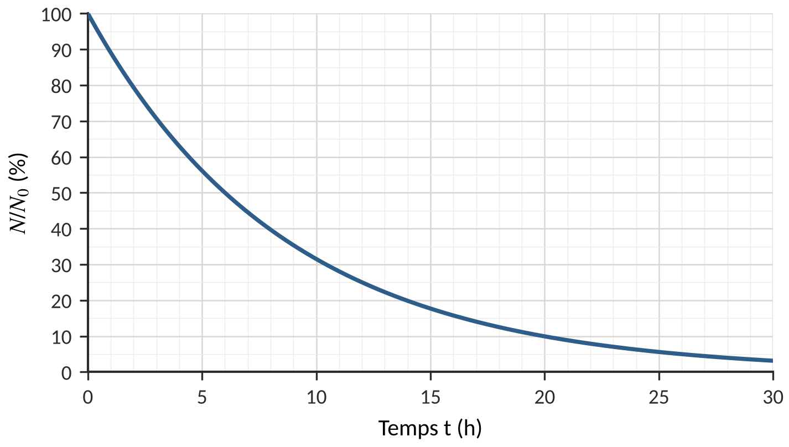{width=9cm}
:::

::: {custom-style="Legende"}
Figure 9. Décroissance d'un échantillon de technétium 99m
:::

## [Q.23]{custom-style="QNum"}\ \ Relier l'activité et le nombre de noyaux {#q23}

::: {custom-style="Meta"}
[\ Objectif 10\ ]{custom-style="Niv10"}\ \ Cours · Notions : activité, becquerel, $A = \lambda N$, décroissance de l'activité · Demandé en 2026 (Antilles-Guyane)\ \ \ [CIBLE:c_q23]{custom-style="BoutonCorrige"}
:::

::: {custom-style="Enonce"}
Application : définir l'activité d'un échantillon radioactif et donner son unité. Un compteur enregistre $1\,200$ désintégrations en $1{,}0\ \text{min}$ : quelle est l'activité de l'échantillon à cette date ? Montrer, avec la loi de décroissance $N(t) = N_0\,\text{e}^{-\lambda t}$, que la relation $A(t) = \lambda\, N(t)$ conduit à $A(t) = A_0\,\text{e}^{-\lambda t}$.
:::

## [Q.24]{custom-style="QNum"}\ \ Calculer un nombre de noyaux et une activité à partir d'une masse {#q24}

::: {custom-style="Meta"}
[\ Objectif 14\ ]{custom-style="Niv14"}\ \ Méthode · Notions : quantité de matière, constante d'Avogadro, activité\ \ \ [CIBLE:c_q24]{custom-style="BoutonCorrige"}
:::

::: {custom-style="Enonce"}
Application : calculer le nombre de noyaux contenus dans $1{,}0\ \text{µg}$ d'iode 131, puis l'activité de cet échantillon. Données : $M(\text{I}) = 131\ \text{g·mol}^{-1}$ ; demi-vie de l'iode 131 : $8{,}0$ jours ; $N_\text{A} = 6{,}02 \times 10^{23}\ \text{mol}^{-1}$.
:::

## [Q.25]{custom-style="QNum"}\ \ Calculer une durée ou un âge {#q25}

::: {custom-style="Meta"}
[\ Objectif 14\ ]{custom-style="Niv14"}\ \ Méthode · Notions : datation, logarithme, choix d'un noyau radioactif · Demandé dans quatre exercices en 2025 et 2026\ \ \ [CIBLE:c_q25]{custom-style="BoutonCorrige"}
:::

::: {custom-style="Enonce"}
Application : le carbone 14, de demi-vie $5\,730\ \text{ans}$, permet de dater des restes organiques. Un fragment de bois trouvé dans une grotte a une activité de $0{,}074\ \text{Bq}$ par gramme de carbone, contre $0{,}23\ \text{Bq}$ pour un bois actuel. Estimer son âge. Par ailleurs, au bout de combien de temps l'activité d'un échantillon d'iode 131, de demi-vie $8{,}0$ jours, est-elle divisée par $1\,000$ ?
:::

## [Q.26]{custom-style="QNum"}\ \ Vérifier la loi de décroissance sur des mesures {#q26}

::: {custom-style="Meta"}
[\ Objectif 14\ ]{custom-style="Niv14"}\ \ Méthode · Notions : tracé de $-\ln(N/N_0)$, constante radioactive, identification d'un noyau\ \ \ [CIBLE:c_q26]{custom-style="BoutonCorrige"}
:::

::: {custom-style="Enonce"}
Application : on a mesuré tous les 40 jours le rapport $\dfrac{N}{N_0}$ pour un échantillon radioactif. Vérifier que la loi de décroissance est respectée, déterminer $\lambda$ et la demi-vie, puis identifier le noyau parmi l'iode 131 (demi-vie $8{,}0$ jours), le polonium 210 ($138$ jours) et le cobalt 60 ($5{,}27$ ans).
:::

<!--colonnes: 23 11 11 11 11 11 11 11-->

| *t* (jours) | 0 | 40 | 80 | 120 | 160 | 200 | 240 |
|---|---|---|---|---|---|---|---|
| $N/N_0$ | 1,00 | 0,82 | 0,67 | 0,55 | 0,45 | 0,37 | 0,30 |

::: {custom-style="Rubrique"}
Exercices
:::

### [Exercice 5]{custom-style="QNum"}\ \ Le fluor 18 en imagerie médicale [(voir BAC Centres étrangers 2026)]{custom-style="VoirBac"} {#ex5}

::: {custom-style="Meta"}
[\ Objectif 14\ ]{custom-style="Niv14"}\ \ [Type BAC]{custom-style="TagBac"} · 5 points · 45 min · Question 6 : objectif 18
:::

::: {custom-style="MentionBac"}
[Sujet du BAC correspondant.]{custom-style="EtiqBac"} Centres étrangers 2026, jour 2, exercice 1 : « Le cyclotron Arronax » (partie sur la production du fluor 18 et l'imagerie médicale).
:::

::: {custom-style="Enonce"}
Pour une tomographie par émission de positons, on injecte au patient un dérivé du glucose marqué au fluor 18. Ce noyau est produit dans un cyclotron, en bombardant de l'oxygène 18 par des protons ${}^{1}_{1}\text{p}$ : la réaction libère aussi un neutron. Le fluor 18 est émetteur $\beta^{\text{+}}$ ; chaque positon émis rencontre presque aussitôt un électron et disparaît en produisant deux photons d'énergie $511\ \text{keV}$ chacun, détectés par une caméra placée autour du patient. Après l'injection, à $t = 0$, le patient se repose pendant $1\ \text{h}$, puis les images sont enregistrées pendant $30\ \text{min}$.
:::

::: {custom-style="Figure"}
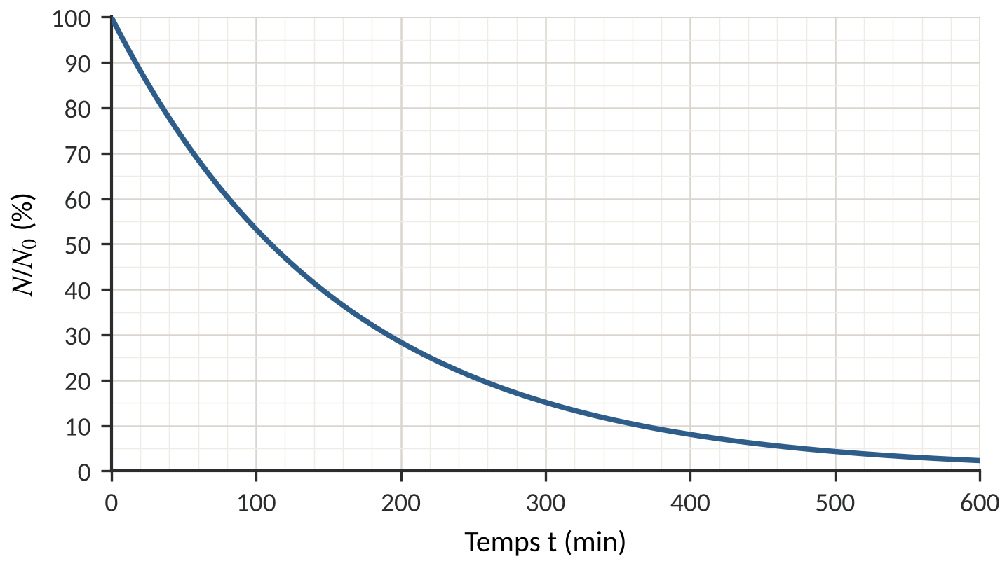{width=9cm}
:::

::: {custom-style="Legende"}
Figure 10. Décroissance du fluor 18
:::

::: {custom-style="Enonce"}
**Données**
:::

::: {custom-style="EnonceDonnees"}
$\text{O}$ ($Z = 8$), $\text{F}$ ($Z = 9$). $h = 6{,}63 \times 10^{-34}\ \text{J·s}$ ; $c = 3{,}00 \times 10^{8}\ \text{m·s}^{-1}$ ; $1\ \text{eV} = 1{,}60 \times 10^{-19}\ \text{J}$. Les rayons X ont des longueurs d'onde comprises entre $10^{-11}$ et $10^{-8}\ \text{m}$ environ ; les rayons $\gamma$, des longueurs d'onde plus courtes.
:::

::: {custom-style="Enonce"}
**1.** Écrire l'équation de la réaction qui produit le fluor 18, puis celle de sa désintégration. Nommer la particule émise.

**2.** Calculer la longueur d'onde des photons détectés. À quel domaine appartiennent-ils ?

**3.** Vérifier que $N(t) = N_0\,\text{e}^{-\lambda t}$ est solution de l'équation $\dfrac{\text{d}N}{\text{d}t} = -\lambda N$.

**4.** Déterminer la demi-vie du fluor 18 à l'aide de la figure 10, puis sa constante radioactive.

**5.** Quel pourcentage des noyaux de fluor 18 injectés reste-t-il à la fin de l'enregistrement des images ?

**6.** Établir l'expression de la durée $t_p$ au bout de laquelle il ne reste qu'une fraction $p$ des noyaux injectés, en fonction de $p$ et de $t_{1/2}$. Calculer $t_p$ pour $p = 1\ \%$, puis commenter ce résultat.
:::

::: {custom-style="Renvoi"}
[CIBLE:c_ex5]{custom-style="BoutonCorrige"}
:::

<!--debut:complet-->
::: {custom-style="Surtitre"}
Corrigés
:::

# Corrigés du thème 1 : vitesse et suivi d'une transformation {#c_theme1}

#### [Corrigé]{custom-style="NumCorrige"}\ \ Q.1 · Reconnaître une transformation lente et les facteurs cinétiques {#c_q1}

::: {custom-style="Renvoi"}
[CIBLE:q1]{custom-style="BoutonEnonce"}
:::

La précipitation du chlorure d'argent est rapide : le précipité blanc apparaît dès le mélange, sans évolution perceptible ensuite. L'oxydation des ions iodure par l'eau oxygénée est lente : la couleur brune du diiode s'installe en plusieurs minutes, on peut suivre son évolution. La formation de la rouille est très lente : elle prend des jours, voire des années.

Trois facteurs cinétiques : la température, la concentration des réactifs et la présence d'un catalyseur. Pour un réactif solide, l'étendue de la surface de contact joue aussi.

L'eau glacée réalise une trempe : le refroidissement brutal et la dilution ralentissent tellement la transformation qu'elle est pratiquement arrêtée pendant le titrage. On dose ainsi la composition du mélange à l'instant du prélèvement.

::: {custom-style="Retenir"}
Une transformation est d'autant plus rapide que la température est élevée et que les réactifs sont concentrés ; un catalyseur l'accélère sans modifier l'état final.
:::

::: {custom-style="Piege"}
[Piège.]{custom-style="EtiqPiege"} Croire qu'un catalyseur augmente le rendement ou l'avancement final : il permet seulement d'atteindre plus vite le même état final.
:::

#### [Corrigé]{custom-style="NumCorrige"}\ \ Q.2 · Définir et calculer une vitesse volumique {#c_q2}

::: {custom-style="Renvoi"}
[CIBLE:q2]{custom-style="BoutonEnonce"}
:::

Par définition, la vitesse volumique d'apparition d'un produit est la dérivée de sa concentration par rapport au temps, et la vitesse volumique de disparition d'un réactif l'opposé de cette dérivée :

$$v_\text{app}(\text{I}_2) = \dfrac{\text{d}[\text{I}_2]}{\text{d}t} \qquad v_\text{disp}(\text{H}_2\text{O}_2) = -\dfrac{\text{d}[\text{H}_2\text{O}_2]}{\text{d}t}$$

Avec l'avancement : $[\text{I}_2] = \dfrac{x}{V}$ et $[\text{H}_2\text{O}_2] = \dfrac{n_0 - x}{V}$, où $n_0$ est la quantité initiale d'eau oxygénée. Le volume étant constant :

$$v_\text{app}(\text{I}_2) = \dfrac{1}{V}\,\dfrac{\text{d}x}{\text{d}t} = v_\text{disp}(\text{H}_2\text{O}_2)$$

Ces deux vitesses sont égales car les nombres stœchiométriques de $\text{I}_2$ et de $\text{H}_2\text{O}_2$ valent 1 ; celle de disparition des ions iodure est deux fois plus grande. Sur l'intervalle étudié :

$$v_\text{moy} = \dfrac{\Delta[\text{I}_2]}{\Delta t} = \dfrac{3{,}0}{5{,}0} = 0{,}60\ \text{mmol·L}^{-1}\text{·min}^{-1}, \text{ soit } 1{,}0 \times 10^{-5}\ \text{mol·L}^{-1}\text{·s}^{-1}$$

::: {custom-style="Retenir"}
$v_\text{app}(\text{P}) = \dfrac{\text{d}[\text{P}]}{\text{d}t}$ et $v_\text{disp}(\text{R}) = -\dfrac{\text{d}[\text{R}]}{\text{d}t}$, en $\text{mol·L}^{-1}\text{·s}^{-1}$
:::

::: {custom-style="Piege"}
[Piège.]{custom-style="EtiqPiege"} Oublier le signe moins de la vitesse de disparition : la concentration du réactif diminue, sa dérivée est négative, et la vitesse doit être positive.
:::

#### [Corrigé]{custom-style="NumCorrige"}\ \ Q.3 · Déterminer une vitesse volumique sur une courbe {#c_q3}

::: {custom-style="Renvoi"}
[CIBLE:q3]{custom-style="BoutonEnonce"}
:::

La vitesse volumique d'apparition à une date est le coefficient directeur de la tangente à la courbe $[\text{I}_2](t)$ à cette date (figure 11).

::: {custom-style="Figure"}
{width=9.5cm}
:::

::: {custom-style="Legende"}
Figure 11. Tangentes à la courbe à $t = 0$ et à $t = 10\ \text{min}$
:::

$$v_\text{app}(0) = \dfrac{5{,}0 - 0}{10 - 0} = 0{,}50\ \text{mmol·L}^{-1}\text{·min}^{-1} \qquad v_\text{app}(10\ \text{min}) = \dfrac{5{,}0 - 1{,}3}{20 - 0} = 0{,}185 \approx 0{,}19\ \text{mmol·L}^{-1}\text{·min}^{-1}$$

Une tangente tracée à la main donne ces pentes à $10\ \%$ près.

La vitesse diminue au cours du temps : les réactifs sont consommés, leur concentration baisse, et la concentration des réactifs est un facteur cinétique. Elle tend vers zéro quand la transformation s'achève.

::: {custom-style="Methode"}
[Méthode.]{custom-style="EtiqMethode"} Tracer la tangente au point voulu, choisir deux points de la tangente assez éloignés l'un de l'autre, lire leurs coordonnées avec les unités des axes, puis calculer $\dfrac{y_\text{B} - y_\text{A}}{x_\text{B} - x_\text{A}}$.
:::

::: {custom-style="Remarque"}
[Remarque.]{custom-style="EtiqRemarque"} La vitesse ne diminue pas toujours dès le début : pour certaines transformations, la pente de la courbe est faible au départ, augmente, puis diminue de nouveau. C'est le cas quand un produit de la réaction accélère lui-même la transformation, en jouant le rôle de catalyseur.
:::

#### [Corrigé]{custom-style="NumCorrige"}\ \ Q.4 · Définir et déterminer un temps de demi-réaction {#c_q4}

::: {custom-style="Renvoi"}
[CIBLE:q4]{custom-style="BoutonEnonce"}
:::

Le temps de demi-réaction $t_{1/2}$ est la durée au bout de laquelle l'avancement atteint la moitié de sa valeur finale : $x(t_{1/2}) = \dfrac{x_\text{f}}{2}$. Pour une transformation totale, c'est la durée au bout de laquelle la moitié du réactif limitant a été consommée.

Ici, la concentration en diiode est proportionnelle à l'avancement et tend vers $5{,}0\ \text{mmol·L}^{-1}$. On cherche la date à laquelle elle vaut $2{,}5\ \text{mmol·L}^{-1}$ (figure 12) : $t_{1/2} \approx 7\ \text{min}$.

::: {custom-style="Figure"}
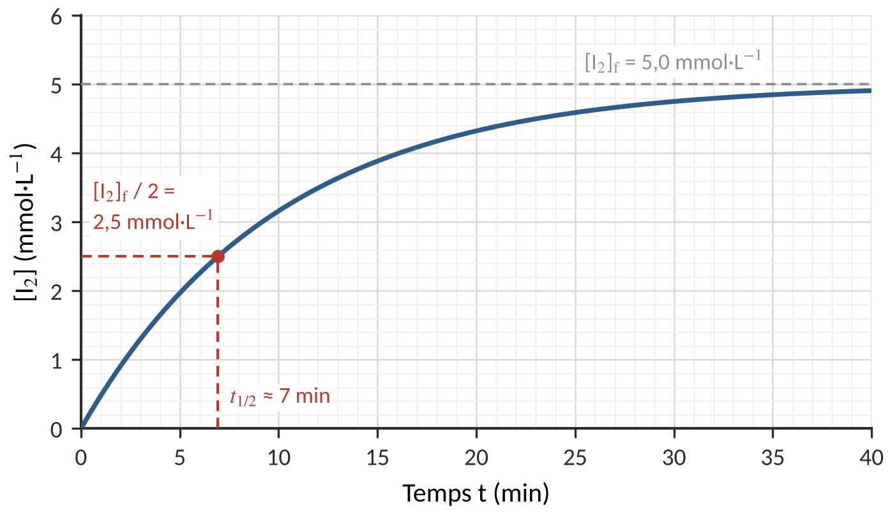{width=9.5cm}
:::

::: {custom-style="Legende"}
Figure 12. Lecture du temps de demi-réaction
:::

À $2\ \%$ près, la concentration vaut $0{,}98 \times 5{,}0 = 4{,}9\ \text{mmol·L}^{-1}$ : la courbe atteint cette valeur vers $40\ \text{min}$, soit près de six $t_{1/2}$. En pratique, on considère qu'une transformation est terminée au bout de quelques temps de demi-réaction.

::: {custom-style="Piege"}
[Piège.]{custom-style="EtiqPiege"} Prendre pour $t_{1/2}$ la moitié de la durée de la transformation, ou, pour une transformation non totale, la date à laquelle $x = \dfrac{x_\text{max}}{2}$ : c'est la moitié de l'avancement final $x_\text{f}$ qui compte.
:::

#### [Corrigé]{custom-style="NumCorrige"}\ \ Q.5 · Choisir une méthode de suivi cinétique {#c_q5}

::: {custom-style="Renvoi"}
[CIBLE:q5]{custom-style="BoutonEnonce"}
:::

- Seul le diiode est coloré : un suivi par spectrophotométrie, à une longueur d'onde où il absorbe, donne $[\text{I}_2]$ par la loi de Beer-Lambert.
- Des ions se forment à partir de réactifs moléculaires : la conductivité du mélange augmente avec l'avancement, on la suit par conductimétrie.
- Un gaz se dégage : on mesure son volume, ou la pression dans un récipient fermé.
- Aucune grandeur physique simple ne varie : on réalise des titrages successifs de l'acide restant, en effectuant une trempe de chaque prélèvement.

Dans tous les cas, la mesure doit être rapide devant la durée de la transformation : sinon, la composition change pendant la mesure.

::: {custom-style="Retenir"}
On suit une transformation par une grandeur qui varie avec l'avancement : absorbance, conductivité, volume ou pression d'un gaz, ou par des titrages successifs.
:::

#### [Corrigé]{custom-style="NumCorrige"}\ \ Q.6 · Attribuer des courbes à des conditions expérimentales {#c_q6}

::: {custom-style="Renvoi"}
[CIBLE:q6]{custom-style="BoutonEnonce"}
:::

La transformation est totale et une mole de A donne une mole de P : la concentration finale en produit est égale à $[\text{A}]_0$. La courbe b, qui tend vers $20\ \text{mmol·L}^{-1}$, correspond donc à l'expérience 3. Les courbes a et c tendent vers $10\ \text{mmol·L}^{-1}$ : expériences 1 et 2.

La température est un facteur cinétique : à $40\ \text{°C}$, la transformation est plus rapide qu'à $25\ \text{°C}$. La courbe c, qui atteint plus vite sa valeur finale, correspond à l'expérience 2, et la courbe a à l'expérience 1.

Les courbes b et c ont le même temps de demi-réaction, environ $3{,}5\ \text{min}$ : à la même température, doubler la concentration initiale double la vitesse initiale (pente à l'origine), mais ne change pas $t_{1/2}$. C'est une propriété des transformations qui suivent une loi d'ordre 1 (thème 2).

::: {custom-style="Piege"}
[Piège.]{custom-style="EtiqPiege"} Écrire que plus de réactif donne « un plus grand taux d'avancement » : la concentration modifie la vitesse ; la quantité finale de produit est fixée par la quantité de réactif limitant.
:::

#### [Corrigé]{custom-style="NumCorrige"}\ \ Exercice 1 · L'arôme de jasmin {#c_ex1}

::: {custom-style="Renvoi"}
[CIBLE:ex1]{custom-style="BoutonEnonce"}
:::

::: {custom-style="QRappel"}
**1.** Acide sulfurique et eau glacée
:::

L'acide sulfurique est un catalyseur : il accélère l'estérification, lente sans lui, et il est régénéré à la fin. L'eau glacée réalise une trempe : refroidi et dilué, le mélange n'évolue pratiquement plus, et le titrage mesure la quantité d'acide présente à l'instant où l'on a sorti le tube.

::: {custom-style="QRappel"}
**2.** Quantités initiales et réactif limitant
:::

$$n_0 = \dfrac{\rho \times V_\text{ac}}{M} = \dfrac{1{,}05 \times 0{,}600}{60{,}1} = 1{,}05 \times 10^{-2}\ \text{mol} \qquad n_\text{alc} = \dfrac{1{,}04 \times 1{,}40}{108} = 1{,}35 \times 10^{-2}\ \text{mol}$$

Les réactifs réagissent mole à mole : l'acide éthanoïque, en plus petite quantité, est le réactif limitant, et $x_\text{max} = 10{,}5\ \text{mmol}$.

::: {custom-style="QRappel"}
**3.** Quantité d'ester et rendement
:::

Chaque mole d'acide consommée donne une mole d'ester : $n_\text{E}(t) = n_0 - n_\text{ac}(t)$. À la fin, $n_\text{ac} = 2{,}6\ \text{mmol}$ :

$$n_\text{E,f} = 10{,}5 - 2{,}6 = 7{,}9\ \text{mmol} \qquad \eta = \dfrac{n_\text{E,f}}{x_\text{max}} = \dfrac{7{,}9}{10{,}5} = 0{,}75, \text{ soit } 75\ \%$$

La transformation n'est pas totale : il reste de l'acide alors que la composition n'évolue plus.

::: {custom-style="QRappel"}
**4.** Temps de demi-réaction
:::

C'est la durée au bout de laquelle l'avancement, ici égal à $n_\text{E}$, atteint la moitié de sa valeur finale, soit $\dfrac{7{,}9}{2} = 3{,}95\ \text{mmol}$. La figure 13 donne $t_{1/2} \approx 4\ \text{min}$.

::: {custom-style="Figure"}
{width=9.5cm}
:::

::: {custom-style="Legende"}
Figure 13. Lecture du temps de demi-réaction et de la pente à l'origine
:::

::: {custom-style="QRappel"}
**5.** Vitesse volumique à l'origine
:::

$$v_\text{app}(\text{E}) = \dfrac{1}{V}\,\dfrac{\text{d}n_\text{E}}{\text{d}t}$$

La tangente à l'origine passe par $(0 ; 0)$ et $(6{,}0\ \text{min} ; 7{,}9\ \text{mmol})$ : sa pente vaut $\dfrac{7{,}9}{6{,}0} = 1{,}32\ \text{mmol·min}^{-1}$. Avec $V = 2{,}0 \times 10^{-3}\ \text{L}$ :

$$v_\text{app}(\text{E})(0) = \dfrac{1{,}32 \times 10^{-3}}{2{,}0 \times 10^{-3}} = 0{,}66\ \text{mol·L}^{-1}\text{·min}^{-1}$$

::: {custom-style="QRappel"}
**6.** Évolution de la vitesse
:::

Les tangentes à la courbe sont de moins en moins pentues : la vitesse diminue, puis devient nulle quand l'état final est atteint. Le facteur cinétique en cause est la concentration des réactifs, qui diminue au fur et à mesure qu'ils sont consommés.

Pour atteindre plus vite l'état final, on peut élever la température du bain, ou ajouter un peu plus de catalyseur. L'état final d'une estérification dépend très peu de la température : le rendement resterait voisin de $75\ \%$.

::: {custom-style="Piege"}
[Piège.]{custom-style="EtiqPiege"} Calculer la vitesse avec la quantité de matière sans diviser par le volume : une vitesse volumique s'exprime en $\text{mol·L}^{-1}\text{·min}^{-1}$, pas en $\text{mol·min}^{-1}$.
:::

# Corrigés du thème 2 : loi de vitesse d'ordre 1 {#c_theme2}

#### [Corrigé]{custom-style="NumCorrige"}\ \ Q.7 · Écrire une loi de vitesse d'ordre 1 et l'unité de la constante de vitesse {#c_q7}

::: {custom-style="Renvoi"}
[CIBLE:q7]{custom-style="BoutonEnonce"}
:::

Une transformation suit une loi de vitesse d'ordre 1 par rapport au réactif A si sa vitesse volumique de disparition est proportionnelle à sa concentration : $v_\text{disp}(\text{A}) = k\,[\text{A}]$, où $k$ est la constante de vitesse, qui dépend de la température.

Le rapport $\dfrac{v_\text{disp}(\text{A})}{[\text{A}]}$ a la même valeur pour les trois mesures, en convertissant les deux grandeurs avec la même unité de quantité de matière :

$$k = \dfrac{v_\text{disp}(\text{A})}{[\text{A}]} = \dfrac{10 \times 10^{-6}}{5{,}0 \times 10^{-3}} = \dfrac{5{,}0 \times 10^{-6}}{2{,}5 \times 10^{-3}} = \dfrac{2{,}5 \times 10^{-6}}{1{,}25 \times 10^{-3}} = 2{,}0 \times 10^{-3}\ \text{s}^{-1}$$

La vitesse est proportionnelle à la concentration : les mesures sont en accord avec une loi d'ordre 1. Analyse dimensionnelle :

$$\text{unité de } k = \dfrac{\text{unité de } v}{\text{unité de } [\text{A}]} = \dfrac{\text{mol·L}^{-1}\text{·s}^{-1}}{\text{mol·L}^{-1}} = \text{s}^{-1}$$

::: {custom-style="Retenir"}
Loi d'ordre 1 : $v_\text{disp}(\text{A}) = k\,[\text{A}]$, avec $k$ en $\text{s}^{-1}$, l'inverse d'une durée
:::

::: {custom-style="Remarque"}
[Remarque.]{custom-style="EtiqRemarque"} On peut aussi tracer $v_\text{disp}(\text{A})$ en fonction de $[\text{A}]$ : pour une loi d'ordre 1, on obtient une droite passant par l'origine, de coefficient directeur $k$.
:::

::: {custom-style="Piege"}
[Piège.]{custom-style="EtiqPiege"} Diviser des $\text{µmol}$ par des $\text{mmol}$ : on trouverait $k = 2\ \text{s}^{-1}$, mille fois trop grand. On convertit d'abord en $\text{mol}$.
:::

#### [Corrigé]{custom-style="NumCorrige"}\ \ Q.8 · Établir et résoudre l'équation différentielle d'une loi d'ordre 1 {#c_q8}

::: {custom-style="Renvoi"}
[CIBLE:q8]{custom-style="BoutonEnonce"}
:::

La vitesse de disparition s'écrit de deux façons, par sa définition et par la loi de vitesse :

$$v_\text{disp}(\text{A}) = -\dfrac{\text{d}[\text{A}]}{\text{d}t} = k\,[\text{A}] \qquad \text{d'où} \qquad \dfrac{\text{d}[\text{A}]}{\text{d}t} = -k\,[\text{A}]$$

Les solutions de l'équation $y' = a\,y$ sont les fonctions $y = K\,\text{e}^{a t}$ : ici $[\text{A}](t) = K\,\text{e}^{-kt}$. À $t = 0$, $[\text{A}](0) = K = [\text{A}]_0$, d'où :

$$[\text{A}](t) = [\text{A}]_0\,\text{e}^{-kt}$$

À $t = 10\ \text{min} = 600\ \text{s}$ :

$$[\text{A}] = 2{,}0 \times 10^{-2} \times \text{e}^{-2{,}0 \times 10^{-3} \times 600} = 2{,}0 \times 10^{-2} \times 0{,}30 = 6{,}0 \times 10^{-3}\ \text{mol·L}^{-1}$$

::: {custom-style="Methode"}
[Méthode.]{custom-style="EtiqMethode"} Pour vérifier qu'une expression donnée est solution, la dériver, remplacer dans l'équation différentielle, puis contrôler la valeur à $t = 0$. Avant l'application numérique, exprimer $t$ dans l'unité inverse de celle de $k$.
:::

#### [Corrigé]{custom-style="NumCorrige"}\ \ Q.9 · Relier temps de demi-réaction et constante de vitesse {#c_q9}

::: {custom-style="Renvoi"}
[CIBLE:q9]{custom-style="BoutonEnonce"}
:::

À $t = t_{1/2}$, la moitié de A a été consommée : $[\text{A}](t_{1/2}) = \dfrac{[\text{A}]_0}{2} = [\text{A}]_0\,\text{e}^{-k\,t_{1/2}}$, soit $\text{e}^{-k\,t_{1/2}} = \dfrac{1}{2}$. En composant par la fonction logarithme :

$$-k\,t_{1/2} = \ln\dfrac{1}{2} = -\ln 2 \qquad \text{d'où} \qquad t_{1/2} = \dfrac{\ln 2}{k}$$

$[\text{A}]_0$ s'est simplifiée : le temps de demi-réaction ne dépend pas de la concentration initiale.

$$t_{1/2} = \dfrac{\ln 2}{2{,}0 \times 10^{-3}} = 3{,}5 \times 10^{2}\ \text{s}, \text{ soit } 5{,}8\ \text{min}$$

Au bout de $3\,t_{1/2}$, la concentration a été divisée trois fois par deux : il reste $\dfrac{1}{8}$ de A, soit $12{,}5\ \%$.

::: {custom-style="Retenir"}
Pour une loi d'ordre 1 : $t_{1/2} = \dfrac{\ln 2}{k}$, indépendant de $[\text{A}]_0$
:::

#### [Corrigé]{custom-style="NumCorrige"}\ \ Q.10 · Vérifier qu'une transformation suit une loi d'ordre 1 {#c_q10}

::: {custom-style="Renvoi"}
[CIBLE:q10]{custom-style="BoutonEnonce"}
:::

Première méthode : les temps de demi-réaction successifs. La concentration passe de $20{,}0$ à $10{,}0\ \text{µmol·L}^{-1}$ en $8\ \text{min}$, de $10{,}0$ à $5{,}0$ entre $8$ et $16\ \text{min}$, de $5{,}0$ à $2{,}5$ entre $16$ et $24\ \text{min}$, et de $14{,}1$ à $7{,}1$ entre $4$ et $12\ \text{min}$. La durée nécessaire pour diviser la concentration par deux est toujours de $8{,}0\ \text{min}$, quelle que soit la concentration de départ : c'est la propriété d'une loi d'ordre 1.

Seconde méthode : si la loi est d'ordre 1, $\ln[\text{CV}] = \ln[\text{CV}]_0 - k\,t$ est une fonction affine du temps. Les points sont alignés (figure 14) :

::: {custom-style="Figure"}
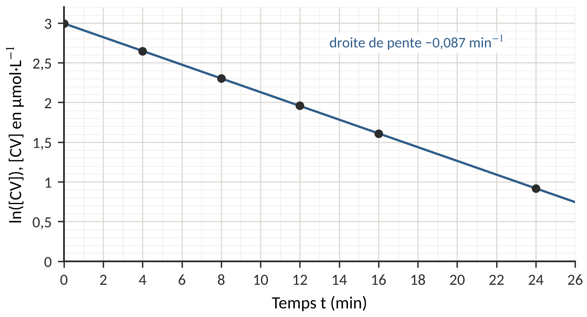{width=9.5cm}
:::

::: {custom-style="Legende"}
Figure 14. Tracé de $\ln[\text{CV}]$ en fonction du temps
:::

$$k = -\dfrac{0{,}92 - 3{,}00}{24 - 0} = 8{,}7 \times 10^{-2}\ \text{min}^{-1}, \text{ en accord avec } \dfrac{\ln 2}{8{,}0} = 8{,}7 \times 10^{-2}\ \text{min}^{-1}$$

::: {custom-style="Remarque"}
[Remarque.]{custom-style="EtiqRemarque"} Une seule vérification sur deux points ne suffit pas. À l'inverse, si les points de $\ln[\text{A}]$ ne sont pas alignés, la transformation ne suit pas une loi d'ordre 1 : c'était le cas de l'hydrolyse de l'aspirine dans l'exercice « De l'aspirine pour favoriser l'écoulement sanguin » (BAC Nouvelle-Calédonie 2025, jour 1), où le graphe de la vitesse en fonction de la concentration n'était pas une droite passant par l'origine.
:::

::: {custom-style="Piege"}
[Piège.]{custom-style="EtiqPiege"} Chercher si la concentration d'un produit double en $t_{1/2}$ : c'est la concentration du réactif qui est divisée par deux à chaque nouveau temps de demi-réaction.
:::

#### [Corrigé]{custom-style="NumCorrige"}\ \ Q.11 · Prévoir une durée avec une loi d'ordre 1 {#c_q11}

::: {custom-style="Renvoi"}
[CIBLE:q11]{custom-style="BoutonEnonce"}
:::

La décoloration suit une loi d'ordre 1 (Q.10) : la concentration en cristal violet est donc la solution de l'équation différentielle établie à la Q.8,

$$[\text{CV}](t) = [\text{CV}]_0\,\text{e}^{-kt}$$

Quand $90\ \%$ du cristal violet ont été consommés, il n'en reste que $10\ \%$ : le volume étant constant, la concentration ne vaut plus que le dixième de sa valeur initiale. À cette date, notée $t_{90\ \%}$, $[\text{CV}](t_{90\ \%}) = \dfrac{[\text{CV}]_0}{10}$. On remplace dans la solution, puis on divise les deux membres par $[\text{CV}]_0$, qui se simplifie :

$$[\text{CV}]_0\,\text{e}^{-k\,t_{90\ \%}} = \dfrac{[\text{CV}]_0}{10} \qquad \text{soit} \qquad \text{e}^{-k\,t_{90\ \%}} = \dfrac{1}{10}$$

En composant par la fonction logarithme, $-k\,t_{90\ \%} = \ln\dfrac{1}{10} = -\ln 10$, d'où $t_{90\ \%} = \dfrac{\ln 10}{k}$. Avec $k = \dfrac{\ln 2}{t_{1/2}}$ (Q.9) et $t_{1/2} = 8{,}0\ \text{min}$ (Q.10) :

$$t_{90\ \%} = \dfrac{\ln 10}{\ln 2}\,t_{1/2} = 3{,}32 \times 8{,}0 = 27\ \text{min}$$

De même, quand $99\ \%$ du cristal violet ont été consommés, il en reste $1\ \%$ : $\text{e}^{-k\,t_{99\ \%}} = \dfrac{1}{100}$, d'où :

$$t_{99\ \%} = \dfrac{\ln 100}{k} = \dfrac{\ln 100}{\ln 2}\,t_{1/2} = 6{,}64 \times 8{,}0 = 53\ \text{min}$$

Il faut environ $3{,}3$ temps de demi-réaction pour consommer $90\ \%$ du réactif, et $6{,}6$ pour en consommer $99\ \%$, quelle que soit la transformation d'ordre 1.

::: {custom-style="Methode"}
[Méthode.]{custom-style="EtiqMethode"} Écrire $\dfrac{[\text{A}]}{[\text{A}]_0} = \text{e}^{-kt}$, composer par le logarithme, puis isoler $t$ : $t = \dfrac{1}{k}\,\ln\dfrac{[\text{A}]_0}{[\text{A}]}$.
:::

#### [Corrigé]{custom-style="NumCorrige"}\ \ Exercice 2 · Le paracétamol dans l'organisme {#c_ex2}

::: {custom-style="Renvoi"}
[CIBLE:ex2]{custom-style="BoutonEnonce"}
:::

::: {custom-style="QRappel"}
**1.** Vitesse de disparition et équation différentielle
:::

$$v_\text{disp}(\text{P}) = -\dfrac{\text{d}[\text{P}]}{\text{d}t} = k\,[\text{P}] \qquad \text{d'où} \qquad \dfrac{\text{d}[\text{P}]}{\text{d}t} = -k\,[\text{P}]$$

D'après le tableau, $[\text{P}]$ diminue au cours du temps ; la vitesse, proportionnelle à $[\text{P}]$, diminue donc aussi. On le voit sur les mesures : la concentration baisse de $28{,}4\ \text{µmol·L}^{-1}$ pendant la première heure, puis de $21{,}7$ pendant la deuxième.

::: {custom-style="QRappel"}
**2.** Vérification de la solution
:::

En dérivant : $\dfrac{\text{d}[\text{P}]}{\text{d}t} = -k\,[\text{P}]_0\,\text{e}^{-kt} = -k\,[\text{P}](t)$ : l'équation est vérifiée. À $t = 0$, $[\text{P}](0) = [\text{P}]_0\,\text{e}^{0} = [\text{P}]_0$ : la condition initiale est respectée.

::: {custom-style="QRappel"}
**3.** Ordre 1 et constante de vitesse
:::

Si la loi est d'ordre 1, $\ln[\text{P}] = \ln[\text{P}]_0 - k\,t$ : la courbe est une droite de pente $-k$. C'est bien le cas sur la figure 4. Avec deux points de la droite (figure 15) :

::: {custom-style="Figure"}
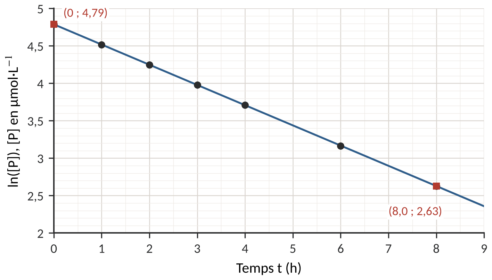{width=9.5cm}
:::

::: {custom-style="Legende"}
Figure 15. Lecture de la pente de la droite
:::

$$k = -\dfrac{2{,}63 - 4{,}79}{8{,}0 - 0} = 0{,}27\ \text{h}^{-1}$$

::: {custom-style="QRappel"}
**4.** Temps de demi-réaction
:::

$$t_{1/2} = \dfrac{\ln 2}{k} = \dfrac{0{,}693}{0{,}27} = 2{,}6\ \text{h}$$

Vérification : la moitié de la concentration initiale, $60\ \text{µmol·L}^{-1}$, est atteinte entre $t = 2{,}0\ \text{h}$ ($69{,}9\ \text{µmol·L}^{-1}$) et $t = 3{,}0\ \text{h}$ ($53{,}4\ \text{µmol·L}^{-1}$), ce qui est cohérent avec $2{,}6\ \text{h}$.

::: {custom-style="QRappel"}
**5.** Durée de l'effet
:::

$$[\text{P}]_\text{lim} = \dfrac{C_\text{m,lim}}{M} = \dfrac{8{,}0 \times 10^{-3}}{151} = 5{,}3 \times 10^{-5}\ \text{mol·L}^{-1} = 53\ \text{µmol·L}^{-1}$$

$$t = \dfrac{1}{k}\,\ln\dfrac{[\text{P}]_0}{[\text{P}]_\text{lim}} = \dfrac{1}{0{,}27}\,\ln\dfrac{120}{53} = 3{,}0\ \text{h}$$

Cette durée est comptée à partir du maximum de concentration, atteint $30\ \text{min}$ après la prise : l'effet s'atténue fortement environ $3{,}5\ \text{h}$ après la prise du médicament.

::: {custom-style="QRappel"}
**6.** Recommandation de la notice
:::

L'effet s'atténue au bout de $3{,}5\ \text{h}$ environ, bien avant les $6\ \text{h}$ demandées par la notice. L'intervalle entre deux prises ne vise donc pas à prolonger l'effet, mais à éviter que le paracétamol s'accumule dans l'organisme : à forte dose, il est toxique pour le foie. De plus, le modèle décrit un patient moyen, alors que l'élimination varie d'une personne à l'autre.

::: {custom-style="Redaction"}
[Rédaction.]{custom-style="EtiqRedaction"} « L'effet s'atténue environ $3{,}5\ \text{h}$ après la prise, avant les $6\ \text{h}$ imposées par la notice : ce délai ne sert pas à prolonger l'effet, il évite que le paracétamol s'accumule dans l'organisme. »
:::

::: {custom-style="Piege"}
[Piège.]{custom-style="EtiqPiege"} Oublier la demi-heure entre la prise et le maximum de concentration : les dates du tableau sont comptées à partir du maximum, pas de la prise.
:::

# Corrigés du thème 3 : mécanisme réactionnel {#c_theme3}

#### [Corrigé]{custom-style="NumCorrige"}\ \ Q.12 · Repérer une liaison polarisée grâce à l'électronégativité {#c_q12}

::: {custom-style="Renvoi"}
[CIBLE:q12]{custom-style="BoutonEnonce"}
:::

L'électronégativité d'un atome traduit sa capacité à attirer vers lui le doublet d'une liaison covalente. Elle augmente de gauche à droite et de bas en haut dans la classification ; le fluor est l'élément le plus électronégatif. Une liaison entre deux atomes d'électronégativités nettement différentes (écart supérieur à $0{,}4$ environ) est polarisée : l'atome le plus électronégatif porte une charge partielle négative $\delta^-$, l'autre une charge partielle positive $\delta^{\text{+}}$.

<!--colonnes: 22 26 52-->

| Liaison | Écart d'électronégativité | Conclusion |
|---|---|---|
| $\text{C-H}$ | $0{,}35$ | Écart faible : on considère la liaison comme non polarisée. |
| $\text{C-O}$ et $\text{C=O}$ | $0{,}89$ | Polarisée : $\delta^{\text{+}}$ sur le carbone, $\delta^-$ sur l'oxygène. |
| $\text{O-H}$ | $1{,}24$ | Polarisée : $\delta^-$ sur l'oxygène, $\delta^{\text{+}}$ sur l'hydrogène. |
| $\text{C-Cl}$ | $0{,}61$ | Polarisée : $\delta^{\text{+}}$ sur le carbone, $\delta^-$ sur le chlore. |

::: {custom-style="Retenir"}
Dans une liaison polarisée, l'atome le plus électronégatif porte la charge partielle $\delta^-$.
:::

::: {custom-style="Remarque"}
[Remarque.]{custom-style="EtiqRemarque"} Une molécule est polaire si le centre des charges partielles positives ne coïncide pas avec celui des charges partielles négatives. Une espèce polaire se dissout mieux dans un solvant polaire comme l'eau ; une espèce apolaire, dans un solvant apolaire comme le cyclohexane.
:::

#### [Corrigé]{custom-style="NumCorrige"}\ \ Q.13 · Identifier les sites donneur et accepteur de doublet d'électrons {#c_q13}

::: {custom-style="Renvoi"}
[CIBLE:q13]{custom-style="BoutonEnonce"}
:::

Un site donneur de doublet d'électrons est un atome riche en électrons : il porte un doublet non liant ou une charge négative, ou bien c'est une liaison multiple. Un site accepteur est un atome pauvre en électrons : il porte une charge partielle positive ou une lacune électronique.

- Dans la première réaction, l'atome d'oxygène de l'ion hydroxyde porte trois doublets non liants et une charge négative : c'est le site donneur. Le brome est plus électronégatif que le carbone (écart $0{,}41$) : l'atome de carbone lié au brome porte une charge partielle $\delta^{\text{+}}$, c'est le site accepteur.
- Dans la seconde, l'atome d'oxygène de l'eau, qui porte deux doublets non liants, est le site donneur ; l'ion $\text{H}^{\text{+}}$, qui n'a aucun électron et présente une lacune, est le site accepteur.

Une même molécule peut porter plusieurs sites donneurs et plusieurs sites accepteurs. Dans un ester $\text{R}_1\text{-COO-R}_2$, les deux atomes d'oxygène sont des sites donneurs, et l'atome de carbone du groupe $\text{C=O}$, lié à deux atomes d'oxygène, est un site accepteur (Ex. 3).

::: {custom-style="Retenir"}
Site donneur : doublet non liant, charge négative ou liaison multiple. Site accepteur : charge partielle positive ou lacune électronique.
:::

#### [Corrigé]{custom-style="NumCorrige"}\ \ Q.14 · Représenter et justifier des flèches courbes {#c_q14}

::: {custom-style="Renvoi"}
[CIBLE:q14]{custom-style="BoutonEnonce"}
:::

Une flèche courbe représente le déplacement d'un doublet d'électrons lors d'un acte élémentaire. Elle part du site donneur, un doublet non liant ou liant, et pointe vers le site accepteur (figure 16).

::: {custom-style="Figure"}
{width=14cm}
:::

::: {custom-style="Legende"}
Figure 16. Les flèches courbes des deux actes élémentaires
:::

- Acte 1 : un doublet non liant de l'oxygène forme la nouvelle liaison $\text{O-H}$ ; l'oxygène, qui a mis en commun l'un de ses doublets, porte alors une charge positive.
- Acte 2 : un doublet non liant de l'oxygène forme la liaison $\text{C-O}$. Le carbone ne pouvant pas porter cinq liaisons, la liaison $\text{C-Br}$ se rompt en même temps : son doublet part sur le brome, plus électronégatif, qui devient l'ion bromure.

::: {custom-style="Retenir"}
Une flèche courbe part toujours d'un doublet d'électrons et pointe vers l'atome qui le reçoit, ou vers la liaison qui se forme.
:::

::: {custom-style="Piege"}
[Piège.]{custom-style="EtiqPiege"} Faire partir la flèche de l'ion $\text{H}^{\text{+}}$ vers l'oxygène, ou d'un atome sans doublet : ce sont les électrons qui se déplacent, jamais les charges positives.
:::

#### [Corrigé]{custom-style="NumCorrige"}\ \ Q.15 · Identifier intermédiaire réactionnel et catalyseur dans un mécanisme {#c_q15}

::: {custom-style="Renvoi"}
[CIBLE:q15]{custom-style="BoutonEnonce"}
:::

Un acte élémentaire est une réaction qui se produit en une seule étape, lors d'un choc efficace entre entités. L'ensemble des actes élémentaires constitue le mécanisme réactionnel.

- L'ion hypoiodite $\text{IO}^-$ est formé à l'étape 1 puis consommé à l'étape 2 : c'est un intermédiaire réactionnel.
- L'ion iodure $\text{I}^-$ est consommé à l'étape 1 puis régénéré à l'étape 2 : c'est un catalyseur.

En additionnant les deux étapes et en simplifiant les espèces présentes de part et d'autre :

$$2\,\text{H}_2\text{O}_2(\text{aq}) \rightarrow 2\,\text{H}_2\text{O}(\ell) + \text{O}_2(\text{g})$$

Ni l'intermédiaire ni le catalyseur n'apparaissent dans l'équation de la réaction.

::: {custom-style="Retenir"}
Intermédiaire réactionnel : formé puis consommé. Catalyseur : consommé puis régénéré. Aucun des deux n'apparaît dans l'équation de la réaction.
:::

::: {custom-style="Piege"}
[Piège.]{custom-style="EtiqPiege"} Présenter un catalyseur comme un intermédiaire réactionnel : il est présent dès le début et se retrouve intact à la fin.
:::

#### [Corrigé]{custom-style="NumCorrige"}\ \ Q.16 · Interpréter les facteurs cinétiques à l'échelle microscopique {#c_q16}

::: {custom-style="Renvoi"}
[CIBLE:q16]{custom-style="BoutonEnonce"}
:::

Une réaction se produit lors de chocs efficaces entre entités réactives, c'est-à-dire de chocs assez énergétiques et convenablement orientés.

- Quand la température augmente, l'agitation thermique augmente : les chocs sont plus fréquents et une plus grande proportion d'entre eux est efficace.
- Quand la concentration des réactifs augmente, les entités sont plus nombreuses par unité de volume : les chocs, et donc les chocs efficaces, sont plus fréquents.
- Un catalyseur fait passer la transformation par un autre mécanisme, dont les étapes sont plus rapides. Il est consommé lors d'une étape et régénéré lors d'une autre : il n'apparaît pas dans l'équation de la réaction.

#### [Corrigé]{custom-style="NumCorrige"}\ \ Exercice 3 · La fabrication d'un savon {#c_ex3}

::: {custom-style="Renvoi"}
[CIBLE:ex3]{custom-style="BoutonEnonce"}
:::

::: {custom-style="QRappel"}
**1.** Sites accepteur et donneur
:::

L'oxygène est plus électronégatif que le carbone ($3{,}44$ contre $2{,}55$) : les liaisons $\text{C=O}$ et $\text{C-O}$ sont polarisées, et l'atome de carbone, lié à deux atomes d'oxygène, porte une charge partielle $\delta^{\text{+}}$. Il est pauvre en électrons : c'est un site accepteur. Le site donneur de l'étape 1 est l'atome d'oxygène de l'ion hydroxyde, qui porte des doublets non liants et une charge négative.

::: {custom-style="QRappel"}
**2.** Flèches courbes
:::

::: {custom-style="Figure"}
![Les trois étapes avec leurs flèches courbes. Étape 1 : une flèche va d'un doublet non liant de l'ion hydroxyde vers le carbone, une autre de la double liaison carbone oxygène vers l'oxygène. Étape 2 : une flèche va d'un doublet de l'oxygène chargé négativement vers la liaison carbone oxygène, une autre de la liaison entre le carbone et l'oxygène lié à R2 vers cet oxygène. Étape 3 : une flèche va d'un doublet de l'ion alcoolate vers l'hydrogène de l'acide, une autre de la liaison oxygène hydrogène vers l'oxygène](figs/fig_savon_c.png){width=14cm}
:::

::: {custom-style="Legende"}
Figure 17. Le mécanisme de la saponification avec ses flèches courbes
:::

Chaque flèche part d'un doublet et pointe vers l'atome qui le reçoit (figure 17). Étape 1 : un doublet non liant de l'ion hydroxyde forme la liaison avec le carbone, et un doublet de la liaison $\text{C=O}$ se replie sur l'oxygène. Étape 2 : un doublet de l'oxygène chargé reforme la liaison $\text{C=O}$, et le doublet de la liaison entre le carbone et l'oxygène lié à $\text{R}_2$ part sur cet oxygène. Étape 3 : un doublet de l'ion alcoolate capte l'hydrogène de l'acide, et le doublet de la liaison $\text{O-H}$ reste sur l'oxygène.

::: {custom-style="QRappel"}
**3.** Intermédiaires et nature de l'étape 3
:::

Les intermédiaires réactionnels sont formés puis consommés : l'espèce où le carbone porte quatre liaisons simples, formée à l'étape 1 et consommée à l'étape 2, puis l'acide carboxylique $\text{R}_1\text{-COOH}$ et l'ion alcoolate $\text{R}_2\text{O}^-$, formés à l'étape 2 et consommés à l'étape 3. L'étape 3 est une réaction acide-base : un ion $\text{H}^{\text{+}}$ passe de l'acide carboxylique à l'ion alcoolate.

::: {custom-style="QRappel"}
**4.** Équation de la réaction
:::

En additionnant les trois étapes et en simplifiant les intermédiaires :

$$\text{R}_1\text{-COO-R}_2 + \text{HO}^- \rightarrow \text{R}_1\text{-COO}^- + \text{R}_2\text{-OH}$$

L'ion hydroxyde n'est pas un catalyseur : il est consommé et ne se retrouve pas parmi les produits. C'est un réactif.

::: {custom-style="QRappel"}
**5.** Chauffage et vitesse
:::

En chauffant, on augmente l'agitation thermique : les chocs entre l'ion hydroxyde et l'ester sont plus fréquents, et une plus grande part d'entre eux est efficace. La transformation est plus rapide. La vitesse volumique d'apparition de l'ion carboxylate n'est pas constante : elle diminue au cours du chauffage, car la concentration des réactifs, un facteur cinétique, diminue.

::: {custom-style="QRappel"}
**6.** Rôle de l'APTS
:::

L'APTS est un catalyseur : il accélère l'estérification en lui faisant suivre un autre mécanisme, et il est régénéré à la fin. Il permet d'atteindre plus vite l'état final, mais ne modifie pas cet état final : le rendement reste le même.

::: {custom-style="Piege"}
[Piège.]{custom-style="EtiqPiege"} Ranger parmi les intermédiaires une espèce présente dès le départ, comme l'ion hydroxyde : un intermédiaire n'existe ni au début ni à la fin de la transformation.
:::

# Corrigés du thème 4 : noyaux et désintégrations radioactives {#c_theme4}

#### [Corrigé]{custom-style="NumCorrige"}\ \ Q.17 · Décrire la composition d'un noyau et reconnaître des isotopes {#c_q17}

::: {custom-style="Renvoi"}
[CIBLE:q17]{custom-style="BoutonEnonce"}
:::

Dans l'écriture ${}^{A}_{Z}\text{X}$, $Z$ est le nombre de protons (numéro atomique) et $A$ le nombre de nucléons (nombre de masse) ; le noyau contient $N = A - Z$ neutrons.

- ${}^{63}_{28}\text{Ni}$ : 28 protons et $63 - 28 = 35$ neutrons.
- ${}^{12}_{6}\text{C}$ : 6 protons et 6 neutrons ; ${}^{14}_{6}\text{C}$ : 6 protons et 8 neutrons.

Le carbone 12 et le carbone 14 sont isotopes : ils ont le même nombre de protons, donc appartiennent au même élément, mais des nombres de neutrons différents. Seuls les protons sont chargés :

$$Q = 28 \times 1{,}60 \times 10^{-19} = 4{,}48 \times 10^{-18}\ \text{C}$$

::: {custom-style="Retenir"}
Isotopes : même nombre de protons $Z$, nombres de neutrons différents.
:::

#### [Corrigé]{custom-style="NumCorrige"}\ \ Q.18 · Identifier le type de radioactivité {#c_q18}

::: {custom-style="Renvoi"}
[CIBLE:q18]{custom-style="BoutonEnonce"}
:::

Un noyau radioactif est un noyau instable : il se désintègre spontanément en un noyau plus stable, en émettant une particule et souvent un rayonnement. La désintégration d'un noyau donné est aléatoire : on ne peut pas prévoir à quel instant elle se produira, et elle ne dépend ni de l'âge du noyau ni de ses voisins.

- Le nickel 63 émet des électrons ${}^{0}_{-1}\text{e}$ : radioactivité $\beta^-$.
- Le radium 226 émet un noyau d'hélium ${}^{4}_{2}\text{He}$ : radioactivité $\alpha$ ; le noyau fils est le radon 222 (Q.19).
- Le fluor 18 émet des positons ${}^{0}_{1}\text{e}$, de même masse que l'électron mais de charge opposée : radioactivité $\beta^{\text{+}}$.

Le noyau fils est souvent formé dans un état excité ; en revenant à son état fondamental, il émet un photon de très haute énergie : c'est l'émission $\gamma$, que le programme appelle radioactivité $\gamma$. Elle suit en général une désintégration $\alpha$ ou $\beta$ et ne modifie ni $A$ ni $Z$.

::: {custom-style="Piege"}
[Piège.]{custom-style="EtiqPiege"} Écrire pour l'émission $\gamma$ une équation où $A$ ou $Z$ change, comme pour une désintégration $\alpha$ ou $\beta$ : le noyau ne se transforme pas en un autre, il se désexcite.
:::

#### [Corrigé]{custom-style="NumCorrige"}\ \ Q.19 · Écrire l'équation d'une désintégration {#c_q19}

::: {custom-style="Renvoi"}
[CIBLE:q19]{custom-style="BoutonEnonce"}
:::

Lors d'une transformation nucléaire, le nombre de nucléons $A$ et le nombre de charges $Z$ se conservent : ce sont les lois de Soddy. On écrit la particule émise, on calcule $A$ et $Z$ du noyau fils, puis on identifie l'élément grâce à $Z$.

$${}^{63}_{28}\text{Ni} \rightarrow {}^{63}_{29}\text{Cu} + {}^{0}_{-1}\text{e} \qquad {}^{226}_{88}\text{Ra} \rightarrow {}^{222}_{86}\text{Rn} + {}^{4}_{2}\text{He}$$

$${}^{18}_{9}\text{F} \rightarrow {}^{18}_{8}\text{O} + {}^{0}_{1}\text{e} \qquad {}^{239}_{94}\text{Pu} \rightarrow {}^{235}_{92}\text{U} + {}^{4}_{2}\text{He}$$

Par exemple, pour le nickel : $63 = A + 0$ donne $A = 63$ ; $28 = Z - 1$ donne $Z = 29$, le cuivre.

::: {custom-style="Remarque"}
[Remarque.]{custom-style="EtiqRemarque"} Une réaction chimique ne fait intervenir que les électrons des atomes : elle ne peut pas changer le nombre de protons d'un noyau. Seule une transformation nucléaire change un élément en un autre.
:::

::: {custom-style="Piege"}
[Piège.]{custom-style="EtiqPiege"} Supposer que le noyau fils a toujours le même nombre de masse que le noyau père : c'est vrai pour les désintégrations $\beta$, pas pour la désintégration $\alpha$, où $A$ diminue de 4.
:::

#### [Corrigé]{custom-style="NumCorrige"}\ \ Q.20 · Exploiter un diagramme (N, Z) {#c_q20}

::: {custom-style="Renvoi"}
[CIBLE:q20]{custom-style="BoutonEnonce"}
:::

Dans le diagramme (N, Z), appelé aussi diagramme de Segrè, les noyaux stables forment la vallée de stabilité, proche de la droite $N = Z$ pour les noyaux légers.

- Le carbone 14 ($Z = 6$, $N = 8$) est au-dessus de la vallée : il a trop de neutrons. Il est émetteur $\beta^-$ : un neutron se transforme en proton. ${}^{14}_{6}\text{C} \rightarrow {}^{14}_{7}\text{N} + {}^{0}_{-1}\text{e}$, le noyau fils est l'azote 14, stable.
- Le carbone 11 ($Z = 6$, $N = 5$) est en dessous : il a trop de protons. Il est émetteur $\beta^{\text{+}}$ : un proton se transforme en neutron. ${}^{11}_{6}\text{C} \rightarrow {}^{11}_{5}\text{B} + {}^{0}_{1}\text{e}$, le noyau fils est le bore 11, stable.

Dans le diagramme, une désintégration $\beta^-$ fait passer de $(Z ; N)$ à $(Z + 1 ; N - 1)$, une désintégration $\beta^{\text{+}}$ à $(Z - 1 ; N + 1)$, et une désintégration $\alpha$, propre aux noyaux lourds, à $(Z - 2 ; N - 2)$.

::: {custom-style="Methode"}
[Méthode.]{custom-style="EtiqMethode"} Placer le noyau, puis le comparer aux isotopes stables du même élément, sur la même verticale : au-dessus, excès de neutrons et radioactivité $\beta^-$ ; en dessous, excès de protons et radioactivité $\beta^{\text{+}}$. Cette règle vaut pour un diagramme où $N$ est en ordonnée. Si les axes sont échangés, les isotopes d'un élément sont sur une même horizontale : à droite des noyaux stables, excès de neutrons et radioactivité $\beta^-$ ; à gauche, radioactivité $\beta^{\text{+}}$.
:::

#### [Corrigé]{custom-style="NumCorrige"}\ \ Exercice 4 · Du plutonium dans le combustible MOX {#c_ex4}

::: {custom-style="Renvoi"}
[CIBLE:ex4]{custom-style="BoutonEnonce"}
:::

::: {custom-style="QRappel"}
**1.** Composition et isotopes
:::

L'uranium 235 compte 92 protons et $235 - 92 = 143$ neutrons ; l'uranium 238, 92 protons et 146 neutrons. Même nombre de protons, nombres de neutrons différents : ce sont des isotopes.

::: {custom-style="QRappel"}
**2.** Capture d'un neutron
:::

$${}^{238}_{92}\text{U} + {}^{1}_{0}\text{n} \rightarrow {}^{239}_{92}\text{U}$$

::: {custom-style="QRappel"}
**3.** Les deux désintégrations
:::

D'après la figure 8, l'uranium 239 et le neptunium 239 sont émetteurs $\beta^-$ (figure 18) :

$${}^{239}_{92}\text{U} \rightarrow {}^{239}_{93}\text{Np} + {}^{0}_{-1}\text{e} \qquad {}^{239}_{93}\text{Np} \rightarrow {}^{239}_{94}\text{Pu} + {}^{0}_{-1}\text{e}$$

La particule émise est un électron.

::: {custom-style="Figure"}
{width=8.5cm}
:::

::: {custom-style="Legende"}
Figure 18. Du plutonium 239 à partir de l'uranium 238, puis sa désintégration
:::

::: {custom-style="QRappel"}
**4.** Désintégration du plutonium 239
:::

$${}^{239}_{94}\text{Pu} \rightarrow {}^{235}_{92}\text{U} + {}^{4}_{2}\text{He}$$

La particule émise est un noyau d'hélium : c'est une radioactivité $\alpha$, conforme à la figure 8.

::: {custom-style="QRappel"}
**5.** Constante radioactive
:::

À $t = t_{1/2}$, $N = \dfrac{N_0}{2} = N_0\,\text{e}^{-\lambda t_{1/2}}$, d'où $\lambda\,t_{1/2} = \ln 2$ et :

$$\lambda = \dfrac{\ln 2}{t_{1/2}} = \dfrac{0{,}693}{24\,100 \times 3{,}16 \times 10^{7}} = 9{,}1 \times 10^{-13}\ \text{s}^{-1}$$

::: {custom-style="QRappel"}
**6.** Activité et classement
:::

$$N = \dfrac{m}{M}\,N_\text{A} = \dfrac{1{,}0}{239} \times 6{,}02 \times 10^{23} = 2{,}5 \times 10^{21} \qquad A = \lambda N = 9{,}1 \times 10^{-13} \times 2{,}5 \times 10^{21} = 2{,}3 \times 10^{9}\ \text{Bq}$$

Un gramme de plutonium 239 a une activité de $2{,}3 \times 10^{9}\ \text{Bq}$, au-delà de $10^{9}\ \text{Bq·g}^{-1}$, et une demi-vie bien supérieure à 31 ans : ce serait un déchet de haute activité à vie longue, la catégorie la plus difficile à gérer. Le recycler comme combustible dans le MOX permet d'en réduire la quantité, tout en produisant de l'énergie.

::: {custom-style="Redaction"}
[Rédaction.]{custom-style="EtiqRedaction"} « L'activité d'un gramme de plutonium 239, $2{,}3 \times 10^{9}\ \text{Bq}$, dépasse $10^{9}\ \text{Bq·g}^{-1}$ et sa demi-vie dépasse 31 ans : ce serait un déchet de haute activité à vie longue. »
:::

::: {custom-style="Piege"}
[Piège.]{custom-style="EtiqPiege"} Calculer $\lambda$ avec la demi-vie en années pour obtenir des $\text{s}^{-1}$ : il faut d'abord convertir $t_{1/2}$ en secondes.
:::

# Corrigés du thème 5 : décroissance radioactive {#c_theme5}

#### [Corrigé]{custom-style="NumCorrige"}\ \ Q.21 · Établir et résoudre l'équation de la décroissance radioactive {#c_q21}

::: {custom-style="Renvoi"}
[CIBLE:q21]{custom-style="BoutonEnonce"}
:::

En divisant $\text{d}N = -\lambda\, N\, \text{d}t$ par $\text{d}t$ :

$$\dfrac{\text{d}N}{\text{d}t} = -\lambda\, N \qquad \text{soit} \qquad \dfrac{\text{d}N}{\text{d}t} + \lambda N = 0$$

Les solutions sont de la forme $N(t) = K\,\text{e}^{-\lambda t}$. À $t = 0$, $N(0) = K = N_0$, nombre de noyaux initialement présents : c'est la loi de décroissance radioactive, $N(t) = N_0\,\text{e}^{-\lambda t}$.

Les deux autres expressions valent bien $N_0$ à $t = 0$, mais $N_0 - \lambda t$ deviendrait négatif, ce qui est impossible pour un nombre de noyaux, et $N_0\,\text{e}^{\lambda t}$ augmente au lieu de diminuer. Seule $N_0\,\text{e}^{-\lambda t}$ décroît et tend vers zéro.

Le produit $\lambda t$ est sans unité, comme tout argument d'une exponentielle : $\lambda$ s'exprime dans l'inverse d'une unité de temps, en $\text{s}^{-1}$ dans le système international, ou par exemple en $\text{an}^{-1}$. Son inverse $\tau = \dfrac{1}{\lambda}$ est la constante de temps de la décroissance.

::: {custom-style="Retenir"}
$N(t) = N_0\,\text{e}^{-\lambda t}$, avec $\lambda$ en $\text{s}^{-1}$ si $t$ est en secondes
:::

::: {custom-style="Remarque"}
[Remarque.]{custom-style="EtiqRemarque"} C'est la même équation que pour une loi de vitesse d'ordre 1 (Q.8), et que pour la décharge d'un condensateur : la grandeur diminue d'autant plus vite qu'elle est grande.
:::

#### [Corrigé]{custom-style="NumCorrige"}\ \ Q.22 · Définir et exploiter la demi-vie {#c_q22}

::: {custom-style="Renvoi"}
[CIBLE:q22]{custom-style="BoutonEnonce"}
:::

La demi-vie $t_{1/2}$ d'un noyau radioactif est la durée au bout de laquelle la moitié des noyaux d'un échantillon s'est désintégrée. À $t = t_{1/2}$ : $\dfrac{N_0}{2} = N_0\,\text{e}^{-\lambda t_{1/2}}$, donc $\text{e}^{-\lambda t_{1/2}} = \dfrac{1}{2}$. En composant par le logarithme :

$$\lambda\,t_{1/2} = \ln 2 \qquad \text{d'où la demi-vie} \qquad t_{1/2} = \dfrac{\ln 2}{\lambda}$$

Sur la figure 19, il reste $50\ \%$ des noyaux à $t_{1/2} = 6{,}0\ \text{h}$.

::: {custom-style="Figure"}
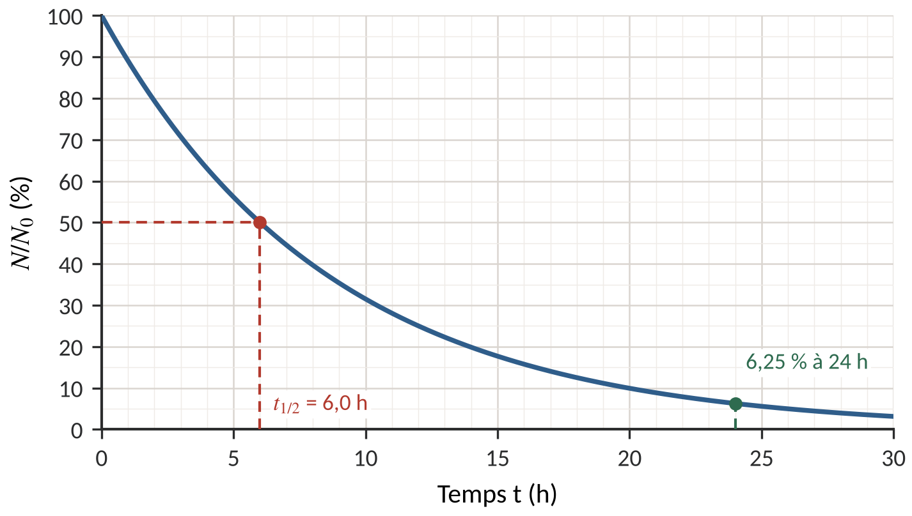{width=9.5cm}
:::

::: {custom-style="Legende"}
Figure 19. Lecture de la demi-vie du technétium 99m
:::

$$\lambda = \dfrac{\ln 2}{6{,}0} = 0{,}12\ \text{h}^{-1} \qquad \lambda = \dfrac{\ln 2}{6{,}0 \times 3\,600} = 3{,}2 \times 10^{-5}\ \text{s}^{-1}$$

En $24\ \text{h}$, soit 4 demi-vies, le nombre de noyaux est divisé par $2^4 = 16$ : il en reste $\dfrac{100}{16} = 6{,}25\ \%$.

::: {custom-style="Retenir"}
$t_{1/2} = \dfrac{\ln 2}{\lambda}$ ; au bout de $n$ demi-vies, il reste $\dfrac{N_0}{2^n}$ noyaux
:::

::: {custom-style="Remarque"}
[Remarque.]{custom-style="EtiqRemarque"} Dans les textes anciens, la demi-vie est parfois appelée période radioactive.
:::

#### [Corrigé]{custom-style="NumCorrige"}\ \ Q.23 · Relier l'activité et le nombre de noyaux {#c_q23}

::: {custom-style="Renvoi"}
[CIBLE:q23]{custom-style="BoutonEnonce"}
:::

L'activité $A$ d'un échantillon est le nombre moyen de désintégrations qui s'y produisent par seconde. Elle s'exprime en becquerels : $1\ \text{Bq}$ correspond à une désintégration par seconde. Ne la confondez pas avec le nombre de masse, noté lui aussi $A$ dans l'écriture ${}^{A}_{Z}\text{X}$ (Q.17).

$$A = \dfrac{1\,200}{60} = 20\ \text{Bq}$$

C'est l'activité à la date de la mesure, et non l'activité initiale de l'échantillon.

L'activité est le nombre de noyaux qui disparaissent par unité de temps : $A(t) = -\dfrac{\text{d}N}{\text{d}t} = \lambda\, N(t)$. Avec la loi de décroissance :

$$A(t) = \lambda N_0\,\text{e}^{-\lambda t} = A_0\,\text{e}^{-\lambda t} \qquad \text{avec } A_0 = \lambda N_0$$

L'activité décroît comme le nombre de noyaux : elle est divisée par deux à chaque demi-vie.

::: {custom-style="Retenir"}
$A(t) = \lambda\, N(t) = A_0\,\text{e}^{-\lambda t}$, en becquerels
:::

::: {custom-style="Remarque"}
[Remarque.]{custom-style="EtiqRemarque"} Pour se protéger des rayonnements ionisants, on s'éloigne de la source, on réduit la durée d'exposition et on interpose un écran. L'efficacité de l'écran dépend de sa nature, de son épaisseur et du type de rayonnement : une feuille de papier arrête les particules $\alpha$, quelques millimètres d'aluminium arrêtent les particules $\beta$, plusieurs centimètres de plomb atténuent fortement les photons $\gamma$.
:::

#### [Corrigé]{custom-style="NumCorrige"}\ \ Q.24 · Calculer un nombre de noyaux et une activité à partir d'une masse {#c_q24}

::: {custom-style="Renvoi"}
[CIBLE:q24]{custom-style="BoutonEnonce"}
:::

Chaque atome possède un noyau : le nombre de noyaux est égal au nombre d'atomes.

$$N = \dfrac{m}{M}\,N_\text{A} = \dfrac{1{,}0 \times 10^{-6}}{131} \times 6{,}02 \times 10^{23} = 4{,}6 \times 10^{15}$$

$$\lambda = \dfrac{\ln 2}{8{,}0 \times 86\,400} = 1{,}0 \times 10^{-6}\ \text{s}^{-1} \qquad A = \lambda N = 1{,}0 \times 10^{-6} \times 4{,}6 \times 10^{15} = 4{,}6 \times 10^{9}\ \text{Bq}$$

Un microgramme d'iode 131 suffit à produire plusieurs milliards de désintégrations par seconde. Pour un même noyau radioactif, l'activité est proportionnelle à la masse de l'échantillon.

::: {custom-style="Remarque"}
[Remarque.]{custom-style="EtiqRemarque"} Si l'énoncé donne la masse d'un atome au lieu de la masse molaire, $N = \dfrac{m}{m_\text{atome}}$, avec les deux masses dans la même unité. Ici, $m_\text{atome} = \dfrac{M}{N_\text{A}} = 2{,}18 \times 10^{-25}\ \text{kg}$ donne $N = \dfrac{1{,}0 \times 10^{-9}}{2{,}18 \times 10^{-25}} = 4{,}6 \times 10^{15}$.
:::

::: {custom-style="Piege"}
[Piège.]{custom-style="EtiqPiege"} Calculer l'activité avec $\lambda$ en $\text{jour}^{-1}$ : on obtiendrait des désintégrations par jour. Pour des becquerels, $\lambda$ doit être en $\text{s}^{-1}$.
:::

#### [Corrigé]{custom-style="NumCorrige"}\ \ Q.25 · Calculer une durée ou un âge {#c_q25}

::: {custom-style="Renvoi"}
[CIBLE:q25]{custom-style="BoutonEnonce"}
:::

L'activité par gramme de carbone d'un bois vivant reste constante ; après la mort de l'arbre, elle décroît selon $A = A_0\,\text{e}^{-\lambda t}$. En composant par le logarithme :

$$t = \dfrac{1}{\lambda}\,\ln\dfrac{A_0}{A} = \dfrac{t_{1/2}}{\ln 2}\,\ln\dfrac{A_0}{A} = \dfrac{5\,730}{\ln 2} \times \ln\dfrac{0{,}23}{0{,}074} = 9{,}4 \times 10^{3}\ \text{ans}$$

Le bois a environ $9\,400$ ans. Pour une activité divisée par $1\,000$ :

$$t = \dfrac{t_{1/2}}{\ln 2}\,\ln 1\,000 = \dfrac{8{,}0}{\ln 2} \times \ln 1\,000 = 80\ \text{jours}, \text{ soit environ } 10\ \text{demi-vies}$$

::: {custom-style="Remarque"}
[Remarque.]{custom-style="EtiqRemarque"} Pour dater un objet, on choisit un noyau dont la demi-vie est du même ordre de grandeur que l'âge à mesurer : le carbone 14 au-delà de quelques siècles et jusqu'à environ $50\,000$ ans, le rubidium 87 ou le potassium 40 pour des roches de plusieurs millions ou milliards d'années. Par exemple, le potassium 40, de demi-vie $1{,}3 \times 10^{9}$ ans, conserve après $4{,}5 \times 10^{9}$ ans, âge de la Terre, une proportion $\dfrac{N}{N_0} = \text{e}^{-\ln 2 \times 4{,}5 / 1{,}3} = 0{,}091$ : il reste $9{,}1\ \%$ des noyaux initiaux, assez pour une mesure. Le carbone 14, lui, n'en conserve que $0{,}24\ \%$ après $50\,000$ ans, ce qui explique cette limite.
:::

::: {custom-style="Remarque"}
[Remarque.]{custom-style="EtiqRemarque"} L'âge trouvé est la durée écoulée depuis la mort de l'arbre. Pour situer un événement, on retranche cet âge de l'année de la mesure : un âge de $1\,000$ ans mesuré en 2026 place l'événement vers l'an $1026$, sans qu'on puisse garantir une précision à l'année près.
:::

::: {custom-style="Methode"}
[Méthode.]{custom-style="EtiqMethode"} Écrire le rapport $\dfrac{A}{A_0}$ ou $\dfrac{N}{N_0}$ sous la forme $\text{e}^{-\lambda t}$, composer par le logarithme, isoler $t$, puis remplacer $\lambda$ par $\dfrac{\ln 2}{t_{1/2}}$ : $t$ sort dans l'unité de $t_{1/2}$. S'il reste $N$ noyaux, $N_0 - N$ noyaux se sont désintégrés. Comparez la durée trouvée à l'ordre de grandeur que donne l'énoncé.
:::

#### [Corrigé]{custom-style="NumCorrige"}\ \ Q.26 · Vérifier la loi de décroissance sur des mesures {#c_q26}

::: {custom-style="Renvoi"}
[CIBLE:q26]{custom-style="BoutonEnonce"}
:::

Si la loi est respectée, $\dfrac{N}{N_0} = \text{e}^{-\lambda t}$, soit $-\ln\dfrac{N}{N_0} = \lambda t$ : cette grandeur doit être proportionnelle au temps.

<!--colonnes: 23 11 11 11 11 11 11 11-->

| *t* (jours) | 0 | 40 | 80 | 120 | 160 | 200 | 240 |
|---|---|---|---|---|---|---|---|
| $-\ln(N/N_0)$ | 0 | 0,20 | 0,40 | 0,60 | 0,80 | 0,99 | 1,20 |

Les points sont alignés sur une droite passant par l'origine (figure 20) : la loi de décroissance est vérifiée.

::: {custom-style="Figure"}
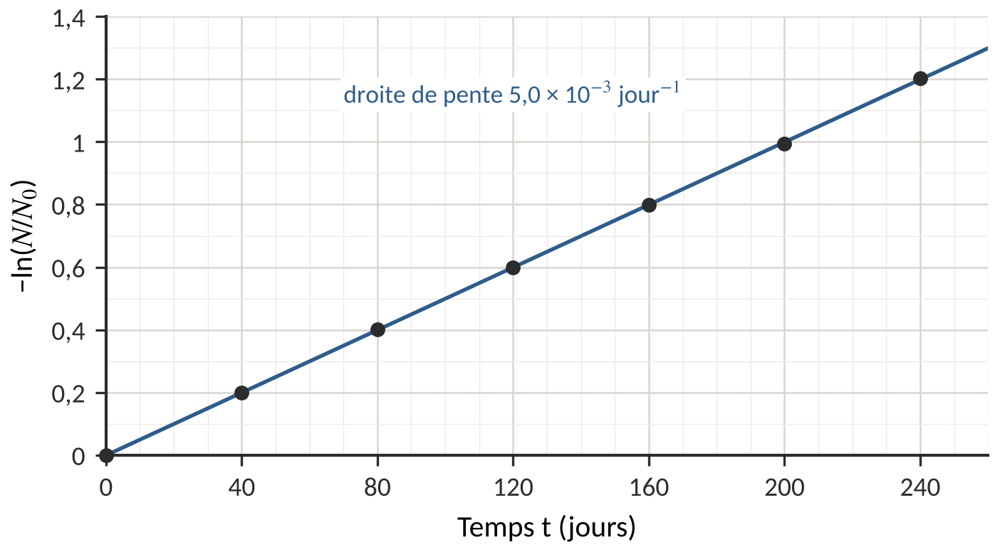{width=9.5cm}
:::

::: {custom-style="Legende"}
Figure 20. Tracé de $-\ln(N/N_0)$ en fonction du temps
:::

$$\lambda = \dfrac{1{,}20}{240} = 5{,}0 \times 10^{-3}\ \text{jour}^{-1} \qquad t_{1/2} = \dfrac{\ln 2}{5{,}0 \times 10^{-3}} = 1{,}4 \times 10^{2}\ \text{jours}$$

La demi-vie, d'environ $1{,}4 \times 10^{2}$ jours, est celle du polonium 210 ($138$ jours).

::: {custom-style="Remarque"}
[Remarque.]{custom-style="EtiqRemarque"} Un compteur ne donne pas $N$, mais le nombre $n$ de désintégrations pendant une courte durée $\Delta t$ : $n = A \times \Delta t = \lambda N_0\,\Delta t\,\text{e}^{-\lambda t}$. Donc $\ln n = \ln(\lambda N_0\,\Delta t) - \lambda t$, et de même $\ln A = \ln A_0 - \lambda t$ : la courbe de $\ln n$ ou de $\ln A$ en fonction du temps est une droite décroissante, de coefficient directeur $-\lambda$. On en déduit $\lambda$, opposé de la pente, puis $t_{1/2} = \dfrac{\ln 2}{\lambda}$.
:::

::: {custom-style="Piege"}
[Piège.]{custom-style="EtiqPiege"} Donner $\lambda$ en $\text{s}^{-1}$ alors que le temps est en jours : la pente s'exprime dans l'inverse de l'unité de l'axe des temps, ici en $\text{jour}^{-1}$.
:::

#### [Corrigé]{custom-style="NumCorrige"}\ \ Exercice 5 · Le fluor 18 en imagerie médicale {#c_ex5}

::: {custom-style="Renvoi"}
[CIBLE:ex5]{custom-style="BoutonEnonce"}
:::

::: {custom-style="QRappel"}
**1.** Production et désintégration du fluor 18
:::

Le nombre de nucléons et le nombre de charges se conservent :

$${}^{18}_{8}\text{O} + {}^{1}_{1}\text{p} \rightarrow {}^{18}_{9}\text{F} + {}^{1}_{0}\text{n} \qquad {}^{18}_{9}\text{F} \rightarrow {}^{18}_{8}\text{O} + {}^{0}_{1}\text{e}$$

La particule émise lors de la désintégration est un positon. La première réaction est provoquée par le bombardement ; la seconde est spontanée.

::: {custom-style="QRappel"}
**2.** Longueur d'onde des photons
:::

$$E = 511 \times 10^{3} \times 1{,}60 \times 10^{-19} = 8{,}18 \times 10^{-14}\ \text{J} \qquad \lambda_\gamma = \dfrac{h\,c}{E} = \dfrac{6{,}63 \times 10^{-34} \times 3{,}00 \times 10^{8}}{8{,}18 \times 10^{-14}} = 2{,}43 \times 10^{-12}\ \text{m}$$

Cette longueur d'onde $\lambda_\gamma$ est inférieure à $10^{-11}\ \text{m}$ : ce sont des photons $\gamma$, que la caméra est conçue pour détecter.

::: {custom-style="QRappel"}
**3.** Vérification de la solution
:::

$$\dfrac{\text{d}N}{\text{d}t} = N_0 \times (-\lambda)\,\text{e}^{-\lambda t} = -\lambda\, N(t)$$

L'équation est vérifiée, et $N(0) = N_0$.

::: {custom-style="QRappel"}
**4.** Demi-vie et constante radioactive
:::

Il reste $50\ \%$ des noyaux au bout de $t_{1/2} = 110\ \text{min}$ (figure 21).

::: {custom-style="Figure"}
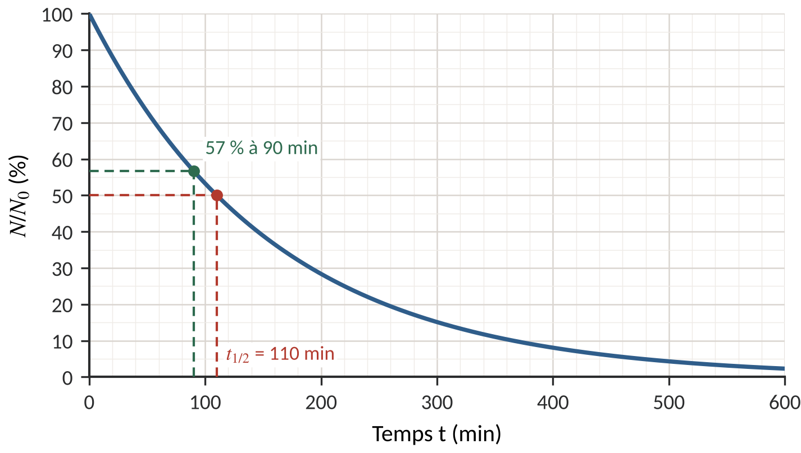{width=9.5cm}
:::

::: {custom-style="Legende"}
Figure 21. Lecture de la demi-vie et du pourcentage restant à $90\ \text{min}$
:::

$$\lambda = \dfrac{\ln 2}{t_{1/2}} = \dfrac{0{,}693}{110} = 6{,}3 \times 10^{-3}\ \text{min}^{-1}, \text{ soit } 1{,}1 \times 10^{-4}\ \text{s}^{-1}$$

::: {custom-style="QRappel"}
**5.** Pourcentage restant à la fin des images
:::

L'enregistrement se termine à $t = 60 + 30 = 90\ \text{min}$ :

$$\dfrac{N}{N_0} = \text{e}^{-\lambda t} = \text{e}^{-6{,}3 \times 10^{-3} \times 90} = 0{,}57$$

Il reste environ $57\ \%$ des noyaux injectés, ce que confirme la lecture sur la courbe.

::: {custom-style="QRappel"}
**6.** Durée pour qu'il reste moins de 1 %
:::

La fraction des noyaux restants à la date $t_p$ vaut $p = \text{e}^{-\lambda t_p}$ ; en composant par le logarithme, $t_p = \dfrac{\ln(1/p)}{\lambda} = \dfrac{\ln(1/p)}{\ln 2}\,t_{1/2}$. Pour $p = 1\ \%$ :

$$t_{1\ \%} = \dfrac{\ln 100}{\ln 2}\,t_{1/2} = 6{,}64 \times 110 = 7{,}3 \times 10^{2}\ \text{min}$$

Il faut environ $12\ \text{h}$, soit un peu plus de six demi-vies. Le lendemain de l'examen, le patient ne contient pratiquement plus de fluor 18 : la courte demi-vie limite son exposition aux rayonnements. En contrepartie, le traceur doit être produit tout près de l'hôpital et utilisé dans les heures qui suivent, d'où l'intérêt de cyclotrons comme celui de Nantes.

::: {custom-style="Redaction"}
[Rédaction.]{custom-style="EtiqRedaction"} « Il faut environ $12\ \text{h}$, soit un peu plus de six demi-vies, pour que le fluor 18 injecté disparaisse presque entièrement : la courte demi-vie limite l'exposition du patient aux rayonnements. »
:::

::: {custom-style="Piege"}
[Piège.]{custom-style="EtiqPiege"} Calculer le pourcentage à $t = 60\ \text{min}$ ou à $t = 30\ \text{min}$ : l'enregistrement se termine après le repos et la prise des images, soit $90\ \text{min}$ après l'injection.
:::

```{=openxml}
<w:p><w:r><w:br w:type="page"/></w:r></w:p>
```

# Index des notions {#index}

Chaque notion renvoie aux questions de cours (Q) et aux exercices (Ex.) où elle est travaillée.

| Notion | Où la travailler |
|---|---|
| Acte élémentaire, mécanisme réactionnel | Q.14, Q.15, Ex. 3 |
| Activité, becquerel | Q.23, Q.24, Ex. 4 |
| Catalyseur | Q.1, Q.15, Q.16, Ex. 1, Ex. 3 |
| Chocs efficaces, interprétation microscopique | Q.16, Ex. 3 |
| Composition d'un noyau, isotopes | Q.17, Ex. 4 |
| Constante de vitesse, loi de vitesse d'ordre 1 | Q.7 à Q.11, Ex. 2 |
| Constante radioactive, loi de décroissance | Q.21, Q.22, Q.26, Ex. 4, Ex. 5 |
| Datation, durée de décroissance | Q.25, Ex. 5 |
| Demi-vie | Q.22, Q.25, Q.26, Ex. 4, Ex. 5 |
| Diagramme (N, Z), diagramme de Segrè | Q.20, Ex. 4 |
| Électronégativité, liaison polarisée | Q.12, Ex. 3 |
| Équation d'une désintégration, lois de conservation (lois de Soddy) | Q.19, Ex. 4, Ex. 5 |
| Équation différentielle du premier ordre | Q.8, Q.21, Ex. 2, Ex. 5 |
| Facteurs cinétiques | Q.1, Q.6, Ex. 1, Ex. 3 |
| Flèche courbe | Q.14, Ex. 3 |
| Intermédiaire réactionnel | Q.15, Ex. 3 |
| Méthodes de suivi cinétique, trempe | Q.1, Q.5, Ex. 1 |
| Protection contre les rayonnements ionisants | Q.23 |
| Radioactivités $\alpha$, $\beta^-$, $\beta^{\text{+}}$, émission $\gamma$ | Q.18, Q.19, Ex. 4, Ex. 5 |
| Sites donneur et accepteur | Q.13, Ex. 3 |
| Temps de demi-réaction | Q.4, Q.6, Q.9, Ex. 1, Ex. 2 |
| Vérification de l'ordre 1, tracé d'un logarithme | Q.10, Q.26, Ex. 2 |
| Vitesse volumique d'apparition ou de disparition | Q.2, Q.3, Ex. 1, Ex. 2 |

<!--fin:complet-->
