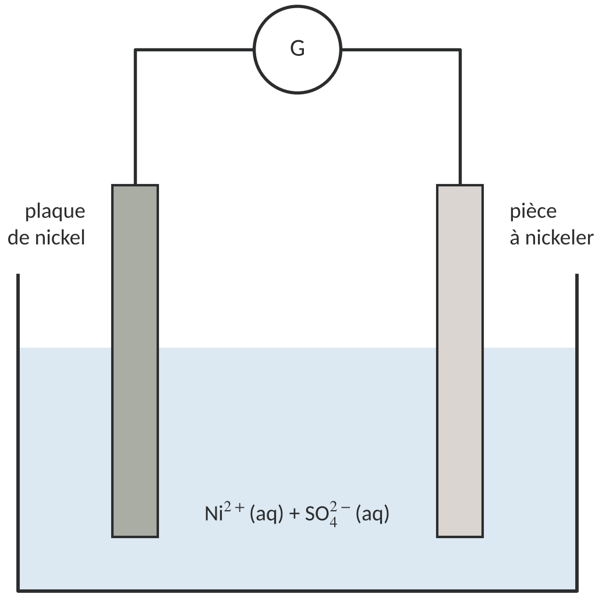
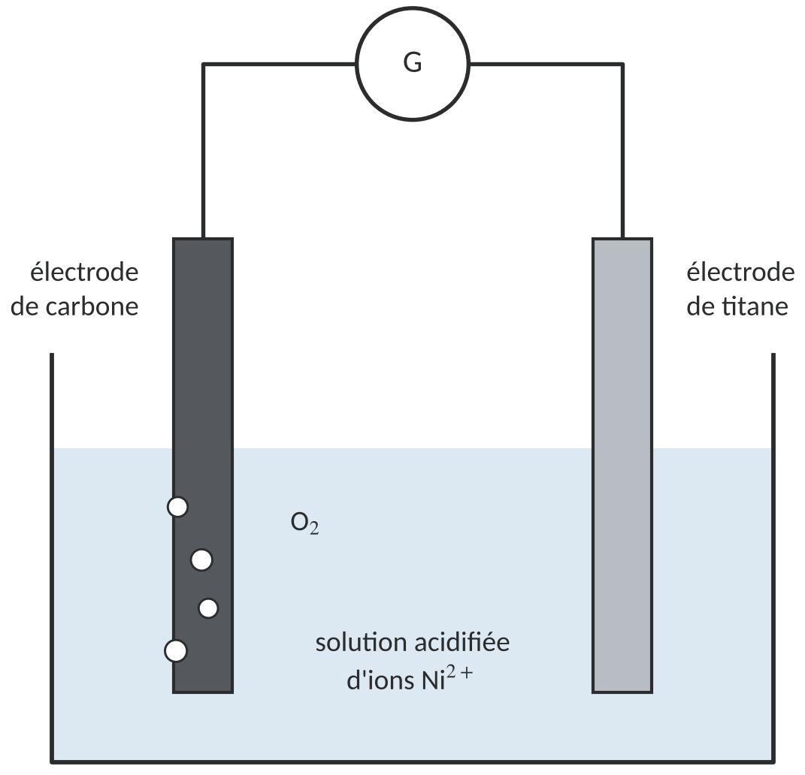
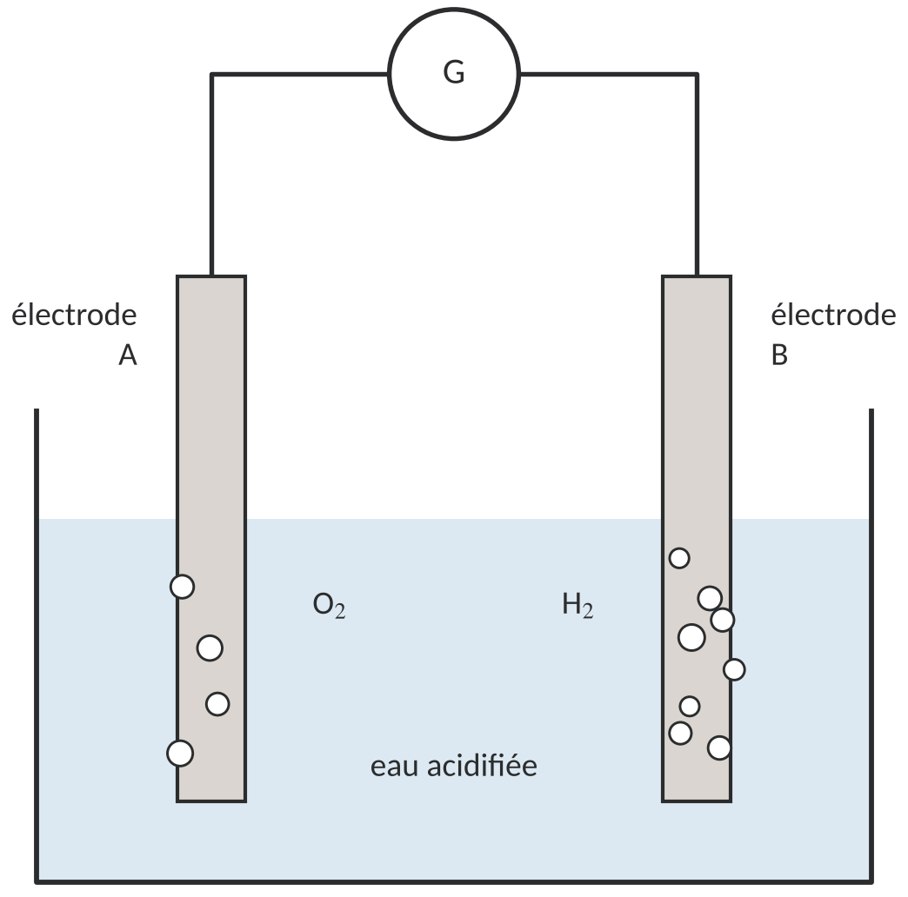

<!--meta {"numero": "12", "matiere": "Physique-Chimie", "titre": "Équilibre, piles et électrolyse : quotient de réaction, sens d'évolution, oxydoréduction, piles et transformations forcées", "titre_court": "Équilibre, piles et électrolyse", "fichier": "MasterBac_PC_Fiche12_Equilibre_piles_electrolyse", "fichier_cahier": "MasterBac_PC_Fiche12_Cahier_enonces"} -->

<!--inclure:ouverture-->

# L'essentiel en une page {#essentiel}

::: {custom-style="Rubrique"}
À connaître par cœur
:::

<!--colonnes: 19 26 55-->

| Notion | Relation | À retenir |
|---|---|---|
| Quotient de réaction | $Q_\text{r} = \dfrac{[\text{C}]^c\,[\text{D}]^d}{[\text{A}]^a\,[\text{B}]^b}$ | Concentrations en $\text{mol·L}^{-1}$, sans le solvant ni les solides. À l'équilibre, $Q_\text{r} = K$, qui ne dépend que de la température. |
| Sens d'évolution | $Q_\text{r,i} < K$ : sens direct ; $Q_\text{r,i} > K$ : sens indirect | $Q_\text{r}$ évolue vers $K$. Si $Q_\text{r,i} = K$, le système est à l'équilibre : il n'évolue pas. |
| Taux d'avancement | $\tau = x_\text{f} / x_\text{max}$ | Un réactif en excès ou l'élimination d'un produit augmente $\tau$. |
| Oxydoréduction | $\text{Ox} + n\,\text{e}^- = \text{Red}$ | Oxydation : perte d'électrons, à l'anode. Réduction : gain d'électrons, à la cathode. |
| Pile | $Q = n(\text{e}^-) \times F = I \times \Delta t$ | Transformation spontanée ; l'anode est la borne négative. $F$, charge d'une mole d'électrons, est donnée par l'énoncé. |
| Électrolyse | $Q = n(\text{e}^-) \times F = I \times \Delta t$ | Transformation forcée ; l'anode est reliée à la borne positive. Accumulateur : pile en décharge, électrolyseur en charge. |

::: {custom-style="Rubrique"}
À savoir retrouver
:::

<!--colonnes: 19 26 55-->

| Notion | Relation | Comment la retrouver |
|---|---|---|
| Énergie électrique | $E = U \times I \times \Delta t = U \times Q$ | Combiner $E = P \times \Delta t$, $P = U \times I$ et $Q = I \times \Delta t$ ; $\Delta t$ en heures, avec $1\ \text{h} = 3\,600\ \text{s}$, donne $Q$ en $\text{A·h}$ et $E$ en $\text{W·h}$. |

::: {custom-style="Rubrique"}
Fourni par l'énoncé, à savoir exploiter
:::

Les valeurs de $K$, le seuil $K > 10^4$ d'une transformation totale, les couples oxydant/réducteur, les schémas de piles et d'électrolyseurs, la constante de Faraday $F = 9{,}65 \times 10^{4}\ \text{C·mol}^{-1}$, le volume molaire des gaz.

::: {custom-style="Rubrique"}
Les pièges qui coûtent des points
:::

- Écrire l'eau solvant ou un solide dans le quotient de réaction.
- Croire que l'anode est toujours négative : en électrolyse, elle est reliée à la borne positive.
- Oublier le nombre d'électrons de la demi-équation : deux moles d'électrons par mole de nickel.
- Exprimer la constante de Faraday en coulombs : elle s'exprime en $\text{C·mol}^{-1}$.

::: {custom-style="Rubrique"}
Votre parcours selon votre objectif
:::

<!--colonnes: 14 41 45-->

| Objectif | Questions de cours | Exercices |
|---|---|---|
| [\ Objectif 10\ ]{custom-style="Niv10"} | Q.1, Q.3, Q.6, Q.7, Q.9, Q.10, Q.14, Q.15, Q.19 | Ex. 1 (questions 1 à 3), Ex. 2 (questions 1 à 4), Ex. 4 (questions 2 à 4) |
| [\ Objectif 14\ ]{custom-style="Niv14"} | Plus Q.2, Q.4, Q.5, Q.8, Q.11 à Q.13, Q.16 à Q.18 | Ex. 1 à Ex. 4, Ex. 5 (questions 1 à 5) |
| [\ Objectif 18\ ]{custom-style="Niv18"} | Toutes | Tous |

```{=openxml}
<w:p><w:r><w:br w:type="page"/></w:r></w:p>
```

# Ce qui est tombé aux BAC 2025 et 2026 {#tombe}

Les notions de cette fiche ont été demandées dans au moins quatorze exercices des sessions 2025 et 2026. Le tableau indique, pour chacun, ce qui était mobilisé et où s'y préparer dans la fiche.

<!--colonnes: 21 25 37 17-->

| Session | Exercice | Notions de cette fiche | Pour s'y préparer |
|---|---|---|---|
| Métropole 2026, jour 2 (sujet de secours) | La tomate, un fruit plein de ressources | Couples oxydant/réducteur, demi-équations des ions iodure et peroxodisulfate | Q.6 à Q.8 |
| Métropole, septembre 2026, jour 1 | Synthèse de l'alcool de champignon | Quotient de réaction initial nul, critère d'évolution spontanée | Q.1, Q.3 |
| Amérique du Nord 2026, jour 2 | HOPE, l'espoir du dihydrogène vert | Électrolyse de l'eau : électrons et courant, électrodes, charge, masse de dihydrogène, énergie | Q.7, Q.15 à Q.18, Ex. 5 |
| Antilles-Guyane 2026, jour 2 | Traitement de l'eau d'une piscine | Électrolyse d'une eau salée : électrons, courant, polarité, durée | Q.15, Q.17 |
| Centres étrangers 2026, jour 1 | La dépollution par les plantes pour extraire du nickel | Demi-équations, réduction des ions nickel, schéma et durée de l'électrolyse | Q.7, Q.15, Q.17, Ex. 4 |
| Centres étrangers 2026, jour 2 | Une synthèse non totale, l'estérification | Expression de $K$, taux d'avancement final, choix d'une racine, rendement | Q.4, Q.5, Ex. 1 |
| Polynésie 2026, jour 2 | Les algues vertes | Réducteur, équation d'oxydoréduction du sulfure d'hydrogène | Q.6 à Q.8 |
| Métropole, septembre 2025, jour 1 | Traitement de surface d'une pièce de jeu d'échecs | Transformation forcée, demi-équations aux électrodes, masse d'alumine, rendement | Q.14 à Q.17 |
| Métropole 2025, jour 2 (sujet de secours) | Savon : parfum, synthèse et utilisation | Constante d'équilibre, éliminer l'eau pour améliorer le rendement | Q.2, Q.5 |
| Amérique du Nord 2025, jour 2 (sujet de secours) | L'atropine | Demi-équations, équation d'oxydoréduction, quotient de réaction et Dean-Stark | Q.1, Q.5, Q.7, Q.8 |
| Amérique du Sud 2025, jour 1 | Recharge des voitures électriques | Pile à combustible : demi-équations, équation, polarités, porteurs de charge, capacité | Q.7, Q.9 à Q.12, Ex. 2 |
| Asie 2025, jour 1 | Arôme de poire | Quotient de réaction initial, sens d'évolution, améliorer le rendement | Q.1, Q.3, Q.5 |
| Asie 2025, jour 2 | Batteries au lithium | Accumulateur : électrodes, demi-équations, porteurs de charge, capacité | Q.9, Q.10, Q.12, Q.19, Ex. 3 |
| Polynésie 2025, jour 1 | Autour de la glace | Constante d'équilibre d'une formation d'ion complexe, réactif en excès | Q.2, Q.4 |

::: {custom-style="Intertitre"}
Ce qu'il faut en retenir
:::

- Équilibre : six exercices font utiliser $Q_\text{r}$ ou $K$, dont quatre pour améliorer un rendement (Q.5).
- Électrolyse : quatre exercices, dont trois de 2026, font calculer une durée, une masse ou une énergie (Q.17).
- Piles : deux exercices de 2025, une pile à combustible et une batterie lithium-ion (Q.9 à Q.12).

::: {custom-style="Surtitre"}
Énoncés
:::

# Thème 1 : quotient de réaction et état d'équilibre {#theme1}

::: {custom-style="Rubrique"}
Questions de cours
:::

## [Q.1]{custom-style="QNum"}\ \ Exprimer un quotient de réaction {#q1}

::: {custom-style="Meta"}
[\ Objectif 10\ ]{custom-style="Niv10"}\ \ Cours · Notions : quotient de réaction, activité, solvant et solides · Demandé en 2025 et 2026\ \ \ [CIBLE:c_q1]{custom-style="BoutonCorrige"}
:::

::: {custom-style="Enonce"}
Application : exprimer le quotient de réaction des transformations modélisées par les équations suivantes.

a. $\text{CH}_3\text{COOH}(\text{aq}) + \text{H}_2\text{O}(\ell) \rightleftarrows \text{CH}_3\text{COO}^-(\text{aq}) + \text{H}_3\text{O}^{\text{+}}(\text{aq})$

b. $\text{Zn}(\text{s}) + \text{Cu}^{\text{2+}}(\text{aq}) \rightleftarrows \text{Zn}^{\text{2+}}(\text{aq}) + \text{Cu}(\text{s})$

c. L'estérification $\text{acide}(\ell) + \text{alcool}(\ell) \rightleftarrows \text{ester}(\ell) + \text{eau}(\ell)$, les quatre espèces étant mélangées dans un même volume $V$.

Que vaut le quotient de réaction initial lorsque le milieu ne contient au départ aucun produit ?
:::

## [Q.2]{custom-style="QNum"}\ \ Écrire une constante d'équilibre et combiner des constantes {#q2}

::: {custom-style="Meta"}
[\ Objectif 14\ ]{custom-style="Niv14"}\ \ Méthode · Notions : constante d'équilibre, réaction inverse, produit ionique de l'eau · Demandé en 2025 (Métropole, Polynésie)\ \ \ [CIBLE:c_q2]{custom-style="BoutonCorrige"}
:::

::: {custom-style="Enonce"}
Application : on considère, à $25\ \text{°C}$, les trois réactions suivantes.

(1) $\text{NH}_3(\text{aq}) + \text{H}_2\text{O}(\ell) \rightleftarrows \text{NH}_4^{\text{+}}(\text{aq}) + \text{HO}^-(\text{aq})$, de constante $K_1$ ;

(2) $\text{NH}_4^{\text{+}}(\text{aq}) + \text{H}_2\text{O}(\ell) \rightleftarrows \text{NH}_3(\text{aq}) + \text{H}_3\text{O}^{\text{+}}(\text{aq})$, de constante $K_\text{A} = 10^{-9{,}2}$ ;

(3) $2\,\text{H}_2\text{O}(\ell) \rightleftarrows \text{H}_3\text{O}^{\text{+}}(\text{aq}) + \text{HO}^-(\text{aq})$, de constante $K_\text{e} = 1{,}0 \times 10^{-14}$.

Écrire l'expression de chaque constante d'équilibre, puis montrer que $K_1 = K_\text{e} / K_\text{A}$ et la calculer. Que vaut la constante de la réaction inverse de la réaction (1) ?
:::

## [Q.3]{custom-style="QNum"}\ \ Prévoir le sens d'évolution spontanée d'un système {#q3}

::: {custom-style="Meta"}
[\ Objectif 10\ ]{custom-style="Niv10"}\ \ Méthode · Notions : quotient de réaction initial, critère d'évolution spontanée, mélange de solutions · Demandé en 2025 et 2026\ \ \ [CIBLE:c_q3]{custom-style="BoutonCorrige"}
:::

::: {custom-style="Enonce"}
Application : dans un bécher contenant une lame de zinc et une lame de fer, on mélange $V_1 = 100\ \text{mL}$ d'une solution de sulfate de fer(II) de concentration $C_1 = 1{,}00 \times 10^{-1}\ \text{mol·L}^{-1}$ et $V_2 = 200\ \text{mL}$ d'une solution de sulfate de zinc de concentration $C_2 = 1{,}00 \times 10^{-1}\ \text{mol·L}^{-1}$. La transformation est modélisée par l'équation $\text{Zn}(\text{s}) + \text{Fe}^{\text{2+}}(\text{aq}) \rightleftarrows \text{Zn}^{\text{2+}}(\text{aq}) + \text{Fe}(\text{s})$, de constante $K = 10^{11}$ à $25\ \text{°C}$. Calculer les concentrations initiales des ions fer(II) et des ions zinc et le quotient de réaction initial, puis prévoir le sens d'évolution spontanée du système. Prévoir de même le sens d'évolution spontanée d'une estérification de constante $K = 4{,}0$ (Q.4), dans laquelle on mélange $0{,}10\ \text{mol}$ d'acide, $0{,}10\ \text{mol}$ d'éthanol, $0{,}50\ \text{mol}$ d'ester et $0{,}50\ \text{mol}$ d'eau.
:::

## [Q.4]{custom-style="QNum"}\ \ Déterminer l'état final à l'aide de la constante d'équilibre {#q4}

::: {custom-style="Meta"}
[\ Objectif 14\ ]{custom-style="Niv14"}\ \ Méthode · Notions : tableau d'avancement, taux d'avancement final, transformation totale ou non · Demandé en 2025 et 2026\ \ \ [CIBLE:c_q4]{custom-style="BoutonCorrige"}
:::

::: {custom-style="Enonce"}
Application : on mélange $0{,}50\ \text{mol}$ d'acide éthanoïque et $0{,}50\ \text{mol}$ d'éthanol. L'estérification, de constante $K = 4{,}0$, forme de l'éthanoate d'éthyle et de l'eau. Dresser le tableau d'avancement, exprimer $K$ en fonction de l'avancement final $x_\text{f}$, puis calculer $x_\text{f}$ et le taux d'avancement final. La transformation est-elle totale ? Que peut-on dire de celle de Q.3, de constante $K = 10^{11}$ ? Donnée : on considère qu'une transformation est totale lorsque $K > 10^4$.
:::

## [Q.5]{custom-style="QNum"}\ \ Améliorer un rendement en déplaçant l'état d'équilibre {#q5}

::: {custom-style="Meta"}
[\ Objectif 14\ ]{custom-style="Niv14"}\ \ Méthode · Notions : réactif en excès, élimination d'un produit, Dean-Stark, quotient de réaction · Demandé dans quatre exercices en 2025 et 2026\ \ \ [CIBLE:c_q5]{custom-style="BoutonCorrige"}
:::

::: {custom-style="Enonce"}
Application : on reprend l'estérification de Q.4, de constante $K = 4{,}0$, en mélangeant cette fois $0{,}50\ \text{mol}$ d'acide éthanoïque et $1{,}00\ \text{mol}$ d'éthanol. Montrer que l'avancement final vérifie $3\,x_\text{f}^2 - 6\,x_\text{f} + 2 = 0$ ($x_\text{f}$ en mol), puis calculer le taux d'avancement final. Expliquer à l'aide du quotient de réaction pourquoi un excès d'éthanol, ou l'élimination de l'eau au fur et à mesure de sa formation dans un appareil de Dean-Stark, augmente le rendement.
:::

::: {custom-style="Rubrique"}
Exercices
:::

### [Exercice 1]{custom-style="QNum"}\ \ L'arôme d'ananas [(voir BAC Centres étrangers 2026)]{custom-style="VoirBac"} {#ex1}

::: {custom-style="Meta"}
[\ Objectif 10\ ]{custom-style="Niv10"}\ \ [Type BAC]{custom-style="TagBac"} · 4 points · 35 min · Questions 4 à 6 : objectif 14
:::

::: {custom-style="MentionBac"}
[Sujet du BAC correspondant.]{custom-style="EtiqBac"} Centres étrangers 2026, jour 2, exercice 3 : « Une synthèse non totale, l'estérification » (taux d'avancement, constante d'équilibre, rendement).
:::

::: {custom-style="Enonce"}
Le butanoate d'éthyle donne leur odeur à certains arômes d'ananas. On le synthétise en chauffant à reflux un mélange d'acide butanoïque et d'éthanol, additionné de quelques gouttes d'acide sulfurique concentré :

$$\text{C}_3\text{H}_7\text{COOH}(\ell) + \text{C}_2\text{H}_5\text{OH}(\ell) \rightleftarrows \text{C}_3\text{H}_7\text{COOC}_2\text{H}_5(\ell) + \text{H}_2\text{O}(\ell)$$

On introduit dans le ballon $18{,}4\ \text{mL}$ d'acide butanoïque et $17{,}5\ \text{mL}$ d'éthanol. À la température du mélange, la constante d'équilibre de la réaction vaut $K = 4{,}00$.
:::

::: {custom-style="Enonce"}
**Données**
:::

::: {custom-style="EnonceDonnees"}
Acide butanoïque : $M = 88{,}1\ \text{g·mol}^{-1}$, $\rho = 0{,}960\ \text{g·mL}^{-1}$. Éthanol : $M = 46{,}1\ \text{g·mol}^{-1}$, $\rho = 0{,}789\ \text{g·mL}^{-1}$. Butanoate d'éthyle : $M = 116\ \text{g·mol}^{-1}$.
:::

::: {custom-style="Enonce"}
**1.** Quel est le rôle de l'acide sulfurique ? Pourquoi chauffe-t-on à reflux ?

**2.** Calculer les quantités initiales des deux réactifs. Montrer que l'acide est le réactif limitant et calculer la masse d'ester que l'on obtiendrait si la transformation était totale.

**3.** Exprimer le quotient de réaction en fonction des quantités de matière. Que vaut-il à l'instant initial ? En déduire le sens d'évolution du système.

**4.** Montrer que l'avancement final vérifie $3\,x_\text{f}^2 - 2\,x_\text{f} + 0{,}24 = 0$, avec $x_\text{f}$ en mol.

**5.** Résoudre cette équation et justifier le choix de la solution. Calculer le taux d'avancement final et la masse d'ester obtenue.

**6.** Proposer deux modifications du protocole qui augmenteraient le rendement et les justifier à l'aide du quotient de réaction.
:::

::: {custom-style="Renvoi"}
[CIBLE:c_ex1]{custom-style="BoutonCorrige"}
:::

# Thème 2 : oxydoréduction et piles {#theme2}

::: {custom-style="Rubrique"}
Questions de cours
:::

## [Q.6]{custom-style="QNum"}\ \ Reconnaître oxydant, réducteur, oxydation et réduction {#q6}

::: {custom-style="Meta"}
[\ Objectif 10\ ]{custom-style="Niv10"}\ \ Cours · Notions : couple oxydant/réducteur, oxydation, réduction · Demandé en 2026 (Métropole, Polynésie)\ \ \ [CIBLE:c_q6]{custom-style="BoutonCorrige"}
:::

::: {custom-style="Enonce"}
Application : définir un oxydant, un réducteur, une oxydation et une réduction. Lorsqu'on plonge une lame de zinc dans une solution bleue de sulfate de cuivre(II), un dépôt rouge de cuivre se forme et la solution se décolore : identifier les couples mis en jeu, l'espèce oxydée et l'espèce réduite. Dans le couple $\text{SO}_4^{2-}/\text{H}_2\text{S}$, quel est l'oxydant ? Des bactéries qui transforment les ions sulfate en sulfure d'hydrogène réalisent-elles une oxydation ou une réduction ?
:::

## [Q.7]{custom-style="QNum"}\ \ Écrire une demi-équation électronique {#q7}

::: {custom-style="Meta"}
[\ Objectif 10\ ]{custom-style="Niv10"}\ \ Méthode · Notions : demi-équation en milieu acide, conservation des éléments et des charges · Demandé dans au moins six exercices en 2025 et 2026\ \ \ [CIBLE:c_q7]{custom-style="BoutonCorrige"}
:::

::: {custom-style="Enonce"}
Application : écrire, en milieu acide, les demi-équations des couples $\text{MnO}_4^-/\text{Mn}^{\text{2+}}$, $\text{O}_2/\text{H}_2\text{O}$, $\text{H}^{\text{+}}/\text{H}_2$, $\text{S}_2\text{O}_8^{2-}/\text{SO}_4^{2-}$, $\text{SO}_4^{2-}/\text{H}_2\text{S}$ et menthone/menthol, $\text{C}_{10}\text{H}_{18}\text{O}/\text{C}_{10}\text{H}_{20}\text{O}$.
:::

## [Q.8]{custom-style="QNum"}\ \ Écrire l'équation d'une réaction d'oxydoréduction {#q8}

::: {custom-style="Meta"}
[\ Objectif 14\ ]{custom-style="Niv14"}\ \ Méthode · Notions : combinaison de demi-équations, électrons échangés · Demandé en 2025 et 2026\ \ \ [CIBLE:c_q8]{custom-style="BoutonCorrige"}
:::

::: {custom-style="Enonce"}
Application : à l'aide des demi-équations de Q.7, écrire l'équation des réactions suivantes.

a. Les ions permanganate oxydent le menthol en menthone, en milieu acide.

b. Les ions peroxodisulfate oxydent les ions iodure en diiode (couple $\text{I}_2/\text{I}^-$).

c. Le dioxygène dissous oxyde le sulfure d'hydrogène en ions sulfate. Expliquer pourquoi le milieu devient plus acide.
:::

## [Q.9]{custom-style="QNum"}\ \ Déterminer la polarité, l'anode et la cathode d'une pile {#q9}

::: {custom-style="Meta"}
[\ Objectif 10\ ]{custom-style="Niv10"}\ \ Méthode · Notions : demi-pile, pont salin, anode, cathode, polarité · Demandé en 2025 (Amérique du Sud, Asie)\ \ \ [CIBLE:c_q9]{custom-style="BoutonCorrige"}
:::

::: {custom-style="Enonce"}
Application : dans la pile de la figure 1, un pont salin au chlorure de potassium relie une solution de sulfate d'aluminium, où plonge une lame d'aluminium, et une solution de sulfate de cuivre(II), où plonge une lame de cuivre. Dans le circuit extérieur, le courant circule de la lame de cuivre vers la lame d'aluminium. En déduire la polarité de la pile, les demi-équations aux électrodes, l'anode et la cathode. Quel est le rôle du pont salin ?
:::

::: {custom-style="Figure"}
{width=9.5cm}
:::

::: {custom-style="Legende"}
Figure 1. La pile cuivre-aluminium
:::

```{=openxml}
<w:p><w:r><w:br w:type="page"/></w:r></w:p>
```

## [Q.10]{custom-style="QNum"}\ \ Décrire le déplacement des porteurs de charge {#q10}

::: {custom-style="Meta"}
[\ Objectif 10\ ]{custom-style="Niv10"}\ \ Méthode · Notions : électrons, ions, sens du courant, membrane · Demandé en 2025 (Amérique du Sud, Asie)\ \ \ [CIBLE:c_q10]{custom-style="BoutonCorrige"}
:::

::: {custom-style="Enonce"}
Application : dans la pile à combustible au méthanol de la figure 2, une membrane ne laisse passer que les ions $\text{H}^{\text{+}}$. Les demi-équations sont, à l'électrode 1 : $\text{CH}_3\text{OH}(\text{aq}) + \text{H}_2\text{O}(\ell) = \text{CO}_2(\text{g}) + 6\,\text{H}^{\text{+}}(\text{aq}) + 6\,\text{e}^-$ et, à l'électrode 2 : $\text{O}_2(\text{g}) + 4\,\text{H}^{\text{+}}(\text{aq}) + 4\,\text{e}^- = 2\,\text{H}_2\text{O}(\ell)$. Identifier l'anode, la cathode et la polarité, puis les porteurs de charge et leur sens de déplacement dans le circuit extérieur et dans la membrane.
:::

::: {custom-style="Figure"}
{width=7cm}
:::

::: {custom-style="Legende"}
Figure 2. Pile à combustible au méthanol
:::

## [Q.11]{custom-style="QNum"}\ \ Écrire l'équation de fonctionnement d'une pile et vérifier son sens d'évolution {#q11}

::: {custom-style="Meta"}
[\ Objectif 14\ ]{custom-style="Niv14"}\ \ Méthode · Notions : équation de fonctionnement, quotient de réaction initial, cohérence avec le sens du courant · Demandé en 2025 (Amérique du Sud)\ \ \ [CIBLE:c_q11]{custom-style="BoutonCorrige"}
:::

::: {custom-style="Enonce"}
Application : écrire l'équation de fonctionnement des piles de Q.9 et de Q.10. Dans la pile de Q.9, les concentrations initiales valent $[\text{Al}^{\text{3+}}]_\text{i} = [\text{Cu}^{\text{2+}}]_\text{i} = 0{,}40\ \text{mol·L}^{-1}$ et la constante d'équilibre de la réaction est de l'ordre de $10^{200}$. Calculer le quotient de réaction initial et vérifier que le sens du courant observé est cohérent avec le critère d'évolution spontanée.
:::

```{=openxml}
<w:p><w:r><w:br w:type="page"/></w:r></w:p>
```

## [Q.12]{custom-style="QNum"}\ \ Calculer la capacité d'une pile et sa durée de fonctionnement {#q12}

::: {custom-style="Meta"}
[\ Objectif 14\ ]{custom-style="Niv14"}\ \ Méthode · Notions : réactif limitant, quantité d'électricité, constante de Faraday, ampère-heure · Demandé en 2025 (Amérique du Sud, Asie)\ \ \ [CIBLE:c_q12]{custom-style="BoutonCorrige"}
:::

::: {custom-style="Enonce"}
Application : dans la pile de Q.9, les concentrations initiales valent $[\text{Al}^{\text{3+}}]_\text{i} = [\text{Cu}^{\text{2+}}]_\text{i} = 0{,}40\ \text{mol·L}^{-1}$, comme en Q.11 ; chaque solution a un volume $V = 100\ \text{mL}$ et la lame d'aluminium a une masse $m = 1{,}0\ \text{g}$. Déterminer le réactif limitant, la quantité maximale d'électrons échangés, la capacité de la pile en coulombs puis en ampères-heures, et sa durée de fonctionnement lorsqu'elle débite un courant d'intensité constante $0{,}10\ \text{A}$. Données : $M(\text{Al}) = 27{,}0\ \text{g·mol}^{-1}$ ; $F = 9{,}65 \times 10^{4}\ \text{C·mol}^{-1}$.
:::

## [Q.13]{custom-style="QNum"}\ \ Comparer des piles : capacité massique et énergie {#q13}

::: {custom-style="Meta"}
[\ Objectif 14\ ]{custom-style="Niv14"}\ \ Application · Notions : capacité massique, énergie électrique, wattheure\ \ \ [CIBLE:c_q13]{custom-style="BoutonCorrige"}
:::

::: {custom-style="Enonce"}
Application : l'électrode négative d'une pile est souvent un métal $\text{M}$ oxydé selon $\text{M} \rightarrow \text{M}^{z\text{+}} + z\,\text{e}^-$. La capacité massique d'un métal est la charge électrique maximale que peut fournir un kilogramme de ce métal. Calculer la capacité massique, en $\text{A·h·kg}^{-1}$, du lithium ($z = 1$), du zinc ($z = 2$) et de l'aluminium ($z = 3$). Lequel donne, à capacité égale, la pile la plus légère ? Une pile au lithium de $3{,}0\ \text{V}$ contient $0{,}70\ \text{g}$ de lithium : calculer l'énergie maximale qu'elle peut fournir, en wattheures et en joules. Données : $M(\text{Li}) = 6{,}94\ \text{g·mol}^{-1}$ ; $M(\text{Zn}) = 65{,}4\ \text{g·mol}^{-1}$ ; $M(\text{Al}) = 27{,}0\ \text{g·mol}^{-1}$ ; $F = 9{,}65 \times 10^{4}\ \text{C·mol}^{-1}$ ; $1\ \text{A·h} = 3\,600\ \text{C}$.
:::

::: {custom-style="Rubrique"}
Exercices
:::

### [Exercice 2]{custom-style="QNum"}\ \ Une borne de recharge à pile à combustible [(voir BAC Amérique du Sud 2025)]{custom-style="VoirBac"} {#ex2}

::: {custom-style="Meta"}
[\ Objectif 10\ ]{custom-style="Niv10"}\ \ [Type BAC]{custom-style="TagBac"} · 5 points · 45 min · Questions 5 et 6 : objectif 14
:::

::: {custom-style="MentionBac"}
[Sujet du BAC correspondant.]{custom-style="EtiqBac"} Amérique du Sud 2025, jour 1, exercice 2 : « Recharge des voitures électriques » (pile à combustible, demi-équations, polarité, capacité).
:::

::: {custom-style="Enonce"}
Une borne de recharge isolée est alimentée par une pile à combustible à oxyde solide. Le dihydrogène est produit sur place par vaporeformage de l'éthanol :

$$\text{C}_2\text{H}_6\text{O}(\text{g}) + 3\,\text{H}_2\text{O}(\text{g}) \rightarrow 2\,\text{CO}_2(\text{g}) + 6\,\text{H}_2(\text{g})$$

Dans la pile (figure 3), l'électrode 1 est alimentée en dihydrogène et l'électrode 2 en air. L'électrolyte solide qui les sépare ne laisse passer que les ions oxyde $\text{O}^{2-}$. À l'électrode 2, le dioxygène est transformé selon $\text{O}_2(\text{g}) + 4\,\text{e}^- \rightarrow 2\,\text{O}^{2-}$ ; à l'électrode 1, le dihydrogène réagit avec les ions oxyde pour former de l'eau.
:::

::: {custom-style="Figure"}
{width=9cm}
:::

::: {custom-style="Legende"}
Figure 3. Schéma de la pile à combustible de la borne
:::

::: {custom-style="Enonce"}
**Données**
:::

::: {custom-style="EnonceDonnees"}
Éthanol : $M = 46{,}1\ \text{g·mol}^{-1}$, $\rho = 0{,}79\ \text{g·mL}^{-1}$. $F = 9{,}65 \times 10^{4}\ \text{C·mol}^{-1}$. Tension de fonctionnement de la pile : $U = 0{,}80\ \text{V}$. $1\ \text{kW·h} = 3{,}6 \times 10^{6}\ \text{J}$.
:::

::: {custom-style="Enonce"}
**1.** Écrire la demi-équation de la transformation qui se produit à l'électrode 1. S'agit-il d'une oxydation ou d'une réduction ?

**2.** Identifier l'anode et la cathode. En déduire la polarité de la pile.

**3.** Reproduire le schéma de la figure 3 et y indiquer le sens de déplacement des électrons dans le circuit extérieur, le sens du courant et le sens de déplacement des ions oxyde dans l'électrolyte.

**4.** Écrire l'équation de fonctionnement de la pile.

**5.** Montrer qu'un litre d'éthanol permet de produire environ $1{,}0 \times 10^{2}\ \text{mol}$ de dihydrogène, puis calculer la quantité d'électricité que la pile peut débiter avec ce dihydrogène.

**6.** Calculer l'énergie électrique fournie par la pile pour un litre d'éthanol consommé. Combien de litres d'éthanol faut-il pour recharger une batterie de voiture de $40\ \text{kW·h}$ ?
:::

::: {custom-style="Renvoi"}
[CIBLE:c_ex2]{custom-style="BoutonCorrige"}
:::

### [Exercice 3]{custom-style="QNum"}\ \ La batterie d'un vélo électrique [(voir BAC Asie 2025)]{custom-style="VoirBac"} {#ex3}

::: {custom-style="Meta"}
[\ Objectif 14\ ]{custom-style="Niv14"}\ \ [Type BAC]{custom-style="TagBac"} · 4 points · 35 min
:::

::: {custom-style="MentionBac"}
[Sujet du BAC correspondant.]{custom-style="EtiqBac"} Asie 2025, jour 2, exercice 1 : « Batteries au lithium » (électrodes, porteurs de charge, capacité, masse d'électrode).
:::

::: {custom-style="Enonce"}
La batterie d'un vélo électrique est formée de 40 cellules lithium-ion identiques. Dans chaque cellule (figure 4), une électrode est en graphite contenant du lithium, de formule $\text{LiC}_6$, l'autre en oxyde de cobalt ; l'électrolyte contient des ions lithium $\text{Li}^{\text{+}}$. Pendant la décharge, les transformations aux électrodes sont :

$$\text{LiC}_6(\text{s}) \rightarrow \text{Li}^{\text{+}} + \text{C}_6(\text{s}) + \text{e}^- \qquad \text{CoO}_2(\text{s}) + \text{Li}^{\text{+}} + \text{e}^- \rightarrow \text{LiCoO}_2(\text{s})$$
:::

::: {custom-style="Figure"}
{width=6.5cm}
:::

::: {custom-style="Legende"}
Figure 4. Une cellule de la batterie, reliée au moteur
:::

::: {custom-style="Enonce"}
**Données**
:::

::: {custom-style="EnonceDonnees"}
Pour une cellule : tension $U = 3{,}6\ \text{V}$, capacité $Q = 3{,}0\ \text{A·h}$. $1\ \text{A·h} = 3\,600\ \text{C}$. $M(\text{LiC}_6) = 79{,}0\ \text{g·mol}^{-1}$. $F = 9{,}65 \times 10^{4}\ \text{C·mol}^{-1}$. Le vélo consomme en moyenne $10\ \text{W·h}$ par kilomètre.
:::

::: {custom-style="Enonce"}
**1.** Pendant la décharge, identifier l'anode et la cathode. Quelle électrode est la borne positive de la cellule ?

**2.** Reproduire le schéma de la figure 4 et y indiquer, pendant la décharge, le sens des électrons dans le circuit extérieur, le sens du courant et le sens de déplacement des ions lithium.

**3.** Écrire l'équation de la réaction de décharge.

**4.** Calculer la quantité d'électrons échangés quand une cellule délivre toute sa capacité, puis la masse de $\text{LiC}_6$ consommée.

**5.** Calculer l'énergie stockée dans la batterie et l'autonomie du vélo.

**6.** Pendant la recharge, la transformation est-elle spontanée ? Quelle électrode devient l'anode ? Écrire la demi-équation qui s'y produit.
:::

::: {custom-style="Renvoi"}
[CIBLE:c_ex3]{custom-style="BoutonCorrige"}
:::

<!--debut:cahier-->
```{=openxml}
<w:p><w:r><w:br w:type="page"/></w:r></w:p>
```

<!--fin:cahier-->
# Thème 3 : électrolyse et accumulateurs {#theme3}

::: {custom-style="Rubrique"}
Questions de cours
:::

## [Q.14]{custom-style="QNum"}\ \ Distinguer transformation spontanée et transformation forcée {#q14}

::: {custom-style="Meta"}
[\ Objectif 10\ ]{custom-style="Niv10"}\ \ Cours · Notions : transformation forcée, électrolyse, générateur, quotient de réaction · Demandé en 2025 (Métropole, septembre)\ \ \ [CIBLE:c_q14]{custom-style="BoutonCorrige"}
:::

::: {custom-style="Enonce"}
Application : une pile cuivre-zinc, siège de la réaction $\text{Zn}(\text{s}) + \text{Cu}^{\text{2+}}(\text{aq}) \rightarrow \text{Zn}^{\text{2+}}(\text{aq}) + \text{Cu}(\text{s})$, de constante $K = 10^{37}$, a débité jusqu'à ce que $[\text{Zn}^{\text{2+}}] = 0{,}15\ \text{mol·L}^{-1}$ et $[\text{Cu}^{\text{2+}}] = 0{,}050\ \text{mol·L}^{-1}$. On la branche alors à un générateur qui impose un courant de sens opposé à celui qu'elle débitait. Calculer le quotient de réaction et indiquer le sens d'évolution spontanée. Dans quel sens le système évolue-t-il sous l'action du générateur, et comment varie alors $Q_\text{r}$ ? Pourquoi parle-t-on de transformation forcée ?
:::

## [Q.15]{custom-style="QNum"}\ \ Identifier anode, cathode et porteurs de charge dans un électrolyseur {#q15}

::: {custom-style="Meta"}
[\ Objectif 10\ ]{custom-style="Niv10"}\ \ Méthode · Notions : polarité, sens du courant et des électrons, déplacement des ions · Demandé dans quatre exercices en 2025 et 2026\ \ \ [CIBLE:c_q15]{custom-style="BoutonCorrige"}
:::

::: {custom-style="Enonce"}
Application : pour nickeler une pièce métallique, on la relie à la borne négative d'un générateur et on la plonge, face à une plaque de nickel reliée à la borne positive, dans une solution de sulfate de nickel (figure 5). Un dépôt de nickel se forme sur la pièce. Écrire la demi-équation qui se produit sur la pièce et en déduire si elle est l'anode ou la cathode. Indiquer le sens du courant, celui des électrons dans les fils et le déplacement des ions dans la solution.
:::

::: {custom-style="Figure"}
{width=7cm}
:::

::: {custom-style="Legende"}
Figure 5. Le montage de nickelage
:::

## [Q.16]{custom-style="QNum"}\ \ Écrire les réactions aux électrodes d'une électrolyse {#q16}

::: {custom-style="Meta"}
[\ Objectif 14\ ]{custom-style="Niv14"}\ \ Méthode · Notions : anode soluble, électrolyse de l'eau, équation de l'électrolyse · Demandé en 2025 et 2026\ \ \ [CIBLE:c_q16]{custom-style="BoutonCorrige"}
:::

::: {custom-style="Enonce"}
Application : dans le nickelage de Q.15, la plaque de nickel est une anode soluble. Écrire la demi-équation qui s'y produit et expliquer pourquoi la concentration en ions nickel de la solution reste constante. On électrolyse ensuite de l'eau acidifiée entre deux électrodes inertes ; les couples mis en jeu sont $\text{H}^{\text{+}}/\text{H}_2$ et $\text{O}_2/\text{H}_2\text{O}$. Écrire les demi-équations aux électrodes, indiquer à quelle électrode se dégage chaque gaz, puis écrire l'équation de l'électrolyse.
:::

## [Q.17]{custom-style="QNum"}\ \ Relier charge électrique, quantité de produit et durée {#q17}

::: {custom-style="Meta"}
[\ Objectif 14\ ]{custom-style="Niv14"}\ \ Méthode · Notions : quantité d'électricité, constante de Faraday, masse déposée, énergie consommée · Demandé dans quatre exercices en 2025 et 2026\ \ \ [CIBLE:c_q17]{custom-style="BoutonCorrige"}
:::

::: {custom-style="Enonce"}
Application : on veut déposer $m = 1{,}0\ \text{g}$ de nickel sur la pièce de Q.15 avec un courant d'intensité constante $I = 2{,}0\ \text{A}$. Établir l'expression de la durée $\Delta t$ de l'électrolyse en fonction de $m$, $M(\text{Ni})$, $F$ et $I$, puis la calculer. Le générateur impose une tension $U = 3{,}0\ \text{V}$ : calculer l'énergie électrique consommée. Données : $M(\text{Ni}) = 58{,}7\ \text{g·mol}^{-1}$ ; $F = 9{,}65 \times 10^{4}\ \text{C·mol}^{-1}$.
:::

## [Q.18]{custom-style="QNum"}\ \ Calculer un volume de gaz et l'intensité nécessaire {#q18}

::: {custom-style="Meta"}
[\ Objectif 14\ ]{custom-style="Niv14"}\ \ Application · Notions : volume molaire, électrolyse de l'eau, intensité · Électrolyse de l'eau tombée en 2026 (Amérique du Nord), avec une masse à calculer\ \ \ [CIBLE:c_q18]{custom-style="BoutonCorrige"}
:::

::: {custom-style="Enonce"}
Application : un électrolyseur industriel doit produire $5{,}0\ \text{m}^3$ de dihydrogène par heure, par réduction des ions $\text{H}^{\text{+}}$. Calculer l'intensité du courant nécessaire. Données : volume molaire des gaz dans les conditions de l'expérience, $V_\text{m} = 24\ \text{L·mol}^{-1}$ ; $F = 9{,}65 \times 10^{4}\ \text{C·mol}^{-1}$.
:::

## [Q.19]{custom-style="QNum"}\ \ Expliquer le fonctionnement d'un accumulateur {#q19}

::: {custom-style="Meta"}
[\ Objectif 10\ ]{custom-style="Niv10"}\ \ Cours · Notions : charge, décharge, énergie stockée · Décharge d'un accumulateur demandée en 2025 (Asie)\ \ \ [CIBLE:c_q19]{custom-style="BoutonCorrige"}
:::

::: {custom-style="Enonce"}
Application : dans un accumulateur au plomb, les transformations pendant la décharge sont, à l'électrode négative, $\text{Pb}(\text{s}) + \text{SO}_4^{2-}(\text{aq}) \rightarrow \text{PbSO}_4(\text{s}) + 2\,\text{e}^-$ et, à l'électrode positive, $\text{PbO}_2(\text{s}) + \text{SO}_4^{2-}(\text{aq}) + 4\,\text{H}^{\text{+}}(\text{aq}) + 2\,\text{e}^- \rightarrow \text{PbSO}_4(\text{s}) + 2\,\text{H}_2\text{O}(\ell)$. Écrire l'équation de la décharge. Pendant la recharge, la transformation est-elle spontanée ? Quelle électrode est alors l'anode ? Une batterie de voiture de tension $12\ \text{V}$ a une capacité de $60\ \text{A·h}$ : calculer l'énergie qu'elle stocke.
:::

::: {custom-style="Rubrique"}
Exercices
:::

### [Exercice 4]{custom-style="QNum"}\ \ Du nickel extrait des plantes [(voir BAC Centres étrangers 2026)]{custom-style="VoirBac"} {#ex4}

::: {custom-style="Meta"}
[\ Objectif 10\ ]{custom-style="Niv10"}\ \ [Type BAC]{custom-style="TagBac"} · 5 points · 45 min · Questions 1, 5 et 6 : objectif 14
:::

::: {custom-style="MentionBac"}
[Sujet du BAC correspondant.]{custom-style="EtiqBac"} Centres étrangers 2026, jour 1, exercice 2 : « La dépollution par les plantes pour extraire du nickel » (oxydoréduction, électrolyse, durée).
:::

::: {custom-style="Enonce"}
Certaines plantes, dites hyperaccumulatrices, extraient du sol les ions nickel et les stockent dans leurs feuilles. Elles poussent grâce à la photosynthèse, modélisée par l'équation $6\,\text{CO}_2(\text{g}) + 6\,\text{H}_2\text{O}(\ell) \rightarrow \text{C}_6\text{H}_{12}\text{O}_6(\text{aq}) + 6\,\text{O}_2(\text{g})$. Après la récolte, les plantes sont séchées et brûlées ; les cendres sont dissoutes dans un acide. Le nickel est ensuite récupéré par électrolyse de la solution obtenue, entre une électrode de titane, sur laquelle il se dépose, et une électrode de carbone, où se dégage du dioxygène (figure 6).
:::

::: {custom-style="Figure"}
{width=7cm}
:::

::: {custom-style="Legende"}
Figure 6. L'électrolyse de la solution d'ions nickel
:::

::: {custom-style="Enonce"}
**Données**
:::

::: {custom-style="EnonceDonnees"}
Couples : $\text{CO}_2/\text{C}_6\text{H}_{12}\text{O}_6$ ; $\text{O}_2/\text{H}_2\text{O}$ ; $\text{Ni}^{\text{2+}}/\text{Ni}$. Une parcelle de $1{,}0\ \text{ha}$ produit $9{,}0\ \text{t}$ de plantes sèches, qui contiennent $1{,}6\ \%$ de nickel en masse. $M(\text{Ni}) = 58{,}7\ \text{g·mol}^{-1}$ ; $F = 9{,}65 \times 10^{4}\ \text{C·mol}^{-1}$.
:::

::: {custom-style="Enonce"}
**1.** Écrire les demi-équations des couples $\text{CO}_2/\text{C}_6\text{H}_{12}\text{O}_6$ et $\text{O}_2/\text{H}_2\text{O}$, puis retrouver l'équation de la photosynthèse.

**2.** Calculer la masse de nickel que l'on peut récolter sur une parcelle.

**3.** L'électrolyse est-elle une transformation spontanée ? Pourquoi faut-il un générateur ?

**4.** Écrire la demi-équation qui se produit sur l'électrode de titane. Est-elle l'anode ou la cathode ? À quelle borne du générateur est-elle reliée ? Reproduire le schéma et y indiquer le sens du courant et celui des électrons.

**5.** Calculer la durée nécessaire pour déposer $50\ \text{g}$ de nickel avec un courant d'intensité $2{,}0\ \text{A}$.

**6.** On souhaite traiter en 30 jours le nickel d'une parcelle. Quelle intensité faut-il ? Commenter.
:::

::: {custom-style="Renvoi"}
[CIBLE:c_ex4]{custom-style="BoutonCorrige"}
:::

### [Exercice 5]{custom-style="QNum"}\ \ Du dihydrogène vert produit en mer [(voir BAC Amérique du Nord 2026)]{custom-style="VoirBac"} {#ex5}

::: {custom-style="Meta"}
[\ Objectif 14\ ]{custom-style="Niv14"}\ \ [Type BAC]{custom-style="TagBac"} · 5 points · 45 min · Question 6 : objectif 18
:::

::: {custom-style="MentionBac"}
[Sujet du BAC correspondant.]{custom-style="EtiqBac"} Amérique du Nord 2026, jour 2, exercice 2 : « HOPE, l'espoir du dihydrogène vert » (électrolyse de l'eau, quantité d'électrons, énergie).
:::

::: {custom-style="Enonce"}
Au large des côtes, une éolienne flottante alimente un électrolyseur qui produit du dihydrogène à partir d'eau de mer dessalée et acidifiée. Au laboratoire, on étudie une maquette d'électrolyseur (figure 7) : du dioxygène se dégage à l'électrode A, du dihydrogène à l'électrode B. Les couples mis en jeu sont $\text{H}^{\text{+}}/\text{H}_2$ et $\text{O}_2/\text{H}_2\text{O}$.
:::

::: {custom-style="Figure"}
{width=7cm}
:::

::: {custom-style="Legende"}
Figure 7. La maquette d'électrolyseur
:::

::: {custom-style="Enonce"}
**Données**
:::

::: {custom-style="EnonceDonnees"}
$F = 9{,}65 \times 10^{4}\ \text{C·mol}^{-1}$. Volume molaire des gaz dans les conditions de l'expérience : $V_\text{m} = 24\ \text{L·mol}^{-1}$. $M(\text{H}) = 1{,}0\ \text{g·mol}^{-1}$. L'électrolyseur industriel fonctionne sous une tension $U = 2{,}0\ \text{V}$. En novembre, mois de 30 jours, l'éolienne a produit $750\ \text{MW·h}$. $1\ \text{kW·h} = 3{,}6 \times 10^{6}\ \text{J}$.
:::

::: {custom-style="Enonce"}
**1.** Écrire les demi-équations aux électrodes A et B. Identifier l'anode et la cathode, puis écrire l'équation de l'électrolyse.

**2.** Reproduire le schéma de la figure 7 et y indiquer la polarité du générateur, le sens du courant et celui des électrons.

**3.** La maquette fonctionne pendant $15\ \text{min}$ avec un courant d'intensité $I = 0{,}40\ \text{A}$. Exprimer la quantité d'électrons échangés en fonction de $I$, $\Delta t$ et $F$, puis la calculer.

**4.** En déduire les volumes de dihydrogène et de dioxygène produits.

**5.** Montrer que la production de $1{,}0\ \text{kg}$ de dihydrogène par l'électrolyseur industriel consomme environ $54\ \text{kW·h}$.

**6.** L'éolienne peut-elle alimenter une production de $400\ \text{kg}$ de dihydrogène par jour ? Commenter.
:::

::: {custom-style="Renvoi"}
[CIBLE:c_ex5]{custom-style="BoutonCorrige"}
:::

<!--debut:complet-->
::: {custom-style="Surtitre"}
Corrigés
:::

# Corrigés du thème 1 : quotient de réaction et état d'équilibre {#c_theme1}

#### [Corrigé]{custom-style="NumCorrige"}\ \ Q.1 · Exprimer un quotient de réaction {#c_q1}

::: {custom-style="Renvoi"}
[CIBLE:q1]{custom-style="BoutonEnonce"}
:::

Pour une transformation d'équation $a\,\text{A} + b\,\text{B} \rightleftarrows c\,\text{C} + d\,\text{D}$, le quotient de réaction s'écrit :

$$Q_\text{r} = \dfrac{[\text{C}]^c \times [\text{D}]^d}{[\text{A}]^a \times [\text{B}]^b}$$

Plus précisément, chaque espèce intervient par son activité : $[\text{X}] / c^\circ$ pour un soluté X, avec $c^\circ = 1\ \text{mol·L}^{-1}$, et 1 pour le solvant ou pour un solide. En pratique, on écrit les concentrations en $\text{mol·L}^{-1}$ et $Q_\text{r}$ est sans unité.

a. L'eau est le solvant, elle ne figure pas dans le quotient :

$$Q_\text{r} = \dfrac{[\text{CH}_3\text{COO}^-] \times [\text{H}_3\text{O}^{\text{+}}]}{[\text{CH}_3\text{COOH}]}$$

b. Le zinc et le cuivre sont solides :

$$Q_\text{r} = \dfrac{[\text{Zn}^{\text{2+}}]}{[\text{Cu}^{\text{2+}}]}$$

c. Ici, l'eau n'est pas le solvant : c'est un produit, mélangé aux trois autres liquides, et elle figure dans le quotient. Les quatre espèces occupant le même volume $V$, celui-ci se simplifie :

$$Q_\text{r} = \dfrac{[\text{ester}] \times [\text{eau}]}{[\text{acide}] \times [\text{alcool}]} = \dfrac{n_\text{ester} \times n_\text{eau}}{n_\text{acide} \times n_\text{alcool}}$$

Sans produit au départ, le numérateur est nul : $Q_\text{r,i} = 0$ dans les trois cas.

::: {custom-style="Retenir"}
Dans le quotient de réaction, chaque soluté intervient par sa concentration en $\text{mol·L}^{-1}$, élevée à la puissance de son nombre stœchiométrique ; le solvant et les solides n'y figurent pas
:::

::: {custom-style="Piege"}
[Piège.]{custom-style="EtiqPiege"} Écrire la concentration de l'eau quand elle est le solvant, ou celle d'un métal solide, ou oublier les exposants quand un nombre stœchiométrique vaut 2 ou 3.
:::

#### [Corrigé]{custom-style="NumCorrige"}\ \ Q.2 · Écrire une constante d'équilibre et combiner des constantes {#c_q2}

::: {custom-style="Renvoi"}
[CIBLE:q2]{custom-style="BoutonEnonce"}
:::

À l'équilibre, le quotient de réaction est égal à la constante d'équilibre, qui ne dépend que de la température :

$$K_1 = \dfrac{[\text{NH}_4^{\text{+}}]_\text{éq} \times [\text{HO}^-]_\text{éq}}{[\text{NH}_3]_\text{éq}} \qquad K_\text{A} = \dfrac{[\text{NH}_3]_\text{éq} \times [\text{H}_3\text{O}^{\text{+}}]_\text{éq}}{[\text{NH}_4^{\text{+}}]_\text{éq}} \qquad K_\text{e} = [\text{H}_3\text{O}^{\text{+}}]_\text{éq} \times [\text{HO}^-]_\text{éq}$$

On multiplie le numérateur et le dénominateur de $K_1$ par $[\text{H}_3\text{O}^{\text{+}}]_\text{éq}$, puis on regroupe les termes :

$$K_1 = \dfrac{[\text{H}_3\text{O}^{\text{+}}]_\text{éq} \times [\text{HO}^-]_\text{éq} \times [\text{NH}_4^{\text{+}}]_\text{éq}}{[\text{NH}_3]_\text{éq} \times [\text{H}_3\text{O}^{\text{+}}]_\text{éq}} = K_\text{e} \times \dfrac{1}{K_\text{A}}$$

$$K_1 = \dfrac{1{,}0 \times 10^{-14}}{10^{-9{,}2}} = 10^{-4{,}8} = 1{,}6 \times 10^{-5}$$

La réaction inverse de la réaction (1) a pour constante l'inverse de $K_1$ : $\dfrac{1}{K_1} = 10^{4{,}8} = 6{,}3 \times 10^{4}$. C'est une constante d'équilibre, pas une constante d'acidité. De même, la réaction d'une base avec l'ion oxonium, par exemple $\text{ClO}^-(\text{aq}) + \text{H}_3\text{O}^{\text{+}}(\text{aq}) \rightarrow \text{HClO}(\text{aq}) + \text{H}_2\text{O}(\ell)$, est la réaction inverse de celle de l'acide conjugué avec l'eau : sa constante vaut $1 / K_\text{A}$.

::: {custom-style="Retenir"}
La constante de la réaction inverse vaut $1 / K$ ; la constante d'une réaction somme de deux autres est le produit de leurs constantes
:::

::: {custom-style="Remarque"}
[Remarque.]{custom-style="EtiqRemarque"} $K_1$ étant très inférieure à 1, la réaction de l'ammoniac avec l'eau est très limitée : une solution d'ammoniac contient surtout des molécules $\text{NH}_3$.
:::

#### [Corrigé]{custom-style="NumCorrige"}\ \ Q.3 · Prévoir le sens d'évolution spontanée d'un système {#c_q3}

::: {custom-style="Renvoi"}
[CIBLE:q3]{custom-style="BoutonEnonce"}
:::

Dans un mélange, les quantités apportées se calculent avec le volume de chaque solution, les concentrations avec le volume total $V_1 + V_2 = 300\ \text{mL}$ :

$$[\text{Fe}^{\text{2+}}]_\text{i} = \dfrac{C_1 \times V_1}{V_1 + V_2} = \dfrac{1{,}00 \times 10^{-1} \times 100}{300} = 3{,}33 \times 10^{-2}\ \text{mol·L}^{-1} \qquad [\text{Zn}^{\text{2+}}]_\text{i} = \dfrac{1{,}00 \times 10^{-1} \times 200}{300} = 6{,}67 \times 10^{-2}\ \text{mol·L}^{-1}$$

Les métaux, solides, ne figurent pas dans le quotient de réaction :

$$Q_\text{r,i} = \dfrac{[\text{Zn}^{\text{2+}}]_\text{i}}{[\text{Fe}^{\text{2+}}]_\text{i}} = \dfrac{6{,}67 \times 10^{-2}}{3{,}33 \times 10^{-2}} = 2{,}00$$

$Q_\text{r,i} = 2{,}00 < K = 10^{11}$ : le système évolue spontanément dans le sens direct. Le zinc est oxydé en ions zinc et les ions fer(II) sont réduits : du fer se dépose sur la lame de zinc. $Q_\text{r}$ augmente jusqu'à atteindre $K$ (figure 8) ; $K$ étant très grand, les ions fer(II) sont pratiquement tous consommés.

::: {custom-style="Figure"}
{width=11cm}
:::

::: {custom-style="Legende"}
Figure 8. Le critère d'évolution spontanée
:::

Pour l'estérification, les quatre espèces occupent le même volume, qui se simplifie (Q.1, cas c) :

$$Q_\text{r,i} = \dfrac{n_\text{ester} \times n_\text{eau}}{n_\text{acide} \times n_\text{éthanol}} = \dfrac{0{,}50 \times 0{,}50}{0{,}10 \times 0{,}10} = 25$$

$Q_\text{r,i} = 25 > K = 4{,}0$ : le système évolue dans le sens indirect, celui de l'hydrolyse de l'ester. $Q_\text{r}$ diminue jusqu'à atteindre $K$.

::: {custom-style="Retenir"}
Un système évolue spontanément de façon que son quotient de réaction se rapproche de la constante d'équilibre
:::

::: {custom-style="Redaction"}
[Rédaction.]{custom-style="EtiqRedaction"} « Le quotient de réaction initial $Q_\text{r,i} = 2{,}00$ est inférieur à la constante d'équilibre $K = 10^{11}$ : le système évolue spontanément dans le sens direct de l'équation de la réaction. » Les trois éléments attendus : la valeur de $Q_\text{r,i}$, la comparaison à $K$, le sens d'évolution.
:::

#### [Corrigé]{custom-style="NumCorrige"}\ \ Q.4 · Déterminer l'état final à l'aide de la constante d'équilibre {#c_q4}

::: {custom-style="Renvoi"}
[CIBLE:q4]{custom-style="BoutonEnonce"}
:::

<!--colonnes: 14 14 16 16 5 19 16-->

| État du système | Avancement (mol) | CH~3~COOH(ℓ) | \+ C~2~H~5~OH(ℓ) | ⇄ | CH~3~COOC~2~H~5~(ℓ) | \+ H~2~O(ℓ) |
|:--|:-:|:-:|:-:|:-:|:-:|:-:|
| État initial | $0$ | $0{,}50$ | $0{,}50$ | | $0$ | $0$ |
| En cours | $x$ | $0{,}50 - x$ | $0{,}50 - x$ | | $x$ | $x$ |
| État final | $x_\text{f}$ | $0{,}50 - x_\text{f}$ | $0{,}50 - x_\text{f}$ | | $x_\text{f}$ | $x_\text{f}$ |

Le volume se simplifie (Q.1, cas c) :

$$K = \dfrac{x_\text{f} \times x_\text{f}}{(0{,}50 - x_\text{f}) \times (0{,}50 - x_\text{f})} = \left(\dfrac{x_\text{f}}{0{,}50 - x_\text{f}}\right)^2 = 4{,}0$$

Comme $0 < x_\text{f} < 0{,}50\ \text{mol}$, le rapport est positif : $\dfrac{x_\text{f}}{0{,}50 - x_\text{f}} = 2{,}0$, soit $x_\text{f} = 1{,}00 - 2\,x_\text{f}$.

$$x_\text{f} = \dfrac{1{,}00}{3} = 0{,}333\ \text{mol} \qquad \tau = \dfrac{x_\text{f}}{x_\text{max}} = \dfrac{0{,}333}{0{,}50} = 0{,}67, \text{ soit } 67\ \%$$

La transformation n'est pas totale : à l'état final, il reste un tiers de chaque réactif. À l'état final, les quantités ne varient plus, mais les réactions directe et inverse se poursuivent à la même vitesse : l'équilibre est dynamique. Pour la transformation de Q.3, $K = 10^{11}$ est bien supérieure à $10^4$ : elle est considérée comme totale, $\tau \approx 1$.

::: {custom-style="Retenir"}
$\tau = x_\text{f} / x_\text{max}$ ; une transformation est totale si $\tau = 1$, et on la considère comme totale lorsque $K > 10^4$
:::

::: {custom-style="Remarque"}
[Remarque.]{custom-style="EtiqRemarque"} Le taux d'avancement final dépend des conditions initiales, alors que $K$ ne dépend que de la température : en changeant les quantités initiales (Q.5), on modifie $\tau$ sans modifier $K$.
:::

::: {custom-style="Piege"}
[Piège.]{custom-style="EtiqPiege"} Garder une solution négative ou supérieure à $x_\text{max}$ : l'avancement final est compris entre 0 et $x_\text{max}$.
:::

#### [Corrigé]{custom-style="NumCorrige"}\ \ Q.5 · Améliorer un rendement en déplaçant l'état d'équilibre {#c_q5}

::: {custom-style="Renvoi"}
[CIBLE:q5]{custom-style="BoutonEnonce"}
:::

À l'état final, il reste $0{,}50 - x_\text{f}$ d'acide et $1{,}00 - x_\text{f}$ d'éthanol ; il s'est formé $x_\text{f}$ d'ester et $x_\text{f}$ d'eau :

$$K = \dfrac{x_\text{f}^2}{(0{,}50 - x_\text{f}) \times (1{,}00 - x_\text{f})} = 4{,}0$$

d'où $x_\text{f}^2 = 4{,}0 \times (0{,}50 - 1{,}50\,x_\text{f} + x_\text{f}^2) = 2{,}0 - 6{,}0\,x_\text{f} + 4{,}0\,x_\text{f}^2$, soit $3\,x_\text{f}^2 - 6\,x_\text{f} + 2 = 0$. Le discriminant vaut $12$ ; la solution $\dfrac{6 + \sqrt{12}}{6} = 1{,}58\ \text{mol}$ dépasse $x_\text{max} = 0{,}50\ \text{mol}$, on retient l'autre :

$$x_\text{f} = \dfrac{6 - \sqrt{12}}{6} = 0{,}423\ \text{mol} \qquad \tau = \dfrac{0{,}423}{0{,}50} = 0{,}85, \text{ soit } 85\ \%$$

L'excès d'éthanol fait passer le taux d'avancement final de $67\ \%$ (Q.4) à $85\ \%$.

Partons d'un mélange à l'équilibre, où $Q_\text{r} = K$. Si l'on ajoute de l'éthanol, $n_\text{alcool}$ augmente : le dénominateur de $Q_\text{r}$ augmente, $Q_\text{r}$ devient inférieur à $K$, et le système évolue dans le sens direct, en formant de l'ester, jusqu'à ce que $Q_\text{r}$ revienne à $K$. Si l'on élimine l'eau au fur et à mesure de sa formation, $n_\text{eau}$ reste très faible : $Q_\text{r}$ reste inférieur à $K$ et la transformation progresse jusqu'à épuisement du réactif limitant. Elle devient pratiquement totale.

::: {custom-style="Retenir"}
Ajouter un réactif ou retirer un produit rend $Q_\text{r} < K$ : le système évolue dans le sens direct et le rendement augmente
:::

::: {custom-style="Remarque"}
[Remarque.]{custom-style="EtiqRemarque"} Un catalyseur ne modifie ni $K$ ni l'état final : il permet seulement de l'atteindre plus vite.
:::

#### [Corrigé]{custom-style="NumCorrige"}\ \ Exercice 1 · L'arôme d'ananas {#c_ex1}

::: {custom-style="Renvoi"}
[CIBLE:ex1]{custom-style="BoutonEnonce"}
:::

::: {custom-style="QRappel"}
**1.** Acide sulfurique et chauffage à reflux
:::

L'acide sulfurique est un catalyseur : il accélère l'estérification sans modifier l'état final. Le chauffage accélère aussi la transformation, la température étant un facteur cinétique ; le reflux évite les pertes, car les vapeurs se condensent dans le réfrigérant et retombent dans le ballon.

::: {custom-style="QRappel"}
**2.** Quantités initiales et masse maximale d'ester
:::

$$n_\text{acide} = \dfrac{\rho \times V}{M} = \dfrac{0{,}960 \times 18{,}4}{88{,}1} = 0{,}200\ \text{mol} \qquad n_\text{éthanol} = \dfrac{0{,}789 \times 17{,}5}{46{,}1} = 0{,}300\ \text{mol}$$

On garde $0{,}200\ \text{mol}$ et $0{,}300\ \text{mol}$ pour la suite. Les réactifs réagissent mole à mole : l'acide, en plus petite quantité, est le réactif limitant, et $x_\text{max} = 0{,}200\ \text{mol}$. Si la transformation était totale :

$$m_\text{max} = x_\text{max} \times M(\text{ester}) = 0{,}200 \times 116 = 23{,}2\ \text{g}$$

::: {custom-style="QRappel"}
**3.** Quotient de réaction et sens d'évolution
:::

Les quatre espèces occupent le même volume ; l'eau, produit de la réaction, n'est pas le solvant :

$$Q_\text{r} = \dfrac{n_\text{ester} \times n_\text{eau}}{n_\text{acide} \times n_\text{éthanol}}$$

À l'instant initial, il n'y a ni ester ni eau : $Q_\text{r,i} = 0 < K$. Le système évolue dans le sens direct, celui de la formation de l'ester.

::: {custom-style="QRappel"}
**4.** Équation vérifiée par l'avancement final
:::

À l'état final : $n_\text{acide} = 0{,}200 - x_\text{f}$, $n_\text{éthanol} = 0{,}300 - x_\text{f}$ et $n_\text{ester} = n_\text{eau} = x_\text{f}$.

$$K = \dfrac{x_\text{f}^2}{(0{,}200 - x_\text{f}) \times (0{,}300 - x_\text{f})} = 4{,}00$$

d'où $x_\text{f}^2 = 4{,}00 \times (0{,}0600 - 0{,}500\,x_\text{f} + x_\text{f}^2) = 0{,}240 - 2{,}00\,x_\text{f} + 4{,}00\,x_\text{f}^2$, soit $3\,x_\text{f}^2 - 2\,x_\text{f} + 0{,}24 = 0$.

::: {custom-style="QRappel"}
**5.** Avancement final, taux d'avancement et masse d'ester
:::

Le discriminant vaut $\Delta = 2^2 - 4 \times 3 \times 0{,}24 = 1{,}12$ :

$$x_1 = \dfrac{2 - \sqrt{1{,}12}}{6} = 0{,}157\ \text{mol} \qquad x_2 = \dfrac{2 + \sqrt{1{,}12}}{6} = 0{,}510\ \text{mol}$$

$x_2$ dépasse $x_\text{max} = 0{,}200\ \text{mol}$ : cette solution est impossible. Donc $x_\text{f} = 0{,}157\ \text{mol}$.

$$\tau = \dfrac{0{,}157}{0{,}200} = 0{,}785, \text{ soit } 78{,}5\ \% \qquad m = 0{,}157 \times 116 = 18{,}2\ \text{g}$$

Le rendement de la synthèse, $m / m_\text{max}$, est égal à ce taux d'avancement. Avec un mélange équimolaire, le taux d'avancement final ne serait que de $67\ \%$ (Q.4) : l'excès d'éthanol améliore déjà le rendement.

::: {custom-style="QRappel"}
**6.** Améliorer le rendement
:::

- Utiliser un plus grand excès d'éthanol : $n_\text{éthanol}$ étant plus grand, le dénominateur de $Q_\text{r}$ augmente ; $Q_\text{r}$ devient inférieur à $K$ et le système évolue dans le sens direct.
- Éliminer l'eau au fur et à mesure de sa formation, par exemple avec un appareil de Dean-Stark : $n_\text{eau}$ reste faible, $Q_\text{r}$ reste inférieur à $K$, et la transformation se poursuit jusqu'à épuisement de l'acide.

Ajouter davantage d'acide sulfurique ne change pas l'état final : un catalyseur permet seulement de l'atteindre plus vite. Chauffer plus fort n'améliore pas non plus le rendement : la constante d'équilibre d'une estérification varie très peu avec la température.

# Corrigés du thème 2 : oxydoréduction et piles {#c_theme2}

#### [Corrigé]{custom-style="NumCorrige"}\ \ Q.6 · Reconnaître oxydant, réducteur, oxydation et réduction {#c_q6}

::: {custom-style="Renvoi"}
[CIBLE:q6]{custom-style="BoutonEnonce"}
:::

Un oxydant est une espèce capable de capter un ou plusieurs électrons ; un réducteur, une espèce capable d'en céder. Une réduction est un gain d'électrons, subi par l'oxydant ; une oxydation est une perte d'électrons, subie par le réducteur. Un couple se note Ox/Red, et sa demi-équation s'écrit $\text{Ox} + n\,\text{e}^- = \text{Red}$.

Le dépôt rouge est du cuivre, et la décoloration montre la disparition des ions cuivre(II) :

$$\text{Cu}^{\text{2+}}(\text{aq}) + 2\,\text{e}^- \rightarrow \text{Cu}(\text{s}) \qquad \text{Zn}(\text{s}) \rightarrow \text{Zn}^{\text{2+}}(\text{aq}) + 2\,\text{e}^-$$

Les couples sont $\text{Cu}^{\text{2+}}/\text{Cu}$ et $\text{Zn}^{\text{2+}}/\text{Zn}$. Les ions cuivre(II), oxydant, sont réduits ; le zinc, réducteur, est oxydé. L'équation de la réaction est $\text{Zn}(\text{s}) + \text{Cu}^{\text{2+}}(\text{aq}) \rightarrow \text{Zn}^{\text{2+}}(\text{aq}) + \text{Cu}(\text{s})$.

Dans le couple $\text{SO}_4^{2-}/\text{H}_2\text{S}$, l'oxydant est l'ion sulfate, écrit en premier. Transformer l'oxydant d'un couple en son réducteur, c'est le réduire : ces bactéries réalisent une réduction, d'où leur nom de bactéries sulfato-réductrices.

::: {custom-style="Retenir"}
Couple Ox/Red : $\text{Ox} + n\,\text{e}^- = \text{Red}$. Dans une réaction d'oxydoréduction, l'oxydant d'un couple est réduit pendant que le réducteur d'un autre couple est oxydé
:::

::: {custom-style="Remarque"}
[Remarque.]{custom-style="EtiqRemarque"} Oxydants usuels : le dioxygène, le dichlore, l'eau de Javel. Réducteurs usuels : le dihydrogène, l'acide ascorbique, les métaux. Les métaux du bloc s (colonnes 1 et 2 du tableau périodique, comme le lithium, le sodium ou le magnésium) cèdent facilement leurs électrons de valence : ce sont des réducteurs.
:::

#### [Corrigé]{custom-style="NumCorrige"}\ \ Q.7 · Écrire une demi-équation électronique {#c_q7}

::: {custom-style="Renvoi"}
[CIBLE:q7]{custom-style="BoutonEnonce"}
:::

::: {custom-style="Methode"}
[Méthode.]{custom-style="EtiqMethode"} En milieu acide : équilibrer l'élément autre que O et H ; équilibrer O avec des molécules d'eau ; équilibrer H avec des ions $\text{H}^{\text{+}}$ ; équilibrer enfin les charges avec des électrons, placés du côté de l'oxydant.
:::

Pour $\text{MnO}_4^-/\text{Mn}^{\text{2+}}$ : le manganèse est équilibré ; les 4 atomes d'oxygène donnent 4 molécules d'eau à droite ; leurs 8 atomes d'hydrogène imposent 8 ions $\text{H}^{\text{+}}$ à gauche ; il y a alors $-1 + 8 = 7$ charges positives à gauche contre 2 à droite, d'où 5 électrons à gauche.

$$\text{MnO}_4^-(\text{aq}) + 8\,\text{H}^{\text{+}}(\text{aq}) + 5\,\text{e}^- = \text{Mn}^{\text{2+}}(\text{aq}) + 4\,\text{H}_2\text{O}(\ell)$$

$$\text{O}_2(\text{g}) + 4\,\text{H}^{\text{+}}(\text{aq}) + 4\,\text{e}^- = 2\,\text{H}_2\text{O}(\ell) \qquad 2\,\text{H}^{\text{+}}(\text{aq}) + 2\,\text{e}^- = \text{H}_2(\text{g})$$

$$\text{S}_2\text{O}_8^{2-}(\text{aq}) + 2\,\text{e}^- = 2\,\text{SO}_4^{2-}(\text{aq})$$

$$\text{SO}_4^{2-}(\text{aq}) + 10\,\text{H}^{\text{+}}(\text{aq}) + 8\,\text{e}^- = \text{H}_2\text{S}(\text{aq}) + 4\,\text{H}_2\text{O}(\ell)$$

$$\text{C}_{10}\text{H}_{18}\text{O} + 2\,\text{H}^{\text{+}}(\text{aq}) + 2\,\text{e}^- = \text{C}_{10}\text{H}_{20}\text{O}$$

::: {custom-style="Piege"}
[Piège.]{custom-style="EtiqPiege"} Placer les électrons du côté du réducteur : dans une demi-équation écrite $\text{Ox} + n\,\text{e}^- = \text{Red}$, ils sont toujours du côté de l'oxydant.
:::

#### [Corrigé]{custom-style="NumCorrige"}\ \ Q.8 · Écrire l'équation d'une réaction d'oxydoréduction {#c_q8}

::: {custom-style="Renvoi"}
[CIBLE:q8]{custom-style="BoutonEnonce"}
:::

On écrit chaque demi-équation dans le sens de la réaction, on les multiplie pour que le réducteur cède autant d'électrons que l'oxydant en capte, puis on les additionne : les électrons ne figurent jamais dans l'équation.

a. Le menthol est oxydé (demi-équation multipliée par 5), les ions permanganate sont réduits (multipliée par 2) : 10 électrons sont échangés.

$$5\,\text{C}_{10}\text{H}_{20}\text{O} \rightarrow 5\,\text{C}_{10}\text{H}_{18}\text{O} + 10\,\text{H}^{\text{+}}(\text{aq}) + 10\,\text{e}^-$$

$$2\,\text{MnO}_4^-(\text{aq}) + 16\,\text{H}^{\text{+}}(\text{aq}) + 10\,\text{e}^- \rightarrow 2\,\text{Mn}^{\text{2+}}(\text{aq}) + 8\,\text{H}_2\text{O}(\ell)$$

$$5\,\text{C}_{10}\text{H}_{20}\text{O} + 2\,\text{MnO}_4^-(\text{aq}) + 6\,\text{H}^{\text{+}}(\text{aq}) \rightarrow 5\,\text{C}_{10}\text{H}_{18}\text{O} + 2\,\text{Mn}^{\text{2+}}(\text{aq}) + 8\,\text{H}_2\text{O}(\ell)$$

Des 16 ions $\text{H}^{\text{+}}$ consommés, 10 sont rendus par l'oxydation du menthol : il en reste 6 à gauche. Vérification : 4 charges positives de chaque côté.

b. Les ions iodure sont oxydés selon $2\,\text{I}^-(\text{aq}) \rightarrow \text{I}_2(\text{aq}) + 2\,\text{e}^-$ ; avec la demi-équation des ions peroxodisulfate, 2 électrons sont échangés :

$$\text{S}_2\text{O}_8^{2-}(\text{aq}) + 2\,\text{I}^-(\text{aq}) \rightarrow 2\,\text{SO}_4^{2-}(\text{aq}) + \text{I}_2(\text{aq})$$

c. Le sulfure d'hydrogène est oxydé ($8$ électrons cédés), le dioxygène est réduit (demi-équation multipliée par 2) :

$$\text{H}_2\text{S}(\text{aq}) + 4\,\text{H}_2\text{O}(\ell) \rightarrow \text{SO}_4^{2-}(\text{aq}) + 10\,\text{H}^{\text{+}}(\text{aq}) + 8\,\text{e}^-$$

$$2\,\text{O}_2(\text{aq}) + 8\,\text{H}^{\text{+}}(\text{aq}) + 8\,\text{e}^- \rightarrow 4\,\text{H}_2\text{O}(\ell)$$

$$\text{H}_2\text{S}(\text{aq}) + 2\,\text{O}_2(\text{aq}) \rightarrow \text{SO}_4^{2-}(\text{aq}) + 2\,\text{H}^{\text{+}}(\text{aq})$$

La réaction produit des ions $\text{H}^{\text{+}}$ : le pH diminue, le milieu devient plus acide.

::: {custom-style="Remarque"}
[Remarque.]{custom-style="EtiqRemarque"} Pour montrer qu'une réaction est une réaction d'oxydoréduction, on écrit de même la demi-équation de chaque couple et l'on fait apparaître le transfert d'électrons du réducteur de l'un vers l'oxydant de l'autre.
:::

::: {custom-style="Piege"}
[Piège.]{custom-style="EtiqPiege"} Additionner deux demi-équations sans égaliser le nombre d'électrons, ou les écrire toutes deux dans le sens de la réduction. Toujours vérifier la conservation des éléments et des charges.
:::

#### [Corrigé]{custom-style="NumCorrige"}\ \ Q.9 · Déterminer la polarité, l'anode et la cathode d'une pile {#c_q9}

::: {custom-style="Renvoi"}
[CIBLE:q9]{custom-style="BoutonEnonce"}
:::

Dans le circuit extérieur, le courant sort de la pile par sa borne positive : la lame de cuivre est la borne positive, la lame d'aluminium la borne négative. Les électrons circulent en sens inverse du courant : ils partent de la lame d'aluminium et arrivent sur la lame de cuivre.

L'aluminium cède des électrons : c'est une oxydation, la lame d'aluminium est l'anode.

$$\text{Al}(\text{s}) \rightarrow \text{Al}^{\text{3+}}(\text{aq}) + 3\,\text{e}^-$$

Les ions cuivre(II) captent les électrons arrivés sur la lame de cuivre : c'est une réduction, la lame de cuivre est la cathode.

$$\text{Cu}^{\text{2+}}(\text{aq}) + 2\,\text{e}^- \rightarrow \text{Cu}(\text{s})$$

Le pont salin ferme le circuit : à l'intérieur de la pile, le courant est porté par des ions. Il maintient aussi l'électroneutralité des solutions : les ions potassium migrent vers la solution de cuivre, où des cations disparaissent, et les ions chlorure vers la solution d'aluminium, où des cations apparaissent (figure 9).

::: {custom-style="Remarque"}
[Remarque.]{custom-style="EtiqRemarque"} Chaque lame, avec la solution qui l'entoure, forme une demi-pile : séparer ainsi les réactifs oblige les électrons à passer par le circuit extérieur. La tension à vide est la tension aux bornes de la pile quand elle ne débite pas : mesurée avec la borne $\text{V}$ du voltmètre sur le cuivre et la borne $\text{COM}$ sur l'aluminium, elle est positive, ce qui confirme que le cuivre est la borne positive.
:::

::: {custom-style="Methode"}
[Méthode.]{custom-style="EtiqMethode"} Un ampèremètre affiche une valeur positive lorsque le courant entre par sa borne $\text{A}$ (ou $\text{mA}$) et sort par la borne $\text{COM}$ : on en déduit la borne positive de la pile.
:::

::: {custom-style="Figure"}
{width=11cm}
:::

::: {custom-style="Legende"}
Figure 9. Polarité, porteurs de charge et électrodes de la pile
:::

::: {custom-style="Retenir"}
Dans une pile, l'anode, siège de l'oxydation, est la borne négative ; la cathode, siège de la réduction, est la borne positive
:::

::: {custom-style="Remarque"}
[Remarque.]{custom-style="EtiqRemarque"} Pour ne pas confondre : réduCtion et Cathode contiennent un C, OxydAtion et Anode un A.
:::

#### [Corrigé]{custom-style="NumCorrige"}\ \ Q.10 · Décrire le déplacement des porteurs de charge {#c_q10}

::: {custom-style="Renvoi"}
[CIBLE:q10]{custom-style="BoutonEnonce"}
:::

À l'électrode 1, le méthanol cède des électrons : oxydation, l'électrode 1 est l'anode, borne négative. À l'électrode 2, le dioxygène capte des électrons : réduction, l'électrode 2 est la cathode, borne positive.

Dans le circuit extérieur, les porteurs de charge sont les électrons : ils vont de l'électrode 1 vers l'électrode 2, et le courant circule en sens inverse. Dans la membrane, ce sont les ions $\text{H}^{\text{+}}$ : formés à l'électrode 1 et consommés à l'électrode 2, ils traversent la membrane de l'électrode 1 vers l'électrode 2 (figure 10).

::: {custom-style="Figure"}
{width=9cm}
:::

::: {custom-style="Legende"}
Figure 10. Les porteurs de charge dans la pile au méthanol
:::

::: {custom-style="Piege"}
[Piège.]{custom-style="EtiqPiege"} Faire circuler des électrons dans la membrane ou dans une solution : à l'intérieur d'une pile, ce sont des ions qui se déplacent.
:::

#### [Corrigé]{custom-style="NumCorrige"}\ \ Q.11 · Écrire l'équation de fonctionnement d'une pile et vérifier son sens d'évolution {#c_q11}

::: {custom-style="Renvoi"}
[CIBLE:q11]{custom-style="BoutonEnonce"}
:::

Pour la pile de Q.9, on multiplie la demi-équation de l'aluminium par 2 et celle du cuivre par 3 : 6 électrons sont échangés.

$$2\,\text{Al}(\text{s}) + 3\,\text{Cu}^{\text{2+}}(\text{aq}) \rightarrow 2\,\text{Al}^{\text{3+}}(\text{aq}) + 3\,\text{Cu}(\text{s})$$

Pour la pile au méthanol, on multiplie la première demi-équation par 2 et la seconde par 3 : 12 électrons sont échangés, les ions $\text{H}^{\text{+}}$ et une partie de l'eau se simplifient.

$$2\,\text{CH}_3\text{OH}(\text{aq}) + 3\,\text{O}_2(\text{g}) \rightarrow 2\,\text{CO}_2(\text{g}) + 4\,\text{H}_2\text{O}(\ell)$$

Les métaux, solides, ne figurent pas dans le quotient de réaction de la première pile :

$$Q_\text{r,i} = \dfrac{[\text{Al}^{\text{3+}}]_\text{i}^2}{[\text{Cu}^{\text{2+}}]_\text{i}^3} = \dfrac{0{,}40^2}{0{,}40^3} = \dfrac{1}{0{,}40} = 2{,}5$$

$Q_\text{r,i} = 2{,}5$ est très inférieur à $K \approx 10^{200}$ : le système évolue spontanément dans le sens direct, qui consomme l'aluminium et les ions cuivre(II). C'est ce que traduit le sens du courant observé : les électrons cédés par l'aluminium vont vers la lame de cuivre.

::: {custom-style="Retenir"}
Une pile est le siège d'une transformation spontanée : le sens du courant qu'elle débite est celui que prévoit le critère d'évolution spontanée
:::

#### [Corrigé]{custom-style="NumCorrige"}\ \ Q.12 · Calculer la capacité d'une pile et sa durée de fonctionnement {#c_q12}

::: {custom-style="Renvoi"}
[CIBLE:q12]{custom-style="BoutonEnonce"}
:::

$$n(\text{Cu}^{\text{2+}}) = 0{,}40 \times 0{,}100 = 4{,}0 \times 10^{-2}\ \text{mol} \qquad n(\text{Al}) = \dfrac{1{,}0}{27{,}0} = 3{,}7 \times 10^{-2}\ \text{mol}$$

D'après l'équation de fonctionnement établie en Q.11, $2\,\text{Al} + 3\,\text{Cu}^{\text{2+}} \rightarrow 2\,\text{Al}^{\text{3+}} + 3\,\text{Cu}$, l'avancement maximal est la plus petite des deux valeurs :

$$\dfrac{4{,}0 \times 10^{-2}}{3} = 1{,}3 \times 10^{-2}\ \text{mol} \qquad \dfrac{3{,}7 \times 10^{-2}}{2} = 1{,}9 \times 10^{-2}\ \text{mol}$$

Les ions cuivre(II) sont le réactif limitant : $x_\text{max} = 1{,}3 \times 10^{-2}\ \text{mol}$. Chaque fois que la réaction se produit, 6 électrons sont échangés :

$$n(\text{e}^-)_\text{max} = 6\,x_\text{max} = 2 \times n(\text{Cu}^{\text{2+}}) = 8{,}0 \times 10^{-2}\ \text{mol}$$

$$Q_\text{max} = n(\text{e}^-)_\text{max} \times F = 8{,}0 \times 10^{-2} \times 9{,}65 \times 10^{4} = 7{,}7 \times 10^{3}\ \text{C}, \text{ soit } \dfrac{7\,720}{3\,600} = 2{,}1\ \text{A·h}$$

$$\Delta t = \dfrac{Q_\text{max}}{I} = \dfrac{7{,}7 \times 10^{3}}{0{,}10} = 7{,}7 \times 10^{4}\ \text{s}, \text{ soit environ } 21\ \text{h}$$

Il reste alors $3{,}7 \times 10^{-2} - 2 \times 1{,}33 \times 10^{-2} = 1{,}0 \times 10^{-2}\ \text{mol}$ d'aluminium : la lame d'aluminium n'est pas entièrement consommée. Pendant le fonctionnement, $Q_\text{r}$ augmente jusqu'à atteindre $K$ : la pile est alors usée. Comme $K$ est très grand, cela revient à l'épuisement du réactif limitant, ici les ions cuivre(II).

::: {custom-style="Methode"}
[Méthode.]{custom-style="EtiqMethode"} Pour calculer une capacité : trouver le réactif limitant, en déduire la quantité maximale d'électrons à l'aide de sa demi-équation, puis $Q = n(\text{e}^-) \times F$. Garder la valeur exacte de $x_\text{max}$, ici $4{,}0 \times 10^{-2} / 3\ \text{mol}$, pour éviter les erreurs d'arrondi ; $1\ \text{A·h} = 3\,600\ \text{C}$.
:::

#### [Corrigé]{custom-style="NumCorrige"}\ \ Q.13 · Comparer des piles : capacité massique et énergie {#c_q13}

::: {custom-style="Renvoi"}
[CIBLE:q13]{custom-style="BoutonEnonce"}
:::

Pour $1{,}0\ \text{kg}$ de métal : $n(\text{métal}) = 1\,000 / M$ ; chaque atome libère $z$ électrons, donc $n(\text{e}^-) = z \times 1\,000 / M$ et $Q = n(\text{e}^-) \times F$, que l'on divise par $3\,600$ pour l'exprimer en ampères-heures.

$$\text{lithium} : \dfrac{1 \times 1\,000 \times 9{,}65 \times 10^{4}}{6{,}94 \times 3\,600} = 3{,}86 \times 10^{3}\ \text{A·h·kg}^{-1}$$

$$\text{zinc} : \dfrac{2 \times 1\,000 \times 9{,}65 \times 10^{4}}{65{,}4 \times 3\,600} = 8{,}20 \times 10^{2}\ \text{A·h·kg}^{-1} \qquad \text{aluminium} : \dfrac{3 \times 1\,000 \times 9{,}65 \times 10^{4}}{27{,}0 \times 3\,600} = 2{,}98 \times 10^{3}\ \text{A·h·kg}^{-1}$$

Le lithium, très léger, a la plus grande capacité massique : à capacité égale, il donne la pile la plus légère.

Pour la pile au lithium : $Q = 0{,}70 \times 10^{-3} \times 3{,}86 \times 10^{3} = 2{,}7\ \text{A·h}$.

$$E = U \times Q = 3{,}0 \times 2{,}7 = 8{,}1\ \text{W·h}, \text{ soit } 8{,}1 \times 3\,600 = 2{,}9 \times 10^{4}\ \text{J}$$

::: {custom-style="Retenir"}
L'énergie électrique fournie par une pile vaut $E = U \times Q$ ; avec $Q$ en ampères-heures, $E$ est en wattheures, et $1\ \text{W·h} = 3\,600\ \text{J}$
:::

#### [Corrigé]{custom-style="NumCorrige"}\ \ Exercice 2 · Une borne de recharge à pile à combustible {#c_ex2}

::: {custom-style="Renvoi"}
[CIBLE:ex2]{custom-style="BoutonEnonce"}
:::

::: {custom-style="QRappel"}
**1.** Demi-équation à l'électrode 1
:::

$$\text{H}_2(\text{g}) + \text{O}^{2-} \rightarrow \text{H}_2\text{O}(\text{g}) + 2\,\text{e}^-$$

Le dihydrogène cède des électrons : c'est une oxydation.

::: {custom-style="QRappel"}
**2.** Anode, cathode et polarité
:::

L'électrode 1, siège de l'oxydation, est l'anode : c'est la borne négative. L'électrode 2, où le dioxygène est réduit, est la cathode : c'est la borne positive.

::: {custom-style="QRappel"}
**3.** Porteurs de charge
:::

Dans le circuit extérieur, les électrons vont de l'électrode 1 vers l'électrode 2 ; le courant circule de l'électrode 2 vers l'électrode 1. Dans l'électrolyte, les ions oxyde, formés à l'électrode 2 et consommés à l'électrode 1, se déplacent de l'électrode 2 vers l'électrode 1 (figure 11).

::: {custom-style="Figure"}
{width=9cm}
:::

::: {custom-style="Legende"}
Figure 11. Les porteurs de charge dans la pile à oxyde solide
:::

::: {custom-style="QRappel"}
**4.** Équation de fonctionnement
:::

On multiplie la demi-équation de l'électrode 1 par 2 pour échanger 4 électrons ; les ions oxyde, formés puis consommés, se simplifient :

$$2\,\text{H}_2(\text{g}) + \text{O}_2(\text{g}) \rightarrow 2\,\text{H}_2\text{O}(\text{g})$$

::: {custom-style="QRappel"}
**5.** Dihydrogène produit et quantité d'électricité
:::

$$n(\text{éthanol}) = \dfrac{\rho \times V}{M} = \dfrac{0{,}79 \times 1\,000}{46{,}1} = 17{,}1\ \text{mol} \qquad n(\text{H}_2) = 6 \times 17{,}1 = 1{,}03 \times 10^{2}\ \text{mol}$$

On suppose le dioxygène de l'air en excès : le dihydrogène est le réactif limitant. D'après la demi-équation de l'électrode 1, chaque molécule de dihydrogène libère deux électrons :

$$n(\text{e}^-) = 2 \times n(\text{H}_2) = 2{,}06 \times 10^{2}\ \text{mol} \qquad Q = n(\text{e}^-) \times F = 2{,}06 \times 10^{2} \times 9{,}65 \times 10^{4} = 2{,}0 \times 10^{7}\ \text{C}$$

::: {custom-style="QRappel"}
**6.** Énergie fournie et éthanol nécessaire
:::

$$E = U \times Q = 0{,}80 \times 2{,}0 \times 10^{7} = 1{,}6 \times 10^{7}\ \text{J}, \text{ soit } \dfrac{1{,}6 \times 10^{7}}{3{,}6 \times 10^{6}} = 4{,}4\ \text{kW·h}$$

Pour recharger une batterie de $40\ \text{kW·h}$, il faut $\dfrac{40}{4{,}4}$, soit environ $9\ \text{L}$ d'éthanol, en supposant que tout le dihydrogène produit alimente la pile. Les pertes réelles augmentent cette quantité.

#### [Corrigé]{custom-style="NumCorrige"}\ \ Exercice 3 · La batterie d'un vélo électrique {#c_ex3}

::: {custom-style="Renvoi"}
[CIBLE:ex3]{custom-style="BoutonEnonce"}
:::

::: {custom-style="QRappel"}
**1.** Anode et cathode pendant la décharge
:::

À l'électrode de graphite, $\text{LiC}_6$ cède un électron : c'est une oxydation, cette électrode est l'anode, borne négative. À l'électrode d'oxyde de cobalt, $\text{CoO}_2$ capte un électron : c'est une réduction, cette électrode est la cathode, borne positive de la cellule.

::: {custom-style="QRappel"}
**2.** Porteurs de charge
:::

Les électrons sortent par l'électrode de graphite et traversent le moteur jusqu'à l'électrode d'oxyde de cobalt ; le courant circule en sens inverse. Dans l'électrolyte, les ions lithium, libérés à l'électrode de graphite et consommés à l'autre électrode, migrent de l'électrode de graphite vers l'électrode d'oxyde de cobalt (figure 12).

::: {custom-style="Figure"}
{width=6.5cm}
:::

::: {custom-style="Legende"}
Figure 12. La cellule pendant la décharge
:::

::: {custom-style="QRappel"}
**3.** Équation de la décharge
:::

Chaque demi-équation met en jeu un électron ; en les additionnant, les ions lithium se simplifient :

$$\text{LiC}_6(\text{s}) + \text{CoO}_2(\text{s}) \rightarrow \text{C}_6(\text{s}) + \text{LiCoO}_2(\text{s})$$

::: {custom-style="QRappel"}
**4.** Électrons échangés et masse de graphite lithié
:::

$$Q = 3{,}0 \times 3\,600 = 1{,}08 \times 10^{4}\ \text{C} \qquad n(\text{e}^-) = \dfrac{Q}{F} = \dfrac{1{,}08 \times 10^{4}}{9{,}65 \times 10^{4}} = 0{,}112\ \text{mol}$$

Chaque entité $\text{LiC}_6$ libère un électron : $n(\text{LiC}_6) = n(\text{e}^-) = 0{,}112\ \text{mol}$.

$$m(\text{LiC}_6) = n \times M = 0{,}112 \times 79{,}0 = 8{,}8\ \text{g}$$

::: {custom-style="QRappel"}
**5.** Énergie stockée et autonomie
:::

$$E_\text{cellule} = U \times Q = 3{,}6 \times 3{,}0 = 10{,}8\ \text{W·h} \qquad E_\text{batterie} = 40 \times 10{,}8 = 4{,}3 \times 10^{2}\ \text{W·h}$$

À raison de $10\ \text{W·h}$ par kilomètre, l'autonomie est de $\dfrac{4{,}3 \times 10^{2}}{10} = 43\ \text{km}$ environ.

::: {custom-style="QRappel"}
**6.** La recharge
:::

La recharge est une transformation forcée : le chargeur, qui joue le rôle de générateur, fait évoluer la cellule dans le sens inverse de la décharge. Les transformations aux électrodes s'inversent. L'électrode d'oxyde de cobalt est maintenant le siège d'une oxydation : elle devient l'anode, reliée à la borne positive du chargeur.

$$\text{LiCoO}_2(\text{s}) \rightarrow \text{CoO}_2(\text{s}) + \text{Li}^{\text{+}} + \text{e}^-$$

L'électrode de graphite, où se produit la transformation inverse de celle de la décharge, est le siège d'une réduction : elle devient la cathode.

$$\text{Li}^{\text{+}} + \text{C}_6(\text{s}) + \text{e}^- \rightarrow \text{LiC}_6(\text{s})$$

# Corrigés du thème 3 : électrolyse et accumulateurs {#c_theme3}

#### [Corrigé]{custom-style="NumCorrige"}\ \ Q.14 · Distinguer transformation spontanée et transformation forcée {#c_q14}

::: {custom-style="Renvoi"}
[CIBLE:q14]{custom-style="BoutonEnonce"}
:::

$$Q_\text{r} = \dfrac{[\text{Zn}^{\text{2+}}]}{[\text{Cu}^{\text{2+}}]} = \dfrac{0{,}15}{0{,}050} = 3{,}0$$

$Q_\text{r} = 3{,}0$ est très inférieur à $K = 10^{37}$ : le sens d'évolution spontanée reste le sens direct, et la pile pourrait encore débiter.

Le générateur impose le sens inverse : le cuivre est oxydé et les ions zinc sont réduits.

$$\text{Zn}^{\text{2+}}(\text{aq}) + \text{Cu}(\text{s}) \rightarrow \text{Zn}(\text{s}) + \text{Cu}^{\text{2+}}(\text{aq})$$

$[\text{Zn}^{\text{2+}}]$ diminue et $[\text{Cu}^{\text{2+}}]$ augmente : $Q_\text{r}$ diminue et s'éloigne encore de $K$. Cette transformation ne peut pas se produire seule : elle a besoin de l'énergie fournie par le générateur et s'arrête dès qu'on le débranche. C'est une transformation forcée ; lorsqu'elle est imposée par un courant électrique, on parle d'électrolyse. C'est ainsi que l'on recharge un accumulateur (Q.19).

::: {custom-style="Retenir"}
Dans une électrolyse, un générateur force le système à évoluer dans le sens opposé à son sens spontané : $Q_\text{r}$ s'éloigne de $K$
:::

#### [Corrigé]{custom-style="NumCorrige"}\ \ Q.15 · Identifier anode, cathode et porteurs de charge dans un électrolyseur {#c_q15}

::: {custom-style="Renvoi"}
[CIBLE:q15]{custom-style="BoutonEnonce"}
:::

Sur la pièce, les ions nickel captent des électrons :

$$\text{Ni}^{\text{2+}}(\text{aq}) + 2\,\text{e}^- \rightarrow \text{Ni}(\text{s})$$

C'est une réduction : la pièce est la cathode. Elle est reliée à la borne négative du générateur, d'où partent les électrons qu'elle reçoit. La plaque de nickel, reliée à la borne positive, est l'anode, siège d'une oxydation.

Le courant sort du générateur par sa borne positive, traverse la solution de l'anode vers la cathode et revient par la borne négative. Dans les fils, les électrons vont de la borne négative vers la pièce, et de la plaque de nickel vers la borne positive. Dans la solution, ce sont des ions qui se déplacent : les cations $\text{Ni}^{\text{2+}}$ vers la cathode, les anions $\text{SO}_4^{2-}$ vers l'anode (figure 13).

::: {custom-style="Figure"}
{width=7cm}
:::

::: {custom-style="Legende"}
Figure 13. Électrodes et porteurs de charge pendant le nickelage
:::

::: {custom-style="Piege"}
[Piège.]{custom-style="EtiqPiege"} Croire que l'anode est la borne négative comme dans une pile : dans un électrolyseur, l'anode est reliée à la borne positive du générateur. Dans les deux cas, l'anode est le siège de l'oxydation.
:::

#### [Corrigé]{custom-style="NumCorrige"}\ \ Q.16 · Écrire les réactions aux électrodes d'une électrolyse {#c_q16}

::: {custom-style="Renvoi"}
[CIBLE:q16]{custom-style="BoutonEnonce"}
:::

À l'anode, le nickel est oxydé :

$$\text{Ni}(\text{s}) \rightarrow \text{Ni}^{\text{2+}}(\text{aq}) + 2\,\text{e}^-$$

Les deux électrodes échangent le même nombre d'électrons : il se forme à l'anode autant d'ions nickel qu'il en disparaît à la cathode, et leur concentration reste constante. Tout se passe comme si le nickel passait de la plaque à la pièce : on parle d'anode soluble.

Pour l'électrolyse de l'eau, le dihydrogène se forme par réduction, donc à la cathode :

$$2\,\text{H}^{\text{+}}(\text{aq}) + 2\,\text{e}^- \rightarrow \text{H}_2(\text{g})$$

Le dioxygène se forme par oxydation de l'eau, donc à l'anode :

$$2\,\text{H}_2\text{O}(\ell) \rightarrow \text{O}_2(\text{g}) + 4\,\text{H}^{\text{+}}(\text{aq}) + 4\,\text{e}^-$$

On multiplie la première demi-équation par 2 et on additionne :

$$2\,\text{H}_2\text{O}(\ell) \rightarrow 2\,\text{H}_2(\text{g}) + \text{O}_2(\text{g})$$

Il se forme deux fois plus de dihydrogène que de dioxygène, en quantité de matière comme en volume.

#### [Corrigé]{custom-style="NumCorrige"}\ \ Q.17 · Relier charge électrique, quantité de produit et durée {#c_q17}

::: {custom-style="Renvoi"}
[CIBLE:q17]{custom-style="BoutonEnonce"}
:::

D'après la demi-équation $\text{Ni}^{\text{2+}} + 2\,\text{e}^- \rightarrow \text{Ni}$, il faut deux moles d'électrons pour déposer une mole de nickel :

$$n(\text{e}^-) = 2\,n(\text{Ni}) = \dfrac{2\,m}{M(\text{Ni})}$$

La charge qui traverse le circuit vaut $Q = I \times \Delta t = n(\text{e}^-) \times F$, d'où :

$$\Delta t = \dfrac{2\,m\,F}{M(\text{Ni}) \times I} = \dfrac{2 \times 1{,}0 \times 9{,}65 \times 10^{4}}{58{,}7 \times 2{,}0} = 1\,644\ \text{s}, \text{ soit } 1{,}6 \times 10^{3}\ \text{s ou environ } 27\ \text{min}$$

$$E = U \times I \times \Delta t = 3{,}0 \times 2{,}0 \times 1\,644 = 9{,}9 \times 10^{3}\ \text{J}, \text{ soit } 2{,}7\ \text{W·h}$$

::: {custom-style="Methode"}
[Méthode.]{custom-style="EtiqMethode"} Écrire la demi-équation de l'électrode étudiée ; relier la quantité d'électrons à celle du produit ; écrire $Q = I \times \Delta t = n(\text{e}^-) \times F$. La constante de Faraday, $F = N_\text{A} \times e = 9{,}65 \times 10^{4}\ \text{C·mol}^{-1}$, est la charge d'une mole d'électrons.
:::

#### [Corrigé]{custom-style="NumCorrige"}\ \ Q.18 · Calculer un volume de gaz et l'intensité nécessaire {#c_q18}

::: {custom-style="Renvoi"}
[CIBLE:q18]{custom-style="BoutonEnonce"}
:::

$$n(\text{H}_2) = \dfrac{V}{V_\text{m}} = \dfrac{5{,}0 \times 10^{3}}{24} = 2{,}1 \times 10^{2}\ \text{mol}$$

D'après la demi-équation $2\,\text{H}^{\text{+}} + 2\,\text{e}^- \rightarrow \text{H}_2$, il faut deux moles d'électrons par mole de dihydrogène :

$$n(\text{e}^-) = 2\,n(\text{H}_2) = 4{,}2 \times 10^{2}\ \text{mol} \qquad I = \dfrac{n(\text{e}^-) \times F}{\Delta t} = \dfrac{4{,}17 \times 10^{2} \times 9{,}65 \times 10^{4}}{3\,600} = 1{,}1 \times 10^{4}\ \text{A}$$

Une telle intensité impose de répartir le courant entre de nombreuses cellules d'électrolyse.

::: {custom-style="Piege"}
[Piège.]{custom-style="EtiqPiege"} Chercher un réactif limitant : dans une électrolyse, la quantité de produit formé est fixée par la charge électrique qui traverse le circuit.
:::

#### [Corrigé]{custom-style="NumCorrige"}\ \ Q.19 · Expliquer le fonctionnement d'un accumulateur {#c_q19}

::: {custom-style="Renvoi"}
[CIBLE:q19]{custom-style="BoutonEnonce"}
:::

Les deux demi-équations mettent en jeu 2 électrons ; on les additionne :

$$\text{Pb}(\text{s}) + \text{PbO}_2(\text{s}) + 2\,\text{SO}_4^{2-}(\text{aq}) + 4\,\text{H}^{\text{+}}(\text{aq}) \rightarrow 2\,\text{PbSO}_4(\text{s}) + 2\,\text{H}_2\text{O}(\ell)$$

Pendant la décharge, l'accumulateur fonctionne comme une pile : la transformation est spontanée, et l'électrode négative, où le plomb est oxydé, est l'anode. Pendant la recharge, le chargeur impose la transformation inverse : c'est une électrolyse, transformation forcée. À l'électrode positive, le sulfate de plomb est alors oxydé en $\text{PbO}_2$ : elle devient l'anode, reliée à la borne positive du chargeur, et l'électrode négative devient la cathode.

L'énergie stockée vaut $E = U \times Q$ : avec la capacité $Q$ en ampères-heures, $E$ s'obtient en wattheures (Q.13), et $1\ \text{W·h} = 3\,600\ \text{J}$.

$$E = U \times Q = 12 \times 60 = 720\ \text{W·h}, \text{ soit } 720 \times 3\,600 = 2{,}6 \times 10^{6}\ \text{J}$$

::: {custom-style="Retenir"}
Un accumulateur fonctionne en pile pendant la décharge, transformation spontanée, et en électrolyseur pendant la charge, transformation forcée
:::

#### [Corrigé]{custom-style="NumCorrige"}\ \ Exercice 4 · Du nickel extrait des plantes {#c_ex4}

::: {custom-style="Renvoi"}
[CIBLE:ex4]{custom-style="BoutonEnonce"}
:::

::: {custom-style="QRappel"}
**1.** Demi-équations et photosynthèse
:::

$$6\,\text{CO}_2(\text{g}) + 24\,\text{H}^{\text{+}}(\text{aq}) + 24\,\text{e}^- = \text{C}_6\text{H}_{12}\text{O}_6(\text{aq}) + 6\,\text{H}_2\text{O}(\ell)$$

$$\text{O}_2(\text{g}) + 4\,\text{H}^{\text{+}}(\text{aq}) + 4\,\text{e}^- = 2\,\text{H}_2\text{O}(\ell)$$

Dans la photosynthèse, le dioxyde de carbone est réduit et l'eau est oxydée. On écrit la seconde demi-équation dans le sens de l'oxydation de l'eau et on la multiplie par 6, pour échanger 24 électrons :

$$12\,\text{H}_2\text{O}(\ell) \rightarrow 6\,\text{O}_2(\text{g}) + 24\,\text{H}^{\text{+}}(\text{aq}) + 24\,\text{e}^-$$

En additionnant et en simplifiant les ions $\text{H}^{\text{+}}$ et six molécules d'eau, on retrouve l'équation de la photosynthèse, $6\,\text{CO}_2(\text{g}) + 6\,\text{H}_2\text{O}(\ell) \rightarrow \text{C}_6\text{H}_{12}\text{O}_6(\text{aq}) + 6\,\text{O}_2(\text{g})$.

::: {custom-style="QRappel"}
**2.** Masse de nickel récoltée
:::

$$m(\text{Ni}) = 9{,}0 \times 10^{3} \times 0{,}016 = 144\ \text{kg}, \text{ soit } 1{,}4 \times 10^{2}\ \text{kg}$$

On garde $144\ \text{kg}$ pour la question 6.

::: {custom-style="QRappel"}
**3.** Une transformation forcée
:::

L'électrolyse n'est pas une transformation spontanée : sans générateur, les ions nickel ne se réduiraient pas et l'eau ne s'oxyderait pas. Le générateur fournit l'énergie qui force la transformation.

::: {custom-style="QRappel"}
**4.** L'électrode de titane
:::

$$\text{Ni}^{\text{2+}}(\text{aq}) + 2\,\text{e}^- \rightarrow \text{Ni}(\text{s})$$

C'est une réduction : l'électrode de titane est la cathode, reliée à la borne négative du générateur. L'électrode de carbone, où l'eau est oxydée en dioxygène, est l'anode, reliée à la borne positive. Le courant sort par la borne positive, traverse la solution de l'anode vers la cathode et revient par la borne négative ; dans les fils, les électrons circulent en sens inverse (figure 14).

::: {custom-style="Figure"}
{width=7cm}
:::

::: {custom-style="Legende"}
Figure 14. Électrodes et porteurs de charge pendant l'électrolyse
:::

::: {custom-style="QRappel"}
**5.** Durée pour déposer 50 g de nickel
:::

$$n(\text{Ni}) = \dfrac{50}{58{,}7} = 0{,}852\ \text{mol} \qquad n(\text{e}^-) = 2 \times 0{,}852 = 1{,}70\ \text{mol}$$

$$\Delta t = \dfrac{n(\text{e}^-) \times F}{I} = \dfrac{1{,}70 \times 9{,}65 \times 10^{4}}{2{,}0} = 8{,}2 \times 10^{4}\ \text{s}, \text{ soit environ } 23\ \text{h}$$

::: {custom-style="QRappel"}
**6.** Intensité pour traiter une parcelle en 30 jours
:::

$$Q = \dfrac{2 \times 1{,}44 \times 10^{5}}{58{,}7} \times 9{,}65 \times 10^{4} = 4{,}73 \times 10^{8}\ \text{C} \qquad I = \dfrac{Q}{\Delta t} = \dfrac{4{,}73 \times 10^{8}}{30 \times 86\,400} = 1{,}8 \times 10^{2}\ \text{A}$$

Il faut un courant près de cent fois plus intense que celui de la question 5 : on répartit l'électrolyse entre plusieurs cuves, ou l'on utilise des électrodes de grande surface. Il faut aussi tenir compte de l'énergie consommée et des pertes, qui allongent la durée réelle.

#### [Corrigé]{custom-style="NumCorrige"}\ \ Exercice 5 · Du dihydrogène vert produit en mer {#c_ex5}

::: {custom-style="Renvoi"}
[CIBLE:ex5]{custom-style="BoutonEnonce"}
:::

::: {custom-style="QRappel"}
**1.** Demi-équations et équation de l'électrolyse
:::

À l'électrode A, l'eau est oxydée en dioxygène : A est l'anode.

$$2\,\text{H}_2\text{O}(\ell) \rightarrow \text{O}_2(\text{g}) + 4\,\text{H}^{\text{+}}(\text{aq}) + 4\,\text{e}^-$$

À l'électrode B, les ions $\text{H}^{\text{+}}$ sont réduits en dihydrogène : B est la cathode.

$$2\,\text{H}^{\text{+}}(\text{aq}) + 2\,\text{e}^- \rightarrow \text{H}_2(\text{g})$$

En multipliant la seconde par 2 et en additionnant : $2\,\text{H}_2\text{O}(\ell) \rightarrow 2\,\text{H}_2(\text{g}) + \text{O}_2(\text{g})$.

::: {custom-style="QRappel"}
**2.** Polarité et sens de circulation
:::

L'anode A est reliée à la borne positive du générateur, la cathode B à la borne négative. Le courant sort par la borne positive, traverse l'électrolyseur de A vers B et revient par la borne négative ; les électrons partent de la borne négative vers B et vont de A vers la borne positive (figure 15).

::: {custom-style="Figure"}
{width=7cm}
:::

::: {custom-style="Legende"}
Figure 15. Électrodes et porteurs de charge dans la maquette
:::

::: {custom-style="QRappel"}
**3.** Quantité d'électrons échangés
:::

$$n(\text{e}^-) = \dfrac{I \times \Delta t}{F} = \dfrac{0{,}40 \times 15 \times 60}{9{,}65 \times 10^{4}} = 3{,}73 \times 10^{-3}\ \text{mol}, \text{ soit } 3{,}7 \times 10^{-3}\ \text{mol}$$

::: {custom-style="QRappel"}
**4.** Volumes de gaz
:::

D'après les demi-équations, $n(\text{H}_2) = \dfrac{n(\text{e}^-)}{2} = 1{,}87 \times 10^{-3}\ \text{mol}$ et $n(\text{O}_2) = \dfrac{n(\text{e}^-)}{4} = 9{,}33 \times 10^{-4}\ \text{mol}$.

$$V(\text{H}_2) = 1{,}87 \times 10^{-3} \times 24 = 4{,}5 \times 10^{-2}\ \text{L} = 45\ \text{mL} \qquad V(\text{O}_2) = 9{,}33 \times 10^{-4} \times 24 = 22\ \text{mL}$$

::: {custom-style="QRappel"}
**5.** Énergie pour un kilogramme de dihydrogène
:::

$$n(\text{H}_2) = \dfrac{1\,000}{2{,}0} = 5{,}0 \times 10^{2}\ \text{mol} \qquad Q = 2 \times 5{,}0 \times 10^{2} \times 9{,}65 \times 10^{4} = 9{,}65 \times 10^{7}\ \text{C}$$

$$E = U \times Q = 2{,}0 \times 9{,}65 \times 10^{7} = 1{,}93 \times 10^{8}\ \text{J}, \text{ soit } \dfrac{1{,}93 \times 10^{8}}{3{,}6 \times 10^{6}} = 53{,}6\ \text{kW·h}, \text{ soit environ } 54\ \text{kW·h}$$

::: {custom-style="QRappel"}
**6.** L'éolienne suffit-elle ?
:::

Pour $400\ \text{kg}$ par jour, il faut $400 \times 53{,}6 = 2{,}1 \times 10^{4}\ \text{kW·h}$, soit $21\ \text{MW·h}$ par jour. L'éolienne a fourni en moyenne $\dfrac{750}{30} = 25\ \text{MW·h}$ par jour : en moyenne, elle suffirait, avec une faible marge. Mais sa production dépend du vent : certains jours, elle sera insuffisante, et il faut aussi de l'énergie pour dessaler l'eau, comprimer et stocker le gaz. Un stockage d'électricité ou un complément du réseau reste nécessaire.

```{=openxml}
<w:p><w:r><w:br w:type="page"/></w:r></w:p>
```

# Index des notions {#index}

Chaque notion renvoie aux questions de cours (Q) et aux exercices (Ex.) où elle est travaillée.

| Notion | Où la travailler |
|---|---|
| Accumulateur, charge et décharge | Q.14, Q.19, Ex. 3 |
| Anode, cathode, polarité | Q.9, Q.10, Q.15, Ex. 2, Ex. 3, Ex. 4, Ex. 5 |
| Capacité d'une pile, ampère-heure | Q.12, Q.13, Ex. 3 |
| Capacité massique | Q.13 |
| Constante d'équilibre | Q.2, Q.4, Q.5, Ex. 1 |
| Constante de Faraday, quantité d'électricité | Q.12, Q.17, Q.18, Ex. 2, Ex. 3, Ex. 4, Ex. 5 |
| Critère d'évolution spontanée | Q.3, Q.11, Q.14, Ex. 1 |
| Demi-équation électronique | Q.7, Q.16, Ex. 2, Ex. 4, Ex. 5 |
| Électrolyse, transformation forcée | Q.14 à Q.18, Ex. 4, Ex. 5 |
| Énergie électrique, wattheure | Q.13, Q.17, Q.19, Ex. 2, Ex. 3, Ex. 5 |
| Équation d'oxydoréduction | Q.8, Q.11, Ex. 2, Ex. 3, Ex. 4 |
| Équilibre dynamique | Q.4 |
| Oxydant, réducteur, oxydation, réduction | Q.6, Ex. 2, Ex. 4 |
| Oxydants et réducteurs usuels | Q.6 |
| Pile à combustible | Q.10, Ex. 2 |
| Pile, pont salin | Q.9, Q.11, Q.12 |
| Porteurs de charge, sens du courant | Q.9, Q.10, Q.15, Ex. 2, Ex. 3, Ex. 4, Ex. 5 |
| Quotient de réaction | Q.1, Q.3, Q.5, Q.11, Q.14, Ex. 1 |
| Rendement, réactif en excès, Dean-Stark | Q.5, Ex. 1 |
| Taux d'avancement final | Q.4, Q.5, Ex. 1 |
| Tension à vide, demi-pile, usure d'une pile | Q.9, Q.12 |
| Volume de gaz produit | Q.18, Ex. 5 |

<!--fin:complet-->
