<!--meta {"numero": "13", "matiere": "Physique-Chimie", "titre": "Synthèse organique : structure des molécules, réactions, stratégie de synthèse, purification, analyse et rendement", "titre_court": "Synthèse organique", "fichier": "MasterBac_PC_Fiche13_Synthese_organique", "fichier_cahier": "MasterBac_PC_Fiche13_Cahier_enonces"} -->

<!--inclure:ouverture-->

# L'essentiel en une page {#essentiel}

::: {custom-style="Rubrique"}
À connaître par cœur
:::

<!--colonnes: 19 36 45-->

| Notion | Relation | À retenir |
|---|---|---|
| Formules | Brute, semi-développée, topologique ; alcane $\text{C}_n\text{H}_{2n+2}$, alcène $\text{C}_n\text{H}_{2n}$ | Topologique : chaque sommet est un carbone ; les H liés au carbone ne sont pas écrits. |
| Groupes caractéristiques | $\text{-OH}$, $\text{C=O}$, $\text{-COOH}$, $\text{-COO-}$, $\text{-NH}_2$, $\text{-CO-N}$, $\text{-Cl}$, $\text{-Br}$ | Alcool, aldéhyde, cétone, acide carboxylique, ester, amine, amide, halogénoalcane. |
| Nomenclature | Préfixes, chaîne principale, suffixe | Chaîne la plus longue portant le groupe, numérotée pour donner au carbone du groupe le plus petit numéro ; ester : alcanoate d'alkyle. |
| Isomères | Même formule brute | Constitution : chaîne, position ou famille différente. Complément hors programme : Z/E autour d'une liaison $\text{C=C}$. |
| Réactions | Substitution, addition, élimination | Aussi acide-base et oxydoréduction ; protéger un groupe, réagir, déprotéger. |
| Rendement | $\eta = n_\text{obtenue} / n_\text{max}$ | $n_\text{max}$ avec le réactif limitant ; sur plusieurs étapes, les rendements se multiplient. |
| Analyse | $R_\text{f} = h / H$ ; $\sigma = 1 / \lambda$ | CCM, température de fusion ; IR : $\text{C=O}$ vers $1\,700$, $\text{O-H}$ vers $3\,300\ \text{cm}^{-1}$. |

::: {custom-style="Rubrique"}
Fourni par l'énoncé, à savoir exploiter
:::

Les tables de spectroscopie infrarouge, les masses molaires, densités, températures de changement d'état et solubilités, la banque de réactions d'une séquence de synthèse.

::: {custom-style="Rubrique"}
Les pièges qui coûtent des points
:::

- Confondre vitesse et rendement : un catalyseur ne change pas l'état final ; pour une estérification, un chauffage non plus.
- Calculer la masse maximale avec le réactif en excès au lieu du réactif limitant.
- Placer la phase organique en haut sans comparer les densités.
- Oublier les atomes d'hydrogène sous-entendus d'une formule topologique.

::: {custom-style="Rubrique"}
Votre parcours selon votre objectif
:::

| Objectif | Questions de cours | Exercices |
|---|---|---|
| [\ Objectif 10\ ]{custom-style="Niv10"} | Q.1, Q.2, Q.5, Q.6, Q.8, Q.9, Q.12, Q.14, Q.15, Q.17 à Q.19 | Ex. 1 (questions 1 à 4), Ex. 3 (questions 1 à 4), Ex. 4 (questions 1 à 5) |
| [\ Objectif 14\ ]{custom-style="Niv14"} | Plus Q.3, Q.4, Q.7, Q.10, Q.11, Q.13, Q.16, Q.20 | Ex. 1, Ex. 3 et Ex. 4 en entier ; Ex. 2 et Ex. 5 (questions 1 à 5 de chacun) |
| [\ Objectif 18\ ]{custom-style="Niv18"} | Toutes | Tous |

```{=openxml}
<w:p><w:r><w:br w:type="page"/></w:r></w:p>
```

# Ce qui est tombé aux BAC 2025 et 2026 {#tombe}

Les notions de cette fiche ont été demandées dans au moins quinze exercices des sessions 2025 et 2026. Le tableau indique, pour chacun, ce qui était mobilisé et où s'y préparer dans la fiche.

<!--colonnes: 21 25 37 17-->

| Session | Exercice | Notions de cette fiche | Pour s'y préparer |
|---|---|---|---|
| Métropole, juin 2026, jour 1 | L'odeur de Jasmin | Groupe caractéristique et famille fonctionnelle de l'ester | Q.2, Q.9 |
| Métropole 2026, jour 2 (sujet de secours) | La tomate, un fruit plein de ressources | Extraction par solvant, groupes caractéristiques, catégorie de réaction, spectre IR | Q.2, Q.6, Q.14, Q.18 |
| Métropole, septembre 2026, jour 1 | Synthèse de l'alcool de champignon | Reflux, extraction, distillation fractionnée, spectre IR, CCM, rendement | Q.12, Q.14, Q.16 à Q.19, Ex. 4 |
| Métropole, septembre 2026, jour 2 | De l'acide salicylique à l'aspirine | Chauffage à reflux, CCM, rendement | Q.12, Q.17, Q.19 |
| Antilles-Guyane 2026, jour 2 | Traitement de l'eau d'une piscine | Catégorie de réaction | Q.6 |
| Centres étrangers 2026, jour 2 | Une synthèse non totale, l'estérification | Facteurs cinétiques, rendement | Q.13, Q.19 |
| Polynésie 2026, jour 1 | Synthèse d'une Coumarine | Catalyseur, catégorie de réaction, filtration sur Büchner, spectre IR, rendement, choix d'une voie de synthèse | Q.6, Q.13, Q.15, Q.18 à Q.20, Ex. 5 |
| Métropole, juin 2025, jour 2 | Un parfum de rose | Groupe caractéristique, catalyseur, extraction, spectre IR, rendement | Q.2, Q.13, Q.14, Q.18, Q.19 |
| Métropole 2025, jour 2 (sujet de secours) | Savon : parfum, synthèse et utilisation | Formule topologique, synthèse d'un ester, extraction, CCM | Q.1, Q.9, Q.14, Q.17 |
| Amérique du Nord 2025, jour 1 | Étude d'un vernis à ongles | Ester, extraction liquide-liquide, rendement | Q.2, Q.14, Q.19 |
| Amérique du Nord 2025, jour 2 (sujet de secours) | L'atropine | Familles fonctionnelles, chauffage à reflux, Dean-Stark, spectre IR, CCM | Q.2, Q.12, Q.13, Q.17, Q.18 |
| Amérique du Sud 2025, jour 2 | Infusion à la framboise | Formules, groupes caractéristiques, catégories de réaction, rendement | Q.1, Q.2, Q.6, Q.7, Q.19, Ex. 3 |
| Asie 2025, jour 1 | Arôme de poire | Isomérie, spectre IR, rendement | Q.4, Q.18, Q.19, Ex. 1 |
| Centres étrangers 2025, jour 1 | Autour du géranium rosat | Groupe caractéristique, spectre IR, synthèse d'un ester | Q.2, Q.9, Q.18 |
| Nouvelle-Calédonie 2025, jour 2 | Synthèse d'un édulcorant : l'aspartame | Groupes caractéristiques, stratégie de synthèse, protection | Q.2, Q.11, Ex. 2 |

::: {custom-style="Intertitre"}
Ce qu'il faut en retenir
:::

- Rendement : huit exercices le font calculer, souvent après une purification (Q.19).
- Groupes caractéristiques : huit exercices ; spectre IR : sept (Q.2, Q.18).
- Protocole : extraction liquide-liquide dans cinq exercices, CCM dans quatre (Q.14, Q.17).

::: {custom-style="Surtitre"}
Énoncés
:::

# Thème 1 : structure et nomenclature des espèces organiques {#theme1}

::: {custom-style="Rubrique"}
Questions de cours
:::

## [Q.1]{custom-style="QNum"}\ \ Passer d'une formule à une autre : brute, semi-développée, topologique {#q1}

::: {custom-style="Meta"}
[\ Objectif 10\ ]{custom-style="Niv10"}\ \ Cours · Notions : formules brute, développée, semi-développée et topologique, alcanes et alcènes, squelette carboné · Demandé en 2025 (Métropole, Amérique du Sud)\ \ \ [CIBLE:c_q1]{custom-style="BoutonCorrige"}
:::

::: {custom-style="Enonce"}
Application : la figure 1 représente la formule topologique de l'acide 3-méthylbutanoïque, en partie responsable de l'odeur de certains fromages. Écrire sa formule semi-développée et sa formule brute. Son squelette est-il linéaire, ramifié ou cyclique ? Représenter la formule topologique du butan-2-ol, $\text{CH}_3\text{-CH}(\text{OH})\text{-CH}_2\text{-CH}_3$, puis sa formule développée et sa formule brute. Définir un alcane et un alcène avec leurs formules brutes générales, puis celle de l'heptane, alcane linéaire à sept carbones.
:::

::: {custom-style="Figure"}
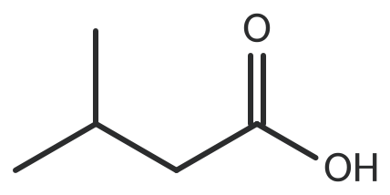{width=2.8cm}
:::

::: {custom-style="Legende"}
Figure 1. L'acide 3-méthylbutanoïque
:::

## [Q.2]{custom-style="QNum"}\ \ Repérer les groupes caractéristiques et nommer les familles {#q2}

::: {custom-style="Meta"}
[\ Objectif 10\ ]{custom-style="Niv10"}\ \ Cours · Notions : groupe caractéristique, famille fonctionnelle, molécule polyfonctionnelle, classe d'un alcool ou d'une amine · Demandé dans huit exercices en 2025 et 2026\ \ \ [CIBLE:c_q2]{custom-style="BoutonCorrige"}
:::

::: {custom-style="Enonce"}
Application : sur la figure 2, entourer les groupes caractéristiques et nommer les familles. La glutamine est un acide aminé : justifier ce nom. Préciser la classe de l'alcool lactique et de l'amine de la glutamine.
:::

::: {custom-style="Figure"}
{width=11.2cm}
:::

::: {custom-style="Legende"}
Figure 2. Trois molécules polyfonctionnelles
:::

## [Q.3]{custom-style="QNum"}\ \ Nommer une espèce organique {#q3}

::: {custom-style="Meta"}
[\ Objectif 14\ ]{custom-style="Niv14"}\ \ Méthode · Notions : chaîne principale, numérotation, préfixes et suffixes, nom d'un ester, alcanes, alcènes, amines, halogènes et cycloalcanes\ \ \ [CIBLE:c_q3]{custom-style="BoutonCorrige"}
:::

::: {custom-style="Enonce"}
Application : nommer les espèces suivantes.

a. $\text{CH}_3\text{-CH}(\text{CH}_3)\text{-CH}_2\text{-CH}_2\text{-OH}$

b. $\text{CH}_3\text{-CO-CH}(\text{CH}_3)\text{-CH}_3$

c. $\text{CH}_3\text{-CH}_2\text{-CH}(\text{CH}_3)\text{-COOH}$

d. $\text{CH}_3\text{-CH}_2\text{-CHO}$

e. $\text{CH}_3\text{-CH}_2\text{-COO-CH}_2\text{-CH}_2\text{-CH}_2\text{-CH}_3$

f. $\text{CH}_3\text{-CHCl-CH}_2\text{-CH}_3$

g. $\text{CH}_3\text{-CO-NH-CH}_3$

h. $\text{CH}_3\text{-CH}(\text{CH}_3)\text{-CH}(\text{CH}_3)\text{-CH}_2\text{-CH}_3$

i. le cycloalcane de la figure 3

j. $\text{CH}_3\text{-CH}_2\text{-CH}(\text{NH}_2)\text{-CH}_3$

k. $\text{CH}_3\text{-C}(\text{CH}_3)\text{=CH-CH}_2\text{-CH}_3$

l. $\text{CH}_3\text{-CHCl-CH}(\text{CH}_3)\text{-CH}_3$

Écrire ensuite la formule semi-développée de la 4-méthylpentan-2-one.
:::

::: {custom-style="Figure"}
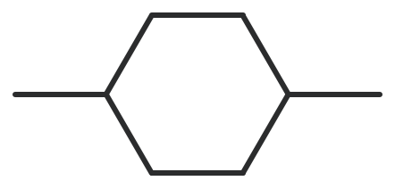{width=2.5cm}
:::

::: {custom-style="Legende"}
Figure 3. Un cycloalcane à nommer
:::

## [Q.4]{custom-style="QNum"}\ \ Reconnaître des isomères {#q4}

::: {custom-style="Meta"}
[\ Objectif 14\ ]{custom-style="Niv14"}\ \ Méthode · Notions : isomérie de constitution (chaîne, position, fonction) ; complément hors programme : isomérie Z/E · Demandé en 2025 (Asie)\ \ \ [CIBLE:c_q4]{custom-style="BoutonCorrige"}
:::

::: {custom-style="Enonce"}
Application : les molécules a à f de la figure 4 ont pour formule brute $\text{C}_4\text{H}_{10}\text{O}$ ou $\text{C}_4\text{H}_8\text{O}$. Les répartir en groupes d'isomères et préciser le type d'isomérie de chaque paire. Complément hors programme : les molécules g et h de la figure 5 sont-elles isomères ? Les nommer.
:::

::: {custom-style="Figure"}
{width=13.2cm}
:::

::: {custom-style="Legende"}
Figure 4. Six molécules à quatre atomes de carbone
:::

::: {custom-style="Figure"}
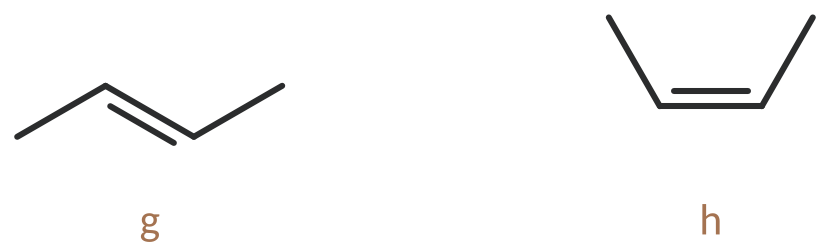{width=4.5cm}
:::

::: {custom-style="Legende"}
Figure 5. Deux alcènes de formule $\text{C}_4\text{H}_8$
:::

## [Q.5]{custom-style="QNum"}\ \ Identifier le motif d'un polymère {#q5}

::: {custom-style="Meta"}
[\ Objectif 10\ ]{custom-style="Niv10"}\ \ Cours · Notions : polymère, monomère, motif, polyaddition, modification de chaîne\ \ \ [CIBLE:c_q5]{custom-style="BoutonCorrige"}
:::

::: {custom-style="Enonce"}
Application : un fragment de la chaîne du polypropylène s'écrit $\text{-CH}_2\text{-CH}(\text{CH}_3)\text{-CH}_2\text{-CH}(\text{CH}_3)\text{-CH}_2\text{-CH}(\text{CH}_3)\text{-}$. Identifier le motif et le monomère. Écrire le motif du polystyrène, obtenu à partir du styrène $\text{CH}_2\text{=CH-C}_6\text{H}_5$. Un polypropylène de masse molaire moyenne $M = 1{,}26 \times 10^{5}\ \text{g·mol}^{-1}$ : estimer le nombre moyen de motifs par chaîne. Citer deux polymères naturels. Que font le craquage et le reformage d'une chaîne carbonée ?

Données : $M(\text{H}) = 1{,}0\ \text{g·mol}^{-1}$ ; $M(\text{C}) = 12{,}0\ \text{g·mol}^{-1}$.
:::

::: {custom-style="Rubrique"}
Exercices
:::

### [Exercice 1]{custom-style="QNum"}\ \ Des esters à l'odeur de fruit [(voir BAC Asie 2025)]{custom-style="VoirBac"} {#ex1}

::: {custom-style="Meta"}
[\ Objectif 10\ ]{custom-style="Niv10"}\ \ [Type BAC]{custom-style="TagBac"} · 4 points · 35 min · Questions 5 et 6 : objectif 14
:::

::: {custom-style="MentionBac"}
[Sujet du BAC correspondant.]{custom-style="EtiqBac"} Asie 2025, jour 1, exercice 3 : « Arôme de poire » (isomérie, spectroscopie infrarouge, rendement).
:::

::: {custom-style="Enonce"}
L'éthanoate de pentyle donne son odeur à certains arômes de poire. Un technicien dispose de deux flacons, contenant les esters A et B de la figure 6 ; l'un d'eux est l'éthanoate de pentyle. Il enregistre le spectre infrarouge du contenu du flacon qu'il pense être le bon (figure 7).
:::

::: {custom-style="Figure"}
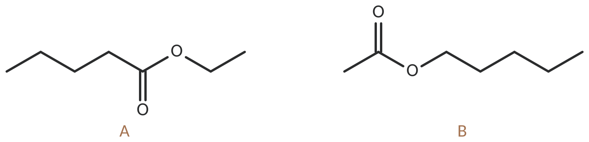{width=10cm}
:::

::: {custom-style="Legende"}
Figure 6. Les deux esters
:::

::: {custom-style="Figure"}
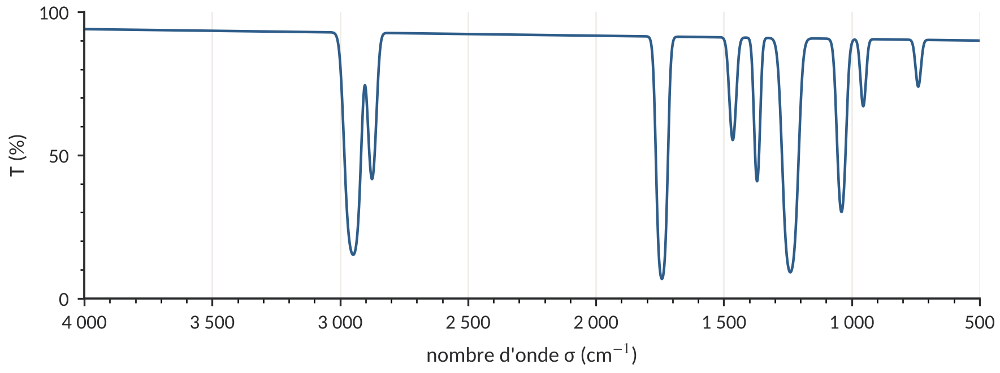{width=11cm}
:::

::: {custom-style="Legende"}
Figure 7. Spectre infrarouge du contenu du flacon
:::

::: {custom-style="EnonceDonnees"}
Masses molaires : $M(\text{H}) = 1{,}0\ \text{g·mol}^{-1}$ ; $M(\text{C}) = 12{,}0\ \text{g·mol}^{-1}$ ; $M(\text{O}) = 16{,}0\ \text{g·mol}^{-1}$. Pentan-1-ol : $M = 88{,}0\ \text{g·mol}^{-1}$, $\rho = 0{,}814\ \text{g·mL}^{-1}$. Bandes infrarouges : $\text{O-H}$ d'un alcool, $3\,200$ à $3\,400\ \text{cm}^{-1}$, forte et large ; $\text{O-H}$ d'un acide carboxylique, $2\,500$ à $3\,200\ \text{cm}^{-1}$, forte et très large ; $\text{C-H}$, $2\,850$ à $3\,100\ \text{cm}^{-1}$ ; $\text{C=O}$, $1\,650$ à $1\,750\ \text{cm}^{-1}$, forte et fine ; $\text{C-O}$, $1\,000$ à $1\,300\ \text{cm}^{-1}$, forte.
:::

::: {custom-style="Enonce"}
**1.** Écrire la formule brute de A et celle de B. Justifier que A et B sont des isomères de constitution.

**2.** Nommer A et B. Lequel est l'éthanoate de pentyle ?

**3.** Chacun de ces esters peut être synthétisé à partir d'un acide carboxylique et d'un alcool. Nommer ces deux réactifs pour A, puis pour B.

**4.** Le spectre de la figure 7 confirme-t-il que le flacon contient un ester ? Permet-il de distinguer A de B ?

**5.** L'éthanoate de 3-méthylbutyle, à l'odeur de banane, est-il un isomère de B ? Préciser le type d'isomérie et représenter sa formule topologique.

**6.** Pour préparer l'éthanoate de pentyle, on fait réagir $54{,}1\ \text{mL}$ de pentan-1-ol avec $0{,}500\ \text{mol}$ d'acide éthanoïque ; on recueille $42{,}9\ \text{g}$ d'ester. Calculer le rendement de la synthèse.
:::

::: {custom-style="Renvoi"}
[CIBLE:c_ex1]{custom-style="BoutonCorrige"}
:::

# Thème 2 : réactions et stratégie de synthèse {#theme2}

::: {custom-style="Rubrique"}
Questions de cours
:::

## [Q.6]{custom-style="QNum"}\ \ Reconnaître une substitution, une addition ou une élimination {#q6}

::: {custom-style="Meta"}
[\ Objectif 10\ ]{custom-style="Niv10"}\ \ Cours · Notions : substitution, addition, élimination, modification de groupe caractéristique · Demandé dans quatre exercices en 2025 et 2026\ \ \ [CIBLE:c_q6]{custom-style="BoutonCorrige"}
:::

::: {custom-style="Enonce"}
Application : indiquer la catégorie de chacune des réactions suivantes.

a. $\text{CH}_3\text{-CH}_2\text{-Br} + \text{HO}^- \rightarrow \text{CH}_3\text{-CH}_2\text{-OH} + \text{Br}^-$

b. $\text{CH}_2\text{=CH-CH}_3 + \text{H}_2\text{O} \rightarrow \text{CH}_3\text{-CH}(\text{OH})\text{-CH}_3$

c. $\text{CH}_3\text{-CH}(\text{OH})\text{-CH}_2\text{-CH}_3 \rightarrow \text{CH}_3\text{-CH=CH-CH}_3 + \text{H}_2\text{O}$

d. $\text{CH}_3\text{-COOH} + \text{CH}_3\text{-OH} \rightleftarrows \text{CH}_3\text{-COO-CH}_3 + \text{H}_2\text{O}$

e. la formation du polyéthylène à partir de l'éthène $\text{CH}_2\text{=CH}_2$
:::

## [Q.7]{custom-style="QNum"}\ \ Reconnaître une réaction acide-base ou d'oxydoréduction {#q7}

::: {custom-style="Meta"}
[\ Objectif 14\ ]{custom-style="Niv14"}\ \ Méthode · Notions : transfert de proton, transfert d'électrons, oxydation d'un alcool, hydrogénation · Demandé en 2025 (Amérique du Sud)\ \ \ [CIBLE:c_q7]{custom-style="BoutonCorrige"}
:::

::: {custom-style="Enonce"}
Application : pour chaque transformation, dire s'il s'agit d'une réaction acide-base ou d'oxydoréduction ; dans le second cas, préciser si l'espèce organique est oxydée ou réduite.

a. $\text{CH}_3\text{-COOH} + \text{HO}^- \rightarrow \text{CH}_3\text{-COO}^- + \text{H}_2\text{O}$

b. l'éthanol $\text{CH}_3\text{-CH}_2\text{-OH}$ est transformé en éthanal $\text{CH}_3\text{-CHO}$ par les ions permanganate en milieu acide ; écrire la demi-équation du couple éthanal/éthanol

c. $\text{CH}_3\text{-CO-CH}_3 + \text{H}_2 \rightarrow \text{CH}_3\text{-CH}(\text{OH})\text{-CH}_3$, en présence d'un catalyseur
:::

## [Q.8]{custom-style="QNum"}\ \ Identifier un produit grâce à la conservation des éléments {#q8}

::: {custom-style="Meta"}
[\ Objectif 10\ ]{custom-style="Niv10"}\ \ Méthode · Notions : conservation des éléments, formule brute, sous-produit d'une synthèse\ \ \ [CIBLE:c_q8]{custom-style="BoutonCorrige"}
:::

::: {custom-style="Enonce"}
Application : identifier les espèces X et Y.

a. Synthèse d'un ester : $\text{C}_5\text{H}_{12}\text{O} + \text{C}_2\text{H}_4\text{O}_2 \rightarrow \text{C}_7\text{H}_{14}\text{O}_2 + \text{X}$

b. Synthèse de l'aspirine à partir d'acide salicylique et d'anhydride éthanoïque : $\text{C}_7\text{H}_6\text{O}_3 + \text{C}_4\text{H}_6\text{O}_3 \rightarrow \text{C}_9\text{H}_8\text{O}_4 + \text{Y}$
:::

## [Q.9]{custom-style="QNum"}\ \ Écrire une estérification, une hydrolyse et une saponification {#q9}

::: {custom-style="Meta"}
[\ Objectif 10\ ]{custom-style="Niv10"}\ \ Cours · Notions : ester, acide carboxylique, alcool, hydrolyse, saponification, savon · Demandé en 2025 et 2026\ \ \ [CIBLE:c_q9]{custom-style="BoutonCorrige"}
:::

::: {custom-style="Enonce"}
Application : le méthanoate d'éthyle a une odeur de rhum. Écrire sa formule semi-développée, nommer l'acide carboxylique et l'alcool qui permettent de le synthétiser, puis écrire l'équation de l'estérification. Écrire l'équation de son hydrolyse, puis celle de sa saponification par les ions hydroxyde. Laquelle de ces trois transformations est totale ? Un savon est formé d'ions carboxylate à longue chaîne, comme l'ion oléate $\text{C}_{17}\text{H}_{33}\text{-COO}^-$ : quelle partie de cet ion est hydrophile, laquelle est lipophile ?
:::

## [Q.10]{custom-style="QNum"}\ \ Élaborer une séquence réactionnelle à partir d'une banque de réactions {#q10}

::: {custom-style="Meta"}
[\ Objectif 14\ ]{custom-style="Niv14"}\ \ Méthode · Notions : banque de réactions, séquence réactionnelle, catégories de réactions\ \ \ [CIBLE:c_q10]{custom-style="BoutonCorrige"}
:::

::: {custom-style="Enonce"}
Application : on dispose de la banque de réactions ci-dessous, où R et R' désignent des groupes d'atomes carbonés. Proposer une séquence de réactions qui permette d'obtenir l'éthanoate d'éthyle, $\text{CH}_3\text{-COO-CH}_2\text{-CH}_3$, à partir de l'éthène $\text{CH}_2\text{=CH}_2$ comme seule espèce organique de départ. Préciser la catégorie de chaque étape.
:::

<!--colonnes: 36 64-->

| Réaction | Transformation |
|---|---|
| R1 : hydratation d'un alcène | $\text{R-CH=CH}_2 + \text{H}_2\text{O} \rightarrow \text{R-CH}(\text{OH})\text{-CH}_3$ (pour R = H, on obtient $\text{CH}_3\text{-CH}_2\text{-OH}$) |
| R2 : oxydation d'un alcool primaire | $\text{R-CH}_2\text{-OH} \rightarrow \text{R-COOH}$, par les ions permanganate en excès, en milieu acide |
| R3 : estérification | $\text{R-COOH} + \text{R'-OH} \rightleftarrows \text{R-COO-R'} + \text{H}_2\text{O}$ |
| R4 : substitution d'un bromoalcane | $\text{R-Br} + \text{HO}^- \rightarrow \text{R-OH} + \text{Br}^-$ |

## [Q.11]{custom-style="QNum"}\ \ Justifier une étape de protection et de déprotection {#q11}

::: {custom-style="Meta"}
[\ Objectif 14\ ]{custom-style="Niv14"}\ \ Méthode · Notions : molécule polyfonctionnelle, sélectivité, protection, déprotection · Demandé en 2025 (Nouvelle-Calédonie)\ \ \ [CIBLE:c_q11]{custom-style="BoutonCorrige"}
:::

::: {custom-style="Enonce"}
Application : on veut synthétiser le dipeptide Gly-Ala, $\text{H}_2\text{N-CH}_2\text{-CO-NH-CH}(\text{CH}_3)\text{-COOH}$, en formant une liaison amide entre le groupe carboxyle de la glycine, $\text{H}_2\text{N-CH}_2\text{-COOH}$, et le groupe amine de l'alanine, $\text{H}_2\text{N-CH}(\text{CH}_3)\text{-COOH}$. Montrer qu'en chauffant simplement un mélange des deux acides aminés, on peut obtenir quatre dipeptides différents. Proposer une stratégie pour n'obtenir que Gly-Ala.
:::

::: {custom-style="Rubrique"}
Exercices
:::

### [Exercice 2]{custom-style="QNum"}\ \ Un édulcorant, l'aspartame [(voir BAC Nouvelle-Calédonie 2025)]{custom-style="VoirBac"} {#ex2}

::: {custom-style="Meta"}
[\ Objectif 14\ ]{custom-style="Niv14"}\ \ [Type BAC]{custom-style="TagBac"} · 5 points · 45 min · Question 6 : objectif 18
:::

::: {custom-style="MentionBac"}
[Sujet du BAC correspondant.]{custom-style="EtiqBac"} Nouvelle-Calédonie 2025, jour 2, exercice 1 : « Synthèse d'un édulcorant : l'aspartame » (groupes caractéristiques, mécanisme, stratégie de synthèse).
:::

::: {custom-style="Enonce"}
L'aspartame, deux cents fois plus sucré que le saccharose, se forme par réaction entre l'acide aspartique et la phénylalanine méthylée (figure 8). On modélise la formation de la liaison par un mécanisme en deux étapes, dans lequel le groupe amine de la phénylalanine méthylée est noté $\text{R}_1\text{-NH}_2$ et le groupe carboxyle de l'acide aspartique $\text{R}_2\text{-COOH}$. L'étape 1 est représentée sur la figure 9 ; à l'étape 2, l'espèce formée perd une molécule d'eau.
:::

::: {custom-style="Figure"}
{width=10cm}
:::

::: {custom-style="Legende"}
Figure 8. Formation de l'aspartame
:::

::: {custom-style="Figure"}
{width=7.8cm}
:::

::: {custom-style="Legende"}
Figure 9. Étape 1 du mécanisme
:::

::: {custom-style="EnonceDonnees"}
Électronégativités : $\chi(\text{H}) = 2{,}20$ ; $\chi(\text{C}) = 2{,}55$ ; $\chi(\text{N}) = 3{,}04$ ; $\chi(\text{O}) = 3{,}44$. Formules brutes : acide aspartique $\text{C}_4\text{H}_7\text{NO}_4$ ; phénylalanine méthylée $\text{C}_{10}\text{H}_{13}\text{NO}_2$ ; aspartame $\text{C}_{14}\text{H}_{18}\text{N}_2\text{O}_5$.
:::

::: {custom-style="Enonce"}
**1.** Nommer les groupes caractéristiques de la phénylalanine méthylée et ceux de l'aspartame. Quel groupe est créé par la réaction ?

**2.** Vérifier la conservation des éléments au cours de la réaction. À quelle catégorie appartient la transformation globale ?

**3.** À l'aide des électronégativités, justifier la polarisation de la liaison $\text{C=O}$. Identifier, dans l'étape 1, le site donneur et le site accepteur de doublet d'électrons.

**4.** Recopier l'étape 1 et représenter les flèches courbes qui rendent compte de la formation et de la rupture des liaisons.

**5.** Justifier que l'espèce formée à l'étape 1 est un intermédiaire réactionnel. À quelle catégorie appartient l'étape 2 ?

**6.** Le mélange direct des deux réactifs donne d'autres produits que l'aspartame. Expliquer pourquoi, puis proposer une stratégie de synthèse qui ne conduise qu'à l'aspartame.
:::

::: {custom-style="Renvoi"}
[CIBLE:c_ex2]{custom-style="BoutonCorrige"}
:::

### [Exercice 3]{custom-style="QNum"}\ \ La cétone de framboise [(voir BAC Amérique du Sud 2025)]{custom-style="VoirBac"} {#ex3}

::: {custom-style="Meta"}
[\ Objectif 10\ ]{custom-style="Niv10"}\ \ [Type BAC]{custom-style="TagBac"} · 4 points · 35 min · Questions 5 et 6 : objectif 14
:::

::: {custom-style="MentionBac"}
[Sujet du BAC correspondant.]{custom-style="EtiqBac"} Amérique du Sud 2025, jour 2, exercice 1 : « Infusion à la framboise » (groupes caractéristiques, catégories de réactions, rendement).
:::

::: {custom-style="Enonce"}
La frambinone, ou cétone de framboise, donne au fruit son odeur. Trop peu abondante pour être extraite, elle est synthétisée en deux étapes (figure 10). Étape 1 : on dissout $2{,}44\ \text{g}$ de 4-hydroxybenzaldéhyde (espèce A) dans un excès de propanone, on ajoute une solution aqueuse d'hydroxyde de sodium et on agite quatre heures ; on obtient l'espèce B. Étape 2 : B réagit avec du dihydrogène en excès, en présence d'un catalyseur sélectif, qui n'agit que sur la double liaison $\text{C=C}$. Après purification, on recueille $2{,}13\ \text{g}$ de frambinone.
:::

::: {custom-style="Figure"}
{width=14cm}
:::

::: {custom-style="Legende"}
Figure 10. Les deux étapes de la synthèse de la frambinone
:::

::: {custom-style="EnonceDonnees"}
$M(\text{A}) = 122\ \text{g·mol}^{-1}$ ; $M(\text{frambinone}) = 164\ \text{g·mol}^{-1}$. Le 4-hydroxybenzaldéhyde est peu soluble dans l'eau et très soluble dans la propanone ; la propanone est miscible à l'eau.
:::

::: {custom-style="Enonce"}
**1.** Nommer les groupes caractéristiques de la frambinone. Justifier son nom de cétone de framboise.

**2.** Écrire les formules brutes de A, de B et de la frambinone. Vérifier que l'étape 1 a pour équation : A + propanone → B + $\text{H}_2\text{O}$.

**3.** L'étape 1 se déroule en deux temps : une addition de la propanone sur le groupe carbonyle de A, puis une élimination. Quelle molécule est éliminée ? Quelle liaison apparaît dans B ?

**4.** Pourquoi la propanone est-elle utilisée en excès et comme solvant ?

**5.** Le premier acte élémentaire de l'étape 1 est $\text{CH}_3\text{-CO-CH}_3 + \text{HO}^- \rightarrow \text{CH}_3\text{-CO-CH}_2^- + \text{H}_2\text{O}$. À quelle catégorie appartient-il ? Quel est le rôle des ions hydroxyde dans cet acte ? À quelles catégories appartient l'étape 2 ?

**6.** Calculer le rendement de la synthèse, le 4-hydroxybenzaldéhyde étant le réactif limitant.
:::

::: {custom-style="Renvoi"}
[CIBLE:c_ex3]{custom-style="BoutonCorrige"}
:::

```{=openxml}
<w:p><w:r><w:br w:type="page"/></w:r></w:p>
```

# Thème 3 : protocole, purification, analyse et rendement {#theme3}

::: {custom-style="Rubrique"}
Questions de cours
:::

## [Q.12]{custom-style="QNum"}\ \ Identifier les étapes d'un protocole et le rôle d'un chauffage à reflux {#q12}

::: {custom-style="Meta"}
[\ Objectif 10\ ]{custom-style="Niv10"}\ \ Cours · Notions : transformation, isolement, purification, analyse, chauffage à reflux, pierre ponce, pictogrammes de sécurité · Demandé en 2025 et 2026\ \ \ [CIBLE:c_q12]{custom-style="BoutonCorrige"}
:::

::: {custom-style="Enonce"}
Application : nommer les éléments numérotés du montage de la figure 11 et donner le rôle du chauffage, du réfrigérant et de la pierre ponce. Associer ensuite chaque opération du protocole suivant à une étape de la synthèse (transformation, isolement, purification, analyse) : (1) chauffer à reflux $30\ \text{min}$ l'acide, l'alcool et quelques gouttes d'acide sulfurique ; (2) verser le mélange refroidi dans une ampoule à décanter contenant de l'eau froide et garder la phase organique ; (3) laver cette phase avec une solution d'hydrogénocarbonate de sodium ; (4) la sécher sur sulfate de magnésium anhydre et filtrer ; (5) enregistrer le spectre infrarouge du liquide obtenu. Enfin, le flacon d'acide sulfurique porte le pictogramme « corrosion », celui de l'alcool les pictogrammes « flamme » et « point d'exclamation » : que signalent-ils, et quelles précautions imposent-ils ?
:::

::: {custom-style="Figure"}
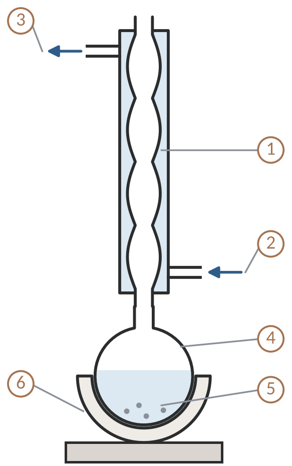{width=3.5cm}
:::

::: {custom-style="Legende"}
Figure 11. Un montage de synthèse
:::

## [Q.13]{custom-style="QNum"}\ \ Distinguer ce qui accélère une synthèse de ce qui améliore son rendement {#q13}

::: {custom-style="Meta"}
[\ Objectif 14\ ]{custom-style="Niv14"}\ \ Méthode · Notions : facteurs cinétiques, catalyseur, catalyse homogène ou hétérogène, réactif en excès, élimination d'un produit, Dean-Stark · Demandé dans quatre exercices en 2025 et 2026\ \ \ [CIBLE:c_q13]{custom-style="BoutonCorrige"}
:::

::: {custom-style="Enonce"}
Application : pour une estérification, transformation lente et non totale, on envisage : a. chauffer le mélange ; b. ajouter quelques gouttes d'acide sulfurique ; c. introduire l'alcool en excès ; d. éliminer l'eau au fur et à mesure de sa formation avec un appareil de Dean-Stark. Pour chaque choix, dire s'il augmente la vitesse de formation de l'ester, le rendement, ou les deux. La catalyse par l'acide sulfurique est-elle homogène ou hétérogène ? Représenter l'allure de l'avancement au cours du temps, avec et sans catalyseur.
:::

## [Q.14]{custom-style="QNum"}\ \ Réaliser une extraction liquide-liquide {#q14}

::: {custom-style="Meta"}
[\ Objectif 10\ ]{custom-style="Niv10"}\ \ Méthode · Notions : solvant extracteur, miscibilité, densité, lavage, séchage · Demandé dans cinq exercices en 2025 et 2026\ \ \ [CIBLE:c_q14]{custom-style="BoutonCorrige"}
:::

::: {custom-style="Enonce"}
Application : en fin d'estérification, le mélange contient l'ester, de l'eau, de l'acide éthanoïque restant et l'acide sulfurique (on néglige l'alcool restant). On y ajoute du cyclohexane, non miscible avec l'eau, et on agite dans une ampoule à décanter. L'ester est très peu soluble dans l'eau et très soluble dans le cyclohexane ; l'acide éthanoïque est très soluble dans l'eau et soluble dans le cyclohexane. Densités : ester $0{,}88$ ; cyclohexane $0{,}78$ ; eau $1{,}00$. Justifier le choix du cyclohexane, schématiser l'ampoule en indiquant la position des phases et celle de l'ester. On lave ensuite la phase organique avec une solution d'hydrogénocarbonate de sodium : un gaz se dégage. Expliquer le rôle de ce lavage et la précaution à prendre. Quel est le rôle du sulfate de magnésium anhydre ajouté ensuite ?
:::

## [Q.15]{custom-style="QNum"}\ \ Isoler et purifier un solide : précipitation, filtration et recristallisation {#q15}

::: {custom-style="Meta"}
[\ Objectif 10\ ]{custom-style="Niv10"}\ \ Méthode · Notions : précipitation, filtration simple et sur Büchner, lavage, recristallisation, solubilité à chaud et à froid · Demandé en 2026 (Polynésie)\ \ \ [CIBLE:c_q15]{custom-style="BoutonCorrige"}
:::

::: {custom-style="Enonce"}
Application : une synthèse fournit $5{,}0\ \text{g}$ de solide P brut, souillé par une petite quantité d'une impureté I, dont on néglige la masse. La solubilité de P dans l'eau vaut $3{,}0\ \text{g·L}^{-1}$ à $20\ \text{°C}$ et $60\ \text{g·L}^{-1}$ à $100\ \text{°C}$ ; l'impureté I est très soluble dans l'eau, à chaud comme à froid. Qu'appelle-t-on une précipitation ? Décrire la recristallisation de P dans l'eau. Calculer le volume minimal d'eau bouillante qui dissout tout le solide P, puis la masse de P qui reste dissoute après refroidissement à $20\ \text{°C}$ ; en déduire la masse maximale de P récupérable. Pourquoi filtre-t-on sous vide plutôt que par simple filtration, et lave-t-on les cristaux à l'eau glacée ?
:::

## [Q.16]{custom-style="QNum"}\ \ Purifier un liquide par distillation et extraire par hydrodistillation {#q16}

::: {custom-style="Meta"}
[\ Objectif 14\ ]{custom-style="Niv14"}\ \ Méthode · Notions : distillation fractionnée, température d'ébullition, colonne de Vigreux, hydrodistillation · Demandé en 2026 (Métropole, septembre)\ \ \ [CIBLE:c_q16]{custom-style="BoutonCorrige"}
:::

::: {custom-style="Enonce"}
Application : on sépare par distillation fractionnée un mélange de cyclohexane ($T_\text{éb} = 81\ \text{°C}$) et de toluène ($T_\text{éb} = 111\ \text{°C}$). Quelle espèce est recueillie en premier ? Quelle température lit-on en tête de colonne pendant qu'elle distille ? Quel est le rôle de la colonne de Vigreux, et où placer le réservoir du thermomètre ? Pour extraire l'huile essentielle de lavande, on réalise une hydrodistillation : décrire son montage. Le distillat recueilli se sépare en deux phases. L'huile essentielle, de densité $0{,}89$ et très peu soluble dans l'eau, est-elle au-dessus ou au-dessous ?
:::

## [Q.17]{custom-style="QNum"}\ \ Contrôler la pureté : température de fusion et CCM {#q17}

::: {custom-style="Meta"}
[\ Objectif 10\ ]{custom-style="Niv10"}\ \ Méthode · Notions : banc Kofler, chromatographie sur couche mince, rapport frontal, éluant, révélation · Demandé dans quatre exercices en 2025 et 2026\ \ \ [CIBLE:c_q17]{custom-style="BoutonCorrige"}
:::

::: {custom-style="Enonce"}
Application : la chromatographie de la figure 12 a été réalisée après une synthèse d'aspirine. Dépôt A : aspirine pure du commerce ; B : acide salicylique, réactif de la synthèse ; C : produit brut ; D : produit recristallisé. Calculer les rapports frontaux de l'aspirine et de l'acide salicylique. Le produit brut est-il pur ? Le produit recristallisé ? Sur un banc Kofler, le produit recristallisé fond à $135\ \text{°C}$, température de fusion de l'aspirine. Conclure.
:::

::: {custom-style="Figure"}
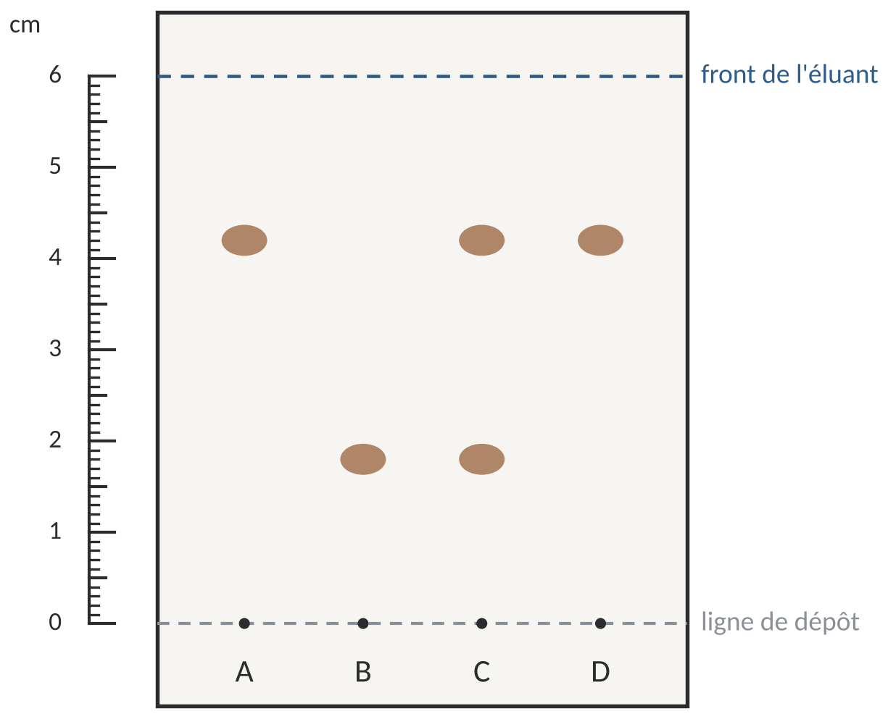{width=5.2cm}
:::

::: {custom-style="Legende"}
Figure 12. Chromatographie après la synthèse de l'aspirine
:::

## [Q.18]{custom-style="QNum"}\ \ Exploiter un spectre infrarouge {#q18}

::: {custom-style="Meta"}
[\ Objectif 10\ ]{custom-style="Niv10"}\ \ Méthode · Notions : transmittance, nombre d'onde, bande d'absorption, liaisons $\text{O-H}$, $\text{C=O}$ et $\text{C-H}$ · Demandé dans sept exercices en 2025 et 2026\ \ \ [CIBLE:c_q18]{custom-style="BoutonCorrige"}
:::

::: {custom-style="Enonce"}
Application : les spectres de la figure 13 sont ceux du butan-1-ol et de la butanone. Attribuer chaque spectre à son espèce en justifiant. Dans l'un des spectres, une bande intense correspond à une longueur d'onde $\lambda = 5{,}85\ \text{µm}$ : calculer son nombre d'onde $\sigma = 1/\lambda$ en $\text{cm}^{-1}$ et l'attribuer à une liaison.
:::

<!--colonnes: 34 33 33-->

| Liaison | Nombre d'onde (cm⁻¹) | Allure de la bande |
|---|---|---|
| $\text{O-H}$ d'un alcool | $3\,200$ à $3\,400$ | Forte et large |
| $\text{O-H}$ d'un acide carboxylique | $2\,500$ à $3\,200$ | Forte et très large |
| $\text{C-H}$ | $2\,850$ à $3\,100$ | Moyenne à forte |
| $\text{C=O}$ | $1\,650$ à $1\,750$ | Forte et fine |
| $\text{C-O}$ | $1\,000$ à $1\,300$ | Forte |

::: {custom-style="Figure"}
{width=15.5cm}
:::

::: {custom-style="Legende"}
Figure 13. Spectres infrarouges du butan-1-ol et de la butanone
:::

## [Q.19]{custom-style="QNum"}\ \ Calculer une masse maximale et un rendement {#q19}

::: {custom-style="Meta"}
[\ Objectif 10\ ]{custom-style="Niv10"}\ \ Méthode · Notions : réactif limitant, masse maximale, rendement, synthèse en plusieurs étapes · Demandé dans huit exercices en 2025 et 2026\ \ \ [CIBLE:c_q19]{custom-style="BoutonCorrige"}
:::

::: {custom-style="Enonce"}
Application : l'aspirine se prépare selon $\text{C}_7\text{H}_6\text{O}_3 + \text{C}_4\text{H}_6\text{O}_3 \rightarrow \text{C}_9\text{H}_8\text{O}_4 + \text{C}_2\text{H}_4\text{O}_2$. On introduit $2{,}76\ \text{g}$ d'acide salicylique ($M = 138\ \text{g·mol}^{-1}$) et $5{,}0\ \text{mL}$ d'anhydride éthanoïque ($\rho = 1{,}08\ \text{g·mL}^{-1}$ ; $M = 102\ \text{g·mol}^{-1}$) ; on obtient $2{,}88\ \text{g}$ d'aspirine ($M = 180\ \text{g·mol}^{-1}$). Déterminer le réactif limitant, la masse maximale d'aspirine et le rendement. L'aspirine sert ensuite de réactif dans une seconde synthèse, de rendement $75\ \%$ : quel est le rendement global des deux étapes ? Dans une autre synthèse, d'équation $2\,\text{A} + \text{B} \rightarrow 3\,\text{C} + \text{D}$, on introduit $3{,}0\ \text{mol}$ de A et $1{,}0\ \text{mol}$ de B : quelle quantité maximale de C peut-on obtenir ?
:::

## [Q.20]{custom-style="QNum"}\ \ Comparer deux protocoles : énergie consommée et choix d'une voie de synthèse {#q20}

::: {custom-style="Meta"}
[\ Objectif 14\ ]{custom-style="Niv14"}\ \ Application · Notions : énergie électrique, puissance, chimie verte, comparaison de protocoles · Comparaison de deux voies demandée en 2026 (Polynésie)\ \ \ [CIBLE:c_q20]{custom-style="BoutonCorrige"}
:::

::: {custom-style="Enonce"}
Application : on compare deux protocoles pour la synthèse de Q.19, avec les mêmes quantités de réactifs. Protocole A : chauffage à reflux pendant $45\ \text{min}$ avec un chauffe-ballon de puissance $250\ \text{W}$, rendement $80\ \%$. Protocole B : chauffage par micro-ondes pendant $3\ \text{min}$ à $800\ \text{W}$, rendement $70\ \%$. Calculer l'énergie électrique consommée par chaque protocole, en joules et en kilowattheures, puis l'énergie consommée par gramme d'aspirine obtenu, la masse maximale étant $3{,}60\ \text{g}$. Quel protocole choisir ? Citer un autre critère de choix.
:::

::: {custom-style="Rubrique"}
Exercices
:::

### [Exercice 4]{custom-style="QNum"}\ \ L'alcool de champignon [(voir BAC Métropole, septembre 2026)]{custom-style="VoirBac"} {#ex4}

::: {custom-style="Meta"}
[\ Objectif 10\ ]{custom-style="Niv10"}\ \ [Type BAC]{custom-style="TagBac"} · 5 points · 45 min · Question 6 : objectif 14
:::

::: {custom-style="MentionBac"}
[Sujet du BAC correspondant.]{custom-style="EtiqBac"} Métropole, septembre 2026, jour 1, exercice 3 : « Synthèse de l'alcool de champignon » (reflux, extraction, distillation fractionnée, spectre IR, CCM, rendement).
:::

::: {custom-style="Enonce"}
L'alcool de champignon, ou oct-1-én-3-ol ($\text{C}_8\text{H}_{16}\text{O}$), donne leur odeur aux champignons. On le synthétise selon l'équation :

$$\text{C}_5\text{H}_{11}\text{MgBr} + \text{C}_3\text{H}_4\text{O} + \text{NH}_4^{\text{+}} \rightarrow \text{C}_8\text{H}_{16}\text{O} + \text{Mg}^{\text{2+}} + \text{Br}^- + \text{NH}_3$$

Protocole. Dans un ballon sec, on place $10{,}0\ \text{mL}$ d'une solution de bromure de pentylmagnésium à $2{,}00\ \text{mol·L}^{-1}$ dans l'éther diéthylique, on ajoute goutte à goutte l'acroléine en excès et on chauffe à reflux $10\ \text{min}$. On ajoute ensuite une solution aqueuse de chlorure d'ammonium et on sépare les phases dans une ampoule à décanter ; la phase organique, séchée, est purifiée par distillation fractionnée. On recueille $2{,}25\ \text{g}$ de produit, analysé par spectroscopie infrarouge et par CCM (figure 14 ; dépôt 1 : acroléine ; 2 : phase organique avant distillation ; 3 : produit distillé).
:::

::: {custom-style="EnonceDonnees"}
Éther diéthylique : $T_\text{éb} = 35\ \text{°C}$, densité $0{,}71$, peu soluble dans l'eau. Acroléine : $T_\text{éb} = 53\ \text{°C}$, soluble dans l'eau. Alcool de champignon : $M = 128\ \text{g·mol}^{-1}$, $T_\text{éb} = 175\ \text{°C}$, très peu soluble dans l'eau. Bandes infrarouges : $\text{O-H}$ d'un alcool, $3\,200$ à $3\,400\ \text{cm}^{-1}$, forte et large ; $\text{C-H}$, $2\,850$ à $3\,100\ \text{cm}^{-1}$ ; $\text{C=O}$, $1\,650$ à $1\,750\ \text{cm}^{-1}$, forte et fine ; $\text{C=C}$, $1\,620$ à $1\,680\ \text{cm}^{-1}$, faible.
:::

::: {custom-style="Figure"}
{width=13cm}
:::

::: {custom-style="Legende"}
Figure 14. Analyse du produit : a. spectre infrarouge du produit distillé ; b. chromatographie sur couche mince
:::

::: {custom-style="Enonce"}
**1.** Donner deux raisons de chauffer à reflux.

**2.** Quelle phase est au-dessus dans l'ampoule à décanter ? Où se trouve l'alcool de champignon ? Citer deux espèces de l'autre phase.

**3.** Dans quel ordre les espèces de la phase organique distillent-elles ? Quelle température lit-on en tête de colonne quand on recueille le produit ?

**4.** Montrer que le spectre de la figure 14 a est compatible avec l'alcool de champignon et que le produit ne contient plus d'acroléine, qui est un aldéhyde.

**5.** Calculer le rapport frontal de l'alcool de champignon (figure 14 b). Que montre la chromatographie sur l'efficacité de la distillation ?

**6.** Calculer le rendement de la synthèse. Un titrage indique que la concentration réelle de la solution de bromure de pentylmagnésium vaut $1{,}94\ \text{mol·L}^{-1}$ : recalculer le rendement.
:::

::: {custom-style="Renvoi"}
[CIBLE:c_ex4]{custom-style="BoutonCorrige"}
:::

### [Exercice 5]{custom-style="QNum"}\ \ Une coumarine fluorescente [(voir BAC Polynésie 2026)]{custom-style="VoirBac"} {#ex5}

::: {custom-style="Meta"}
[\ Objectif 14\ ]{custom-style="Niv14"}\ \ [Type BAC]{custom-style="TagBac"} · 5 points · 45 min · Question 6 : objectif 18
:::

::: {custom-style="MentionBac"}
[Sujet du BAC correspondant.]{custom-style="EtiqBac"} Polynésie 2026, jour 1, exercice 1 : « Synthèse d'une Coumarine » (catalyseur, filtration sur Büchner, recristallisation, rendement, comparaison de deux voies).
:::

::: {custom-style="Enonce"}
La 7-hydroxy-4-méthylcoumarine (composé A) émet une lumière bleue lorsqu'elle est éclairée par un rayonnement ultraviolet. On la synthétise à partir du résorcinol et de l'acétoacétate d'éthyle, en présence d'acide paratoluènesulfonique, noté APTS (figure 15).

Protocole. Dans un erlenmeyer, on mélange $2{,}20\ \text{g}$ de résorcinol, $2{,}60\ \text{g}$ d'acétoacétate d'éthyle et $0{,}18\ \text{g}$ d'APTS, puis on chauffe au bain-marie à $60\ \text{°C}$ pendant $10\ \text{min}$, sous agitation. Après refroidissement, on ajoute $15\ \text{mL}$ d'eau froide : le composé A cristallise. On filtre, on lave les cristaux avec trois fois $5\ \text{mL}$ d'eau froide, puis on les recristallise dans un mélange d'éthanol et d'eau. Après séchage, on recueille $2{,}0\ \text{g}$ de composé A.
:::

::: {custom-style="Figure"}
{width=13.5cm}
:::

::: {custom-style="Legende"}
Figure 15. Synthèse du composé A
:::

<!--colonnes: 34 22 22 22-->

| Espèce | M (g·mol⁻¹) | Dans l'eau froide | Dans l'éthanol |
|---|---|---|---|
| Résorcinol ($\text{C}_6\text{H}_6\text{O}_2$) | 110 | Très soluble | Très soluble |
| Acétoacétate d'éthyle ($\text{C}_6\text{H}_{10}\text{O}_3$) | 130 | Peu soluble | Très soluble |
| APTS | 172 | Très soluble | Soluble |
| Composé A ($\text{C}_{10}\text{H}_8\text{O}_3$) | 176 | Insoluble | Peu soluble à froid, soluble à chaud |

::: {custom-style="Enonce"}
**1.** Identifier l'espèce X à l'aide de la conservation des éléments.

**2.** Nommer les groupes caractéristiques de l'acétoacétate d'éthyle.

**3.** L'APTS est un catalyseur : définir ce terme. Son ajout modifie-t-il le rendement ?

**4.** Expliquer le rôle de l'eau froide ajoutée en fin de réaction, puis celui du lavage des cristaux. Quel type de filtration convient ? Quelles impuretés la recristallisation élimine-t-elle ?

**5.** Vérifier que les réactifs sont introduits dans les proportions stœchiométriques, puis calculer le rendement de la synthèse.

**6.** Une autre voie, catalysée par l'acide sulfamique, demande $20\ \text{min}$ de chauffage à $130\ \text{°C}$ sur une plaque de $500\ \text{W}$ et a un rendement de $65\ \%$. La voie étudiée utilise un bain-marie de $300\ \text{W}$. Pour les mêmes quantités de réactifs, comparer les deux voies (rendement, énergie consommée par gramme de composé A, sécurité) et conclure.
:::

::: {custom-style="Renvoi"}
[CIBLE:c_ex5]{custom-style="BoutonCorrige"}
:::

<!--debut:complet-->
::: {custom-style="Surtitre"}
Corrigés
:::

# Corrigés du thème 1 : structure et nomenclature des espèces organiques {#c_theme1}

#### [Corrigé]{custom-style="NumCorrige"}\ \ Q.1 · Passer d'une formule à une autre : brute, semi-développée, topologique {#c_q1}

::: {custom-style="Renvoi"}
[CIBLE:q1]{custom-style="BoutonEnonce"}
:::

La formule brute donne seulement le nombre d'atomes de chaque élément. Une formule développée montre toutes les liaisons, y compris celles avec les atomes d'hydrogène. La formule semi-développée montre l'enchaînement des atomes, sans détailler les liaisons avec l'hydrogène. Dans la formule topologique, chaque sommet et chaque extrémité de trait représentent un atome de carbone ; chaque carbone forme quatre liaisons, complétées par des atomes d'hydrogène que l'on n'écrit pas. Les autres atomes (O, N, Cl…) sont écrits avec les hydrogènes qu'ils portent.

La figure 1 compte cinq atomes de carbone : une chaîne de quatre, et un groupe méthyle sur le troisième carbone en partant du groupe acide. D'où :

$$\text{CH}_3\text{-CH}(\text{CH}_3)\text{-CH}_2\text{-COOH} \qquad \text{formule brute : } \text{C}_5\text{H}_{10}\text{O}_2$$

On compte les hydrogènes groupe par groupe : $3 + 1 + 3 + 2 + 1 = 10$. Le squelette est ramifié : la chaîne principale porte une ramification, sans cycle.

Le butan-2-ol a une chaîne de quatre carbones et un groupe hydroxyle sur le carbone 2 (figure 16, à gauche). Sa formule brute est $\text{C}_4\text{H}_{10}\text{O}$. Pour obtenir sa formule développée, on part de la formule semi-développée et on « développe » toutes les liaisons : chaque groupe $\text{CH}_3$, $\text{CH}_2$ ou $\text{CH}$ est remplacé par un atome de carbone relié par un trait à chacun de ses atomes d'hydrogène, et le groupe $\text{OH}$ devient une liaison $\text{C-O}$ suivie d'une liaison $\text{O-H}$ (figure 16, à droite). On compte alors dix liaisons $\text{C-H}$ ou $\text{O-H}$ pour dix atomes d'hydrogène, comme dans la formule brute.

::: {custom-style="Figure"}
{width=8cm}
:::

::: {custom-style="Legende"}
Figure 16. Le butan-2-ol : formules topologique et développée
:::

Un alcane est un hydrocarbure, formé seulement de carbone et d'hydrogène, dont toutes les liaisons sont simples : il est saturé, et sa formule brute générale est $\text{C}_n\text{H}_{2n+2}$. Un alcène est un hydrocarbure insaturé : il porte une double liaison $\text{C=C}$ ; avec une seule, sa formule brute est $\text{C}_n\text{H}_{2n}$. L'heptane, alcane linéaire à sept carbones, a pour formule brute $\text{C}_7\text{H}_{16}$, car $2 \times 7 + 2 = 16$.

::: {custom-style="Retenir"}
Une formule brute s'écrit dans l'ordre C, H, puis les autres éléments par ordre alphabétique ; en formule topologique, seuls les hydrogènes portés par des atomes autres que le carbone sont écrits
:::

::: {custom-style="Piege"}
[Piège.]{custom-style="EtiqPiege"} Oublier les hydrogènes sous-entendus, ou compter un atome de carbone au bout du trait qui mène à OH : ce trait se termine sur l'atome d'oxygène.
:::

#### [Corrigé]{custom-style="NumCorrige"}\ \ Q.2 · Repérer les groupes caractéristiques et nommer les familles {#c_q2}

::: {custom-style="Renvoi"}
[CIBLE:q2]{custom-style="BoutonEnonce"}
:::

<!--colonnes: 22 42 36-->

| Famille | Groupe caractéristique | Exemple |
|---|---|---|
| Alcool | Hydroxyle $\text{-OH}$, sur un carbone lié à quatre atomes | Éthanol $\text{CH}_3\text{-CH}_2\text{-OH}$ |
| Aldéhyde | Carbonyle $\text{-CHO}$, en bout de chaîne | Éthanal $\text{CH}_3\text{-CHO}$ |
| Cétone | Carbonyle $\text{C=O}$, entre deux carbones | Propanone $\text{CH}_3\text{-CO-CH}_3$ |
| Acide carboxylique | Carboxyle $\text{-COOH}$ | Acide éthanoïque $\text{CH}_3\text{-COOH}$ |
| Ester | Ester $\text{-COO-}$ | Éthanoate de méthyle $\text{CH}_3\text{-COO-CH}_3$ |
| Amine | Azote lié à un, deux ou trois carbones | Éthanamine $\text{CH}_3\text{-CH}_2\text{-NH}_2$ |
| Amide | Amide $\text{-CO-N}$ | Éthanamide $\text{CH}_3\text{-CO-NH}_2$ |
| Halogénoalcane | Halogène $\text{-Cl}$, $\text{-Br}$… sur un carbone | Chloroéthane $\text{CH}_3\text{-CH}_2\text{-Cl}$ |

Dans la figure 17 : l'acide lactique est à la fois un alcool (groupe hydroxyle) et un acide carboxylique (groupe carboxyle) ; le paracétamol porte un groupe hydroxyle lié au cycle (famille des phénols) et un groupe amide ; la glutamine porte un groupe amide, un groupe amine et un groupe carboxyle. Un acide aminé possède un groupe amine et un groupe carboxyle : c'est le cas de la glutamine.

::: {custom-style="Figure"}
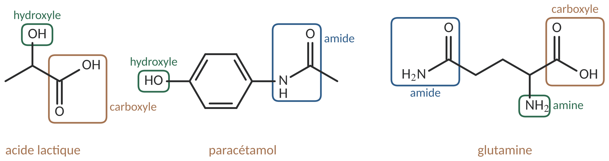{width=12cm}
:::

::: {custom-style="Legende"}
Figure 17. Les groupes caractéristiques entourés
:::

Un alcool est primaire, secondaire ou tertiaire selon que le carbone qui porte le groupe hydroxyle est lié à un, deux ou trois atomes de carbone : éthanol, propan-2-ol, 2-méthylpropan-2-ol. L'acide lactique contient un alcool secondaire. Par oxydation ménagée, un alcool primaire donne un aldéhyde puis un acide carboxylique, un secondaire une cétone ; un tertiaire ne s'oxyde pas. Une amine se classe de même d'après le nombre de carbones liés à l'azote : $\text{CH}_3\text{-NH}_2$ est primaire, $\text{CH}_3\text{-NH-CH}_3$ secondaire, $(\text{CH}_3)_3\text{N}$ tertiaire ; l'amine de la glutamine, dont l'azote n'est lié qu'à un carbone, est primaire. Un amide se classe de même : $\text{CH}_3\text{-CO-NH}_2$ est primaire, $\text{CH}_3\text{-CO-NH-CH}_3$ secondaire, $\text{CH}_3\text{-CO-N}(\text{CH}_3)_2$ tertiaire.

::: {custom-style="Piege"}
[Piège.]{custom-style="EtiqPiege"} Prendre un groupe $\text{C=O}$ isolé pour un groupe carboxyle ou ester : il faut regarder ce qui est lié au carbone. Avec $\text{-OH}$, c'est un acide ; avec $\text{-O-C}$, un ester ; avec un azote, un amide.
:::

#### [Corrigé]{custom-style="NumCorrige"}\ \ Q.3 · Nommer une espèce organique {#c_q3}

::: {custom-style="Renvoi"}
[CIBLE:q3]{custom-style="BoutonEnonce"}
:::

::: {custom-style="Methode"}
[Méthode.]{custom-style="EtiqMethode"} Repérer le groupe caractéristique, qui fixe le suffixe ; choisir la chaîne la plus longue qui le porte (méth-, éth-, prop-, but-, pent-, hex-, hept-, oct- pour 1 à 8 carbones) ; la numéroter pour donner le plus petit numéro au carbone du groupe ; nommer les ramifications (groupes alkyle : méthyl, éthyl, propyl, butyl, pentyl, le suffixe « yle » remplaçant « ane ») et les halogènes (fluoro, chloro, bromo, iodo, pour F, Cl, Br, I) en préfixes, avec leur numéro. Un halogène est un élément de la 17e colonne du tableau périodique : fluor F, chlore Cl, brome Br, iode I. Une chaîne fermée en cycle prend le préfixe cyclo : cyclohexane pour six carbones.
:::

<!--colonnes: 26 34 40-->

| Famille | Nom | Exemple |
|---|---|---|
| Alcène | Alc-n-ène (n : numéro du premier carbone de la double liaison) | But-2-ène |
| Alcool | Alcan-n-ol | Propan-2-ol |
| Aldéhyde | Alcanal (carbone 1 : celui du groupe) | Butanal |
| Cétone | Alcan-n-one | Pentan-3-one |
| Acide carboxylique | Acide alcanoïque | Acide propanoïque |
| Ester R-COO-R' | Alcanoate (partie R-CO) d'alkyle (partie R') | Éthanoate de méthyle |
| Amine | Alcan-n-amine ; substituant sur N noté N- | Butan-2-amine ; N-méthylpropan-1-amine |
| Amide | Alcanamide ; substituant sur N noté N- | N-méthyléthanamide |

a. Chaîne de quatre carbones portant le groupe hydroxyle, numérotée depuis le carbone lié à $\text{-OH}$ ; méthyle en 3 : 3-méthylbutan-1-ol.

b. Chaîne de quatre carbones ; le groupe carbonyle est sur le carbone 2 et le méthyle sur le carbone 3 : 3-méthylbutan-2-one.

c. Le carbone du groupe carboxyle porte le numéro 1 ; méthyle en 2 : acide 2-méthylbutanoïque.

d. Aldéhyde à trois carbones : propanal.

e. Partie issue de l'acide, $\text{CH}_3\text{-CH}_2\text{-CO-}$ : propanoate ; partie liée à l'oxygène, à quatre carbones : butyle. C'est le propanoate de butyle.

f. Chlore sur le carbone 2 d'une chaîne de quatre carbones : 2-chlorobutane.

g. Amide à deux carbones dont l'azote porte un méthyle : N-méthyléthanamide.

h. Alcane : la chaîne la plus longue compte cinq carbones ; numérotée pour donner les plus petits numéros aux ramifications, elle porte deux méthyles en 2 et 3 : 2,3-diméthylpentane. Sa formule brute, $\text{C}_7\text{H}_{16}$, est celle de l'heptane : ce sont deux isomères de chaîne.

i. Cycle de six carbones sans double liaison : cyclohexane. Les deux méthyles sont portés par des carbones opposés, numérotés 1 et 4 : 1,4-diméthylcyclohexane, de formule brute $\text{C}_8\text{H}_{16}$. Un cycloalcane à un seul cycle a pour formule brute $\text{C}_n\text{H}_{2n}$, comme un alcène.

j. Chaîne de quatre carbones, groupe amine sur le carbone 2 : butan-2-amine.

k. La chaîne la plus longue qui porte la double liaison compte cinq carbones ; numérotée pour donner à cette liaison le plus petit numéro, soit 2, elle porte un méthyle en 2 : 2-méthylpent-2-ène.

l. Chaîne de quatre carbones portant un chlore et un méthyle. Les deux sens de numérotation donnent les numéros 2 et 3 ; à égalité, le plus petit numéro revient au premier groupe cité par ordre alphabétique, ici chloro : chlore en 2, méthyle en 3. C'est le 2-chloro-3-méthylbutane.

La 4-méthylpentan-2-one a une chaîne de cinq carbones, un groupe carbonyle en 2 et un méthyle en 4 : $\text{CH}_3\text{-CO-CH}_2\text{-CH}(\text{CH}_3)\text{-CH}_3$.

::: {custom-style="Piege"}
[Piège.]{custom-style="EtiqPiege"} Numéroter un ester ou un acide comme un alcane : dans un acide, le carbone du groupe carboxyle est toujours le carbone 1 ; dans un ester, on nomme d'abord la partie issue de l'acide. Dans le groupe alkyle de l'ester, la numérotation part du carbone lié à l'atome d'oxygène : 3-méthylbutyle, par exemple.
:::

#### [Corrigé]{custom-style="NumCorrige"}\ \ Q.4 · Reconnaître des isomères {#c_q4}

::: {custom-style="Renvoi"}
[CIBLE:q4]{custom-style="BoutonEnonce"}
:::

Des isomères ont la même formule brute mais des structures différentes. Les isomères de constitution diffèrent par l'enchaînement des atomes : la chaîne (isomères de chaîne), la position du groupe caractéristique (isomères de position) ou la famille (isomères de fonction).

Les molécules a (butan-1-ol), b (butan-2-ol), c (2-méthylpropan-1-ol) et d (éthoxyéthane) ont pour formule brute $\text{C}_4\text{H}_{10}\text{O}$ : ce sont des isomères. a et b sont isomères de position : le groupe hydroxyle n'est pas sur le même carbone. a et c sont isomères de chaîne : linéaire pour a, ramifiée pour c. d n'est pas un alcool, son atome d'oxygène est placé entre deux carbones : a et d sont isomères de fonction. Les trois autres paires se classent de même : b et c diffèrent à la fois par la chaîne et par la position du groupe hydroxyle ; d est isomère de fonction de b comme de c. Les molécules e (butanal) et f (butanone) ont pour formule brute $\text{C}_4\text{H}_8\text{O}$ : ce sont deux isomères de fonction, un aldéhyde et une cétone.

g et h ont la même formule semi-développée, $\text{CH}_3\text{-CH=CH-CH}_3$, mais une disposition différente des groupes méthyle autour de la double liaison : ce sont deux stéréoisomères. En h, les méthyles sont du même côté, c'est le (Z)-but-2-ène ; en g, ils sont de part et d'autre, c'est le (E)-but-2-ène.

::: {custom-style="Retenir"}
Z : les deux groupes principaux sont du même côté de la double liaison ; E : ils sont de part et d'autre. Tous les atomes liés à la double liaison sont dans un même plan
:::

#### [Corrigé]{custom-style="NumCorrige"}\ \ Q.5 · Identifier le motif d'un polymère {#c_q5}

::: {custom-style="Renvoi"}
[CIBLE:q5]{custom-style="BoutonEnonce"}
:::

Un polymère est une macromolécule formée par la répétition d'un même motif. Il est obtenu par polymérisation de petites molécules, les monomères ; lorsque le monomère porte une double liaison $\text{C=C}$, la polymérisation est une suite d'additions qui ouvrent cette double liaison et allongent la chaîne.

Le motif du polypropylène est $\text{-CH}_2\text{-CH}(\text{CH}_3)\text{-}$ ; le monomère est le propène, $\text{CH}_2\text{=CH-CH}_3$. Le motif du polystyrène est $\text{-CH}_2\text{-CH}(\text{C}_6\text{H}_5)\text{-}$. Le polymère s'écrit en plaçant le motif entre crochets ou parenthèses, suivi de l'indice $n$, nombre de motifs : $\text{-[CH}_2\text{-CH}(\text{CH}_3)\text{]}_n\text{-}$ pour le polypropylène.

Le motif $\text{C}_3\text{H}_6$ a pour masse molaire $3 \times 12{,}0 + 6 \times 1{,}0 = 42{,}0\ \text{g·mol}^{-1}$, d'où :

$$n = \dfrac{M}{M_\text{motif}} = \dfrac{1{,}26 \times 10^{5}}{42{,}0} = 3{,}00 \times 10^{3}\ \text{motifs}$$

La cellulose, l'amidon, les protéines et l'ADN sont des polymères naturels. Le polyéthylène (sacs, films), le polypropylène (boîtes, pare-chocs) et le polystyrène (emballages, isolation) sont des polymères synthétiques. La polymérisation allonge la chaîne carbonée. Le craquage la coupe en molécules plus courtes, par exemple pour tirer des alcènes du pétrole ; le reformage la réarrange sans changer son nombre d'atomes de carbone, en chaîne ramifiée ou en cycle.

::: {custom-style="Piege"}
[Piège.]{custom-style="EtiqPiege"} Garder la double liaison du monomère dans le motif : elle est devenue simple en s'ouvrant.
:::

#### [Corrigé]{custom-style="NumCorrige"}\ \ Exercice 1 · Des esters à l'odeur de fruit {#c_ex1}

::: {custom-style="Renvoi"}
[CIBLE:ex1]{custom-style="BoutonEnonce"}
:::

::: {custom-style="QRappel"}
**1.** Formules brutes
:::

A et B comptent chacun sept atomes de carbone et deux atomes d'oxygène ; en complétant les hydrogènes, on obtient pour les deux $\text{C}_7\text{H}_{14}\text{O}_2$. Même formule brute, enchaînements différents : ce sont des isomères de constitution.

::: {custom-style="QRappel"}
**2.** Noms des esters
:::

Dans A, la partie issue de l'acide compte cinq carbones (pentanoate) et la partie liée à l'oxygène deux (éthyle) : A est le pentanoate d'éthyle. Dans B, la partie issue de l'acide compte deux carbones et la partie liée à l'oxygène cinq : B est l'éthanoate de pentyle, l'arôme de poire.

::: {custom-style="QRappel"}
**3.** Réactifs de l'estérification
:::

A : acide pentanoïque et éthanol. B : acide éthanoïque et pentan-1-ol.

::: {custom-style="QRappel"}
**4.** Exploitation du spectre
:::

Le spectre présente une bande forte et fine vers $1\,740\ \text{cm}^{-1}$ (liaison $\text{C=O}$), une bande forte vers $1\,240\ \text{cm}^{-1}$ (liaison $\text{C-O}$) et des bandes vers $2\,900\ \text{cm}^{-1}$ (liaisons $\text{C-H}$). Il n'y a aucune bande large de liaison $\text{O-H}$, ni vers $3\,200$ à $3\,400\ \text{cm}^{-1}$ (alcool), ni vers $2\,500$ à $3\,200\ \text{cm}^{-1}$ (acide) : le produit n'est ni un alcool ni un acide carboxylique. Il est compatible avec un ester. A et B ont les mêmes liaisons : leurs spectres présentent les mêmes bandes, la table ne permet pas de les distinguer.

::: {custom-style="QRappel"}
**5.** Un isomère à l'odeur de banane
:::

L'éthanoate de 3-méthylbutyle, $\text{CH}_3\text{-COO-CH}_2\text{-CH}_2\text{-CH}(\text{CH}_3)\text{-CH}_3$, a pour formule brute $\text{C}_7\text{H}_{14}\text{O}_2$ : c'est un isomère de B. Sa partie liée à l'oxygène est ramifiée, celle de B est linéaire : c'est une isomérie de chaîne (figure 18).

::: {custom-style="Figure"}
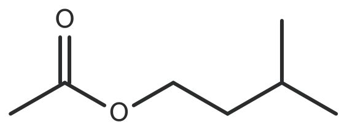{width=4cm}
:::

::: {custom-style="Legende"}
Figure 18. L'éthanoate de 3-méthylbutyle
:::

::: {custom-style="QRappel"}
**6.** Rendement
:::

$$n_\text{alcool} = \dfrac{\rho \times V}{M} = \dfrac{0{,}814 \times 54{,}1}{88{,}0} = 0{,}500\ \text{mol}$$

Les deux réactifs, à $0{,}500\ \text{mol}$ chacun, réagissent mole à mole : $x_\text{max} = 0{,}500\ \text{mol}$. L'ester a pour masse molaire $7 \times 12{,}0 + 14 \times 1{,}0 + 2 \times 16{,}0 = 130\ \text{g·mol}^{-1}$ :

$$n_\text{ester} = \dfrac{42{,}9}{130} = 0{,}330\ \text{mol} \qquad \eta = \dfrac{0{,}330}{0{,}500} = 0{,}660, \text{ soit } 66{,}0\ \%$$

# Corrigés du thème 2 : réactions et stratégie de synthèse {#c_theme2}

#### [Corrigé]{custom-style="NumCorrige"}\ \ Q.6 · Reconnaître une substitution, une addition ou une élimination {#c_q6}

::: {custom-style="Renvoi"}
[CIBLE:q6]{custom-style="BoutonEnonce"}
:::

Dans une substitution, un atome ou un groupe d'atomes d'une molécule est remplacé par un autre. Dans une addition, deux molécules s'unissent en une seule : une liaison multiple s'ouvre. Dans une élimination, une molécule perd des atomes qui partent sous forme d'une petite molécule, et une liaison multiple apparaît.

a. Le groupe $\text{-OH}$ remplace l'atome de brome : substitution.

b. L'eau se fixe sur la double liaison, qui devient simple : addition.

c. L'alcool perd une molécule d'eau et une double liaison $\text{C=C}$ apparaît : élimination.

d. Dans l'estérification, le groupe $\text{-OH}$ de l'acide est remplacé par le groupe $\text{-O-CH}_3$ de l'alcool : substitution.

e. La polymérisation de l'éthène est une suite d'additions : chaque double liaison s'ouvre pour lier le monomère à la chaîne.

::: {custom-style="Retenir"}
Comparer réactifs et produits : un groupe en remplace un autre (substitution), deux réactifs donnent un seul produit (addition), un réactif se scinde en libérant une petite molécule (élimination)
:::

#### [Corrigé]{custom-style="NumCorrige"}\ \ Q.7 · Reconnaître une réaction acide-base ou d'oxydoréduction {#c_q7}

::: {custom-style="Renvoi"}
[CIBLE:q7]{custom-style="BoutonEnonce"}
:::

Une réaction acide-base est un transfert d'ion $\text{H}^{\text{+}}$ ; une réaction d'oxydoréduction est un transfert d'électrons. En chimie organique, une espèce qui perd des atomes d'hydrogène ou gagne des atomes d'oxygène est en général oxydée ; dans le cas inverse, elle est réduite.

a. L'acide éthanoïque cède un ion $\text{H}^{\text{+}}$ à l'ion hydroxyde : réaction acide-base.

b. L'éthanol perd deux atomes d'hydrogène : il est oxydé. Demi-équation du couple éthanal/éthanol :

$$\text{CH}_3\text{-CH}_2\text{-OH} = \text{CH}_3\text{-CHO} + 2\,\text{H}^{\text{+}} + 2\,\text{e}^-$$

c. La propanone gagne deux atomes d'hydrogène : elle est réduite. Cette réaction est à la fois une addition, sur la double liaison $\text{C=O}$, et une réduction.

::: {custom-style="Piege"}
[Piège.]{custom-style="EtiqPiege"} Croire qu'une réaction n'a qu'une catégorie : l'hydrogénation d'une double liaison est une addition et une réduction.
:::

#### [Corrigé]{custom-style="NumCorrige"}\ \ Q.8 · Identifier un produit grâce à la conservation des éléments {#c_q8}

::: {custom-style="Renvoi"}
[CIBLE:q8]{custom-style="BoutonEnonce"}
:::

::: {custom-style="Methode"}
[Méthode.]{custom-style="EtiqMethode"} Compter, pour chaque élément, les atomes des réactifs puis ceux des produits connus ; la différence donne la formule brute de l'espèce manquante, que l'on identifie.
:::

a. Carbone : $5 + 2 = 7$, déjà tous dans l'ester. Hydrogène : $12 + 4 = 16$, dont 14 dans l'ester ; il en reste 2. Oxygène : $1 + 2 = 3$, dont 2 dans l'ester ; il en reste 1. X a pour formule $\text{H}_2\text{O}$ : c'est l'eau.

$$\text{C}_5\text{H}_{12}\text{O} + \text{C}_2\text{H}_4\text{O}_2 \rightarrow \text{C}_7\text{H}_{14}\text{O}_2 + \text{H}_2\text{O}$$

b. Carbone : $7 + 4 - 9 = 2$ ; hydrogène : $6 + 6 - 8 = 4$ ; oxygène : $3 + 3 - 4 = 2$. Y a pour formule $\text{C}_2\text{H}_4\text{O}_2$ : c'est l'acide éthanoïque.

$$\text{C}_7\text{H}_6\text{O}_3 + \text{C}_4\text{H}_6\text{O}_3 \rightarrow \text{C}_9\text{H}_8\text{O}_4 + \text{C}_2\text{H}_4\text{O}_2$$

#### [Corrigé]{custom-style="NumCorrige"}\ \ Q.9 · Écrire une estérification, une hydrolyse et une saponification {#c_q9}

::: {custom-style="Renvoi"}
[CIBLE:q9]{custom-style="BoutonEnonce"}
:::

Un ester $\text{R-COO-R'}$ se forme à partir de l'acide $\text{R-COOH}$ et de l'alcool $\text{R'-OH}$ : la partie R' liée à l'oxygène vient de l'alcool. Le méthanoate d'éthyle, $\text{HCOO-CH}_2\text{-CH}_3$, provient de l'acide méthanoïque et de l'éthanol :

$$\text{HCOOH} + \text{CH}_3\text{-CH}_2\text{-OH} \rightleftarrows \text{HCOO-CH}_2\text{-CH}_3 + \text{H}_2\text{O}$$

L'hydrolyse est la réaction inverse : $\text{HCOO-CH}_2\text{-CH}_3 + \text{H}_2\text{O} \rightleftarrows \text{HCOOH} + \text{CH}_3\text{-CH}_2\text{-OH}$. La saponification fait réagir l'ester avec les ions hydroxyde :

$$\text{HCOO-CH}_2\text{-CH}_3 + \text{HO}^- \rightarrow \text{HCOO}^- + \text{CH}_3\text{-CH}_2\text{-OH}$$

L'estérification et l'hydrolyse sont lentes et non totales : elles aboutissent au même état d'équilibre. La saponification est lente mais totale ; c'est elle qui fabrique les savons, à partir des graisses.

Un marquage isotopique permet de savoir quelle liaison se rompt lors de l'estérification. Avec un alcool dont l'atome d'oxygène est l'isotope $^{18}\text{O}$, l'isotope se retrouve dans l'ester, et l'eau formée n'est pas marquée. C'est donc la liaison $\text{C-OH}$ de l'acide qui est rompue : son groupe hydroxyle forme l'eau avec l'atome d'hydrogène de l'alcool.

L'ion oléate, $\text{C}_{17}\text{H}_{33}\text{-COO}^-$, a deux parties. La tête carboxylate, chargée, interagit avec l'eau : elle est hydrophile. La longue chaîne carbonée, apolaire, se mêle aux graisses : elle est lipophile. Une espèce qui réunit ces deux parties est amphiphile ; dans l'eau, les ions du savon entourent les graisses et les décrochent.

::: {custom-style="Piege"}
[Piège.]{custom-style="EtiqPiege"} Confondre lente et non totale : la lenteur concerne la vitesse, le caractère non total concerne l'état final. Un catalyseur rend l'estérification plus rapide, pas totale.
:::

#### [Corrigé]{custom-style="NumCorrige"}\ \ Q.10 · Élaborer une séquence réactionnelle à partir d'une banque de réactions {#c_q10}

::: {custom-style="Renvoi"}
[CIBLE:q10]{custom-style="BoutonEnonce"}
:::

::: {custom-style="Methode"}
[Méthode.]{custom-style="EtiqMethode"} Partir de la molécule cible : repérer son groupe caractéristique et les fragments qui la composent, puis remonter étape par étape, avec la banque de réactions, jusqu'aux réactifs disponibles.
:::

L'éthanoate d'éthyle s'obtient par estérification (R3) de l'acide éthanoïque par l'éthanol. L'éthanol se prépare par hydratation de l'éthène (R1) ; l'acide éthanoïque, par oxydation de l'éthanol (R2). D'où la séquence :

1. Hydratation de l'éthène, une addition : $\text{CH}_2\text{=CH}_2 + \text{H}_2\text{O} \rightarrow \text{CH}_3\text{-CH}_2\text{-OH}$.
2. Oxydation d'une partie de l'éthanol, une oxydoréduction, selon la demi-équation $\text{CH}_3\text{-CH}_2\text{-OH} + \text{H}_2\text{O} = \text{CH}_3\text{-COOH} + 4\,\text{H}^{\text{+}} + 4\,\text{e}^-$.
3. Estérification, une substitution : $\text{CH}_3\text{-COOH} + \text{CH}_3\text{-CH}_2\text{-OH} \rightleftarrows \text{CH}_3\text{-COO-CH}_2\text{-CH}_3 + \text{H}_2\text{O}$.

La réaction R4 ne sert pas : il n'y a pas de bromoalcane au départ.

#### [Corrigé]{custom-style="NumCorrige"}\ \ Q.11 · Justifier une étape de protection et de déprotection {#c_q11}

::: {custom-style="Renvoi"}
[CIBLE:q11]{custom-style="BoutonEnonce"}
:::

Chaque acide aminé possède un groupe amine et un groupe carboxyle. Le groupe carboxyle de la glycine ou de l'alanine peut réagir avec le groupe amine de la glycine ou de l'alanine : $2 \times 2 = 4$ dipeptides sont possibles, Gly-Gly, Gly-Ala, Ala-Gly et Ala-Ala. Le rendement en Gly-Ala est faible et il faut séparer les produits.

Stratégie :

1. Protéger le groupe amine de la glycine, pour qu'il ne puisse pas réagir.
2. Protéger le groupe carboxyle de l'alanine, par exemple en le transformant en ester par estérification.
3. Faire réagir les deux espèces protégées : seuls le groupe carboxyle de la glycine et le groupe amine de l'alanine sont libres, il ne se forme que Gly-Ala protégé.
4. Déprotéger les deux groupes, dans des conditions qui ne coupent pas la liaison amide formée.

::: {custom-style="Retenir"}
Protéger un groupe, c'est le transformer de façon réversible pour qu'il ne réagisse pas ; le groupe protecteur doit se fixer sélectivement, résister aux conditions de la réaction et s'éliminer facilement à la fin
:::

#### [Corrigé]{custom-style="NumCorrige"}\ \ Exercice 2 · Un édulcorant, l'aspartame {#c_ex2}

::: {custom-style="Renvoi"}
[CIBLE:ex2]{custom-style="BoutonEnonce"}
:::

::: {custom-style="QRappel"}
**1.** Groupes caractéristiques
:::

La phénylalanine méthylée porte un groupe amine et un groupe ester. L'aspartame porte un groupe carboxyle, un groupe amine, un groupe amide et un groupe ester. Le groupe amide, $\text{-CO-NH-}$, est créé par la réaction.

::: {custom-style="QRappel"}
**2.** Conservation des éléments et catégorie
:::

Carbone : $4 + 10 = 14$ ; hydrogène : $7 + 13 = 20 = 18 + 2$ ; azote : $1 + 1 = 2$ ; oxygène : $4 + 2 = 6 = 5 + 1$. Les éléments sont conservés :

$$\text{C}_4\text{H}_7\text{NO}_4 + \text{C}_{10}\text{H}_{13}\text{NO}_2 \rightarrow \text{C}_{14}\text{H}_{18}\text{N}_2\text{O}_5 + \text{H}_2\text{O}$$

Le groupe $\text{-OH}$ du groupe carboxyle de l'acide aspartique est remplacé par le groupe $\text{-NH-}$ de la phénylalanine méthylée : c'est une substitution.

::: {custom-style="QRappel"}
**3.** Polarisation et sites
:::

$\chi(\text{O}) - \chi(\text{C}) = 3{,}44 - 2{,}55 = 0{,}89$ : la liaison $\text{C=O}$ est polarisée, l'oxygène porte une charge partielle $\delta^-$ et le carbone une charge partielle $\delta^{\text{+}}$. Le carbone du groupe carboxyle est le site accepteur de doublet d'électrons ; l'atome d'azote du groupe amine, qui porte un doublet non liant, est le site donneur.

::: {custom-style="QRappel"}
**4.** Flèches courbes
:::

Une flèche part du doublet non liant de l'azote et pointe vers l'atome de carbone : elle représente la formation de la liaison $\text{N-C}$. Une seconde flèche part de la double liaison $\text{C=O}$ et pointe vers l'atome d'oxygène : un des deux doublets de la liaison devient un doublet non liant de l'oxygène, qui porte alors une charge négative (figure 19).

::: {custom-style="Figure"}
{width=8cm}
:::

::: {custom-style="Legende"}
Figure 19. Les flèches courbes de l'étape 1
:::

::: {custom-style="QRappel"}
**5.** Intermédiaire réactionnel
:::

L'espèce formée à l'étape 1 est produite puis consommée à l'étape 2 ; elle n'apparaît pas dans l'équation de la réaction : c'est un intermédiaire réactionnel. À l'étape 2, elle perd une molécule d'eau et la double liaison $\text{C=O}$ se reforme : c'est une élimination.

::: {custom-style="QRappel"}
**6.** Sélectivité et stratégie
:::

L'acide aspartique possède deux groupes carboxyle et un groupe amine. Le groupe amine de la phénylalanine méthylée peut réagir avec l'un ou l'autre groupe carboxyle, et le groupe amine d'une molécule d'acide aspartique peut réagir avec un groupe carboxyle d'une autre : on obtient un mélange de produits et peu d'aspartame. Il faut protéger le groupe amine et le groupe carboxyle de la chaîne latérale de l'acide aspartique, faire réagir avec la phénylalanine méthylée, dont le groupe carboxyle est déjà protégé sous forme d'ester méthylique, puis déprotéger l'acide aspartique sans hydrolyser l'ester, qui fait partie de l'aspartame.

#### [Corrigé]{custom-style="NumCorrige"}\ \ Exercice 3 · La cétone de framboise {#c_ex3}

::: {custom-style="Renvoi"}
[CIBLE:ex3]{custom-style="BoutonEnonce"}
:::

::: {custom-style="QRappel"}
**1.** Groupes caractéristiques
:::

La frambinone porte un groupe hydroxyle, lié au cycle, et un groupe carbonyle situé entre deux atomes de carbone : c'est une cétone, d'où son nom.

::: {custom-style="QRappel"}
**2.** Formules brutes et équation de l'étape 1
:::

A : $\text{C}_7\text{H}_6\text{O}_2$ ; B : $\text{C}_{10}\text{H}_{10}\text{O}_2$ ; frambinone : $\text{C}_{10}\text{H}_{12}\text{O}_2$. La propanone a pour formule $\text{C}_3\text{H}_6\text{O}$ :

$$\text{C}_7\text{H}_6\text{O}_2 + \text{C}_3\text{H}_6\text{O} \rightarrow \text{C}_{10}\text{H}_{10}\text{O}_2 + \text{H}_2\text{O}$$

Carbone : $7 + 3 = 10$ ; hydrogène : $6 + 6 = 10 + 2$ ; oxygène : $2 + 1 = 2 + 1$. L'équation est équilibrée.

::: {custom-style="QRappel"}
**3.** Addition puis élimination
:::

L'addition de la propanone sur le groupe carbonyle de A forme un alcool ; l'élimination lui retire une molécule d'eau. Une double liaison $\text{C=C}$ apparaît dans B, entre le carbone lié au cycle et son voisin.

::: {custom-style="QRappel"}
**4.** Rôle de la propanone
:::

A est peu soluble dans l'eau mais très soluble dans la propanone, et la propanone est miscible à la solution aqueuse d'hydroxyde de sodium : le milieu est homogène, les réactifs se rencontrent. En excès, la propanone permet de consommer tout le 4-hydroxybenzaldéhyde.

::: {custom-style="QRappel"}
**5.** Catégories
:::

Dans le premier acte, la propanone cède un ion $\text{H}^{\text{+}}$ à l'ion hydroxyde : c'est une réaction acide-base, où l'ion hydroxyde joue le rôle de base. Régénérés ensuite, les ions hydroxyde n'apparaissent pas dans l'équation de l'étape 1 : ils la catalysent. L'étape 2 est une addition de dihydrogène sur la double liaison $\text{C=C}$, et une réduction de B.

::: {custom-style="QRappel"}
**6.** Rendement
:::

$$n(\text{A}) = \dfrac{2{,}44}{122} = 2{,}00 \times 10^{-2}\ \text{mol} \qquad m_\text{max} = 2{,}00 \times 10^{-2} \times 164 = 3{,}28\ \text{g}$$

Chaque molécule de A donne une molécule de B, puis une de frambinone :

$$\eta = \dfrac{2{,}13}{3{,}28} = 0{,}649, \text{ soit } 64{,}9\ \%$$

# Corrigés du thème 3 : protocole, purification, analyse et rendement {#c_theme3}

#### [Corrigé]{custom-style="NumCorrige"}\ \ Q.12 · Identifier les étapes d'un protocole et le rôle d'un chauffage à reflux {#c_q12}

::: {custom-style="Renvoi"}
[CIBLE:q12]{custom-style="BoutonEnonce"}
:::

Éléments du montage (figure 20) : 1, réfrigérant à boules ; 2, entrée d'eau ; 3, sortie d'eau ; 4, ballon ; 5, mélange réactionnel et pierre ponce ; 6, chauffe-ballon. L'eau entre par le bas du réfrigérant et sort par le haut, pour que le manchon reste plein.

Le chauffage accélère la transformation : la température est un facteur cinétique. Le réfrigérant condense les vapeurs, qui retombent dans le ballon : on chauffe sans perdre de matière. Le haut du réfrigérant reste ouvert, pour que la pression ne monte pas dans le montage. Le chauffe-ballon repose sur un support élévateur, que l'on abaisse pour arrêter rapidement le chauffage. La pierre ponce régularise l'ébullition et évite les projections.

Opérations : (1) transformation ; (2) isolement du produit, par extraction ; (3) et (4) purification, par lavage puis séchage ; (5) analyse.

::: {custom-style="Figure"}
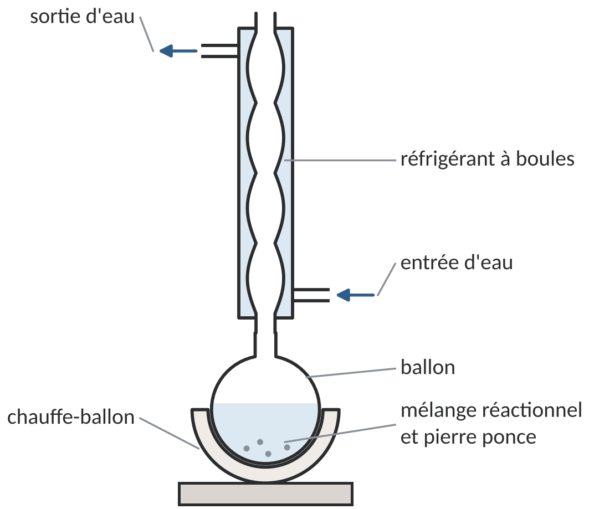{width=5.6cm}
:::

::: {custom-style="Legende"}
Figure 20. Le montage de chauffage à reflux
:::

<!--colonnes: 24 32 44-->

| Pictogramme | Danger signalé | Précautions |
|---|---|---|
| Flamme | Espèce inflammable | Aucune flamme nue : chauffe-ballon, et reflux qui retient les vapeurs |
| Corrosion : un liquide ronge une main et une surface | Brûlures graves de la peau et des yeux | Gants, lunettes, blouse ; versement lent, sous la hotte |
| Point d'exclamation | Irritant ou nocif | Gants, lunettes ; travail sous la hotte |

Deux autres pictogrammes reviennent souvent : la silhouette marquée d'une étoile, danger grave pour la santé, et la tête de mort, toxicité aiguë ; ils imposent la hotte et les gants. Pour cette synthèse : blouse en coton fermée, lunettes et gants ; l'acide sulfurique est prélevé et versé sous la hotte, goutte à goutte ; le mélange, qui contient un alcool inflammable, est chauffé au chauffe-ballon et à reflux, jamais à la flamme.

#### [Corrigé]{custom-style="NumCorrige"}\ \ Q.13 · Distinguer ce qui accélère une synthèse de ce qui améliore son rendement {#c_q13}

::: {custom-style="Renvoi"}
[CIBLE:q13]{custom-style="BoutonEnonce"}
:::

a. Chauffer augmente la vitesse ; pour une estérification, dont la constante d'équilibre varie très peu avec la température, le rendement final ne change pas.

b. L'acide sulfurique est un catalyseur : il augmente la vitesse sans modifier l'état final, donc sans changer le rendement. Dissous dans le mélange, il est dans la même phase que les réactifs : c'est une catalyse homogène.

c. Un excès d'alcool déplace l'état d'équilibre : le quotient de réaction devient inférieur à la constante d'équilibre, la transformation progresse dans le sens direct, et le rendement, calculé par rapport à l'acide, augmente.

d. Éliminer l'eau maintient le quotient de réaction inférieur à la constante d'équilibre : la transformation se poursuit, le rendement augmente. On peut aussi remplacer l'acide carboxylique par l'anhydride d'acide correspondant, un acide « déshydraté » comme l'anhydride éthanoïque de l'aspirine (Q.8 b et Q.19) : il se forme alors un acide carboxylique à la place de l'eau, et le rendement n'est plus limité par un équilibre.

Avec le catalyseur, l'avancement augmente plus vite au début, mais il tend vers le même avancement final $x_\text{f}$ (figure 21) : le catalyseur ne change pas l'état final.

::: {custom-style="Figure"}
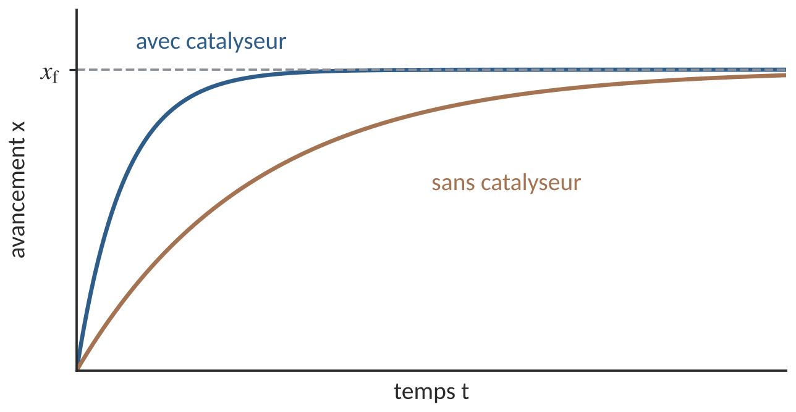{width=6.2cm}
:::

::: {custom-style="Legende"}
Figure 21. L'avancement au cours du temps, avec et sans catalyseur
:::

::: {custom-style="Remarque"}
[Remarque.]{custom-style="EtiqRemarque"} En catalyse homogène, catalyseur et réactifs sont dans la même phase : la vitesse augmente avec la concentration du catalyseur. En catalyse hétérogène, le catalyseur est dans une autre phase, souvent un solide comme le nickel d'une hydrogénation : seule sa surface agit, d'où des catalyseurs en poudre ou en grille. En catalyse enzymatique, le catalyseur est une enzyme, très sélective.
:::

::: {custom-style="Retenir"}
Température, catalyseur et concentrations agissent sur la vitesse ; pour une estérification, le rendement s'améliore avec un réactif en excès ou l'élimination d'un produit (voir la fiche 12, Q.5)
:::

::: {custom-style="Piege"}
[Piège.]{custom-style="EtiqPiege"} Écrire qu'un catalyseur améliore le rendement, ou que chauffer améliore celui d'une estérification : ils permettent seulement d'atteindre plus vite l'état final.
:::

#### [Corrigé]{custom-style="NumCorrige"}\ \ Q.14 · Réaliser une extraction liquide-liquide {#c_q14}

::: {custom-style="Renvoi"}
[CIBLE:q14]{custom-style="BoutonEnonce"}
:::

Un solvant extracteur doit être non miscible avec la phase de départ et dissoudre beaucoup mieux l'espèce à extraire : le cyclohexane est non miscible avec l'eau et l'ester y est très soluble. Le cyclohexane ($d = 0{,}78$) est moins dense que l'eau : la phase organique est au-dessus, elle contient l'ester (figure 22).

::: {custom-style="Figure"}
{width=5.0cm}
:::

::: {custom-style="Legende"}
Figure 22. L'ampoule à décanter
:::

Une partie de l'acide éthanoïque, soluble dans le cyclohexane, accompagne l'ester. La solution d'hydrogénocarbonate de sodium le transforme en ions éthanoate, qui passent dans la phase aqueuse (à pH supérieur au $\text{p}K_\text{A}$ du couple, la forme basique prédomine : fiche 9, Q.18) :

$$\text{CH}_3\text{-COOH}(\text{aq}) + \text{HCO}_3^-(\text{aq}) \rightarrow \text{CH}_3\text{-COO}^-(\text{aq}) + \text{CO}_2(\text{g}) + \text{H}_2\text{O}(\ell)$$

Le dioxyde de carbone formé fait monter la pression : il faut dégazer souvent, en ouvrant le robinet de l'ampoule retournée. On vérifie avec du papier pH que la phase aqueuse de lavage reste basique : l'acide est alors éliminé. Le sulfate de magnésium anhydre est un desséchant : il fixe les dernières traces d'eau de la phase organique, ce qui évite l'hydrolyse de l'ester et préserve la pureté du produit.

::: {custom-style="Piege"}
[Piège.]{custom-style="EtiqPiege"} Placer la phase organique en haut par habitude : avec un solvant plus dense que l'eau, comme le dichlorométhane, elle est en bas. Il faut toujours comparer les densités.
:::

#### [Corrigé]{custom-style="NumCorrige"}\ \ Q.15 · Isoler et purifier un solide : précipitation, filtration et recristallisation {#c_q15}

::: {custom-style="Renvoi"}
[CIBLE:q15]{custom-style="BoutonEnonce"}
:::

Une précipitation est la formation d'un solide, le précipité, quand la quantité d'une espèce dissoute dépasse sa solubilité, masse maximale de cette espèce que l'on peut dissoudre dans un litre de solvant. On la provoque souvent en fin de synthèse, en refroidissant le milieu ou en ajoutant de l'eau froide quand le produit y est peu soluble (exercice 5), puis on récupère le solide par filtration.

On dissout le solide brut dans le minimum d'eau bouillante, puis on laisse refroidir lentement : P, beaucoup moins soluble à froid, cristallise, tandis que l'impureté I, soluble à froid, reste en solution. On récupère les cristaux par filtration.

$$V_\text{min} = \dfrac{5{,}0}{60} = 8{,}3 \times 10^{-2}\ \text{L} = 83\ \text{mL}$$

$$m_\text{dissoute} = 3{,}0 \times 8{,}3 \times 10^{-2} = 0{,}25\ \text{g} \qquad m_\text{récupérable} = 5{,}0 - 0{,}25 \approx 4{,}8\ \text{g}$$

On récupère au mieux $95\ \%$ du solide : c'est pourquoi on utilise le minimum de solvant chaud. Dans une filtration simple (figure 23, à gauche), on verse le mélange dans un entonnoir garni d'un papier filtre plissé, maintenu par un support à anneau : le liquide traverse le papier sous l'effet de son seul poids et le filtrat est recueilli dans un récipient, tandis que le solide reste sur le papier. La filtration sous vide, sur un entonnoir Büchner (figure 23, à droite), aspire le liquide : elle est plus rapide et donne un solide plus sec. On lave les cristaux à l'eau glacée pour entraîner la solution qui les imprègne, et l'impureté qu'elle contient, sans redissoudre P.

::: {custom-style="Figure"}
{width=15.5cm}
:::

::: {custom-style="Legende"}
Figure 23. La filtration simple et la filtration sous vide
:::

::: {custom-style="Retenir"}
Une recristallisation exige un solvant qui dissout bien le produit à chaud, mal à froid, et qui dissout les impuretés à froid
:::

#### [Corrigé]{custom-style="NumCorrige"}\ \ Q.16 · Purifier un liquide par distillation et extraire par hydrodistillation {#c_q16}

::: {custom-style="Renvoi"}
[CIBLE:q16]{custom-style="BoutonEnonce"}
:::

L'espèce la plus volatile, celle dont la température d'ébullition est la plus basse, distille la première : c'est le cyclohexane. Tant qu'il distille, le thermomètre indique $81\ \text{°C}$ ; la température monte ensuite vers $111\ \text{°C}$ quand le toluène commence à passer.

Dans la colonne de Vigreux (figure 24), la vapeur se condense et se vaporise plusieurs fois : elle s'enrichit en espèce la plus volatile en montant. Une distillation est commode quand les températures d'ébullition sont assez éloignées ; sinon, il faut une colonne de Vigreux plus haute. Le réservoir du thermomètre est placé à la hauteur du bras latéral, pour mesurer la température de la vapeur qui part vers le réfrigérant.

::: {custom-style="Figure"}
{width=7.2cm}
:::

::: {custom-style="Legende"}
Figure 24. La distillation fractionnée
:::

Dans une hydrodistillation, le ballon contient la plante et de l'eau ; le montage est celui de la figure 24, sans colonne de Vigreux. La vapeur d'eau entraîne les espèces volatiles de la plante, et le distillat recueilli se sépare en deux phases. L'huile essentielle, de densité $0{,}89$ et très peu soluble dans l'eau, forme la phase supérieure ; on la sépare par décantation.

#### [Corrigé]{custom-style="NumCorrige"}\ \ Q.17 · Contrôler la pureté : température de fusion et CCM {#c_q17}

::: {custom-style="Renvoi"}
[CIBLE:q17]{custom-style="BoutonEnonce"}
:::

Le rapport frontal est le quotient de la distance parcourue par l'espèce, $h$, par celle parcourue par l'éluant, $H$, mesurées depuis la ligne de dépôt (figure 25) :

$$R_\text{f}(\text{aspirine}) = \dfrac{4{,}2}{6{,}0} = 0{,}70 \qquad R_\text{f}(\text{acide salicylique}) = \dfrac{1{,}8}{6{,}0} = 0{,}30$$

Le produit brut C donne deux taches, à la hauteur de l'aspirine et de l'acide salicylique : il contient de l'aspirine et du réactif qui n'a pas réagi. Le produit recristallisé D ne donne qu'une tache, à la hauteur de l'aspirine : aucune impureté n'est détectée. Sa température de fusion est celle de l'aspirine : le produit est de l'aspirine, sans impureté détectable.

::: {custom-style="Figure"}
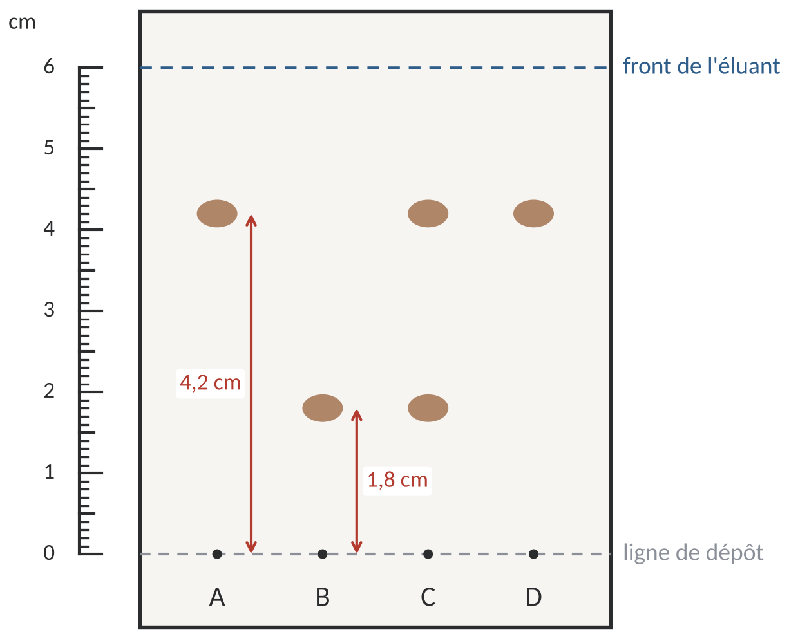{width=6cm}
:::

::: {custom-style="Legende"}
Figure 25. Mesure des rapports frontaux
:::

::: {custom-style="Piege"}
[Piège.]{custom-style="EtiqPiege"} Conclure qu'une espèce est pure parce qu'elle donne une seule tache : une impureté qui migre à la même hauteur, ou qui n'est pas révélée, passe inaperçue. La température de fusion complète le contrôle. On peut aussi titrer l'espèce synthétisée et comparer la masse trouvée à la masse pesée, incertitudes comprises (fiche 10, Q.15 et Q.16).
:::

#### [Corrigé]{custom-style="NumCorrige"}\ \ Q.18 · Exploiter un spectre infrarouge {#c_q18}

::: {custom-style="Renvoi"}
[CIBLE:q18]{custom-style="BoutonEnonce"}
:::

Un spectre infrarouge donne la transmittance $T$ de l'échantillon, c'est-à-dire la part du rayonnement infrarouge qui le traverse, en fonction du nombre d'onde $\sigma = 1/\lambda$, porté en abscisse et décroissant de gauche à droite. Si $T = 100\ \%$, rien n'est absorbé ; si $T$ est proche de $0\ \%$, presque tout l'est. Chaque type de liaison absorbe autour d'un nombre d'onde qui lui est propre : la transmittance chute alors et la courbe présente un creux, la bande d'absorption. Comme en spectrophotométrie UV-visible, on exploite l'absorption d'un rayonnement par l'échantillon ; seul le domaine de longueurs d'onde change.

Le spectre 1 présente une bande forte et large vers $3\,340\ \text{cm}^{-1}$, caractéristique de la liaison $\text{O-H}$ d'un alcool, et aucune bande vers $1\,700\ \text{cm}^{-1}$ : c'est le butan-1-ol. Le spectre 2 présente une bande forte et fine vers $1\,715\ \text{cm}^{-1}$, caractéristique de la liaison $\text{C=O}$, et aucune bande large au-dessus de $3\,000\ \text{cm}^{-1}$ : c'est la butanone. Les deux spectres ont des bandes vers $2\,950\ \text{cm}^{-1}$, dues aux liaisons $\text{C-H}$.

$$\sigma = \dfrac{1}{\lambda} = \dfrac{1}{5{,}85 \times 10^{-4}\ \text{cm}} = 1{,}71 \times 10^{3}\ \text{cm}^{-1}$$

Cette bande, du spectre 2, correspond à la liaison $\text{C=O}$ de la butanone.

::: {custom-style="Methode"}
[Méthode.]{custom-style="EtiqMethode"} Repérer d'abord les bandes au-dessus de $1\,500\ \text{cm}^{-1}$, les plus sûres à attribuer ; en dessous, ne retenir que les bandes fortes que donne la table, comme $\text{C-O}$ ; relier chacune à une liaison, puis vérifier aussi l'absence des bandes attendues pour les autres espèces.
:::

#### [Corrigé]{custom-style="NumCorrige"}\ \ Q.19 · Calculer une masse maximale et un rendement {#c_q19}

::: {custom-style="Renvoi"}
[CIBLE:q19]{custom-style="BoutonEnonce"}
:::

$$n_\text{acide} = \dfrac{2{,}76}{138} = 2{,}00 \times 10^{-2}\ \text{mol} \qquad n_\text{anhydride} = \dfrac{\rho \times V}{M} = \dfrac{1{,}08 \times 5{,}0}{102} = 5{,}3 \times 10^{-2}\ \text{mol}$$

Les réactifs réagissent mole à mole : l'acide salicylique est le réactif limitant, $x_\text{max} = 2{,}00 \times 10^{-2}\ \text{mol}$.

$$m_\text{max} = 2{,}00 \times 10^{-2} \times 180 = 3{,}60\ \text{g} \qquad \eta = \dfrac{2{,}88}{3{,}60} = 0{,}800, \text{ soit } 80{,}0\ \%$$

Pour deux étapes successives, le rendement global est le produit des rendements : $0{,}800 \times 0{,}75 = 0{,}60$, soit $60\ \%$.

Pour l'équation $2\,\text{A} + \text{B} \rightarrow 3\,\text{C} + \text{D}$, les quantités consommées sont $2\,x$ pour A et $x$ pour B. A s'épuise pour $x = 3{,}0/2 = 1{,}5\ \text{mol}$, B pour $x = 1{,}0\ \text{mol}$ : B est limitant, $x_\text{max} = 1{,}0\ \text{mol}$, et $n_\text{max}(\text{C}) = 3 \times x_\text{max} = 3{,}0\ \text{mol}$.

::: {custom-style="Methode"}
[Méthode.]{custom-style="EtiqMethode"} Pour $a\,\text{A} + b\,\text{B} \rightarrow c\,\text{C} + d\,\text{D}$, $x_\text{max}$ est la plus petite des valeurs $n(\text{A})/a$ et $n(\text{B})/b$, et $n_\text{max}(\text{C}) = c \times x_\text{max}$. Masse à peser et pourcentage massique : fiche 9, Q.1 et Q.2.
:::

::: {custom-style="Piege"}
[Piège.]{custom-style="EtiqPiege"} Calculer la masse maximale avec le réactif en excès, ou oublier les nombres stœchiométriques : $n_\text{max}$ se déduit de l'avancement maximal.
:::

#### [Corrigé]{custom-style="NumCorrige"}\ \ Q.20 · Comparer deux protocoles : énergie consommée et choix d'une voie de synthèse {#c_q20}

::: {custom-style="Renvoi"}
[CIBLE:q20]{custom-style="BoutonEnonce"}
:::

L'énergie électrique consommée vaut $E = P \times \Delta t$, avec $\Delta t$ en secondes, et $1\ \text{kW·h} = 3{,}6 \times 10^{6}\ \text{J}$.

$$E_\text{A} = 250 \times 45 \times 60 = 6{,}75 \times 10^{5}\ \text{J} = 0{,}19\ \text{kW·h} \qquad E_\text{B} = 800 \times 3 \times 60 = 1{,}44 \times 10^{5}\ \text{J} = 0{,}040\ \text{kW·h}$$

Masses obtenues : $0{,}80 \times 3{,}60 = 2{,}88\ \text{g}$ pour A et $0{,}70 \times 3{,}60 = 2{,}52\ \text{g}$ pour B.

$$\dfrac{E_\text{A}}{m_\text{A}} = \dfrac{6{,}75 \times 10^{5}}{2{,}88} = 2{,}3 \times 10^{5}\ \text{J·g}^{-1} \qquad \dfrac{E_\text{B}}{m_\text{B}} = \dfrac{1{,}44 \times 10^{5}}{2{,}52} = 5{,}7 \times 10^{4}\ \text{J·g}^{-1}$$

Malgré son rendement plus faible, le protocole B consomme environ quatre fois moins d'énergie par gramme d'aspirine et dure quinze fois moins longtemps : il est préférable de ce point de vue. Autres critères : la toxicité des réactifs et des solvants, la sécurité, la quantité de déchets, le coût des réactifs.

#### [Corrigé]{custom-style="NumCorrige"}\ \ Exercice 4 · L'alcool de champignon {#c_ex4}

::: {custom-style="Renvoi"}
[CIBLE:ex4]{custom-style="BoutonEnonce"}
:::

::: {custom-style="QRappel"}
**1.** Chauffage à reflux
:::

Le chauffage accélère la transformation, la température étant un facteur cinétique ; le reflux condense les vapeurs, d'éther surtout, très volatil, et les renvoie dans le ballon : on évite les pertes de matière.

::: {custom-style="QRappel"}
**2.** Séparation des phases
:::

L'éther diéthylique ($d = 0{,}71$) est moins dense que la solution aqueuse : la phase organique est au-dessus. L'alcool de champignon, très peu soluble dans l'eau, est dans la phase organique. La phase aqueuse contient les ions $\text{Mg}^{\text{2+}}$, $\text{Br}^-$, $\text{NH}_4^{\text{+}}$ et $\text{Cl}^-$, ainsi que l'ammoniac.

::: {custom-style="QRappel"}
**3.** Distillation fractionnée
:::

Les espèces passent par ordre de température d'ébullition croissante : l'éther ($35\ \text{°C}$), puis l'acroléine qui reste ($53\ \text{°C}$), enfin l'alcool de champignon. Pendant qu'on le recueille, la température en tête de colonne reste égale à $175\ \text{°C}$.

::: {custom-style="QRappel"}
**4.** Spectre infrarouge
:::

La bande forte et large vers $3\,350\ \text{cm}^{-1}$ est celle de la liaison $\text{O-H}$ d'un alcool ; la petite bande fine vers $1\,645\ \text{cm}^{-1}$ correspond à la liaison $\text{C=C}$ ; les bandes vers $2\,930\ \text{cm}^{-1}$ aux liaisons $\text{C-H}$. Le spectre est compatible avec l'alcool de champignon. Il n'y a aucune bande forte entre $1\,650$ et $1\,750\ \text{cm}^{-1}$ : pas de liaison $\text{C=O}$, donc plus d'acroléine.

::: {custom-style="QRappel"}
**5.** Chromatographie
:::

$$R_\text{f} = \dfrac{h}{H} = \dfrac{2{,}2}{5{,}0} = 0{,}44$$

Le dépôt 2 donne deux taches : l'une à la hauteur de l'acroléine, l'autre à $R_\text{f} = 0{,}44$ ; avant distillation, la phase organique contenait encore de l'acroléine. Le dépôt 3 ne donne que la tache du produit : la distillation a éliminé l'acroléine.

::: {custom-style="QRappel"}
**6.** Rendement
:::

L'acroléine est en excès : le bromure de pentylmagnésium est le réactif limitant.

$$n = 2{,}00 \times 10{,}0 \times 10^{-3} = 2{,}00 \times 10^{-2}\ \text{mol} \qquad m_\text{max} = 2{,}00 \times 10^{-2} \times 128 = 2{,}56\ \text{g} \qquad \eta = \dfrac{2{,}25}{2{,}56} = 0{,}879$$

Avec la concentration réelle : $n = 1{,}94 \times 10^{-2}\ \text{mol}$, $m_\text{max} = 2{,}483\ \text{g}$ et $\eta = \dfrac{2{,}25}{2{,}483} = 0{,}906$. Le rendement est de $90{,}6\ \%$ : la valeur de $87{,}9\ \%$ sous-estimait l'efficacité de la synthèse.

#### [Corrigé]{custom-style="NumCorrige"}\ \ Exercice 5 · Une coumarine fluorescente {#c_ex5}

::: {custom-style="Renvoi"}
[CIBLE:ex5]{custom-style="BoutonEnonce"}
:::

::: {custom-style="QRappel"}
**1.** Identification de X
:::

Réactifs : $\text{C}_6\text{H}_6\text{O}_2 + \text{C}_6\text{H}_{10}\text{O}_3$, soit 12 C, 16 H et 5 O. Produits connus : $\text{C}_{10}\text{H}_8\text{O}_3 + \text{H}_2\text{O}$, soit 10 C, 10 H et 4 O. Il reste 2 C, 6 H et 1 O : X a pour formule $\text{C}_2\text{H}_6\text{O}$, c'est l'éthanol.

$$\text{C}_6\text{H}_6\text{O}_2 + \text{C}_6\text{H}_{10}\text{O}_3 \rightarrow \text{C}_{10}\text{H}_8\text{O}_3 + \text{H}_2\text{O} + \text{C}_2\text{H}_6\text{O}$$

::: {custom-style="QRappel"}
**2.** Groupes caractéristiques
:::

L'acétoacétate d'éthyle porte un groupe carbonyle entre deux carbones, de la famille des cétones, et un groupe ester.

::: {custom-style="QRappel"}
**3.** Catalyseur
:::

Un catalyseur accélère une transformation et se retrouve intact à la fin : il n'apparaît pas dans l'équation. L'APTS ne change pas le rendement ; il permet de l'atteindre plus vite et à plus basse température.

::: {custom-style="QRappel"}
**4.** Isolement et purification
:::

Le composé A est insoluble dans l'eau : l'eau froide le fait précipiter, alors que l'APTS et le résorcinol, très solubles, restent dissous. On filtre sous vide, sur Büchner ; l'eau froide du lavage entraîne la solution qui imprègne les cristaux sans dissoudre A. La recristallisation dans l'éthanol et l'eau élimine les réactifs restants, solubles à froid.

::: {custom-style="QRappel"}
**5.** Proportions et rendement
:::

$$n_\text{résorcinol} = \dfrac{2{,}20}{110} = 2{,}00 \times 10^{-2}\ \text{mol} \qquad n_\text{ester} = \dfrac{2{,}60}{130} = 2{,}00 \times 10^{-2}\ \text{mol}$$

Les réactifs réagissent mole à mole et sont introduits en quantités égales : ils sont dans les proportions stœchiométriques.

$$m_\text{max} = 2{,}00 \times 10^{-2} \times 176 = 3{,}52\ \text{g} \qquad \eta = \dfrac{2{,}0}{3{,}52} = 0{,}57, \text{ soit } 57\ \%$$

::: {custom-style="QRappel"}
**6.** Comparaison des deux voies
:::

Énergie consommée : $E_1 = 500 \times 20 \times 60 = 6{,}0 \times 10^{5}\ \text{J}$ pour la voie à l'acide sulfamique, $E_2 = 300 \times 10 \times 60 = 1{,}8 \times 10^{5}\ \text{J}$ pour la voie étudiée. Masses obtenues : $0{,}65 \times 3{,}52 = 2{,}29\ \text{g}$ et $2{,}0\ \text{g}$.

$$\dfrac{E_1}{m_1} = \dfrac{6{,}0 \times 10^{5}}{2{,}29} = 2{,}6 \times 10^{5}\ \text{J·g}^{-1} \qquad \dfrac{E_2}{m_2} = \dfrac{1{,}8 \times 10^{5}}{2{,}0} = 9{,}0 \times 10^{4}\ \text{J·g}^{-1}$$

La voie à l'acide sulfamique a le meilleur rendement, mais elle consomme environ trois fois plus d'énergie par gramme et chauffe à $130\ \text{°C}$ : la voie à l'APTS, au bain-marie à $60\ \text{°C}$, est plus économe et plus sûre.

```{=openxml}
<w:p><w:r><w:br w:type="page"/></w:r></w:p>
```

# Index des notions {#index}

Chaque notion renvoie aux questions de cours (Q) et aux exercices (Ex.) où elle est travaillée.

| Notion | Où la travailler |
|---|---|
| Acide aminé, liaison amide | Q.2, Q.11, Ex. 2 |
| Alcanes, alcènes, cycloalcanes | Q.1, Q.3 |
| Banque de réactions, séquence réactionnelle | Q.10, Ex. 3 |
| Catalyseur, catalyse homogène ou hétérogène | Q.13, Ex. 5 |
| Catégories de réactions : substitution, addition, élimination | Q.6, Ex. 2, Ex. 3 |
| Chauffage à reflux | Q.12, Ex. 4 |
| Chimie verte, énergie consommée | Q.20, Ex. 5 |
| Chromatographie sur couche mince, rapport frontal | Q.17, Ex. 4 |
| Classes d'alcools et d'amines | Q.2 |
| Conservation des éléments | Q.8, Ex. 2, Ex. 3, Ex. 5 |
| Distillation, hydrodistillation | Q.16, Ex. 4 |
| Estérification, hydrolyse, saponification | Q.9, Q.13, Ex. 1 |
| Extraction liquide-liquide, ampoule à décanter | Q.14, Ex. 4 |
| Filtration, précipitation, recristallisation | Q.15, Ex. 5 |
| Formules brute, semi-développée, topologique | Q.1, Ex. 1, Ex. 3 |
| Groupes caractéristiques, familles | Q.2, Ex. 1, Ex. 2, Ex. 3, Ex. 5 |
| Isomérie de constitution ; isomérie Z/E (complément hors programme) | Q.4, Ex. 1 |
| Mécanisme, flèches courbes | Ex. 2 |
| Nomenclature, halogènes | Q.3, Ex. 1 |
| Oxydoréduction et acide-base en chimie organique | Q.7, Ex. 3 |
| Pictogrammes de sécurité, précautions | Q.12 |
| Polymère, motif, monomère, craquage, reformage | Q.5 |
| Protection et déprotection | Q.11, Ex. 2 |
| Rendement, réactif limitant | Q.19, Ex. 1, Ex. 3, Ex. 4, Ex. 5 |
| Savon : parties hydrophile et lipophile | Q.9 |
| Spectroscopie infrarouge | Q.18, Ex. 1, Ex. 4 |
| Température de fusion, banc Kofler | Q.17 |
| Transmittance, bande d'absorption | Q.18, Ex. 1, Ex. 4 |

<!--fin:complet-->
