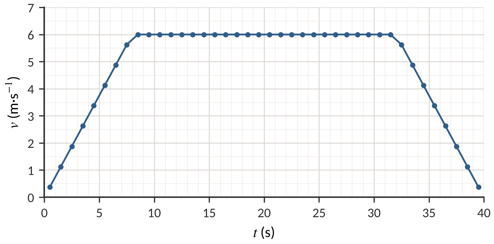
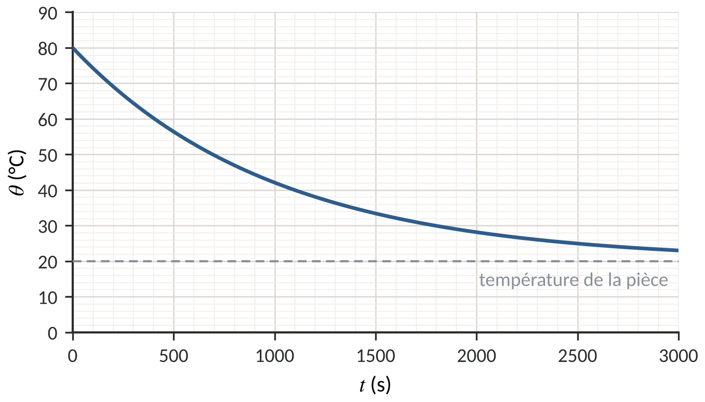
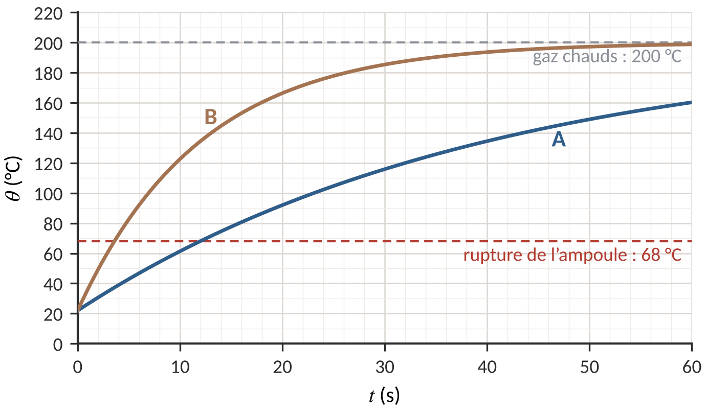
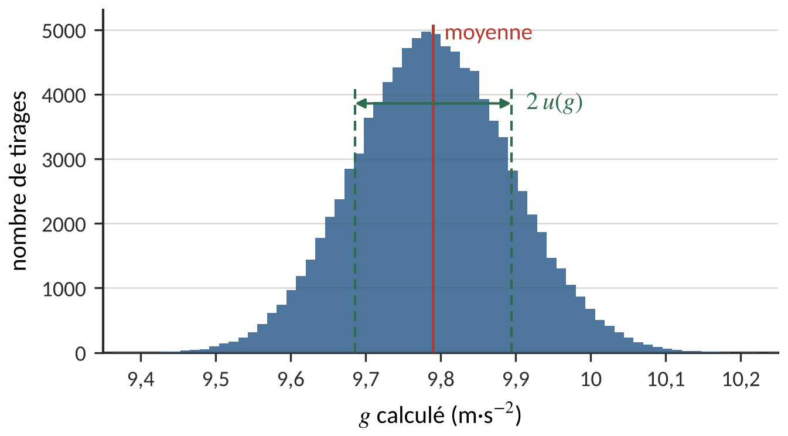
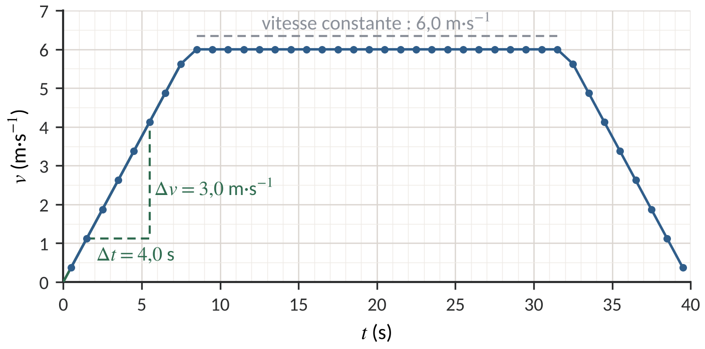
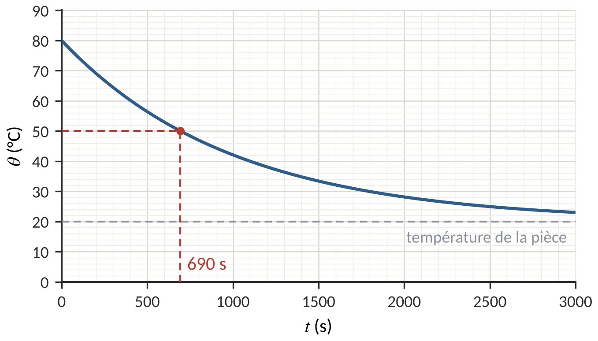
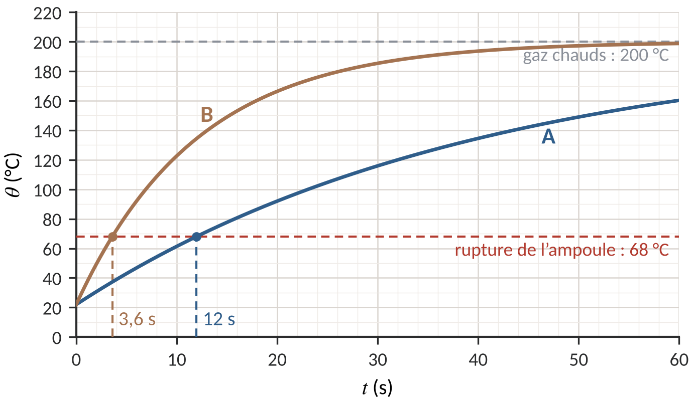

<!--meta {"numero": "14", "matiere": "Physique-Chimie", "titre": "Méthodes du BAC : incertitudes, Python, équations différentielles et rédaction", "titre_court": "Méthodes du BAC", "fichier": "MasterBac_PC_Fiche14_Methodes_du_BAC", "fichier_cahier": "MasterBac_PC_Fiche14_Cahier_enonces"} -->

<!--inclure:ouverture-->

# L'essentiel en une page {#essentiel}

::: {custom-style="Rubrique"}
À connaître par cœur
:::

<!--colonnes: 16 46 38-->

| Notion | Relation | À retenir |
|---|---|---|
| Écriture d'un résultat | $x = 9{,}79\ \text{m·s}^{-2}$ et $u(x) = 0{,}10\ \text{m·s}^{-2}$ | $u(x)$ a un ou deux chiffres significatifs ; $x$ s'arrête à la même décimale. |
| Incertitude-type de type A | $u(\overline{x}) = \dfrac{s}{\sqrt{n}}$ | $s$ : écart-type expérimental des $n$ mesures, noté $\sigma_{n-1}$ ; $\overline{x}$ : leur moyenne. |
| Comparaison à une référence | $z = \dfrac{\left|x - x_{\text{réf}}\right|}{u(x)}$ | Compatible si $z \leq 2$. Sinon, chercher une erreur dans le protocole ou le modèle. |
| Vitesse calculée en Python | `v[i] = (x[i+1]-x[i]) / (t[i+1]-t[i])` | Avec $n$ positions : $n - 1$ vitesses, puis $n - 2$ accélérations ; le premier indice est 0. |

::: {custom-style="Rubrique"}
À savoir retrouver
:::

<!--colonnes: 16 36 48-->

| Notion | Relation | Comment la retrouver |
|---|---|---|
| Équation du premier ordre | $\dfrac{\mathrm{d}y}{\mathrm{d}t} + \dfrac{y}{\tau} = \dfrac{y_f}{\tau}$ ($\tau$ en s, $y_f$ valeur finale) | Loi des mailles, premier principe, loi de vitesse, loi de décroissance radioactive ou deuxième loi de Newton. |
| Solution | $y(t) = y_f + (y_0 - y_f)\, e^{-t/\tau}$ | Reporter $A\, e^{-t/\tau} + B$ dans l'équation, puis $y(0) = y_0$. |
| Date d'un seuil, demi-vie | $t = \tau \ln \dfrac{y_0 - y_f}{y - y_f}$ et $t_{1/2} = \tau \ln 2$ | Isoler l'exponentielle, puis prendre le logarithme népérien. $t_{1/2}$ : demi-vie ou temps de demi-réaction. |

::: {custom-style="Rubrique"}
Fourni par l'énoncé, à savoir exploiter
:::

Les relations des incertitudes-types de type B et composées, la loi de Newton d'un transfert thermique, le modèle d'une force de frottement et le programme Python, dont on complète ou explique quelques lignes.

::: {custom-style="Rubrique"}
Les pièges qui coûtent des points
:::

- Recopier $u(x)$ avec tous les chiffres affichés, ou arrondir $x$ à une autre décimale que $u(x)$.
- Oublier qu'en Python `range(n)` va de 0 à $n - 1$, et écrire `^` pour une puissance au lieu de `**`.
- Confondre la constante de temps $\tau$ et la demi-vie $t_{1/2} = \tau \ln 2$.
- Conclure « c'est proche » sans calculer $z$, ou donner un résultat sans unité.

::: {custom-style="Rubrique"}
Votre parcours selon votre objectif
:::

<!--colonnes: 16 46 38-->

| Objectif | Questions de cours | Exercices |
|---|---|---|
| [\ Objectif 10\ ]{custom-style="Niv10"} | Q.1 à Q.3, Q.5, Q.6, Q.8, Q.11, Q.14, Q.16 à Q.18 | Ex. 1 (questions 1 à 3), Ex. 4 |
| [\ Objectif 14\ ]{custom-style="Niv14"} | Plus Q.4, Q.7, Q.9, Q.10, Q.12, Q.13, Q.19 | Ex. 1 et Ex. 4, Ex. 2 et Ex. 3 (questions 1 à 5) |
| [\ Objectif 18\ ]{custom-style="Niv18"} | Toutes | Tous |

```{=openxml}
<w:p><w:r><w:br w:type="page"/></w:r></w:p>
```

# Ce qui est tombé aux BAC 2025 et 2026 {#tombe}

Incertitudes et équations différentielles reviennent souvent (bilans sous le tableau). Le tableau retient, parmi les vingt-huit sujets, les quatorze exercices où il faut lire ou compléter un programme Python.

<!--colonnes: 21 24 41 14-->

| Session | Exercice | Notions de cette fiche | Pour s'y préparer |
|---|---|---|---|
| Métropole, juin 2026, jour 1 | L'odeur de Jasmin | Quantité de matière initiale, ligne de calcul à compléter | Q.6 |
| Métropole, juin 2026, jour 2 | Le kéfir de fruit | Simulation d'un titrage, volume à l'équivalence ; équation différentielle d'une cinétique | Q.6, Q.9, Q.11 |
| Métropole, septembre 2026, jour 1 | Loi de dilution d'Ostwald | Lignes d'un programme à compléter | Q.6 |
| Métropole, septembre 2026, jour 2 | Un champion du monde inattendu | Deux lignes d'un programme à compléter, une ligne à commenter | Q.6 |
| Antilles-Guyane 2026, jour 1 | Le césium 137 et l'essai Trinity | Simulation d'une décroissance radioactive ; équation différentielle et sa solution | Q.11, Q.13, Q.15 |
| Métropole, juin 2025, jour 2 | Eau de Quinton | Simulation d'un titrage, volume à l'équivalence ; incertitude-type | Q.4, Q.9 |
| Métropole 2025, jour 2 (sujet de secours) | Jeu de billes et gravité | Vitesse calculée entre deux positions, énergies ; quotient $z$ | Q.5, Q.7, Q.8 |
| Métropole, septembre 2025, jour 2 | La couleur des scarabées | Simulation d'un processus aléatoire, incertitude-type, écriture du résultat | Q.1, Q.10 |
| Amérique du Nord 2025, jour 1 | Physique et raccordements routiers | Coordonnées du vecteur accélération | Q.7, Ex. 2 |
| Amérique du Sud 2025, jour 1 | Tour Montparnasse | Accélération calculée à partir des vitesses, nombre de valeurs calculées | Q.6, Q.7, Ex. 2 |
| Centres étrangers 2025, jour 2 | Le trombone de Koenig | Rôle d'une boucle, ligne de calcul d'une longueur d'onde | Q.6 |
| Nouvelle-Calédonie 2025, jour 1 | De l'aspirine pour favoriser l'écoulement sanguin | Vitesse volumique de disparition calculée entre deux dates | Q.7 |
| Nouvelle-Calédonie 2025, jour 2 | La physique s'invite sur un terrain de rugby | Vitesse, énergies cinétique, potentielle et mécanique | Q.7, Q.8 |
| Polynésie 2025, jour 1 | Le Mölkky | Masse lue dans le calcul de l'énergie cinétique, ligne de l'énergie mécanique, courbes | Q.8 |

::: {custom-style="Intertitre"}
Ce qu'il faut en retenir
:::

- Aucun exercice ne fait écrire un programme entier : on complète une ou deux lignes ou on explique un calcul : vitesse ou accélération entre deux dates (cinq), énergies (trois) ou titrage (deux).
- Au moins dix-sept exercices demandent une incertitude-type ou un quotient $z$ ; la relation de l'incertitude composée est toujours fournie.
- Au moins dix-sept exercices font établir, résoudre ou vérifier une équation du premier ordre : condensateur, cinétique, radioactivité, chute dans un fluide, échauffement ou refroidissement (Q.11 à Q.15, Ex. 3).

::: {custom-style="Surtitre"}
Énoncés
:::

# Thème 1 : mesures et incertitudes {#theme1}

::: {custom-style="Rubrique"}
Questions de cours
:::

## [Q.1]{custom-style="QNum"}\ \ Écrire le résultat d'une mesure avec un nombre adapté de chiffres significatifs {#q1}

::: {custom-style="Meta"}
[\ Objectif 10\ ]{custom-style="Niv10"}\ \ Cours · Notions : incertitude-type, chiffres significatifs · Demandé en 2025 et 2026\ \ \ [CIBLE:c_q1]{custom-style="BoutonCorrige"}
:::

::: {custom-style="Enonce"}
Application : un logiciel affiche pour la période d'un pendule $T = 1{,}4192378\ \text{s}$ et pour son incertitude-type $u(T) = 0{,}0213\ \text{s}$. Écrire le résultat de la mesure, d'abord avec une incertitude-type à un chiffre significatif, puis à deux.
:::

## [Q.2]{custom-style="QNum"}\ \ Évaluer une incertitude-type de type A à partir d'une série de mesures {#q2}

::: {custom-style="Meta"}
[\ Objectif 10\ ]{custom-style="Niv10"}\ \ Méthode · Notions : moyenne, écart-type expérimental, incertitude-type\ \ \ [CIBLE:c_q2]{custom-style="BoutonCorrige"}
:::

::: {custom-style="Enonce"}
Application : huit élèves mesurent au chronomètre la période du même pendule et trouvent, en seconde : 1,42 ; 1,40 ; 1,45 ; 1,43 ; 1,39 ; 1,44 ; 1,41 ; 1,42. Calculer la moyenne, l'écart-type expérimental, puis l'incertitude-type sur la moyenne. Écrire le résultat.
:::

## [Q.3]{custom-style="QNum"}\ \ Évaluer une incertitude-type de type B : graduation ou tolérance {#q3}

::: {custom-style="Meta"}
[\ Objectif 10\ ]{custom-style="Niv10"}\ \ Méthode · Notions : graduation, tolérance du constructeur, relation fournie\ \ \ [CIBLE:c_q3]{custom-style="BoutonCorrige"}
:::

::: {custom-style="Enonce"}
Application : calculer l'incertitude-type d'une longueur lue une seule fois sur une règle graduée au millimètre, avec $u = \dfrac{\text{une graduation}}{\sqrt{12}}$, puis celle du volume délivré par une pipette jaugée de $10{,}0\ \text{mL}$ dont la notice indique une tolérance de $\pm 0{,}02\ \text{mL}$, avec $u = \dfrac{\text{tolérance}}{\sqrt{3}}$.
:::

## [Q.4]{custom-style="QNum"}\ \ Calculer une incertitude-type composée avec une relation fournie {#q4}

::: {custom-style="Meta"}
[\ Objectif 14\ ]{custom-style="Niv14"}\ \ Méthode · Notions : incertitude relative, source d'incertitude prépondérante\ \ \ [CIBLE:c_q4]{custom-style="BoutonCorrige"}
:::

::: {custom-style="Enonce"}
Application : avec un pendule de longueur $L = 0{,}500\ \text{m}$, $u(L) = 0{,}002\ \text{m}$, de période $T = 1{,}420\ \text{s}$, $u(T) = 0{,}007\ \text{s}$, on calcule $g = \dfrac{4\pi^{2} L}{T^{2}}$. Calculer $g$, puis $u(g)$ avec la relation $\dfrac{u(g)}{g} = \sqrt{\left(\dfrac{u(L)}{L}\right)^{2} + \left(\dfrac{2\,u(T)}{T}\right)^{2}}$. Quelle mesure faut-il améliorer en priorité ?
:::

## [Q.5]{custom-style="QNum"}\ \ Comparer un résultat de mesure à une valeur de référence {#q5}

::: {custom-style="Meta"}
[\ Objectif 10\ ]{custom-style="Niv10"}\ \ Cours · Notions : valeur de référence, quotient $z$ · Demandé dans plus de dix exercices en 2025 et 2026\ \ \ [CIBLE:c_q5]{custom-style="BoutonCorrige"}
:::

::: {custom-style="Enonce"}
Application : un groupe trouve $g = 9{,}79\ \text{m·s}^{-2}$ avec $u(g) = 0{,}10\ \text{m·s}^{-2}$, un autre $g = 10{,}21\ \text{m·s}^{-2}$ avec $u(g) = 0{,}15\ \text{m·s}^{-2}$. Ces résultats sont-ils compatibles avec la valeur de référence $g_{\text{réf}} = 9{,}81\ \text{m·s}^{-2}$ ?
:::

<!--sans-saut-->

::: {custom-style="Rubrique"}
Exercices
:::

## [Exercice 1]{custom-style="QNum"}\ \ Le contrôle d'une bille de roulement {#ex1}

::: {custom-style="Meta"}
[\ Objectif 10\ ]{custom-style="Niv10"}\ \ Entraînement · 4 points · 35 min · Questions 4 à 6 : objectif 14
:::

::: {custom-style="Enonce"}
Une usine fabrique des billes d'acier pour roulements. Pour contrôler l'acier utilisé, un technicien détermine la masse volumique d'une bille à partir de son diamètre $d$ et de sa masse $m$ : $\rho = \dfrac{6\,m}{\pi d^{3}}$.

Il mesure six fois le diamètre au pied à coulisse, en tournant la bille entre chaque mesure, et trouve en millimètre : 12,70 ; 12,68 ; 12,72 ; 12,70 ; 12,66 ; 12,72. La balance affiche $m = 8{,}36\ \text{g}$.
:::

::: {custom-style="Enonce"}
**Données**
:::

::: {custom-style="EnonceDonnees"}
Tolérance de la balance, d'après sa notice : $\pm 0{,}01\ \text{g}$ ; incertitude-type associée : $u(m) = \dfrac{0{,}01}{\sqrt{3}}\ \text{g}$

Incertitude-type sur la masse volumique : $\dfrac{u(\rho)}{\rho} = \sqrt{\left(\dfrac{u(m)}{m}\right)^{2} + \left(\dfrac{3\,u(d)}{d}\right)^{2}}$

Masse volumique de l'acier annoncée par le fournisseur : $\rho_{\text{réf}} = 7{,}83\ \text{g·cm}^{-3}$
:::

::: {custom-style="Enonce"}
**1.** Pourquoi le technicien mesure-t-il le diamètre plusieurs fois, en tournant la bille ?

**2.** Calculer le diamètre moyen $\overline{d}$ et son incertitude-type, de type A.

**3.** Calculer $u(m)$. De quel type est cette évaluation ?

**4.** Calculer la masse volumique de la bille, en $\text{g·cm}^{-3}$, puis son incertitude-type. Écrire le résultat.

**5.** L'acier de la bille est-il celui annoncé par le fournisseur ?

**6.** Quelle mesure limite la précision du résultat ? Proposer une amélioration.
:::

::: {custom-style="Renvoi"}
[CIBLE:c_ex1]{custom-style="BoutonCorrige"}
:::

::: {custom-style="Surtitre"}
Énoncés
:::

# Thème 2 : programmer en Python {#theme2}

::: {custom-style="Rubrique"}
Questions de cours
:::

## [Q.6]{custom-style="QNum"}\ \ Lire un programme : listes, indices et boucle for {#q6}

::: {custom-style="Meta"}
[\ Objectif 10\ ]{custom-style="Niv10"}\ \ Cours · Notions : liste, indice, boucle, fonction `range` · Utile dans les quatorze exercices Python de 2025 et 2026\ \ \ [CIBLE:c_q6]{custom-style="BoutonCorrige"}
:::

::: {custom-style="Enonce"}
Application : on considère le programme suivant.
:::

```
 1  t = [0.0, 0.5, 1.0, 1.5, 2.0]        # dates, en s
 2  x = [0.00, 0.40, 0.95, 1.65, 2.50]   # positions, en m
 3  n = len(x)
 4  for i in range(n - 1):
 5      dx = x[i + 1] - x[i]
 6      print(i, dx)
```

::: {custom-style="Enonce"}
Que valent `n` et `t[0]` ? Combien de lignes le programme affiche-t-il, et pour quelles valeurs de `i` ? Quelle valeur de `dx` affiche-t-il pour `i = 2` ?
:::

## [Q.7]{custom-style="QNum"}\ \ Calculer des vitesses et des accélérations à partir de positions {#q7}

::: {custom-style="Meta"}
[\ Objectif 14\ ]{custom-style="Niv14"}\ \ Méthode · Notions : vitesse, accélération, nombre de valeurs calculées · Demandé dans quatre sujets en 2025\ \ \ [CIBLE:c_q7]{custom-style="BoutonCorrige"}
:::

::: {custom-style="Enonce"}
Application : le programme de Q.6 se poursuit ainsi.
:::

```
 7  v = []
 8  for i in range(n - 1):
 9      v.append(..........)
10  a = []
11  for i in range(len(v) - 1):
12      a.append(..........)
```

::: {custom-style="Enonce"}
Compléter les lignes 9 et 12. Combien de valeurs les listes `v` et `a` contiennent-elles ? Calculer ces valeurs et décrire le mouvement.
:::

## [Q.8]{custom-style="QNum"}\ \ Calculer des énergies dans une boucle {#q8}

::: {custom-style="Meta"}
[\ Objectif 10\ ]{custom-style="Niv10"}\ \ Méthode · Notions : énergies cinétique, potentielle de pesanteur et mécanique · Demandé trois fois en 2025\ \ \ [CIBLE:c_q8]{custom-style="BoutonCorrige"}
:::

::: {custom-style="Enonce"}
Application : `z` et `v` sont les altitudes (en m) et les vitesses (en $\text{m·s}^{-1}$) d'une balle, aux mêmes dates.
:::

```
 1  m = 0.058          # masse de la balle, en kg
 2  g = 9.81           # intensité de la pesanteur, en m/s2
 3  Ec, Epp, Em = [], [], []
 4  for i in range(len(v)):
 5      Ec.append(..........)
 6      Epp.append(..........)
 7      Em.append(..........)
```

::: {custom-style="Enonce"}
Compléter les lignes 5 à 7. Sur le graphique tracé ensuite, `Em` diminue : que peut-on en conclure ?
:::

## [Q.9]{custom-style="QNum"}\ \ Simuler les quantités de matière au cours d'un titrage {#q9}

::: {custom-style="Meta"}
[\ Objectif 14\ ]{custom-style="Niv14"}\ \ Méthode · Notions : équivalence, réactif limitant, volume versé · Demandé en 2025 et en 2026 (Métropole)\ \ \ [CIBLE:c_q9]{custom-style="BoutonCorrige"}
:::

::: {custom-style="Enonce"}
Application : la réaction support d'un titrage, $\text{A} + \text{B} \rightarrow \text{C} + \text{D}$, est totale. A est l'espèce titrée, B l'espèce titrante. Le programme calcule les quantités de matière `n1` de A et `n2` de B présentes dans le bécher.
:::

```
 1  import numpy as np
 2  C1 = 0.050        # concentration de A, en mol/L
 3  V1 = 10.0e-3      # volume de solution titrée, en L
 4  C2 = 0.100        # concentration de B, en mol/L
 5  VE = ..........
 6  V = np.linspace(0, 10.0e-3, 21)    # volumes versés, en L
 7  n1, n2 = [], []
 8  for Vk in V:
 9      if Vk < VE:
10          n1.append(C1 * V1 - C2 * Vk)
11          n2.append(0)
12      else:
13          n1.append(0)
14          n2.append(..........)
```

::: {custom-style="Enonce"}
Compléter les lignes 5 et 14. Que contient le tableau `V` ? Calculer la valeur ajoutée à `n1` pour un volume versé de $2{,}0\ \text{mL}$.
:::

## [Q.10]{custom-style="QNum"}\ \ Simuler un processus aléatoire pour évaluer une incertitude-type composée {#q10}

::: {custom-style="Meta"}
[\ Objectif 14\ ]{custom-style="Niv14"}\ \ Méthode · Notions : tirages aléatoires, moyenne, écart-type · Demandé en 2025 (Métropole, septembre)\ \ \ [CIBLE:c_q10]{custom-style="BoutonCorrige"}
:::

::: {custom-style="Enonce"}
Application : on reprend la mesure de $g$ de Q.4 avec le programme suivant.
:::

```
 1  import numpy as np
 2  N = 100000                                 # nombre de tirages
 3  L = np.random.normal(0.500, 0.002, N)      # longueurs tirées, en m
 4  T = np.random.normal(1.420, 0.007, N)      # périodes tirées, en s
 5  g = 4 * np.pi**2 * L / T**2
 6  print(np.mean(g), np.std(g, ddof=1))
```

::: {custom-style="Enonce"}
Le programme affiche, après arrondi, `9.7898 0.1042`. Expliquer le rôle des lignes 3 et 4, puis écrire le résultat de la mesure de $g$ et le comparer à celui de Q.4.
:::

::: {custom-style="Rubrique"}
Exercices
:::

### [Exercice 2]{custom-style="QNum"}\ \ L'ascenseur de la tour [(voir BAC Amérique du Sud 2025)]{custom-style="VoirBac"} {#ex2}

::: {custom-style="Meta"}
[\ Objectif 14\ ]{custom-style="Niv14"}\ \ [Type BAC]{custom-style="TagBac"} · 5 points · 45 min · Question 6 : objectif 18
:::

::: {custom-style="MentionBac"}
[Sujet du BAC correspondant.]{custom-style="EtiqBac"} Amérique du Sud 2025, jour 1, exercice 1 : « Tour Montparnasse » (partie sur l'ascenseur et le programme Python).
:::

::: {custom-style="Enonce"}
Pour étudier l'ascenseur rapide d'une tour, un élève pose son smartphone dans la cabine et enregistre la pression de l'air chaque seconde pendant la montée, de $t = 0$ à $t = 40\ \text{s}$. Le programme ci-dessous calcule l'altitude $z$ de la cabine par rapport au rez-de-chaussée, puis sa vitesse $v$ et son accélération $a$. La figure 1 représente les vitesses calculées, chaque `v[i]` étant placée au milieu de son intervalle de temps.
:::

```
 1  t = [0, 1, 2, ..., 40]                       # 41 dates, en s
 2  P = [101300.0, 101295.6, ..., 99039.8]       # 41 pressions, en Pa
 3  rho, g = 1.2, 9.81
 4  z = []
 5  for i in range(len(P)):
 6      z.append((P[0] - P[i]) / (rho * g))
 7  v = []
 8  for i in range(len(z) - 1):
 9      v.append((z[i + 1] - z[i]) / (t[i + 1] - t[i]))
10  a = []
11  for i in range(len(v) - 1):
12      a.append(..........)
```

::: {custom-style="Figure"}
{width=8.1cm}
:::

::: {custom-style="Legende"}
Figure 1. Vitesse de la cabine calculée par le programme
:::

::: {custom-style="Enonce"}
**Données**
:::

::: {custom-style="EnonceDonnees"}
Masse volumique de l'air, supposée constante : $\rho = 1{,}2\ \text{kg·m}^{-3}$ ; intensité de la pesanteur : $g = 9{,}81\ \text{m·s}^{-2}$

Loi fondamentale de la statique des fluides, pour deux points A et B : $P_A - P_B = \rho\, g\, (z_B - z_A)$
:::

::: {custom-style="Enonce"}
**1.** Justifier l'expression de l'altitude $z$ calculée à la ligne 6.

**2.** Indiquer, en justifiant, le nombre de valeurs contenues dans les listes `z`, `v` et `a`.

**3.** Recopier et compléter la ligne 12.

**4.** À l'aide de la figure 1, décrire les trois phases du mouvement de la cabine et déterminer son accélération pendant la première phase.

**5.** Déterminer la hauteur à laquelle la cabine s'arrête, puis la vérifier avec la dernière pression mesurée.

**6.** Un capteur réel ne donne la pression qu'au pascal près. À quelle variation d'altitude correspond $1\ \text{Pa}$ ? Pourquoi les accélérations tirées d'un enregistrement réel sont-elles plus dispersées que les vitesses ?
:::

::: {custom-style="Renvoi"}
[CIBLE:c_ex2]{custom-style="BoutonCorrige"}
:::

::: {custom-style="Surtitre"}
Énoncés
:::

# Thème 3 : équations différentielles {#theme3}

::: {custom-style="Rubrique"}
Questions de cours
:::

## [Q.11]{custom-style="QNum"}\ \ Reconnaître une équation différentielle du premier ordre et lire ses paramètres {#q11}

::: {custom-style="Meta"}
[\ Objectif 10\ ]{custom-style="Niv10"}\ \ Cours · Notions : constante de temps, valeur finale · Au moins dix-sept exercices en 2025 et 2026\ \ \ [CIBLE:c_q11]{custom-style="BoutonCorrige"}
:::

::: {custom-style="Enonce"}
Application : pour chaque équation, donner la constante de temps $\tau$ et la valeur finale de la grandeur. (a) Charge d'un condensateur : $\dfrac{\mathrm{d}u_C}{\mathrm{d}t} + 50\, u_C = 250$, en unités SI. (b) Cinétique d'ordre 1 : $\dfrac{\mathrm{d}[\text{A}]}{\mathrm{d}t} = -2{,}0 \times 10^{-3} \times [\text{A}]$, avec $t$ en seconde. (c) Refroidissement : $\dfrac{\mathrm{d}\theta}{\mathrm{d}t} = -\dfrac{\theta - 20}{600}$, avec $\theta$ en °C et $t$ en seconde.
:::

## [Q.12]{custom-style="QNum"}\ \ Établir l'équation différentielle d'un refroidissement {#q12}

::: {custom-style="Meta"}
[\ Objectif 14\ ]{custom-style="Niv14"}\ \ Démonstration · Notions : bilan d'énergie, flux thermique, loi de Newton · Équation sur la température dans au moins cinq exercices en 2025 et 2026\ \ \ [CIBLE:c_q12]{custom-style="BoutonCorrige"}
:::

::: {custom-style="Enonce"}
Application : un thé de capacité thermique $C = 1{,}0 \times 10^{3}\ \text{J·K}^{-1}$, tasse comprise, refroidit dans une pièce à $\theta_{\text{ext}} = 20\ \text{°C}$. Le flux thermique qu'il cède à l'air suit la loi de Newton : $\Phi = h\,S\,(\theta - \theta_{\text{ext}})$, avec $h\,S = 1{,}0\ \text{W·K}^{-1}$. Par un bilan d'énergie entre les dates $t$ et $t + \mathrm{d}t$, montrer que $\dfrac{\mathrm{d}\theta}{\mathrm{d}t} + \dfrac{\theta}{\tau} = \dfrac{\theta_{\text{ext}}}{\tau}$, puis exprimer et calculer $\tau$.
:::

## [Q.13]{custom-style="QNum"}\ \ Résoudre une équation différentielle du premier ordre {#q13}

::: {custom-style="Meta"}
[\ Objectif 14\ ]{custom-style="Niv14"}\ \ Méthode · Notions : solution générale, condition initiale\ \ \ [CIBLE:c_q13]{custom-style="BoutonCorrige"}
:::

::: {custom-style="Enonce"}
Application : montrer que $\theta(t) = A\, e^{-t/\tau} + B$ est solution de l'équation de Q.12 pour une valeur de $B$ à déterminer. Trouver $A$ sachant que le thé est à $\theta_0 = 80\ \text{°C}$ à la date $t = 0$, puis calculer sa température au bout de $10\ \text{min}$.
:::

## [Q.14]{custom-style="QNum"}\ \ Calculer la date à laquelle la grandeur atteint une valeur donnée {#q14}

::: {custom-style="Meta"}
[\ Objectif 10\ ]{custom-style="Niv10"}\ \ Méthode · Notions : logarithme népérien, demi-vie\ \ \ [CIBLE:c_q14]{custom-style="BoutonCorrige"}
:::

::: {custom-style="Figure"}
{width=10cm}
:::

::: {custom-style="Legende"}
Figure 2. Refroidissement du thé dans une pièce à 20 °C
:::

::: {custom-style="Enonce"}
Application : la température du thé de Q.13 suit $\theta(t) = 20 + 60\, e^{-t/\tau}$, avec $\theta$ en °C, $t$ en seconde et $\tau = 1{,}0 \times 10^{3}\ \text{s}$. Ce thé se boit à $50\ \text{°C}$. Calculer la date à laquelle il atteint cette température et la vérifier sur la figure 2. Montrer ensuite que, pour toute équation de ce type, l'écart à la valeur finale est divisé par deux au bout de $\tau \ln 2$.
:::

## [Q.15]{custom-style="QNum"}\ \ Résoudre une équation différentielle pas à pas avec Python {#q15}

::: {custom-style="Meta"}
[\ Objectif 18\ ]{custom-style="Niv18"}\ \ Méthode · Notions : approximation de la dérivée, pas de calcul · Simulation par la solution exacte demandée en 2026 (Antilles-Guyane)\ \ \ [CIBLE:c_q15]{custom-style="BoutonCorrige"}
:::

::: {custom-style="Enonce"}
Application : le nombre $N$ de noyaux de césium 137 d'un échantillon vérifie $\dfrac{\mathrm{d}N}{\mathrm{d}t} = -\lambda N$. Le programme suivant calcule $N$ année après année.
:::

```
 1  import numpy as np
 2  t12 = 30.1                   # demi-vie du césium 137, en années
 3  lam = np.log(2) / t12        # constante radioactive, en an^-1
 4  dt = 1.0                     # pas de calcul, en années
 5  t, N = [0.0], [1.0e6]        # listes des dates et des nombres de noyaux
 6  while t[-1] < 100:
 7      N.append(N[-1] - lam * N[-1] * dt)
 8      t.append(t[-1] + dt)
 9  print(100 * N[-1] / N[0])
```

::: {custom-style="Enonce"}
Expliquer la ligne 7. Le programme affiche, après arrondi, `9.73` : que représente ce nombre ? Le comparer à la valeur donnée par la solution $N(t) = N_0\, e^{-\lambda t}$, puis proposer un moyen de rendre le calcul plus précis.
:::

::: {custom-style="Rubrique"}
Exercices
:::

### [Exercice 3]{custom-style="QNum"}\ \ L'ampoule du sprinkler [(voir BAC Antilles-Guyane 2026)]{custom-style="VoirBac"} {#ex3}

::: {custom-style="Meta"}
[\ Objectif 14\ ]{custom-style="Niv14"}\ \ [Type BAC]{custom-style="TagBac"} · 5 points · 45 min · Question 6 : objectif 18
:::

::: {custom-style="MentionBac"}
[Sujet du BAC correspondant.]{custom-style="EtiqBac"} Antilles-Guyane 2026, jour 2, exercice 1 : « Sécurité incendie » (partie sur l'échauffement de l'ampoule).
:::

::: {custom-style="Enonce"}
Dans un bâtiment, chaque tête d'extinction automatique, ou sprinkler, est fermée par une petite ampoule de verre remplie d'un liquide. En cas d'incendie, les gaz chauds échauffent l'ampoule. Lorsque sa température atteint $\theta_r = 68\ \text{°C}$, le liquide dilaté fait éclater le verre et l'eau jaillit.

À la date $t = 0$, une ampoule de température $\theta_0 = 22\ \text{°C}$ se retrouve dans des gaz chauds à la température constante $\theta_{\text{ext}} = 200\ \text{°C}$. Le flux thermique qu'elle reçoit suit la loi de Newton : $\Phi = h\,S\,(\theta_{\text{ext}} - \theta)$. La figure 3 représente la température de deux ampoules, A et B.
:::

::: {custom-style="Figure"}
{width=10cm}
:::

::: {custom-style="Legende"}
Figure 3. Échauffement de deux ampoules de sprinkler dans des gaz à 200 °C
:::

::: {custom-style="Enonce"}
**Données**
:::

::: {custom-style="EnonceDonnees"}
Ampoule A : capacité thermique $C = 0{,}80\ \text{J·K}^{-1}$ ; $h\,S = 2{,}0 \times 10^{-2}\ \text{W·K}^{-1}$

Ampoule B, plus fine : constante de temps $\tau_B = 12\ \text{s}$
:::

::: {custom-style="Enonce"}
**1.** Par un bilan d'énergie sur l'ampoule entre les dates $t$ et $t + \mathrm{d}t$, montrer que sa température vérifie $\dfrac{\mathrm{d}\theta}{\mathrm{d}t} + \dfrac{\theta}{\tau} = \dfrac{\theta_{\text{ext}}}{\tau}$, avec $\tau = \dfrac{C}{h\,S}$.

**2.** Vérifier que $\tau$ s'exprime en seconde, puis calculer la constante de temps $\tau_A$ de l'ampoule A.

**3.** Vérifier que $\theta(t) = \theta_{\text{ext}} + (\theta_0 - \theta_{\text{ext}})\, e^{-t/\tau}$ est solution de l'équation et respecte la condition initiale.

**4.** Calculer la date de rupture de l'ampoule A, puis la vérifier sur la figure 3.

**5.** Lire la date de rupture de l'ampoule B. Expliquer pourquoi une ampoule plus fine réagit plus vite.

**6.** Loin du foyer, les gaz ne sont qu'à $100\ \text{°C}$. Calculer la nouvelle date de rupture de l'ampoule A. Que se passe-t-il si les gaz restent en dessous de $68\ \text{°C}$ ?
:::

::: {custom-style="Renvoi"}
[CIBLE:c_ex3]{custom-style="BoutonCorrige"}
:::

::: {custom-style="Surtitre"}
Énoncés
:::

# Thème 4 : rédiger une copie {#theme4}

::: {custom-style="Rubrique"}
Questions de cours
:::

## [Q.16]{custom-style="QNum"}\ \ Présenter un calcul : expression littérale, application numérique, résultat {#q16}

::: {custom-style="Meta"}
[\ Objectif 10\ ]{custom-style="Niv10"}\ \ Méthode · Notions : conversion, unité, chiffres significatifs\ \ \ [CIBLE:c_q16]{custom-style="BoutonCorrige"}
:::

::: {custom-style="Enonce"}
Application : rédiger le calcul de l'énergie cinétique d'un ballon de masse $450\ \text{g}$ lancé à $72\ \text{km·h}^{-1}$.
:::

## [Q.17]{custom-style="QNum"}\ \ Comprendre ce qu'attend une consigne : justifier, montrer que, vérifier, commenter {#q17}

::: {custom-style="Meta"}
[\ Objectif 10\ ]{custom-style="Niv10"}\ \ Cours · Notions : verbes de consigne, phrase de conclusion\ \ \ [CIBLE:c_q17]{custom-style="BoutonCorrige"}
:::

::: {custom-style="Enonce"}
Application : dire ce que le correcteur attend pour chacune des consignes suivantes. (a) « Montrer que la vitesse limite vaut $1{,}2\ \text{cm·s}^{-1}$. » (b) « Vérifier que $\theta(t)$ est solution de l'équation différentielle. » (c) « Commenter le résultat obtenu. »
:::

## [Q.18]{custom-style="QNum"}\ \ Vérifier l'homogénéité d'une relation {#q18}

::: {custom-style="Meta"}
[\ Objectif 10\ ]{custom-style="Niv10"}\ \ Méthode · Notions : unités SI, analyse dimensionnelle\ \ \ [CIBLE:c_q18]{custom-style="BoutonCorrige"}
:::

::: {custom-style="Enonce"}
Application : un élève hésite entre plusieurs relations. Lesquelles sont homogènes ? (a) $v = \sqrt{2\,g\,h}$ ; (b) $v = 2\,g\,h$ ; (c) $\tau = \dfrac{R}{C}$ ; (d) $t_{1/2} = \dfrac{\ln 2}{\lambda}$, avec $\lambda$ en $\text{s}^{-1}$.
:::

## [Q.19]{custom-style="QNum"}\ \ Mener une résolution de problème {#q19}

::: {custom-style="Meta"}
[\ Objectif 14\ ]{custom-style="Niv14"}\ \ Méthode · Notions : démarche, hypothèses, ordre de grandeur, regard critique\ \ \ [CIBLE:c_q19]{custom-style="BoutonCorrige"}
:::

::: {custom-style="Enonce"}
Application : une publicité affirme qu'une bouilloire de $2\,000\ \text{W}$ porte $1{,}7\ \text{L}$ d'eau de $20\ \text{°C}$ à $100\ \text{°C}$ en deux minutes. Est-ce possible ? Données : capacité thermique massique de l'eau $c = 4{,}18 \times 10^{3}\ \text{J·kg}^{-1}\text{·K}^{-1}$ ; masse volumique de l'eau $1{,}00\ \text{kg·L}^{-1}$.
:::

::: {custom-style="Rubrique"}
Exercices
:::

## [Exercice 4]{custom-style="QNum"}\ \ La copie à améliorer {#ex4}

::: {custom-style="Meta"}
[\ Objectif 10\ ]{custom-style="Niv10"}\ \ Entraînement · 3 points · 25 min
:::

::: {custom-style="Enonce"}
Voici un court exercice, puis la copie d'un élève qui n'a obtenu que la moitié des points.

**Sujet.** Un condensateur se charge à travers un conducteur ohmique de résistance $R = 10\ \text{kΩ}$, sous une tension $E = 12\ \text{V}$. On lit sur la courbe de charge une constante de temps $\tau = 47\ \text{ms}$. (a) Déterminer la capacité $C$ du condensateur. (b) Le fabricant annonce $C = 4{,}7\ \text{µF}$ à 10 % près : conclure. (c) Calculer l'énergie stockée par le condensateur chargé, $E_{\text{cond}} = \dfrac{1}{2}\, C\, E^{2}$.

**Copie de l'élève.**

(a) « $\tau = R \times C$ donc $C = \tau \times R = 47 \times 10 = 470\ \text{µF}$. »

(b) « C'est presque pareil, donc c'est bon. »

(c) « $E = \dfrac{1}{2} \times C \times E^{2} = 0{,}5 \times 470 \times 12^{2} = 33\,840\ \text{J}$. »
:::

::: {custom-style="Enonce"}
**1.** Relever, pour chaque réponse, les erreurs de méthode et de rédaction.

**2.** Rédiger une copie correcte pour les trois questions.

**3.** Pourquoi l'énergie trouvée par l'élève aurait-elle dû l'alerter ?
:::

::: {custom-style="Renvoi"}
[CIBLE:c_ex4]{custom-style="BoutonCorrige"}
:::

<!--debut:complet-->
::: {custom-style="Surtitre"}
Corrigés
:::

# Corrigés du thème 1 : mesures et incertitudes {#c_theme1}

#### [Corrigé]{custom-style="NumCorrige"}\ \ Q.1 · Écrire le résultat d'une mesure avec un nombre adapté de chiffres significatifs {#c_q1}

::: {custom-style="Renvoi"}
[CIBLE:q1]{custom-style="BoutonEnonce"}
:::

L'incertitude-type s'écrit avec un ou deux chiffres significatifs. La valeur mesurée s'arrondit ensuite à la même décimale que l'incertitude-type : les chiffres suivants sont incertains, les écrire n'aurait pas de sens.

On arrondit l'incertitude-type au plus proche, sauf consigne contraire de l'énoncé.

Avec un chiffre significatif, $u(T) = 0{,}0213\ \text{s}$ devient $0{,}02\ \text{s}$ : son dernier chiffre est celui des centièmes. La période s'arrondit donc au centième.

::: {custom-style="Retenir"}
$T = 1{,}42\ \text{s}$ avec $u(T) = 0{,}02\ \text{s}$
:::

Avec deux chiffres significatifs, $u(T) = 0{,}021\ \text{s}$ s'arrête aux millièmes, et la période aussi : $T = 1{,}419\ \text{s}$ avec $u(T) = 0{,}021\ \text{s}$.

::: {custom-style="Piege"}
[Piège.]{custom-style="EtiqPiege"} Recopier tous les chiffres de la calculatrice, ou arrondir la valeur à une autre décimale que l'incertitude-type. Les deux sont sanctionnés.
:::

::: {custom-style="Redaction"}
[Rédaction.]{custom-style="EtiqRedaction"} « La période mesurée vaut $T = 1{,}42\ \text{s}$, avec une incertitude-type $u(T) = 0{,}02\ \text{s}$. »
:::

#### [Corrigé]{custom-style="NumCorrige"}\ \ Q.2 · Évaluer une incertitude-type de type A à partir d'une série de mesures {#c_q2}

::: {custom-style="Renvoi"}
[CIBLE:q2]{custom-style="BoutonEnonce"}
:::

Une évaluation de type A exploite la dispersion d'une série de mesures répétées. La moyenne vaut :

$$\overline{T} = \dfrac{1{,}42 + 1{,}40 + 1{,}45 + 1{,}43 + 1{,}39 + 1{,}44 + 1{,}41 + 1{,}42}{8} = \dfrac{11{,}36}{8} = 1{,}42\ \text{s}$$

Les écarts à la moyenne valent, en seconde : 0 ; −0,02 ; 0,03 ; 0,01 ; −0,03 ; 0,02 ; −0,01 ; 0. La somme de leurs carrés vaut $2{,}8 \times 10^{-3}\ \text{s}^{2}$, d'où l'écart-type expérimental :

$$s = \sqrt{\dfrac{\sum (T_i - \overline{T})^{2}}{n - 1}} = \sqrt{\dfrac{2{,}8 \times 10^{-3}}{7}} = 0{,}020\ \text{s}$$

L'incertitude-type sur la moyenne est plus petite que $s$ :

$$u(\overline{T}) = \dfrac{s}{\sqrt{n}} = \dfrac{0{,}020}{\sqrt{8}} = 7{,}1 \times 10^{-3}\ \text{s}$$

Le résultat de la mesure est la moyenne : on note désormais $u(T)$ son incertitude-type.

::: {custom-style="Retenir"}
$T = 1{,}420\ \text{s}$ avec $u(T) = 0{,}007\ \text{s}$
:::

::: {custom-style="Methode"}
[Méthode.]{custom-style="EtiqMethode"} À la calculatrice, saisissez la série en mode statistiques et lisez l'écart-type noté $\sigma_{n-1}$ ou $s$, et non $\sigma_n$. En Python : `np.std(liste, ddof=1)`.
:::

::: {custom-style="Remarque"}
[Remarque.]{custom-style="EtiqRemarque"} L'incertitude-type diminue comme $\dfrac{1}{\sqrt{n}}$ : avec 32 mesures au lieu de 8, elle serait divisée par deux.
:::

#### [Corrigé]{custom-style="NumCorrige"}\ \ Q.3 · Évaluer une incertitude-type de type B : graduation ou tolérance {#c_q3}

::: {custom-style="Renvoi"}
[CIBLE:q3]{custom-style="BoutonEnonce"}
:::

Une évaluation de type B se fait sans répéter la mesure, à partir des caractéristiques de l'instrument : graduation, notice du constructeur. La relation à utiliser est fournie par l'énoncé.

Pour la lecture sur la règle graduée au millimètre :

$$u(L) = \dfrac{1\ \text{mm}}{\sqrt{12}} = 0{,}29\ \text{mm}, \text{ soit } 0{,}3\ \text{mm}$$

Pour la pipette jaugée :

$$u(V) = \dfrac{0{,}02\ \text{mL}}{\sqrt{3}} = 0{,}012\ \text{mL}, \text{ soit } 0{,}01\ \text{mL}$$

::: {custom-style="Retenir"}
Type A : on répète la mesure. Type B : on exploite l'instrument, avec la relation donnée.
:::

::: {custom-style="Piege"}
[Piège.]{custom-style="EtiqPiege"} La tolérance de $\pm 0{,}02\ \text{mL}$ est une limite, pas l'incertitude-type : celle-ci est plus petite.
:::

#### [Corrigé]{custom-style="NumCorrige"}\ \ Q.4 · Calculer une incertitude-type composée avec une relation fournie {#c_q4}

::: {custom-style="Renvoi"}
[CIBLE:q4]{custom-style="BoutonEnonce"}
:::

$$g = \dfrac{4\pi^{2} L}{T^{2}} = \dfrac{4\pi^{2} \times 0{,}500}{1{,}420^{2}} = 9{,}789\ \text{m·s}^{-2}$$

On calcule séparément les deux termes de la racine :

$$\dfrac{u(L)}{L} = \dfrac{0{,}002}{0{,}500} = 4{,}00 \times 10^{-3} \quad \text{et} \quad \dfrac{2\,u(T)}{T} = \dfrac{2 \times 0{,}007}{1{,}420} = 9{,}86 \times 10^{-3}$$

$$\dfrac{u(g)}{g} = \sqrt{\left(4{,}00 \times 10^{-3}\right)^{2} + \left(9{,}86 \times 10^{-3}\right)^{2}} = 1{,}06 \times 10^{-2}$$

D'où $u(g) = 9{,}789 \times 1{,}06 \times 10^{-2} = 0{,}10\ \text{m·s}^{-2}$. On garde ici deux chiffres : arrondie à $0{,}1\ \text{m·s}^{-2}$, l'incertitude obligerait à écrire $g = 9{,}8\ \text{m·s}^{-2}$.

::: {custom-style="Retenir"}
$g = 9{,}79\ \text{m·s}^{-2}$ avec $u(g) = 0{,}10\ \text{m·s}^{-2}$
:::

Le terme de la période, près de 1 %, l'emporte sur celui de la longueur, 0,4 % : les deux incertitudes relatives sont voisines (0,5 % et 0,4 %), mais celle de $T$ compte double, car $T$ est élevé au carré. Il faut améliorer d'abord la mesure de la période, par exemple en chronométrant dix oscillations d'un coup.

::: {custom-style="Methode"}
[Méthode.]{custom-style="EtiqMethode"} Calculez chaque terme sous la racine avant de les combiner : le plus grand désigne la source d'incertitude prépondérante, celle qu'une question suivante demande souvent d'identifier.
:::

#### [Corrigé]{custom-style="NumCorrige"}\ \ Q.5 · Comparer un résultat de mesure à une valeur de référence {#c_q5}

::: {custom-style="Renvoi"}
[CIBLE:q5]{custom-style="BoutonEnonce"}
:::

On calcule le quotient $z$, aussi appelé écart normalisé ou z-score, qui mesure l'écart à la référence en nombre d'incertitudes-types :

$$z_1 = \dfrac{\left|9{,}79 - 9{,}81\right|}{0{,}10} = 0{,}2 \quad \text{et} \quad z_2 = \dfrac{\left|10{,}21 - 9{,}81\right|}{0{,}15} = 2{,}7$$

::: {custom-style="Retenir"}
Compatible si $z \leq 2$ : le premier résultat l'est, le second ne l'est pas.
:::

Le second groupe doit chercher une erreur que son incertitude ne prend pas en compte : longueur mesurée jusqu'au mauvais point du pendule, oscillations trop amples, mauvais comptage des périodes.

::: {custom-style="Redaction"}
[Rédaction.]{custom-style="EtiqRedaction"} « Le quotient $z = 0{,}2$ est inférieur à 2 : la valeur mesurée est compatible avec la valeur de référence. »
:::

#### [Corrigé]{custom-style="NumCorrige"}\ \ Exercice 1 · Le contrôle d'une bille de roulement {#c_ex1}

::: {custom-style="Renvoi"}
[CIBLE:ex1]{custom-style="BoutonEnonce"}
:::

::: {custom-style="QRappel"}
**1.** Mesures répétées
:::

Chaque mesure varie : la bille n'est pas parfaitement sphérique et le pied à coulisse n'est jamais placé tout à fait de la même façon. Répéter la mesure en tournant la bille compense ces défauts en moyenne et réduit l'incertitude-type, qui diminue comme $\dfrac{1}{\sqrt{n}}$.

::: {custom-style="QRappel"}
**2.** Diamètre moyen et incertitude de type A
:::

$$\overline{d} = \dfrac{76{,}18}{6} = 12{,}697\ \text{mm} \quad ; \quad s = 0{,}023\ \text{mm} \quad ; \quad u(d) = \dfrac{s}{\sqrt{6}} = 0{,}0095\ \text{mm}$$

Le diamètre s'écrit $d = 12{,}70\ \text{mm}$ avec $u(d) = 0{,}01\ \text{mm}$. Dans la calculatrice, on garde la valeur non arrondie de $s$ : $0{,}023\ \text{mm}$ n'en est qu'un arrondi. On garde $12{,}697\ \text{mm}$ pour les calculs suivants.

::: {custom-style="QRappel"}
**3.** Incertitude sur la masse
:::

$u(m) = \dfrac{0{,}01}{\sqrt{3}} = 0{,}0058\ \text{g}$, soit $0{,}006\ \text{g}$. C'est une évaluation de type B : une seule pesée, exploitée avec la notice de la balance.

::: {custom-style="QRappel"}
**4.** Masse volumique et son incertitude-type
:::

Avec $d = 1{,}2697\ \text{cm}$ :

$$\rho = \dfrac{6\,m}{\pi d^{3}} = \dfrac{6 \times 8{,}36}{\pi \times 1{,}2697^{3}} = 7{,}80\ \text{g·cm}^{-3}$$

$$\dfrac{u(\rho)}{\rho} = \sqrt{\left(\dfrac{0{,}0058}{8{,}36}\right)^{2} + \left(\dfrac{3 \times 0{,}0095}{12{,}697}\right)^{2}} = \sqrt{\left(6{,}9 \times 10^{-4}\right)^{2} + \left(2{,}2 \times 10^{-3}\right)^{2}} = 2{,}3 \times 10^{-3}$$

D'où $u(\rho) = 7{,}80 \times 2{,}3 \times 10^{-3} = 0{,}02\ \text{g·cm}^{-3}$.

::: {custom-style="Retenir"}
$\rho = 7{,}80\ \text{g·cm}^{-3}$ avec $u(\rho) = 0{,}02\ \text{g·cm}^{-3}$
:::

::: {custom-style="QRappel"}
**5.** Comparaison avec l'acier annoncé
:::

$$z = \dfrac{\left|7{,}80 - 7{,}83\right|}{0{,}02} = 1{,}5$$

Le quotient est inférieur à 2 : la masse volumique mesurée est compatible avec celle de l'acier annoncé par le fournisseur.

Avec les valeurs non arrondies, on trouve $z = 1{,}6$ : la conclusion est la même. Près de 2, calculez toujours $z$ avec l'incertitude non arrondie.

::: {custom-style="QRappel"}
**6.** Source d'incertitude prépondérante
:::

Le terme du diamètre, $2{,}2 \times 10^{-3}$, est plus de trois fois plus grand que celui de la masse, $6{,}9 \times 10^{-4}$ : les deux incertitudes relatives sont voisines, mais celle du diamètre compte triple, car $d$ est élevé au cube. Le diamètre limite donc la précision. On l'améliore en multipliant les mesures ou en utilisant un micromètre, plus précis que le pied à coulisse.

::: {custom-style="Renvoi"}
[CIBLE:ex1]{custom-style="BoutonEnonce"}
:::

::: {custom-style="Surtitre"}
Corrigés
:::

# Corrigés du thème 2 : programmer en Python {#c_theme2}

#### [Corrigé]{custom-style="NumCorrige"}\ \ Q.6 · Lire un programme : listes, indices et boucle for {#c_q6}

::: {custom-style="Renvoi"}
[CIBLE:q6]{custom-style="BoutonEnonce"}
:::

`len(x)` renvoie le nombre d'éléments de la liste : `n` vaut 5. Les indices commencent à 0, donc `t[0]` est la première date, $0{,}0\ \text{s}$, et `t[4]` la dernière.

`range(n - 1)`, c'est-à-dire `range(4)`, donne successivement `i = 0, 1, 2, 3` : la boucle tourne quatre fois et le programme affiche quatre lignes. Pour `i = 2` :

$$dx = x[3] - x[2] = 1{,}65 - 0{,}95 = 0{,}70\ \text{m}$$

| Écriture | Ce qu'elle fait |
|---|---|
| `x[i]`, `x[-1]` | Élément d'indice `i` (le premier a l'indice 0) ; dernier élément de la liste |
| `len(x)` | Nombre d'éléments de la liste |
| `range(n)` | Entiers de 0 à $n - 1$ : la boucle tourne $n$ fois |
| `v.append(valeur)` | Ajoute la valeur à la fin de la liste `v` |
| `a**2`, `np.sqrt(a)`, `np.log(a)`, `np.exp(a)` | Carré, racine carrée, logarithme népérien, exponentielle |
| `np.mean(x)`, `np.std(x, ddof=1)` | Moyenne et écart-type expérimental d'une liste |
| `# texte` | Commentaire, ignoré par Python |

::: {custom-style="Piege"}
[Piège.]{custom-style="EtiqPiege"} Le dernier indice d'une liste de $n$ éléments est $n - 1$, et `range(n)` s'arrête avant $n$. Comptez toujours les tours de boucle sur un exemple.
:::

#### [Corrigé]{custom-style="NumCorrige"}\ \ Q.7 · Calculer des vitesses et des accélérations à partir de positions {#c_q7}

::: {custom-style="Renvoi"}
[CIBLE:q7]{custom-style="BoutonEnonce"}
:::

La vitesse est la variation de position divisée par la durée correspondante, et l'accélération la variation de vitesse divisée par la durée :

```
 9      v.append((x[i + 1] - x[i]) / (t[i + 1] - t[i]))
12      a.append((v[i + 1] - v[i]) / (t[i + 1] - t[i]))
```

Chaque vitesse utilise deux positions consécutives : avec 5 positions, `v` contient 4 valeurs. De même, `a` en contient 3.

::: {custom-style="Retenir"}
$v$ : 0,80 ; 1,1 ; 1,4 ; 1,7 en $\text{m·s}^{-1}$. $a$ : 0,60 ; 0,60 ; 0,60 en $\text{m·s}^{-2}$.
:::

La vitesse augmente régulièrement et l'accélération est constante : le mouvement selon l'axe $(Ox)$ est uniformément accéléré.

::: {custom-style="Remarque"}
[Remarque.]{custom-style="EtiqRemarque"} Certains programmes calculent la vitesse à la date `t[i]` avec les points qui l'encadrent : `(x[i + 1] - x[i - 1]) / (t[i + 1] - t[i - 1])`. Ce calcul est plus précis, mais impossible pour le premier et le dernier point, une question posée en 2025.
:::

::: {custom-style="Redaction"}
[Rédaction.]{custom-style="EtiqRedaction"} « La liste `v` contient $n - 1 = 4$ valeurs, car chaque vitesse est calculée à partir de deux positions consécutives. »
:::

#### [Corrigé]{custom-style="NumCorrige"}\ \ Q.8 · Calculer des énergies dans une boucle {#c_q8}

::: {custom-style="Renvoi"}
[CIBLE:q8]{custom-style="BoutonEnonce"}
:::

```
 5      Ec.append(0.5 * m * v[i]**2)
 6      Epp.append(m * g * z[i])
 7      Em.append(Ec[i] + Epp[i])
```

L'énergie mécanique diminue : la balle est soumise à des forces non conservatives, ici les frottements de l'air, dont le travail est négatif. Si `Em` restait constante, on pourrait négliger ces frottements.

::: {custom-style="Piege"}
[Piège.]{custom-style="EtiqPiege"} En Python, la puissance s'écrit `**`. Le symbole `^` existe, mais il fait tout autre chose : `v[i]^2` donne une erreur ou un résultat faux.
:::

#### [Corrigé]{custom-style="NumCorrige"}\ \ Q.9 · Simuler les quantités de matière au cours d'un titrage {#c_q9}

::: {custom-style="Renvoi"}
[CIBLE:q9]{custom-style="BoutonEnonce"}
:::

À l'équivalence, les réactifs ont été introduits dans les proportions de l'équation : $C_2 \times V_E = C_1 \times V_1$. Après l'équivalence, A a disparu et B, ajouté en excès, s'accumule :

```
 5  VE = C1 * V1 / C2
14          n2.append(C2 * Vk - C1 * V1)
```

$$V_E = \dfrac{0{,}050 \times 10{,}0 \times 10^{-3}}{0{,}100} = 5{,}0 \times 10^{-3}\ \text{L}, \text{ soit } 5{,}0\ \text{mL}$$

`np.linspace(0, 10.0e-3, 21)` crée 21 volumes régulièrement espacés de 0 à $10\ \text{mL}$, soit un pas de $0{,}50\ \text{mL}$. Pour $V = 2{,}0\ \text{mL}$, inférieur à $V_E$ :

$$n_1 = C_1 V_1 - C_2 V = 5{,}0 \times 10^{-4} - 2{,}0 \times 10^{-4} = 3{,}0 \times 10^{-4}\ \text{mol}$$

::: {custom-style="Remarque"}
[Remarque.]{custom-style="EtiqRemarque"} Tracées en fonction de $V$, les deux quantités de matière forment deux segments qui s'annulent à $V_E$ : avant l'équivalence, le réactif limitant est l'espèce titrante B ; après, c'est l'espèce titrée A.
:::

#### [Corrigé]{custom-style="NumCorrige"}\ \ Q.10 · Simuler un processus aléatoire pour évaluer une incertitude-type composée {#c_q10}

::: {custom-style="Renvoi"}
[CIBLE:q10]{custom-style="BoutonEnonce"}
:::

Les lignes 3 et 4 tirent au hasard $100\,000$ longueurs et $100\,000$ périodes, réparties autour des valeurs mesurées avec un écart-type égal à leur incertitude-type. Chaque couple $(L, T)$ est un résultat de mesure possible. La ligne 5 calcule $g$ pour chacun d'eux, et la ligne 6 affiche la moyenne et l'écart-type des $100\,000$ valeurs obtenues (figure 4).

::: {custom-style="Figure"}
{width=10cm}
:::

::: {custom-style="Legende"}
Figure 4. Répartition des valeurs de $g$ obtenues par la simulation
:::

L'écart-type des valeurs simulées est l'incertitude-type composée :

::: {custom-style="Retenir"}
$g = 9{,}79\ \text{m·s}^{-2}$ avec $u(g) = 0{,}10\ \text{m·s}^{-2}$
:::

C'est le résultat de Q.4 : la simulation retrouve l'incertitude composée sans utiliser de formule.

::: {custom-style="Remarque"}
[Remarque.]{custom-style="EtiqRemarque"} Les tirages étant aléatoires, chaque exécution affiche des nombres un peu différents ; avec $100\,000$ tirages, $u(g)$ ne varie que de quelques dix-millièmes de $\text{m·s}^{-2}$ : l'arrondi $0{,}10\ \text{m·s}^{-2}$ ne change pas.
:::

#### [Corrigé]{custom-style="NumCorrige"}\ \ Exercice 2 · L'ascenseur de la tour {#c_ex2}

::: {custom-style="Renvoi"}
[CIBLE:ex2]{custom-style="BoutonEnonce"}
:::

::: {custom-style="QRappel"}
**1.** Altitude calculée à partir de la pression
:::

On applique la loi de la statique des fluides entre le point A du rez-de-chaussée, d'altitude $z_A = 0$ et de pression `P[0]`, et la cabine B à l'altitude $z$, de pression `P[i]` :

$$P[0] - P[i] = \rho\, g\, (z - 0) \quad \text{donc} \quad z = \dfrac{P[0] - P[i]}{\rho\, g}$$

C'est la ligne 6. Elle suppose la masse volumique de l'air constante sur la hauteur de la tour.

::: {custom-style="QRappel"}
**2.** Nombre de valeurs
:::

`z` contient 41 valeurs, une par pression mesurée. Chaque vitesse utilise deux altitudes consécutives : `v` en contient 40. De même, `a` en contient 39.

::: {custom-style="QRappel"}
**3.** Ligne 12
:::

```
12      a.append((v[i + 1] - v[i]) / (t[i + 1] - t[i]))
```

::: {custom-style="QRappel"}
**4.** Phases du mouvement
:::

De 0 à $8\ \text{s}$, la vitesse croît régulièrement jusqu'à $6{,}0\ \text{m·s}^{-1}$ : le mouvement est accéléré. De 8 à $32\ \text{s}$, elle reste égale à $6{,}0\ \text{m·s}^{-1}$ : il est uniforme. De 32 à $40\ \text{s}$, elle décroît jusqu'à 0 : la cabine freine. Pendant la première phase, l'accélération est le coefficient directeur de la droite (figure 5). Chaque vitesse `v[i]` est la vitesse moyenne entre `t[i]` et `t[i + 1]`, d'où son point au milieu de cet intervalle : la cabine démarre à $t = 0$, atteint $6{,}0\ \text{m·s}^{-1}$ à $8\ \text{s}$, freine à partir de $32\ \text{s}$ et s'arrête à $40\ \text{s}$.

$$a = \dfrac{\Delta v}{\Delta t} = \dfrac{4{,}1 - 1{,}1}{5{,}5 - 1{,}5} = 0{,}75\ \text{m·s}^{-2}$$

::: {custom-style="Figure"}
{width=10cm}
:::

::: {custom-style="Legende"}
Figure 5. Accélération de la cabine pendant la première phase
:::

::: {custom-style="QRappel"}
**5.** Hauteur atteinte
:::

La distance parcourue est l'aire sous la courbe de vitesse, un trapèze :

$$h = \dfrac{(40 + 24) \times 6{,}0}{2} = 192\ \text{m}$$

Avec la dernière pression mesurée :

$$z = \dfrac{101\,300{,}0 - 99\,039{,}8}{1{,}2 \times 9{,}81} = \dfrac{2\,260{,}2}{11{,}772} = 192\ \text{m}$$

Les deux méthodes concordent. On garde ici trois chiffres pour pouvoir les comparer, alors que les données n'en ont que deux.

::: {custom-style="QRappel"}
**6.** Effet de la résolution du capteur
:::

Une variation de pression de $1\ \text{Pa}$ correspond à :

$$\Delta z = \dfrac{1}{1{,}2 \times 9{,}81} = 0{,}085\ \text{m}$$

Chaque altitude n'est connue qu'à quelques centimètres près. Une vitesse est une différence de deux altitudes divisée par $1\ \text{s}$ : son erreur est de l'ordre de $0{,}1\ \text{m·s}^{-1}$. Une accélération est une différence de deux vitesses : les erreurs s'ajoutent encore. Chaque dérivation numérique amplifie le bruit de mesure ; on calcule alors l'accélération sur des intervalles plus longs, ou après avoir lissé les mesures.

::: {custom-style="Renvoi"}
[CIBLE:ex2]{custom-style="BoutonEnonce"}
:::

::: {custom-style="Surtitre"}
Corrigés
:::

# Corrigés du thème 3 : équations différentielles {#c_theme3}

#### [Corrigé]{custom-style="NumCorrige"}\ \ Q.11 · Reconnaître une équation différentielle du premier ordre et lire ses paramètres {#c_q11}

::: {custom-style="Renvoi"}
[CIBLE:q11]{custom-style="BoutonEnonce"}
:::

On met l'équation sous la forme $\dfrac{\mathrm{d}y}{\mathrm{d}t} + \dfrac{y}{\tau} = \dfrac{y_f}{\tau}$. Le coefficient de $y$ est l'inverse de la constante de temps, et la valeur finale $y_f$ est celle pour laquelle la dérivée s'annule.

(a) $\dfrac{1}{\tau} = 50\ \text{s}^{-1}$, donc $\tau = 0{,}020\ \text{s}$. Quand la charge est terminée, $\dfrac{\mathrm{d}u_C}{\mathrm{d}t} = 0$ et $u_C = \dfrac{250}{50} = 5{,}0\ \text{V}$.

(b) $\dfrac{\mathrm{d}[\text{A}]}{\mathrm{d}t} + 2{,}0 \times 10^{-3} \times [\text{A}] = 0$, donc $\tau = \dfrac{1}{2{,}0 \times 10^{-3}} = 500\ \text{s}$ et la valeur finale est nulle.

(c) $\dfrac{\mathrm{d}\theta}{\mathrm{d}t} + \dfrac{\theta}{600} = \dfrac{20}{600}$, donc $\tau = 600\ \text{s}$ et la température finale vaut $20\ \text{°C}$.

<!--colonnes: 27 33 18 22-->

| Phénomène | Équation | Constante de temps | Valeur finale |
|---|---|---|---|
| Charge d'un condensateur | $\dfrac{\mathrm{d}u_C}{\mathrm{d}t} + \dfrac{u_C}{RC} = \dfrac{E}{RC}$ | $\tau = RC$ | $E$ |
| Décharge d'un condensateur | $\dfrac{\mathrm{d}u_C}{\mathrm{d}t} + \dfrac{u_C}{RC} = 0$ | $\tau = RC$ | 0 |
| Cinétique d'ordre 1 | $\dfrac{\mathrm{d}[\text{A}]}{\mathrm{d}t} = -k\,[\text{A}]$ | $\tau = \dfrac{1}{k}$ | 0 |
| Décroissance radioactive | $\dfrac{\mathrm{d}N}{\mathrm{d}t} = -\lambda N$ | $\tau = \dfrac{1}{\lambda}$ | 0 |
| Chute dans un fluide, frottement $f = k \times v$, poussée négligée | $\dfrac{\mathrm{d}v}{\mathrm{d}t} + \dfrac{v}{\tau} = g$ | $\tau = \dfrac{m}{k}$ | $v_{\text{lim}} = g\,\tau$ |
| Transfert thermique | $\dfrac{\mathrm{d}\theta}{\mathrm{d}t} + \dfrac{\theta}{\tau} = \dfrac{\theta_{\text{ext}}}{\tau}$ | $\tau = \dfrac{C}{h\,S}$ | $\theta_{\text{ext}}$ |

$C$ : capacité du condensateur, en F, dans les deux premières lignes ; capacité thermique du système, en $\text{J·K}^{-1}$, dans la dernière.

#### [Corrigé]{custom-style="NumCorrige"}\ \ Q.12 · Établir l'équation différentielle d'un refroidissement {#c_q12}

::: {custom-style="Renvoi"}
[CIBLE:q12]{custom-style="BoutonEnonce"}
:::

Le système {thé et tasse} est incompressible. Entre $t$ et $t + \mathrm{d}t$, sa température varie de $\mathrm{d}\theta$ et son énergie interne de $\mathrm{d}U = C\, \mathrm{d}\theta$. Il ne reçoit aucun travail et cède à l'air le transfert thermique $\Phi\, \mathrm{d}t$. Le premier principe donne :

$$C\, \mathrm{d}\theta = -h\,S\,(\theta - \theta_{\text{ext}})\, \mathrm{d}t$$

On divise par $C\, \mathrm{d}t$ :

$$\dfrac{\mathrm{d}\theta}{\mathrm{d}t} = -\dfrac{h\,S}{C}\,(\theta - \theta_{\text{ext}}) \quad \text{soit} \quad \dfrac{\mathrm{d}\theta}{\mathrm{d}t} + \dfrac{\theta}{\tau} = \dfrac{\theta_{\text{ext}}}{\tau}$$

::: {custom-style="Retenir"}
$\tau = \dfrac{C}{h\,S} = \dfrac{1{,}0 \times 10^{3}}{1{,}0} = 1{,}0 \times 10^{3}\ \text{s}$, soit environ 17 minutes.
:::

L'unité est bien la seconde : $\dfrac{\text{J·K}^{-1}}{\text{W·K}^{-1}} = \dfrac{\text{J}}{\text{W}} = \text{s}$.

::: {custom-style="Piege"}
[Piège.]{custom-style="EtiqPiege"} Le signe moins traduit le sens du transfert : le thé, plus chaud que l'air, perd de l'énergie, donc $\mathrm{d}\theta < 0$ quand $\theta > \theta_{\text{ext}}$.
:::

#### [Corrigé]{custom-style="NumCorrige"}\ \ Q.13 · Résoudre une équation différentielle du premier ordre {#c_q13}

::: {custom-style="Renvoi"}
[CIBLE:q13]{custom-style="BoutonEnonce"}
:::

Avec $\theta(t) = A\, e^{-t/\tau} + B$, la dérivée vaut $\dfrac{\mathrm{d}\theta}{\mathrm{d}t} = -\dfrac{A}{\tau}\, e^{-t/\tau}$. En remplaçant dans l'équation :

$$-\dfrac{A}{\tau}\, e^{-t/\tau} + \dfrac{A\, e^{-t/\tau} + B}{\tau} = \dfrac{B}{\tau}$$

L'égalité avec $\dfrac{\theta_{\text{ext}}}{\tau}$ impose $B = \theta_{\text{ext}} = 20\ \text{°C}$. À $t = 0$, $\theta(0) = A + B = \theta_0$, donc $A = \theta_0 - \theta_{\text{ext}} = 60\ \text{°C}$.

::: {custom-style="Retenir"}
$\theta(t) = 20 + 60\, e^{-t/1000}$, avec $t$ en seconde et $\theta$ en °C
:::

Au bout de $10\ \text{min}$, soit $600\ \text{s}$ :

$$\theta = 20 + 60\, e^{-0{,}6} = 20 + 33 = 53\ \text{°C}$$

::: {custom-style="Methode"}
[Méthode.]{custom-style="EtiqMethode"} Pour toute équation $\dfrac{\mathrm{d}y}{\mathrm{d}t} + \dfrac{y}{\tau} = \dfrac{y_f}{\tau}$, la solution s'écrit $y = A\, e^{-t/\tau} + B$ : $B$ est la valeur finale $y_f$, et $A = y_0 - y_f$ se déduit de la condition initiale.
:::

#### [Corrigé]{custom-style="NumCorrige"}\ \ Q.14 · Calculer la date à laquelle la grandeur atteint une valeur donnée {#c_q14}

::: {custom-style="Renvoi"}
[CIBLE:q14]{custom-style="BoutonEnonce"}
:::

On isole l'exponentielle, puis on prend le logarithme :

$$20 + 60\, e^{-t/\tau} = 50 \quad \text{donc} \quad e^{-t/\tau} = \dfrac{30}{60} = \dfrac{1}{2} \quad \text{et} \quad t = \tau \ln 2$$

::: {custom-style="Retenir"}
$t = 1{,}0 \times 10^{3} \times \ln 2 = 6{,}9 \times 10^{2}\ \text{s}$, soit environ 11 min 30 s
:::

La figure 6 le confirme : la courbe passe par $50\ \text{°C}$ vers $t = 690\ \text{s}$.

::: {custom-style="Figure"}
{width=10cm}
:::

::: {custom-style="Legende"}
Figure 6. Date à laquelle le thé atteint 50 °C
:::

De façon générale, $y - y_f = (y_0 - y_f)\, e^{-t/\tau}$ : l'écart à la valeur finale est divisé par deux quand $e^{-t/\tau} = \dfrac{1}{2}$, c'est-à-dire au bout de $\tau \ln 2$. Pour des noyaux radioactifs, $\tau = \dfrac{1}{\lambda}$ et l'on retrouve la demi-vie $t_{1/2} = \dfrac{\ln 2}{\lambda}$.

::: {custom-style="Methode"}
[Méthode.]{custom-style="EtiqMethode"} La date à laquelle $y$ atteint une valeur donnée s'écrit $t = \tau \ln\left(\dfrac{y_0 - y_f}{y - y_f}\right)$. Retrouvez-la à chaque fois en isolant l'exponentielle : c'est plus sûr que d'apprendre la formule.
:::

#### [Corrigé]{custom-style="NumCorrige"}\ \ Q.15 · Résoudre une équation différentielle pas à pas avec Python {#c_q15}

::: {custom-style="Renvoi"}
[CIBLE:q15]{custom-style="BoutonEnonce"}
:::

Pendant une durée $\mathrm{d}t$ courte, la variation du nombre de noyaux vaut $\mathrm{d}N \approx \dfrac{\mathrm{d}N}{\mathrm{d}t} \times \mathrm{d}t = -\lambda N\, \mathrm{d}t$. La ligne 7 calcule donc le nombre de noyaux à la date suivante à partir du dernier calculé, `N[-1]` : $N(t + \mathrm{d}t) = N(t) - \lambda N(t)\, \mathrm{d}t$. La ligne 8 avance la date d'un pas. La boucle s'arrête quand la date atteint 100 ans.

Le nombre affiché est le pourcentage de noyaux restant au bout de 100 ans : 9,73 %. La solution exacte donne, avec $\lambda = \dfrac{\ln 2}{30{,}1} = 2{,}30 \times 10^{-2}\ \text{an}^{-1}$ :

$$\dfrac{N}{N_0} = e^{-\lambda \times 100} = e^{-2{,}30} = 0{,}100, \text{ soit } 10{,}0\ \%$$

Le calcul pas à pas sous-estime légèrement la valeur exacte, car il remplace la dérivée par une variation sur une année entière. Avec un pas de $0{,}25$ an, il donne 9,93 %.

::: {custom-style="Retenir"}
Plus le pas `dt` est petit, plus le calcul pas à pas est proche de la solution exacte.
:::

::: {custom-style="Remarque"}
[Remarque.]{custom-style="EtiqRemarque"} Cette façon de calculer s'appelle la méthode d'Euler. Les sujets la donnent toujours déjà programmée : on demande d'expliquer ou de compléter une ligne, comme la ligne 7.
:::

#### [Corrigé]{custom-style="NumCorrige"}\ \ Exercice 3 · L'ampoule du sprinkler {#c_ex3}

::: {custom-style="Renvoi"}
[CIBLE:ex3]{custom-style="BoutonEnonce"}
:::

::: {custom-style="QRappel"}
**1.** Équation différentielle
:::

On étudie le système {ampoule}, incompressible. Entre $t$ et $t + \mathrm{d}t$, il reçoit le transfert thermique $\Phi\, \mathrm{d}t$ et son énergie interne varie de $C\, \mathrm{d}\theta$. D'après le premier principe :

$$C\, \mathrm{d}\theta = h\,S\,(\theta_{\text{ext}} - \theta)\, \mathrm{d}t \quad \text{donc} \quad \dfrac{\mathrm{d}\theta}{\mathrm{d}t} + \dfrac{h\,S}{C}\,\theta = \dfrac{h\,S}{C}\,\theta_{\text{ext}}$$

C'est l'équation demandée, avec $\tau = \dfrac{C}{h\,S}$.

::: {custom-style="QRappel"}
**2.** Constante de temps
:::

$\dfrac{\text{J·K}^{-1}}{\text{W·K}^{-1}} = \dfrac{\text{J}}{\text{J·s}^{-1}} = \text{s}$ : $\tau$ s'exprime bien en seconde.

::: {custom-style="Retenir"}
$\tau_A = \dfrac{0{,}80}{2{,}0 \times 10^{-2}} = 40\ \text{s}$
:::

::: {custom-style="QRappel"}
**3.** Vérification de la solution
:::

$\dfrac{\mathrm{d}\theta}{\mathrm{d}t} = -\dfrac{\theta_0 - \theta_{\text{ext}}}{\tau}\, e^{-t/\tau}$. En remplaçant dans le membre de gauche :

$$-\dfrac{\theta_0 - \theta_{\text{ext}}}{\tau}\, e^{-t/\tau} + \dfrac{\theta_{\text{ext}} + (\theta_0 - \theta_{\text{ext}})\, e^{-t/\tau}}{\tau} = \dfrac{\theta_{\text{ext}}}{\tau}$$

L'équation est vérifiée, et $\theta(0) = \theta_{\text{ext}} + \theta_0 - \theta_{\text{ext}} = \theta_0$ : la condition initiale est respectée.

::: {custom-style="QRappel"}
**4.** Date de rupture de l'ampoule A
:::

$$(\theta_0 - \theta_{\text{ext}})\, e^{-t_r/\tau} = \theta_r - \theta_{\text{ext}} \quad \text{donc} \quad t_r = \tau \ln\left(\dfrac{\theta_{\text{ext}} - \theta_0}{\theta_{\text{ext}} - \theta_r}\right)$$

::: {custom-style="Retenir"}
$t_r = 40 \times \ln\left(\dfrac{200 - 22}{200 - 68}\right) = 40 \times \ln\left(\dfrac{178}{132}\right) = 12\ \text{s}$
:::

La courbe A coupe la droite de $68\ \text{°C}$ à $12\ \text{s}$ (figure 7).

::: {custom-style="Figure"}
{width=10cm}
:::

::: {custom-style="Legende"}
Figure 7. Dates de rupture des deux ampoules
:::

::: {custom-style="QRappel"}
**5.** Ampoule B
:::

On lit environ $3{,}6\ \text{s}$, ce que confirme le calcul : $12 \times \ln\left(\dfrac{178}{132}\right) = 3{,}6\ \text{s}$. Une ampoule plus fine contient moins de verre et de liquide : sa capacité thermique $C$ diminue plus vite que sa surface d'échange $S$, donc $\tau = \dfrac{C}{h\,S}$ est plus petite et l'ampoule chauffe plus vite.

::: {custom-style="QRappel"}
**6.** Gaz moins chauds
:::

$$t_r = 40 \times \ln\left(\dfrac{100 - 22}{100 - 68}\right) = 40 \times \ln\left(\dfrac{78}{32}\right) = 36\ \text{s}$$

Si les gaz restent en dessous de $68\ \text{°C}$, la température de l'ampoule tend vers $\theta_{\text{ext}} < \theta_r$ sans jamais atteindre $68\ \text{°C}$ : ce sprinkler ne se déclenche pas, et seuls ceux proches du foyer s'ouvrent.

::: {custom-style="Renvoi"}
[CIBLE:ex3]{custom-style="BoutonEnonce"}
:::

::: {custom-style="Surtitre"}
Corrigés
:::

# Corrigés du thème 4 : rédiger une copie {#c_theme4}

#### [Corrigé]{custom-style="NumCorrige"}\ \ Q.16 · Présenter un calcul : expression littérale, application numérique, résultat {#c_q16}

::: {custom-style="Renvoi"}
[CIBLE:q16]{custom-style="BoutonEnonce"}
:::

Un calcul se rédige en quatre temps : l'expression littérale, les conversions en unités SI, l'application numérique, puis le résultat avec son unité et un nombre adapté de chiffres significatifs.

On convertit $m = 450\ \text{g} = 0{,}450\ \text{kg}$ et $v = \dfrac{72}{3{,}6} = 20\ \text{m·s}^{-1}$.

::: {custom-style="Redaction"}
[Rédaction.]{custom-style="EtiqRedaction"} « L'énergie cinétique du ballon vaut $E_c = \dfrac{1}{2}\, m\, v^{2} = \dfrac{1}{2} \times 0{,}450 \times 20^{2} = 90\ \text{J}$. »
:::

Le résultat garde deux chiffres significatifs, comme la donnée la moins précise, $72\ \text{km·h}^{-1}$.

::: {custom-style="Methode"}
[Méthode.]{custom-style="EtiqMethode"} Écrivez toujours l'expression littérale avant les nombres : elle rapporte des points même si l'application numérique est fausse, et elle permet de vérifier l'unité.
:::

#### [Corrigé]{custom-style="NumCorrige"}\ \ Q.17 · Comprendre ce qu'attend une consigne : justifier, montrer que, vérifier, commenter {#c_q17}

::: {custom-style="Renvoi"}
[CIBLE:q17]{custom-style="BoutonEnonce"}
:::

<!--colonnes: 26 74-->

| Consigne | Ce qui est attendu |
|---|---|
| Définir, citer, nommer | Une phrase précise, sans calcul. |
| Justifier | Un argument, loi, observation ou calcul, qui mène à la réponse, introduit par « car » ou « donc ». |
| Montrer que, établir | Une démarche complète qui aboutit au résultat annoncé : il est donné, c'est la démarche qui est notée. |
| Vérifier que | Remplacer et constater l'égalité, ou calculer et retrouver la valeur annoncée. |
| Calculer, déterminer | Expression littérale, application numérique, résultat avec unité. |
| Estimer | Un ordre de grandeur, à partir d'hypothèses simples et annoncées. |
| Commenter, conclure | Une comparaison chiffrée à une référence ou à l'attendu, puis une phrase qui en tire la conséquence. |

(a) Il faut écrire que les forces se compensent, en déduire l'expression littérale de la vitesse limite, puis faire l'application numérique et retrouver $1{,}2\ \text{cm·s}^{-1}$. Recopier la valeur annoncée ne rapporte rien.

(b) Il faut calculer la dérivée, remplacer $\theta$ et sa dérivée dans l'équation, constater l'égalité, puis vérifier la condition initiale.

(c) Il faut comparer le résultat à une référence avec un nombre, par exemple un quotient $z$ ou un écart relatif, puis conclure par une phrase.

#### [Corrigé]{custom-style="NumCorrige"}\ \ Q.18 · Vérifier l'homogénéité d'une relation {#c_q18}

::: {custom-style="Renvoi"}
[CIBLE:q18]{custom-style="BoutonEnonce"}
:::

On remplace chaque grandeur par son unité SI, puis on compare les deux membres.

(a) $g\,h$ s'exprime en $\text{m·s}^{-2} \times \text{m} = \text{m}^{2}\text{·s}^{-2}$, dont la racine carrée est en $\text{m·s}^{-1}$ : la relation est homogène.

(b) $2\,g\,h$ est en $\text{m}^{2}\text{·s}^{-2}$, et non en $\text{m·s}^{-1}$ : la relation est fausse.

(c) Avec $1\ \Omega = 1\ \text{V·A}^{-1}$ et $1\ \text{F} = 1\ \text{A·s·V}^{-1}$, le produit $R\,C$ est en seconde, mais pas le quotient $\dfrac{R}{C}$ : la relation est fausse, il faut $\tau = R\,C$.

(d) $\ln 2$ est sans unité, donc $\dfrac{\ln 2}{\lambda}$ s'exprime en seconde : la relation est homogène.

::: {custom-style="Retenir"}
Les deux membres d'une relation ont la même unité. Une exponentielle ou un logarithme n'a pas d'unité, et son argument non plus.
:::

#### [Corrigé]{custom-style="NumCorrige"}\ \ Q.19 · Mener une résolution de problème {#c_q19}

::: {custom-style="Renvoi"}
[CIBLE:q19]{custom-style="BoutonEnonce"}
:::

On calcule la durée minimale nécessaire pour chauffer l'eau, puis on la compare aux deux minutes annoncées. On se place dans le cas le plus favorable, sans aucune perte : toute l'énergie électrique chauffe l'eau.

La masse d'eau vaut $m = 1{,}7\ \text{kg}$. L'énergie nécessaire est :

$$Q = m\, c\, (\theta_f - \theta_i) = 1{,}7 \times 4{,}18 \times 10^{3} \times 80 = 5{,}7 \times 10^{5}\ \text{J}$$

La durée minimale de chauffe vaut donc :

$$\Delta t = \dfrac{Q}{P} = \dfrac{5{,}7 \times 10^{5}}{2\,000} = 2{,}8 \times 10^{2}\ \text{s}, \text{ soit environ } 4\ \text{min}\ 45\ \text{s}$$

::: {custom-style="Redaction"}
[Rédaction.]{custom-style="EtiqRedaction"} « Même sans aucune perte, il faut au moins 4 minutes 45 pour chauffer 1,7 L d'eau : l'affirmation de la publicité est fausse. Les pertes réelles allongent encore cette durée. »
:::

::: {custom-style="Methode"}
[Méthode.]{custom-style="EtiqMethode"} Une résolution de problème se mène en cinq temps : dire ce que l'on cherche, annoncer les hypothèses, poser les relations utiles, calculer, puis comparer et conclure avec un regard critique. Une démarche claire, même non aboutie, rapporte des points.
:::

#### [Corrigé]{custom-style="NumCorrige"}\ \ Exercice 4 · La copie à améliorer {#c_ex4}

::: {custom-style="Renvoi"}
[CIBLE:ex4]{custom-style="BoutonEnonce"}
:::

::: {custom-style="QRappel"}
**1.** Erreurs de la copie
:::

(a) La relation est mal transformée : de $\tau = R\,C$, on tire $C = \dfrac{\tau}{R}$. Les données ne sont pas converties en unités SI et l'unité finale est inventée.

(b) Aucune comparaison chiffrée : « presque pareil » n'est pas un argument, et la tolérance de 10 % n'est pas utilisée.

(c) La même lettre désigne l'énergie et la tension. La capacité n'est pas en farad, et le résultat, donné avec trop de chiffres, n'est pas commenté.

::: {custom-style="QRappel"}
**2.** Copie corrigée
:::

::: {custom-style="Redaction"}
[Rédaction.]{custom-style="EtiqRedaction"} (a) « $\tau = R\,C$, donc $C = \dfrac{\tau}{R} = \dfrac{47 \times 10^{-3}}{10 \times 10^{3}} = 4{,}7 \times 10^{-6}\ \text{F}$, soit $4{,}7\ \text{µF}$. »
:::

::: {custom-style="Redaction"}
[Rédaction.]{custom-style="EtiqRedaction"} (b) « À 10 % près, la capacité annoncée est comprise entre $4{,}7 - 0{,}47 = 4{,}2\ \text{µF}$ et $4{,}7 + 0{,}47 = 5{,}2\ \text{µF}$. La valeur obtenue, $4{,}7\ \text{µF}$, appartient à cet intervalle : le condensateur est conforme. »
:::

::: {custom-style="Redaction"}
[Rédaction.]{custom-style="EtiqRedaction"} (c) « $E_{\text{cond}} = \dfrac{1}{2}\, C\, E^{2} = \dfrac{1}{2} \times 4{,}7 \times 10^{-6} \times 12^{2} = 3{,}4 \times 10^{-4}\ \text{J}$. »
:::

::: {custom-style="QRappel"}
**3.** Un ordre de grandeur qui aurait dû alerter
:::

Avec $33\,840\ \text{J}$, on pourrait soulever une masse de $34\ \text{kg}$ de $100\ \text{m}$ : c'est absurde pour un petit condensateur chargé sous $12\ \text{V}$. Ce résultat, cent millions de fois trop grand, signale à la fois l'erreur sur la relation et l'oubli de la conversion des microfarads en farads.

::: {custom-style="Retenir"}
Comparez toujours un résultat à un ordre de grandeur connu avant de passer à la question suivante.
:::

::: {custom-style="Renvoi"}
[CIBLE:ex4]{custom-style="BoutonEnonce"}
:::

```{=openxml}
<w:p><w:r><w:br w:type="page"/></w:r></w:p>
```

# Index des notions {#index}

Chaque notion renvoie aux questions de cours (Q) et aux exercices (Ex.) où elle est travaillée.

| Notion | Où la travailler |
|---|---|
| Analyse dimensionnelle, homogénéité | Q.12, Q.18, Ex. 3 |
| Bilan d'énergie, loi de Newton d'un transfert thermique | Q.12, Ex. 3 |
| Chiffres significatifs, écriture d'un résultat | Q.1, Q.2, Q.16, Ex. 1 |
| Comparaison à une valeur de référence, quotient $z$ (écart normalisé, z-score) | Q.5, Ex. 1, Ex. 4 |
| Constante de temps | Q.11, Q.12, Ex. 3 |
| Date d'un seuil, demi-vie | Q.14, Q.15, Ex. 3 |
| Équation différentielle du premier ordre | Q.11 à Q.15, Ex. 3 |
| Incertitude-type composée | Q.4, Q.10, Ex. 1 |
| Incertitude-type de type A | Q.2, Ex. 1 |
| Incertitude-type de type B | Q.3, Ex. 1 |
| Ordre de grandeur, regard critique | Q.19, Ex. 2, Ex. 4 |
| Python : boucle, liste, indice | Q.6, Q.7, Ex. 2 |
| Python : calcul pas à pas (méthode d'Euler) | Q.15 |
| Python : énergies | Q.8 |
| Python : simulation aléatoire | Q.10 |
| Python : titrage | Q.9 |
| Python : vitesse et accélération | Q.7, Ex. 2 |
| Rédaction, verbes de consigne | Q.16, Q.17, Ex. 4 |
| Résolution de problème | Q.19 |
| Solution d'une équation différentielle | Q.13, Ex. 3 |
| Statique des fluides | Ex. 2 |

<!--fin:complet-->
